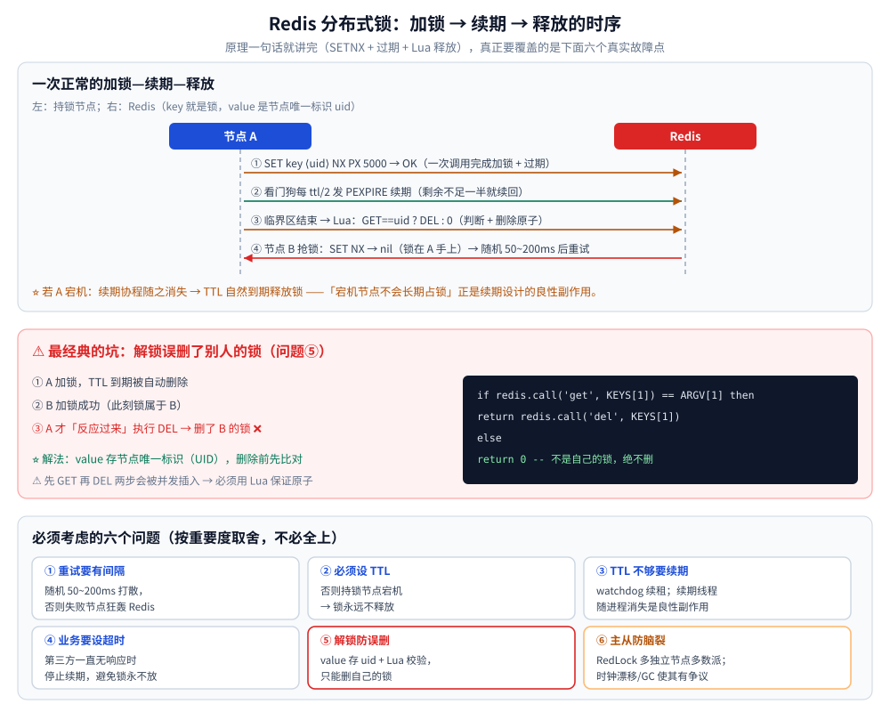
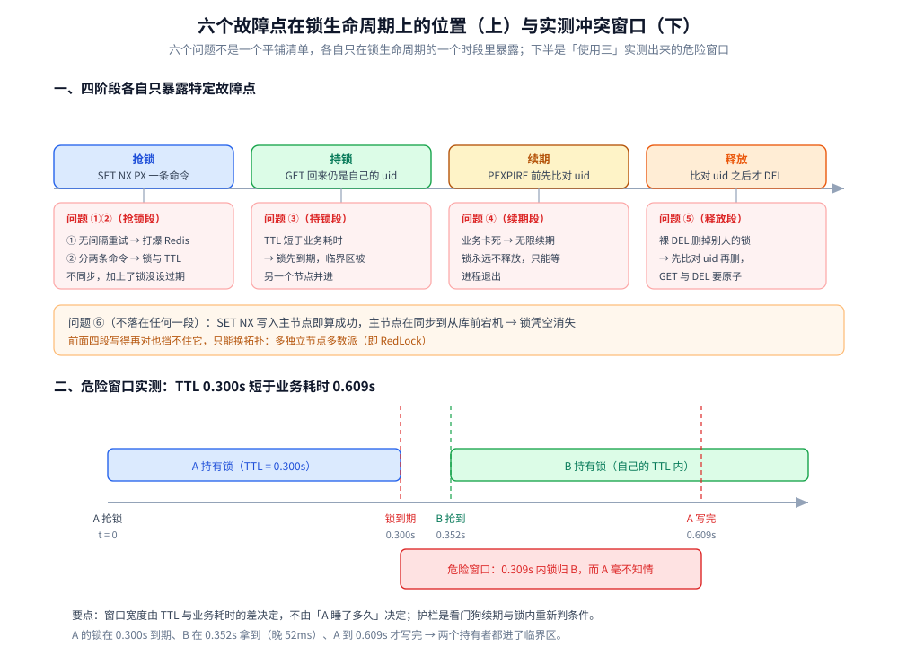

# Redis 分布式锁

> SetNX + 过期 + Lua 释放的实现原理、六个真实故障点各自卡在锁生命周期的哪一刻，以及「什么时候该上锁、什么时候别上」的落地判据（含 Go 手写与 Java Redisson 两条路线）。
>
> 内容整理自个人学习笔记，并参考《Redis 设计与实现》（黄健宏）的对应章节；参考资料与原始素材见 [素材清单](../../../../素材清单.md)。
>
> 实测环境：「使用三」一节的读数来自本机容器 `redis:7-alpine`（`redis-server v=7.4.11`、`build=fbf7a7d03c2e9219`，宿主端口 14379，客户端 `redis-cli 7.4.11`），三类实验各连跑 3 轮；Go / Java 两段代码只做了 `gofmt` / `go vet` / `go build` 这类静态检查，**未跑集成测试**。

---

## 一、Redis 分布式锁如何实现？需要考虑哪些问题？

**本节要点**：这是 Redis 设计里**区分度最高**的一块。原理一句话就讲完，"需要考虑哪些问题"才是关键。

### 加锁与解锁原理

**为什么用 `SETNX` 而不是 `SET`？**
- `SET` 是**覆盖写**，多个节点同时执行都会成功，谁最后写谁生效 → 无法互斥；
- `SETNX` 是 **"key 不存在时才写入"**，多个节点并发调用**只有一个能成功** → 天然实现互斥。

```go
ok, err := rdb.SetNX(ctx, lockKey, nodeUID, expire).Result()
```

解锁更简单：**删掉这个 key**。
但正因为"解锁 = 删 key"这条链路太简单，才引出了下面 6 个必须考虑的问题。

### 必须考虑的 6 个问题（逐条对应真实故障）

**① 加锁失败时的重试要"有间隔"**
加锁失败的节点必然要不断重试。如果**无间隔**地狂请求 Redis，会白白浪费 Redis 资源（自己打自己）。
→ 用**随机等待**打散，例如 50ms ~ 200ms（甚至 500ms），让请求错开。

**② 必须设置过期时间（`TTL`）**
不设 TTL 的风险：**持锁节点宕机，锁永远不释放**，所有其他节点全部阻塞。
→ 加锁时就要带上过期时间。

**③ 过期时间不够用，需要"续期"（watchdog）**
问题：TTL 到了但业务还没处理完，锁自动释放，**别的节点进来了** → 临界区被并发进入。
→ 后台启动一个**续期线程/协程**，定时检查：剩余时间小于阈值（如 TTL 的一半）就重新续到 5s / 10s。
→ **关键副作用**：如果节点异常退出，续期线程也随之消失，TTL 自然到期释放锁——
这恰好**避免了宕机节点长期占锁**，是个"良性副作用"。

**④ 有必要时设置"业务超时时间"，避免无限续期**
如果调用第三方资源一直无响应，续期会一直续下去，锁永远不放。
→ 设置整体超时（通常 30s 或 60s，不需要太长），超时后**停止续期并自动解锁**。

**⑤ 解锁要防止"误删别人的锁"⚠️ 最经典的坑**

时序：
1. 节点 A 加锁，TTL 到期自动删除；
2. 节点 B 加锁成功；
3. 此时 A 的业务"反应过来了"，执行 `DEL key` → **把 B 的锁删掉了**。

→ 解法：**value 存节点唯一标识（UUID）**，删除前先校验：

```lua
-- 用 Lua 保证"判断 + 删除"的原子性
if redis.call('get', KEYS[1]) == ARGV[1] then
    return redis.call('del', KEYS[1])
else
    return 0
end
```

**⑥ 主从架构下的锁失效 → 需要 RedLock（防脑裂）**

故障场景：
- 锁**写入主节点**，但客户端可能**从从节点读**——A 在主节点加锁成功，B 访问从节点发现"没这个锁"，加锁也成功了；
- 更严重：主节点**在数据同步到从节点之前宕机**，新晋升的主节点没有这把锁 → 其他节点可以加锁成功，
  **同一段临界区逻辑被多个节点并发执行**。

→ 解法：**RedLock**——向多个**相互独立**的 Redis 节点申请锁，**多数节点成功**才认为加锁成功。
概率虽低但确实存在，属于必须知道的进阶点。

### 一句话总结

Redis 分布式锁，**加锁用 `SETNX` + 过期时间，解锁用"校验 UID 后删除"**；
真正要覆盖的是六个问题：**重试防打爆 Redis、必须设 TTL、TTL 不够要续期、业务要设超时**、
**解锁防误删、主从要防脑裂**。这六个问题不一定要全部解决，按业务重要程度取舍。



---

## 二、六个故障点分别卡在锁生命周期的哪一刻？

**本节要点**：六个问题不是一个平铺的清单，它们各自只在锁生命周期的**一个时段**里才会暴露。先把生命周期切成四段、把故障点挂到对应的段上，再谈「要不要解决、先解决哪个」。

### 2.1 一条锁命的四个阶段

| 阶段 | 时间坐标 | 这一段的判据 | 挂在这一段的故障 |
|---|---|---|---|
| ① 抢锁 | 调用 `SET NX PX` → 拿到 `OK` | 加锁与设 TTL 必须是**同一条命令** | 问题①（重试无间隔）、问题②（写成 `SETNX` + `EXPIRE` 两条） |
| ② 持锁 | 拿到 `OK` → 业务返回 | `GET` 回来仍是自己的 uid | 问题③（TTL 短于业务耗时） |
| ③ 续期 | 持锁期内周期性触发 | `GET` 比对通过才 `PEXPIRE` | 问题④（业务卡死 → 无限续期） |
| ④ 释放 | 业务返回 → 删掉 key | 比对 uid 之后才删 | 问题⑤（删掉别人的锁） |

**问题⑥（主从切换丢锁）不落在任何一段**：它发生在**节点层面**——`SET NX` 写入主节点的那一刻就已经「成功」了，而从库此时还没有这条 key；主节点在同步到从库之前宕机，锁就凭空消失。前面四段写得再对也挡不住它，只能换拓扑（多独立节点多数派）。

### 2.2 危险窗口有多宽：把故障点钉到时间轴上

下图上半是「四阶段 + 六个故障点」的定位，下半是「使用三」实测出来的那条**危险窗口**：A 用 `PX 300` 抢到锁、业务却跑了 600ms，A 的锁在 0.300s 到期，B 在 0.352s 抢到同一把锁，A 直到 0.609s 才写完——两个持有者都进了临界区。



⭐ **窗口的宽度不由「A 睡了多久」决定，而由 `TTL` 与业务耗时的差决定**：`TTL` 一旦短于业务耗时，从 TTL 到点那一刻起锁就不再属于 A，而 A 自己毫不知情——唯一的护栏是 **watchdog 续期**（问题③）与**锁内重新判业务条件**。

### 2.3 落地判据：什么时候该上锁、什么时候别上

**该上锁**：**多实例 / 多进程共享同一个外部资源**（同一行库存记录、同一个第三方账号额度、同一份文件），并且**能容忍极低概率的失效**（下游有幂等兜底）。

**不该上锁**——下面四种场景都有比「加一把 Redis 锁」更便宜、也更可靠的做法：

| 场景 | 为什么不该用 Redis 锁 | 更该用什么 |
|---|---|---|
| 单机内多协程 / 多线程互斥 | 一个进程内就能挡住，绕 Redis 只多一次 RTT 与一个故障源 | `sync.Mutex` / `ReentrantLock` |
| 能靠唯一约束**判定**的写 | 「同一订单只能有一条记录」是判定，唯一索引比锁更可靠（锁会失效，约束不会） | 唯一索引 + `INSERT` 冲突处理（见 [乐观锁与悲观锁.md](../../并发控制/乐观锁与悲观锁.md) 第三节） |
| 跨服务的「要么都成功」 | 锁只提供**互斥**，不提供原子提交与回滚 | 事务 / 补偿（见 [README.md](../../../../04-架构与系统/分布式/分布式事务/README.md)） |
| 只是「防重复提交 / 削峰」 | 幂等键与限流不会因锁失效而破坏正确性，成本也更低 | 幂等键、限流、队列 |

⭐ 一句判据：**锁是「大多数时候能避免并发」的优化手段，不是「保证串行」的正确性保证**——真正不能并发的动作（扣款、发券）下游必须有幂等或唯一约束兜底；场景视角的展开见 [缓存应用场景.md](../../缓存/缓存应用场景.md) 第二节。

⚠️ 最容易被忽略的一条：**锁只保护临界区，不保护业务边界**。拿到锁之后，业务条件必须在锁内**重新判一次**（如库存 `> 0`），否则「TTL 到点 + 没重判」照样超卖——秒杀侧的实测见 [库存系统设计.md](../../../../04-架构与系统/系统设计/秒杀系统/库存系统设计.md) 第四节。

---

## 使用一：Go（把 6 个问题逐个写进代码）⭐

> 前置：`redis.Client` 内部是连接池，**全进程共用一个实例**（`sync.OnceValue`），理由见 [缓存问题与方案.md](../../缓存/缓存问题与方案.md) 使用一的「前置：中间件实例必须是单例」。
> 校验说明：以下 Go 代码在 `go-redis v9.22` 下 `go build` + `go vet` + `gofmt` 通过；**未做集成测试**——其中用到的 `SET NX PX`、Lua 比对-删除等命令语义，由「使用三」的容器实测覆盖。

### 1. 分布式锁：把第一节的 6 个问题逐个写进代码

```go
package redlock

import (
	"context"
	"crypto/rand"
	"encoding/hex"
	"errors"
	mrand "math/rand"
	"time"

	"github.com/redis/go-redis/v9"
)

// ErrLockBusy 表示在给定等待时间内没抢到锁。
var ErrLockBusy = errors.New("redlock: lock busy")

// 解锁脚本：value 校验 + 删除必须原子（第一节问题⑤，防误删别人的锁）
var unlockScript = redis.NewScript(`
if redis.call('GET', KEYS[1]) == ARGV[1] then
	return redis.call('DEL', KEYS[1])
end
return 0`)

// 续期脚本：同样要先确认锁还在自己手上，否则会给别人的锁续命
var renewScript = redis.NewScript(`
if redis.call('GET', KEYS[1]) == ARGV[1] then
	return redis.call('PEXPIRE', KEYS[1], ARGV[2])
end
return 0`)

type Lock struct {
	rdb     *redis.Client
	key     string
	value   string // 节点唯一标识，解锁时校验
	ttl     time.Duration
	maxHold time.Duration // 业务总超时（第一节问题④），到点停止续期
	stop    chan struct{}
}

func newValue() string {
	b := make([]byte, 16)
	_, _ = rand.Read(b)
	return hex.EncodeToString(b)
}

// TryLock 抢锁：SET NX PX + 随机间隔重试。
// wait 为总等待时间，超过返回 ErrLockBusy；ttl 是单次持锁时间。
func TryLock(ctx context.Context, rdb *redis.Client, key string, ttl, wait time.Duration) (*Lock, error) {
	l := &Lock{rdb: rdb, key: key, value: newValue(), ttl: ttl, maxHold: 60 * time.Second, stop: make(chan struct{})}
	deadline := time.Now().Add(wait)
	for {
		// 一次调用就完成 SET NX PX，避免"加成功但没设上过期"的中间态（第一节问题②）
		ok, err := rdb.SetNX(ctx, key, l.value, ttl).Result()
		if err != nil {
			return nil, err
		}
		if ok {
			go l.watchdog()
			return l, nil
		}
		delay := retryDelay()
		if time.Now().Add(delay).After(deadline) {
			return nil, ErrLockBusy
		}
		// 随机等待，避免所有失败节点同频狂轰 Redis（第一节问题①）
		time.Sleep(delay)
	}
}

func retryDelay() time.Duration {
	return time.Duration(50+mrand.Int63n(150)) * time.Millisecond
}

// watchdog 在剩余时间不足一半时续期（第一节问题③）。
// 进程异常退出 → 续期协程消失 → TTL 自然到期，锁不会被宕机节点长期占用。
func (l *Lock) watchdog() {
	interval := l.ttl / 2
	ticker := time.NewTicker(interval)
	defer ticker.Stop()

	renewCtx, cancel := context.WithTimeout(context.Background(), l.maxHold)
	defer cancel()

	for {
		select {
		case <-l.stop:
			return
		case <-renewCtx.Done(): // 问题④：业务卡死时不再无限续期，让锁按 TTL 过期
			return
		case <-ticker.C:
			// 续期不能复用请求的 ctx：请求 ctx 可能已被 cancel，而锁仍需要维护
			c := context.Background()
			if n, err := renewScript.Run(c, l.rdb, []string{l.key}, l.value, l.ttl.Milliseconds()).Int64(); err != nil || n == 0 {
				return // 锁已丢失（过期或被别人拿走），继续续期没有意义
			}
		}
	}
}

func (l *Lock) Unlock(ctx context.Context) error {
	close(l.stop) // 先停续期，再删锁，避免删完又被续期脚本"复活"别人的锁
	return unlockScript.Run(ctx, l.rdb, []string{l.key}, l.value).Err()
}
```

使用：

```go
lock, err := redlock.TryLock(ctx, cachePool.Client(), "lock:order:"+orderID, 5*time.Second, 3*time.Second)
if errors.Is(err, redlock.ErrLockBusy) {
	return nil // 抢不到就放弃，让上游重试或返回"操作太频繁"
}
if err != nil {
	return err
}
defer lock.Unlock(context.Background()) // ⚠️ 用 Background，别用可能已取消的请求 ctx
// ... 临界区业务 ...
```

**这段实现没有解决的问题**：主从切换导致的丢锁（第一节问题⑥）。单实例锁在"主节点写入后、同步到从节点前宕机"时必然丢，**不要自己写 RedLock**，直接用 `github.com/go-redsync/redsync/v4` 的 `redisgoredisv8pool`（多独立节点 + 多数派）；同时接受它的代价——**QPS 下降、运维要维护 N 个独立实例、GC/时钟偏斜会影响正确性**。库存扣减这类强需求更适合改成"数据库唯一约束 + 状态机"来兜底，而不是把正确性压在锁上。

## 使用二：Java（Redisson 的现成实现）

### 1. Redisson：第一节六个问题的现成实现

Redisson 的 `RLock` 已经把「SET NX + 唯一标识 + Lua 原子解锁 + 看门狗续期」全做了，**生产环境优先用它而不是手写**：

```java
@Service
public class StockLockService {

    private final RedissonClient redisson;

    public StockLockService(RedissonClient redisson) {
        this.redisson = redisson;
    }

    public void deduct(String orderNo) throws InterruptedException {
        RLock lock = redisson.getLock("lock:stock:" + orderNo);
        // waitTime：抢不到最多等 3s（对应第一节问题①的重试与放弃）
        // leaseTime：显式给 10s —— 关键取舍，见下方说明
        if (!lock.tryLock(3, 10, TimeUnit.SECONDS)) {
            throw new BizException("操作太频繁，请稍后重试");
        }
        try {
            doDeduct(orderNo);
        } finally {
            if (lock.isHeldByCurrentThread()) { // 防止误删别人的锁（第一节问题⑤）
                lock.unlock();
            }
        }
    }

    private void doDeduct(String orderNo) {
        // 真正的扣减：UPDATE stock SET n = n - 1 WHERE n > 0，靠行锁 + 条件保证不超卖（见 [淘汰策略.md](淘汰策略.md)）
    }
}
```

**`leaseTime` 到底给不给（Redisson 最容易踩的点）**：

| 写法 | 行为 | 后果 |
|---|---|---|
| `lock()` 或 `tryLock(waitTime, unit)`（**不给 leaseTime**） | 启用**看门狗**，默认每 `30/3 = 10s` 续期一次，锁续到 30s | 业务卡死时锁被无限续（第一节问题④），只能靠进程退出才释放 |
| `tryLock(waitTime, leaseTime, unit)`（**给了 leaseTime**） | **不启**看门狗，到点无条件释放 | 业务没跑完锁先没了 → 临界区被并发进入（第一节问题③） |

所以「给 leaseTime」和「靠看门狗」是互斥的两种取舍：leaseTime 必须**明显大于 P99 业务耗时**，否则就交给看门狗并接受"卡死不释放"。

多节点 RedLock（第一节问题⑥）对应 `RedissonRedLock`（把多个独立节点的 `RLock` 合成一把）——但 RedLock 存在争议（时钟漂移、节点重启导致的安全窗口），**能用数据库约束保证正确性就别依赖它**。

---

## 使用三：三类故障在真实实例上复现（redis-cli 实测）

> 环境：容器 `redis:7-alpine`，`redis-server v=7.4.11`、`build=fbf7a7d03c2e9219`，宿主端口 14379，客户端 `redis-cli 7.4.11`；并发抢占用 10 个真实 `redis-cli` 进程，三类实验各连跑 3 轮。原始输出见 `.workbuddy/tmp/round495/w9c_e5_lock_race.txt`、`w9c_e6_lock_del.txt`、`w9c_e7_lock_stale.txt`。
> 同一现象在更大并发规模（50 实例）下的读数、以及「该不该自己写锁」的场景判据见 [缓存应用场景.md](../../缓存/缓存应用场景.md) 第二节；本节只补**命令级原文**与**冲突窗口的实际宽度**。

### 1. `SET NX PX` 的竞争：10 个客户端只有 1 个拿到

| 轮次 | 拿到 `OK` 的客户端 | 其余 9 个的返回 | 胜者 `GET` | 胜者 `PTTL` |
|---|---|---|---|---|
| 第 1 轮 | client4 | 空（nil） | `uid-4` | 4985 ms |
| 第 2 轮 | client1 | 空（nil） | `uid-1` | 4983 ms |
| 第 3 轮 | client1 | 空（nil） | `uid-1` | 4986 ms |

**对照组**：同一个 key 换成不带 `NX` 的裸 `SET`，10 个客户端**全部返回 `OK`**，最终值是最后写入者的 `uid-9`——「互斥」完全来自 `NX` 这个原子条件，不来自命令的并发调度。

### 2. 释放：裸 `DEL` 会删掉别人的锁

| 步骤 | 命令 | 实测返回 |
|---|---|---|
| A 抢锁 | `SET lock:x uid-A NX PX 300` | `OK`（`PTTL` 297 ms） |
| 等 1s 后再看 | `GET lock:x` | 空——A 的锁已被 TTL 清掉 |
| B 抢锁 | `SET lock:x uid-B NX PX 5000` | `OK`（`PTTL` 4969 ms） |
| A 用裸 `DEL` 释放 | `DEL lock:x` | `1` |
| 再 `GET` 一次 | `GET lock:x` | 空——**B 的锁被 A 删掉了** ❌ |

把最后两步换成 Lua 比对-删除，同一场景下 A 的脚本返回 `0`、`GET lock:x` 仍是 `uid-B`；由 B 自己执行时返回 `1`、key 被正常删掉。⚠️ 判据在**返回值的语义**：Lua 返回 `0` 是「比对未通过、没删」，不是「失败」，监控里别当错误。

### 3. 锁过期后旧持有者继续写：窗口从 0.352s 到 0.609s

脚本按真实时序跑：A 抢到 `PX 300` 的锁后**睡 600ms** 再写临界区，B 在 350ms 后开始抢锁。连跑 3 轮，`counter` 三轮都是 `2`：

| 轮次 | A 抢锁 | B 抢锁 | B 写 `counter` | A 写 `counter` | 结果 |
|---|---|---|---|---|---|
| 第 1 轮 | 606.952 | 607.304 | → 1 | → 2 | `counter = 2` |
| 第 2 轮 | 607.599 | 607.952 | → 1 | → 2 | `counter = 2` |
| 第 3 轮 | 608.267 | 608.618 | → 1 | → 2 | `counter = 2` |

（时间列为 `redis-cli TIME` 的 `秒.微秒` 去掉公共前缀；三轮里 B 都是**一次抢到、重试 0 次**。）

**读出来的三个数**：TTL 设 0.300s，B 在 0.352s 拿到锁（比 A 的到期点晚 52ms），A 在 0.609s 才写完——**从 A 的锁失效到 A 自己写完，中间这 0.309s 里锁归别人**，而 A 毫不知情。A 最后那次裸 `DEL` 返回 `0`（锁已被 B 释放），但 `counter` 已经被加了两次。

### 4. 三类故障的暴露条件

| 故障 | 触发条件 | 实测证据 | 代价 |
|---|---|---|---|
| 竞争不互斥 | 用 `SET` 而不是 `SET NX` | 10/10 全部 `OK` | 互斥失效 |
| 释放误删 | TTL 短于业务耗时 + 用裸 `DEL` 释放 | `DEL` 返回 `1`、B 的锁消失 | 互斥失效 |
| 旧持有者越界写 | TTL 短于业务耗时 + 无续期 + 锁内不重判 | `counter = 2`（3/3 轮） | 业务重复执行 |

⭐ 三者的**共同前提**都是「TTL 短于业务耗时」——盯住这一个量，第 2、3 类会同时被压住；「重试间隔」与「主从切换」才是另外两条独立的线。

---


## 延伸追问

- **锁过期了但业务没跑完怎么办？** → watchdog 续期（Redisson 默认按 1/3 租期续一次）；⚠️ 但续期进程自己挂了就退化成「锁提前释放」，所以业务侧仍要有幂等兜底。
- **主从切换会不会丢锁？** → 会：主节点写入后、同步到从库前宕机，新主没有这条 key。单实例锁**必然**有这个窗口；要更强的保证得用多独立节点的多数派（RedLock）并接受其代价。
- **为什么不建议自己写 RedLock？** → 时钟漂移、GC 停顿、网络延迟都会破坏它的假设；用成熟实现（如 `redsync`）并接受 QPS 下降。
- **锁能替代事务吗？** → 不能。锁只解决**互斥**，不解决原子提交与回滚；跨服务的「要么都成功」仍要靠事务或补偿（见 [README.md](../../../../04-架构与系统/分布式/分布式事务/README.md)）。
- **怎么避免误删别人的锁？** → value 存唯一标识 + Lua 里「比对后再删」；分两步（先 get 再 del）中间会被并发插入。
- **拿不到锁该重试还是直接失败？** → 按业务语义定：强要求成功（如支付回调）用有限退避重试；弱要求（如防重复点击）直接返回失败反而更快。
- **什么时候该上锁、什么时候别上？** → 只有「多实例共享同一个外部资源 + 能容忍极低概率失效」才值得上锁；单机互斥用进程内锁、能靠唯一约束判定的写用约束、跨服务的「要么都成功」用事务或补偿（第二节的落地判据）。
- **六个故障点里哪几个最常一起出问题？** → 「TTL 短于业务耗时」一个量会同时引爆问题③与问题⑤：实测 A 的锁在 0.300s 到期、B 在 0.352s 抢到、A 到 0.609s 才写完，`counter` 被加了两次（「使用三」第 3 小节）。

## 关联

- [缓存问题与方案.md](../../缓存/缓存问题与方案.md) — 含「中间件实例必须单例」的前置说明与缓存三件套封装
- [缓存应用场景.md](../../缓存/缓存应用场景.md) — 同一批故障点的场景视角：50 并发竞争、释放误删必现，以及「该不该自己写锁」的判据
- [库存系统设计.md](../../../../04-架构与系统/系统设计/秒杀系统/库存系统设计.md) — TTL 定错导致超卖的秒杀侧实测，与「锁内重新判业务条件」
- [Nacos.md](../../../中间件/注册与配置中心/Nacos.md) — 分布式锁之外的分布式协调（选主、配置）
- [README.md](../../../../04-架构与系统/分布式/分布式事务/README.md) — 跨服务一致性，锁之外的另一条路
- [CAP与PACELC.md](../../../../04-架构与系统/分布式/理论基础/CAP与PACELC.md) — 「主从切换丢锁」的本质：故障期间用一致性换可用性
- [Raft协议.md](../../../../04-架构与系统/分布式/共识协议/Raft协议.md) — RedLock 的「多数派」为什么不等价于共识算法
- [乐观锁与悲观锁.md](../../并发控制/乐观锁与悲观锁.md) — 单机侧的乐观锁/悲观锁对照

> 反向引用（本篇被下列文档引到）：[标准库实现.md](../../../../01-编程语言/go/工程实践/定时任务/标准库实现.md)、[分布式协调选型对比.md](../../../中间件/分布式协调/分布式协调选型对比.md)、[客户端使用.md](客户端使用.md)、[底层结构.md](底层结构.md)、[InnoDB的并发控制实现.md](../../关系型/MySQL/InnoDB的并发控制实现.md)、[热点数据存储.md](../../存储架构与场景/横切篇/热点数据存储.md)、[死锁原理与防治.md](../../并发控制/死锁原理与防治.md)、[缓存选型对比.md](../../缓存/缓存选型对比.md)、[2PC与3PC.md](../../../../04-架构与系统/分布式/分布式事务/2PC与3PC.md)、[一致性模型.md](../../../../04-架构与系统/分布式/理论基础/一致性模型.md)、[时钟与顺序.md](../../../../04-架构与系统/分布式/理论基础/时钟与顺序.md)、[集群基础.md](../../../../04-架构与系统/分布式/集群基础.md)、[优惠券系统设计.md](../../../../04-架构与系统/系统设计/秒杀系统/优惠券系统设计.md)、[总体设计.md](../../../../04-架构与系统/系统设计/秒杀系统/总体设计.md)、[秒杀骨架.md](../../../../04-架构与系统/系统设计/秒杀系统/秒杀骨架.md)
