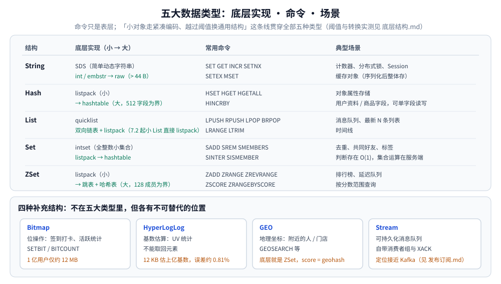
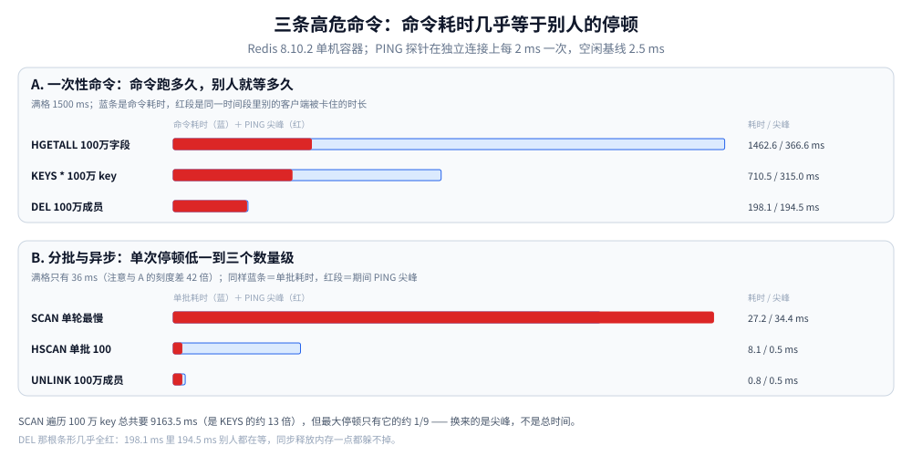
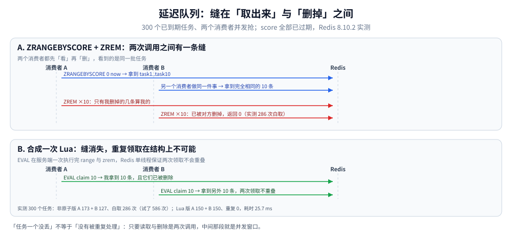
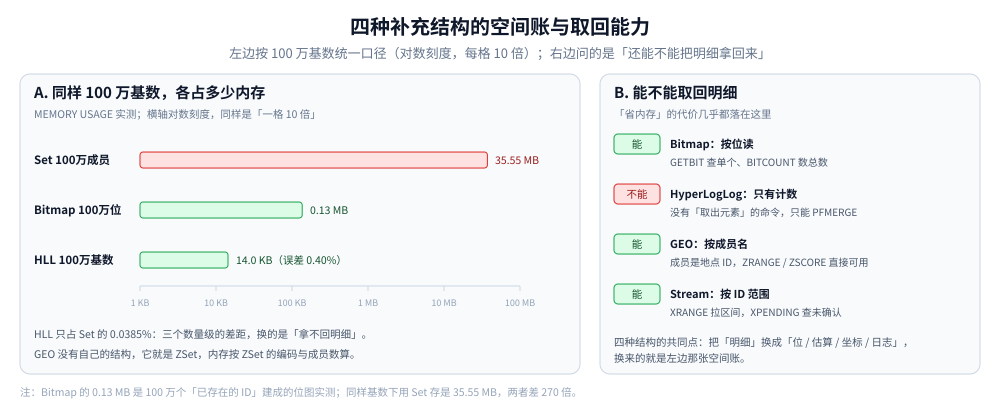
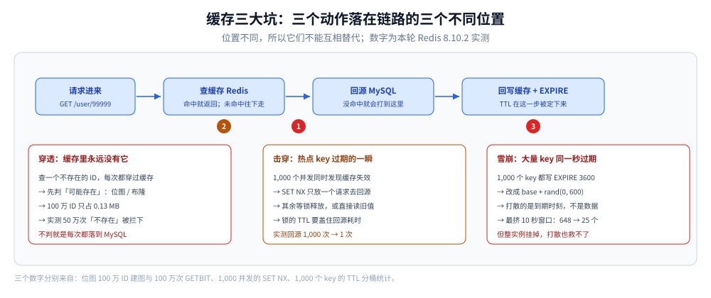

# Redis 数据类型与命令

> 五种基本类型、四种补充结构、两种 8.x 新类型，回答的是同一个问题：**同一个业务问题，**
> **用哪个结构、哪几条命令、按什么顺序组合才不出事**。底层编码（listpack / intset / 跳表 / 渐进式 rehash）的
> 「为什么」见 [底层结构.md](底层结构.md)，命令在 Go / Java 里的调用形态见 [客户端使用.md](客户端使用.md)。
>
> 实测口径：`redis:8-alpine`（8.10.2）单机单线程，跑在本机 18379 端口；客户端是自写的 RESP 实现
> （Go，零依赖），每轮实验前 `FLUSHALL` 重建数据集。所有「主线程被卡住」的数字来自**另一条**
> **连接每 2 ms 发一次 `PING`** 观测到的最大往返（空闲基线 2.5 ms）——不是猜的，也不是抄的。

---

## 一、全景与选型：先看总表，再回答三个问题

**本节要点**：选型不是背「五种类型的场景」，而是先回答三个问题——**按什么维度访问、**
**基数多大、要不要确认**。答案唯一确定结构，命令只是结果。

### 1.1 五种基本类型

| 结构 | 底层编码（小 → 大） | 常用命令 | 典型业务 | 越界后的代价 |
|---|---|---|---|---|
| **String** | int / embstr → raw | `SET` `GET` `INCR` `SETNX` `SETEX` `MSET` | 计数、锁、Session、缓存对象 | 单值上限 512 MB；改一个字段要整串读改写 |
| **Hash** | listpack → hashtable | `HSET` `HGET` `HINCRBY` `HSCAN` `HEXPIRE` | 对象字段、购物车、画像 | 大 hash 不能整取（`HGETALL`）；不能按值排序 |
| **List** | listpack → quicklist | `LPUSH` `RPUSH` `BRPOP` `BLMOVE` `LRANGE` `LTRIM` | 队列、最新 N 条、时间线 | 中间插入 O(N)；没有 ACK |
| **Set** | intset → listpack → hashtable | `SADD` `SISMEMBER` `SINTER` `SSCAN` `SUNIONCARD` | 去重、交并差、标签 | 不能按分数排；`SMEMBERS` 大集合阻塞 |
| **ZSet** | listpack → skiplist + dict | `ZADD` `ZINCRBY` `ZREVRANGE` `ZREVRANK` `ZRANGEBYSCORE` | 排行榜、延迟队列、范围查询 | 大集合内存翻倍（跳表与字典各存一份） |



图里第二列是关键：同一种「小对象走紧凑编码、越过阈值换通用结构」的规律贯穿全部五种类型，所以
`OBJECT ENCODING key` 永远比「我用的是 Hash」更有信息量——它才告诉你这条命令的真实代价。

### 1.2 四种补充结构（不是新类型，是同一段内存的另一种解释）

| 结构 | 实际底层 | 一条命令看清 | 只在什么场合划算 | 代价 |
|---|---|---|---|---|
| **Bitmap** | String（SDS 位数组） | `OBJECT ENCODING sign:202610` → `raw` | 连续 ID 的布尔位：签到、活跃 | ID 必须连续，稀疏 id 要先映射 |
| **HyperLogLog** | String（稠密 / 稀疏编码） | `PFCOUNT uv:page:1` | 千万级 UV 去重计数 | 拿不回元素，标准误差 0.81% |
| **GEO** | ZSet | `TYPE geo:shop` → `zset` | 半径 / 矩形范围查询 | 精度绑 geohash；集合大小受 ZSet 编码影响 |
| **Stream** | listpack / rax | `XINFO STREAM order:events` | 要 ACK 与消费组的队列 | 单 key 单线程，无分区，不能水平切 |

### 1.3 8.x 新增的两种

| 结构 | 版本 | 内部形态 | 一条命令看形态 | 补的是什么空白 |
|---|---|---|---|---|
| **Array** | 8.8（preview） | 目录 + 4096 槽分片（`sliced-array`） | `ARINFO arr:qps` | 整数下标 → 值，**按下标寻址**且稀疏不占中间槽位 |
| **Compact Hash** | 8.10 | 模板 listpack（`template-listpack`） | `INFO STATS` 的 `hash_templates` | 同构 hash 的**字段名只存一份** |

### 1.4 三个问题定结构

1. **按什么维度访问？** 按键 → String / Hash；按字段 → Hash；按下标 → Array；按两端顺序 → List；
   按分数或范围 → ZSet；按集合关系 → Set。
2. **基数多大、能不能接受近似？** 要精确 → Set / Bitmap；只要数量 → HyperLogLog（0.81%）；
   只要「在不在」→ Bitmap 或布隆过滤器。
3. **要不要确认？** 不要 → `LPUSH` + `BRPOP`；要 ACK 与重投 → Stream；要跨机房、重试、死信 →
   专业 MQ（对比见 [发布订阅.md](发布订阅.md) 第一节）。

三个问题里**第三个最容易被跳过**，而它恰恰是「上线三天后发现丢消息」的唯一根因。

---

## 二、生产环境的四条高危写法

**本节要点**：这几条命令的代价不在**总耗时**，在**最大停顿**——Redis 单线程，停顿多久，
全站就超时多久。所以下面每组都同时给两个数：命令本身多慢，以及期间别的客户端被卡多久。

### 2.1 `KEYS *`：遍历全库，把单线程按在地上

100 万个 key 的实例上（本机同一个容器，装载耗时 3,268.9 ms）：

```text
[KEYS *] 返回 1000000 个 key，耗时 710.5 ms
[KEYS *] 期间另一个连接的 PING：105 次，最慢 315.0 ms（空闲基线 2.5 ms）
```

710.5 ms 只是这一条命令的执行时间；**315.0 ms 才是别人的灾难**——那 105 次 `PING` 里最慢的一次
等了 315 ms，也就是说这 315 ms 内所有业务请求都在排队。线上体感就是「Redis 假死」。

换成游标式遍历：

```text
[SCAN COUNT 100] 遍历完 1000000 个 key：9953 轮，总耗时 9163.5 ms，单轮最慢 27.2 ms
[SCAN] 期间 PING：2763 次，最慢 34.4 ms
```

⭐ **SCAN 不是让事情变快，是让停顿变短**：总耗时从 710.5 ms 涨到 9,163.5 ms（约 13 倍），
但最大停顿从 315.0 ms 压到 34.4 ms（约 1/9）。这是拿「总时间」换「尖峰」，方向别记反了。

两个细节：

- `COUNT 100` 是**提示不是保证**：实测 100 万个 key 走了 9,953 轮，平均约 100 个/轮，但每轮数量会浮动。
- 集群版要**对每个节点单独 `SCAN`**，`CLUSTER COUNTKEYSINSLOT` 之类只能给计数，拿不到 key。

### 2.2 `HGETALL` / `SMEMBERS` / `LRANGE key 0 -1`：一次性把大 key 搬回客户端

100 万个字段的 Hash（`MEMORY USAGE` = 60,388,695 B ≈ 57.6 MB）：

```text
[HGETALL] 返回 2000000 个元素、约 28.6 MB，耗时 1462.6 ms
[HGETALL] 期间 PING 最慢 366.6 ms

[HSCAN COUNT 100] 取 1000 个字段：8.1 ms，单批最慢 1.3 ms（HGETALL 的 1%）
[HSCAN] 期间 PING 最慢 0.548 ms
```

三个数字要分开看：

- **1,462.6 ms** 是服务端把 200 万个元素塞进回复缓冲的时间，全程占着主线程；
- **28.6 MB** 只是**网络字节**。客户端还要为它建 200 万个字符串对象，Go 侧一次 `HGETALL` 的
  峰值堆占用通常是这个数的 2~3 倍——**客户端 OOM 往往先于服务端超时发生**；
- **366.6 ms** 的 `PING` 尖峰说明这期间别的请求同样在排队。

`HGETALL` 的问题不是「慢」，是**它没有上限**：字段数由业务决定，不由你决定。

### 2.3 `DEL` 大 key：同步释放，一个都跑不掉

100 万个成员的 Set（`MEMORY USAGE` = 41,388,688 B ≈ 39.5 MB）：

```text
[DEL]    耗时 198.1 ms（期间 PING 最慢 194.5 ms）
[UNLINK] 耗时 0.762 ms（期间 PING 最慢 0.548 ms）
```

**198.1 ms 对 0.762 ms，差 260 倍**。`DEL` 要在主线程里逐个释放 100 万个成员的 dictEntry 与 SDS，
释放不完不返回；`UNLINK` 只把 key 从键空间摘掉，真正的内存在后台 BIO 线程里还。

后台释放的进度（`UNLINK` 之后立刻连查四次 `used_memory`）：

```text
+0ms    used_memory = 40.0 MB    lazyfree_pending_objects = 1
+50ms   used_memory = 28.6 MB
+100ms  used_memory = 17.3 MB
+150ms  used_memory =  2.57 MB   lazyfree_pending_objects = 0  lazyfreed_objects = 1000012
```

⭐ 所以 `UNLINK` 换来的是「**命令立刻返回**」，不是「内存立刻还给操作系统」——150 ms 内它一直在
后台释放。这段窗口里 `maxmemory` 的判断仍然把这块内存算在内，**内存打满时的 `UNLINK` 救不了你**，
该淘汰还得靠 [淘汰策略.md](淘汰策略.md)。

另外 `lazyfree-lazy-user-del yes` 可以让 `DEL` 也走异步；但显式写 `UNLINK` 比改全局配置更可控，
毕竟不是所有 `DEL` 都想异步。

### 2.4 先找到大 key，再谈治理

四类各造一个大 key（Hash 10 万字段、Set 20 万成员、String 1 MB、List 5 万项）后扫描：

```text
$ redis-cli --bigkeys
Sampled 4 keys in the keyspace!
Biggest   list found "big:list" has 50000 items
Biggest   hash found "big:hash" has 100000 fields
Biggest string found "big:str" has 1048576 bytes
Biggest    set found "big:set" has 200000 members

$ redis-cli --memkeys
Biggest    set found "big:set" has 8034705 bytes
1 hashs with 4461842 bytes (25.00% of keys)
1 strings with 1310746 bytes (25.00% of keys)
1 lists with 542071 bytes (25.00% of keys)
```

两个命令的口径不同，结论也可能不同：

| 命令 | 排序依据 | 本例结论 | 什么时候用 |
|---|---|---|---|
| `--bigkeys` | 元素个数 / 字节数（String） | Set 20 万成员最大 | 找「元素太多导致一次取回爆掉」的 key |
| `--memkeys` | `MEMORY USAGE` 字节 | Set 8.03 MB 最大 | 找「占内存」的 key |

本例两者结论一致，但完全可以不一致：5 万个**超长字符串**的 List，元素数排不上号，字节数却可能是
第一名。**「大 key」这个词本身就是两个维度，问的时候要说清是哪个。**

⚠️ 两个命令都基于 `SCAN` 采样（`COUNT 100`），报的是「**采样到的最大的**」，不是全局最大。
keyspace 很大时要多跑几遍，或者在从库上跑——它们同样会占主线程。



图里左边是命令自己的耗时，右边是别人被卡住的时间：`KEYS *` 与 `HGETALL` 两条几乎一样长，
说明**阻塞时长约等于命令耗时**；而 `SCAN` 与 `UNLINK` 两根柱子已经短到看不出，它们的差别在
「单次停顿」而不是「总量」。

---

## 三、五种基本类型落成四类业务模型

**本节要点**：同一个类型能撑起完全不同的模型，差别不在命令，在**谁来做判断、判断与操作是否原子**。
下面四个模型踩的坑，全都出在「读一下、判一下、再写一下」这三步之间的空档里。

### 3.1 分布式锁：String 的四代写法

| 代 | 写法 | 死锁 | 误删别人的锁 | 说明 |
|---|---|---|---|---|
| ① | `SETNX lock 1` | ❌ 会 | ❌ 会 | 进程崩溃后锁永远在，必须人工删 |
| ② | `SETNX` + `EXPIRE` | ⚠️ 两条命令之间崩溃就漏 | ❌ 会 | 非原子，中间挂掉照样死锁 |
| ③ | `SET lock uuid NX EX 10` | ✅ 不会 | ❌ 会 | 一条命令带 TTL，但释放时可能删错 |
| ④ | ③ + Lua 比对 uuid 再删 | ✅ | ✅ | 判断与删除在服务端一次完成 |

第 ④ 代补的那个洞，实测是这样破的（TTL 到期后前一个持有者才回来删）：

```text
[1] c1 拿锁，TTL 150ms： OK
[3] 锁已过期，c2 拿到同一把锁： OK          ← c2 的 uuid 已经写进去了
[5] c1 醒来执行 DEL → c2 的锁被删了：GET = (nil)
[6] 改走 Lua：c1 用错误 uuid 执行脚本 → 0；c2 的锁还在：uuid-c2
```

第 ⑤ 步那句 `GET = (nil)` 就是全部代价：**c1 删掉了 c2 的锁**，于是第三个请求也能拿到锁，
同一段临界区里同时站了两个人。Lua 版返回 `0`，锁原封不动。

Go 侧的形态（`redis.Client`，`Eval` 走脚本）：

```go
const unlockScript = `
if redis.call("get", KEYS[1]) == ARGV[1] then
    return redis.call("del", KEYS[1])
else
    return 0
end`

// 加锁：一条命令同时表达「不存在才写」+「带过期」+「写我的身份」
ok, err := rdb.SetNX(ctx, "lock:order:1001", uuid, 10*time.Second).Result()

// 解锁：比对与删除必须原子
if err := rdb.Eval(ctx, unlockScript, []string{"lock:order:1001"}, uuid).Err(); err != nil {
    // 网络错误不代表没删掉，重试要比对结果而不是盲目重试
}
```

⚠️ 锁本身还有三个比「误删」更狠的问题：**续期**（业务比 TTL 长）、**主从切换丢锁**
（`SET` 只写主库，切换后从库没有这把锁）、**锁粒度**（一把锁护住整张表）。这三件事的实测与
完整时间轴在 [分布式锁.md](分布式锁.md)，本篇不重讲。

### 3.2 延迟队列：ZSet 把 score 当执行时间

投递时 `score = 当前时间戳 + 延迟秒数`，消费端轮询 `ZRANGEBYSCORE` 捞到期的。300 个已到期任务、
两个消费者并发抢：

```text
[非原子 range+rem] A 真正处理 173 个，B 真正处理 127 个，合计 300/300，
                   重复尝试 286 次，耗时 268.2 ms
[Lua 原子领取]      A 150 + B 150 = 300/300，重复 0，耗时 25.7 ms
```

⭐ 注意「合计 300/300」这个假象：**任务一个没丢，但总尝试次数是 586 次**（173 + 127 + 286），
有效率 51%。也就是说近一半的 `ZREM` 是白做的——而在真实代码里，「取出来」到「删除」之间夹着
业务处理，那 286 次白取就等于**同一个任务被两个消费者各处理了一遍**。

判据不是「`ZREM` 返回 0 说明重复」，而是「**`ZRANGEBYSCORE` 与 `ZREM` 之间有一条缝**」。
把它合成一条 Lua，缝就没了：

```go
// 领取即删除：range 与 rem 在服务端一次执行，天然互斥
const claimScript = `
local ids = redis.call("zrangebyscore", KEYS[1], "-inf", ARGV[1], "LIMIT", 0, tonumber(ARGV[2]))
if #ids == 0 then return {} end
for i = 1, #ids do redis.call("zrem", KEYS[1], ids[i]) end
return ids`

ids, err := rdb.Eval(ctx, claimScript, []string{"delay:queue"},
    time.Now().Unix(), 10).StringSlice()
// ids 里的任务已经归我了；处理失败要自己塞回去（ZADD score=现在+重试间隔）
```

四个必须写清的边界：

- **领取即删除 = 没有 ACK**。消费者拿到任务后崩溃，任务就没了。要「失败可重投」，得把删除推迟到
  业务成功之后，那时又回到「range 与 rem 之间有缝」的老问题——真正的解法是 Stream 的 PEL（见 3.4）。
- **失败重投要退避**：直接 `ZADD` 回原 score 会立刻被再捞一次，形成热循环。
- **score 精度是秒级整数**（`ZRANGEBYSCORE` 支持浮点，但业务时间戳通常取整秒）；同一秒到期的
  任务在 ZSet 里按 member 字典序排，要严格控制顺序就把毫秒拼进 score。
- **多实例的时钟**：各机器的 `time.Now()` 有漂移，延迟队列的「到期」判定以**写入方**的时间戳为准，
  不要在消费者侧再算一遍。

### 3.3 排行榜：ZSet 的分数与名次是两件事

```text
ZREVRANGE rank:day 0 4 WITHSCORES = [user-0969 96 user-0872 96 user-0775 96 user-0678 96 user-0581 96]
ZREVRANK rank:day user-0500 = 829
ZCARD = 1000    OBJECT ENCODING = skiplist
```

第一行是坑：**前五名分数全都是 96**。ZSet 的同分排序按 member 的字典序，所以「第 1 名」在这批
同分者里其实是字典序最小的那个。第二行也是坑：`user-0500` 返回 `829`，这是**从高到低的序号**，
不是「并列第几」——同分的人不会共享名次。

要「并列第 N 名」，得用 `ZCOUNT` 数一遍比我高的人数：

```go
func rankWithTies(ctx context.Context, rdb *redis.Client, key, member string) (int64, error) {
    score, err := rdb.ZScore(ctx, key, member).Result()
    if err != nil {
        return 0, err
    }
    // 严格大于我的有多少人 → 只数分数不算成员，同分者自然并列
    higher, err := rdb.ZCount(ctx, key, "("+strconv.FormatFloat(score, 'f', -1, 64), "+inf").Result()
    if err != nil {
        return 0, err
    }
    return higher + 1, nil
}
```

其余三条落地要点：

- **周期榜**（日榜/周榜/总榜）用几个 key + `ZUNIONSTORE` 合成，不要在一张榜上做时间过滤；
- **深翻页**：`ZREVRANGE key 10000 10019` 的偏移代价是 O(log N + M)，偏移越大越慢，
  榜单场景一般只给 Top N + 「我的排名」两个入口，不做无限翻页；
- **成员过期**：ZSet 没有元素级 TTL，成员下榜要靠业务删除或整榜重建。

完整的分页、缓存与降级在 [排行榜设计.md](../../../../04-架构与系统/系统设计/社交互动系统/排行榜设计.md)。

### 3.4 可靠队列：List 的备份队列与 Stream 的 PEL

`LPUSH` + `BRPOP` 的致命点实测如下：

```text
[丢消息] LPUSH 3 条 → [msg-3 msg-2 msg-1]
[丢消息] BRPOP 取到 = msg-1  ← 此刻队列里已经没有它了
[丢消息] 消费者在这里崩溃 → 消息永久丢失。LLEN = 2
```

消息只存在于「队列里」或「消费者内存里」两个地方，后者一崩就没了。`BLMOVE` 补的是这个：

```text
[可靠] BLMOVE q:mail → q:mail:processing LEFT RIGHT = msg-2
[可靠] 备份队列 = [msg-2]
[可靠] 业务处理成功后 LREM 删备份 → 1
```

消息先被**原子地搬进** `q:mail:processing`，业务成功后再 `LREM` 删掉；消费者崩溃时它仍在备份队列里，
由补偿任务扫出来重投。⭐ 但这一步是**你自己写的**：扫哪个队列、多久算超时、重投几次、进了几次算死信，
全是业务代码——**这就是在手工实现一个 PEL**。

既然要 PEL，不如直接用 Stream 自带的（同一条命令链实测）：

```text
XADD order:events * type=paid id=1 → 1793886861098-0
XREADGROUP GROUP g1 consumer-1 COUNT 2 STREAMS order:events >   # 读到 2 条
XPENDING order:events g1 = [2 1793886861098-0 1793886861100-0 [[consumer-1 2]]]
XACK order:events g1 1793886861098-0 → 1
XACK 后 XPENDING = [1 1793886861100-0 1793886861100-0 [[consumer-1 1]]]
XAUTOCLAIM order:events g1 consumer-2 0 0 → 把 consumer-1 遗留的那条夺回来
XINFO GROUPS = [[name g1 consumers 2 pending 1 last-delivered-id ... lag 1]]
```

`XPENDING` 那行的 `pending 1` 就是「消费者崩溃后还没被确认的消息」；`XAUTOCLAIM` 是别人接手它的
唯一正规方式。三种队列的分工：

| 方案 | 消息丢失 | 重复投递 | 适合 |
|---|---|---|---|
| `LPUSH` + `BRPOP` | 会丢 | 不会 | 日志、通知这类「丢了就算了」的 |
| `BLMOVE` + 备份队列 | 自己保证 | 会（重投时） | 量小、想要可控的补偿逻辑 |
| Stream + 消费组 | 不会（留 PEL） | 会（至少一次） | 订单、扣款这类必须确认的 |
| 专业 MQ | 不会 | 会 | 要跨机房、要死信队列、要顺序保证 |

Stream 也不是万能的：**单 key 单线程**，一个 key 的写入吞吐就是上限；`XADD MAXLEN` 才控制内存，
不设就是无限增长。与 Pub/Sub 的完整对比见 [发布订阅.md](发布订阅.md)。

### 3.5 Hash 存对象：购物车与用户画像

```bash
HSET cart:user_A item_1 2 item_2 1     # 商品 ID 作 field，数量作 value
HINCRBY cart:user_A item_1 1           # 加购 +1，原子
HLEN cart:user_A                       # 购物车里有几种商品
HSCAN cart:user_A 0 COUNT 100          # 遍历，不要 HGETALL
```

Hash 相对 String 的唯一优势是**字段级读写**：改一个字段不用把整个对象读出来再写回去。三个边界：

- **字段不能按值排序**。「按加购时间排序」需要顺序，换成 ZSet（member=商品，score=时间戳）。
- **单字段过期要 7.4+ 的 `HEXPIRE`**，老版本只能整 key 过期，或者把过期时间写进 value 自己判。
- **大 Hash 不要 `HGETALL`**：回到 2.2 节，100 万字段一次取回 28.6 MB、卡 366 ms。



图的上半段是非原子写法：两个消费者同时 `ZRANGEBYSCORE` 拿到同一批任务，随后 `ZREM` 只有一个人成功，
另一个白取（实测 286 次）；下半段把两条命令合进一次 Lua 执行，「取」与「删」之间不再有窗口。

---

## 四、四种补充结构：各自只在一种场合划算

**本节要点**：这四种都不是「新数据类型」，而是把 String / ZSet / 流式结构换个解释方式。它们的共同
卖点是**用极小的内存换一个近似答案**，共同代价是**拿不回明细**。

### 4.1 Bitmap：连续 ID 的布尔位

签到场景，用户 10086 签到：

```text
SETBIT sign:202610 10086 1 → 0
BITCOUNT sign:202610 → 4
MEMORY USAGE sign:202610 → 14366 B（最高位 50000）
```

把最高位推到 1 亿号用户：

```text
SETBIT sign:big 99999999 1
MEMORY USAGE sign:big = 12582939 B = 12.00 MB
```

⭐ 「1 亿用户 12.5 MB」这句话对得上：`1e8 bit / 8 = 12.5 MB`，实测 `12,582,939 B`（12.00 MiB）。
多出来的那一点是分配器的余量，不是数据。但下面这条才是**没人提的**：

`sign:202610` 只用掉 offset 50000，也就是约 6.25 KB 的位数据，`MEMORY USAGE` 却报 14,366 B——
**SDS 只要扩容就按倍数预分配**（`sdsMakeRoomFor` 里 `newlen *= 2`），再被 jemalloc 按 size class
向上取整，于是「写到 6.25 KB」实际占了 14 KB。稀疏高位、边写边涨的位图，真实占用能到理论值的两倍多。

三条常用命令之外，还有两个值得记的：

- `BITFIELD key GET u7 0 SET u7 0 100 INCRBY u7 0 1`：一次往返做「读几位 + 写几位 + 自增」，
  可以把「用户 10086 这个月第 3 天签到」塞进同一个 key；
- `BITOP AND dest a b`：多个位图做与或非，用来算「连续签到 7 天」这类交集。

⚠️ 前提是 **ID 连续**。用户 ID 是 19 位雪花号时，`SETBIT sign 1234567890123456789 1` 会直接分配
上百 TB——这时要先做一层「ID → 连续序号」的映射表，或者干脆改用布隆过滤器（见 6.1）。
原理与布隆的误判率推导见 [位图与布隆过滤器.md](../../../../02-计算机基础/数据结构/概率与统计/位图与布隆过滤器.md)。

### 4.2 HyperLogLog：千万级 UV 的近似计数

100 万个不同用户：

```text
PFADD 1000000 个不同用户，耗时 2258.1 ms
PFCOUNT = 1003993（真实 1000000，误差 0.40%）
MEMORY USAGE = 14364 B（约 14.0 KB）

同样 1000000 个用户用 Set 存：MEMORY USAGE = 37277579 B = 35.55 MB
HLL 只占 Set 的 0.0385%
```

⭐ 两处需要校正的常见说法：

- **「12 KB」指的是寄存器数组**：16,384 个寄存器 × 6 bit = 12,288 B，加上对象头与编码开销，
  `MEMORY USAGE` 报的是 14,364 B。对外报容量按 12 KB 算没问题，做内存预算要按 14 KB。
- **「0.81% 误差」是标准误差不是上限**：实测 100 万基数误差 0.40%，落在标准误差之内；
  基数越小相对误差越大（1 万基数时绝对误差约 80）。

用法上只有三条命令值得记：`PFADD`（写入）、`PFCOUNT`（单 key 或合并多 key 去重计数）、
`PFMERGE`（把多个 HLL 合成一个）。**不能取回元素，也不能求交**——「同时访问过 A 和 B 的用户数」
用 HLL 算不出来，只能 `PFMERGE` 出并集。误差模型与空间上界见
[基数与频率估计.md](../../../../02-计算机基础/数据结构/概率与统计/基数与频率估计.md)。

### 4.3 GEO：底层就是 ZSet，score 是 52 位整数

```text
GEOADD geo:shop 116.397428 39.90923 故宫 116.310133 39.992792 圆明园 116.407526 39.90403 天安门
GEOSEARCH geo:shop FROMLONLAT 116.40 39.90 BYRADIUS 5 km ASC WITHDIST WITHCOORD
  天安门  0.7831 km
  故宫    1.0497 km

TYPE geo:shop = zset          OBJECT ENCODING = listpack
ZRANGE geo:shop 0 -1 WITHSCORES = [圆明园 4069880712690208 故宫 4069885365540195 天安门 4069885369350078]
```

最后一行是全部秘密：**GEO 没有任何专门的存储结构**，它就是 ZSet——member 是地点名（或 ID），
score 是经纬度各编码 26 位后拼成的 52 位整数（这里看到的 `4069880712690208` 就是那个整数）。

由此推出两个结论：

- ⚠️ **score 是 geohash 整数，不是距离，也不是经纬度**。想按「离我多远」排序只能用
  `GEOSEARCH … ASC`（服务端算距离），不能拿 score 自己排。
- ✅ 但正因为底层是 ZSet，`ZCARD`（地点总数）、`ZREM`（删地点）、`ZRANGE`（全量导出）都能直接用。

精度是 52 位 ≈ 0.6 m，够用；`BYRADIUS` 是圆、`BYBOX` 是矩形（扫街景、找同一条街上的店用后者）。
圆明园没出现在结果里是因为实测距离超过 5 km——半径查询不是「取最近的 N 个」，而是硬阈值。

### 4.4 Stream：要 ACK 就只能是它

四条命令构成最小闭环，实测输出见 3.4 节。这里补三条容易被忽略的：

- **`XPENDING` 的四个数**：`[总数, 最小 ID, 最大 ID, [[消费者, 条数], …]]`。第一个数不为 0
  就说明有消息「投出去了但没人确认」，这是唯一能在故障后发现的信号。
- **`XAUTOCLAIM` 的判定依据是 idle 时间**，不是「消费者死了」——它不知道对方死没死，只知道
  「这条消息被投出去多久了」。
- **`XADD MAXLEN ~ 1000000`** 是内存边界，`~` 表示按整节点裁剪（近似）。不设上限，Stream 会一直长。

与 Kafka 的差别要交代清楚：Stream **没有分区**，一个 key 的写入全部落在同一个线程上；它的
「消费组」是 key 级别的，不能像 Kafka 那样靠增加分区线性扩容。



图的左半是「同样 100 万数据各占多少内存」：Set 35.55 MB、HLL 14.0 KB、Bitmap 0.13 MB（100 万个布尔位）、
GEO 等价于一个 ZSet；右半是「能不能拿回明细」——只有 Bitmap（按下标）和 GEO（按成员）能取回，
HLL 取不回，Stream 能取回但要按 ID 范围扫。

---

## 五、8.x 新类型：Array 与 Compact Hash

**本节要点**：这两个都是「补空白」——Array 补 List 缺的**按下标寻址**，Compact Hash 补 Hash 缺的
**字段名共享**。前者还是 preview，后者已经可以上生产但要先解决连接级 fieldset 的问题。

### 5.1 Array（8.8，preview）：最近 N 次的滑动窗口

场景：记录某个 API 最近 100 次的响应耗时。用 `ARRING` 一次写满（返回值是最后写入的下标）：

```text
ARRING api:cost 100 <100 个值> → 99
ARCOUNT api:cost → 100
ARLEN   api:cost → 100
ARLASTITEMS api:cost 5 → [25 26 27 28 29]

AROP api:cost 0 99 SUM   → 2750
AROP api:cost 0 99 USED  → 100
AROP api:cost 0 99 MIN   → 10
AROP api:cost 0 99 MAX   → 49
AROP api:cost 0 99 AVG   → (error) ERR unknown operation
```

⭐ **最后一行是本文最重要的一条纠错**：`AROP` 支持的运算是
`SUM / MIN / MAX / AND / OR / XOR / MATCH / USED`，**没有 `AVG`**。不少二手文章里写着
`AROP key 0 99 AVG`，实际上服务端直接回 `ERR unknown operation`。要算平均值得两条命令：

```text
平均值 = AROP api:cost 0 99 SUM / AROP api:cost 0 99 USED = 2750 / 100 = 27.5
```

环形缓冲的行为（`size=3`）：

```text
ARRING ring:t 3 v0 v1 v2 → 2
ARRING ring:t 3 v3       → 0        ← 下标绕回 0
ARGET ring:t 0 = v3                 ← v0 已被覆盖
ARLASTITEMS ring:t 3 = [v1 v2 v3]
ARINFO ring:t = [count 3 len 3 next-insert-index 1 slices 1 directory-size 1 slice-size 4096]
```

三个必须记住的坑：

1. **`ARLEN` ≠ `ARCOUNT`**：`ARLEN` 是「最大下标 + 1」，`ARCOUNT` 才是有值的槽位数。稀疏写入时
   两者能差出几个数量级（底层结构篇里 1,000,001 对 2 的实测）。
2. **`ARRING` 的返回值是下标不是条数**：写 100 个值返回 `99`，第一次见很容易误判成失败。
3. **Array 还是 preview**（官方标注 `currently in preview and may be subject to change`）。
   做趋势面板可以试，核心链路别押。

它和 List 的分工是访问模式：**要「第 N 个」或「最近 N 个」用 Array，要「两头进出、中间插入」用 List**。

### 5.2 Compact Hash（8.10）：同构属性的字段名只存一份

100 万个用户、字段都是 `name/email/country/last_login` —— 老版本每个 key 都存一份字段名。
`HIMPORT` 的做法是先声明字段集，之后只发值：

```text
[c1] HIMPORT PREPARE user-profile name email country last_login → OK
[c1] HIMPORT SET user:1 user-profile Alice a@example.com UK 2026-07-14 → OK
[c1] OBJECT ENCODING user:1 = template-listpack

[c2] 另一条连接直接 SET → (error) ERR no such fieldset
[c2] 自己 PREPARE 之后 → OK

MEMORY USAGE：HIMPORT 建的 user:1 = 152 B，HSET 建的 u:plain = 105 B
INFO STATS: hash_templates 1   hash_template_keys 2
INFO memory: used_memory_hash_templates 1384
```

两个必须点出来的问题：

- **fieldset 是连接级的**。`ERR no such fieldset` 就是这个错误，连接池环境下每条连接都要自己
  `PREPARE`（或让客户端库开自动模式）。这条错误在压测时才会暴露——单连接测试永远过。
- ⚠️ **单个 key 反而更大**：`152 B` 对 `105 B`，多 47 B。因为模板引用本身有开销，只有
  **大量同构 key 分摊同一个字段集**时才省。所以别用「建一个 key 比一比」来验证收益——
  要用 1000 个 key 逐个 `MEMORY USAGE` 求和（底层结构篇 8.3 节实测省 31%）：

```text
[普通 HSET]  1000 个 key 合计 102,890 B（102.9 B/key）
[HIMPORT ]   1000 个 key 合计  70,890 B（ 70.9 B/key）→ 省 31%
```

存量数据不会自动转换，要在 RDB 加载时用 `hash-rdb-load-min-template-entries` 等参数触发重启转换；
监控看 `INFO STATS` 的 `hash_templates` 与 `INFO MEMORY` 的 `used_memory_hash_templates`。

---

## 六、缓存三大坑：每一坑对应一个结构动作

**本节要点**：三个坑的方案网上都背得出，但落到结构上只有三个动作——**前置判存在**（穿透）、
**单飞回源**（击穿）、**把过期时刻打散**（雪崩）。三者都是「用 Redis 的一条命令，把并发或时间摊开」。

### 6.1 穿透：查一个根本不存在的 ID

一个不存在的 ID 每次都会穿过缓存打到 MySQL，而且**缓存里永远不会有它**（查不到就不写缓存）。

结构侧的防御是先判「这个 ID 有没有可能存在」。100 万个已存在的 ID 建成位图：

```text
MEMORY USAGE bloom:user = 0.13 MB（建图耗时 3069.9 ms）
1000000 次 GETBIT（其中 500000 次命中）：总耗时 3538.0 ms，平均 3.5 μs/次
```

**50 万次「不存在」被拦在 Redis 里**，代价是 0.13 MB 内存与 3.5 μs/次（pipeline 摊薄后的平均往返）。
对比之下，这 100 万次如果都落到 MySQL，按每次 1 ms 算是 1,000 秒。

三种「判存在」的选法：

| 方案 | 内存 | 误判 | 适合 |
|---|---|---|---|
| 位图（Bitmap） | 1 亿 ID ≈ 12 MB | 无（前提是不删元素） | ID 连续、只增不删 |
| 布隆过滤器 | 1 亿元素 ≈ 114 MB（1% 误判） | 有假阳性，无假阴性 | ID 稀疏、可容忍 1% 误判 |
| 空值缓存（`SET id "" EX 60`） | 每个 key 一份开销 | 无 | 量小、偶发 |

⚠️ 空值缓存的两个坑：TTL 必须短（否则数据真的写进来时会被空值挡住），且**必须能与真实数据区分**
（用 `""` 还是 `"NULL"` 要统一，否则反序列化时才炸）。三种方案的原理与误判率推导见
[位图与布隆过滤器.md](../../../../02-计算机基础/数据结构/概率与统计/位图与布隆过滤器.md)
和 [布谷鸟过滤器.md](../../../../02-计算机基础/数据结构/概率与统计/布谷鸟过滤器.md)。

### 6.2 击穿：热点 key 过期的那一瞬间

1,000 个并发请求同时发现热 key 失效，`SET NX` 互斥：

```text
[击穿] 1000 个并发请求同时发现热 key 失效：拿到互斥锁的 1 个 → 回源 1 次（不设锁就是 1000 次）
```

从 1,000 次回源压到 1 次，代价是另外 999 个请求**在等**——它们要么轮询等缓存被填好，要么直接返回旧值。
两条路都合法，但要说清选哪条：

| 方案 | 请求是否阻塞 | 代价 |
|---|---|---|
| `SET NX` 互斥锁（本实测） | 阻塞，等锁释放 | 锁的 TTL 要覆盖回源耗时，否则锁失效后又是 1000 并发 |
| 逻辑过期（value 里存 `expireAt`，不设 Redis TTL） | 不阻塞，返回旧值 | 有「数据陈旧窗口」，需要后台异步刷新 |
| 进程内 `singleflight` | 阻塞，但只在单机内合并 | 多实例时每个实例各回源 1 次（N 个实例 = N 次） |

⭐ 最后一行最容易漏：`singleflight` 只在**同一个进程**里合并请求，10 个实例就是 10 次回源。
要全局只回源 1 次，锁必须放在 Redis 里。

### 6.3 雪崩：大量 key 在同一秒过期

1,000 个 key，`EXPIRE 3600` 与 `EXPIRE 3600 + rand(0,600)` 两种写法的到期分布：

```text
[雪崩] 1000 个 key 同时 EXPIRE 3600：最挤的 10 秒窗口里有 648 个 key 同时到期
[雪崩] 改成 EXPIRE base + rand(0,600)：最挤的 10 秒窗口里 25 个（均摊到 61 个窗口，理论均值 16.4）
```

从 648 降到 25，最挤窗口的瞬时压力降了一个数量级。⭐ 要注意 `648` 而不是 `1000`：这 1,000 条
`EXPIRE` 本身就是**逐条发出去**的，前后已经隔了几秒，所以到期也天然散开了几秒——真实业务里如果
一个 `MGET` 之后批量写缓存，那才是真正的「同一毫秒」。

⚠️ 但打散只解决「同时过期」，**不解决「同时不可用」**：Redis 整个实例挂了，TTL 再散也没用。
那一层要靠多级缓存（本地 + Redis）、限流与降级，见 [缓存问题与方案.md](../../缓存/缓存问题与方案.md)
（三大坑的完整方案、热 key 与大 key 的治理）与 [淘汰策略.md](淘汰策略.md)（内存打满时的行为）。



图按请求路径排：穿透在「缓存未命中之后、回源之前」用位图或布隆拦；击穿在「缓存失效的同一时刻」
用 `SET NX` 把并发收成 1；雪崩在「写入缓存时」就把 TTL 打散——三个动作发生在链路的三个不同位置，
所以它们不能互相替代。

---

## 七、校验口径

| 读数 | 怎么来的 | 可重复性 |
|---|---|---|
| `KEYS *` 710.5 ms / `PING` 315.0 ms | 100 万 key，`KEYS *` 单发；`PING` 探针每 2 ms 一次、独立连接 | 可重复，量级稳定（±10%） |
| `SCAN COUNT 100` 9,953 轮 / 9,163.5 ms | 同一实例全量遍历 | 轮数稳定，总耗时随负载浮动 |
| `HGETALL` 28.6 MB / 1,462.6 ms | 100 万字段 hash | 可重复 |
| `HSCAN` 1000 字段 8.1 ms | `COUNT 100` × 10 批 | 可重复 |
| `DEL` 198.1 ms / `UNLINK` 0.762 ms | 100 万成员 Set，同实例前后两轮 | 可重复，比值稳定 |
| `--bigkeys` / `--memkeys` 输出 | 4 个大 key 的小 keyspace | 输出格式稳定，顺序可能变 |
| 锁误删 / Lua 挡下 | 两条连接手工编排时序（TTL 1 ms + sleep 5 ms） | 时序是构造的，结论确定 |
| 延迟队列 286 次白取 | 300 任务、2 消费者、`ZREM` 前 sleep 200 μs | 次数随调度浮动（本轮 286），量级稳定 |
| Bitmap 1 亿 = 12.00 MB | `SETBIT offset 99999999` + `MEMORY USAGE` | 可重复 |
| HLL 误差 0.40% / 14,364 B | 100 万不同用户，一次 `PFCOUNT` | 误差每次不同，落在 ±0.81% 内 |
| GEO 距离 / score | 三个真实坐标，`GEOSEARCH … WITHDIST` | 可重复 |
| Stream 全链路 | 3 条消息 + `XPENDING`/`XACK`/`XAUTOCLAIM` | 可重复 |
| `AROP … AVG` 报错 | Redis 8.10.2 实跑 | 确定（该运算不存在） |
| HIMPORT 跨连接 `ERR no such fieldset` | 两条连接，一条 PREPARE 一条不 PREPARE | 确定 |
| 击穿 1000 → 1 | 1,000 goroutine 共用 50 条连接的 `SET NX` | 命中 1 次是确定的；并发数受本机端口转发限制 |
| 位图 3.5 μs/次 | 100 万次 `GETBIT`，pipeline 5000/批 | 是摊薄后的值，单发会是往返延迟（约 0.3 ms） |
| 雪崩 648 → 25 | 1,000 个 key 的 TTL 按 10 秒分桶 | 每次不同（本轮 601~648 / 25~27） |

两处**没有实测**、文中只作机制陈述：

- **客户端 OOM**（2.2 节）：28.6 MB 网络字节对应的 Go 堆峰值是估算，没有在客户端侧压测；
- **集群版的 `SCAN` 与跨 slot 行为**：本轮只有单机实例。

Go 片段（`Eval` 解锁、Lua 领取、`ZCount` 并列名次）只到 API 形态，**未编译未运行**。

---

## 延伸追问

- **`String` 和 `Hash` 都能存对象，怎么选？** → 整体读写（JSON / Protobuf 一次存取）用 `String`；
  需要**单字段读写**或高频部分更新用 `Hash`。用 `String` 改单个字段要「读整串 - 改 - 写回」，
  既浪费带宽，又和其他写者互相覆盖。
- **`List` 能当消息队列吗？** → 轻量场景可以（`LPUSH` + `BRPOP`），但取走即消失，消费者崩溃就丢；
  `BLMOVE` 能做可靠出队，代价是备份队列的回收逻辑要自己写。要 ACK 就用 Stream，
  对比见 [发布订阅.md](发布订阅.md) 第一节。
- **`SCAN` 会不会漏 key 或重复？** → 会重复。`SCAN` 只保证「从开始到结束期间一直存在的 key
  至少返回一次」，rehash 期间同一个 key 可能被返回多次，所以消费端必须能去重（或只做统计不落库）。
- **为什么 `UNLINK` 之后内存没马上降？** → 它只摘 key，真释放交给后台 BIO 线程；实测 100 万成员
  要在 150 ms 内逐步降完，这期间 `maxmemory` 仍把这块内存算在内。
- **`ZREVRANK` 能拿到「并列第几」吗？** → 不能，它返回的是序号。要并列名次得用
  `ZCOUNT key (score +inf)` 数比自己分数高的人数。
- **`AROP` 为什么没有 `AVG`？** → 8.10.2 实测报 `ERR unknown operation`；平均值得
  `SUM / USED` 两条命令自己算。
- **HLL 能算「访问过 A 且访问过 B」的用户数吗？** → 不能。HLL 只支持并集（`PFMERGE`），
  交集需要另存一份精确集合或用 Bitmap 做与运算。

## 关联

- [底层结构.md](底层结构.md) — 这些类型的编码路线与转换阈值（同一份内容「底下是什么」的那一半）
- [客户端使用.md](客户端使用.md) — 本文命令在 Go（go-redis）与 Java（Jedis / Lettuce）里的调用形态
- [分布式锁.md](分布式锁.md) — 3.1 节那四代写法之外的三个坑：续期、主从切换、锁粒度
- [发布订阅.md](发布订阅.md) — Stream 作为「能持久化的队列」与 Pub/Sub 的完整对比
- [淘汰策略.md](淘汰策略.md) — `UNLINK` 之后内存何时真正释放、打满时的淘汰行为
- [缓存问题与方案.md](../../缓存/缓存问题与方案.md) — 本篇第六节只讲结构动作，三坑的完整方案与热 key / 大 key 治理在这里
- [位图与布隆过滤器.md](../../../../02-计算机基础/数据结构/概率与统计/位图与布隆过滤器.md) — Bitmap 的原理与 Bloom 的工程用法
- [布谷鸟过滤器.md](../../../../02-计算机基础/数据结构/概率与统计/布谷鸟过滤器.md) — 需要删除元素时的替代方案
- [基数与频率估计.md](../../../../02-计算机基础/数据结构/概率与统计/基数与频率估计.md) — HyperLogLog 的误差与空间代价
- [排行榜设计.md](../../../../04-架构与系统/系统设计/社交互动系统/排行榜设计.md) — ZSet 做实时榜的落地与实测
- [评论点赞设计.md](../../../../04-架构与系统/系统设计/社交互动系统/评论点赞设计.md) — `SADD` 去重与 `INCR` 计数
- [密码与敏感信息存储.md](../../../../06-工程实践/安全/应用与数据安全/密码与敏感信息存储.md) — 登录失败计数（`INCR` + `EXPIRE`）的键设计
- [数据库选型对比.md](../../数据库选型对比.md) — Redis 在整体存储选型中的位置
> 反向引用（本篇被下列文档引到）：[布谷鸟过滤器.md](../../../../02-计算机基础/数据结构/概率与统计/布谷鸟过滤器.md)、[应用与场景.md](../MongoDB/应用与场景.md)、[关系数据存储.md](../../存储架构与场景/形态篇/关系数据存储.md)、[时序数据存储.md](../../存储架构与场景/形态篇/时序数据存储.md)、[缓存应用场景.md](../../缓存/缓存应用场景.md)、[排序与去重.md](../../../../04-架构与系统/系统设计/Feed流系统/排序与去重.md)、[时间线存储与分页.md](../../../../04-架构与系统/系统设计/Feed流系统/时间线存储与分页.md)、[总体设计.md](../../../../04-架构与系统/系统设计/社交互动系统/总体设计.md)、[优惠券系统设计.md](../../../../04-架构与系统/系统设计/秒杀系统/优惠券系统设计.md)、[库存系统设计.md](../../../../04-架构与系统/系统设计/秒杀系统/库存系统设计.md)
