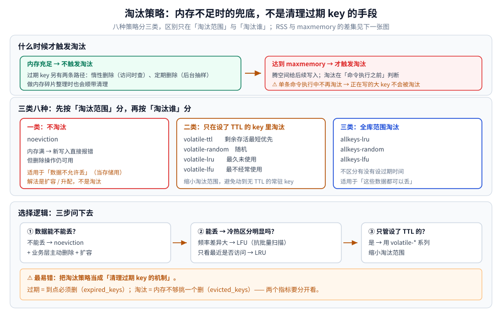
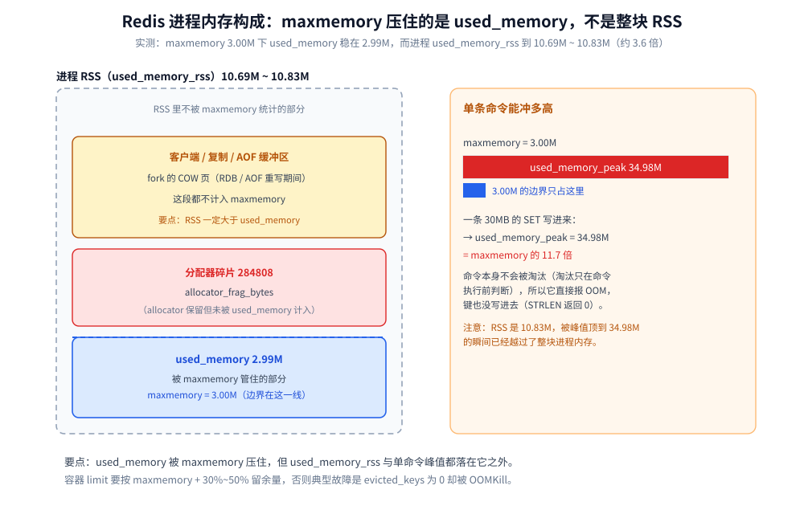

# Redis 淘汰策略

> maxmemory 触发时机与三大类淘汰策略（noeviction / allkeys / volatile）的取舍、`maxmemory` 管不住哪些内存（为什么 RSS 会超过它）、近似 LRU 与 LFU 的实现细节，以及在线调参与调优顺序。
>
> 内容整理自个人学习笔记，并参考《Redis 设计与实现》（黄健宏）的对应章节；参考资料与原始素材见 [素材清单](../../../../素材清单.md)。
>
> 实测口径：第四节的三类策略对照、`noeviction` 触顶读数与 `OBJECT FREQ` / `OBJECT IDLETIME` 读数，来自容器 `redis:7-alpine`（`redis-server v=7.4.11`、宿主端口 14379、客户端 `redis-cli 7.4.11`），时序类读数连跑 3 轮按 `min~max` 记、确定性读数直接当结论用；第一至三节为原理整理，未做实测。

---

## 一、Redis 的淘汰策略有哪些？什么情况下触发？

**本节要点**：要清楚"淘汰"是内存不足时的**兜底**，而不是日常清理手段。

### 什么时候触发

- **内存充足时：不触发淘汰**。过期 key 由另外两条路径清掉：
  1. **惰性删除**：访问 key 时顺带检查是否过期，过期就删；
  2. **定期删除**：后台线程周期性抽样扫描过期 key 并删除；
  3. 做**内存碎片整理**时，也会顺带清理过期 key。
- **内存达到 `maxmemory` 上限时：才开始触发淘汰策略**，腾出空间给后续写入。

### 三大类淘汰策略

**第一类：不淘汰（`noeviction`）**
内存满了新写入直接**报错**，但允许删除操作。
适用场景：**数据不允许丢失**（不只是当缓存用，还承担持久化职责）。
应对方式不是淘汰，而是**扩容 / 升配内存**。

**第二类：只在设置了过期时间的 key 中淘汰**

| 策略 | 含义 |
|---|---|
| `volatile-ttl` | 优先淘汰**剩余存活时间最短**的 key |
| `volatile-random` | 在设了过期时间的 key 中**随机**淘汰 |
| `volatile-lru` | 在设了过期时间的 key 中淘汰**最久未使用**的 |
| `volatile-lfu` | 在设了过期时间的 key 中淘汰**最不经常使用**的 |

**第三类：全库范围淘汰（不区分是否设了过期时间）**
`allkeys-lru`、`allkeys-random`、`allkeys-lfu`。
适用场景：这些数据**都可以丢**。

### 怎么选（选择逻辑）

1. **先问数据能不能丢**：不能丢 → `noeviction` + 业务层主动删除 + 扩容；
2. **能丢且冷热区分明显** → LRU 或 LFU；
   - 访问**频率差异大**（少数 key 极高频、大量 key 极低频）→ 优先 **LFU**，比 LRU 更能抵御"偶发批量扫描"污染；
   - 只看**最近是否被访问** → LRU；
3. 只关心"设了过期时间的 key" → 用 `volatile-*` 系列，缩小淘汰范围。

**易错点**：把淘汰策略当成"清理过期 key 的机制"。它是内存不足时才生效的兜底手段。



---


## 二、`maxmemory` 到底管住了哪些内存？（最容易踩的坑）

**本节要点**：`maxmemory` 约束的是 Redis 自己统计的 `used_memory`，**不是进程的物理内存（RSS）** —— 两者之间的差集就是所有「内存告警与容器被杀」事故的来源，下面逐项列清。

| `maxmemory` **不管**的部分 | 什么时候会显著膨胀 |
| --- | --- |
| **复制缓冲区**（`repl-backlog` + 每个从库的 output buffer） | 主从延迟大、全量同步、从库断连期间 |
| **AOF 缓冲区**（`aof_buf`）与重写期间的增量缓冲 | 写入量大、AOF 重写期间 |
| **客户端输出缓冲区** | 大 key + 慢客户端（尤其 Pub/Sub），受 `client-output-buffer-limit` 约束但**不计入** `maxmemory` |
| **内存碎片**（分配器碎片） | 频繁增删不同 size 的 key |
| **fork 的 COW 页** | `BGSAVE` / AOF 重写期间可能瞬时接近翻倍 |

⭐ **结论：RSS 一定大于 `maxmemory`**。容器里给 Redis 设 `limit` 时，要按 `maxmemory + 30%~50%` 留余量，否则典型故障是 **「Redis 自己觉得还没到上限，却被 cgroup OOMKill 掉，且 `evicted_keys` 一直是 0」**——这个组合现象几乎可以直接判定是内存边界算错了。

**这段差集在实测里有多宽**：配了 `maxmemory 3.00M` 之后，`used_memory` 被稳稳压在 2.99M，而进程的 `used_memory_rss` 到了 10.69M ~ 10.83M（约 3.6 倍）；一条 30MB 的 `SET` 更是能把 `used_memory_peak` 顶到 34.98M，是 `maxmemory` 的 11.7 倍。两个越界点的读数与命令原文见第四节。



### 2.1 `INFO memory` 的读法

```bash
redis-cli INFO memory | grep -E 'used_memory:|used_memory_rss|used_memory_peak|mem_fragmentation_ratio|maxmemory:'
```

| 字段 | 含义 | 判读 |
| --- | --- | --- |
| `used_memory` | Redis 逻辑用量（**受 `maxmemory` 约束的就是它**） | 与 `maxmemory` 比较 |
| `used_memory_rss` | 操作系统看到的物理内存 | ⭐ 与容器 limit 比较才有意义 |
| `used_memory_peak` | 历史峰值 | 排查「曾经被打爆」的依据 |
| `mem_fragmentation_ratio` | `rss / used_memory` | 明显 > 1.5 → 碎片严重，考虑 `activedefrag`；**< 1 说明发生了 swap，性能会断崖式下跌** |

### 2.2 两个容易漏的边界

- **淘汰发生在「命令执行之前」**（`processCommand` 阶段判断），单条命令执行中不会再触发淘汰。所以写入一个巨大的 key（如 300MB 的 hash）时，内存会在**一次命令内**冲过上限很远，而**这个 key 自己不会被淘汰**（它正被写）→ 直接 OOM。**大 key 必须拆**（用 `redis-cli --bigkeys` 找）。
- **`maxmemory` 设成 0 表示不限制**（默认值），此时淘汰策略形同虚设，容器里就是「谁跑得久谁被宿主 OOM Killer 挑中」。

---

## 三、LRU 与 LFU 为什么都是「近似」实现？

**本节要点**：Redis 的 LRU / LFU 都是**近似**实现 —— 24 位访问时间戳 + 随机采样 + 淘汰池，换来近乎零的空间开销与"只在淘汰时才花 CPU"；真正的关键在说清**为什么不做精确**。

> 📖 **LRU / LFU / Clock / W-TinyLFU 四种算法的原理、实现与横向对比**的单一来源是 [缓存淘汰算法.md](../../缓存/缓存淘汰算法.md)；本节只回答「**Redis 为什么只能做近似**、以及它近似成了什么样」。

### 3.1 近似 LRU：采样 + 淘汰池

| 方案 | 做法 | 成本 |
| --- | --- | --- |
| **精确 LRU**（教科书） | 维护全局双向链表，每次访问把节点移到头部 | 每个 key 多 16 字节指针开销 + **每次访问都要改链表**（即使只是读），还要加锁/处理并发 |
| **Redis 的近似 LRU** | 每个对象只用 **24 位**记录「上次访问的秒级时间戳」；淘汰时**随机采样 `maxmemory-samples` 个 key**（默认 5），从中挑最久未用的删掉 | 空间几乎为零、淘汰时才花 CPU |

为了改善「采样太少会误杀热点」的问题，Redis 还维护一个 **淘汰池（eviction pool，16 个候选）**：把多轮采样的候选累积起来，跨轮次挑最该淘汰的那个，因此实际效果比「纯采样」好得多。

> ⭐ Redis 3.0 之后，采样数为 5 的近似 LRU 与精确 LRU 在命中率上的差距已经很小——**用一点点精度换掉了「每次读都要改链表」的巨大开销**，这是典型的工程取舍。

⚠️ `maxmemory-samples` 越大越接近精确，但**每次淘汰都要多采样**；默认 5 是折中，别拉到几百。

### 3.2 LFU：8 位计数器 + 概率递增 + 时间衰减

LFU 在 Redis 4.0 引入，复用同一个 24 位字段，拆成两段：

```text
 24 位 lru 字段（LFU 模式下的布局）
┌────────────── 16 位 ──────────────┬── 8 位 ──┐
│   上次衰减时间（分钟粒度）          │  访问频率计数器 │
└───────────────────────────────────┴───────────┘
```

两个关键设计：

| 设计 | 参数 | 行为 |
| --- | --- | --- |
| **计数器按概率递增**（不是每次 +1） | `lfu-log-factor`（默认 10） | 值越大越难增长：计数到 100 需要更多次访问；上限 255 后**饱和** |
| **计数器随时间衰减** | `lfu-decay-time`（默认 1 分钟） | 每过 N 分钟减 1，避免历史热点永久占位 |

⭐⭐ 这就解释了 LFU 的核心优势——**抗「偶发批量扫描」**：一次性被扫过的 key，计数涨不上去（概率递增 + 8 位饱和），所以不会顶掉长期高频的热点；而 LRU 会因为这些 key「刚刚被访问过」而把它们留在内存里，把真热点挤出去。

查看某个 key 当前的频率计数（需 `maxmemory-policy` 为 `*-lfu`）：

```bash
redis-cli CONFIG GET maxmemory-policy lfu-log-factor lfu-decay-time
redis-cli OBJECT FREQ mykey        # 返回 0~255 的频率计数
```

> ⚠️ 两者都**不精确、也不持久**：`lru` 字段随数据一起序列化，但 RDB/AOF 恢复后计数不会完全还原（尤其是 LFU 的时间衰减依赖运行时钟），所以重启后短时间内的淘汰判断会「失忆」。

---

## 四、淘汰在真实实例上长什么样？

> 环境：容器 `redis:7-alpine`，`redis-server v=7.4.11`，宿主端口 14379，客户端 `redis-cli 7.4.11`；混合 TTL 键集的策略对照连跑 3 轮，读数按 `min~max` 记。原始输出见 `.workbuddy/tmp/round495/w9c_e1_noeviction.txt`、`w9c_e2_mixed.txt`、`w9c_e3b_rss.txt`、`w9c_e4b_object.txt`。
> 指标口径、热 key 定位与「内存三种状态」的完整读法见 [缓存运维与排查.md](../../缓存/缓存运维与排查.md) 第二、四、六节；本节只补**策略之间的可观察差别**与**越界读数**。

**本节要点**：第一节讲「策略是什么」，这里补「策略在实例上怎么表现」——尤其是 `volatile-*` 在**混合 TTL 键集**下的失败形态，以及 `maxmemory` 边界外那一段到底有多宽。

### 4.1 三类策略在混合 TTL 键集下的差异

**键集构造**：每轮循环先写一个有 TTL 的键 `ttl:i`（10KB 值、`EX 300`），紧接着写一个**无 TTL** 的键 `perm:i`（同样 10KB），直到写命令报错或跑满 300 轮；`maxmemory` 固定 2mb。连跑 3 轮：

| `maxmemory-policy` | 第一次报错的位置 | 报错原文 | 活着的 `ttl:*` | 活着的 `perm:*` | `evicted_keys` |
|---|---|---|---|---|---|
| `noeviction` | 第 41 轮（写 `perm:41`） | `OOM command not allowed when used memory > 'maxmemory'.` | 42 | 41 | 0 |
| `allkeys-lru` | 未报错（跑满 300 轮） | — | 37 ~ 45 | 37 ~ 44 | 519 |
| `allkeys-random` | 未报错（跑满 300 轮） | — | 38 ~ 41 | 41 ~ 45 | 519 |
| `volatile-lru` | 第 83 轮（写 `ttl:83`） | `OOM command not allowed when used memory > 'maxmemory'.` | 1 | 83 | 83 |
| `volatile-ttl` | 第 83 轮（写 `ttl:83`） | `OOM command not allowed when used memory > 'maxmemory'.` | 1 | 83 | 83 |

⭐ **三个判据**（第 83 轮、519、1834 这些数三轮内完全一致，可直接当结论用）：

1. **`allkeys-*` 不看 TTL**：`ttl:*` 与 `perm:*` 的存活数基本相等（37~45 对 37~45），有 TTL 的键**不会**先被淘汰——TTL 只决定「何时过期」，不决定「淘汰谁」；
2. **`volatile-*` 只动有 TTL 的键**：无 TTL 的键**一个都没被淘汰**，一路涨到 83 个把内存占住，最后连「写一个有 TTL 的新键」都因为**没有可淘汰的键**而报 OOM。这是 `volatile-*` 最反直觉的失败形态——**它保护了不该保护的键**；
3. **`noeviction` 停在 41 轮且 `evicted_keys` 全程 0**：真正「写不进去」的策略表现是**报错**，而不是「变慢」——与 [缓存运维与排查.md](../../缓存/缓存运维与排查.md) 第六节的「内存三种状态」对应。

### 4.2 `noeviction` 触顶后的表现

`maxmemory 3mb`、1KB 值：写到第 1529 个键时第一条写命令失败，原文是 `OOM command not allowed when used memory > 'maxmemory'.`；此时 `INFO keyspace` 为 `db0:keys=1529,expires=0,avg_ttl=0`，`evicted_keys:0`、`expired_keys:0`。

触顶之后：`GET noev:0` 正常返回、`DEL noev:0` 返回 `1`，但**紧接着的 `SET` 仍然报同一个 OOM**——`noeviction` 下淘汰不会发生，`used_memory` 仍在 `maxmemory` 之上，只有内存真的降回上限以下，写入才会恢复。

### 4.3 `maxmemory` 管不住的那一段有多宽

**基线**（`maxmemory 0` + 空库，连测 3 次完全相同）：`used_memory` 1360544（1.30M）、`used_memory_rss` 9506816（9.07M）、`mem_fragmentation_ratio` 7.19。

**设 `maxmemory 3mb` 并写满 2000 个 10KB 值**（连跑 3 轮）：

| 读数 | 第 1 轮 | 第 2 轮 | 第 3 轮 |
|---|---|---|---|
| `used_memory` | 3138752（2.99M） | 3138904（2.99M） | 3139056（2.99M） |
| `used_memory_rss` | 11210752（10.69M） | 11284480（10.76M） | 11358208（10.83M） |
| `mem_fragmentation_ratio` | 3.62 | 3.64 | 3.66 |
| `evicted_keys` | 1834 | 1834 | 1834 |
| `DBSIZE` | 166 | 166 | 166 |

⭐ `used_memory` 被稳稳压在 `maxmemory 3.00M` 之下，但 **`used_memory_rss` 是它的约 3.6 倍**（10.69M ~ 10.83M）。差额里 `allocator_frag_bytes` 只有 284808（0.27M），**剩下的是 jemalloc 保留的 arena 与进程自身的其它段**，不是「数据」——所以把容器 limit 贴着 `maxmemory` 设，就必然 OOMKill。

**单条大命令能越界多少**（`maxmemory 3mb` 不变）：用 `redis-cli -x SET big` 把 30MB 的文件灌进去，连跑 3 轮都返回同一个错误：

```text
SET big (30MB) -> OOM command not allowed when used memory > 'maxmemory'.
STRLEN big    = 0
used_memory_peak = 36682520        # 34.98M
```

`STRLEN big = 0` 说明这个 key **根本没被建出来**——30MB 先落进**客户端 query buffer**（它算进 `used_memory`，但**不是可淘汰的对象**），`used_memory` 在这条命令内被顶到 36682520（34.98M），是 `maxmemory` 的 11.7 倍，随后 `processCommand` 判定超限、直接拒绝执行。所以第二节那句「大 key 必须拆」是对的，但机制要说准：**越界发生在「命令执行之前」的那段命令缓冲区里**，被推高的是**进程内存峰值**，而不是数据；容器 limit 贴着 `maxmemory` 设时，这一下就够触发 OOMKill。

⚠️ 另外，别把 `mem_fragmentation_ratio < 1` 直接读成「已经 swap」：本轮同一实例既出现过 `9.01`、也出现过 `0.42`。第 3 次那份 `INFO memory` 里 `used_memory_rss` 是 14.68M、`used_memory` 是 1.06M（两者相除是 13.8，不是 0.42），只有按**峰值时刻**的 `used_memory 34.98M` 去算才得到 0.42（14.68M ÷ 34.98M ≈ 0.40，量级吻合）。**这个比值只在它被算出的那一刻成立**，判读时要和 `used_memory_peak`、`used_memory_rss` 一起看。

### 4.4 `OBJECT FREQ` / `OBJECT IDLETIME`：LFU 与 LRU 的读数

| `maxmemory-policy` | `OBJECT FREQ <key>` | `OBJECT IDLETIME <key>` |
|---|---|---|
| `allkeys-lfu` | 返回 0~255 的计数 | 报错：`ERR An LFU maxmemory policy is selected, idle time not tracked...` |
| `allkeys-lru` | 报错：`ERR An LFU maxmemory policy is not selected, access frequency not tracked...` | 返回空闲秒数 |
| `noeviction` | 同上（报错） | 返回空闲秒数 |

`OBJECT HELP` 列出的子命令是 `ENCODING` / `FREQ` / `IDLETIME` / `REFCOUNT` / `HELP`——**没有 `OBJECT IDLE`**，写成 `OBJECT IDLE` 会直接报 `ERR unknown subcommand 'IDLE'. Try OBJECT HELP.`。

**「近似」在读数上长什么样**：

```text
新建 key 立刻读              OBJECT FREQ = 5      # LFU_INIT_VAL：新建即 5，看不到 0
同一个 key 访问 101 次后读     OBJECT FREQ = 9      # 不是 101
lfu-log-factor = 1 ，11 次   OBJECT FREQ = 9
lfu-log-factor = 10，11 次   OBJECT FREQ = 6
```

⭐ 三条判据：① **计数不是次数**——101 次访问只到 9，因为 8 位计数器按概率递增；② **新建即 5**，所以「FREQ = 5」代表「从没被访问过」；③ **同一个 24 位字段的含义随策略变**——`lru` / `lfu` 模式下它分别是时间戳与计数器，切换策略后报错原文里那句 `LRU and LFU data will take some time to adjust` 就是这个意思。

> `LFU_INIT_VAL = 5`、`--hotkeys` 的比值判据与热 key 定位的完整推导，单一来源是 [缓存运维与排查.md](../../缓存/缓存运维与排查.md) 第四节，本节不复述。

### 4.5 三种现象对应三个动作

| 现象 | 出现的策略 | 该做什么 |
|---|---|---|
| 写命令报 `OOM ... > 'maxmemory'`，`evicted_keys` 一直 0 | `noeviction`；或 `volatile-*` 遇上「没有可淘汰的键」 | 扩容，或换成全库淘汰；**别指望淘汰能救** |
| 有 TTL 的键不断消失、无 TTL 的键永驻 | `volatile-*` | 给常驻数据也留退路，或改 `allkeys-*` |
| `used_memory` 没到上限、`used_memory_rss` 却越界 | 任何策略（越界在 `maxmemory` 之外） | 按 `maxmemory + 30%~50%` 给容器留余量 |

---

## 使用：运行期查看与调整淘汰策略

淘汰策略是**可以在线改**的（`CONFIG SET` 立即生效），但改完要写回配置文件，否则重启就回去了：

```bash
# 1) 现状与容量口径
redis-cli CONFIG GET maxmemory maxmemory-policy maxmemory-samples
redis-cli INFO memory | grep -E 'used_memory_human|maxmemory_human|mem_fragmentation_ratio'

# 2) 淘汰与过期是两个独立指标，要分开看
redis-cli INFO stats | grep -E 'evicted_keys|expired_keys|keyspace_hits|keyspace_misses'

# 3) 在线调整（立即生效，但重启会丢）
redis-cli CONFIG SET maxmemory-policy allkeys-lfu
redis-cli CONFIG SET maxmemory 4gb
redis-cli CONFIG REWRITE          # ⭐ 写回 redis.conf，否则重启失效
```

**调优顺序建议**（别一上来就调策略）：

| 步骤 | 动作 | 目的 |
|---|---|---|
| 1 | 开 `--bigkeys` / `--hotkeys` 体检 | 先搞清是「真的放不下」还是「几个大 key 占满了」 |
| 2 | 给 key 补 TTL、打散过期时间 | 把「淘汰」问题转成「自然到期」 |
| 3 | 再考虑 `maxmemory-policy` | 淘汰是**兜底**，不是容量方案 |
| 4 | 仍然不够 → 分片 / 扩容 / 冷热分离 | 真正的容量解法（见 [缓存选型对比.md](../../缓存/缓存选型对比.md)） |

> ⚠️ `maxmemory-samples` 越大越接近真 LRU/LFU，代价是每次淘汰多花 CPU 抽样；默认 5 是精度与开销的折中，**不要为了让「LRU 更准」把它拉到几百**。

## 延伸追问

- **为什么「加内存」往往比调淘汰策略更对？** → 淘汰策略是**兜底**不是容量方案。调 `allkeys-lru` 只是把「丢谁」从随机变成有依据；数据规模超过内存时，热数据迟早被丢（见 [缓存选型对比.md](../../缓存/缓存选型对比.md)）。
- **LRU 和 LFU 怎么选？** → 有明显批量扫描/冷数据突增 → `lfu`（抗污染）；访问模式随时间漂移 → `lru`。⚠️ 两者都是**采样近似**，不是精确算法。
- **`noeviction` 下写满了会怎样？** → 写命令直接报错（读仍可用）。把它当存储用时必须配容量告警，否则故障表现是「突然写不进去」而不是「慢慢变慢」。
- **过期删除和内存淘汰是一回事吗？** → 不是：过期是「到点了必须删」，淘汰是「内存不够了挑一个删」；对应 `expired_keys` 与 `evicted_keys` 两个指标，排查时要分开看。
- **怎么判断当前策略选错了？** → `evicted_keys` 突增 + 命中率下降 + 热数据响应变慢，三者同现基本可以确认。
- **`maxmemory` 管不住哪些内存？** → 复制缓冲区、AOF 缓冲区、客户端输出缓冲区、内存碎片、fork 的 COW 页都**不计入** `maxmemory`。所以 RSS 会大于它，容器 limit 要留 30%~50% 余量，否则会出现「`evicted_keys` 为 0 但容器被 OOMKilled」的组合现象。
- **Redis 的 LRU 是精确的吗？** → 不是，是**采样近似**（每个 key 只存 24 位时间戳，淘汰时随机采样 `maxmemory-samples` 个 + 维护 16 个候选的淘汰池）。不精确是为了避免「每次读操作都要改全局链表」的开销。
- **LFU 的计数器为什么不是每次 +1？** → 它按概率递增（`lfu-log-factor` 控制速度，8 位上限 255 会饱和）并随时间衰减（`lfu-decay-time`）。正是这个设计让它能抵抗「偶发批量扫描」——被扫过一次的 key 计数涨不上去，不会顶掉长期热点。
- **正在写入的大 key 会被淘汰吗？** → 不会。淘汰只在**命令执行前**判断，单条命令执行中不再淘汰；所以写入一个巨大的 key 会在一次命令内把内存推过上限很远，而它自己不会被淘汰 → 直接 OOM。大 key 必须拆。实测口径：`maxmemory 3.00M` 时一条 30MB 的 `SET` 把 `used_memory_peak` 顶到 34.98M（11.7 倍），命令报 OOM 且**键没有写进去**（`STRLEN` 返回 0），见第四节 4.3。
- **`mem_fragmentation_ratio` < 1 意味着什么？** → 说明物理内存小于逻辑用量，通常已经**发生 swap**——Redis 性能会断崖式下跌，比碎片率高更危险。⚠️ 但它是个**瞬时比值**，别单独拿来下结论：本轮同一实例既出现过 `9.01`、也出现过 `0.42`，后者只有按**峰值时刻**的 `used_memory 34.98M` 去算才在同一量级（14.68M ÷ 34.98M ≈ 0.40，见第四节 4.3 的告警）。
- **`volatile-*` 配了为什么反而更早写不进去？** → 因为它只淘汰**有 TTL 的键**，无 TTL 的键一个都不动。混合键集实测里 `volatile-lru` / `volatile-ttl` 到第 83 轮就因为「没有可淘汰的键」报 OOM，而 `allkeys-lru` 一直跑满 300 轮没报错（第四节 4.1）。要么给常驻数据也留退路，要么改用 `allkeys-*`。

---

## 关联

- [缓存问题与方案.md](../../缓存/缓存问题与方案.md) — 雪崩/击穿/穿透的解法
- [缓存选型对比.md](../../缓存/缓存选型对比.md) — 内存真的放不下时的扩容与分片
- [缓存淘汰算法.md](../../缓存/缓存淘汰算法.md) — LRU/LFU/Clock/W-TinyLFU 的算法原理与单一来源
- [缓存运维与排查.md](../../缓存/缓存运维与排查.md) — 「内存三种状态」、热 key 定位与指标口径的单一来源，本篇第四节只补策略之间的差别
- [缓存容量与治理.md](../../缓存/缓存容量与治理.md) — 容量水位怎么定、到水位后怎么办（本篇讲的是兜底机制本身）

> 反向引用（本篇被下列文档引到）：[LSM树.md](../../../../02-计算机基础/数据结构/树/磁盘存储树/LSM树.md)、[底层结构.md](底层结构.md)、[部署与运维.md](部署与运维.md)、[高可用.md](高可用.md)、[缓存容量与治理.md](../../缓存/缓存容量与治理.md)、[缓存运维与排查.md](../../缓存/缓存运维与排查.md)
