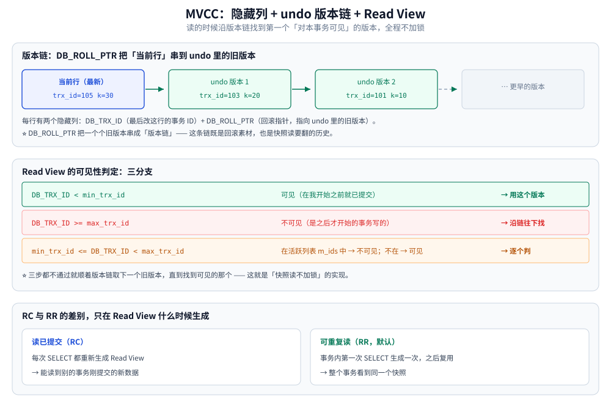
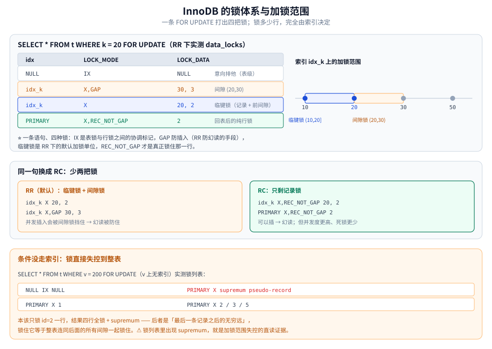

# InnoDB 的并发控制实现

> 本篇只讲 **InnoDB 存储引擎专属**的两套机制：MVCC 的落地实现（隐藏列 / undo 版本链 / Read View），以及锁体系（意向锁 / 记录锁 / 间隙锁 / 临键锁 / MDL / `SKIP LOCKED` / `NOWAIT`）。
> **通用理论**（乐观锁与悲观锁、MVCC 的通用原理、快照读与当前读的读语义、隔离级别标准）见 [并发控制](../../并发控制/README.md) 目录；本篇是它的「实现层」。
>
> 内容整理自个人学习笔记，参考资料与原始素材见 [素材清单](../../../../素材清单.md)。
>
> ✅ **实测口径**：本篇的锁清单、`SKIP LOCKED` / `NOWAIT` 的返回与报错原文，
> 来自本机 Docker Desktop 的 `mysql:8.0` 隔离实例（容器 `mysql-arch-lab`、端口 13307、**8.0.46**）；
> 夹具是 `locklab.t(id INT PRIMARY KEY, k INT NOT NULL, KEY idx_k(k))`，数据 `id = 1,2,3,5` / `k = 10,20,30,50`。
> ⚠️ 主从与分布式场景下的锁见 [分布式锁.md](../../NoSQL/Redis/分布式锁.md)。

---

## 一、MVCC 在 InnoDB 里怎么落地

**本节要点**：隐藏列、undo 版本链、Read View 三件套怎么配合出「读写不阻塞」，以及 RC 与 RR 的差别落在 Read View 的**生成时机**上。

InnoDB 的 MVCC 由三样东西协作实现：

| 组成 | 作用 |
|---|---|
| **隐藏列** | 每行有两个隐藏字段：`DB_TRX_ID`（最后修改该行的事务 ID）、`DB_ROLL_PTR`（回滚指针，指向 undo log 中的旧版本） |
| **Undo Log** | 保存数据的历史版本，通过 `DB_ROLL_PTR` 串成**版本链** |
| **Read View** | 事务快照读时生成，记录「当前活跃的事务 ID 列表」，用于判断某个版本对该事务是否可见 |

**可见性判断**：读取时沿版本链找到第一个「对当前 Read View 可见」的版本。



上图就是这条判定链：`DB_ROLL_PTR` 把同一行的各历史版本串起来，Read View 从链头（最新版本）往回找，第一个落在「已提交且早于本事务快照」的版本才是本事务要读的值。

**RC 与 RR 的差异在 Read View 的生成时机**：

- **读已提交（RC）**：**每次** `SELECT` 都重新生成 Read View → 能读到别的事务已提交的新数据
- **可重复读（RR）**：**事务内第一次** `SELECT` 时生成一次，之后复用 → 整个事务看到同一个快照（这也是 MySQL 默认级别下能避免不可重复读的原因）

> ⚠️ 注意区分**快照读**与**当前读**：普通 `SELECT` 走 MVCC 快照读（不加锁）；`SELECT ... FOR UPDATE`、`UPDATE`、`DELETE` 属于**当前读**，读的是最新版本并加锁。两者的完整对照见 [快照读与当前读.md](../../并发控制/快照读与当前读.md)。

## 二、InnoDB 的锁体系

**本节要点**：行锁、间隙锁、临键锁、意向锁分别在什么时候出现，以及
**为什么「锁了多少行」完全由索引决定**。

### 2.1 从一次 `FOR UPDATE` 说起：四把锁同时出现

表 `t(id INT PRIMARY KEY, k INT NOT NULL, KEY idx_k(k))`，数据 `id = 1,2,3,5` / `k = 10,20,30,50`。
在**默认的 RR** 下执行 `SELECT * FROM t WHERE k = 20 FOR UPDATE`，另一个会话从
`performance_schema.data_locks` 读到的**全部**锁是（实测 8.0.46）：

```text
+-----------+---------------+-----------+
| idx       | LOCK_MODE     | LOCK_DATA |
+-----------+---------------+-----------+
| NULL      | IX            | NULL      |   ← 意向排他锁（表级）
| idx_k     | X,GAP         | 30, 3     |   ← 间隙锁：(20, 30) 这一段
| idx_k     | X             | 20, 2     |   ← 临键锁：k=20 这条记录 + 它前面的间隙
| PRIMARY   | X,REC_NOT_GAP | 2         |   ← 回表后落在主键上的行锁
+-----------+---------------+-----------+
```

**一条语句、四种锁**。各自的职责：

| 锁 | 加在哪 | 为什么需要 |
|---|---|---|
| **IX（意向排他锁）** | **表级** | 事务打算在表内的某些行上加排他锁，先在表上做个标记 —— 它是**表锁与行锁之间的协调机制** |
| **GAP（间隙锁）** | 索引记录**之间** | 锁住「还不存在的空隙」，**防止别人在这一段插入新行** —— RR 防幻读的手段 |
| **临键锁（Next-Key Lock）** | 命中的那条索引记录 | **记录锁 + 它前面的间隙锁**的组合，是 RR 下的默认加锁单位 |
| **REC_NOT_GAP（纯记录锁）** | 主键记录 | 回表之后真正锁住那一行数据 |

### 2.2 意向锁：为什么行锁没被表锁卡死

`SELECT ... FOR UPDATE` / `UPDATE` 这类操作，InnoDB 会**先在表上加意向锁（IS / IX），再到行上加锁**。
意向锁之间**互相兼容**（IS 与 IX 不冲突），它唯一的作用是：**让「表级锁」能快速判断「表里有没有行锁」**。

- `LOCK TABLES ... WRITE`（表级排他锁）必须先确认表内没有任何行锁 → 扫一遍意向锁即可，不必逐行扫描；
- 反过来，意向锁**不会**阻塞其他事务拿行锁 —— 两个人各改一行，不会因为对方持了 IX 而互相等待。

⭐ 一个常见误解：**「我明明加了行锁，怎么还被卡住」** —— 卡的通常不是意向锁，而是 2.6 讲的 **MDL**。

### 2.3 记录锁、间隙锁与临键锁：RR 与 RC 的差别就在这两把

同一句 `SELECT * FROM t WHERE k = 20 FOR UPDATE`，把隔离级别换成 **RC**，锁就只剩两把（实测对比）：

```text
RR：  idx_k    RECORD  X              20, 2      ← 临键锁
      idx_k    RECORD  X,GAP          30, 3      ← 多出的间隙锁
      PRIMARY  RECORD  X,REC_NOT_GAP  2

RC：  idx_k    RECORD  X,REC_NOT_GAP  20, 2      ← 只剩记录锁
      PRIMARY  RECORD  X,REC_NOT_GAP  2
```

**RC 与 RR 的差别不只是「幻读」三个字** —— 落到锁上是「少两把锁」：

| | RR（默认） | RC |
|---|---|---|
| 命中记录 | **临键锁**（记录 + 前间隙） | 纯记录锁 |
| 命中记录**之后**的间隙 | **锁住**（`X,GAP`） | 不锁 |
| 并发插入 | 会被间隙锁挡住 | 可以插（→ 幻读） |
| 并发度 / 死锁概率 | 更差 / 更高 | 更好 / 更低 |

这就是很多互联网业务把线上隔离级别降到 RC 的真实原因：**不是为了幻读，是为了少锁**。
（标准怎么说、产品之间差在哪，见 [标准隔离级别与产品实现差异.md](../../并发控制/标准隔离级别与产品实现差异.md)。）

### 2.4 加锁范围由索引决定：没有索引就锁全表

把条件换成**没有索引的列**：`SELECT * FROM t WHERE v = 200 FOR UPDATE`（`v` 上无索引），实测锁变成：

```text
+-----------+------------------------+
| idx       | LOCK_MODE | LOCK_DATA  |
+-----------+------------------------+
| NULL      | IX        | NULL       |
| PRIMARY   | X         | supremum pseudo-record |   ← 锁到"无穷远"
| PRIMARY   | X         | 1          |
| PRIMARY   | X         | 2          |
| PRIMARY   | X         | 3          |
| PRIMARY   | X         | 5          |
+-----------+------------------------+
```

本该只锁 `id = 2` 一行，结果**四行全锁 + `supremum pseudo-record`** ——
后者是「最后一条记录之后的无穷远」，锁住它等价于**整表连同它后面的所有间隙一起锁住**。

⭐ **锁列表里出现 `supremum pseudo-record`，就是「这次加锁范围失控」的直读证据**。
线上锁等待事故里最常见的一条：`UPDATE` / `FOR UPDATE` 的 `WHERE` 条件没走索引。

### 2.5 SKIP LOCKED 与 NOWAIT：不让「等锁」拖死请求

8.0 之前拿不到锁只能**等**（`innodb_lock_wait_timeout` 默认 50 秒）。8.0 给了两个显式选项：

| 写法 | 行为 | 实测（目标行被别的事务锁住时） |
|---|---|---|
| `FOR UPDATE` | 等，直到超时 | 阻塞 |
| `FOR UPDATE NOWAIT` | **立即失败**，一秒都不等 | `ERROR 3572 (HY000): Statement aborted because lock(s) could not be acquired immediately and NOWAIT is set.` |
| `FOR UPDATE SKIP LOCKED` | **跳过被锁的行**，返回剩下的 | 返回 **0 行** |

⭐ **典型用法是任务队列**：多个 worker 用
`SELECT ... WHERE status='pending' LIMIT 1 FOR UPDATE SKIP LOCKED` 抢任务 ——
每个 worker 自动跳过别人正在处理的行，避免了「所有人抢同一条、其余空转」。

⚠️ `SKIP LOCKED` 的代价是**结果不完整**：它返回的不是「满足条件的全部行」，而是「当前没被别人锁住的那部分」。
所以它**不能**用在需要完整结果集的查询里。

### 2.6 元数据锁（MDL）：DDL 卡住业务的那一把

MDL 由 MySQL **自动加**、不用你写，作用是保护**表结构**不被并发修改。它最容易惹祸的形态是：
**一个长事务持着 MDL 读锁，`ALTER TABLE` 在等它；而 `ALTER` 一开始排队，后面所有读这张表的请求都会排在 `ALTER` 之后** ——
表现就是「整张表突然全卡了」。

实测复现（会话 A 开事务读表不提交，会话 B 执行 `ALTER TABLE t ADD COLUMN c INT NULL`）：

```text
+-------------+-------------------+-------------+-----------+
| OBJECT_NAME | LOCK_TYPE         | LOCK_STATUS | 谁        |
+-------------+-------------------+-------------+-----------+
| t           | SHARED_READ       | GRANTED     | 长事务    |
| t           | SHARED_UPGRADABLE | GRANTED     | DDL 会话  |
| t           | EXCLUSIVE         | PENDING     | DDL 会话  |   ← 在等
+-------------+-------------------+-------------+-----------+
```

同一时刻 `information_schema.processlist` 里的等待现场：

```text
| ID | TIME | STATE                           | INFO                                 |
| 25 |    6 | User sleep                      | SELECT SLEEP(7)                      |
| 26 |    4 | Waiting for table metadata lock | ALTER TABLE t ADD COLUMN c INT NULL  |
```

**排查口诀**：看到 `Waiting for table metadata lock`，就去找那个 `TIME` 很大、状态是 `User sleep`
或 `executing` 的**长事务** —— 它才是根因，`ALTER` 只是受害者。

> 这是「长事务的六宗罪」之外最容易被忽略的一宗：**它能让一次 DDL 演变成整表不可用**。
> 线上执行 DDL 之前，先用 `information_schema.innodb_trx` 确认没有长事务（见
> [事务与隔离级别.md](事务与隔离级别.md) 的长事务排查）。



上图把本节实测的四把锁放在同一张表上：命中记录拿临键锁、记录之后的间隙单独加 `X,GAP`、回表落在主键上再加纯记录锁，而没有索引时锁定范围会一直扩到 `supremum`。

## 延伸追问

- **版本链会不会无限长？** → 会被 purge 线程按「最老的活跃 Read View」清理；**长事务会把水位钉住** → undo 暴涨，这是长事务最真实的代价。
- **为什么 RC 下每条语句读到的版本可能不同？** → RC 每条语句生成新 Read View，RR 只在事务内第一条语句生成、之后复用。
- **`select ... for update` 到底锁了什么？** → 命中的行加排他锁、未命中的范围按索引加间隙锁；⚠️ 走不到索引就退化成扫全表并把范围锁升级，这是很多锁等待事故的根因。
- **间隙锁只跟隔离级别有关吗？** → 还与索引有关：RC 基本不加间隙锁（除唯一键冲突检测等少数场景），RR 下「等值命中 + 后面的间隙」都会锁，所以 RC/RR 的锁数量差是实打实的。
- **MDL 和行锁的等待超时是同一个参数吗？** → 不是。`innodb_lock_wait_timeout` 管行锁，`lock_wait_timeout` 管 MDL；DDL 卡住业务通常撞的是后者。

## 关联

- [README.md](../../并发控制/README.md) — **本篇的上层**：并发控制的通用理论与知识地图
- [乐观锁与悲观锁.md](../../并发控制/乐观锁与悲观锁.md) — 两种并发控制思想与选型（本篇讲引擎真正提供的锁）
- [快照读与当前读.md](../../并发控制/快照读与当前读.md) — 快照读与当前读的读语义与对照实验
- [标准隔离级别与产品实现差异.md](../../并发控制/标准隔离级别与产品实现差异.md) — RC/RR 在标准与产品间的差别
- [锁等待与死锁排查.md](锁等待与死锁排查.md) — 本篇机制对应的线上排查实操
- [事务与隔离级别.md](事务与隔离级别.md) — 隔离级别是 MVCC 的语义层；事务的代价与死锁也在那一篇
- [日志与持久化.md](日志与持久化.md) — undo / redo 与版本链的存储
- [索引设计与EXPLAIN.md](索引设计与EXPLAIN.md) — 加锁范围与索引的关系
- [分布式锁.md](../../NoSQL/Redis/分布式锁.md) — 跨进程、跨机器的那一把锁
- [素材清单.md](../../../../素材清单.md) — 素材来源登记
