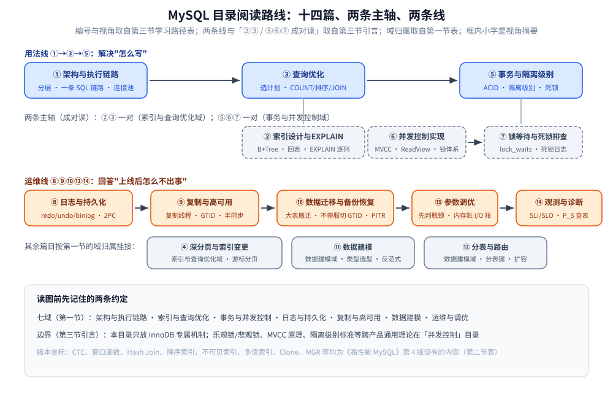

# MySQL 目录导读

> 覆盖 MySQL 的架构与执行链路、索引设计与查询优化、事务与并发控制、日志与持久化、
> 复制与高可用、数据建模、参数调优与运维观测；补充 8.0 后期与 8.4 / 9.x 的新特性。
>
> 内容整理自个人学习笔记。**基础框架**参考《高性能 MySQL》（第 4 版，对应 5.7 / 8.0 早期）；
> **8.0 后期与 8.4 / 9.x 的新特性**（CTE、窗口函数、Hash Join、降序索引、不可见索引、
> 函数索引、多值索引、直方图、原子 DDL、Clone 插件、MGR、MySQL Shell 等）
> 均基于官方文档与 Release Notes 独立整理，各篇标注版本来源。
> 参考资料与原始素材见 [素材清单](../../../../素材清单.md)。

---

## 一、这个目录怎么读

本目录 14 篇，按**七个主题域**组织（域只体现为阅读顺序，文件本身平铺）：

| 域 | 篇 |
|---|---|
| **架构与执行链路** | [架构与执行链路.md](架构与执行链路.md) |
| **索引与查询优化** | [索引设计与EXPLAIN.md](索引设计与EXPLAIN.md)、[查询优化.md](查询优化.md)、[深分页与索引变更.md](深分页与索引变更.md) |
| **事务与并发控制** | [事务与隔离级别.md](事务与隔离级别.md)、[InnoDB的并发控制实现.md](InnoDB的并发控制实现.md)、[锁等待与死锁排查.md](锁等待与死锁排查.md) |
| **日志与持久化** | [日志与持久化.md](日志与持久化.md) |
| **复制与高可用** | [复制与高可用.md](复制与高可用.md)、[数据迁移与备份恢复.md](数据迁移与备份恢复.md) |
| **数据建模** | [数据建模.md](数据建模.md)、[分表与路由.md](分表与路由.md) |
| **运维与调优** | [参数调优.md](参数调优.md)、[观测与诊断.md](观测与诊断.md) |

## 二、版本坐标速查

| 特性 | 引入版本 | 书里有没有 |
|---|---|---|
| CTE / 递归 CTE | 8.0.1 | ❌ |
| 窗口函数 | 8.0.2 | ❌ |
| 降序索引 | 8.0 | ❌ |
| 不可见索引 | 8.0 | ❌ |
| 直方图 | 8.0 | ❌ |
| 原子 DDL | 8.0 | ❌ |
| 函数索引 | 8.0.13 | ❌ |
| 多值索引 | 8.0.17 | ❌ |
| Clone 插件 | 8.0.17 | ❌ |
| Hash Join | 8.0.18 | ❌ |
| `EXPLAIN ANALYZE` | 8.0.18 | ❌ |
| `innodb_redo_log_capacity` | 8.0.30 | ❌ |
| MGR | 5.7.17+ | ❌ |
| MySQL Shell | 8.0 | ❌ |
| 8.4 LTS | 8.4 | ❌ |

⭐ 这张表的用处：本目录的**基础框架**取自《高性能 MySQL》（第 4 版），它对应 5.7 / 8.0 早期 ——
**上表列的全是书里没有的**。遇到"书上没写"的特性先查这里，各篇在用到时会单独标注版本来源。

## 三、学习路径

| 顺序 | 篇 | 视角 |
|---|---|---|
| ① | [架构与执行链路.md](架构与执行链路.md) | 怎么分层、一条 SQL 从连接到返回怎么走完、连接池与预编译各在哪一层省了什么 |
| ② | [索引设计与EXPLAIN.md](索引设计与EXPLAIN.md) | B+Tree、索引分类与回表、选择性、三星索引、覆盖索引与 ICP、`EXPLAIN` 逐列、索引失效 |
| ③ | [查询优化.md](查询优化.md) | 优化器怎么选计划、查询重写套路、`COUNT`/排序/分组/JOIN 的优化点、慢查询定位 |
| ④ | [深分页与索引变更.md](深分页与索引变更.md) | 深分页的解法、基础分页与游标分页、索引变更在线上怎么做 |
| ⑤ | [事务与隔离级别.md](事务与隔离级别.md) | ACID 各自的机制、隔离级别与"实际加了什么锁"、事务代价、死锁、隐式提交 |
| ⑥ | [InnoDB的并发控制实现.md](InnoDB的并发控制实现.md) | MVCC 版本链与 Read View、InnoDB 的锁体系（意向锁/间隙锁/临键锁/MDL）、加锁范围由索引决定 |
| ⑦ | [锁等待与死锁排查.md](锁等待与死锁排查.md) | `sys.innodb_lock_waits` / `data_lock_waits`、死锁日志、持锁老事务的定位 |
| ⑧ | [日志与持久化.md](日志与持久化.md) | redo/undo/binlog 分工、8 步落盘、两阶段提交、崩溃恢复、`fsync` 与 `O_DIRECT` |
| ⑨ | [复制与高可用.md](复制与高可用.md) | 复制线程、binlog 格式取舍、半同步、GTID、并行复制、切换与脑裂 |
| ⑩ | [数据迁移与备份恢复.md](数据迁移与备份恢复.md) | 大表搬迁、不停服切 GTID、全量备份 + 增量重放的 PITR |
| ⑪ | [数据建模.md](数据建模.md) | 数据类型选型、JOIN 与反范式、schema 陷阱、8.0 建模新能力 |
| ⑫ | [分表与路由.md](分表与路由.md) | 分表键怎么选、非分片键怎么定位数据、表数扩容 |
| ⑬ | [参数调优.md](参数调优.md) | 先判瓶颈类型，再算内存账与 I/O 账，最后才是那几十个参数 |
| ⑭ | [观测与诊断.md](观测与诊断.md) | SLI / SLO、Performance Schema 五类问题各查哪张表 |

> ⭐ **两条线**：**用法线**（①→③→⑤）解决"怎么写"；**运维线**（⑧⑨⑩⑬⑭）回答"上线后怎么不出事"。
> 索引与事务是两条主轴，②③ 与 ⑤⑥⑦ 各自成对读。
> ⭐ 本目录只放 **InnoDB 专属**机制；跨产品的通用理论（乐观锁/悲观锁、MVCC 原理、隔离级别标准）在 [并发控制](../../并发控制/README.md)。

## 四、与其他目录的边界

| 主题 | 去哪 |
|---|---|
| 数据库选型对比（MySQL vs PG vs MongoDB vs ES） | [数据库选型对比.md](../../数据库选型对比.md) |
| 关系型内部的跨产品选型（单机开源 / 云原生托管 / 分布式 SQL / 分片中间件四族怎么比） | [关系型选型对比.md](../关系型选型对比.md) |
| 缓存与 MySQL 的分工、缓存选型的容量视角 | [缓存选型对比.md](../../缓存/缓存选型对比.md) |
| 跨库 / 跨服务事务 | [README.md](../../../../04-架构与系统/分布式/分布式事务/README.md) |
| 跨进程、跨机器的锁 | [分布式锁.md](../../NoSQL/Redis/分布式锁.md) |
| B+Tree 的数据结构原理 | [B树与B+树.md](../../../../02-计算机基础/数据结构/树/磁盘存储树/B树与B+树.md) |

**图怎么读**：上方蓝线是用法线（①→③→⑤），解决"怎么写"；下方橙线是运维线（⑧⑨⑩⑬⑭），回答"上线后怎么不出事"；灰色虚线框标出两对主轴——②③ 成对（索引与查询优化域）、⑤⑥⑦ 成对（事务与并发控制域），与第三节学习路径后引言一致。④⑪⑫ 按第一节的域分别挂在索引与查询优化、数据建模之下；通用并发控制理论不在本目录，边界同引言 ⭐ 行。
