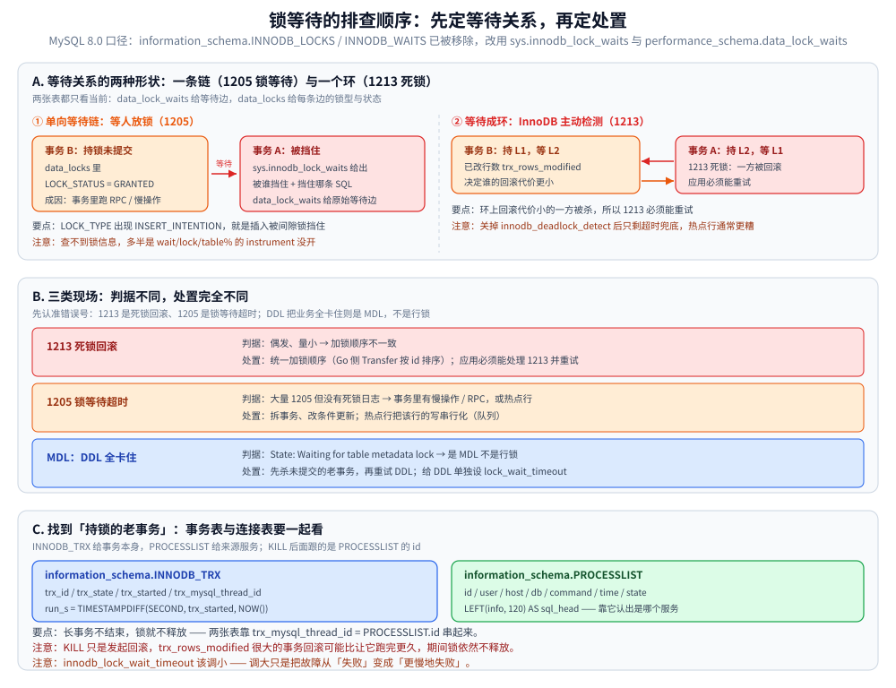

# 锁等待与死锁排查

> 线上「更新语句卡住」「整表突然全卡」的现场排查：谁在等谁、死锁日志怎么看、持锁的老事务怎么找。
> 锁的机制侧（意向锁 / 间隙锁 / 临键锁 / MDL）见 [InnoDB的并发控制实现.md](InnoDB的并发控制实现.md)，本篇只讲**排查动作**。
>
> 内容整理自个人学习笔记。素材见 [素材清单](../../../../素材清单.md)。
>
> ⚠️ 本篇命令来自 MySQL **8.0** 的口径：`information_schema.INNODB_LOCKS` / `INNODB_WAITS` 在 8.0 已被移除，旧文章里的写法会直接报错。

---

## 一、谁在等谁

**本节要点**：8.0 有现成视图直接给出「被谁挡住 + 该 kill 谁 + 挡住了哪条 SQL」，不必自己拼表。

```sql
-- 现成的视图：直接给出"被谁挡住 + 该 kill 谁 + 挡住了哪条 SQL"
SELECT * FROM sys.innodb_lock_waits\G

-- 8.0 的 information_schema.INNODB_LOCKS / INNODB_WAITS 已被移除，改用：
SELECT * FROM performance_schema.data_lock_waits\G
SELECT ENGINE_TRANSACTION_ID, THREAD_ID, OBJECT_NAME, LOCK_TYPE, LOCK_MODE, LOCK_STATUS, LOCK_DATA
  FROM performance_schema.data_locks;   -- RECORD / GAP / INSERT_INTENTION，能看出是不是间隙锁在挡

-- ⚠️ 查不到锁信息，多半是这两张表的 consumer 没开（默认部分关闭）
UPDATE performance_schema.setup_instruments SET ENABLED='YES', TIMED='YES' WHERE NAME LIKE 'wait/lock/table%';
```

> `LOCK_TYPE` 里出现 `INSERT_INTENTION`，通常就是**插入被间隙锁挡住** —— 也就是有人在一个较大范围上持着间隙锁（原因见 [InnoDB的并发控制实现.md](InnoDB的并发控制实现.md) 的加锁范围一节）。

## 二、死锁：不要只靠 `LATEST DETECTED DEADLOCK`

**本节要点**：`SHOW ENGINE INNODB STATUS` 只保留最近一次死锁，而且需要出现新的输出段才会刷新；生产应该把每次死锁都落日志。

```bash
# 只保留"最近一次"死锁，且需要 RECREATE 输出段才刷新；生产应把死锁写进错误日志
docker exec -i mysql8 mysql -uroot -p -e "SHOW ENGINE INNODB STATUS\G" | sed -n '/LATEST DETECTED DEADLOCK/,/TRANSACTIONS/p'
```

```sql
-- 让每次死锁都被完整记录（含两边 SQL），排期比看 STATUS 有用得多
SHOW VARIABLES LIKE 'innodb_print_all_deadlocks';   -- 建议 ON
SHOW VARIABLES LIKE 'innodb_deadlock_detect';       -- 关掉它 = 只能用等待超时兜底，热点行场景反而更糟
```

**三类现场与处置**：

| 现象 | 判断 | 处置 |
|---|---|---|
| 死锁（1213）偶发、量小 | 加锁顺序不一致 | **统一顺序**（见 [事务与隔离级别.md](事务与隔离级别.md) 的第一节 ⑤），Go 侧见 `Transfer` 的按 id 排序 |
| 大量 1205 锁等待超时，但没有死锁日志 | 有人在事务里做慢操作 / RPC，或热点行 | 拆事务、改条件更新、或把该行的写串行化（队列） |
| DDL 把业务全卡住，`State: Waiting for table metadata lock` | MDL，不是行锁 | 看 `lock_wait_timeout` 与**未提交的老事务**，先杀事务再重试 DDL（在线 DDL 步骤见 [深分页与索引变更.md](深分页与索引变更.md) 的「索引变更」） |

> 1213 是死锁回滚、1205 是锁等待超时 —— 两个错误号对应的处置完全不同，别混。

## 三、找到「持锁的老事务」

**本节要点**：长事务不结束，锁就不释放；定位要同时看「事务」（INNODB_TRX）与「连接」（PROCESSLIST），才能追到是哪个服务。

```sql
-- 事务已经跑了很久还没结束 = 锁一直被持有；长事务的现场版
SELECT trx_id, trx_state, trx_started, TIMESTAMPDIFF(SECOND, trx_started, NOW()) AS run_s,
       trx_rows_locked, trx_rows_modified, trx_mysql_thread_id
  FROM information_schema.INNODB_TRX
 ORDER BY trx_started LIMIT 10;

-- 关联到连接与来源，才能定位是哪个服务
SELECT id, user, host, db, command, time, state, LEFT(info, 120) AS sql_head
  FROM information_schema.PROCESSLIST
 WHERE command <> 'Sleep'
 ORDER BY time DESC LIMIT 10;

-- 确认无误再杀（回滚本身可能比等它跑完更久，大事务慎杀）
-- KILL <processlist_id>;
```

> ⚠️ **大事务慎杀**：`KILL` 只是发起回滚，`trx_rows_modified` 很大的事务回滚耗时可能比让它跑完更久，期间锁依然不释放。
>
> 与 MVCC 的关联：`trx_rows_modified` 很大的长事务会让 **undo 版本链变长**，
> 快照读要沿链回溯更远（读变慢），同时 purge 无法推进 → undo 表空间膨胀。
> 这就是 [MVCC多版本并发控制.md](../../并发控制/MVCC多版本并发控制.md) 里「存储开销 / 垃圾回收」在监控上的具体体现。



**图怎么读**：A 区给出等待关系的两种形状——单向等待链对应 1205（B 持锁未提交、A 被挡住，`data_lock_waits` 给等待边、`data_locks` 给锁型），互相持锁成环对应 1213，环上回滚代价小的一方被杀，所以应用必须能重试。B 区是三类现场的判据与处置：1213 改加锁顺序、1205 拆事务或把热点行串行化、DDL 全卡住是 MDL 要走 `lock_wait_timeout` 与老事务。C 区是定位持锁老事务的两张表：`INNODB_TRX` 看事务跑了多久、锁了多少行，`PROCESSLIST` 靠 `LEFT(info, 120)` 认出是哪个服务，两者用 `trx_mysql_thread_id = PROCESSLIST.id` 串起来。

## 延伸追问

- **为什么开了 `data_locks` 还是查不到锁？** → 这两张表的 instrument / consumer 默认部分关闭，需要显式打开（见第一节的 `setup_instruments`）。
- **死锁能不能彻底避免？** → 不能，只能减少；InnoDB 的应对是检测到环就立刻回滚代价小的一方，所以应用必须能处理 1213 并重试。
- **关掉 `innodb_deadlock_detect` 会怎样？** → 死锁不再被主动检测，只能靠 `innodb_lock_wait_timeout` 超时兜底；热点行场景下等待会显著变长，通常更糟。
- **锁等待超时该调大还是调小？** → 调小让请求快速失败、避免连接被占死；调大只是把故障从「失败」变成「更慢地失败」，一般不推荐。
- **MDL 等待要怎么预防？** → DDL 前先确认没有长事务与未提交的连接；给 DDL 单独设 `lock_wait_timeout`，避免 `ALTER` 在队列里把后面所有请求一起堵住。

## 关联

- [InnoDB的并发控制实现.md](InnoDB的并发控制实现.md) — 本篇机制侧（锁类型、加锁范围、MDL）
- [事务与隔离级别.md](事务与隔离级别.md) — 长事务的代价、死锁的两个必要条件与减少手段
- [深分页与索引变更.md](深分页与索引变更.md) — 在线 DDL 的步骤（MDL 等待的处置上游）
- [观测与诊断.md](观测与诊断.md) — 从监控侧发现锁等待与长事务
- [素材清单.md](../../../../素材清单.md) — 素材来源登记
