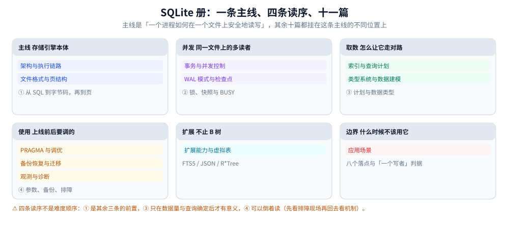

# SQLite 目录导读

> 覆盖 SQLite 的架构与执行链路、文件格式与页结构、索引与查询计划、事务与并发控制、
> WAL 与检查点、类型系统与数据建模、PRAGMA 调优、备份恢复与迁移、观测诊断、
> 扩展能力（FTS5 / JSON1 / R\*Tree / 虚拟表），外加一篇汇总式的应用场景。
>
> 不覆盖：跨产品的选型对照（MySQL / PostgreSQL / 云托管怎么比）见 [关系型选型对比.md](../关系型选型对比.md)；
> MySQL 侧的同名主题见 [MySQL/README.md](../MySQL/README.md)。
>
> 内容整理自个人学习笔记。**实测口径**：本机 Go 1.26.5 + `modernc.org/sqlite`（纯 Go，
> 内嵌 SQLite 3.54.1，`THREADSAFE=1`，`DEFAULT_PAGE_SIZE=4096`，`MAX_VARIABLE_NUMBER=32766`，
> 57 条编译选项）。⚠️ 本机在 Windows 上 `time.Now()` 有毫秒级量化，**µs 级结论一律是
> 「N 次累计 ÷ N」**；毫秒级读数（插入、VACUUM、备份）用单次或中位数。
> `sqlite3` CLI 不在本机 PATH，涉及 CLI 的命令标注了替代做法。

---

## 一、这个目录怎么读

本目录 11 篇，按**五个主题域**组织（域只体现为阅读顺序，文件本身平铺）：

| 域 | 篇 |
|---|---|
| **应用边界** | [应用场景.md](应用场景.md) |
| **存储引擎本体** | [架构与执行链路.md](架构与执行链路.md)、[文件格式与页结构.md](文件格式与页结构.md) |
| **并发控制** | [事务与并发控制.md](事务与并发控制.md)、[WAL模式与检查点.md](WAL模式与检查点.md) |
| **查询与数据** | [索引与查询计划.md](索引与查询计划.md)、[类型系统与数据建模.md](类型系统与数据建模.md) |
| **上线与运维** | [PRAGMA与调优.md](PRAGMA与调优.md)、[备份恢复与迁移.md](备份恢复与迁移.md)、[观测与诊断.md](观测与诊断.md) |
| **扩展能力** | [扩展能力与虚拟表.md](扩展能力与虚拟表.md) |

## 二、版本坐标速查

SQLite 没有 LTS，每年数个版本，特性按小版本进来。下表是各篇会用到的门槛：

| 特性 | 引入版本 | 用在哪 |
|---|---|---|
| WAL 模式 | 3.7.0（2010-07） | [WAL模式与检查点.md](WAL模式与检查点.md) |
| `WITHOUT ROWID` | 3.8.2（2013-12） | [索引与查询计划.md](索引与查询计划.md) |
| FTS5 | 3.9.0（2015-10） | [扩展能力与虚拟表.md](扩展能力与虚拟表.md) |
| `PRAGMA optimize` | 3.18.0（3.32 起自动分析） | [PRAGMA与调优.md](PRAGMA与调优.md) |
| 窗口函数 | 3.25.0（2018-09） | — |
| `VACUUM INTO` | 3.27.0（2019-02） | [备份恢复与迁移.md](备份恢复与迁移.md) |
| `MAX_VARIABLE_NUMBER` 增至 32766 | 3.32.0（2020-05） | [索引与查询计划.md](索引与查询计划.md) |
| `trigram` 分词器 | 3.34.0（2020-12） | [扩展能力与虚拟表.md](扩展能力与虚拟表.md) |
| `RETURNING` | 3.35.0（2021-03） | [架构与执行链路.md](架构与执行链路.md) |
| `STRICT` 表 | 3.37.0（2021-11） | [类型系统与数据建模.md](类型系统与数据建模.md) |
| JSON 函数内置（不再需要 `ENABLE_JSON1`） | 3.38.0（2022-02） | [扩展能力与虚拟表.md](扩展能力与虚拟表.md) |
| `RIGHT` / `FULL JOIN` | 3.39.0（2022-06） | — |
| 聚合里的 `ORDER BY` | 3.44.0（2023-11） | — |

⭐ 这张表的用处：**移动端与嵌入式落点的库版本由系统决定**，不由你决定。
写 `STRICT` 表或 `RETURNING` 之前先查目标设备的最低版本；查不到就降级写法，
或把版本门槛写进应用的启动检查。

## 三、学习路径

| 顺序 | 篇 | 视角 |
|---|---|---|
| ① | [应用场景.md](应用场景.md) | 八个落点按「同时几个写者」排开、什么时候它反而是错配、五个换引擎信号 |
| ② | [架构与执行链路.md](架构与执行链路.md) | 四层结构、`prepare` 与 `step` 的边界、VDBE 寄存器机、编译期选项改了哪一层 |
| ③ | [文件格式与页结构.md](文件格式与页结构.md) | 100 字节头、B 树页与 cell、溢出页、freelist、VACUUM 重写了什么 |
| ④ | [索引与查询计划.md](索引与查询计划.md) | 表与索引同构、`WITHOUT ROWID` 取舍、EQP 五类输出、只有嵌套循环 JOIN、索引失效 |
| ⑤ | [事务与并发控制.md](事务与并发控制.md) | 唯一隔离级别、五种文件锁、`BEGIN IMMEDIATE`、`busy_timeout`、SAVEPOINT、BUSY 治理顺序 |
| ⑥ | [WAL模式与检查点.md](WAL模式与检查点.md) | 帧结构与 `-shm`、读快照、checkpoint 三种模式、`-wal` 为何增长、何时不该开 |
| ⑦ | [类型系统与数据建模.md](类型系统与数据建模.md) | 五类亲和性、动态类型的三个麻烦、`STRICT` 表、时间/金额/布尔、JSON 列、外键默认关 |
| ⑧ | [PRAGMA与调优.md](PRAGMA与调优.md) | 四类 PRAGMA、`synchronous` 的代价由提交次数决定、`cache_size` 的负结果、调优顺序 |
| ⑨ | [备份恢复与迁移.md](备份恢复与迁移.md) | 三条备份路径的锁行为、为什么拷文件会丢数据、hot journal 与 WAL 两条恢复路径、MySQL 映射 |
| ⑩ | [观测与诊断.md](观测与诊断.md) | 五类就地取证、`integrity_check` vs `quick_check`、计时怎么量、错误码分诊、六类故障顺序 |
| ⑪ | [扩展能力与虚拟表.md](扩展能力与虚拟表.md) | FTS5 五张影子表、`MATCH` vs `LIKE`、JSON1 两种遍历、R\*Tree、虚拟表接口 |

> ⭐ **两条线**：**机制线**（②③④⑤⑥）回答「它内部怎么运转」，读的时候顺序不能乱——
> ④依赖③的页结构，⑥依赖⑤的锁模型。
> **落地线**（①⑦⑧⑨⑩）回答「怎么用它不出事」，可以按需跳读。
> ⭐ ⑪ 是支线：前三步（FTS5 / JSON / R\*Tree）各自独立，读完 ④ 就能看；
> 只有「虚拟表接口」那一节需要②③的背景。
> ⭐ 只关心「为什么线上报 database is locked」的，直接读 ⑤ 第二、三节与 ⑩ 第四节。

## 四、与其他目录的边界

| 主题 | 去哪 |
|---|---|
| 跨产品选型（SQLite vs MySQL vs PostgreSQL vs 云托管） | [关系型选型对比.md](../关系型选型对比.md) |
| MySQL 侧的同类主题（InnoDB、复制、分表、参数调优） | [MySQL/README.md](../MySQL/README.md) |
| B+Tree 作为数据结构的一般原理 | [B树与B+树.md](../../../../02-计算机基础/数据结构/树/磁盘存储树/B树与B+树.md) |
| 跨产品的锁与 MVCC 理论 | [并发控制](../../并发控制/README.md) |
| 批量导入导出、进度回报、断点续传 | [数据导入导出设计.md](../../../../04-架构与系统/系统设计/数据导入导出设计.md) |
| 跨库 / 跨服务的数据同步与 CDC | [CDC](../../数据同步/CDC/README.md) |
| 时序、文档、搜索等其他存储族 | [数据库选型对比.md](../../数据库选型对比.md) |

**图怎么读**：上面三张卡是主线（存储引擎本体），中间两张是并发控制，右边是「取数 / 使用 / 扩展 / 边界」四条支线。底部一行说明了读序的性质：① 是其余三条的前置，③ 只在数据量与查询确定后才值得看，④ 可以倒着读——先看排障现场，再回去看机制。这张图不含篇数以外的任何读数，各篇的独有读数在正文里。

## 五、本册的四个已知缺口

| 缺口 | 现状 |
|---|---|
| `backup API` 未实测 | Go 驱动未暴露 C 接口，[备份恢复与迁移.md](备份恢复与迁移.md) 里标了「未实测」 |
| `sqlite3_stmt_status` / `db_status` 未实测 | 同样是 C 接口（`modernc` 未暴露），[观测与诊断.md](观测与诊断.md) 里只讲用途不引读数 |
| 中文分词 | 内置分词器都不做词典分词，[扩展能力与虚拟表.md](扩展能力与虚拟表.md) 给了 `trigram` 与「外部先分词」两条路 |
| 多进程 / 多副本的外部方案 | 只讲了「为什么不能」，未展开 rqlite / LiteFS 一类方案，属选型范畴 |

⭐ 这四条不是遗漏，是**边界**：前两条受本机工具链限制，后两条属于其他目录的职责。
写新篇前先确认不要与这四条重复。
