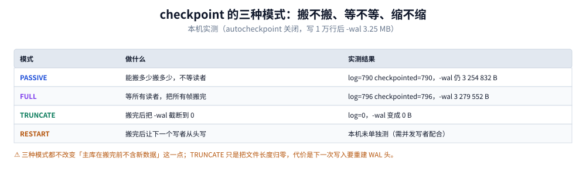

# WAL 模式与检查点

> 覆盖：WAL 为什么能让读写并行、`-wal` 与 `-shm` 两个文件的结构、
> 读快照与「读己之写」的关系、checkpoint 的三种模式（`PASSIVE` / `FULL` / `TRUNCATE`）、
> `-wal` 无限增长的成因与监控口径、以及什么场景下不该开 WAL。
>
> 不覆盖：锁的五态与 `SQLITE_BUSY` 处理见 [事务与并发控制.md](事务与并发控制.md)；
> 主库页结构与 freelist 见 [文件格式与页结构.md](文件格式与页结构.md)；
> `journal_mode` 属于哪类 PRAGMA 见 [PRAGMA与调优.md](PRAGMA与调优.md)。
>
> 内容整理自个人学习笔记。**实测口径**：本机 Go 1.26.5 + `modernc.org/sqlite`（SQLite 3.54.1），
> `wal_autocheckpoint` 关闭（值 0）以观察无 checkpoint 时的增长；每轮一个事务写 2000 行。
> `-wal` / `-shm` 大小取自文件系统，不用估算。

---

## 一、WAL 是什么？为什么读写能并行？

**本节要点**：WAL 不是「日志文件」，是「**页的新版本追加堆**」。写者把改过的整页追加到
`-wal`，读者按自己的快照位置去读——所以读的人不需要锁，写的人也不需要等读的人。

### 1.1 与 rollback journal 的根本差别

| 维度 | rollback journal | WAL |
|---|---|---|
| 提交时改哪里 | 改**主库文件**里的页 | 只往 `-wal` **追加** |
| 回滚靠什么 | 用 journal 把旧值写回 | 丢弃未提交的帧 |
| 读者看到什么 | 主库当前内容（所以写时要独占） | 自己快照位置之前的帧 |
| 读写是否互斥 | **互斥** | **不互斥** |
| 写写是否互斥 | 互斥 | 互斥（仍只有一个写者） |
| 额外文件 | `-journal`（提交后删除） | `-wal` + `-shm`（常驻） |

⭐ 一句话：journal 是「改之前先记账，好回滚」，WAL 是「改的结果先写别处，回头再归位」。
前者保的是原子性，后者同时拿到了并发读。

### 1.2 本机实测的「读写不互斥」

| 操作（写事务未提交时） | 结果 |
|---|---|
| 另一连接 `SELECT count(*)` | 成功，读到 1 行，耗时 559 µs |
| 另一连接 `INSERT` | `database is locked (5)` |

读之所以成功，是因为它读的是自己快照之前的帧，**根本没碰写者正在追加的那部分**。
而写失败，是因为写者唯一这条规则没有被 WAL 改变。

---

## 二、`-wal` 与 `-shm` 两个文件的结构

**设置要点**：三个文件要一起看：主库、`-wal`、`-shm`。只拷主库会丢数据，
这是 WAL 模式下最常见的备份事故。

### 2.1 结构


五段从上到下就是 `-wal` 文件里真实的顺序：32 字节头，然后一帧接一帧。每帧的「帧体」是整页内容而不是增量——这一点决定了 WAL 会比你以为的大。最下面那段是 `-shm`，它是索引不是数据，删了会自动重建。

| 部分 | 大小 | 内容 |
|---|---|---|
| WAL 头 | 32 字节 | magic（`0x377f0682` / `0x377f0683`，后者表示按大端校验）、格式版本、页大小、checkpoint 序号、salt-1/2、校验和 |
| 帧头 | 24 字节 | 页号、提交后的库页数、salt-1/2、帧校验和 |
| 帧体 | 一页（本机 4096） | 该页的完整内容 |
| 提交标记 | 帧头里的「库页数」非 0 | 表示这是一次提交的最后一帧 |
| `-shm` | 本机恒 32768 | WAL 索引：页号 → 最新帧号的哈希表 + 读者标记（read-mark） |

### 2.2 三个容易记错的点

1. **帧体是整页，不是增量**。所以改一行也可能产生 4 KiB 的帧。
2. **`-shm` 不是数据**，删掉会自动重建（但正在有连接时需要小心）。
3. **WAL 头里有页大小**：换页大小会让整条 WAL 作废，所以改页大小必须先切回 journal 模式。

### 2.3 本机实测的大小关系

| 项 | 读数 |
|---|---|
| `-shm` | 恒 32768 字节（写 2 万到 10 万行都没变） |
| `-wal` | 2 万行 473 832 → 10 万行 2 360 792 字节 |
| 主库 `db` | **恒 4096 字节**（因为没 checkpoint） |

⚠️ 主库恒 4096 字节这件事第一次见会以为数据丢了。它只有一页：文件头 + schema 根页。
全部数据都在 `-wal` 里，见第五节。

---

## 三、读快照与「读己之写」

**本节要点**：每个读事务在开始时记下「WAL 的哪个位置是我能看到的」，之后只看这之前。
写事务自己能看到自己的未提交改动（读己之写），但别人看不到。

### 3.1 快照的建立时机

| 时刻 | 快照位置 |
|---|---|
| 第一条 `SELECT` 执行时 | 当时的 WAL 末尾（`mxFrame`） |
| 之后的同事务内查询 | 不变（可重复读） |
| 事务结束 | 释放 read-mark |

⭐ 这就是「WAL 下读事务天然可重复读」的来源：快照在执行第一条读时定下，
之后别人提交多少都看不到。

### 3.2 「读己之写」与「看不到别人的未提交」

| 视角 | 能否看到 |
|---|---|
| 写事务自己 | ✅ 自己的未提交改动（走本地页缓存） |
| 其他读者 | ❌ 未提交的帧（那些帧还没有提交标记） |
| 其他读者 | ✅ 已提交的帧（在快照内） |

### 3.3 快照过期：`SQLITE_BUSY_SNAPSHOT`（517）

本机实测：读快照建立后，别人推进了 WAL，此时这个读事务想升级写 → `database is locked (517)`。
含义是「你的快照落后了，不能在这个快照上写」。

处理口径：

| 做法 | 说明 |
|---|---|
| 重开事务 | 唯一正确做法：`ROLLBACK` 后用新快照重来 |
| 不要重试同一语句 | 快照不会自己变新，重试必然再失败 |
| 预防 | 会写的事务用 `BEGIN IMMEDIATE`，一开始就拿写锁，不建立「只读快照」 |

---

## 四、checkpoint 的三种模式

**设置要点**：checkpoint 是把 `-wal` 里的帧**搬回主库**。它不改变事务语义，
只影响「`-wal` 有多大」与「启动时要重放多久」。三种模式的区别是「搬多少、等不等、缩不缩」。



四行是三种模式加一个未实测的 RESTART；中间一列是「做什么」，右侧是本机实测的帧数与文件大小。注意前两行的 `-wal` 都还有 3.2 MB 左右——搬完了不等于文件变小，只有 TRUNCATE 才缩。

### 4.1 三种模式

| 模式 | 行为 | 阻塞读者 | 缩文件 |
|---|---|---|---|
| `PASSIVE` | 能搬多少搬多少，不等读者 | ❌ 不等 | ❌ |
| `FULL` | 等所有读者退场，把能搬的都搬完 | ✅ 等 | ❌ |
| `TRUNCATE` | `FULL` 之后把 `-wal` 截断为 0 | ✅ 等 | ✅ |
| `RESTART` | `FULL` 之后让下一个写者从头开始写 | ✅ 等 | ❌（但会重用） |

### 4.2 本机实测（`autocheckpoint` 关闭，写 1 万行后 `-wal` 3.25 MB）

| 模式 | 返回值（busy / log / checkpointed） | 之后 `-wal` |
|---|---|---|
| `PASSIVE` | 0 / 790 / 790 | 3 254 832 字节（不缩） |
| `FULL` | 0 / 796 / 796 | 3 279 552 字节（略增） |
| `TRUNCATE` | 0 / 0 / 0 | **0 字节** |

⭐ `log` 是「WAL 里有多少帧」，`checkpointed` 是「这次搬了多少帧」。两者相等说明全搬完了。
`TRUNCATE` 之后两者归 0，因为文件已被截断。

### 4.3 自动 checkpoint

默认 `wal_autocheckpoint = 1000` 页（约 4 MB），日志页数超过就自动跑一次 `PASSIVE`。
所以正常运行时 `-wal` 不会无限涨——除非：

- 有人把它设成 0（本实验就是为了看这个）
- 有一个长读事务一直挡着 `PASSIVE`（`PASSIVE` 不等读者，但读者挡住的部分搬不走）
- 写速度持续高于 checkpoint 速度

```sql
PRAGMA wal_autocheckpoint;        -- 当前阈值（页数）
PRAGMA wal_autocheckpoint = 0;    -- 关闭自动
PRAGMA wal_checkpoint(PASSIVE);   -- 手动跑一次
```

---

## 五、`-wal` 为什么会无限增长？

**设置要点**：增长不是 bug，是「没搬回主库的帧一直堆着」。诊断顺序是
**先看有没有长读事务，再看 autocheckpoint，最后才怀疑写速度**。

### 5.1 本机实测的增长曲线


五个刻度是每写 2 万行读一次 `-wal` 大小，线性增长到 2.36 MB；而主库文件在这五档里一直是 4096 字节。这条曲线是「autocheckpoint 关闭」时的形态，正常配置下它会停在 4 MB 附近上下波动。

| 累计行数 | 主库 | `-wal` | `-shm` |
|---|---|---|---|
| 2 万 | 4096 | 473 832 | 32 768 |
| 4 万 | 4096 | 943 512 | 32 768 |
| 6 万 | 4096 | 1 413 192 | 32 768 |
| 8 万 | 4096 | 1 882 872 | 32 768 |
| 10 万 | 4096 | 2 360 792 | 32 768 |
| `TRUNCATE` 后 | 4096 | **0** | 32 768 |

每 2 万行约 470 KB，即每行约 24 字节 WAL 增量——因为每轮是 2000 行一个事务，
每事务只提交改动过的页，页内多行分摊到一次页写。

### 5.2 四个成因与对策

| 成因 | 症状 | 对策 |
|---|---|---|
| 长读事务一直不结束 | `-wal` 单调涨，checkpoint 的 `checkpointed` 小于 `log` | 找出持读快照的连接，缩短它 |
| `wal_autocheckpoint = 0` | 与上图一致 | 恢复默认 1000 页 |
| 写速度极高（连续批量导入） | `-wal` 涨到 GB 级 | 导入期间提高阈值或手动 checkpoint |
| 磁盘慢，checkpoint 跟不上 | `-wal` 波动但总体上行 | 换盘或降低写入速率 |

### 5.3 监控口径

```sql
-- 一行看当前 WAL 状态（读连接上也能跑）
PRAGMA wal_checkpoint(PASSIVE);   -- 返回 busy / log / checkpointed
```

`busy` 非 0 说明有读者挡住了部分帧。连续多次看到 `busy > 0` 且 `checkpointed < log`，
就是「有人长期持有读快照」的信号。

⚠️ 不要用「文件大小」单独判断，因为 `-wal` 只在 `TRUNCATE` 时才缩。
用 `log - checkpointed` 这个差值更准。

---

## 六、什么场景下不该开 WAL？

**设置要点**：WAL 有两个硬前提：**同一台机器**、**支持共享内存的文件系统**。
另外它对「拷文件即备份」这种用法是破坏性的。

| 场景 | 该不该开 | 原因 |
|---|---|---|
| 移动端/桌面单机 | ✅ 开 | 读写并行收益明显，且都在本地 |
| 服务端小站（单机） | ✅ 开 | 读请求不挡写 |
| 库放在 NFS / SMB 共享盘 | ❌ 不开 | `-shm` 依赖 mmap 共享内存，网络文件系统不可靠 |
| 只读介质（CD、只读镜像） | ❌ 不开 | WAL 需要写 `-wal` 与 `-shm` |
| 需要「拷一个文件就完成备份」 | ⚠️ 谨慎 | 必须连 `-wal` 一起拷，或用 `VACUUM INTO` |
| 纯批量导入、无并发读 | 收益小 | `-wal` 会涨，checkpoint 反而增加 I/O |
| 多个进程写同一个文件 | ❌ 换引擎 | WAL 不解决多写者问题 |

### 6.1 切换与确认

```sql
-- 切到 WAL（返回 'wal' 表示成功）
PRAGMA journal_mode = WAL;
PRAGMA journal_mode;       -- 读回确认

-- 切回（会先把 WAL 合并回主库）
PRAGMA journal_mode = DELETE;
```

⚠️ `journal_mode` 是**持久设置**，写进库头，一次切换对之后所有连接生效。
这与 `busy_timeout` 那种连接级参数完全不同，别混。区分方法见
[PRAGMA与调优.md](PRAGMA与调优.md) 第一节的四类划分。

### 6.2 只读副本与备份的分界

WAL 让人产生「能不能把 `-wal` 拷给别人当副本」的想法。技术上可行（流式备份就是这个思路），
但有三个前提：拷贝要原子、要能处理帧边界、接收端要能重放。自己实现容易出错，
用现成方案（如流式备份工具）或直接用 `VACUUM INTO` 做快照更稳，见
[备份恢复与迁移.md](备份恢复与迁移.md) 第二节。

---

## 七、运维口径：三条命令与两个阈值

**设置要点**：WAL 的运维比 journal 模式多两个文件、多一个后台动作（checkpoint）。
需要盯的只有两件事：`-wal` 多大、checkpoint 是否被挡住。

| 项 | 命令/做法 | 阈值 |
|---|---|---|
| `-wal` 大小 | 看文件，或 `log - checkpointed` | 超过 `wal_autocheckpoint × page_size` 的 2~3 倍就要查 |
| 是否被读者挡住 | `PRAGMA wal_checkpoint(PASSIVE)` 的 `busy` | 连续非 0 → 查长事务 |
| 是否真的在 WAL | `PRAGMA journal_mode` | 返回 `wal` |
| checkpoint 频率 | 自动：每 1000 页；手动：低峰跑 `TRUNCATE` | 长跑服务建议夜间 `TRUNCATE` 一次 |

```bash
# 一条命令看三个文件的大小关系（Linux/macOS）
ls -l app.db app.db-wal app.db-shm 2>/dev/null
```

---

## 使用：开 WAL、复现增长、再收回去

**本节要点**：四步，全程可复现。目的是亲手看到「主库不涨、`-wal` 涨」这个反直觉现象，
以后在线上看到才不会误判成数据丢失。

### 使用一：SQL 侧

```sql
PRAGMA journal_mode = WAL;        -- 返回 wal
PRAGMA wal_autocheckpoint;        -- 默认 1000
PRAGMA wal_autocheckpoint = 0;    -- 关掉自动，便于观察

-- 写数据（用事务，否则每行一次 fsync）
BEGIN IMMEDIATE;
INSERT INTO t(b) VALUES('x');
COMMIT;

-- 看大小：主库几乎不变，-wal 在涨
PRAGMA page_count;

-- 手动 checkpoint，看三种模式的差别
PRAGMA wal_checkpoint(PASSIVE);
PRAGMA wal_checkpoint(FULL);
PRAGMA wal_checkpoint(TRUNCATE);   -- -wal 归零
```

### 使用二：Go 侧（配置 + 观测）

```go
// 开 WAL 并设 autocheckpoint
dsn := "file:app.db?_pragma=journal_mode(WAL)&_pragma=wal_autocheckpoint(1000)"
db, err := sql.Open("sqlite", dsn)
if err != nil {
    return err
}
db.SetMaxOpenConns(1)

// 观测：返回 busy / log / checkpointed
func walStatus(db *sql.DB) (busy, logN, ckpt int, err error) {
    err = db.QueryRow("PRAGMA wal_checkpoint(PASSIVE)").Scan(&busy, &logN, &ckpt)
    return
}

// 低峰收尾：把 -wal 截断
func walTruncate(db *sql.DB) error {
    _, err := db.Exec("PRAGMA wal_checkpoint(TRUNCATE)")
    return err
}
```

⚠️ `PRAGMA wal_checkpoint(PASSIVE)` 在有些驱动上返回 1 列（只返回 busy），
有些返回 3 列。写代码前先用 `PRAGMA wal_checkpoint` 试一次列数，
或统一用 `Exec` 不取返回值。本机（modernc 1.60.1 + SQLite 3.54.1）返回 3 列。

### 使用三：验证「切回 journal 模式会合并」

```sql
PRAGMA journal_mode = DELETE;   -- 返回 delete，WAL 已被合并进主库
-- 此时 app.db-wal 应已消失或为 0
```

### 判读表

| 观察 | 结论 |
|---|---|
| 主库 4096 字节、`-wal` 很大 | 正常，未 checkpoint；不是数据丢失 |
| `-wal` 涨到 GB 级 | 查长读事务 / `autocheckpoint` 是否被关 |
| `PRAGMA journal_mode` 返回 `delete` | 没开成 WAL（常见原因：库在只读介质、或有其他连接） |
| `-shm` 恒 32768 | 正常，它就是这么大 |
| 切 WAL 后启动变慢 | 启动时要重放 `-wal`，属预期；`TRUNCATE` 后恢复正常 |

---

## 延伸追问

**Q：WAL 模式能不能多进程写？**
不能。WAL 只解决读不阻塞写，写者仍然唯一（本机实测：写事务未提交时另一连接写立刻 BUSY）。
多进程写要么收敛写者，要么换引擎。

**Q：`-wal` 被别人删了会怎样？**
已提交但未 checkpoint 的事务会丢。这是「备份只拷主库」时最常见的丢数据方式。
恢复后库是一致的（不会坏），但数据回到最后一次 checkpoint 的状态。

**Q：为什么 `-shm` 删了会自动重建，而 `-wal` 删了会丢数据？**
`-shm` 只是索引（页号 → 帧号），可以从 `-wal` 重建；`-wal` 里是真实页内容，
是尚未合并进主库的唯一副本。

**Q：`PASSIVE` 和 `FULL` 都搬完了，为什么 `-wal` 还是那么大？**
因为 checkpoint 只把帧写回主库，不改变 `-wal` 文件的长度。要缩必须 `TRUNCATE`
（或 `RESTART` 让它从头重用）。这是文件系统层面的「截断」与「覆盖」的区别。

## 关联

- [README.md](README.md) — 本册导读与四条读序
- [事务与并发控制.md](事务与并发控制.md) — 上一篇：锁的五态与 BUSY 处理
- [文件格式与页结构.md](文件格式与页结构.md) — 主库页结构与 freelist，对照看「主库为何不涨」
- [PRAGMA与调优.md](PRAGMA与调优.md) — `journal_mode` / `wal_autocheckpoint` 的分类与取舍
- [备份恢复与迁移.md](备份恢复与迁移.md) — WAL 模式下的备份为什么必须连 `-wal` 一起拷
- [MySQL/日志与持久化.md](../MySQL/日志与持久化.md) — 对照读：redo + binlog 双日志与两阶段提交
