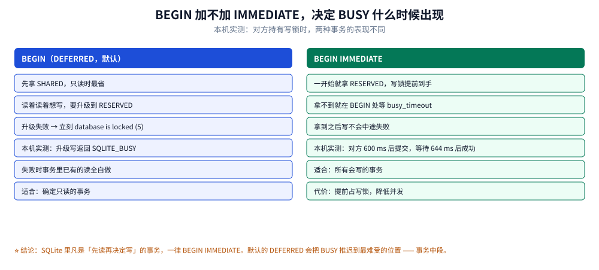
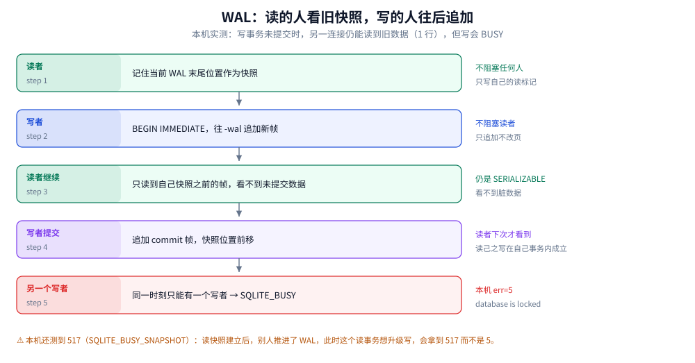

# 事务与并发控制

> 覆盖：SQLite 的事务语义（为什么只有一个隔离级别）、五种文件锁的状态机、
> `BEGIN` 三种模式对 `SQLITE_BUSY` 出现位置的影响、`busy_timeout` 与 `busy_handler` 的区别、
> `SAVEPOINT` 嵌套、WAL 下读写为什么能并行、以及把 BUSY 从常态压成偶发的四条设计口径。
>
> 不覆盖：WAL 文件格式与 checkpoint 见 [WAL模式与检查点.md](WAL模式与检查点.md)；
> 进程内多线程与连接池的组织方式见 [应用场景.md](应用场景.md)；
> 跨产品的并发控制理论见 [并发控制](../../并发控制/README.md)。
>
> 内容整理自个人学习笔记。**实测口径**：本机 Go 1.26.5 + `modernc.org/sqlite`（SQLite 3.54.1）。
> 锁冲突用两个独立连接（各自 `MaxOpenConns(1)`）在同一库上构造，错误码取自驱动返回值。
> 时间读数只保留毫秒级结论（`busy_timeout` 的等待时长），微秒级一律不写。

---

## 一、它的事务语义是什么？为什么只有一个隔离级别？

**本节要点**：SQLite 不提供隔离级别选项。它的默认行为是 **serializable**，
实现方式不是 MVCC，而是「**写者唯一 + 读者看到一致快照**」。理解这一点，
就不会问「怎么改成 RC」，也不会误以为它和 MySQL 的 RR 等价。

### 1.1 三个 ACID 落点

| 性质 | 靠什么实现 |
|---|---|
| 原子性 | rollback journal（或 WAL 的提交帧）：提交前所有改动可撤销 |
| 一致性 | 约束（`NOT NULL` / `CHECK` / `UNIQUE` / 外键）+ 事务边界 |
| 隔离性 | 写者唯一 + 读快照；没有 MVCC 版本链 |
| 持久性 | `synchronous` 决定 `fsync` 时机（默认 FULL） |

### 1.2 为什么没有「读已提交」

MVCC 需要为每行维护多个版本，SQLite 的设计目标里没有这一项。它用更简单的方式
达到「不读到脏数据」：

- rollback journal 模式下：读者持 `SHARED` 锁，写者要拿 `EXCLUSIVE` 才能改库文件，
  所以读者看到的永远是某个提交点之后的一致状态
- WAL 模式下：读者记住自己的快照位置，只看该位置之前的帧，写者往后追加

两种模式都没有「读到一半被别人改掉」的窗口，因此对外表现为 serializable。
代价是**并发度低**：journal 模式下读写互斥，WAL 模式下只有写写互斥。

### 1.3 与 MySQL 隔离级别的对照

| 能力 | MySQL（RC / RR） | SQLite |
|---|---|---|
| 读未提交 | 支持 | 不支持（也不需要） |
| 读已提交 | 支持 | 语义上等价于它的强版本 |
| 可重复读 | 支持（MVCC） | WAL 下读快照天然可重复读 |
| 串行化 | 支持（加锁读） | 全部事务都是这个语义 |
| 选择隔离级别的 SQL | `SET TRANSACTION ISOLATION LEVEL` | 无此语句 |

⭐ 所以「SQLite 能不能降隔离换并发」这个问题的答案是：**不能**。
要提升并发只有一个方向——缩短写事务、把写者收敛到一个进程。

---

## 二、五种文件锁的运行状态机

**本节要点**：并发控制的实现在文件锁上，不在库里的锁管理器。一条连接在任一时刻
处于五态之一，状态迁移由「想做什么」驱动。理解这个状态机，`SQLITE_BUSY` 就不再神秘。

### 2.1 五态


五层从上到下是同一个连接可能停留的位置。注意第三、四层：RESERVED 表示「打算写」、PENDING 表示「要提交了」——这两个中间态是很多人不知道的，它们正是「为什么我的写会被读卡住」的答案。

| 状态 | 能读 | 能写 | 同时可有几个 |
|---|---|---|---|
| `UNLOCKED` | — | — | 任意 |
| `SHARED` | ✅ | ❌ | 多个（读者之间不互斥） |
| `RESERVED` | ✅ | 写进缓存/日志，不改库文件 | 一个 |
| `PENDING` | ❌（挡新读者） | 等老读者退场 | 一个 |
| `EXCLUSIVE` | ❌ | ✅ 改库文件 | 一个 |

### 2.2 关键推论：长读事务会堵住写者

写者要提交，必须从 `RESERVED` 走到 `PENDING` 再到 `EXCLUSIVE`。
`PENDING` 的作用是**拒绝新的 `SHARED`**，然后等已有的读者全部释放。
所以：

- 一个跑了 3 秒的读事务 → 写者的提交要等 3 秒
- 一个忘记提交的连接 → 整个库的写被卡死

⚠️ 这与 MySQL 的 MVCC 完全不同：MySQL 里长读事务只影响 undo 回收，不挡写。
SQLite 里它直接挡写。这也是「ORM 忘 commit」在 SQLite 上后果更严重的原因。

### 2.3 本机实测的三个场景

| 场景 | 结果 |
|---|---|
| 连接 A 持写锁（`BEGIN IMMEDIATE` 后写入未提交），连接 B `busy_timeout=0` 写入 | 立刻 `database is locked (5) (SQLITE_BUSY)` |
| 同上，但 B 设 `busy_timeout=2000`，A 在 600 ms 后提交 | B 等待 **644 ms** 后成功 |
| A 读事务（拿到 `SHARED`）后尝试升级写，B 已持写锁 | `database is locked (5) (SQLITE_BUSY)` |

---

## 三、`BEGIN` 加不加 `IMMEDIATE`，为什么决定 BUSY 出现的位置？

**本节要点**：`BEGIN`（默认 `DEFERRED`）不在开始时拿写锁，等第一条写语句才去拿。
拿不到就立刻失败——**而且是在事务中段失败**，前面的读全白做。
`BEGIN IMMEDIATE` 把这次等待挪到事务开头。



左右两栏是同一个事务在两种模式下的时间线。看第四行：DEFERRED 的失败点在「读到一半想写」处，而 IMMEDIATE 把风险前移到 BEGIN 那一刻——这就是「宁可开头等，不要中段死」的工程含义。

### 3.1 三种 BEGIN 的语义

| 模式 | 开始时拿什么锁 | 适合 |
|---|---|---|
| `BEGIN` / `BEGIN DEFERRED` | 什么都不拿（第一条语句才拿） | **只读**事务 |
| `BEGIN IMMEDIATE` | `RESERVED`（写锁意图） | **所有会写的事务** |
| `BEGIN EXCLUSIVE` | `EXCLUSIVE`（独占，连读都挡） | 极少用：需要绝对独占（如重建索引、运维脚本） |

### 3.2 本机实测：升级写失败

```text
连接 A: BEGIN; SELECT count(*) FROM t;   -- 拿到 SHARED
连接 B: BEGIN IMMEDIATE; INSERT ...;      -- 拿到 RESERVED
连接 A: INSERT ...;                       -- 想升级到 RESERVED
→ database is locked (5) (SQLITE_BUSY)
```

这次失败在事务中段，A 之前的读全部作废。如果 A 一开始就用 `BEGIN IMMEDIATE`，
它会在这里等 `busy_timeout`，等到就继续，等不到就在开头失败——两种都比中段失败好。

### 3.3 一个反直觉的细节：`SAVEPOINT` 在只读事务里能执行

本机实测：同一个只读事务里执行 `SAVEPOINT sp` 返回成功（`err=<nil>`），
而 `INSERT` 返回 `BUSY`。原因是 `SAVEPOINT` 只是开一个回滚点，不需要写锁。
这条容易被误读成「SAVEPOINT 能绕过锁」——它不能，只是它本来就不要锁。

### 3.4 写法

```go
// 错误：DEFERRED，读后想写时才拿锁
tx, err := db.Begin()

// 正确：所有会写的事务都用 IMMEDIATE
tx, err := db.BeginTx(ctx, &sql.TxOptions{Isolation: sql.LevelSerializable})
// 注意：database/sql 的 Isolation 选项对 SQLite 无实际作用，
// 必须显式执行 BEGIN IMMEDIATE：
if _, err := db.ExecContext(ctx, "BEGIN IMMEDIATE"); err != nil { return err }
// 或者用驱动的连接级 DSN 参数把默认事务模式改掉
```

⚠️ Go 的 `database/sql` 会把 `Begin()` 翻译成 `BEGIN`（DEFERRED）。
要 `IMMEDIATE` 只能绕开 `Tx` 用 `Exec("BEGIN IMMEDIATE")`，或用支持配置事务模式的驱动。

```java
// sqlite-jdbc：连接级配置，把自动提交与事务模式设好
SQLiteConfig cfg = new SQLiteConfig();
cfg.setBusyTimeout(5000);
cfg.setJournalMode(SQLiteConfig.JournalMode.WAL);
try (Connection conn = DriverManager.getConnection("jdbc:sqlite:app.db", cfg.toProperties())) {
    conn.setAutoCommit(false);       // 等价于进入事务
    // 需要 IMMEDIATE 时显式执行语句
    try (Statement st = conn.createStatement()) {
        st.execute("BEGIN IMMEDIATE");
    }
}
```

---

## 四、`busy_timeout` 与 `busy_handler`：等待还是放弃

**设置要点**：两者解决的是「拿不到锁时怎么办」，默认是**立刻放弃**（`busy_timeout=0`）。
这是绝大多数「随机报 database is locked」的根因。

| 机制 | 行为 | 值 |
|---|---|---|
| `busy_timeout` | 拿不到锁时睡眠重试，总时长上限 | 毫秒；默认 0 |
| `busy_handler` | 回调，自己决定等多久、等几次 | 函数指针，灵活但易写错 |

### 4.1 本机读数

| 配置 | 对方持锁时的表现 |
|---|---|
| `busy_timeout=0`（默认） | 立即 `SQLITE_BUSY` |
| `busy_timeout=2000`，对方 600 ms 后提交 | 等待 644 ms 后成功 |

⭐ 644 ms 比 600 ms 多出的 44 ms 是「释放 → 重试命中」的调度间隙。
这说明 `busy_timeout` 是**轮询**不是事件通知，等待时长不能当精确值用。

### 4.2 设多少

| 场景 | 建议 |
|---|---|
| 单进程、单写者（移动端/桌面） | 0~100 ms，因为冲突本身不该出现 |
| 两进程（主进程 + 后台同步） | 500~2000 ms |
| 服务端小站（多请求） | 2000~5000 ms，并配合 `BEGIN IMMEDIATE` |
| 批量导入脚本 | 5000 ms 以上，或干脆停写 |

⚠️ 设很大不是解药：它把「立刻失败」变成「慢慢失败」，同时把线程占住。
真正的解药是缩短写事务与减少写者，见第七节。

### 4.3 重试的写法（Go）

```go
// 外层重试只处理可重试的错误码，不要无脑重试一切
func withRetry(ctx context.Context, db *sql.DB, fn func() error) error {
    var last error
    for attempt := 0; attempt < 3; attempt++ {
        if err := fn(); err != nil {
            last = err
            // 5 = SQLITE_BUSY，517 = SQLITE_BUSY_SNAPSHOT，6 = SQLITE_LOCKED
            if !isRetryable(err) {
                return err
            }
            select {
            case <-ctx.Done():
                return ctx.Err()
            case <-time.After(time.Duration(50*(attempt+1)) * time.Millisecond):
            }
            continue
        }
        return nil
    }
    return last
}
```

⚠️ 重试 `SQLITE_BUSY_SNAPSHOT`（517）时必须**从头重开事务**，
因为它意味着读快照已经过期；在原事务上重试同一语句不会成功。

---

## 五、`SAVEPOINT` 嵌套事务怎么用？

**设置要点**：SQLite 支持真正的嵌套回滚点，且**内层回滚不影响外层**。
这是它在业务代码里很实用的一点：可以在一个大事务里做「可选步骤」，
失败就只回退那一段。

### 5.1 本机实测

```text
BEGIN;
  INSERT 'outer-1';
  SAVEPOINT s1;
    INSERT 'inner-1';
  ROLLBACK TO s1;
  RELEASE s1;
  INSERT 'outer-2';
COMMIT;
→ 提交后剩 [outer-1 outer-2]，inner-1 被回滚
```

### 5.2 三个用法与一个陷阱

| 用法 | 写法 |
|---|---|
| 可选步骤 | `SAVEPOINT s; ...; ROLLBACK TO s; RELEASE s;` |
| 批量导入时按批隔离 | 每批一个 savepoint，坏批只丢这一批 |
| ORM 的嵌套事务模拟 | 外层真实事务 + 内层 savepoint |

⚠️ 陷阱：`ROLLBACK TO s` 之后必须 `RELEASE s`，否则 savepoint 会留在栈上。
长事务里反复这样写会累积栈深度，直到提交才清。

### 5.3 与「嵌套 BEGIN」的区别

SQLite 不支持嵌套 `BEGIN`（会报 `cannot start a transaction within a transaction`）。
`sentinel` 式的 ORM 通常用 savepoint 模拟嵌套，所以看到日志里出现
`SAVEPOINT` 而不是第二个 `BEGIN` 是正常的。

---

## 六、WAL 下的并发语义有什么不同？

**本节要点**：WAL 解决的是「**读不阻塞写**」，不是「多写」。写者仍然唯一。
本机实测：写事务未提交时，另一连接能读到旧快照（1 行），但写立刻 BUSY。

### 6.1 三条对照



五个节点是写事务从开始到提交的完整时间线，右侧是每一步对读者的影响。第四步是关键：读者看到的是自己快照之前的帧，所以它读到的是「提交前」的数据——这就是快照隔离在 WAL 上的形态。

| 场景 | journal 模式 | WAL 模式 |
|---|---|---|
| 写事务未提交时另一连接读 | **被阻塞**（要拿 `EXCLUSIVE`） | ✅ 成功（读旧快照） |
| 写事务未提交时另一连接写 | `SQLITE_BUSY` | `SQLITE_BUSY` |
| 长读事务是否会挡写 | ✅ 会（写者等它退场） | ❌ 不会 |
| 恢复方式 | hot journal 回滚 | 重放 `-wal` 帧 |

### 6.2 本机实测的两个错误码

| 操作 | 结果 |
|---|---|
| 写事务未提交时，另一连接 `SELECT count(*)` | 成功，读到 1 行，耗时 559 µs |
| 写事务未提交时，另一连接 `INSERT` | `database is locked (5)` |
| 读快照建立后，别人推进了 WAL，本连接想写 | `database is locked (517)` = `SQLITE_BUSY_SNAPSHOT` |

⭐ 517 这个码值得单独记：它只在 WAL 下出现，含义是「你的读快照已经落后，
不能在这个快照上写」。处理方式不是重试同一语句，而是**重开事务**（见 4.3）。

### 6.3 什么时候该切 WAL

| 条件 | 切 |
|---|---|
| 读多写少，且读操作与写操作来自不同连接/线程 | ✅ 明显收益 |
| 只读副本要并发读 | ✅ |
| 单写者、纯写入（批量导入） | 收益小，`-wal` 会涨 |
| 库放在网络文件系统 | ❌ WAL 需要共享内存（`-shm`），NFS 上不可靠 |
| 需要「拷文件即备份」 | ❌ 必须连 `-wal` 一起拷，否则丢数据 |

---

## 七、怎么把 BUSY 从常态压成偶发？

**本节要点**：BUSY 是症状，不是病因。四条设计口径按收益排序：
**减少写者 → 缩短写事务 → 用 IMMEDIATE → 才轮到设 busy_timeout**。

| 顺序 | 做法 | 收益 |
|---|---|---|
| 1 | 把多个写入方合并成一个写服务（队列化） | 数量级：从「排队冲突」变成「串行但无冲突」 |
| 2 | 写事务里不放网络调用、不读大文件、不 sleep | 数量级：持锁时长从秒降到毫秒 |
| 3 | 所有写事务用 `BEGIN IMMEDIATE` | 消除「中段失败」，失败点前移到开头 |
| 4 | 设合理的 `busy_timeout`（500~2000 ms） | 把偶发冲突吸收掉 |
| 5 | 读操作走独立连接或独立只读连接 | WAL 下读不挡写，进一步降冲突 |

### 7.1 一个反例：定时任务与 Web 进程各写一份

这是服务端最常见的翻车形态：

```text
Web 进程（每请求一次写） + 定时任务（每分钟批量写）
→ 定时任务持写锁 800 ms，期间所有 Web 请求的写全部 BUSY
→ 把 busy_timeout 调到 5 s 后，请求延迟从 20 ms 变成 800 ms
```

处理方式不是调参，而是让定时任务把「要写的变更」交给 Web 进程的写队列，
或者把定时任务改成「写一个小表 + Web 进程合并」。核心是**写者唯一**。

### 7.2 一组可直接抄的 DSN 配置

```go
// modernc.org/sqlite 的 DSN 参数形式
dsn := "file:app.db?" +
    "_pragma=journal_mode(WAL)" +
    "&_pragma=busy_timeout(2000)" +
    "&_pragma=synchronous(NORMAL)" +
    "&_pragma=foreign_keys(1)" +
    "&_pragma=cache_size(-8000)" +   // 8 MiB
    "&_txlock=immediate"             // 让 Begin 默认用 IMMEDIATE（驱动支持时）
db, err := sql.Open("sqlite", dsn)
```

⚠️ `_txlock=immediate` 是部分驱动支持的扩展参数（modernc 支持，`mattn/go-sqlite3`
用 `_txlock=immediate` 亦可）。不支持时要显式 `Exec("BEGIN IMMEDIATE")`。
配置含义见 [PRAGMA与调优.md](PRAGMA与调优.md) 第一节。

---

## 使用：复现一次 BUSY，再把它消掉

**本节要点**：五步，从「制造冲突」到「确认消失」。这套流程能验证任何一处
「以为已经解决」的并发改动。

### 使用一：两个 shell 复现

```bash
# 终端 1：持有写锁 3 秒
sqlite3 app.db "PRAGMA busy_timeout=0; BEGIN IMMEDIATE; INSERT INTO t(v) VALUES(1); SELECT sleep(3); COMMIT;"

# 终端 2：立刻写
sqlite3 app.db "PRAGMA busy_timeout=0; INSERT INTO t(v) VALUES(2);"
# → Error: database is locked
```

`SELECT sleep(3)` 需要扩展；没有扩展就用 `BEGIN IMMEDIATE` 后挂着不提交（交互式 CLI）。

### 使用二：Go 侧的复现与消除

```go
// 制造冲突：两个独立连接，各自 MaxOpenConns(1)
func reproBusy(t *testing.T, path string) {
    a, _ := sql.Open("sqlite", "file:"+path+"?_pragma=busy_timeout(0)")
    b, _ := sql.Open("sqlite", "file:"+path+"?_pragma=busy_timeout(0)")
    a.SetMaxOpenConns(1)
    b.SetMaxOpenConns(1)

    if _, err := a.Exec("BEGIN IMMEDIATE"); err != nil {
        t.Fatal(err)
    }
    _, _ = a.Exec("INSERT INTO t(v) VALUES(1)") // 持写锁不提交

    _, err := b.Exec("INSERT INTO t(v) VALUES(2)")
    // 断言：错误码是 5（SQLITE_BUSY）
    if err == nil || !strings.Contains(err.Error(), "SQLITE_BUSY") {
        t.Fatalf("expected BUSY, got %v", err)
    }
    _, _ = a.Exec("ROLLBACK")
}
```

```go
// 消除：开头的 IMMEDIATE + 合理 busy_timeout，并在 200 ms 后提交
a, _ := sql.Open("sqlite", "file:"+path+"?_pragma=busy_timeout(2000)")
// ... 同样的场景，b 的写入会在 200 ms 后成功，而不是立刻失败
```

### 使用三：验证「读写不互斥」是否真的生效

```go
// WAL 下应当成立：写事务未提交时，另一连接仍能读
// 本机实测：读到 1 行，另一连接写则 BUSY
var cnt int
err := reader.QueryRow("SELECT count(*) FROM t").Scan(&cnt)
```

### 判读表

| 观察 | 含义 |
|---|---|
| 立刻 BUSY，无等待 | `busy_timeout=0`（默认值），先设它 |
| 等满 timeout 才失败 | 冲突真实存在且持续时间 > timeout，去查持锁方 |
| WAL 下读被阻塞 | 大概率不是 WAL（检查 `PRAGMA journal_mode`），或库不在本地盘 |
| 偶发 517 | 读快照过期后写；重开事务，并考虑用 IMMEDIATE |
| 只读事务也 BUSY | 有写者在 `PENDING`/`EXCLUSIVE`（journal 模式），或正在 checkpoint |

---

## 延伸追问

**Q：SQLite 会不会死锁？**
不会出现 MySQL 那种「两个事务互相等对方的行锁」的死锁，因为写锁是整库级、且只有一个写者，
形不成环。但会出现**活锁式等待**：两个连接各自 `busy_timeout` 轮询、互相谦让又同时重试。
表现是「偶发超时」而不是「死锁检测报错」。

**Q：一个连接能不能被多个 goroutine 同时用？**
取决于 `THREADSAFE`。本机是 1（串行化），能用但会被内部互斥锁串行化。
更稳的做法是让每个 goroutine 自己拿连接（`database/sql` 默认就这样），
或用 `SetMaxOpenConns(1)` 显式串行。见 [架构与执行链路.md](架构与执行链路.md) 第六节。

**Q：`BEGIN EXCLUSIVE` 什么时候真的需要？**
需要「期间谁都不能读」的场景：重建表（`ALTER TABLE` 的旧实现）、批量改写后要立刻
看到一致的快照、运维修复。日常业务几乎用不到，用了会明显降并发。

**Q：事务里能不能 `VACUUM`？**
不能，`VACUUM` 不能在事务内执行（报 `cannot VACUUM from within a transaction`）。
它自己就是一次完整的事务性重写。

## 关联

- [README.md](README.md) — 本册导读与四条读序
- [WAL模式与检查点.md](WAL模式与检查点.md) — 下一篇：读写并行的代价是 `-wal` 会涨
- [架构与执行链路.md](架构与执行链路.md) — 事务在 Pager 层怎么落到页与日志
- [PRAGMA与调优.md](PRAGMA与调优.md) — `busy_timeout` / `journal_mode` 属于哪一类 PRAGMA
- [观测与诊断.md](观测与诊断.md) — BUSY 与 LOCKED 的分诊表
- [并发控制](../../并发控制/README.md) — 跨产品的锁与 MVCC 理论
- [MySQL/InnoDB的并发控制实现.md](../MySQL/InnoDB的并发控制实现.md) — 对照读：有 MVCC 与行锁时是什么样
