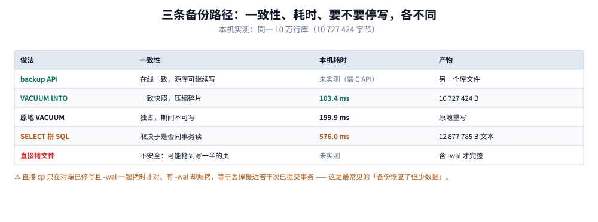
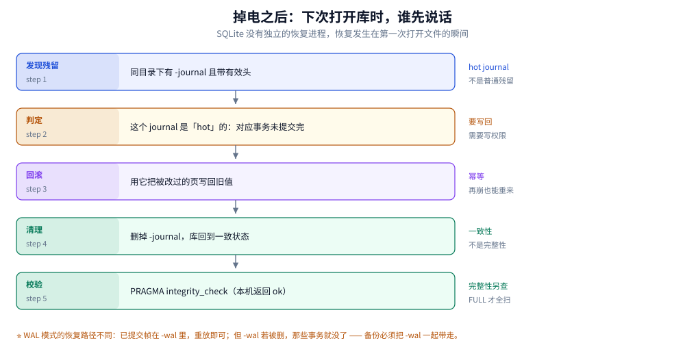
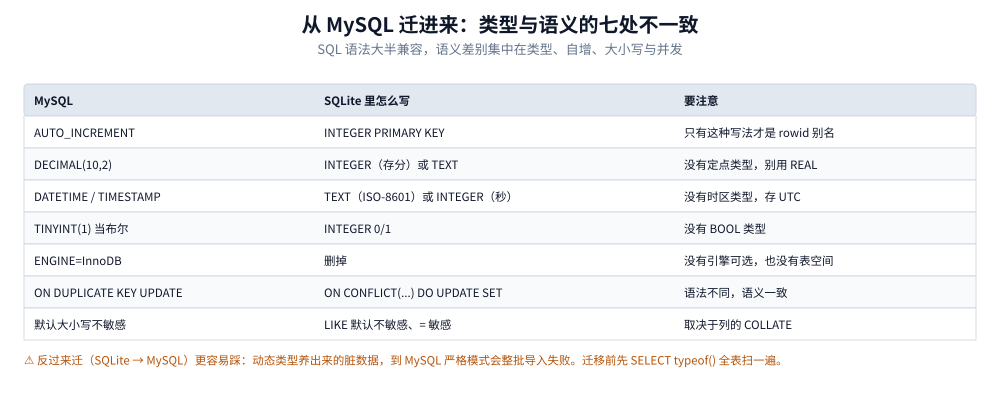

# 备份恢复与迁移

> 覆盖：三条备份路径（backup API / `VACUUM INTO` / SQL 文本导出）的一致性、耗时与锁行为、
> 为什么「拷一个文件就完事」在 WAL 下会丢数据、崩溃恢复的两条路径（hot journal 与 WAL 重放）、
> 从 MySQL 迁入的七处语义映射、迁出到 MySQL 的反向坑、以及恢复演练怎么校验。
>
> 不覆盖：页结构见 [文件格式与页结构.md](文件格式与页结构.md)；WAL 帧与 checkpoint 见
> [WAL模式与检查点.md](WAL模式与检查点.md)；`VACUUM` 的空间账见 [文件格式与页结构.md](文件格式与页结构.md) 第五节。
>
> 内容整理自个人学习笔记。**实测口径**：本机 Go 1.26.5 + `modernc.org/sqlite`（SQLite 3.54.1），
> 源库 10 万行、10 727 424 字节、WAL 已 checkpoint。`backup API` 需要 C 接口，Go 驱动未暴露，
> 标 **未实测**；其余两条为单次总耗时（毫秒级）。

---

## 一、三条备份路径，锁行为完全不同

**本节要点**：三条路的差别不在「快慢」，在**要不要停写**、**产物是不是一致快照**。
选错会让「备份成功」与「备份可用」变成两件事。



五行是四条路加一条反例，中间两列是一致性与本机耗时。看最后一行（直接拷文件）的一致性标注：它写的是「不安全」，因为 WAL 模式下主库本身不是完整状态——这一行是本篇要讲的重点。

| 做法 | 一致性 | 本机耗时 | 源库能否继续写 | 产物 |
|---|---|---|---|---|
| `backup API`（`sqlite3_backup_*`） | 在线一致，可分步、可重试 | 未实测（C 接口） | ✅ 能（且会重启备份） | 另一个库文件 |
| `VACUUM INTO` | 一致快照，顺带压实碎片 | 103.4 ms | ✅ 能（读事务） | 10 727 424 B |
| 手写 `SELECT` 拼 SQL | 取决于是否在同一读事务里 | 576.0 ms | ✅ 能 | 12 877 785 B 文本 |
| 直接拷文件（无并发写） | 安全 | 由文件大小决定 | ❌ 不能 | 完整副本 |
| 直接拷文件（有 WAL 未 checkpoint） | **不安全** | — | ❌ | **丢最近事务** |

⭐ 三条结论：

1. `VACUUM INTO` 是**首选**：一致、压实、比手写 dump 快 5.6 倍、产物可直接当库用
2. `backup API` 唯一的优势是「可增量、可分步、可在长事务中重启」，适合库很大、备份窗口很长的场景
3. 手写 dump 的价值不是快，是**跨版本可读**（SQL 文本能被任何版本的 SQLite 重放）

---

## 二、为什么「拷一个文件」在 WAL 下会丢数据？

**设置要点**：WAL 模式下，**主库文件不是完整状态**——已提交的事务可能还在 `-wal` 里。
只拷 `app.db` 不拷 `app.db-wal`，等于回到最后一次 checkpoint。

### 2.1 本机实测的「主库只有 4 KB」

| 累计写入 | 主库 | `-wal` |
|---|---|---|
| 10 万行（`autocheckpoint=0`） | **4096 字节** | 2 360 792 字节 |

此时拷走主库 = 拷走一个只有文件头和 schema 的空库。10 万行数据全在 `-wal` 里。

### 2.2 三种拷贝方式的正确性

| 方式 | 正确性 | 前提 |
|---|---|---|
| 停写后拷 `db` + `-wal` + `-shm` | ✅ 正确 | 三件套齐全，且拷贝期间没有新写入 |
| 停写后只拷 `db` | ⚠️ 丢失未 checkpoint 的事务 | 只在对端刚 checkpoint 过时安全 |
| 运行中拷 `db` | ❌ 可能读到写一半的页 | 任何情况下都不安全 |

⚠️ `-shm` 可以拷也可以不拷（它会自动重建），但**`-wal` 必须拷**。

### 2.3 为什么运行中拷会读到「半个页」

因为拷贝工具按字节读，而 SQLite 按页写。一页 4 KiB 的写入不是原子的：
拷到一半时可能拿到「前 2 KiB 是新值、后 2 KiB 是旧值」的页。SQLite 能检测到这种损坏
（页校验与文件头计数器），但检测到之后只能报 `SQLITE_CORRUPT` —— 数据已经坏了。

⭐ 所以判断标准是：**这次拷贝期间有没有任何写入**。有，就必须用
`VACUUM INTO` 或 `backup API`，而不是 `cp`。

---

## 三、崩溃恢复：下次打开时发生什么？

**本节要点**：SQLite 没有恢复进程，恢复发生在**第一次打开文件时**。两条路径：
rollback journal 模式下用 hot journal 回滚，WAL 模式下重放 `-wal` 里已提交的帧。

### 3.1 rollback journal 路径



五个节点是打开文件后自动发生的五步，右侧是每一步的判据。第三步是重点：回滚要用 journal 里的旧值把主库改回去，所以它需要写权限——只读打开一个带 hot journal 的库会失败。

| 步骤 | 做什么 | 判据 |
|---|---|---|
| 1 | 发现同目录有 `-journal` | 文件存在 |
| 2 | 判断它是不是 hot | 有有效头，且文件变更计数器与主库一致 |
| 3 | 用 journal 把旧值写回主库 | 需要写权限 |
| 4 | 删除 `-journal` | 恢复完成 |
| 5 | 正常打开 | 数据回到崩溃前的最后提交点 |

⚠️ 第 3 步意味着：**用一个只读连接打开一个带 hot journal 的库会失败**。
设 `PRAGMA query_only=1` 或文件系统只读时，遇到这种情况只能先把文件拷到可写位置。

### 3.2 WAL 路径

| 步骤 | 做什么 |
|---|---|
| 1 | 发现 `-wal`，读头部（校验 magic 与页大小） |
| 2 | 扫描帧，找到最后一个带提交标记的帧 |
| 3 | 把它之前的帧视为有效，之后的丢弃 |
| 4 | 重建 `-shm` 索引 |
| 5 | 正常打开（此时主库可能仍是旧的，数据还在 `-wal` 里） |

⭐ WAL 恢复的「完成」不等于「数据回到主库」：恢复只是让库可读，
数据仍在 `-wal` 里，要靠 checkpoint 才归位。所以**备份必须连 `-wal` 一起**。

### 3.3 恢复之后要做什么

```sql
-- 1. 快速检查（能发现大部分结构问题）
PRAGMA quick_check;

-- 2. 完整检查（逐页校验，慢但彻底）
PRAGMA integrity_check;

-- 3. 外键一致性（迁移或异常恢复后必跑）
PRAGMA foreign_key_check;

-- 4. 若检查失败，尝试导出可读部分
VACUUM INTO 'rescued.db';    -- 能成功说明大部分页可读
```

---

## 四、在线备份怎么做

**设置要点**：在线备份 = 「源库不停写也能拿到一致快照」。两条路：
`VACUUM INTO`（一行 SQL，简单）与 `backup API`（可控、可分步、能续）。

### 4.1 `VACUUM INTO`（推荐默认）

```sql
-- 产物是一个紧凑、一致的库，可直接替换或直接打开
VACUUM INTO '/backup/app-20261103.db';
```

| 优点 | 缺点 |
|---|---|
| 一行 SQL，任何语言都能调 | 产物是完整副本，占等大空间 |
| 顺带压实碎片（比源库小） | 不能增量 |
| 一致性由 SQLite 保证 | 大库耗时长（本机 10 万行 103.4 ms） |
| 期间源库可继续写（读事务） | 目标路径必须不存在 |

⚠️ 目标文件**必须不存在**，否则报错。所以脚本里要先删或带上时间戳。

### 4.2 `backup API`（大库、长窗口）

C 接口的形态：

```c
sqlite3_backup *p = sqlite3_backup_init(dst, "main", src, "main");
do {
    rc = sqlite3_backup_step(p, 100);   /* 每次搬 100 页，可分步 */
    if (rc == SQLITE_BUSY || rc == SQLITE_LOCKED) {
        sqlite3_sleep(50);              /* 让一下，别死等 */
    }
} while (rc == SQLITE_OK || rc == SQLITE_BUSY || rc == SQLITE_LOCKED);
sqlite3_backup_finish(p);
```

它的两个特性值得注意：

| 特性 | 含义 |
|---|---|
| 分步（`npage`） | 一次搬一部分，不会长时间占锁 |
| 源库被写则重启 | 备份期间源库有写入时，`step` 会返回 `SQLITE_BUSY` 并从头上重来 |

⚠️ 「重启」意味着**写多的库用 backup API 可能永远做不完**。这类场景要
「先 checkpoint、再快速启动一个只读快照」，或直接用 `VACUUM INTO`。
Go 侧没有标准封装，需要 cgo 调 C API 或用支持它的驱动。

### 4.3 备份策略（按库大小）

| 库大小 | 策略 |
|---|---|
| < 100 MB | 每次 `VACUUM INTO` 全量，保留 N 份 |
| 100 MB ~ 数 GB | 每天全量 + 每小时 `VACUUM INTO` 到另一块盘 |
| 数 GB 以上 | 考虑流式备份（复制 WAL）或换引擎；`VACUUM INTO` 的窗口已经太长 |
| 移动端 | 不做本地多份，改为「导出给用户 / 上传云端」 |

---

## 五、从 MySQL 迁入的七处映射

**设置要点**：SQL 语法大半兼容，但**语义差别集中在类型、自增、大小写、并发**。
迁移前先用 `SELECT typeof()` 自查一遍，比迁完再修省事。



七行是七处最容易踩的差异，中间一列是 SQLite 里的写法，右列是要注意的点。第一行与第二行最影响建表：`AUTO_INCREMENT` 要改成 `INTEGER PRIMARY KEY`，而 `DECIMAL` 根本没有对应类型。

| MySQL | SQLite | 注意 |
|---|---|---|
| `AUTO_INCREMENT` | `INTEGER PRIMARY KEY` | 只有这种写法才是 rowid 别名；`INT PRIMARY KEY` 要额外建索引 |
| `DECIMAL(10,2)` | `INTEGER`（存分）或 `TEXT` | 没有定点类型，别用 `REAL` |
| `DATETIME` / `TIMESTAMP` | `TEXT`（ISO-8601 UTC）或 `INTEGER`（毫秒） | 没有时区类型 |
| `TINYINT(1)` 当布尔 | `INTEGER` 0/1 + `CHECK` | 没有 `BOOL` |
| `ENGINE=InnoDB` / `CHARSET` | 删掉 | 没有引擎、没有表空间、没有字符集（只有 `COLLATE`） |
| `ON DUPLICATE KEY UPDATE` | `ON CONFLICT(...) DO UPDATE SET` | 语法不同，语义一致 |
| 默认大小写不敏感 | `LIKE` 默认不敏感、`=` 敏感 | 取决于列的 `COLLATE` |
| 外键自动建索引 | 不自动 | 必须手动建，否则级联全表扫 |

### 5.1 三处最容易出错的地方

1. **`INT PRIMARY KEY` 不是 rowid 别名**。写 `INT`（而不是 `INTEGER`）会建一棵独立的索引树，
   主键查询多一次下降。判据：`SELECT rowid, id FROM t` 两者相等才是别名。
2. **`ENGINE=InnoDB` 这类子句要整段删掉**，逐条改 DDL 比重写更快，但容易漏
   （`COMMENT` / `AUTO_INCREMENT=1000` / `ROW_FORMAT` 都要删）。
3. **默认字符集不存在**，但 `COLLATE` 存在。MySQL 的 `utf8mb4_0900_ai_ci` 在 SQLite 里
   没有对应物；需要大小写不敏感比较时显式写 `COLLATE NOCASE`。

### 5.2 迁移脚本的四步

```text
1. 建表（STRICT 可选）→ 2. 关外键与索引 → 3. 批量导入（一个事务）→ 4. 建索引 + 校验
```

第 2 步在 SQLite 里的做法：

```sql
PRAGMA foreign_keys = OFF;      -- 导入期间关（连接级，导入连接上设）
-- 导入完成后再打开并检查
PRAGMA foreign_keys = ON;
PRAGMA foreign_key_check;
```

⚠️ 别在导入期间建索引：每插一行都要维护所有索引，写放大会让导入慢一个量级。
正确顺序是「先建表、导入、最后建索引」。

---

## 六、迁出到 MySQL 的坑

**设置要点**：反向迁移比正向更容易炸，因为 SQLite 的「动态类型」养出来的脏数据，
到 MySQL 严格模式会整批失败。

| 坑 | 现象 | 处理 |
|---|---|---|
| 同列多种 `typeof` | MySQL 报 `Incorrect integer value` | 迁前清洗，或用宽松模式先导入再修 |
| 空字符串与 NULL 混用 | 唯一索引冲突 | 统一口径：要么全 `''`，要么全 `NULL` |
| 时间格式不统一 | `DATETIME` 解析失败 | 统一成 `YYYY-MM-DD HH:MM:SS` |
| 布尔列有 `'true'` | `TINYINT` 转换失败 | 清洗成 0/1 |
| 自增 id 有空洞或负值 | 主键冲突 | 重新分配 id，或改用业务主键 |

### 6.1 迁前自查（必跑）

```sql
-- 每列的存储类分布：出现多行就说明这一列不干净
SELECT 'payment' AS tbl, 'amount_c' AS col, typeof(amount_c) AS t, count(*) AS n
FROM payment GROUP BY 3
UNION ALL
SELECT 'user', 'is_active', typeof(is_active), count(*) FROM user GROUP BY 3;

-- 时间列长度分布（长度不一 = 格式不统一）
SELECT length(created_at) AS len, count(*) FROM note GROUP BY 1;
```

⭐ 这两条查询的输出直接决定迁移能不能「一把过」。本机在类型篇里实测过：
`INTEGER` 声明列里插 `'abc'` 会存成 `text`，所以「声明了类型」不等于「数据干净」。

---

## 七、恢复演练与校验

**设置要点**：备份的价值只在恢复过之后才成立。演练要验证三件事：
**能打开**、**数据对**、**耗时在窗口内**。

### 7.1 三步演练

```bash
# 1. 恢复到一个临时路径（不要覆盖生产）
cp /backup/app-20261103.db /tmp/restore-test.db

# 2. 能打开且结构完整
sqlite3 /tmp/restore-test.db "PRAGMA integrity_check; PRAGMA foreign_key_check;"

# 3. 数据对得上（挑几个业务口径）
sqlite3 /tmp/restore-test.db "SELECT count(*) FROM payment; SELECT sum(amount_c) FROM payment;"
```

### 7.2 校验表

| 检查 | 通过标准 | 不通过 |
|---|---|---|
| `integrity_check` | 返回 `ok` | 页损坏 → 试 `VACUUM INTO` 抢救 |
| `foreign_key_check` | 无行 | 有行 → 数据关系断了，检查导入顺序 |
| 关键表行数 | 与源库一致（或差在可接受窗口） | 差很多 → 备份不完整 |
| 金额合计 | 与源库一致 | 不一致 → 有脏数据或漏行 |
| 恢复耗时 | 在 RTO 内 | 超时 → 备份策略要改（更频繁/更小） |

⚠️ 「行数一致」不足够：本机在类型篇实测过 `1.0` 被存成 `1`，
这类静默转换不会改变行数，但会改变合计。所以金额类字段要单独对账。

---

## 使用：一份可用的备份脚本与恢复流程

**本节要点**：备份脚本要解决四件事：路径不冲突、失败可见、保留份数、事后校验。
下面是一个最小但完整的实现。

### 使用一：Go 侧（`VACUUM INTO` + 校验）

```go
func backup(db *sql.DB, dir string) (string, error) {
    if err := os.MkdirAll(dir, 0o755); err != nil {
        return "", err
    }
    dst := filepath.Join(dir, "app-"+time.Now().Format("20060102-150405")+".db")
    // VACUUM INTO 要求目标不存在
    if _, err := os.Stat(dst); err == nil {
        return "", fmt.Errorf("target exists: %s", dst)
    }
    if _, err := db.Exec("VACUUM INTO ?", dst); err != nil {
        return "", fmt.Errorf("vacuum into: %w", err)
    }
    // 立刻校验：写坏的备份比没有备份更危险
    chk, err := sql.Open("sqlite", "file:"+filepath.ToSlash(dst)+"?mode=ro")
    if err != nil {
        return "", err
    }
    defer chk.Close()
    var res string
    if err := chk.QueryRow("PRAGMA integrity_check").Scan(&res); err != nil {
        return "", err
    }
    if res != "ok" {
        return "", fmt.Errorf("integrity_check: %s", res)
    }
    return dst, nil
}
```

⚠️ `VACUUM INTO ?` 的占位符在部分驱动上不支持（它要求字面量路径）。
若不支持，改成安全的字面量拼接——路径由程序生成，不要来自用户输入。

### 使用二：保留份数与清理

```go
// 只保留最近 N 份：按文件名里的时间戳排序
func prune(dir string, keep int) error {
    entries, err := os.ReadDir(dir)
    if err != nil {
        return err
    }
    var names []string
    for _, e := range entries {
        if strings.HasPrefix(e.Name(), "app-") && strings.HasSuffix(e.Name(), ".db") {
            names = append(names, e.Name())
        }
    }
    sort.Strings(names)              // 时间戳格式天然可排序
    for i := 0; i < len(names)-keep; i++ {
        if err := os.Remove(filepath.Join(dir, names[i])); err != nil {
            return err
        }
    }
    return nil
}
```

### 使用三：恢复时的三条铁律

1. **先拷到临时路径再校验**，不要直接覆盖生产文件
2. **校验通过才切换**，切换用「重命名 + 重启进程」，不要热替换正在被打开的文件
3. **切换后立刻比对业务口径**（行数 + 金额合计），不要只看「服务起来了」

### 判读表

| 现象 | 结论 |
|---|---|
| `VACUUM INTO` 报 `output file already exists` | 目标路径已存在，换名或先删 |
| 备份产物比源库小很多 | 正常：VACUUM 会压实碎片 |
| 备份产物比源库小**极少**但源库有大量删除 | 源库可能没 VACUUM 过，产物才是真实大小 |
| 恢复后 `integrity_check` 报页损坏 | 备份过程中源库被写过，改用 `VACUUM INTO` |
| 恢复后行数对但金额不对 | 类型被静默转换，查 `typeof` |

---

## 延伸追问

**Q：`VACUUM INTO` 备份期间源库能写吗？**
能。它在源库上开一个读事务（一致快照），写入不受阻（WAL 模式下更明显）。
代价是读事务会让 `-wal` 的 checkpoint 推进受限，备份期间 `-wal` 可能更长。

**Q：backup API 与 `VACUUM INTO` 该选哪个？**
默认 `VACUUM INTO`。只有两种情况选 backup API：库大到一次读事务窗口不可接受，
或需要「分步 + 可续」的备份流程（如云上对象存储分块上传）。

**Q：库损坏了还能救出多少？**
看损坏位置。`.recover`（CLI）能扫描并重建大部分结构；`VACUUM INTO` 能成功说明
大部分页可读。两者都不保证 100%，所以「有备份」永远比「有恢复手段」重要。

**Q：迁移需要停机吗？**
SQLite 到 SQLite 可以用 `VACUUM INTO` + 切换文件，停机时间等于「重命名 + 重启」；
MySQL 到 SQLite 的首次全量必须停写（否则追不上增量），之后可以用双写或 CDC 追平。
这部分设计见 [数据同步/CDC](../../数据同步/CDC/README.md)。

## 关联

- [README.md](README.md) — 本册导读与四条读序
- [文件格式与页结构.md](文件格式与页结构.md) — 文件头里的计数器为什么能判断 hot journal
- [WAL模式与检查点.md](WAL模式与检查点.md) — 为什么备份必须连 `-wal` 一起拷
- [类型系统与数据建模.md](类型系统与数据建模.md) — 迁移前为什么必须查 `typeof`
- [观测与诊断.md](观测与诊断.md) — `integrity_check` 与错误码的分诊
- [MySQL/数据迁移与备份恢复.md](../MySQL/数据迁移与备份恢复.md) — 对照读：服务端数据库的 PITR 与不停服切换
