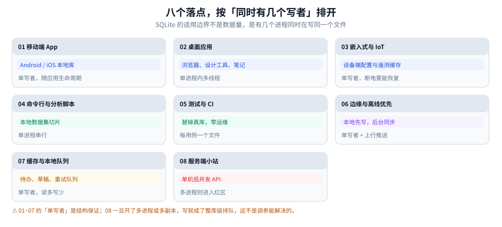
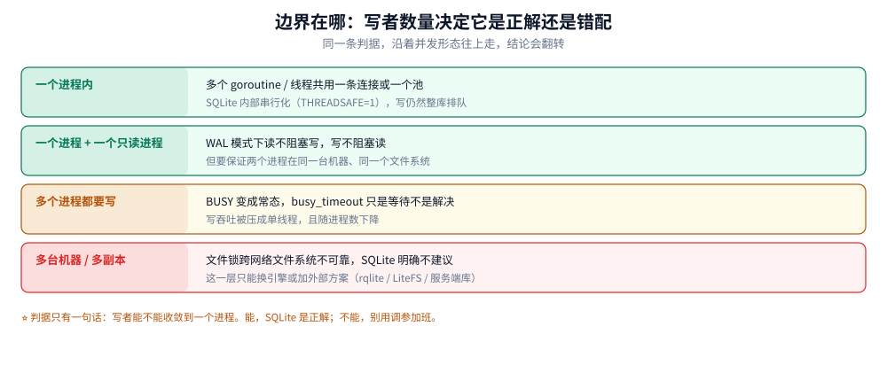

# SQLite 应用场景

> 覆盖：SQLite 落在哪些真实系统里、这些落点背后共用的结构条件、「数据量小」为什么不是判据、
> 以及哪几个信号一出现就说明该换引擎。本册只此一篇讲场景，其余十篇只讲机制与写法。
>
> 不覆盖：跨产品的选型对照（MySQL / PostgreSQL / 云托管怎么比）见 [关系型选型对比.md](../关系型选型对比.md)；
> 各机制细节见本册其余十篇，篇末关联按「先读哪篇」排了序。
>
> 内容整理自个人学习笔记。**实测口径**：本机 Go 1.26.5 + `modernc.org/sqlite`（纯 Go，内嵌 SQLite 3.54.1，
> `THREADSAFE=1`）跑通；本文不含性能对比，凡涉及读数处均指向本册对应篇的本机实测。

---

## 一、为什么判据是「几个写者」，不是「数据量多大」？

**本节要点**：SQLite 的适用边界由**并发形态**决定，不由数据量决定。一个 40 GB 的本地分析库
可以跑得很好，一个 4 MB 但被三个进程同时写的库会持续报 `SQLITE_BUSY`。选错方向时，
调参、加索引、换驱动都救不回来。

### 1.1 八个落点，按「同时有几个写者」排开

下面八个落点不是按行业分的，是按**写者的形态**分的。同一列里越往下，SQLite 越勉强。



从 01 到 08 排的是写者形态的恶化，不是行业分类。01~05 的「只有一个写者」是结构保证（App 生命周期、单进程、单设备），06 开始要靠外部设计维持，08 已经完全进入红区。

| 落点 | 谁在写 | 为什么这个形态成立 |
|---|---|---|
| 移动端 App 本地库 | 应用进程自己，且前台只有一个实例 | 系统自带，无服务要装；进程被杀时靠 journal 恢复 |
| 桌面应用 | 单进程内多线程，或主进程 + 一个后台进程 | 数据随文档/工作区走，拷贝即迁移 |
| 嵌入式与 IoT | 设备上的单一采集进程 | 断电重启后要能自愈，不能依赖外部服务 |
| 命令行与分析脚本 | 一次运行一个进程，串行 | 把 CSV 灌进来做多轮 SQL，比内存 DataFrame 省 |
| 测试与 CI | 每个用例一个临时文件，互不相干 | 零运维，跑完即删 |
| 边缘与离线优先 | 本地单写者 + 上行同步进程 | 断网可写，联网补传 |
| 缓存与本地队列 | 单写者、读多写少 | 事务 + SQL 比自造文件格式省事 |
| 服务端小站 | 若单进程单副本，仍是一个写者 | 一旦多副本或多进程，就进入下一节的红区 |

⭐ 这张表的用处：拿到一个新需求时，先问「**写者能不能收敛到一个进程**」。
能，SQLite 是正解；不能，往后看第二节，别在这一列里硬找落点。

### 1.2 共同结构：数据天然属于一个文件、一个进程

八个落点抽掉行业外壳，剩下三个共同条件：

1. **数据的所有权是清晰的**。这份数据只属于这台设备/这个用户/这次运行，没有第二个进程
   需要同时改它。云端那份是另一份数据，靠同步协议对齐，不靠共享文件。
2. **部署形态要求「零服务」**。用户不会为一个笔记软件装数据库服务，设备也不允许常驻进程。
3. **一致性要求是真的**。它们要的不是「最终能对上」，而是「掉电之后这一笔要么在、要么不在」——
   这正是 journal 与 WAL 提供的，而不是「写个 JSON 文件」能提供的。

三个条件里最容易忽略的是第三条。很多项目选 SQLite 的理由写的是「轻」，但真正让它比
「自己写个 append-only 日志文件」更省事的地方，是它已经处理了崩溃一致性与并发可见性。


这张表按系统类型分八行，看第三列就够：没有一行的理由是「它比较快」，全是部署形态带来的省事。最后一行的条件单独标了出来——服务端小站只有在单写者时才落在这一列里。

### 1.3 反例：数据量很小，但不该用它

数据量小 ≠ 适合。下面三种情况，1 万行也不该用：

| 情形 | 为什么不该用 |
|---|---|
| 多个容器副本共享同一个挂载卷 | 文件锁跨网络文件系统不可靠，官方明确不建议；症状是随机 `SQLITE_BUSY` 或更难查的写丢失 |
| 需要多写并发（如多租户 SaaS 的写热点） | 写是整库级串行，加机器不加吞吐；`busy_timeout` 只是排队，不是扩容 |
| 数据必须被远程客户端直连 | 没有网络协议。要远程访问就得自己在前面套一层服务——那就已经是在写一个数据库服务了 |

⚠️ 反向提醒：「本地开发用 SQLite、线上用 MySQL」这种双引擎策略，代价常被低估：
类型语义（动态类型 vs 严格类型）、`ON CONFLICT` 与 `ON DUPLICATE KEY`、
默认排序与大小写敏感度全都不一样。真要走这条路，迁移差异见
[备份恢复与迁移.md](备份恢复与迁移.md) 第三节。

---

## 二、移动端与桌面：为什么系统自带它？

**本节要点**：这两个落点的共同约束是「不能要求用户装任何东西」，而 SQLite 是唯一
同时满足「零安装、真事务、单文件」的选项。它不是被选中的，是被**部署形态**筛出来的。

### 2.1 零安装是硬约束，不是偏好

移动端与桌面端的安装包由应用自己带。任何需要「先起一个服务」的方案都会被这个约束淘汰：
用户装完 App 就要能用，没有第二步。于是候选只剩三类：

- 自己写文件格式（JSON / 自定义二进制）→ 没有事务、没有并发可见性、崩溃后要自己修
- 键值存储（LevelDB / RocksDB 一类）→ 有事务但不支持 SQL，复杂查询要自己写索引
- 嵌入式关系库 → SQLite 基本是唯一成熟选项

所以这两个落点里 SQLite 的位置不是「性能最优」，是「**在零安装前提下唯一能给出 SQL 语义的**」。

### 2.2 移动端特有的三件事

1. **系统自带意味着版本不由你定**。Android 与 iOS 都内置 SQLite，但版本随系统走，
   老设备上的库可能不支持 `STRICT` 表或较新的 JSON 函数。写跨版本代码前先查
   [类型系统与数据建模.md](类型系统与数据建模.md) 里的版本门槛表。
2. **进程随时会被杀**。移动端没有「优雅关闭」的保证，所有依赖「退出时落盘」的设计都不可靠。
   这让 `synchronous` 的选择变成安全性问题，见 [PRAGMA与调优.md](PRAGMA与调优.md)。
3. **库文件在沙箱里**，随应用卸载一起删。所以「备份」在移动端的含义是把文件导出给用户
   （分享、iCloud），不是本地留副本。

### 2.3 桌面端要额外考虑「一个文件被两个进程打开」

桌面应用常见形态是「主界面进程 + 一个后台同步进程」同时打开同一个库。这时：

- 读读并发没问题（rollback journal 下都拿 `SHARED`，WAL 下各看各的快照）
- 读写会互斥：后台进程长事务会直接堵住界面进程的写
- 两个进程都必须**设 `busy_timeout`**，否则界面卡顿会以「数据库被锁」的形式暴露给用户

> 具体到「谁先拿锁、BUSY 什么时候出现」，见
> [事务与并发控制.md](事务与并发控制.md) 第二、三节；WAL 下的读写并行见
> [WAL模式与检查点.md](WAL模式与检查点.md) 第二节。

---

## 三、嵌入式与边缘：断电恢复为什么是硬需求？

**本节要点**：嵌入式落点把「崩溃一致性」从可选项变成硬指标。这也是 SQLite 与
「自己写个文件格式」差距最大、且最容易被低估的地方。

### 3.1 掉电是常态，不是异常

设备端没有 UPS，写入过程中断电是设计内事件。三类方案在这种场景下的行为截然不同：

| 方案 | 掉电后 |
|---|---|
| 直接覆盖写文件 | 文件可能半新半旧，且没有任何标记能判断新旧 |
| append-only 日志 + 定期压实 | 日志截断处可能残缺，要自己写校验与重放 |
| SQLite（rollback journal 或 WAL） | 下次打开时自动回滚/重放，不需要应用参与 |

第三条的关键在于**恢复是自动的、且发生在打开文件的瞬间**，应用不需要写「启动时修复」的代码。
恢复的判定逻辑见 [备份恢复与迁移.md](备份恢复与迁移.md) 第四节（hot journal 与 WAL 重放两条路径）。

### 3.2 边缘场景的容量上限

单文件数据库的容量受页数与页大小共同限制：默认页 4 KiB、页数上限 4294967294
（本机 `PRAGMA max_page_count` 实测值），理论容量远大于任何嵌入式存储卡。
真正的限制不是理论值，而是：

- 文件系统的单文件上限（FAT32 是 4 GB，这是实际会撞到的墙）
- 备份与校验的耗时（`integrity_check` 要全表扫，几 GB 的库在设备上要跑很久）
- 写放大（WAL 模式下 `-wal` 会涨到一次 checkpoint 的大小）

> 页与文件格式的细节见 [文件格式与页结构.md](文件格式与页结构.md)；
> `-wal` 的增长与 checkpoint 策略见 [WAL模式与检查点.md](WAL模式与检查点.md) 第三节。

---

## 四、测试与 CI：为什么它是替身首选？

**本节要点**：测试落点要的不是「像 MySQL」，而是**每个用例一个干净库、跑完即删、零外部依赖**。
这三点里 SQLite 赢在第三点，前两点靠约定。

### 4.1 三条约定

1. **一个用例一个文件**，路径用临时目录，用例结束删除（含 `-wal`、`-shm`）。共用一个文件是
   测试互相污染的最常见来源。
2. **不要用 `:memory:` 替代文件**。看似更快，但它测不到 WAL、测不到跨连接行为、
   测不到崩溃恢复——而这些恰恰是最容易出问题的地方。
3. **schema 用同一份迁移脚本建**，不要为测试单独维护一套 DDL。两套 DDL 必然漂移。

### 4.2 它替不了的部分

| 能力 | SQLite | 真库（如 MySQL） |
|---|---|---|
| 严格类型 | 默认动态类型，需 `STRICT` 表 | 默认严格 |
| 隔离级别 | 只有 SERIALIZABLE 的语义 | 可选择 RC / RR |
| 多写并发 | 整库串行 | 行级并发 |
| 权限 | 文件权限 | 账号 + 授权体系 |
| 网络 | 无 | 有 |

⭐ 判据：**测业务逻辑用 SQLite 够用；测事务语义、并发行为、权限模型时必须用真库。**
把「在 SQLite 上跑通过的并发测试」当作线上正确的证据，是这类替身最常见的误用。

---

## 五、离线优先与本地队列：同步模型怎么套？

**本节要点**：这个落点考验的不是数据库，是**同步协议**。SQLite 只承担「本地先落地、
可重放」这一段，冲突解决与幂等必须在上层设计。

### 5.1 两张表撑起离线写

```sql
-- 业务表：本地即刻可读
CREATE TABLE note (
    id         TEXT PRIMARY KEY,      -- 客户端生成的 UUID，不用自增
    body       TEXT NOT NULL,
    updated_at INTEGER NOT NULL,      -- Unix 毫秒，UTC
    version    INTEGER NOT NULL DEFAULT 1,
    deleted    INTEGER NOT NULL DEFAULT 0   -- 软删除，等同步确认后才真删
) STRICT;

-- 发件箱：待上行队列
CREATE TABLE outbox (
    seq        INTEGER PRIMARY KEY,   -- 本地顺序，用于保序上传
    op         TEXT NOT NULL,         -- upsert / delete
    payload    TEXT NOT NULL,         -- JSON
    tries      INTEGER NOT NULL DEFAULT 0,
    next_at    INTEGER NOT NULL DEFAULT 0  -- 退避时间点
) STRICT;
```

三条设计约束：

1. **主键用客户端生成的 ID**，不用自增。自增在离线会产生冲突，合并时要重写 ID，到处是外键。
2. **软删除**：本地删了但没同步成功前，行必须还在，否则没法把「删除」这个操作传上去。
3. **发件箱与业务表在同一个事务里写**，否则会出现「业务落了、队列没落」的丢操作。

### 5.2 冲突解决不在数据库里

SQLite 没有内建的冲突解决。常见三种口径：

| 口径 | 适用 | 代价 |
|---|---|---|
| 最后写入胜（比 `updated_at`） | 字段级冲突少的场景 | 时钟漂移会判错 |
| 版本号递增（服务端拒绝旧版本） | 需要严格顺序的字段 | 冲突时要客户端重取重放 |
| 操作日志合并（CRDT 或 OT） | 协同编辑 | 复杂度上一个量级 |

> 队列与发件箱这种「本地可靠投递」的通用设计（不限于 SQLite）见
> [CDC](../../数据同步/CDC/README.md)；本篇只讲它在 SQLite 里的落地形态。

---

## 六、服务端小站：什么时候这是错配？

**本节要点**：服务端是 SQLite 唯一「看起来能用、实际上很容易翻车」的落点。
判断标准不是 QPS，是**有没有第二个写进程**。

### 6.1 单进程单副本时，它确实能用

满足下面全部条件时，服务端用 SQLite 是合理的（很多内部工具、单机 API、个人项目都在这条线上）：

- 一个应用进程，没有多副本、没有滚动发布时的双实例重叠
- 写 QPS 不高，写事务短（毫秒级，且不在事务里做网络调用）
- 部署在有本地盘的机器上，不放在网络文件系统
- 接受「扩容 = 换引擎」这个前提

### 6.2 四个翻车信号

| 信号 | 说明 |
|---|---|
| 部署从 1 副本变成 2 副本 | 两个进程写同一个文件，锁不可靠；即使挂同一块盘也可能写坏 |
| 写事务里出现 HTTP / RPC 调用 | 事务持锁期间等网络，等于把整库写锁挂在外网延迟上 |
| 出现「定时任务 + Web 进程」两个写入方 | 两个进程交替写，`BUSY` 从偶发变成常态 |
| 单库文件超过备份窗口 | 全量备份只能拷贝文件或 `VACUUM INTO`，窗口内写会被影响 |

⭐ **扩容路径是换引擎，不是加机器**。这一点必须在设计时写进文档，否则第一个流量高峰
就会变成「为什么加了两台机器反而更慢」。



四级台阶从「一个进程内」走到「多台机器」：前两级是绿的，第三级开始是黄的，第四级是红的。注意第二级并没有换存储——WAL 只是让读不再挡写，写者数量仍然是 1，这是最容易被误读成「可以多写了」的地方。

### 6.3 需要横向扩展时的四条外部路线

SQLite 自身不做复制，但社区有几条把「单文件」变成「可复制」的路线，选型不在这篇展开：

- 复制整个 WAL 出去（流式备份一类）
- 在前置一层做共识（多个节点各持一份，写走多数派）
- 主节点只写、从节点只读分发
- 换成服务端数据库（这正是 [关系型选型对比.md](../关系型选型对比.md) 第七节决策线 C 的内容）

⚠️ 这四条都不是「配置一下就好」：它们改变了「写者唯一」这个前提的维持方式，
引入的失败模式（脑裂、延迟可见、写冲突）需要单独设计。选择前先读
[关系型选型对比.md](../关系型选型对比.md) 第九节「退路按三项评」。

---

## 七、哪些信号说明该换引擎？

**本节要点**：换引擎是重决策，但**触发信号**可以提前定义好。下面五条任意一条成立，
就说明 SQLite 的结构前提已经不成立，而不是「再调调就好」。

| 信号 | 可观测的形式 | 该做什么 |
|---|---|---|
| 写者不再唯一 | 日志里 `SQLITE_BUSY` 常态化；`busy_timeout` 调到秒级仍在等 | 先拆写者（合并成一个写服务），不行则换引擎 |
| 写事务变长 | 事务里出现网络调用、批量导入、文件读写 | 先把事务改短；改不动则是架构问题 |
| 需要跨机器共享 | 开始考虑网络文件系统、共享卷 | 换引擎或加前置服务，不要在 NFS 上跑 SQLite |
| 需要细粒度权限 | 出现「不同用户看不同行」的需求 | 换引擎（SQLite 只有文件权限） |
| 需要在线扩容/读写分离 | 出现「主从」「只读副本」的设计讨论 | 换引擎 |

反过来说，如果只是「数据涨到几 GB」「查询变慢」「备份变久」，这些**不是**换引擎的信号：

- 数据涨 → 看 [文件格式与页结构.md](文件格式与页结构.md) 的空间账，可能只是碎片
- 查询变慢 → 先看 [索引与查询计划.md](索引与查询计划.md)，本机实测建索引前后差 611 倍
- 备份变久 → 看 [备份恢复与迁移.md](备份恢复与迁移.md)，`VACUUM INTO` 比手写 dump 快 5.6 倍

---

## 使用：怎么用 30 分钟做一次落地验证

**本节要点**：不必写完整压测。下面五步能在半小时内回答「这个场景到底行不行」，
因为它量的都是**结构性事实**，不是吞吐数字。

```bash
# 1. 确认你手上的库版本与关键编译选项（不同驱动差很多）
sqlite3 app.db "select sqlite_version(); pragma compile_options;" | sort

# 2. 看并发形态：当前有几个进程打开了这个文件
lsof app.db            # macOS / Linux
# 本机 Windows 无 lsof，用 Go 探针或 Process Explorer 看句柄

# 3. 压一次「同时写」：两个 shell 各跑一个写事务，观察是否 BUSY
sqlite3 app.db "pragma busy_timeout=0; begin immediate; insert into t(v) values(1);" &
sqlite3 app.db "pragma busy_timeout=0; insert into t(v) values(2);"

# 4. 量一次写事务的持锁时长（改造前 vs 改造后）
sqlite3 app.db ".timer on" "begin immediate; insert into t(v) values(3); commit;"

# 5. 确认空间账没有异常（页数、空闲页、库大小三者对不上就是有碎片）
sqlite3 app.db "pragma page_count; pragma freelist_count; pragma page_size;"
```

`sqlite3` CLI 不在本机 PATH 里（本机实测无该命令），上面的命令在装了 CLI 的环境或容器里跑；
用 Go / Java 也能等价做，写法见 [观测与诊断.md](观测与诊断.md) 的使用节。

五步的判读标准：

| 步骤 | 通过 | 不通过 |
|---|---|---|
| 1 | 版本满足所需特性门槛 | 老版本缺函数 → 改写或升级驱动 |
| 2 | 打开者 ≤ 2 且其中最多一个写 | 三个以上写者 → 先拆写者 |
| 3 | 第二个写能在 `busy_timeout` 内成功 | 立刻 BUSY → 事务该改 `BEGIN IMMEDIATE` |
| 4 | 写事务持锁 < 10 ms | 超过 100 ms → 事务里有慢操作，先拆 |
| 5 | `freelist_count / page_count` < 10% | 比例很高 → 该 `VACUUM` 了 |

⚠️ 这五步只验证结构可行性，不验证性能上限。要量性能，先读
[观测与诊断.md](观测与诊断.md) 第三节「计时该怎么量」——本机在 Windows 上
`time.Now()` 有毫秒级量化，单次微秒读数会把人骗到反方向。

---

## 延伸追问

**Q：既然写是整库串行，为什么还有人说 SQLite 写很快？**
两个「快」不是一回事。单事务内批量写极快（本机 20 万行 368 ms，见
[文件格式与页结构.md](文件格式与页结构.md)），因为只有一次 `fsync`；
而「每个请求一个事务」的写入模式会被 `fsync` 次数拖住（本机每行一事务 500 行要 1.36~3.27 s，
见 [PRAGMA与调优.md](PRAGMA与调优.md)）。前者是吞吐，后者是延迟，报数时必须说清是哪一个。

**Q：把 `journal_mode` 设成 WAL 之后，是不是就能多写了？**
不能。WAL 解决的是「读不阻塞写」，写者仍然唯一。本机实测：写事务未提交时另一连接能读，
但另一连接写立刻 `SQLITE_BUSY`（见 [WAL模式与检查点.md](WAL模式与检查点.md) 第二节）。

**Q：用 `:memory:` 能不能既快又避开锁的问题？**
它避开的是 I/O，不是并发：`:memory:` 库不能被第二个连接共享（除非用 shared cache），
所以「多连接并发」这个场景直接消失，测出来的行为也不代表文件库。用在单元测试里可以，
但别用它替代集成测试的文件库。

**Q：SQLite 适合存多大的数据？**
判据不在 GB 数，在「备份窗口」与「校验耗时」：能不能在可接受的时间内
`VACUUM INTO` 一份、能不能在故障时跑完 `integrity_check`。本机 10 万行库
`VACUUM INTO` 用 103.4 ms，按此粗算 10 GB 级要分钟量级——这才是真正的上限来源。

## 关联

- [README.md](README.md) — 本册导读：十一篇的分工、四条读序与边界表
- [架构与执行链路.md](架构与执行链路.md) — 先读这篇：一条 SQL 在四层里怎么走完，为什么没有「连接层」
- [事务与并发控制.md](事务与并发控制.md) — 八个落点里凡是涉及「谁能写」，机制都在这篇
- [关系型选型对比.md](../关系型选型对比.md) — 跨产品对照与决策线，含「什么时候该换引擎」的完整评法
- [数据库选型对比.md](../../数据库选型对比.md) — 关系型 vs 文档型 vs 搜索型的上层对照
- [数据导入导出设计.md](../../../../04-架构与系统/系统设计/数据导入导出设计.md) — 批量写入、进度回报、断点续传在 SQLite 上的实测
