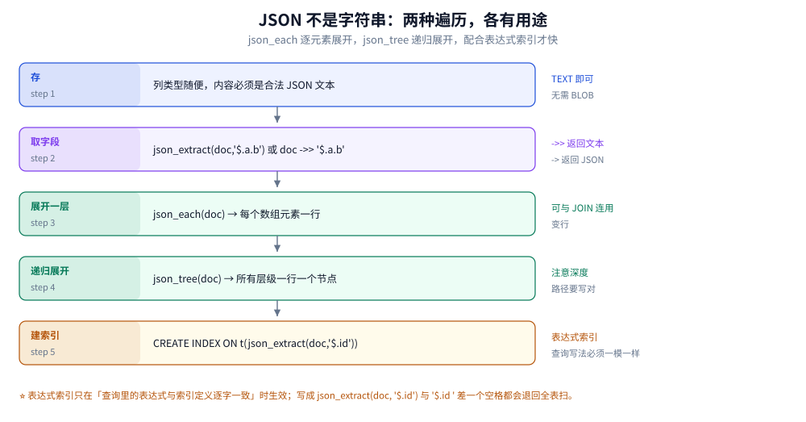
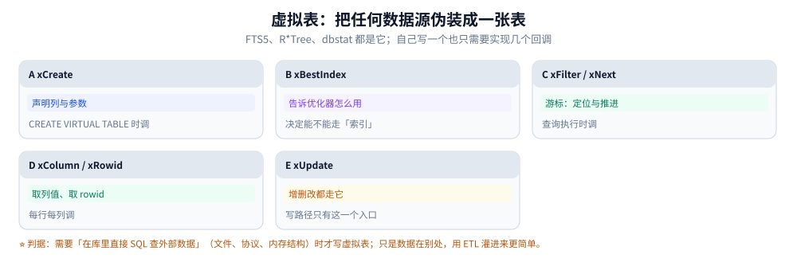

# 扩展能力与虚拟表

> 覆盖：B 树之外的三种索引结构（FTS5 倒排、R*Tree 空间、`dbstat` 统计）、
> FTS5 的五张影子表与分词、`MATCH` 与 `LIKE` 的语义与耗时差、JSON1 的两种遍历与表达式索引、
> R*Tree 的用法、虚拟表接口的五个回调、以及「编译期决定有没有」这条约束。
>
> 不覆盖：B 树索引与查询计划见 [索引与查询计划.md](索引与查询计划.md)；
> 类型与 JSON 列的建模口径见 [类型系统与数据建模.md](类型系统与数据建模.md)；
> 编译期选项如何裁剪功能见 [架构与执行链路.md](架构与执行链路.md) 第六节。
>
> 内容整理自个人学习笔记。**实测口径**：本机 Go 1.26.5 + `modernc.org/sqlite`（SQLite 3.54.1，
> `ENABLE_FTS5` / `ENABLE_RTREE` / `ENABLE_DBSTAT_VTAB` 均已编译）。FTS5 对比在 5 万行短文上做，
> 两种写法各命中 12 500 行，读数为单次总耗时（毫秒级，远超本机计时粒度）。

---

## 一、B 树之外还有哪些索引结构？

**本节要点**：SQLite 的核心只有 B 树，但通过**虚拟表**接进了三种完全不同的结构：
倒排（FTS5）、R 树（R*Tree）、以及元数据视图（`dbstat`）。它们的共同点是
**不满足 B 树的前缀匹配假设**，所以不能复用普通索引。

### 1.1 四种结构的对照

| 结构 | 适合什么查询 | 虚拟表名 | 本机是否编译 |
|---|---|---|---|
| B 树 | 等值、范围、前缀、排序 | 内建（表与索引） | ✅ |
| 倒排索引 | 按词命中、相关性排序 | `fts5` | ✅ `ENABLE_FTS5` |
| R 树 | 矩形/范围相交（地理、时间窗） | `rtree` | ✅ `ENABLE_RTREE` |
| 元数据视图 | 页归属、空间账 | `dbstat` | ✅ `ENABLE_DBSTAT_VTAB` |

⭐ 为什么不能统一成 B 树：`LIKE '%词%'` 这类查询的「键」是**子串**，
B 树只能做前缀（`'词%'`）。倒排索引换了个方向——先建「词 → 文档」的映射，
把「在文档里找词」变成「在词表里找词，再取文档列表」。

### 1.2 一条判断链

```text
要按子串/整词搜索？        → FTS5（注意：词 vs 子串，见第三节）
要按范围相交（地理/时间窗）？ → R*Tree
要看空间被谁占了？          → dbstat
要在库里直接查外部数据？     → 自己写虚拟表（见第六节）
以上都不是                  → 普通 B 树索引
```

⚠️ 第一行的「词 vs 子串」是最大的误用来源：FTS5 默认按**词**切分，
所以 `MATCH 'gamma'` 找不到 `gammaray`（合成词），也找不到 `gamma` 中间的部分。
要子串匹配得用 `trigram` 分词器（3.34+）。

---

## 二、FTS5 是怎么工作的？

**设置要点**：`CREATE VIRTUAL TABLE ... USING fts5` 会在库里建**五张影子表**，
不是一张。它们各存一部分信息，查询时被虚拟表内部拼起来用。

### 2.1 五张影子表


五段从上到下就是建表后库里多出来的对象。注意第三段：原文可能不存（用 `content=` 指向已有表时），而第一段的倒排是必然存在的——这才是搜索快的原因。

| 影子表 | 内容 | 什么时候用到 |
|---|---|---|
| `%_data` | 倒排索引本体：词 → 文档号与位置，分段存放 | 每次 `MATCH` |
| `%_idx` | 段的索引（段多了才需要） | 段数多时定位 |
| `%_content` | 原文（`content=` 时可指向外部表） | 取列值、高亮、snippet |
| `%_docsize` | 每篇文档的词数与总长 | 算 `bm25` 相关性 |
| `%_config` | 分词器、版本等配置 | 换分词器要重建 |

```sql
-- 建表后能看到这些影子表
CREATE VIRTUAL TABLE article_fts USING fts5(title, body, tokenize = 'unicode61');
SELECT name FROM sqlite_master WHERE name LIKE 'article_fts%';
-- article_fts / article_fts_data / article_fts_idx / article_fts_content
-- / article_fts_docsize / article_fts_config
```

### 2.2 分词器怎么选

| 分词器 | 行为 | 适合 |
|---|---|---|
| `unicode61`（默认） | 按 Unicode 词边界切，可设 `remove_diacritics` | 西文为主 |
| `porter` | `unicode61` + 英文词干还原 | 英文搜索（find/finding 视为同词） |
| `trigram`（3.34+） | 按三字符切 | **支持任意子串**（含中文）；索引更大 |
| `ascii` | 只按 ASCII 切 | 纯英文、追求最小索引 |

⚠️ 中文默认用 `unicode61` 会被切得很碎（按标点与空白），实际效果接近「按句」。
要按字搜索用 `trigram`，要按词搜索得用外部分词器（SQLite 不自带中文分词）。

### 2.3 相关性排序：`bm25`

```sql
SELECT title, bm25(article_fts) AS score
FROM article_fts
WHERE article_fts MATCH 'sqlite 索引'
ORDER BY score            -- bm25 越小越相关（负数）
LIMIT 10;
```

`bm25` 依赖 `%_docsize` 里的词数与总长，所以删掉 `%_docsize` 会让排序出错。

### 2.4 高亮与摘要

```sql
SELECT highlight(article_fts, 1, '<b>', '</b>') AS hi,
       snippet(article_fts, 1, '<b>', '</b>', '…', 12) AS snip
FROM article_fts
WHERE article_fts MATCH '索引';
```

---

## 三、`MATCH` 与 `LIKE` 的差别

**设置要点**：两者不是「快慢」关系，是**语义不同**。`LIKE '%x%'` 是子串匹配
（能做任意位置），`MATCH` 是按词命中（不支持任意子串）。速度差来自实现，
但选错语义比选错速度更麻烦。

### 3.1 本机实测


左右两栏是两种写法，中间五行横向对照。第四行是关键差异：LIKE 的代价随总行数线性增长，MATCH 的代价主要看命中数——所以行数越大，差距越大。但语义那一行也别忘了看。

| 项 | `LIKE '%gamma%'` | `MATCH 'gamma'` |
|---|---|---|
| 耗时（5 万行） | 18.13 ms | **1.61 ms** |
| 命中 | 12 500 行 | 12 500 行 |
| 倍数 | — | **11.2 倍** |
| 复杂度 | O(总行数) | O(命中数) 量级 |
| 语义 | 任意子串 | 按词（整词） |
| 写时成本 | 零 | 维护倒排，占额外空间 |

### 3.2 什么时候用哪个

| 需求 | 用 |
|---|---|
| 搜索框、按关键词找文档 | FTS5 |
| `LIKE '前缀%'`（能用索引） | 普通索引 + `LIKE` |
| 任意子串（含中文按字） | FTS5 + `trigram` 分词器 |
| 小表（几千行）临时查 | `LIKE` 就够，别建倒排 |
| 需要相关性排序 | FTS5（`bm25`） |

⚠️ `LIKE` 的前缀形式（`'x%'`）能走普通索引，这一点常被忽略：
不是所有 `LIKE` 都要换成 FTS5。

### 3.3 外部内容表：不重复存原文

```sql
-- 原文已经在 article 表里，FTS5 只存倒排
CREATE VIRTUAL TABLE article_fts USING fts5(
    title, body,
    content = 'article',          -- 指向已有表
    content_rowid = 'id'
);

-- 保持同步：三条触发器（插入、删除、更新）
CREATE TRIGGER article_ai AFTER INSERT ON article BEGIN
    INSERT INTO article_fts(rowid, title, body) VALUES (new.id, new.title, new.body);
END;
CREATE TRIGGER article_ad AFTER DELETE ON article BEGIN
    INSERT INTO article_fts(article_fts, rowid, title, body)
    VALUES ('delete', old.id, old.title, old.body);
END;
CREATE TRIGGER article_au AFTER UPDATE ON article BEGIN
    INSERT INTO article_fts(article_fts, rowid, title, body)
    VALUES ('delete', old.id, old.title, old.body);
    INSERT INTO article_fts(rowid, title, body) VALUES (new.id, new.title, new.body);
END;
```

⭐ 用外部内容表的好处：原文只存一份（省空间），但代价是**必须自己维护同步**。
触发器忘了写，搜索就会与数据不一致，而且不会报错。

---

## 四、JSON1 的两种遍历与表达式索引

**设置要点**：JSON 存在 `TEXT` 列里。取单值用 `json_extract` / `->>`，
展开用 `json_each`（一层）或 `json_tree`（递归）。要快就必须建**表达式索引**，
且查询写法与索引定义**逐字一致**。



五个节点是从存到查的完整链路，右侧是每一步要注意的点。最后一步「建索引」最关键：表达式索引只在写法完全一致时生效，差一个空格就退回全表扫，这也是 JSON 查询最容易「明明建了索引却很慢」的原因。

| 函数 | 返回 | 用途 |
|---|---|---|
| `json_extract(doc, '$.a.b')` | 一个值（自动推断类型） | 取字段 |
| `doc -> '$.a'` | JSON 文本 | 保留结构 |
| `doc ->> '$.a'` | SQL 文本 | 比较、排序 |
| `json_each(doc)` | 多行（数组元素 / 对象成员） | 展开一层，可 JOIN |
| `json_tree(doc)` | 多行（所有层级节点） | 递归查找 |
| `json_valid(doc)` | 0/1 | `CHECK` 约束用 |
| `json_group_array()` / `json_group_object()` | JSON 文本 | 聚合回 JSON |

### 4.1 三种典型查询

```sql
-- 1. 取字段并过滤
SELECT id, doc ->> '$.title' FROM article WHERE doc ->> '$.lang' = 'zh';

-- 2. 展开数组做 JOIN（标签搜索）
SELECT a.id, j.value AS tag
FROM article a, json_each(a.doc, '$.tags') j
WHERE j.value = 'sqlite';

-- 3. 递归找某个键（结构不固定的文档）
SELECT a.id, t.fullkey, t.value
FROM article a, json_tree(a.doc) t
WHERE t.key = 'lang' AND t.type = 'text';
```

### 4.2 表达式索引的两条铁律

```sql
CREATE INDEX idx_article_lang ON article(json_extract(doc, '$.lang'));

-- 命中（与索引定义逐字一致）
EXPLAIN QUERY PLAN SELECT * FROM article WHERE json_extract(doc, '$.lang') = 'zh';
-- SEARCH article USING INDEX idx_article_lang (<expr>=?)

-- 不命中（多一个空格 / 用了 ->> 而不是 json_extract）
EXPLAIN QUERY PLAN SELECT * FROM article WHERE doc ->> '$.lang' = 'zh';
-- SCAN article
```

| 铁律 | 说明 |
|---|---|
| 写法逐字一致 | 包括空格、函数名、引号风格 |
| 用同一种取值方式 | `json_extract(...)` 与 `->>` 在优化器眼里不是同一个表达式 |

⚠️ 这两条不满足时**不会报错**，只是退化成全表扫。所以 JSON 查询上线前
一定要用 `EXPLAIN QUERY PLAN` 确认是 `SEARCH`。

---

## 五、R*Tree 与空间查询

**设置要点**：R*Tree 是矩形索引，除了地理坐标也能用于**时间区间、价格区间、
版本范围**这类「一维到多维的区间相交」问题。

### 5.1 建表与查询

```sql
-- 二维点（minX = maxX 时表示点）
CREATE VIRTUAL TABLE place USING rtree(
    id,           -- 主键（整数）
    minX, maxX,   -- 经度范围
    minY, maxY    -- 纬度范围
);

INSERT INTO place VALUES (1, 116.30, 116.30, 39.90, 39.90);

-- 查某个矩形内的所有点
SELECT id FROM place
WHERE minX >= 116.0 AND maxX <= 117.0
  AND minY >= 39.5  AND maxY <= 40.5;
```

### 5.2 一维区间的用法（常被忽略）

```sql
-- 用一维存「时间窗」，查重叠区间
CREATE VIRTUAL TABLE booking USING rtree(id, start_ms, end_ms);

-- 查与 [t1, t2] 有重叠的记录
SELECT id FROM booking WHERE end_ms >= :t1 AND start_ms <= :t2;
```

⭐ 这类查询用普通 B 树索引很难表达（两个方向的区间），R 树天然支持。
是 R*Tree 除地理之外最有价值的用法。

### 5.3 三个约束

| 约束 | 说明 |
|---|---|
| 键必须是数值 | 坐标、时间戳、价格都行；字符串不行 |
| 没有事务隔离上的特殊待遇 | 它仍是普通虚拟表，跟着库的事务走 |
| 不精确 | R 树给的是「候选集」，精确距离要自己算（如 Haversine） |

---

## 六、虚拟表接口：什么时候该自己写

**设置要点**：虚拟表让「外部数据」以表的形式出现。自己实现要写五个回调，
不算难，但**大多数场景不应该写**——ETL 灌进来更简单、更好调试。



五张卡是必须实现的回调，按调用顺序排。第三、四张卡是查询路径（定位、推进、取列），第五张是写路径的唯一入口。判断要不要自己写，看第一节那条判断链的最后一行就够了。

### 6.1 五个核心回调

| 回调 | 作用 | 什么时候调 |
|---|---|---|
| `xCreate` / `xConnect` | 声明列与参数 | `CREATE VIRTUAL TABLE` / 打开库 |
| `xBestIndex` | 告诉优化器「哪些条件我能用」 | 编译查询时 |
| `xFilter` | 定位到起始位置 | 查询开始 |
| `xNext` / `xEof` / `xColumn` / `xRowid` | 推进与取列 | 每行 |
| `xUpdate` | 增删改 | 写语句 |

### 6.2 该不该写

| 场景 | 建议 |
|---|---|
| 数据在文件里，想直接 SQL 查 | ✅ 值得写（如日志文件、CSV 目录） |
| 数据在远端服务，想 SQL 查 | ⚠️ 要想清楚：每次查询都走网络，延迟不可控 |
| 只是想把数据搬进来 | ❌ 用 ETL，别写虚拟表 |
| 需要特殊索引结构（倒排、向量） | ✅ 这是虚拟表的正当用途 |

⚠️ 虚拟表的最大风险不是难写，是**性能不可预期**：`xBestIndex` 写不好，
优化器会给它一个很差的计划，而 `EXPLAIN` 里看不出原因（只显示 `SCAN`）。

---

## 七、编译期决定「有没有」

**设置要点**：这一节是提醒，不是新知识。上文所有能力都以「编译时开了」为前提：
没编 FTS5 的库里，`CREATE VIRTUAL TABLE ... USING fts5` 直接报错。

```sql
-- 先查，再写
PRAGMA compile_options;
```

| 能力 | 需要的编译选项 | 本机 |
|---|---|---|
| FTS5 | `SQLITE_ENABLE_FTS5` | ✅ |
| R*Tree | `SQLITE_ENABLE_RTREE` | ✅ |
| dbstat | `SQLITE_ENABLE_DBSTAT_VTAB` | ✅ |
| JSON1 | 3.38 起内置（之前是 `SQLITE_ENABLE_JSON1`） | ✅ |
| 加载扩展 | 不能有 `SQLITE_OMIT_LOAD_EXTENSION` | 本机未查 |

⚠️ 移动端系统库常裁剪这些选项。同一段代码在桌面能跑、到手机上 `CREATE VIRTUAL TABLE`
报错，八成是这个原因。排查路径见 [架构与执行链路.md](架构与执行链路.md) 第六节。

---

## 使用：三套最小可跑示例

**设置要点**：下面三段都能直接跑。FTS5 那段包含「建表 → 写入 → 查询 → 高亮」的完整闭环。

### 使用一：FTS5 完整闭环

```sql
-- 1. 建（独立内容表，最简单）
CREATE VIRTUAL TABLE note_fts USING fts5(title, body, tokenize = 'unicode61');

-- 2. 写
INSERT INTO note_fts(title, body) VALUES
    ('SQLite 索引', 'B 树索引与查询计划的关系'),
    ('SQLite 事务', '文件锁与 WAL 的差别');

-- 3. 查（按词命中 + 相关性）
SELECT title, bm25(note_fts) AS score
FROM note_fts WHERE note_fts MATCH '索引'
ORDER BY score;

-- 4. 高亮
SELECT highlight(note_fts, 0, '<b>', '</b>') AS title_hi
FROM note_fts WHERE note_fts MATCH '索引';

-- 5. 维护（独立内容表也要重建索引）
INSERT INTO note_fts(note_fts) VALUES('rebuild');
```

⚠️ 第 5 行的 `'rebuild'` 是 FTS5 的特殊命令：删改大量数据后重建倒排，
否则会留下「已删除文档」的垃圾项。用外部内容表时还要配合触发器，见 3.3。

### 使用二：JSON 查询 + 索引

```sql
CREATE TABLE article(id INTEGER PRIMARY KEY, doc TEXT NOT NULL CHECK (json_valid(doc)))
    STRICT;

INSERT INTO article(doc) VALUES
    ('{"title":"索引","lang":"zh","tags":["sqlite","btree"]}'),
    ('{"title":"WAL","lang":"zh","tags":["sqlite","wal"]}');

-- 取字段
SELECT id, doc ->> '$.title' FROM article;

-- 展开数组
SELECT a.id, j.value FROM article a, json_each(a.doc, '$.tags') j WHERE j.value = 'wal';

-- 建表达式索引后确认命中
CREATE INDEX idx_article_lang ON article(json_extract(doc, '$.lang'));
EXPLAIN QUERY PLAN SELECT id FROM article WHERE json_extract(doc, '$.lang') = 'zh';
-- 期望 SEARCH article USING INDEX idx_article_lang (<expr>=?)
```

### 使用三：Go 里调 FTS5（参数化查询）

```go
// MATCH 的右侧是字符串表达式，用参数绑定避免拼接
func search(db *sql.DB, kw string, limit int) ([]string, error) {
    rows, err := db.Query(
        `SELECT title FROM note_fts WHERE note_fts MATCH ? ORDER BY bm25(note_fts) LIMIT ?`,
        kw, limit,
    )
    if err != nil {
        return nil, err
    }
    defer rows.Close()
    var out []string
    for rows.Next() {
        var t string
        if err := rows.Scan(&t); err != nil {
            return nil, err
        }
        out = append(out, t)
    }
    return out, rows.Err()
}
```

⚠️ FTS5 的查询串有它自己的语法（`AND` / `OR` / `NEAR` / 前缀 `*` / 列限定 `title:`）。
用户输入直接当查询串会被语法错误打断，也会被注入式写法影响。
**把用户输入当「词」用时要转义引号**，或者拆词后自己拼安全的查询串。

### 判读表

| 观察 | 结论 |
|---|---|
| `CREATE VIRTUAL TABLE ... fts5` 报错 | 没编 FTS5，查 `compile_options` |
| `MATCH` 命中数比 `LIKE` 少 | 语义不同：词 vs 子串；中文尤其明显 |
| `MATCH` 报语法错 | 用户输入未转义，含 `"`、`*`、`:` 等特殊字符 |
| 建了表达式索引但仍 `SCAN` | 写法与索引定义不一致（含空格/函数不同） |
| FTS5 表占空间很大 | 倒排 + 原文双份；用 `content=` 去掉重复 |
| 删数据后搜索仍命中 | 需要 `INSERT INTO ft(ft) VALUES('rebuild')` |

---

## 延伸追问

**Q：FTS5 能不能做中文分词？**
内置分词器只有 `unicode61` / `porter` / `trigram` / `ascii`，都不做中文词切分。
两种实用做法：`trigram`（按字切，能子串匹配，索引较大）；或外部分词后
把「空格分隔的词串」存进 FTS5 列（分词在应用层做）。真正的词典分词没有内建方案。

**Q：`bm25` 为什么是负数？**
FTS5 的实现里 `bm25()` 返回负值，**越小（越负）越相关**，所以 `ORDER BY score` 是升序排最相关。
这一点与「分数越高越相关」的直觉相反，容易写错成 `DESC`。

**Q：虚拟表能不能建索引？**
不能对虚拟表 `CREATE INDEX`。虚拟表自己的「索引」由实现方负责（FTS5 有倒排、
R*Tree 有 R 树）。你只能通过 `xBestIndex` 告诉优化器「哪些条件我能高效处理」。

**Q：R*Tree 能存多少行？**
受整数主键与页数限制，实践中几千万行没问题；但它的查询是「候选集 + 精确过滤」，
候选集太大时会退化成扫描。判据是「查询矩形覆盖的记录占比」——占比高就没有优势。

## 关联

- [README.md](README.md) — 本册导读与四条读序
- [索引与查询计划.md](索引与查询计划.md) — 上一篇：B 树索引与 `EXPLAIN QUERY PLAN`
- [类型系统与数据建模.md](类型系统与数据建模.md) — JSON 列的建模口径与 `CHECK (json_valid(...))`
- [架构与执行链路.md](架构与执行链路.md) — 编译期选项如何决定这些能力在不在
- [观测与诊断.md](观测与诊断.md) — FTS5 的语法错误与表达式索引失效怎么排查
- [MySQL/索引设计与EXPLAIN.md](../MySQL/索引设计与EXPLAIN.md) — 对照读：服务端数据库的全文索引怎么做
