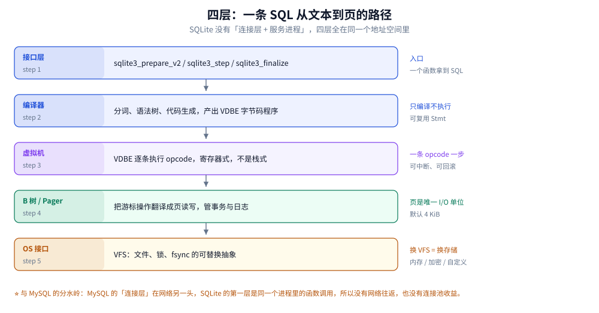
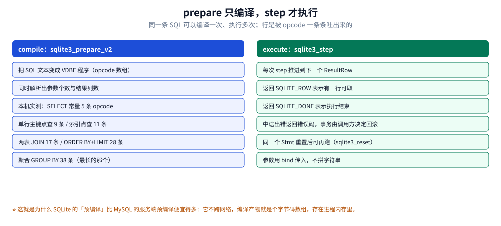

# SQLite 架构与执行链路

> 覆盖：SQLite 的四层结构、一条 SQL 从文本到结果集的完整路径、VDBE 为什么是寄存器虚拟机、
> prepare 与 step 的边界、「预编译」在这里为什么几乎免费、编译期选项怎样改变各层的能力。
>
> 不覆盖：页与文件的字节布局见 [文件格式与页结构.md](文件格式与页结构.md)；
> 索引与查询计划见 [索引与查询计划.md](索引与查询计划.md)；锁与事务见 [事务与并发控制.md](事务与并发控制.md)。
>
> 内容整理自个人学习笔记。**实测口径**：本机 Go 1.26.5 + `modernc.org/sqlite`（内嵌 SQLite 3.54.1，
> `THREADSAFE=1`，`DEFAULT_PAGE_SIZE=4096`，`MAX_VARIABLE_NUMBER=32766`，57 条编译选项）。
> 字节码条数由 `EXPLAIN` 返回的 opcode 行数直接数出，是确定性读数，不受计时粒度影响。

---

## 一、它的整体架构与 MySQL 的分水岭在哪？

**本节要点**：MySQL 是「进程 + 协议 + 引擎」，SQLite 是「**同一个地址空间里的四层函数调用**」。
所有关于 SQLite 的直觉都从这一句派生：没有网络往返，所以没有连接池收益；
没有独立进程，所以「谁在写」只能靠文件锁判断。

### 1.1 四层，一层不缺，也一层不多



五段从上到下走完，一次查询就结束了。右侧一列是每层的「可替换点」：只有最下面的 OS 接口是可换的（VFS），上面四层都编在库里，换不掉。这也是为什么加密、内存库、自定义存储都以 VFS 插件的形式出现。

| 层 | 职责 | 对外接口 |
|---|---|---|
| 接口层 | 打开库、编译 SQL、绑定参数、执行、取行 | `sqlite3_open_v2` / `prepare_v2` / `bind_*` / `step` / `column_*` |
| 编译器 | 分词 → 语法树 → 语义检查 → 代码生成 | 无公开接口，`EXPLAIN` 能看到它的产物 |
| 虚拟机（VDBE） | 执行 opcode，维护游标与寄存器 | 无公开接口，`sqlite3_step` 一次推进一步 |
| B 树 / Pager | 把游标操作翻译成页读写，管事务、日志、缓存 | 无公开接口 |
| OS 接口（VFS） | 文件、锁、`fsync`、共享内存 | 可替换：`sqlite3_vfs_register` |

### 1.2 与 MySQL 的四处结构性差异

| 维度 | MySQL | SQLite |
|---|---|---|
| 连接 | TCP，独立进程，连接池有意义 | 同进程函数调用，库句柄不是连接池瓶颈 |
| 并发控制 | 服务端锁管理器 + MVCC | 文件锁 + 一份日志（journal 或 WAL） |
| 日志 | redo + binlog 两套，两阶段提交 | 只有一套：rollback journal 或 WAL |
| 优化器 | 基于代价，有统计信息与多种 JOIN 算法 | 基于规则 + 少量统计（`sqlite_stat1`），只有嵌套循环 |

⭐ 第四行最容易被忽略：SQLite **没有哈希连接**，也基本不用排序合并连接，JOIN 一律是
嵌套循环加索引。所以「建对索引」在 SQLite 里比在 MySQL 里更决定性，
具体读数见 [索引与查询计划.md](索引与查询计划.md)。

### 1.3 四层都在一个进程里，意味着什么

- **好的一面**：没有网络往返、没有序列化、参数以二进制传给 VDBE；一次点查是微秒级
- **坏的一面**：库崩溃就是进程崩溃（`SQLITE_CORRUPT` 之后不能假设还能继续跑）；
  库的并发上限就是文件锁的能力；库的权限就是文件权限。

---

## 二、一条 SQL 从文本到结果经历了哪些环节？

**本节要点**：`prepare` 只编译不执行，`step` 才执行。这个边界是理解 SQLite 性能与
资源管理的关键：编译产物（`Stmt`）可以复用到几千次，而每次 `step` 只推进一行。

### 2.1 compile 与 execute 的边界



左栏是编译阶段产出什么，右栏是执行阶段怎样一行行吐结果。注意右栏最后两行：重置后可复用、参数用 bind 而不是拼字符串——这两条决定了「预编译」到底有没有省到钱。

编译阶段做四件事：

1. **分词与语法分析**：SQL 文本 → 语法树
2. **语义检查**：表存在吗、列存在吗、类型是否可比较、有没有权限（这里没有权限，只有 schema）
3. **代码生成**：语法树 → VDBE 程序（opcode 数组）
4. **参数与结果描述**：算出需要几个绑定参数（`sqlite3_bind_parameter_count`）、
   结果有几列（`sqlite3_column_count`）

执行阶段只有一个动作：**反复 `step`**，每次返回 `SQLITE_ROW`（有一行）或 `SQLITE_DONE`（结束）。

### 2.2 字节码条数：一条 SQL 的「体积」

下面是本机实测的 opcode 条数（`EXPLAIN` 返回的行数）。它不是性能指标，但它能说明
**编译器把这条 SQL 展开成了多复杂的一段程序**：

| SQL | opcode 条数 | 说明 |
|---|---|---|
| `SELECT 1` | 5 | Init / 常量装入 / ResultRow / Halt 一类 |
| `SELECT a FROM t WHERE id = 7` | 9 | rowid 点查，一次 B 树下降 |
| `SELECT a FROM t WHERE a = 7`（有索引） | 11 | 索引下降 + 取列 |
| `SELECT count(*) FROM t WHERE b > 'x'` | 15 | 全表扫描 + 累加 |
| 两表 JOIN | 17 | 两个游标 + 循环 + 条件判断 |
| `ORDER BY c LIMIT 10` | 28 | 多出排序器（sorter）的打开与比较 |
| `GROUP BY a HAVING ...` | 38 | 聚合、分组键比较、HAVING 过滤各占一段 |
| `INSERT` | 18 | 打开写游标、定位、写 cell、更新计数 |
| `UPDATE` | 19 | 比 INSERT 多一段「读取旧值」 |

⭐ 用法：调试复杂 SQL 时，`EXPLAIN` 的**条数**不是重点，**顺序**才是。
比如以为走了索引，结果字节码里有 `Rewind` + `Next` 而没有 `SeekGE`，那就是全扫。
逐条读法见 [索引与查询计划.md](索引与查询计划.md) 第三节。

### 2.3 一个 `Stmt` 的生命周期

| 阶段 | 函数 | 注意 |
|---|---|---|
| 编译 | `sqlite3_prepare_v2` | 只编译；SQL 语法错在这里就返回 |
| 绑定 | `sqlite3_bind_*` | 索引从 1 开始，不是 0 |
| 执行 | `sqlite3_step` | 一次一行；写语句也可能返回 `SQLITE_ROW`（如 `RETURNING`） |
| 重置 | `sqlite3_reset` | 保留绑定值，可再跑；不清绑定要用 `clear_bindings` |
| 释放 | `sqlite3_finalize` | 必须调，否则泄漏编译产物 |

⚠️ 最常见的资源泄漏：`step` 返回 `SQLITE_DONE` 后忘了 `finalize`。在长跑进程里这会持续
增长内存，而且不看 `sqlite3_stmt_status` 很难发现。

---

## 三、「预编译」在这里为什么几乎免费？

**本节要点**：MySQL 的服务端预编译要跨网络、要占服务端资源、要管生命周期；
SQLite 的预编译产物就是一个字节码数组，放在自己进程的堆上。所以它**默认就该复用**。

### 3.1 与 MySQL 服务端预编译的对照

| 维度 | MySQL 服务端预编译 | SQLite `prepare` |
|---|---|---|
| 产物在哪 | 服务端内存，绑在会话上 | 本地堆，绑在 `Stmt` 指针上 |
| 复用成本 | 一次网络往返（`COM_STMT_EXECUTE`） | 一次函数调用 |
| 生命周期风险 | 会话断开即失效 | 忘记 `finalize` 会泄漏 |
| 参数上限 | 65535 | 本机 `MAX_VARIABLE_NUMBER=32766` |
| 是否必要 | 高并发下必要（省解析） | 循环里几乎必须（省解析 + 省分配） |

### 3.2 什么时候该复用，什么时候不必

| 场景 | 复用 | 理由 |
|---|---|---|
| 循环里插 10 万行 | 必须 | 编译一次的代价会在 10 万次里被放大 |
| HTTP 请求里一条查询 | 看框架 | Go 的 `database/sql` 已经按 SQL 文本缓存了 `Stmt` |
| 动态拼接的 SQL | 不能 | 文本变了就要重新编译，缓存反而增长 |
| 一次性 DDL / 运维语句 | 不必 | 编译成本可忽略 |

⭐ 判据：**SQL 文本是常量，就复用；文本是拼出来的，就先别拼**（改用绑定参数，
顺便消掉注入风险）。Go 侧的写法见 [应用场景.md](应用场景.md) 使用节的五步验证，
Java 侧的 `PreparedStatement` 与 SQLite 的对应关系同理。

---

## 四、VDBE 是寄存器机还是栈机？为什么重要？

**本节要点**：VDBE 是**寄存器式虚拟机**（每个 opcode 带 P1/P2/P3 操作数与若干寄存器号），
不是 JVM 那样的栈机。这决定了它的 opcode 数量少、每条做的事情多，
也决定了 `EXPLAIN` 的输出格式与 JVM 的字节码完全不同。

### 4.1 三条设计后果

1. **opcode 少**：总共约 190 个（随版本略变），而 JVM 有 200 多个且更正交。
   SQLite 的每个 opcode 往往直接对应一个 B 树动作（`OpenRead` / `Rewind` / `SeekGE` / `Next`）。
2. **没有 JIT**：VDBE 永远是解释执行。所以「同一条 SQL 跑很多次」不会有 JIT 预热收益，
   也没有去优化点；它的稳定态从第一次执行就成立。
3. **可中断、可回滚**：每条 opcode 之间是安全点，`sqlite3_interrupt` 能在两次 opcode 之间打断
   （这也是为什么长查询能被取消）。

### 4.2 与「编译成机器码」的路线对比

| 路线 | 代表 | 启动 | 稳定态 | 可移植性 |
|---|---|---|---|---|
| 解释字节码 | SQLite VDBE、PostgreSQL 早期 | 无预热 | 中 | 好 |
| 表达式编译成机器码 | PostgreSQL 表达式 JIT、部分列存引擎 | 有预热 | 高 | 需每平台实现 |
| 全查询编译 | 少数分析型引擎 | 预热更长 | 最高 | 差 |

⭐ SQLite 的取舍是「**启动零成本 + 可移植性**」，这与它要在手机上、在 IoT 设备上
首次执行就快，是一致的。这个取舍不是性能失误，是定位决定。

---

## 五、文件与内存分别放什么？

**本节要点**：库文件里只有页；**所有运行时状态都在内存里**（页缓存、编译好的 `Stmt`、
游标、锁状态）。所以「进程重启后什么都没了，只剩文件」这句话要拆开看：
文件里有数据与 schema，内存里有计划与缓存。

| 位置 | 内容 | 大小/上限 | 对应 PRAGMA |
|---|---|---|---|
| 库文件 | 数据页、schema、文件头 | 页数 × 页大小 | `page_size` / `page_count` |
| `-wal` | 未 checkpoint 的页副本 | 涨到 checkpoint 为止 | `wal_autocheckpoint` |
| `-shm` | WAL 索引（页号 → 帧号 + 读者标记） | 本机实测恒 32768 字节 | 无 |
| 页缓存 | 热页（默认约 2 MB） | `cache_size` | `cache_size`（本机 −2000 即 KiB） |
| `mmap` 区 | 映射的文件页 | 默认 0（关闭） | `mmap_size` |
| `Stmt` / 游标 | 编译产物与执行状态 | 受堆限制 | 无 |
| 排序/临时表 | 内存或临时文件 | 受 `temp_store` 影响 | `temp_store` / `cache_size` |

⚠️ `-shm` 恒 32 KiB 这件事很实用：看到某个目录多出一个 32 KiB 的 `-shm`，
说明这个库正跑在 WAL 模式且非独占锁，不用怀疑它是不是异常增长。

---

## 六、编译期选项改了哪一层？

**本节要点**：编译期选项不是「配置」，是**决定某个功能存不存在**。同样一句
`CREATE VIRTUAL TABLE ... USING fts5`，在没编 FTS5 的库里直接报错。


六条选项分两类：前三条改「能力上限」（并发模式、页大小、参数个数），后三条改「功能在不在」（FTS5、dbstat、R*Tree）。判断某个特性能不能用，先查这张表，别查文档目录——文档默认你编了全功能版本。

### 6.1 本机实测的六条

| 选项 | 本机值 | 影响 |
|---|---|---|
| `THREADSAFE` | 1 | 1 = 串行化模式：一条连接可跨线程（内部加锁）；0 = 单线程，跨线程用会崩；2 = 多线程，同一连接同一时刻只能一个线程 |
| `DEFAULT_PAGE_SIZE` | 4096 | 新库的页大小；已有库不会因此改变 |
| `MAX_VARIABLE_NUMBER` | 32766 | 一条 SQL 的绑定参数上限（3.32 之前是 999） |
| `ENABLE_FTS5` | 已开 | 全文检索虚拟表 |
| `ENABLE_DBSTAT_VTAB` | 已开 | `dbstat` 虚拟表，能看每页归属 |
| `ENABLE_RTREE` | 已开 | R*Tree 空间索引 |

### 6.2 `THREADSAFE` 直接决定「能不能把连接传来传去」

| 值 | 语义 | 能不能多线程共用一条连接 |
|---|---|---|
| 0 | 单线程 | 不能，会崩 |
| 1 | 串行化（本机） | 能，库内部用互斥锁串行化 |
| 2 | 多线程 | 不能，但不同连接可在不同线程 |

⭐ 这三个值里的坑：Go 的 `database/sql` 连接池会**在不同 goroutine 之间移动连接**，
所以在 `THREADSAFE=0` 的构建上跑 Go 程序是不可靠的。纯 Go 驱动与 cgo 驱动、
不同发行版的系统库，这个值可能不同——**先查再信**：

```sql
PRAGMA compile_options;
```

### 6.3 `SQLITE_OMIT_*` 系列：把功能整个删掉

一组 `SQLITE_OMIT_*` 选项会从产物里彻底移除某个特性（如 `SQLITE_OMIT_LOAD_EXTENSION`、
`SQLITE_OMIT_VIRTUALTABLE`、`SQLITE_OMIT_ALTERTABLE`）。移动端系统自带的库常这么裁剪
以减小体积。后果是：

- 编译期就决定了「这个 API 不存在」，不是运行时返回错误
- 你的代码若依赖被裁掉的特性，会在**链接期或运行期首次调用**发现，而不是编译期

⚠️ 所以「在我机器上能跑」的 SQLite 代码，到手机上可能要重测一遍。
判据是版本门槛 + `compile_options` 两件事一起看。

---

## 使用：三条路观察一次链路

**本节要点**：不必读源码。下面三种方式都能看见「编译 → 执行」的边界，
按你手上的工具选一种即可。

### 使用一：SQL 层看字节码与计划

```sql
-- 看编译出的 opcode（8 列：地址/操作码/P1/P2/P3/注释/…）
EXPLAIN SELECT id FROM t WHERE a = 7;

-- 看优化器选的路（只有一列可读文本）
EXPLAIN QUERY PLAN SELECT id FROM t WHERE a = 7;
```

```bash
# 只看计划，更紧凑
sqlite3 app.db ".eqp on" "SELECT id FROM t WHERE a = 7;"
# 输出形如：SEARCH t USING COVERING INDEX idx_a (a=?)
```

### 使用二：Go（prepare 复用 + 字节码条数）

```go
// 编译一次、执行多次：循环里必须这样写
stmt, err := db.Prepare("INSERT INTO t(a, b) VALUES(?, ?)")
if err != nil {
    return err
}
defer stmt.Close()          // 必须关，否则泄漏编译产物
for i := 0; i < n; i++ {
    if _, err := stmt.Exec(i, "x"); err != nil {
        return err
    }
}
```

```go
// 数一条 SQL 编译出多少条 opcode（不受计时粒度影响）
func opcodeCount(db *sql.DB, query string) (int, error) {
    rows, err := db.Query("EXPLAIN " + query)
    if err != nil {
        return 0, err
    }
    defer rows.Close()
    n := 0
    for rows.Next() {
        var a, b, c, d, e, f, g, h any
        if err := rows.Scan(&a, &b, &c, &d, &e, &f, &g, &h); err != nil {
            return 0, err
        }
        n++
    }
    return n, rows.Err()
}
```

本机实测：`SELECT 1` → 5 条，主键点查 → 9 条，聚合 `GROUP BY` → 38 条。

### 使用三：Java（`PreparedStatement` 的对应关系）

```java
String url = "jdbc:sqlite:app.db";
try (Connection conn = DriverManager.getConnection(url);
     PreparedStatement ps = conn.prepareStatement(
             "INSERT INTO t(a, b) VALUES(?, ?)")) {
    for (int i = 0; i < n; i++) {
        ps.setInt(1, i);
        ps.setString(2, "x");
        ps.addBatch();          // 批处理：仍是同一条编译产物
    }
    ps.executeBatch();
}
```

⚠️ `sqlite-jdbc` 的 `executeBatch` 默认包在一个事务里，这与「每次 `Exec` 一次自动提交」
的差别是数量级的——见 [PRAGMA与调优.md](PRAGMA与调优.md) 的 `synchronous` 实测表。

### 三个路的共同检查点

| 检查 | 通过的样子 | 不通过的样子 |
|---|---|---|
| 编译是否复用 | 循环外 `prepare`，循环内只 bind | 循环里拼字符串再 `Exec` |
| 产物是否释放 | `defer stmt.Close()` / `finalize` | 只有 `Query` 没有 `Close` |
| 是否看到真计划 | `SEARCH ... USING INDEX` | 只有 `SCAN`，或 `USE TEMP B-TREE` |

---

## 延伸追问

**Q：SQLite 有没有「执行计划缓存」？**
没有用户可调的计划缓存。`Stmt` 复用等价于「计划复用」——因为计划就是编译产物的一部分。
所以控制计划缓存的方式就是控制 `Stmt` 的生命周期，而不是设一个缓存大小的参数。

**Q：为什么 SQLite 的 `EXPLAIN` 输出是表，而 MySQL 是固定列？**
因为 VDBE 的产物就是「指令表」，`EXPLAIN` 直接把这张表返回。MySQL 的 `EXPLAIN` 返回的是
优化器结论（访问类型、可用键、估算行数），不是执行程序。两者层级不同：
一个给你「程序」，一个给你「决策摘要」。

**Q：一条 SQL 编译要多久？为什么我量不出来？**
本机在 Windows 上 `time.Now()` 有毫秒级量化，编译耗时常落在量化噪声里（见
[观测与诊断.md](观测与诊断.md) 第三节）。要测就得循环几万次取平均，
且要区分「首次编译」（含 schema 加载）与「同文本再编译」（命中内部缓存）。

**Q：既然 JOIN 只能嵌套循环，是不是该在应用层拆开？**
在 SQLite 里这经常是正解：两次单表索引查询 + 内存归并，往往快过一条三表 JOIN，
因为省掉了嵌套循环里的重复探测。判据是「外层行数 × 内层单次探测成本」，
具体做法与实测见 [索引与查询计划.md](索引与查询计划.md) 第四节。

## 关联

- [README.md](README.md) — 本册导读与四条读序
- [文件格式与页结构.md](文件格式与页结构.md) — 这一篇的下一层：Pager 到底在读写什么
- [索引与查询计划.md](索引与查询计划.md) — 编译器与优化器的产物怎么读
- [应用场景.md](应用场景.md) — 这套架构适合什么形态的部署
- [MySQL/架构与执行链路.md](../MySQL/架构与执行链路.md) — 对照读：服务端数据库的四层长什么样
