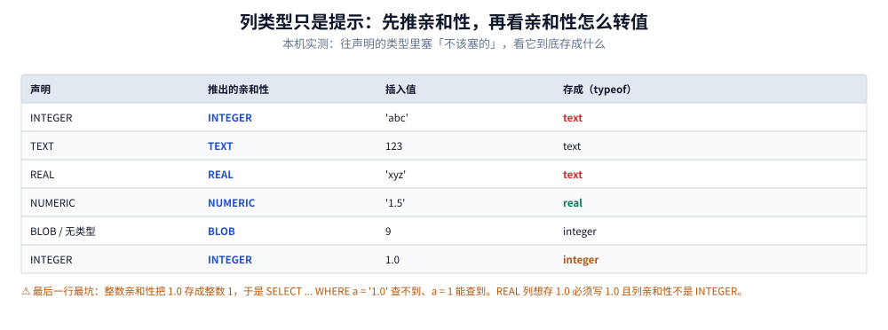
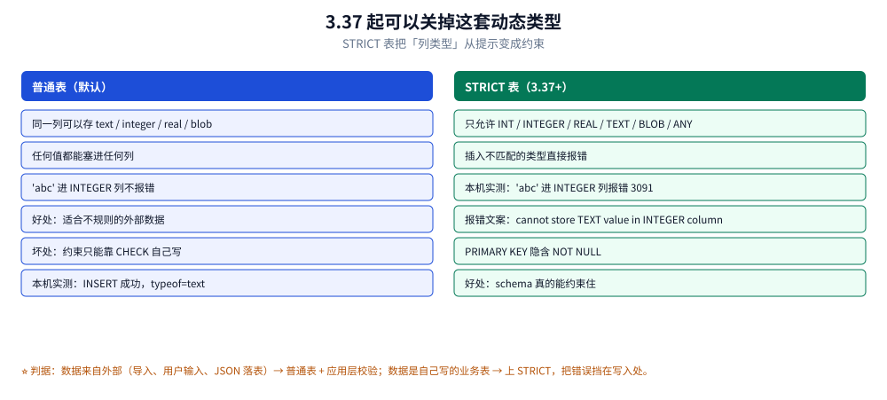

# 类型系统与数据建模

> 覆盖：五类类型亲和性的推导规则、动态类型在真实项目里造成的三个麻烦、
> `STRICT` 表（3.37+）的用法与边界、时间/金额/布尔这三种「没有原生类型」的东西怎么存、
> JSON 半结构化数据的存法与索引、外键为什么默认关闭。
>
> 不覆盖：索引与表达式索引的机制见 [索引与查询计划.md](索引与查询计划.md)；
> `PRAGMA foreign_keys` 属于哪类参数见 [PRAGMA与调优.md](PRAGMA与调优.md)；
> 从 MySQL 迁入的类型映射见 [备份恢复与迁移.md](备份恢复与迁移.md)。
>
> 内容整理自个人学习笔记。**实测口径**：本机 Go 1.26.5 + `modernc.org/sqlite`（SQLite 3.54.1）。
> 亲和性与 `STRICT` 的行为用 `typeof()` 与 `quote()` 直接读出，是确定性结论，不含计时。

---

## 一、为什么往 `INTEGER` 列里能插字符串？

**本节要点**：SQLite 里**列类型只是「亲和性」提示**，不是约束。往 `INTEGER` 列插 `'abc'`
不会报错，它就把 `'abc'` 存成文本。这与 MySQL 的严格模式是根本差异——不是配置差异，
是设计取向差异（它要能直接读写外部来的不规则数据）。

### 1.1 本机实测的六行

| 声明类型 | 插入值 | 实际存成 | 结果 |
|---|---|---|---|
| `INTEGER` | `'abc'` | `text` | 成功，`quote` 为 `'abc'` |
| `TEXT` | `123` | `text` | 成功，`quote` 为 `'123'` |
| `REAL` | `'xyz'` | `text` | 成功，`quote` 为 `'xyz'` |
| `NUMERIC` | `'1.5'` | `real` | 成功，`quote` 为 `1.5` |
| `BLOB`（无类型） | `9` | `integer` | 成功，`quote` 为 `9` |
| `INTEGER` | `1.0` | `integer` | 成功，`quote` 为 `1` |

⭐ 最后两行最需要记：

- `BLOB` 亲和性等于「没有亲和性」，所以整数保持整数，不会被转成文本
- `INTEGER` 亲和性会把 `1.0` **转成整数 1**，于是 `WHERE a = '1.0'` 查不到、`a = 1` 能查到

### 1.2 这不是「宽松」，是「可转就转」

SQLite 不是「什么都存原样」。它的行为是：**先按亲和性尝试转换，转不了就存原值**。
所以：

- `NUMERIC` 列里 `'1.5'` 会变成 `real` 1.5（能转）
- `INTEGER` 列里 `'abc'` 保持 `text`（不能转）
- `INTEGER` 列里 `1.0` 变成 `integer` 1（无损转换）

理解了这条规则，就不会被 `typeof()` 的输出搞糊涂。

---

## 二、五类亲和性是怎么推的？

**设置要点**：从声明类型字符串推亲和性，规则是按顺序匹配的**关键字包含**，
不是精确匹配。所以 `VARCHAR(255)` 是 TEXT、`BIGINT` 是 INTEGER、`UNSIGNED BIG INT` 也是 INTEGER。



六行是六种声明的实测结果，中间一列是推出的亲和性，右两列是「插进去的」与「实际存的」。看最后两行：BLOB 亲和性等于不转换，而 INTEGER 亲和性会把 1.0 变成整数 1，这两条是动态类型最容易踩的坑。

### 2.1 推导规则（按顺序）

| 声明类型里包含 | 亲和性 |
|---|---|
| `INT` | INTEGER |
| `CHAR` / `CLOB` / `TEXT` | TEXT |
| `BLOB`，或**什么都没写** | BLOB（无亲和性） |
| `REAL` / `FLOA` / `DOUB` | REAL |
| 以上都不含 | NUMERIC |

### 2.2 常见声明会落到哪一类

| 你写的 | 亲和性 | 说明 |
|---|---|---|
| `INT` / `INTEGER` / `BIGINT` / `UNSIGNED BIG INT` | INTEGER | 含 `INT` |
| `VARCHAR(255)` / `NVARCHAR` / `CLOB` / `TEXT` | TEXT | 含 `CHAR`/`CLOB`/`TEXT` |
| `REAL` / `DOUBLE` / `FLOAT` | REAL | 含 `REAL`/`DOUB`/`FLOA` |
| `DECIMAL(10,5)` / `NUMERIC` / `BOOLEAN` / `DATE` / `DATETIME` | NUMERIC | 都不含，落到默认 |
| `BLOB` / 无类型 | BLOB | 无亲和性 |

⚠️ `DATETIME` 落到 **NUMERIC** 是个经典陷阱：如果你往里存 ISO-8601 字符串
（`'2026-11-03T12:00:00Z'`），NUMERIC 亲和性会尝试转换，转不了就保持文本——
看起来「能用」，但排序与比较会变成字符串比较，一旦格式不统一（有的带时区有的不带）就会乱。

### 2.3 亲和性对比较的影响

| 比较 | 结果 |
|---|---|
| 两列都是 INTEGER 亲和性，存的是整数 | 数值比较 |
| 一列 TEXT、一列 INTEGER | 按「存储类」比较：数值 < 文本（有明确定义） |
| 同列里混了文本与数值 | 排序结果里数值全在前、文本全在后 |

这就是为什么「动态类型」在业务表里是负担：一旦混入不同类型，排序与索引的行为就不再符合直觉。

---

## 三、动态类型带来的三个真实麻烦

**设置要点**：麻烦不在「能插错」，在**错得安静**——不报错、查询还能跑、只是结果不对。
下面三个是实际项目里最常见的。

### 3.1 麻烦一：整数与浮点在同一个列里

```sql
CREATE TABLE price(id INTEGER PRIMARY KEY, amount NUMERIC);
INSERT INTO price(amount) VALUES('1.0'), ('1'), (1.0), (1);
-- 全部成功
SELECT amount, typeof(amount) FROM price;
-- 1.0 real / 1 integer / 1 integer / 1 integer
```

后果：`WHERE amount = 1` 只命中后三行，第一行（real 1.0）不命中——
因为 `1.0` 与 `1` 在**存储类**上不同，`=` 对 real 与 integer 会做数值比较，
但如果你在应用层用字符串拼条件，就会出现「明明有却查不到」。

### 3.2 麻烦二：时间列混了三种格式

| 存的形态 | 排序正确 | 可读 | 时区明确 |
|---|---|---|---|
| `'2026-11-03 12:00:00'`（本地时间） | ✅（同格式内） | ✅ | ❌ |
| `'2026-11-03T12:00:00Z'`（UTC ISO） | ✅（同格式内） | ✅ | ✅ |
| `1700000000`（整数秒） | ✅ | ❌ | ✅ |
| 上面三种混存 | ❌ | 部分 | ❌ |

混存之后，`ORDER BY created_at` 的结果会按存储类先分组（数值在前、文本在后），
完全不按时间。这类问题往往在数据量大了以后才暴露。

### 3.3 麻烦三：布尔列里出现了「真假不明」

`is_active` 列里可能出现 `1`、`0`、`'true'`、`'false'`、`'1'`、`''`。
`WHERE is_active` 只对 `1` 为真（`'true'` 是非零文本，在布尔上下文中为真……但它不等于 1）。
于是「统计活跃用户数」会少算。

⭐ 三个麻烦的共同解法只有一个：**约束**。要么用 `STRICT` 表挡住写入，
要么用 `CHECK` 约束限定取值范围，要么在应用层用强类型把值规整后再写。

---

## 四、`STRICT` 表怎么用？

**设置要点**：3.37 起可以在建表时加 `STRICT`，把「列类型」从提示变成约束。
它不是万能的（`ANY` 仍允许任意类型），但对业务表已经够用。

### 4.1 语法与允许的类型



左右两栏是同一列值在两种表里的命运：左栏全部放行，右栏按声明类型拦截。看左栏倒数第二行与本机实测一致——`'abc'` 进 INTEGER 列不报错，只是被存成文本，这就是「错得安静」的具体样子。

```sql
CREATE TABLE note (
    id    INTEGER PRIMARY KEY,
    title TEXT    NOT NULL,
    body  TEXT,
    score REAL,
    tags  BLOB,
    meta  ANY            -- 唯一允许「任意类型」的声明
) STRICT;
```

| 允许 | 不允许 |
|---|---|
| `INT` / `INTEGER` | `VARCHAR(255)`（不接受长度修饰） |
| `REAL` | `DECIMAL(10,2)` |
| `TEXT` | `DATETIME` |
| `BLOB` | `BOOLEAN` |
| `ANY` | 无类型声明（必须写类型） |

### 4.2 本机实测的报错

```text
INSERT INTO s(a, b) VALUES('abc', 'x');   -- a 声明为 INTEGER
→ constraint failed: cannot store TEXT value in INTEGER column s.a (3091)
```

错误码 3091 是扩展码（低 8 位是主码 19 = 约束失败）。判断时先看低字节，
再看全码，见 [观测与诊断.md](观测与诊断.md) 第二节的分诊表。

### 4.3 `STRICT` 的三个额外变化

| 变化 | 说明 |
|---|---|
| `PRIMARY KEY` 隐含 `NOT NULL` | 普通表里 `INTEGER PRIMARY KEY` 可以为 NULL 吗？不能，但其他类型的 PK 在普通表里理论上可空（历史遗留）；`STRICT` 里一律 `NOT NULL` |
| 不接受类型修饰 | 不能写 `VARCHAR(255)`，迁移时要改 DDL |
| `ANY` 列仍可存任意类型 | 所以「要严格」就别用 `ANY` |

### 4.4 要不要用

| 场景 | 建议 |
|---|---|
| 业务表、自己写数据 | ✅ 用，把错误挡在写入处 |
| 导入外部数据（CSV、JSON、第三方 API） | ⚠️ 先落到普通表（`text` 列），清洗后再写业务表 |
| 已有表要迁移 | 需重建表（`CREATE ... STRICT` + `INSERT SELECT` + `DROP` + `RENAME`） |
| 版本可能低于 3.37（老 Android） | ❌ 不能用，查版本再定 |

---

## 五、时间怎么存？

**设置要点**：没有 `DATE` / `TIMESTAMP` 类型。三种存法各有取舍，
**同一个项目里只能选一种**，混用必然出问题。


五张卡是三个「没有原生类型」的东西：时间三种存法、金额一种、布尔一种。看第二、三张卡——时间存 INTEGER 或 Julian day 都能排序与比较，而金额那张卡只有一句「一律存整数分」，因为另外两条路都会在对账时出错。

### 5.1 三种存法对照

| 存法 | 声明 | 优点 | 缺点 |
|---|---|---|---|
| ISO-8601 文本 | `TEXT` | 可读、可直接字符串排序（同格式）、调试方便 | 占空间（约 20~24 字节）、格式必须统一 |
| Unix 时间戳（秒/毫秒） | `INTEGER` | 8 字节、时区明确、算术方便 | 不可读，要看转换 |
| Julian day | `REAL` | SQLite 日期函数原生支持 | 精度与可读性都一般，业务表用得少 |

### 5.2 统一口径的三条规则

1. **一律存 UTC**。本地时间在跨时区、夏令时切换时会出现「同一时刻两个值」。
2. **格式固定**。文本存法必须带 `T` 与 `Z`（或统一不带），不能有的带时区有的不带。
3. **毫秒还是秒要写进字段名**（如 `created_at_ms`），否则换人维护必错。

### 5.3 日期函数与索引

```sql
-- 文本（ISO-8601）可以直接比较与排序
SELECT * FROM note WHERE created_at >= '2026-01-01T00:00:00Z';

-- 整数时间戳
SELECT * FROM note WHERE created_at_ms >= 1767225600000;

-- 需要按「天」聚合时，文本用 substr，整数用除法
SELECT substr(created_at, 1, 10) AS day, count(*) FROM note GROUP BY day;
SELECT created_at_ms / 86400000 AS day, count(*) FROM note GROUP BY day;
```

⚠️ 别在 `WHERE` 里对时间列套函数（`date(created_at) = '2026-11-03'`），
那会让索引失效。改成范围条件：`created_at >= '2026-11-03' AND created_at < '2026-11-04'`。

---

## 六、金额与布尔怎么存？

**设置要点**：金额**一律存整数分**，绝不存 `REAL`；布尔存 `INTEGER` 0/1，
不用 `'true'`/`'false'`。这两条没有例外。

### 6.1 金额为什么不能存 `REAL`

浮点无法精确表示 0.1 这类十进制小数，累加会产生误差：

```text
0.1 + 0.2 = 0.30000000000000004
```

对账时「差一分钱」的根源通常是这个。三种正确做法：

| 做法 | 声明 | 适用 |
|---|---|---|
| 存整数分 | `INTEGER`（单位：分） | 首选，运算精确、比较简单 |
| 存文本定点 | `TEXT`（如 `'12.34'`） | 需要保留任意精度（如汇率 6 位小数） |
| 存整数 + 标度 | `INTEGER` + 一个 scale 列 | 多币种、多精度 |

```sql
CREATE TABLE payment (
    id       INTEGER PRIMARY KEY,
    amount_c INTEGER NOT NULL,          -- 单位：分
    currency TEXT    NOT NULL DEFAULT 'CNY'
) STRICT;

-- 展示时再除，不要在库里存除完的结果
SELECT id, printf('%.2f', amount_c / 100.0) AS amount FROM payment;
```

### 6.2 布尔

```sql
CREATE TABLE user (
    id        INTEGER PRIMARY KEY,
    is_active INTEGER NOT NULL DEFAULT 1 CHECK (is_active IN (0, 1))
) STRICT;
```

| 写法 | 问题 |
|---|---|
| `BOOLEAN` 声明 | 亲和性是 NUMERIC，不挡 `'true'` |
| `'true'` / `'false'` 文本 | 排序、比较、聚合全不符合直觉 |
| `1` / `0` + `CHECK` | ✅ 正确 |

⚠️ `WHERE is_active` 对 `1` 为真、对 `0` 为假，但对 `'false'` 也为真
（非空文本在布尔上下文中为真）。这是「用文本存布尔」最直接的坑。

---

## 七、JSON 与半结构化数据

**设置要点**：JSON 存在 `TEXT` 列里，用 `json_*` 函数查。关键是**要么整段取出在应用层解析，
要么建表达式索引让它可走索引**——中间状态（在 `WHERE` 里套 `json_extract` 但不建索引）
是最慢的。

### 7.1 两种遍历

| 函数 | 行为 |
|---|---|
| `json_extract(doc, '$.a.b')` | 取一个路径的值 |
| `doc -> '$.a'` / `doc ->> '$.a'` | 前者返回 JSON，后者返回 SQL 文本 |
| `json_each(doc)` | 逐元素展开（数组 → 多行） |
| `json_tree(doc)` | 递归展开（所有层级 → 多行） |

```sql
-- 取字段（->> 返回文本，适合比较）
SELECT id, doc ->> '$.title' AS title FROM article;

-- 展开数组，与主表 JOIN
SELECT a.id, j.value AS tag
FROM article a, json_each(a.doc, '$.tags') j
WHERE j.value = 'sqlite';

-- 递归找某个键
SELECT id, t.fullkey, t.value
FROM article a, json_tree(a.doc) t
WHERE t.key = 'lang';
```

### 7.2 表达式索引的逐字匹配

```sql
CREATE INDEX idx_article_lang ON article(json_extract(doc, '$.lang'));

-- 命中（写法与索引定义完全一致）
SELECT * FROM article WHERE json_extract(doc, '$.lang') = 'zh';

-- 不命中（多一个空格）
SELECT * FROM article WHERE json_extract(doc,  '$.lang') = 'zh';
```

⭐ 表达式索引的匹配是**文本级**的，差一个空格就退回全表扫，而且不报错。
测试方法：用 `EXPLAIN QUERY PLAN` 确认是 `SEARCH` 而不是 `SCAN`。

### 7.3 什么时候该拆表

| 情况 | 建议 |
|---|---|
| 整段读写、偶尔取一两个字段 | JSON 列就够 |
| 经常按某个字段过滤/排序 | 建表达式索引；字段多就拆成真列 |
| 需要外键约束、需要 `STRICT` 类型 | 拆表 |
| 结构随租户变（多形态） | JSON 列合理，但要有应用层 schema 校验 |

---

## 八、约束：外键为什么默认是关的？

**设置要点**：`PRAGMA foreign_keys` 默认是 **0**（关闭），这是为了向后兼容。
不显式打开，外键定义只是「写在 DDL 里的注释」，不会生效。

### 8.1 打开与确认

```sql
PRAGMA foreign_keys = ON;    -- 连接级，每条连接都要设
PRAGMA foreign_keys;         -- 返回 1 才算开
```

⚠️ 它是**连接级**参数，不是持久设置。连接池里每条新连接都要设，
所以通常写进 DSN（`?_pragma=foreign_keys(1)`）。

### 8.2 五个容易忽略的点

| 点 | 说明 |
|---|---|
| 外键列不自动建索引 | MySQL 会自动建，SQLite 不会；`ON DELETE CASCADE` 会因此全表扫 |
| 事务内改 `foreign_keys` 无效 | 必须在事务外设置 |
| `PRAGMA foreign_key_check` | 一次性检查现有数据是否违反（迁移后必跑） |
| 延迟约束 | `DEFERRABLE INITIALLY DEFERRED`，允许事务内暂时不一致 |
| 自引用表 | 支持，但删除顺序要自己保证 |

### 8.3 建表示例（含索引）

```sql
CREATE TABLE project (
    id   INTEGER PRIMARY KEY,
    name TEXT NOT NULL
) STRICT;

CREATE TABLE task (
    id         INTEGER PRIMARY KEY,
    project_id INTEGER NOT NULL REFERENCES project(id) ON DELETE CASCADE,
    title      TEXT NOT NULL,
    done       INTEGER NOT NULL DEFAULT 0 CHECK (done IN (0, 1))
) STRICT;

-- 必须手动建：否则级联删除每删一个 project 都要全表扫 task
CREATE INDEX idx_task_project ON task(project_id);
```

---

## 使用：建模的三语言写法与自查

**本节要点**：建表时把「严格类型 + 约束 + 时间口径 + 金额单位」四件事一次定好，
后面就不用靠应用层兜。下面是同一张表的三种写法与一份自查 SQL。

### 使用一：SQL（推荐作为唯一事实来源）

```sql
-- 迁移脚本里的表定义：严格类型 + 检查约束 + 明确单位
CREATE TABLE IF NOT EXISTS payment (
    id         INTEGER PRIMARY KEY,
    user_id    INTEGER NOT NULL REFERENCES user(id),
    amount_c   INTEGER NOT NULL CHECK (amount_c >= 0),   -- 单位：分
    currency   TEXT    NOT NULL DEFAULT 'CNY' CHECK (length(currency) = 3),
    created_ms INTEGER NOT NULL,                          -- Unix 毫秒，UTC
    paid       INTEGER NOT NULL DEFAULT 0 CHECK (paid IN (0, 1)),
    meta       TEXT    NOT NULL DEFAULT '{}' CHECK (json_valid(meta))
) STRICT;

CREATE INDEX IF NOT EXISTS idx_payment_user ON payment(user_id, created_ms);
```

### 使用二：Go（写入前规整 + 读出的类型断言）

```go
type Payment struct {
    ID        int64
    UserID    int64
    AmountC   int64  // 分
    Currency  string
    CreatedMS int64
    Paid      bool
    Meta      string
}

func insertPayment(db *sql.DB, p Payment) error {
    paid := 0
    if p.Paid {
        paid = 1
    }
    _, err := db.Exec(
        `INSERT INTO payment(user_id, amount_c, currency, created_ms, paid, meta)
         VALUES(?, ?, ?, ?, ?, ?)`,
        p.UserID, p.AmountC, p.Currency, p.CreatedMS, paid, p.Meta,
    )
    return err
}
```

⚠️ Go 的 `bool` 不能直接写进 `STRICT` 的 `INTEGER` 列，必须转 0/1；
反过来读时 `Scan(&someBool)` 在有些驱动上会失败，用 `int` 接再判断更稳。

### 使用三：Java

```java
String sql = """
    INSERT INTO payment(user_id, amount_c, currency, created_ms, paid, meta)
    VALUES(?, ?, ?, ?, ?, ?)
    """;
try (PreparedStatement ps = conn.prepareStatement(sql)) {
    ps.setLong(1, p.userId());
    ps.setLong(2, p.amountC());
    ps.setString(3, p.currency());
    ps.setLong(4, p.createdMs());
    ps.setInt(5, p.paid() ? 1 : 0);   // 不要用 setBoolean
    ps.setString(6, p.meta());
    ps.executeUpdate();
}
```

### 使用四：建模后的四项自查

```sql
-- 1. 有没有列混了存储类（同列多种 typeof）
SELECT typeof(amount_c), count(*) FROM payment GROUP BY 1;
-- 期望：只有一行，且是 integer

-- 2. 时间列的口径是否统一（长度一致说明格式统一）
SELECT length(created_ms), count(*) FROM payment GROUP BY 1;

-- 3. 有没有该建却没建的外键索引
SELECT m.name AS child, f."table" AS parent, f."from"
FROM sqlite_master m, pragma_foreign_key_list(m.name) f
WHERE m.type = 'table'
  AND NOT EXISTS (
    SELECT 1 FROM pragma_index_list(m.name) il, pragma_index_info(il.name) ii
    WHERE ii.name = f."from"
  );

-- 4. 现有数据是否违反外键（迁移后必跑）
PRAGMA foreign_key_check;
```

⭐ 第 3 条是本册里最实用的一段 SQL：它直接列出「有外键但没有索引」的表，
这类问题在级联删除时会表现为「删一条主表记录要几秒」。

### 判读表

| 自查结果 | 处理 |
|---|---|
| `typeof` 分组出现多行 | 有脏数据，先清洗再加 `STRICT` |
| 时间列长度不一 | 格式不统一，统一成 UTC ISO 或统一整数 |
| 外键索引查询有输出 | 补索引，否则级联操作全表扫 |
| `foreign_key_check` 有行 | 数据已违反约束，迁移前必须修 |
| `json_valid` 约束被触发 | 写入的不是合法 JSON，检查序列化路径 |

---

## 延伸追问

**Q：SQLite 既然有动态类型，为什么还推荐写类型？**
类型不生效但**亲和性生效**：写 `INTEGER` 会让整数按整数存、比较按数值比，
写 `TEXT` 会让所有值转文本。不写类型（BLOB 亲和性）就完全不做转换，
排序与比较会按「存储类」分组，最容易出意外。

**Q：`STRICT` 表能不能存 JSON？**
能，用 `TEXT` 列 + `CHECK (json_valid(col))`。`STRICT` 只约束「存储类」，
不约束文本内容是不是 JSON，所以这条 `CHECK` 是必要的。

**Q：为什么 `NUMERIC` 亲和性对 `'1.5'` 转成 real，而不是保留文本？**
NUMERIC 的规则是「能无损转成整数就转整数，否则转实数，都不行才保留文本」。
所以 `'1.5'` → real 1.5，`'abc'` → 保持 text。

**Q：`ANY` 类型有什么用？**
`STRICT` 表里唯一允许存任意类型的声明。适合「真的什么都可能」的列（如插件配置）。
用了它，这一列就回到动态类型行为，所以只在该列确实无法归类时用。

## 关联

- [README.md](README.md) — 本册导读与四条读序
- [索引与查询计划.md](索引与查询计划.md) — 隐式类型转换为什么让索引失效、表达式索引怎么建
- [PRAGMA与调优.md](PRAGMA与调优.md) — `foreign_keys` 是连接级参数，不能靠一次设置
- [备份恢复与迁移.md](备份恢复与迁移.md) — 从 MySQL 迁入时的类型映射与脏数据清洗
- [扩展能力与虚拟表.md](扩展能力与虚拟表.md) — JSON1 的完整能力与 FTS5 的分词
- [MySQL/数据建模.md](../MySQL/数据建模.md) — 对照读：严格类型下同一张表怎么建
