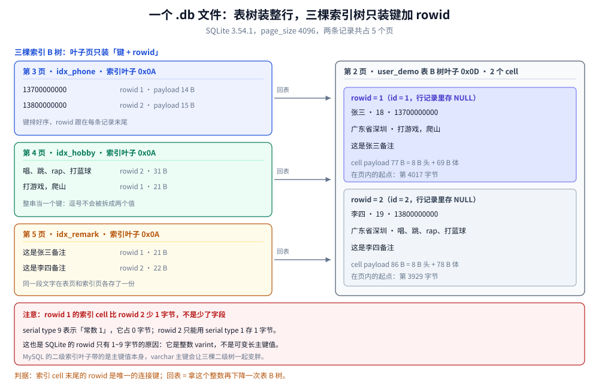

# 索引与查询计划

> 覆盖：表与索引同为 B 树但装的不是同一种东西、`rowid` 表与 `WITHOUT ROWID` 的取舍、
> `EXPLAIN QUERY PLAN` 五类输出怎么读、为什么这里只有嵌套循环 JOIN、哪些写法让索引失效、
> `ANALYZE` 与 `sqlite_stat1` 的作用、建索引的检查清单。
>
> 不覆盖：页与 cell 的字节布局见 [文件格式与页结构.md](文件格式与页结构.md)；
> 数据类型的亲和性与 `STRICT` 表见 [类型系统与数据建模.md](类型系统与数据建模.md)；
> B 树作为数据结构的一般原理见 [B树与B+树.md](../../../../02-计算机基础/数据结构/树/磁盘存储树/B树与B+树.md)。
>
> 内容整理自个人学习笔记。**实测口径**：本机 Go 1.26.5 + `modernc.org/sqlite`（SQLite 3.54.1），
> 20 万行表、`a` 列取值 5000 种（每值 40 行）。全表扫描取 15 次中位数 66.4 ms；
> 索引命中与回表因 Windows 上 `time.Now()` 有毫秒级量化，改用 **2000 次累计 ÷ 2000**：
> 覆盖索引 108.7 µs/次、回表 188.4 µs/次。

---

## 一、表与索引都是 B 树，差别在哪？

**本节要点**：SQLite 里「表」和「索引」是**同一种结构的两份实例**，差别只在 cell 里装什么：
表装整行并按 rowid 排序，索引装键 + rowid 并按键排序。所有关于「回表」的直觉都从这一句来。

### 1.1 两种树的对照


左右两栏是同一份数据的两种组织方式。左栏是默认的 rowid 表，右栏是 WITHOUT ROWID 表；注意第三、四行的箭头方向——rowid 表要先查主键索引再回表，WITHOUT ROWID 一次到位，代价是主键要在每层节点里都存一份。

| 维度 | 表（rowid 表） | 索引 |
|---|---|---|
| 排序键 | `rowid`（隐式或 `INTEGER PRIMARY KEY`） | 索引列 + rowid |
| 叶子 cell | 整行（或指向溢出页） | 键值 + rowid |
| 内部页 cell | 子页号 + 最大 rowid | 子页号 + 键 |
| 点查代价 | 一次下降 | 一次下降，然后**回表**再下降一次 |
| 范围扫描 | 按 rowid 顺序 | 按索引键顺序，但取列要回表（除非覆盖） |

### 1.2 「回表」不是 SQLite 特有的词，但这里的代价更直接

MySQL 的 InnoDB 有聚簇索引 + 二级索引，回表是「拿主键再查聚簇索引」。
SQLite 的结构化表达是：**二级索引的 cell 里带的是 rowid，所以回表就是按 rowid 再下降一次表 B 树**。

本机实测（20 万行，条件命中 40 行）：

| 查询 | 单次耗时 | 说明 |
|---|---|---|
| `SELECT id FROM t WHERE a = 1234` | 108.7 µs | `id` 是 rowid 别名且在索引里 → **覆盖索引，不回表** |
| `SELECT b FROM t WHERE a = 1234` | 188.4 µs | `b` 不在索引里 → 40 次回表 |

⭐ 1.73 倍的差距全部来自 40 次额外的表页访问。所以「把要查的列放进索引」
在 SQLite 里是**收益明确**的动作，不像在 MySQL 里有时会被优化器忽略。


四个节点是从建索引到取数的路径，右侧是每一步的代价。第三节点是分歧点：`SELECT id` 停在索引里，`SELECT b` 要去表里取——两者差 1.73 倍，差值全部在第二步之后的页访问上。

### 1.3 全表扫描差多少

| 查询 | 耗时 | 计划 |
|---|---|---|
| `SELECT count(*) FROM t WHERE b > 'x'`（无索引） | 66.4 ms | `SCAN t` |
| `SELECT id FROM t WHERE a = 1234`（有索引） | 108.7 µs | `SEARCH t USING COVERING INDEX` |

约 **611 倍**。量级差异可以写倍数，因为 66 ms 与 0.1 ms 都远超本机的计时粒度；
但不要把这个倍数当「索引让你快 611 倍」的普适结论——它只对应「这张表、这个选择度、
这 40 行结果」这一组条件。

---

## 二、`rowid` 表与 `WITHOUT ROWID` 怎么选？

**本节要点**：`WITHOUT ROWID` 省掉的是**主键索引那棵树**：主键即表，表即主键。
代价是主键值在内部页里重复存储，主键很长时反而更费空间。

### 2.1 本机实测的两组数

**字节码条数**（同一个查询，两种表）：

| 表 | 点查 `WHERE k = 'a'` | 范围 `WHERE k > 'a'` |
|---|---|---|
| `WITHOUT ROWID` | 10 条 | 10 条 |
| 普通 rowid 表 | 12 条 | 12 条 |

**体积**（同 10 万行、同负载，`k` 是 `key-000000` 这类文本主键）：

| 表 | 页数 | 文件大小 |
|---|---|---|
| `WITHOUT ROWID` | 2861 | 11 718 656 |
| 普通 rowid 表 | 3084 | 12 632 064 |

省 **7.2%**（少 223 页）。这个数不大，因为主键是 10 字符的短文本；
主键越长（比如 UUID 文本），`WITHOUT ROWID` 反而可能更费——键在每一层内部页都要存一份。

### 2.2 选择判据

| 条件 | 选 `WITHOUT ROWID` | 选默认 rowid 表 |
|---|---|---|
| 主键短（整数、短文本） | ✅ | 也行 |
| 主键长（UUID 文本、复合多列） | ⚠️ 要算体积 | ✅ |
| 只有这一个访问路径（按主键） | ✅ 省一棵树 | — |
| 需要 `rowid`（如 `last_insert_rowid`） | ❌ 没有 rowid | ✅ |
| 有大量二级索引 | 影响小（二级索引仍带主键） | ✅ 简单 |
| 表很宽（多列大字段） | ✅ 主键即表，少一次回表 | — |

⚠️ 一个容易忽略的约束：`WITHOUT ROWID` 表**必须有显式主键**，且主键列隐含 `NOT NULL`。
建表时忘了写主键会直接报错。

### 2.3 建表示例

```sql
-- 适合 WITHOUT ROWID：短主键、按主键访问为主、要省掉一棵索引树
CREATE TABLE kv (
    k   TEXT PRIMARY KEY,
    v   BLOB NOT NULL,
    ts  INTEGER NOT NULL
) WITHOUT ROWID, STRICT;

-- 适合默认表：需要自增 id、有多个二级索引、主键可能很长
CREATE TABLE note (
    id   INTEGER PRIMARY KEY,   -- 就是 rowid 别名，不额外建树
    uid  TEXT NOT NULL,
    body TEXT NOT NULL
) STRICT;
CREATE INDEX idx_note_uid ON note(uid);
```

---

## 三、`EXPLAIN QUERY PLAN` 的五种输出怎么读？

**本节要点**：SQLite 的 EQP 只有一句自然语言，没有 MySQL 的 `type` / `key` / `rows` 列。
看懂五类输出就够了：`SCAN`、`SEARCH`、`USING [COVERING] INDEX`、`USE TEMP B-TREE`、
以及它们的组合。


五行是五种典型输出，右列是本机在 20 万行上的实测值。第四、五行最容易看错：第五行写着 USING COVERING INDEX，但它不是 SEARCH——仍然是把索引从头扫到尾，只是扫的对象从表换成了索引。

### 3.1 五类输出与判据

| 输出 | 含义 | 该做什么 |
|---|---|---|
| `SCAN t` | 全表扫 | 加索引，或确认这张表就该全扫（小表/取全量） |
| `SEARCH t USING INDEX idx (a=?)` | 走索引定位 | 好，确认 `(a=?)` 里的列是你要的条件 |
| `SEARCH t USING COVERING INDEX idx (a=?)` | 走索引且不回表 | 最好，索引已覆盖所需列 |
| `SCAN t USING COVERING INDEX idx` | 扫整个索引（不是定位） | 若只需要索引里的列，这比扫表便宜；但不是「走索引」 |
| `USE TEMP B-TREE FOR ORDER BY` | 排序没索引可用 | 给 `ORDER BY` 的列建索引，或改查询 |

### 3.2 本机实测的五条输出

| 查询 | EQP 输出 |
|---|---|
| `WHERE a = 1234`（无索引） | `SCAN t` |
| `WHERE a = 1234`（有索引） | `SEARCH t USING COVERING INDEX idx_a (a=?)` |
| `WHERE a > 0 LIMIT 10` | `SEARCH t USING COVERING INDEX idx_a (a>?)` |
| `ORDER BY b LIMIT 10` | `SCAN t USE TEMP B-TREE FOR ORDER BY` |
| `WHERE a + 0 = 1234` | `SCAN t USING COVERING INDEX idx_a` |

⭐ 最后一行的读法要点：`SCAN` 在前、`USING COVERING INDEX` 在后。它表示
「**扫整个索引**，因为表达式 `a + 0` 让优化器无法定位，但所需列都在索引里」。
比扫表快，但仍与结果集大小无关——全索引扫描仍是 O(n)。

### 3.3 怎么在 CLI / 代码里看

```bash
sqlite3 app.db ".eqp on" "SELECT id FROM t WHERE a = 1234;"
```

```go
func eqp(db *sql.DB, query string) ([]string, error) {
    rows, err := db.Query("EXPLAIN QUERY PLAN " + query)
    if err != nil {
        return nil, err
    }
    defer rows.Close()
    var out []string
    for rows.Next() {
        var id, parent, notused int
        var detail string
        if err := rows.Scan(&id, &parent, &notused, &detail); err != nil {
            return nil, err
        }
        out = append(out, detail)
    }
    return out, rows.Err()
}
```

---

## 四、为什么这里只有嵌套循环 JOIN，该怎么办？

**本节要点**：SQLite **没有哈希连接，也没有排序合并连接**（`EXPLAIN` 里看不到 `HASH JOIN` 一类）。
JOIN 一律是「外层逐行 × 内层索引探测」。所以 JOIN 的性能完全取决于**内层有没有索引**。

### 4.1 一条 JOIN 的字节码结构

本机实测：两表 JOIN 编出 **17 条 opcode**，结构固定为：

```text
OpenRead(外层) → Rewind(外层) → [OpenRead(内层) → SeekGE(内层, 条件) → Column → ResultRow → Next(内层)] → Next(外层)
```

其中 `SeekGE` 是内层的索引定位。如果内层没有索引，`SeekGE` 会变成 `Rewind` + 逐行比较——
复杂度从 O(n·log m) 变成 O(n·m)。

### 4.2 三条对策

| 对策 | 做法 | 适用 |
|---|---|---|
| 给内层建索引 | 在 JOIN 条件的内层列上建 | 最直接，先做这个 |
| 应用层拆开 | 外层查一次，把键收齐，内层 `IN (...)` 一次 | 外层结果集小、网络/调用成本低时 |
| 预聚合 | 把 JOIN 结果物化成表（触发器或定时任务维护） | 读多写少、实时性要求不高 |

⚠️ `IN (...)` 的列表长度受 `MAX_VARIABLE_NUMBER` 限制（本机 32766）。超过就要分批，
分批会让「一次 IN」变成「多次 IN」，语义上不再是单个快照——要包在一个读事务里。

### 4.3 拆 JOIN 的判据

```text
若 外层行数 × 内层单次探测成本 < 一次 JOIN 的总成本
则 拆开更好
```

实际判断靠 EQP + 计时：先看 JOIN 的 EQP 里内层是 `SEARCH` 还是 `SCAN`，
再用累计计时比一次。本机没有可直接引用的 JOIN 对比读数（未单独测），
但「全表扫描 vs 索引命中差 611 倍」这个量级说明：**内层一旦退化成全扫，
JOIN 的代价是乘法级的**。

---

## 五、哪些写法会让索引失效？

**本节要点**：SQLite 的失效规则与 MySQL 不完全一样，最典型的三条是**表达式包裹列**、
**隐式类型转换**、以及**函数包裹列**。另外 `LIKE` 的前导通配符与 `COLLATE` 不一致也会失效。

| 写法 | 为什么失效 | 改法 |
|---|---|---|
| `WHERE a + 0 = 1` | 列被表达式包裹 | 把运算移到右边：`WHERE a = 1 - 0`（或干脆去掉） |
| `WHERE upper(b) = 'X'` | 函数包裹列 | 建表达式索引，或存归一化后的列 |
| `WHERE b = 123`（`b` 是 TEXT） | 类型转换在列上做 | 传字符串 `'123'` |
| `WHERE b LIKE '%x%'` | 前导通配符无法定位 | 用 FTS5，或反转存字符串建索引 |
| `WHERE b LIKE 'x%'` | 可用（前缀匹配） | 确保列的 `COLLATE` 与查询一致 |
| `WHERE a = 1 OR b = 2`（只有一个有索引） | OR 分支要分别走 | 拆成 `UNION ALL` 两条 |
| `WHERE a COLLATE NOCASE = 'X'` 而索引是 BINARY | 排序规则不一致 | 索引与查询用同一 `COLLATE` |

本机实测的类型转换那一行：

```text
WHERE b = 123   →   SCAN t        （b 是 TEXT 列，字面量是整数，转换发生在列上）
WHERE b = '123' →   可用索引
```

### 5.1 表达式索引

```sql
-- 3.9 起支持：把表达式本身建成索引
CREATE INDEX idx_lower_b ON t(lower(b));

-- 查询必须逐字匹配，包括空格与大小写
SELECT * FROM t WHERE lower(b) = 'x';       -- 命中
SELECT * FROM t WHERE lower(b)  = 'x';      -- 多一个空格就不命中
```

⚠️ 这一点很反直觉：表达式索引的匹配是**文本级**的，不是语义级的。
写法差一个空格就退回全表扫，而且不会报错。

---

## 六、统计信息：`ANALYZE` 与 `sqlite_stat1`

**本节要点**：SQLite 的优化器是「规则为主 + 少量统计」。统计信息存在
`sqlite_stat1` 一张表里，格式是「表 索引 各列平均行数」，`ANALYZE` 负责生成它。

### 6.1 本机实测的 `sqlite_stat1` 内容

```sql
ANALYZE;
SELECT * FROM sqlite_stat1;
-- 输出：t | idx_a | 200000 40
```

读法：表 `t`、索引 `idx_a`、索引总行数 200000、**每个索引前缀平均命中 40 行**
（因为 `a` 有 5000 种取值，200000 / 5000 = 40）。

### 6.2 统计信息影响什么

| 影响 | 没有统计 | 有统计 |
|---|---|---|
| 多索引选择 | 按建索引顺序挑 | 挑选择性更好的 |
| JOIN 顺序 | 按表出现顺序 | 可能换内外层 |
| `IN` 的探测方式 | 可能全扫 | 可能走索引 |

SQLite 的代价模型很粗，所以统计信息的作用不如 MySQL 显著，但在「两个索引都能用」
的场景下会改变选择。

### 6.3 `ANALYZE` 与 `PRAGMA optimize`

| 命令 | 做什么 | 什么时候跑 |
|---|---|---|
| `ANALYZE` | 全库扫一遍，重写 `sqlite_stat1` | 数据分布大变后（如批量导入） |
| `ANALYZE 表名` | 只分析一张表 | 单表大改后 |
| `PRAGMA optimize` | 检查是否需要 ANALYZE，只在需要时做 | **连接关闭前**（官方推荐） |

```sql
-- 放在应用退出路径上，成本低
PRAGMA optimize;
```

⚠️ `PRAGMA optimize` 在 3.32 之前行为不同（旧版本是「设置标记」，不立即分析）。
老版本上要在写入后显式 `ANALYZE`。

---

## 七、建索引的检查清单

**设置要点**：索引不是越多越好——每个索引都要在写入时维护，且占页。
SQLite 没有「索引开销监控」，所以要在设计时算清楚。

| 检查项 | 做法 |
|---|---|
| 每条高频查询都有 EQP 佐证 | `SEARCH ... USING INDEX`，不是 `SCAN` |
| `ORDER BY` / `GROUP BY` 的列考虑进索引 | 避免 `USE TEMP B-TREE` |
| 覆盖索引优先 | 把 `SELECT` 里的列放进索引，省回表（本机 1.73 倍差） |
| 复合索引的列序 | 等值条件在前，范围条件在后 |
| 索引数量 | 单表一般不超过 5~6 个（写放大与页占用的平衡） |
| 低选择性的列 | 单独建索引意义不大（如布尔列） |
| 外键列 | SQLite 不自动建索引，需要手动建 |
| 表达式查询 | 建表达式索引，且查询写法逐字一致 |

⭐ 最后一行是最容易漏的：MySQL 里外键会自动建索引，SQLite 里**不会**。
`PRAGMA foreign_key_check` 会因此变慢，级联删除也会全表扫。

---

## 八、两条用户记录落盘后，原始数据和索引各在哪？

**本节要点**：SQLite 把「表」和「索引」做成同一种 B 树的两份实例，所以「原始数据」和「索引数据」
在文件里就是**页与页的边界**：第 2 页装整行，第 3、4、5 页各装一个键加一个 rowid。
这一节用两条记录把这条边界落到字节上，后面所有「回表」「覆盖索引」的说法都能在这里对上账。

统一用下面这两条记录（与 [数据库选型对比.md](../../数据库选型对比.md) 的存储格式一节同一样本）：

```text
id=1  name=张三  age=18  phone=13700000000  addr=广东省深圳  hobby=打游戏，爬山         remark=这是张三备注
id=2  name=李四  age=19  phone=13800000000  addr=广东省深圳  hobby=唱、跳、rap、打蓝球  remark=这是李四备注

主键：id          索引：phone、hobby、remark
```

### 8.1 建表：一个文件、五个页、四棵树

```sql
CREATE TABLE user_demo (
  id INTEGER PRIMARY KEY,
  name TEXT NOT NULL,
  age INTEGER NOT NULL,
  phone TEXT NOT NULL,
  addr TEXT NOT NULL,
  hobby TEXT NOT NULL,
  remark TEXT NOT NULL
);
CREATE INDEX idx_phone  ON user_demo(phone);
CREATE INDEX idx_hobby  ON user_demo(hobby);
CREATE INDEX idx_remark ON user_demo(remark);
```

本机读数（Go 1.26.5 + `modernc.org/sqlite`，SQLite 3.54.1）：

```text
sqlite_version=3.54.1  page_size=4096  page_count=5
--- sqlite_master ---
  table  user_demo   rootpage=2
  index  idx_phone   rootpage=3
  index  idx_hobby   rootpage=4
  index  idx_remark  rootpage=5
```

`schema` 表直接给出了每棵树的根页号 —— 这是全篇最硬的一条证据：**表占一页，三个索引各占一页，互不重叠**。
按页类型逐页读一遍文件头（第 1 字节与第 4~5 字节）：

| 页号 | 页类型字节 | 类型 | cell 数 | 它是什么 |
|---|---|---|---|---|
| 1 | `0x0D` | 表叶子 | 4 | `sqlite_master`：1 条建表 + 3 条建索引 |
| 2 | `0x0D` | 表叶子 | 2 | `user_demo`：两条完整记录 |
| 3 | `0x0A` | 索引叶子 | 2 | `idx_phone` |
| 4 | `0x0A` | 索引叶子 | 2 | `idx_hobby` |
| 5 | `0x0A` | 索引叶子 | 2 | `idx_remark` |

⭐ 表页与索引页的页头类型不同（`0x0D` vs `0x0A`），是因为 cell 的组成不同：表 cell 是「payload 长度 + rowid + 记录」，
索引 cell 是「payload 长度 + 记录」—— **索引没有独立于记录之外的 rowid 字段，rowid 是记录里的最后一个字段**。
这个差别在 8.3 的字节里能直接看出来。

### 8.2 原始数据：表叶子页里的一条 cell

从第 2 页第 4017 字节开始就是 rowid=1 那条记录：

```text
4d 01 | 08 00 19 01 23 2b 31 31 | 31 33 37 30 30 30 30 30 30 30 30 ...
↑  ↑   ↑  └─ 7 个 serial type ─┘  └─ 记录体 ─
│  └ rowid = 1
└ payload 长度 0x4d = 77 字节
```

记录头的 8 个字节里，第一个 `08` 是头自身长度，后面 7 个字节是 7 个字段的 serial type：

| 字段 | serial type | 含义 | 实际存了什么 |
|---|---|---|---|
| `id` | `0x00` | NULL | **什么都不存** —— `INTEGER PRIMARY KEY` 的值就是 rowid |
| `name` | `0x19`=25 | 文本，长 (25-13)/2 = 6 | `张三`（UTF-8 6 字节） |
| `age` | `0x01` | 1 字节有符号整数 | `18` |
| `phone` | `0x23`=35 | 文本，长 11 | `13700000000`（ASCII 11 字节） |
| `addr` | `0x2b`=43 | 文本，长 15 | `广东省深圳` |
| `hobby` | `0x31`=49 | 文本，长 18 | `打游戏，爬山` |
| `remark` | `0x31`=49 | 文本，长 18 | `这是张三备注` |

⭐ 第一条最反直觉的结论：**主键在行记录里根本不出现**。`id INTEGER PRIMARY KEY` 不是「一个普通列 + 一个主键索引」，
而是「这一列就是 rowid 的别名」。所以表里没有第二份 `id`，也就没有「回表查主键」这一步 —— 拿 rowid 就是拿 id。

第二条记录在同一个页的第 3929 字节，payload 86 字节。两者的差全是数据本身：
李四的 hobby 是 27 字节（`rap` 三个 ASCII、另外 8 个全角字符），remark 18 字节，比张三多 9 字节；payload 也就多 9 字节（86 - 77）。

⚠️ 页内 cell 是**从页尾向前生长**的：第一条 cell 在 4017，第二条在 3929，指针数组从页头向后排。
这也是为什么「页里能放多少行」取决于行宽，而不只是页大小 —— 详见 [文件格式与页结构.md](文件格式与页结构.md)。

### 8.3 索引数据：三棵树各存一个键加一个 rowid

先看索引里到底有哪些列。`PRAGMA index_xinfo` 会把「显式列」和「隐式附带列」分开标：

```text
--- index_xinfo(idx_phone) ---
  seq=0 cid=3 name=phone key=1
  seq=1 cid=-1 name=      key=0
```

`key=1` 是建索引时指定的列，`key=0` 且 `cid=-1` 是**隐式附加的 rowid**：它不在索引定义里，但一定在每一条索引记录里。

再把三棵树的叶子 cell 打出来，键与 rowid 的位置一目了然：

| 索引（根页） | cell 原始字节 | payload | 拆开是什么 |
|---|---|---|---|
| `idx_phone`（3） | `0e 03 23 09 31 33 37…` | 14 B | 头 3 B + `13700000000` 11 B + **0 B** |
| `idx_phone`（3） | `0f 03 23 01 31 33 38…` | 15 B | 头 3 B + `13800000000` 11 B + rowid 1 B |
| `idx_hobby`（4） | `15 03 31 09 e6 89 93…` | 21 B | 头 3 B + `打游戏，爬山` 18 B + **0 B** |
| `idx_hobby`（4） | `1f 03 43 01 e5 94 b1…` | 31 B | 头 3 B + `唱、跳、rap、打蓝球` 27 B + rowid 1 B |
| `idx_remark`（5） | `15 03 31 09 e8 bf 99…` | 21 B | 头 3 B + `这是张三备注` 18 B + **0 B** |
| `idx_remark`（5） | `16 03 31 01 e8 bf 99…` | 22 B | 头 3 B + `这是李四备注` 18 B + rowid 1 B |

⭐ serial type `0x09` 是 SQLite 的一个小优化：它表示「整数值 1」，**不占任何字节**。
所以张三的每条索引记录都比李四短 1 字节 —— 不是字段缺失，是值 1 被编码进了类型本身。
反过来说，rowid 的物理宽度是 1~9 字节的 varint，跟主键是整数还是字符串无关。

和同一份数据在 InnoDB 里的样子对照（见 [MySQL/索引设计与EXPLAIN.md](../MySQL/索引设计与EXPLAIN.md) 第十一节）：
MySQL 的二级索引叶子存「索引键 + 主键值」，SQLite 存「索引键 + rowid」。
如果这张表的主键不是 `INTEGER PRIMARY KEY` 而是 `VARCHAR`，MySQL 会把那个字符串抄进每一棵二级树，
而 SQLite 的索引里仍然只有一个整数 rowid —— **主键类型只影响表本身有多宽，不影响索引有多宽**。这是两种引擎在表设计上最实际的分歧。

### 8.4 两者靠什么连：索引 cell 末尾的 rowid



左边三块是三棵索引树的叶子页，右边是表树的叶子页。同一个值（如 `13700000000`、`打游戏，爬山`、`这是张三备注`）
在左右各出现一次，连接它们的是索引记录末尾那个 rowid；所谓「回表」，就是拿这个整数再下降一次右边的表树。

字节层面可以把「一次回表」拆成三步：

1. 在索引树上按键定位，读到这条索引记录；
2. 取记录最后一个字段 rowid（本例是 1，编码成 serial type 9，0 字节）；
3. 用 rowid 在表树上做一次点查，拿到整行。

⭐ SQLite 的点查只能按 rowid 做 —— 表树是按 rowid 排序的 B 树，没有别的入口。
这决定了「回表」在 SQLite 里永远是**整数查找**，比 MySQL 用字符串主键回表更稳定；
但也意味着**二级索引不能替代表树**，除非查询列全在索引里（覆盖索引）。

### 8.5 三次查询各走几步

用 `EXPLAIN QUERY PLAN` 把常见问法各跑一遍（同上运行时）：

| 查询 | 计划原文 | 跳数 | 说明 |
|---|---|---|---|
| `SELECT * FROM user_demo WHERE id=2` | `SEARCH user_demo USING INTEGER PRIMARY KEY (rowid=?)` | 1 | 直接走表树，无索引参与 |
| `SELECT * FROM user_demo WHERE phone='13800000000'` | `SEARCH user_demo USING INDEX idx_phone (phone=?)` | 2 | 索引定位 + 回表取其余列 |
| `SELECT id FROM user_demo WHERE phone='13800000000'` | `SEARCH user_demo USING COVERING INDEX idx_phone (phone=?)` | 1 | `id` 就是 rowid，索引里已有 |
| `SELECT id FROM user_demo WHERE hobby='打游戏，爬山'` | `SEARCH user_demo USING COVERING INDEX idx_hobby (hobby=?)` | 1 | 整串相等才能走 SEARCH |
| `SELECT id FROM user_demo WHERE hobby LIKE '%爬山%'` | `SCAN user_demo USING COVERING INDEX idx_hobby` | 整棵树 | 前缀通配符让定位失效，只能扫 |
| `SELECT id FROM user_demo WHERE remark='这是李四备注'` | `SEARCH user_demo USING COVERING INDEX idx_remark (remark=?)` | 1 | 与 phone 同理 |

⚠️ 后两条放在一起看才是重点：**同一个 `hobby` 字段，等值能走索引，`LIKE '%…%'` 只能全扫**。
最后一行计划里写的是 `USING COVERING INDEX`，容易误读成「还是走了索引」——它确实读了索引树，
但从头扫到尾，`SCAN` 才是关键字。这条差别在 8.7 会展开。

### 8.6 写一条新记录：四棵树各改什么

插入 `id=3, phone=13900000000, hobby='跑步', remark='这是王五备注'` 时，四个 B 树各要做一次定位 + 插入：

| 树 | 怎么定位 | 改什么 | 可能触发 |
|---|---|---|---|
| 表树（第 2 页） | 按 rowid=3 找到应插入的位置 | 新增一条 cell，页头 cell 数与空闲区跟着改 | 页满 → 分配新页 + 父页加指针，必要时树加深一层 |
| `idx_phone`（第 3 页） | 按 `13900000000` 找位置 | 新增「键 + rowid=3」 | 同上 |
| `idx_hobby`（第 4 页） | 按 `跑步` 找位置 | 新增「键 + rowid=3」 | 同上 |
| `idx_remark`（第 5 页） | 按 `这是王五备注` 找位置 | 新增「键 + rowid=3」 | 同上 |

⭐ 一条 INSERT 要写四个页（本样本树高为 1；真实表树高 3~4 层，就是四次「根到叶」的路径）。
这也是第六节说「单表索引不超过 5~6 个」的物理依据 —— 每个索引都是一棵独立维护的树，
写入时各自定位、各自可能分裂，互不共享。

### 8.7 本产品做不到什么：`hobby` 没有多值索引

MySQL 可以用多值索引查 JSON 数组，SQLite **没有对应的东西**。这一列在本样本里是
`打游戏，爬山` / `唱、跳、rap、打蓝球` —— 一个人有多个爱好，但 SQLite 只能把它当**一个字符串**：

- `hobby = '打游戏，爬山'` 能走索引（8.5 第 4 行），因为整串相等；
- `hobby LIKE '%爬山%'` 只能全扫（8.5 第 5 行），因为前缀是通配符；
- 想「按单个爱好查人」，原生能力到此为止。

两条可落地的替代路线，都在本机跑过：

**路线一：拆子表（关系型的老办法）**。另建 `user_hobby(user_id, hobby)`，每行一个爱好，
在 `(hobby, user_id)` 上建索引；`hobby='爬山'` 就能走 SEARCH。代价是查询要 JOIN 或两次查询，
且写入从一处变两处。

**路线二：FTS5 倒排（`扩展能力与虚拟表.md` 有专篇）**。用 external content 表挂到原表上：

```sql
CREATE VIRTUAL TABLE fts_hobby USING fts5(hobby, content='user_demo', content_rowid='id');
INSERT INTO fts_hobby(rowid, hobby) SELECT id, hobby FROM user_demo;

-- 默认 unicode61 分词器
SELECT rowid, hobby FROM fts_hobby WHERE fts_hobby MATCH '爬山';  -- rowid=1
SELECT rowid, hobby FROM fts_hobby WHERE fts_hobby MATCH 'rap';   -- rowid=2
SELECT rowid, hobby FROM fts_hobby WHERE fts_hobby MATCH '打';    -- 0 行
```

⚠️ 最后一行是默认分词器的坑：`unicode61` 按分隔符切词，`打游戏，爬山` 被切成 `打游戏` 和 `爬山` 两个 token，
所以 `打` 匹配不到 `打游戏`；中文没有空格，它也**不做中文分词**。要按子串查，得换 `trigram` 分词器：

```sql
CREATE VIRTUAL TABLE fts_hobby3 USING fts5(hobby, tokenize='trigram');
INSERT INTO fts_hobby3(rowid, hobby) VALUES (1,'打游戏，爬山'),(2,'唱、跳、rap、打蓝球');

SELECT rowid FROM fts_hobby3 WHERE fts_hobby3 MATCH '爬山';    -- 0 行
SELECT rowid FROM fts_hobby3 WHERE fts_hobby3 MATCH '戏，爬';  -- rowid=1
```

⭐ 实测结论：trigram 按 3 字符切，**少于 3 个字符的模式一律 0 行**。
`爬山` 只有 2 个字，查不到；`戏，爬` 3 个字，命中。所以这条路线能用，但查询词必须 ≥3 个字符，
而且 FTS 表本身是另外五张 shadow 表（`fts_data` / `fts_idx` / `fts_docsize` / `fts_config` / 虚拟表本身），
写一份数据要多维护五张表 —— 它不是「免费加个索引」。

⚠️ 本节读数与篇首的基准测量不是同一批实验：篇首是 20 万行表上的耗时，本节是逐页、逐 cell 的落盘读数，
用同一台机器的 Go 1.26.5 + `modernc.org/sqlite`（SQLite 3.54.1）重跑，没有混用其它版本的数字。

## 使用：一次从 `SCAN` 到 `SEARCH` 的改造

**本节要点**：下面是一次完整改造，从「发现慢」到「确认快」，每步都有可核对的输出。
本机读数：66.4 ms → 108.7 µs（约 611 倍）。

### 使用一：定位——先看计划，再看耗时

```sql
-- 1. 拿到计划：看到 SCAN 就是全表
EXPLAIN QUERY PLAN SELECT id FROM t WHERE a = 1234;
-- SCAN t

-- 2. 再确认耗时量级（CLI 的 .timer 用真实时钟，比自己在应用里量稳）
.timer on
SELECT id FROM t WHERE a = 1234;
-- Run Time: real 0.066 user 0.060 sys 0.005
```

### 使用二：改造——建索引并复核计划

```sql
CREATE INDEX idx_a ON t(a);

EXPLAIN QUERY PLAN SELECT id FROM t WHERE a = 1234;
-- SEARCH t USING COVERING INDEX idx_a (a=?)

-- 3. 让统计信息跟上（数据量大时值得）
ANALYZE;
SELECT * FROM sqlite_stat1 WHERE tbl = 't';
-- t|idx_a|200000 40
```

### 使用三：Go 里做「改造前后」的对照

```go
// 计时必须累计：Windows 上单次 time.Now 有毫秒级量化
func timeQuery(db *sql.DB, query string, reps int) (time.Duration, error) {
    start := time.Now()
    for i := 0; i < reps; i++ {
        rows, err := db.Query(query)
        if err != nil {
            return 0, err
        }
        for rows.Next() {
            var v any
            if err := rows.Scan(&v); err != nil {
                rows.Close()
                return 0, err
            }
        }
        rows.Close()
    }
    return time.Since(start) / time.Duration(reps), nil
}

// 用法：改造前后各跑 2000 次
before, _ := timeQuery(db, "SELECT id FROM t WHERE a = 1234", 2000)
db.Exec("CREATE INDEX IF NOT EXISTS idx_a ON t(a)")
db.Exec("ANALYZE")
after, _ := timeQuery(db, "SELECT id FROM t WHERE a = 1234", 2000)
log.Printf("before=%v after=%v ratio=%.1f", before, after, float64(before)/float64(after))
```

⚠️ 不要用「单次 `Query` 计时」比较改造前后：本机实测同一条查询连跑五次，
读数在 0 / 52 µs / 544 µs 之间跳（量化噪声），会把 611 倍的差异看成 2 倍。

### 判读表

| 观察 | 结论 |
|---|---|
| `SCAN` → `SEARCH ... COVERING` | 改造成功，且不回表 |
| `SCAN` → `SEARCH`（无 COVERING） | 成功，但每次要回表；把列放进索引可再快一档 |
| 仍是 `SCAN t USING COVERING INDEX` | 表达式让定位失效，检查 `WHERE` 左侧是不是裸列 |
| 出现 `USE TEMP B-TREE FOR ORDER BY` | 排序没走索引，考虑把排序列并进索引 |
| 建了索引但 EQP 没变 | 索引列顺序不对（复合索引要前缀匹配），或统计信息没更新 |

---

## 延伸追问

**Q：SQLite 会不会「选错索引」？**
会，但概率比 MySQL 低——因为它的候选通常只有一两个。`ANALYZE` 之后
在多索引场景下选择会更准。若确定选错，可以用 `INDEXED BY idx_name` 强制，
但这会把计划和 schema 绑死，慎用。

**Q：为什么 `SELECT count(*)` 有时很慢？**
`count(*)` 不带条件时 SQLite 走「扫最小的一棵 B 树」（通常是某个索引），比扫表快；
带条件且条件无索引时就是全表扫。本机实测无索引的 `WHERE b > 'x'` 是 66.4 ms/20 万行。
想要「行数」的常数时间，只能自己维护计数表。

**Q：`WITHOUT ROWID` 表还能用 `rowid` 吗？**
不能。`SELECT rowid FROM wr` 会报错，`last_insert_rowid()` 对它也没有意义。
这是迁移时最常撞到的差异——很多 ORM 默认按 `rowid` 取回插入结果。

**Q：索引会不会让写入慢很多？**
会。每个索引都是一棵要维护的 B 树：插入一行要更新所有索引，页分裂还可能在多棵树里同时发生。
本机未单独测「索引数量 vs 插入耗时」，但结构上可以确定：索引越多个，写放大越线性。
批量导入前先删索引、导完再建，是这类场景的常规做法。

## 关联

- [README.md](README.md) — 本册导读与四条读序
- [架构与执行链路.md](架构与执行链路.md) — 优化器与 VDBE 在哪一层，`EXPLAIN` 的两种形态
- [文件格式与页结构.md](文件格式与页结构.md) — 索引树的页长什么样，`dbstat` 怎么按索引拆空间
- [类型系统与数据建模.md](类型系统与数据建模.md) — 隐式类型转换为什么会让索引失效
- [扩展能力与虚拟表.md](扩展能力与虚拟表.md) — B 树之外：FTS5 的倒排与 R*Tree 的空间索引
- [MySQL/索引设计与EXPLAIN.md](../MySQL/索引设计与EXPLAIN.md) — 对照读：有 ICP、有多个 JOIN 算法时是什么样
- [数据库选型对比.md](../../数据库选型对比.md) — **上游**：第三节「存储格式」把十类产品的原始数据与索引落点横排，本篇第八节是 SQLite 这一列的完整读数
