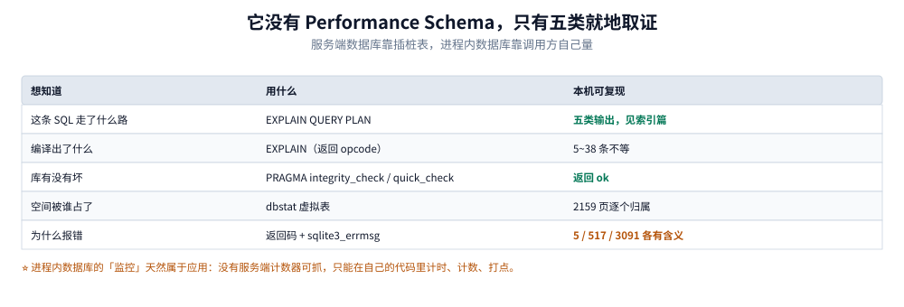
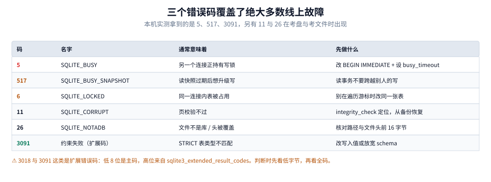

# 观测与诊断

> 覆盖：没有 Performance Schema 时该查什么、五类就地取证（`EXPLAIN QUERY PLAN`、`EXPLAIN`、
> `integrity_check`、`dbstat`、错误码）、计时该怎么量才不被量化噪声骗、错误码分诊表、
> 六类常见故障的排查顺序、应用层该埋哪些点。
>
> 不覆盖：查询计划怎么改见 [索引与查询计划.md](索引与查询计划.md)；空间账见
> [文件格式与页结构.md](文件格式与页结构.md)；BUSY 的处理见 [事务与并发控制.md](事务与并发控制.md)。
>
> 内容整理自个人学习笔记。**实测口径**：本机 Go 1.26.5 + `modernc.org/sqlite`（SQLite 3.54.1），
> Windows 本地盘。本文的重点之一是**本机的计时器有毫秒级量化**——同一条查询连跑五次，
> 读数在 0 / 52 µs / 544 µs 之间跳，因此所有 µs 级结论都用「N 次累计 ÷ N」得出。

---

## 一、没有 Performance Schema，怎么知道慢在哪？

**本节要点**：SQLite 是**进程内库**，没有服务端计数器可抓。它的「可观测性」由两部分组成：
**库内可查的五类事实**（计划、字节码、完整性、空间、错误码）+ **应用层自己埋的点**。
指望「连上去看监控表」这条路在这里不存在。

### 1.1 与 MySQL 的对照

| 想知道 | MySQL | SQLite |
|---|---|---|
| 哪条 SQL 最慢 | `performance_schema.events_statements_summary_by_digest` | 应用层埋点（没有内建） |
| 这条 SQL 走了什么路 | `EXPLAIN` | `EXPLAIN QUERY PLAN` |
| 表的页分布 | `INFORMATION_SCHEMA.INNODB_TABLESPACES` | `dbstat` 虚拟表 |
| 谁在等锁 | `sys.innodb_lock_waits` | 无。只能看错误码与 `busy` 返回 |
| 缓冲池命中率 | `SHOW ENGINE INNODB STATUS` | 无直接指标（`db_status` 需 C 接口） |
| 库有没有坏 | `CHECK TABLE` | `PRAGMA integrity_check` |

⭐ 所以 SQLite 的观测设计要反过来做：**先埋点，再排障**。没有埋点的库，
出事时只能靠「复现 + 临时加日志」。

### 1.2 五类就地取证



五行是五类可查事实，右列标注了本机能不能复现。看最后两行：空间与错误码都是「查一下就有」，而前两行需要你主动去看——它们不会自己报警。

| 想知道 | 用什么 | 本机结果 |
|---|---|---|
| 走了什么路 | `EXPLAIN QUERY PLAN` | 五类输出，见索引篇 |
| 编译成什么 | `EXPLAIN`（返回 opcode） | 5~38 条不等 |
| 库有没有坏 | `PRAGMA integrity_check` / `quick_check` | 均返回 `ok` |
| 空间被谁占了 | `dbstat` 虚拟表 | 2159 页可逐个归属 |
| 为什么报错 | 返回码 + `errmsg` | 5 / 517 / 3091 各有含义 |

---

## 二、`integrity_check` 与 `quick_check` 该跑哪个？

**设置要点**：两者都检查结构完整性，差别在**深度**与**耗时**。
`quick_check` 跳过索引与表的一致性比对，快但漏得更多。

| 命令 | 检查什么 | 耗时 | 什么时候跑 |
|---|---|---|---|
| `PRAGMA quick_check` | 页结构、B 树顺序、空闲链 | 快 | 每次启动、每次备份后 |
| `PRAGMA integrity_check` | 上面 + 索引与表内容一致、外键（可选） | 慢（全库扫） | 怀疑损坏、迁移后、定期（如每周） |
| `PRAGMA integrity_check(N)` | 最多报告 N 个错误 | 同上 | 想快速知道「坏得多不多」 |

本机实测（5 万行库）：

```text
PRAGMA integrity_check  →  ok
PRAGMA quick_check      →  ok
PRAGMA journal_mode     →  delete
```

### 2.1 检查失败时怎么办

| 输出 | 含义 | 处理 |
|---|---|---|
| `ok` | 没问题 | — |
| `*** in database main *** Page N is never used` | 有游离页 | 通常无害，`VACUUM` 可清 |
| `Page N: btreeInitPage() returns error` | 页结构损坏 | 从备份恢复；或试 `.recover` |
| `row N missing from index X` | 索引与表不一致 | `REINDEX X` 可修 |
| `wrong # of entries in index X` | 同上 | `REINDEX X` |

⭐ 索引不一致是**可修**的（`REINDEX`），页损坏是**不可修**的（只能恢复）。
所以看输出先分清是「索引问题」还是「页问题」。

```sql
-- 只重建某个索引（比重建整库快得多）
REINDEX idx_a;
```

---

## 三、计时该怎么量？

**设置要点**：这是本册最容易踩的坑。本机（Windows）`time.Now()` 有毫秒级量化，
单次微秒读数会在 0 与几百 µs 之间跳。**µs 级结论只能靠累计**。

### 3.1 本机实测的噪声

同一条查询连跑五次，原始读数（纳秒）：

| 次数 | 1 | 2 | 3 | 4 | 5 |
|---|---|---|---|---|---|
| `SELECT id WHERE a=1234` | 544 800 | 114 000 | **0** | 566 500 | **0** |
| `SELECT b WHERE a=1234` | 512 200 | **0** | **0** | 559 000 | 52 200 |

「0 ns」不是「快到测不出」，是量化把小于一个刻度的时间记成 0。
如果拿单次读数比较两个方案，得出的结论会随机翻转。

### 3.2 两种可信的量法


左栏是五种会被量化骗到的做法，右栏是对应的正确做法。第三行尤其重要：把 0 ns 当成「极快」是最常见的误读，它只是「小于一个刻度」。

| 场景 | 做法 |
|---|---|
| µs 级差异（索引命中 vs 回表） | 同一操作跑 2000 次，总耗时 ÷ 2000（本机得 108.7 vs 188.4 µs） |
| ms 级差异（全表扫描、VACUUM、备份） | 单次读数即可，但取 3~15 次中位数 |
| 量级差异（ms vs µs） | 可以写倍数（本机 611 倍） |
| 吞吐 | 固定时间内完成多少条，而不是「一条多久」 |
| 跨进程比较 | 不要在 Windows 上跨进程比单次读数 |

```go
// 累计计时：唯一可靠的写法
func timeQuery(db *sql.DB, query string, reps int) (time.Duration, error) {
    start := time.Now()
    for i := 0; i < reps; i++ {
        rows, err := db.Query(query)
        if err != nil {
            return 0, err
        }
        for rows.Next() {
            var v any
            if err := rows.Scan(&v); err != nil {
                rows.Close()
                return 0, err
            }
        }
        rows.Close()
    }
    return time.Since(start) / time.Duration(reps), nil
}
```

### 3.3 CLI 的 `.timer`

CLI 的 `.timer on` 走的是同一套系统时钟，但它的读数是「整条语句」且含输出格式化的开销。
用它看**量级**可以，看微秒不行：

```bash
sqlite3 app.db ".timer on" "SELECT count(*) FROM t WHERE b > 'x';"
# Run Time: real 0.066 user 0.060 sys 0.005
```

---

## 四、错误码分诊

**设置要点**：SQLite 的错误码有两层：主码（低 8 位）与扩展码（高位）。
先看主码定类别，再看全码定细节。三个码覆盖了绝大多数线上故障：5、517、3091。



六行是六个最常见的码，中间一列是「通常意味着什么」，右列是「先做什么」。第 1 行与第 2 行的区别最容易被忽略：一个是「别人在写」，一个是「你的快照过期了」，处理方式完全不同。

| 码 | 名字 | 通常意味着 | 先做什么 |
|---|---|---|---|
| 5 | `SQLITE_BUSY` | 另一个连接持有写锁 | `BEGIN IMMEDIATE` + 设 `busy_timeout` |
| 517 | `SQLITE_BUSY_SNAPSHOT` | 读快照过期后想升级写 | 重开事务；会写的事务一律 `IMMEDIATE` |
| 6 | `SQLITE_LOCKED` | 同一连接内表被占用 | 别在遍历游标时改同一张表 |
| 8 | `SQLITE_READONLY` | 库文件或目录只读 | 检查文件权限与 `query_only` |
| 11 | `SQLITE_CORRUPT` | 页校验不过 | `integrity_check` 定位，从备份恢复 |
| 26 | `SQLITE_NOTADB` | 文件不是库 / 头被破坏 | 核对路径与文件前 16 字节 |
| 3091 | 约束失败（扩展码） | `STRICT` 表类型不匹配 | 改写入值或放宽 schema |

### 4.1 怎么看全码

```go
// 驱动差异大：用错误文本里的括号数字取扩展码最稳
func errorCode(err error) int {
    if err == nil {
        return 0
    }
    // 例：database is locked (5) (SQLITE_BUSY) / constraint failed: ... (3091)
    m := regexp.MustCompile(`\((\d+)\)`).FindStringSubmatch(err.Error())
    if len(m) != 2 {
        return -1
    }
    n, _ := strconv.Atoi(m[1])
    return n
}
```

⚠️ 不同驱动的错误类型不同（`modernc` 返回内部错误类型，`mattn` 返回 `sqlite3.Error`），
**不要跨驱动写死类型断言**。生产代码里用「文本包含 + 字符串解析」更稳，
或者干脆在 DSN 里开扩展码，按数字判断。

### 4.2 三个码的处理模板

| 码 | 可以重试吗 | 怎么重试 |
|---|---|---|
| 5（BUSY） | ✅ | 退避重试，且确认用的是 `IMMEDIATE` |
| 517（快照过期） | ✅ 但**必须重开事务** | `ROLLBACK` 后从头来；不能在同一事务里重试语句 |
| 11 / 26 | ❌ | 立即告警，走恢复流程 |

---

## 五、六类常见故障的排查顺序

**设置要点**：排查顺序比工具重要。下面六类是 SQLite 项目里最常见的，
每条给出「先看什么、再看什么」，避免一上来就翻源码。

| 现象 | 第一步 | 第二步 | 第三步 |
|---|---|---|---|
| `database is locked` 偶发 | 查是否 `busy_timeout=0` | 查写事务是否 DEFERRED | 查是否有第二个写进程 |
| 写入变慢、越来越慢 | 查事务粒度（是否每行一提交） | 查索引数量 | 查 `-wal` 是否过大 |
| 读变慢 | `EXPLAIN QUERY PLAN` | 查是否表达式让索引失效 | 查 `ANALYZE` 是否过期 |
| 磁盘占用只增不减 | `PRAGMA freelist_count` | `dbstat` 看谁占的 | `VACUUM INTO` 一次 |
| 启动变慢 | 看 `-wal` 大小（要重放） | 看 `-journal` 是否存在（要回滚） | 看库大小与页数 |
| 偶发 `SQLITE_CORRUPT` | `integrity_check` | 查是否有多个进程写 | 查存储介质与文件系统 |

### 5.1 一个具体的排查链路

```text
「服务端偶发 500，日志里是 database is locked」
→ 1. 看错误码：是 5 还是 517？（517 说明是快照过期，不是抢锁）
→ 2. 看写事务怎么开的：BEGIN 还是 BEGIN IMMEDIATE？
→ 3. 看有几个进程打开同一个库：lsof / 句柄
→ 4. 看最长的事务持锁多久：应用层埋点（commit 前后的时间差）
→ 5. 只有都排除了，才去调 busy_timeout
```

⭐ 注意顺序：**调 `busy_timeout` 是最后一步**，它只是把症状推迟。
真问题是「写者不唯一」或「写事务太长」。

---

## 六、应用层该埋哪些点

**设置要点**：进程内库的监控必须自己做。最少埋四个点，成本很低，
但能把「事后猜」变成「当场看」。

| 埋点 | 记什么 | 用途 |
|---|---|---|
| 每次查询 | SQL 指纹（去掉字面量）、耗时、行数 | 找慢查询 |
| 每次事务 | 开始/结束时间、是否 `IMMEDIATE`、提交还是回滚 | 找长事务与失败率 |
| 每次错误 | 错误码、SQL 指纹、重试次数 | 分诊 BUSY / 损坏 |
| 周期性 | `page_count` / `freelist_count` / `-wal` 大小 | 空间与 WAL 增长 |

```go
// 最小埋点：包一层 Query，记指纹与耗时
func tracedQuery(ctx context.Context, db *sql.DB, query string, args ...any) (*sql.Rows, error) {
    start := time.Now()
    rows, err := db.QueryContext(ctx, query, args...)
    // 指纹：把字面量替换成 ?（生产环境用更稳的归一化）
    fp := regexp.MustCompile(`'[^']*'|\b\d+\b`).ReplaceAllString(query, "?")
    log.Printf("sql=%q fp=%q dur=%v err=%v", query, fp, time.Since(start), err)
    return rows, err
}
```

⚠️ 埋点不要记完整 SQL 文本（含字面量会泄漏数据，也撑爆日志）。
指纹化之后再聚合，才能算「同一类查询的平均耗时」。

---

## 使用：三语言的观测代码

**本节要点**：不必引入框架。下面三段代码覆盖了「看计划、量耗时、查完整性」三件事。

### 使用一：SQL / CLI

```sql
-- 计划
EXPLAIN QUERY PLAN SELECT * FROM t WHERE a = 1;

-- 完整性（启动时 quick，定期 full）
PRAGMA quick_check;
PRAGMA integrity_check;

-- 空间
SELECT name, sum(pgsize) AS bytes FROM dbstat GROUP BY name ORDER BY bytes DESC;

-- WAL 状态（busy / log / checkpointed）
PRAGMA wal_checkpoint(PASSIVE);
```

```bash
sqlite3 app.db ".eqp on" ".timer on" "SELECT count(*) FROM t WHERE b > 'x';"
sqlite3 app.db ".dbinfo"
```

### 使用二：Go（计划 + 累计计时 + 断言）

```go
func diagnose(db *sql.DB, query string) error {
    // 1. 计划
    rows, err := db.Query("EXPLAIN QUERY PLAN " + query)
    if err != nil {
        return err
    }
    for rows.Next() {
        var id, parent, notused int
        var detail string
        if err := rows.Scan(&id, &parent, &notused, &detail); err != nil {
            rows.Close()
            return err
        }
        log.Printf("plan: %s", detail)
    }
    rows.Close()

    // 2. 累计计时（单次读数会被量化骗到）
    avg, err := timeQuery(db, query, 200)
    if err != nil {
        return err
    }
    log.Printf("avg: %v", avg)

    // 3. 完整性
    var res string
    if err := db.QueryRow("PRAGMA quick_check").Scan(&res); err != nil {
        return err
    }
    if res != "ok" {
        return fmt.Errorf("quick_check: %s", res)
    }
    return nil
}
```

### 使用三：Java

```java
// 计划
try (Statement st = conn.createStatement();
     ResultSet rs = st.executeQuery("EXPLAIN QUERY PLAN SELECT * FROM t WHERE a = 1")) {
    while (rs.next()) {
        System.out.println("plan: " + rs.getString(4));   // 第四列是 detail
    }
}

// 累计计时
long start = System.nanoTime();
for (int i = 0; i < 2000; i++) {
    try (PreparedStatement ps = conn.prepareStatement("SELECT id FROM t WHERE a = 1234");
         ResultSet rs = ps.executeQuery()) {
        while (rs.next()) { rs.getLong(1); }
    }
}
long avgNs = (System.nanoTime() - start) / 2000;
```

⚠️ Java 的 `System.nanoTime()` 在 Windows 上也受同一套时钟影响，
单次读数同样不可信；`nanoTime` 的精度声明是「纳秒级分辨率」，不是「纳秒级准确度」。

### 判读表

| 观察 | 结论 |
|---|---|
| 计划里只有 `SCAN` | 全表扫，去索引篇对照 |
| 计划里 `USE TEMP B-TREE` | 排序没索引可用 |
| `quick_check` 非 `ok` | 结构问题，跑 `integrity_check` 定位 |
| 单次耗时忽大忽小、出现 0 | 计时量化，改累计计时 |
| 错误码 5 且重试就好 | 写者多或事务长，不是「偶发网络问题」 |
| `dbstat` 里某个索引占很大 | 索引冗余或建错，考虑删 |

---

## 延伸追问

**Q：有没有类似 `SHOW PROCESSLIST` 的东西？**
没有。SQLite 不知道自己被哪些进程使用，那是操作系统的事（`lsof` / 句柄查看）。
「谁在写」这个问题只能从外部观察，或从应用层日志推断。

**Q：`sqlite3_stmt_status` / `sqlite3_db_status` 怎么用？**
它们是 C 接口，能给出「全表扫描步数」「缓存命中/未命中」「lookaside 命中」等计数器，
粒度比 PRAGMA 细。Go / Java 驱动大多没暴露，需要 cgo 或 JNI。
**本机未实测**（`modernc` 驱动未暴露这些接口），所以本篇不引用它们的读数。

**Q：为什么日志里看不到 SQLite 自己的日志？**
它默认不写日志（库是进程内组件，没有「服务端日志」）。要调试可以编译时开
`SQLITE_DEBUG`，或用 `sqlite3_trace_v2` 回调把每条执行的 SQL 打出来。
生产环境用应用层埋点更实际。

**Q：`EXPLAIN` 的 8 列分别是什么？**
地址（opcode 序号）、操作码名、P1/P2/P3、P4（如索引名）、P5（标志位）、注释。
读法不是逐列背，而是「看操作码序列」：有 `SeekGE` 是定位，只有 `Rewind`+`Next` 是全扫。
详见 [架构与执行链路.md](架构与执行链路.md) 第二节。

## 关联

- [README.md](README.md) — 本册导读与四条读序
- [索引与查询计划.md](索引与查询计划.md) — 计划怎么改，`SCAN` 怎么变 `SEARCH`
- [事务与并发控制.md](事务与并发控制.md) — BUSY 与 517 的处理模板
- [文件格式与页结构.md](文件格式与页结构.md) — `dbstat` 与空间账
- [PRAGMA与调优.md](PRAGMA与调优.md) — 哪些 PRAGMA 属于观测/一次性
- [MySQL/观测与诊断.md](../MySQL/观测与诊断.md) — 对照读：有 Performance Schema 时怎么查
