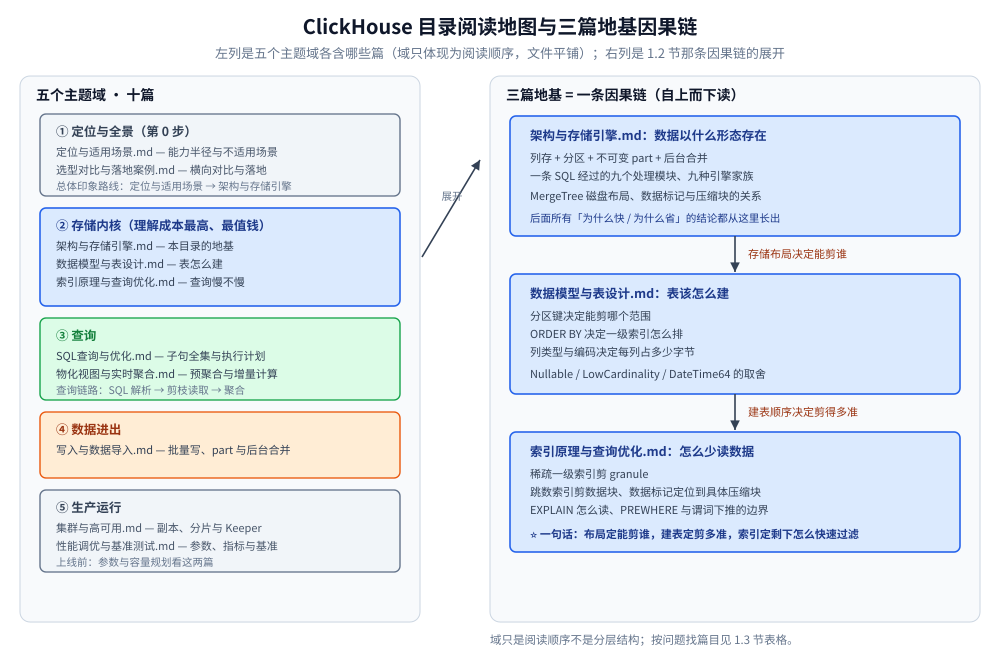

# ClickHouse 目录导读

> 覆盖 ClickHouse 的定位与适用边界、整体架构与 MergeTree 存储引擎、数据模型与建表、
> 稀疏索引与查询优化、SQL 子句全集、写入与数据导入、外部集成与数据源、物化视图与实时聚合、
> 副本与分片、性能调优与基准测试，以及选型对比与落地案例 —— 共 11 篇。
>
> **基础原理**参考《ClickHouse 原理解析与应用实践》（朱凯，机械工业出版社 2020 年）——
> 该书基于 **ClickHouse 19.17.4.11 + CentOS 7.7（2020 年）** 编写，是本目录的**骨架来源**；
> **书之后的所有口径**（默认值、参数名、系统表字段、文件名、引擎能力、新语法）均来自
> **本机 Docker 容器实测（26.3.29.7）与官方文档**，各篇逐处标注「**书 2020 口径 vs 26.3 实测**」。
> 素材与原始出处见 [素材清单](../../../../素材清单.md)。
>
> ⭐ 边界先说清：本目录讲的是 **ClickHouse 这一个库本身怎么工作**。
> **七类存储的横向定位**见 [数据库选型对比.md](../../数据库选型对比.md)；
> **检索与分析两条线的跨产品选型**（ClickHouse 作为「单机列存」一族出现）见
> [搜索与分析选型对比.md](../../搜索与分析/搜索与分析选型对比.md)；
> **时序场景的横向选型**见 [时序数据库选型对比.md](../../时序数据库/时序数据库选型对比.md)。
> 这三张横评表本目录**不重复**，只在 [选型对比与落地案例.md](选型对比与落地案例.md) 里做**更深一层的对照**。

---

## 一、这个目录怎么读

本目录 11 篇，按**五个主题域**组织（域只体现为阅读顺序，文件本身平铺）：

| 域 | 篇 |
|---|---|
| **定位与全景** | [定位与适用场景.md](定位与适用场景.md)、[选型对比与落地案例.md](选型对比与落地案例.md) |
| **存储内核** | [架构与存储引擎.md](架构与存储引擎.md)、[数据模型与表设计.md](数据模型与表设计.md)、[索引原理与查询优化.md](索引原理与查询优化.md) |
| **查询** | [SQL查询与优化.md](SQL查询与优化.md)、[物化视图与实时聚合.md](物化视图与实时聚合.md) |
| **数据进出** | [写入与数据导入.md](写入与数据导入.md)、[外部集成与数据源.md](外部集成与数据源.md) |
| **生产运行** | [集群与高可用.md](集群与高可用.md)、[性能调优与基准测试.md](性能调优与基准测试.md) |

⭐ 三篇是**理解成本最高、也最值钱**的，其余各篇都建立在它们之上：

- [架构与存储引擎.md](架构与存储引擎.md)：本目录的**地基**。讲清一条 SQL 经过哪些模块、
  MergeTree 的数据在磁盘上长什么样、分区的命名与合并、数据标记与压缩数据块的关系、九种引擎家族 ——
  后面所有「为什么快 / 为什么省」的结论都从这里长出。
- [数据模型与表设计.md](数据模型与表设计.md)：决定**表怎么建**。数据类型三类、`Nullable` / `LowCardinality` / `DateTime64`
  的取舍、建表三要素（`PARTITION BY` / `ORDER BY` / `PRIMARY KEY`）怎么配合、默认值表达式与数据字典。
- [索引原理与查询优化.md](索引原理与查询优化.md)：决定**查询慢不慢**。稀疏一级索引为什么省、
  跳数索引怎么选、`EXPLAIN` 怎么读、`PREWHERE` 与谓词下推的边界。

### 1.1 十一篇一句话导读

- [定位与适用场景.md](定位与适用场景.md) — ClickHouse 填的是哪一个空缺、擅长哪些场景、
  哪些场景**明确不适用**、四次换架构的发展历程与谁在用。
- [架构与存储引擎.md](架构与存储引擎.md) — 查询的九个处理模块、五条「为什么快」、
  MergeTree 磁盘布局、分区目录命名与合并生命周期、稀疏索引、跳数索引、数据标记与压缩块、九种引擎家族、
  向量化执行的实测收益。
- [数据模型与表设计.md](数据模型与表设计.md) — 数据类型分三类、`Nullable` / `LowCardinality` / `DateTime64`
  的取舍、建表三要素、`DEFAULT` / `MATERIALIZED` / `ALIAS` 的差别、临时表与视图、改表与改分区、数据字典、
  JOIN 的执行策略与内存账、建表 checklist。
- [索引原理与查询优化.md](索引原理与查询优化.md) — 一级索引为什么「稀疏」、
  `index_granularity` 如何同时约束 `.idx` / `.mrk` / `.bin`、跳数索引怎么选、`EXPLAIN` 读法、谓词下推的边界。
- [SQL查询与优化.md](SQL查询与优化.md) — SQL 的解析顺序、`WITH` / `FROM` / `FINAL`、`SAMPLE` 与 `ARRAY JOIN`、
  `JOIN` 的坑、`WHERE` 与 `PREWHERE` 的分工、`GROUP BY` / `ORDER BY` / `LIMIT BY`、查询级配置与十条经验、
  窗口函数与 CTE 的边界。
- [写入与数据导入.md](写入与数据导入.md) — 为什么必须批量写、一次写入在服务端的路径、
  part 与后台合并、大批量导入的几种方式、写入幂等与去重、写入侧的常见坑。
- [外部集成与数据源.md](外部集成与数据源.md) — 两条对接路线（外部表引擎与表函数「读」、Kafka 引擎与 `INSERT ... SELECT`「搬」）、
  26.3 的引擎与表函数实测清单、MySQL 端到端实测与常见坑。
- [物化视图与实时聚合.md](物化视图与实时聚合.md) — `AggregatingMergeTree` 与 `AggregateFunction` 状态列、
  为什么历史数据不会自动回填、读结果要不要 `FINAL`、`DROP VIEW` 与目标表的连带关系、近似与精确的口径差别、
  Projection（表内自带的物化视图）。
- [集群与高可用.md](集群与高可用.md) — 副本与分片、`ReplicatedMergeTree` 与 ZooKeeper / ClickHouse Keeper、
  分布式表的写入与查询路径、故障恢复与一致性边界。
- [性能调优与基准测试.md](性能调优与基准测试.md) — 调优的四个层面、用系统表定位慢查询、
  关键参数的实测默认值、压缩与编码对存储与扫描的影响、基准测试的正确做法与常见反模式、
  查询级熔断与资源隔离。
- [选型对比与落地案例.md](选型对比与落地案例.md) — 与 Doris / StarRocks / 时序库 / 行存 / 湖仓的横向对比、
  决策框架，以及 Bitmap 用户画像与 Java / Go 侧接入两类落地案例。

### 1.2 三篇地基怎么串起来

读法建议：把这三篇当成**一条因果链**，而不是三个并列知识点。

1. [架构与存储引擎.md](架构与存储引擎.md) 先回答「数据以什么形态存在」——列存 + 分区 + 不可变 part + 后台合并。
2. [数据模型与表设计.md](数据模型与表设计.md) 再回答「表该怎么建」——分区键决定能剪哪个范围、
   `ORDER BY` 决定一级索引怎么排、列类型与编码决定每列占多少字节。
3. [索引原理与查询优化.md](索引原理与查询优化.md) 最后回答「查询怎么利用上面两篇留下的结构少读数据」——
   稀疏索引剪 granule、跳数索引剪数据块、数据标记定位到具体压缩块。

⭐ 一句话：**存储布局决定能剪谁，建表顺序决定剪得多准，索引决定剩下的怎么快速过滤**。

### 1.3 按问题找篇目

| 你现在的疑问 | 去读 |
|---|---|
| 我这份数据到底该不该用 ClickHouse？ | [定位与适用场景.md](定位与适用场景.md)、[选型对比与落地案例.md](选型对比与落地案例.md) |
| 它为什么比 MySQL 快这么多？ | [架构与存储引擎.md](架构与存储引擎.md) |
| 建表时分区键、排序键该怎么选？ | [数据模型与表设计.md](数据模型与表设计.md) |
| 我的查询为什么没走索引？ | [索引原理与查询优化.md](索引原理与查询优化.md) |
| `JOIN` / `GROUP BY` / `LIMIT BY` 怎么写才对？ | [SQL查询与优化.md](SQL查询与优化.md) |
| 写进去很慢 / part 太多怎么办？ | [写入与数据导入.md](写入与数据导入.md) |
| 数据在 MySQL / Kafka / 对象存储里，怎么接进来？ | [外部集成与数据源.md](外部集成与数据源.md) |
| 想让它持续算好聚合、查询时直接读结果 | [物化视图与实时聚合.md](物化视图与实时聚合.md) |
| 单机不够了，怎么上集群？ | [集群与高可用.md](集群与高可用.md) |
| 上线前要做哪些参数与容量规划？ | [性能调优与基准测试.md](性能调优与基准测试.md) |

📖 若只想先建立总体印象，读 [定位与适用场景.md](定位与适用场景.md) → [架构与存储引擎.md](架构与存储引擎.md) 两篇即可。



图把 1.1 与 1.2 两节合成一张地图：左列看清**五个主题域各含哪些篇、从哪进**（「定位与全景」是第 0 步，先判断需求是否落在能力半径内）；右列把「存储内核」域里的三篇地基展开成因果链——自上而下读，后面各篇所有「为什么快 / 为什么省」的结论都能挂回链上的三个节点：**布局定能剪谁、建表定剪多准、索引定剩下的怎么快速过滤**。

## 二、ClickHouse 的数据分几层？

**本节要点**：同一份数据在这里有**两套层级** —— 一套是「库 → 表 → 分区 → part → granule」的**纵向存储层**，一套是「集群 → 分片 → 副本」的**横向分布层**。绝大多数「我的数据到底在哪」的问题，根源都是把这两套混成了一层。

### 2.1 纵向：一份数据在磁盘上被切成了什么

```text
database（库）
 └── table（表）             PARTITION BY / ORDER BY / PRIMARY KEY 在这一层定
      └── partition（分区）   PARTITION BY 切出的逻辑段（目录名 = PartitionID_MinBlockNum_MaxBlockNum_Level）
           └── part（数据片段）一次写入产生一批；不可变，靠后台合并消化
                └── column（列）  每个列字段一个独立文件（.bin + marks），列存就落在这里
                     └── granule（粒度）每 8192 行一段，稀疏索引与 marks 的最小单位
```

⭐ 把三家的分层模型摆在一起记 —— 关系型 `database → table → row → column`、文档型 `database → collection → document → field`、ClickHouse `database → table → partition → part → granule` —— 差异一眼可见：

| 层级 | 关系型数据库（如 [MySQL](../../关系型/MySQL/索引设计与EXPLAIN.md) / InnoDB 引擎为例） | 文档型数据库（如 [MongoDB](../../NoSQL/MongoDB)） | ClickHouse |
|---|------------------------------------------------------------------|---|---|
| 库 | database                                                         | database | database |
| 表 | table                                                            | collection | table |
| 「一条记录」 | row（整行连续待在**聚簇索引的叶子页**里）                                         | document（一个自包含的 JSON） | **没有等价的「一行文件」** —— 一行是一条 `part` 里各列文件的第 n 个值 |
| 字段 | column（行内字段连续存放）                                                 | field | column（**每列一个独立文件**） |
| 检索的最小单位 | **页**（InnoDB 默认 16 KB）→ 行                                        | 索引项 → 文档 | **granule（8192 行）** → part；主键的「值」只存在于列文件里 |

四条由此推出的结论（各篇都有实测支撑）：

- **「改一行」为什么贵**：一行不独立存在，改一行要重写整个 part（见 [架构与存储引擎.md](架构与存储引擎.md) 第八节与 [定位与适用场景.md](定位与适用场景.md) 3.3）；对照 MySQL 的「读一页 → 改 → 写回」—— 两者都贵，但前者贵在**整片重写**，后者贵在**随机 I/O**。
- **列存为什么省**：字段独立成文件，所以查 3 列只读 3 个文件，与表有多少列无关（[架构与存储引擎.md](架构与存储引擎.md) 第七节）；行存（MySQL）正好相反 —— 只想取 1 个字段，也要把包含它的**整行所在的页**读进来。
- **稀疏索引为什么能覆盖海量数据**：它以 granule 为单位记录，不逐行记录（[索引原理与查询优化.md](索引原理与查询优化.md) 第一节）。
- **剪枝的单位不同**：MySQL 的 B+ 树按**页**剪 —— 一次点查就是「树高」次页 I/O；ClickHouse 按 **granule（8192 行）** 剪 —— 一次范围扫描只读命中的 granule（对照见 [B树与B+树.md](../../../../02-计算机基础/数据结构/树/B树与B+树.md)）。

### 2.2 横向：同一张表凭什么分布在多台机器上

```text
cluster（集群）
 └── shard（分片）     数据的横向切分；一个节点只能属于一个分片
      └── replica（副本）同一分片内同一份数据的多个物理副本
```

两条最容易混的边界：

- **分区（partition）不是分片（shard）**：分区是对**本地**数据的纵向切分，**没有**把数据分布到多台机器的能力（[架构与存储引擎.md](架构与存储引擎.md) 4.1）。
- **本地表与分布式表**：分布式表（`Distributed`）本身**不存数据**，是本地表的访问代理，作用类似分库中间件；写入与读取的路径拆解见 [集群与高可用.md](集群与高可用.md) 第四、五节。

⭐ 一句话：**纵向决定「一次查询要读多少字节」，横向决定「这次查询打几台机器」** —— 前者靠建表三要素与索引，后者靠分片键与副本配置。

## 三、版本坐标速查

⭐ **一条线看清「书里的 ClickHouse」与「今天跑的 ClickHouse」差在哪** —— 本目录各篇会反复引用这张表。
⚠️ 左列的「书 2020 口径」是《ClickHouse 原理解析与应用实践》成书时的行为（**19.17.4.11**）；
右列为本目录容器实测（**26.3.29.7**，LTS）。**核不实的条目不列**：

| 项 | 书 2020 口径（19.17.4.11） | 26.3.29.7 实测 / 现状 |
|---|---|---|
| 一级索引文件 | `primary.idx` | **`primary.cidx`**（100 万行 part 实测约 272 B） |
| 列数据标记文件 | `.mrk`（自适应粒度时 `.mrk2`） | **Wide part 为 `<列>.cmrk2`**；**Compact part 为 `.cmrk4`** |
| 库数据目录 | `data/<库>/<表>/` | **Atomic 库落 `store/<uuid>/`**；按路径找数据必须先查 `system.tables.data_paths` |
| 表目录磁盘形态 | 未区分（书未给 Wide / Compact 概念） | **Wide part（逐列成文件）与 Compact part（列挤在一个 `data.bin`）并存** |
| 跳数索引开关 | 需 `SET allow_experimental_data_skipping_indices = 1`（书自己括注「新版本已取消」） | **无需任何开关**，`ALTER TABLE ... ADD INDEX` 直接可用 |
| 执行计划 | **没有 `EXPLAIN`**，只能靠 `--send_logs_level=trace` 看日志行 | **`EXPLAIN` / `EXPLAIN indexes=1` / `EXPLAIN PIPELINE`** 一等公民 |
| `index_granularity` 默认值 | `8192` | **`8192`（未变）**；单 part 100 万行实测 marks = 124 |
| 稀疏索引的量级 | 12208 行标记覆盖 1 亿行 | 同一量级；全表主键索引常驻内存实测约 **7.2 KB** |
| 布尔类型 | **没有 `Boolean`**，用整型 `0` / `1` 代替 | 本篇未断言；用到时以本机实测为准 |
| 时间类型精度 | 最高到**秒**，毫秒 / 微秒需借 `UInt` | **`DateTime64` 可到毫秒 / 微秒**（一律 8 字节，底层 `Decimal64`） |
| `allow_experimental_cross_to_join_conversion` | 默认 1，书已注明「新版本将取消」 | **未复核** |

### 3.1 三条使用纪律

- **读法**：凡是书里给**默认值、参数名、系统表字段、文件后缀、日志文案**的地方，先看有没有「26.3 实测」的对照；
  没有对照的，本目录一律**不把它当成今天的结论**（原文标注「书 2020 口径，未复核」）。
- ⚠️ **读数只记趋势**：书里的单次读数（如 `PREWHERE` 优化前后、`SAMPLE` 行数）与本目录的区间读数**不同源**，
  两者**不能相减、不能混用**；本目录所有耗时都写成**区间**。
- **来源优先级**：本机容器实测 > 官方文档 / Release Notes > 书（2020）。三者冲突时以实测为准，并如实写出差异。

## 四、实测口径（本目录的读数从哪来）

- **容器**：`devnotes-ch`，镜像 `clickhouse/clickhouse-server:26.3-alpine`，服务端版本 **26.3.29.7**，时区 **UTC**；
  HTTP 8123 映射到宿主 **18123**、原生 9000 映射到宿主 **19000**；运行在 **Docker Desktop**。
- **复跑**：本目录的容器按约定只 `docker stop` 不 `docker rm`，**当前全部处于 Exited 状态** —— 要复现读数先
  `docker start devnotes-ch`（单节点）；集群实验是 5 个容器，先 `docker start devnotes-ch-keeper`
  再 `docker start devnotes-ch-s1r1 devnotes-ch-s1r2 devnotes-ch-s2r1 devnotes-ch-s2r2`（Keeper 不起，副本会报连接失败）。
  宿主端口 18123 / 19000 会被占用，起前用 `docker ps -a` 确认没有同名残留。
- **实验编号 01~11**：环境信息 → 数据集 → 稀疏索引 → 跳过索引 → 聚合对照 → 物化视图 →
  Bitmap 画像 → 数据类型与编码 → 写入与导入 → 参数与日志 → 复制与分布式。
  实验的原始命令与输出留在工作区（`.workbuddy/tmp/ch-exp/`，不进版本库），各篇引用的读数都能按编号回到原始记录。
- ⭐ **时序类数字一律标波动区间**（如 `0.28 ~ 0.53 s`），只断言单调趋势；**两次运行的数字绝不混用**。
- ⚠️ **一个反复踩到的读数陷阱**：`system.parts_columns.column_bytes_on_disk` 在 **Compact part** 上**恒为 0**
  （所有列挤在一个 `data.bin`，没有逐列账）—— 要取逐列字节必须先让 part 变成 **Wide**。看到 0 不是「没数据」。

## 五、与相邻目录的边界

| 主题 | 去哪 |
|---|---|
| **列式族内的跨产品中立选型**（ClickHouse 只是五支候选之一，按所有权分三条实现路线） | [列式数据库选型对比.md](../列式数据库选型对比.md) |
| 七类存储的横向定位（关系型 / 文档 / 搜索 / KV / 列式 / 时序 / 图） | [数据库选型对比.md](../../数据库选型对比.md) |
| 检索族与分析族的跨产品选型（含 ClickHouse 所在的分析族） | [搜索与分析选型对比.md](../../搜索与分析/搜索与分析选型对比.md) |
| 时序数据库横向选型（ClickHouse 作为「通用列存自建」一族） | [时序数据库选型对比.md](../../时序数据库/时序数据库选型对比.md) |
| 另一款列存 / 时序引擎的同类问题写法 | [README.md](../../时序数据库/GreptimeDB/README.md) — GreptimeDB 目录导读 |
| 倒排索引与列存为什么擅长相反的查询 | [索引原理.md](../../搜索与分析/Elasticsearch/索引原理.md) |
| 位图 / 布隆过滤器的底层结构（Bitmap 画像与跳数索引共用） | [位图与布隆过滤器.md](../../../../02-计算机基础/数据结构/高级数据结构/位图与布隆过滤器.md) |

### 5.1 本目录明确不展开的内容

- **不重复七类存储的横向定位**：那是 [数据库选型对比.md](../../数据库选型对比.md) 的范围，本目录只给链接。
- **不重复检索 / 分析、时序两份跨产品选型**：那两张表在相邻目录里，本目录只在
  [选型对比与落地案例.md](选型对比与落地案例.md) 做**单点更深的对照**。
- **不展开部署编排本身**：K8s / Helm / Operator 属于 `06-工程实践/部署/` 的话题，
  本目录只在 [集群与高可用.md](集群与高可用.md) 讲引擎侧的分片与副本。
- **不给出未经实测的性能数字**：凡标「官方口径」的结论都写出处，核不实的条目不写。

## 关联

- [定位与适用场景.md](定位与适用场景.md) — 读本目录的第 0 步：先判断需求是否落在它的能力半径内
- [架构与存储引擎.md](架构与存储引擎.md) — 本目录地基，先读它再读其余各篇
- [数据模型与表设计.md](数据模型与表设计.md) — 建表的直接依据
- [索引原理与查询优化.md](索引原理与查询优化.md) — 查询性能问题的第一落点
- [SQL查询与优化.md](SQL查询与优化.md) — 子句全集与执行计划
- [写入与数据导入.md](写入与数据导入.md) — 写入链路与批量导入
- [外部集成与数据源.md](外部集成与数据源.md) — 外部表、表函数与 Kafka / MySQL 接入
- [物化视图与实时聚合.md](物化视图与实时聚合.md) — 预聚合与增量计算
- [集群与高可用.md](集群与高可用.md) — 副本、分片与 Keeper
- [性能调优与基准测试.md](性能调优与基准测试.md) — 参数、指标与基准方法
- [选型对比与落地案例.md](选型对比与落地案例.md) — 横向对比与两类落地案例
- [数据库选型对比.md](../../数据库选型对比.md) — 七类存储在系统中的横向定位
- [素材清单.md](../../../../素材清单.md) — 本目录所用素材的登记
