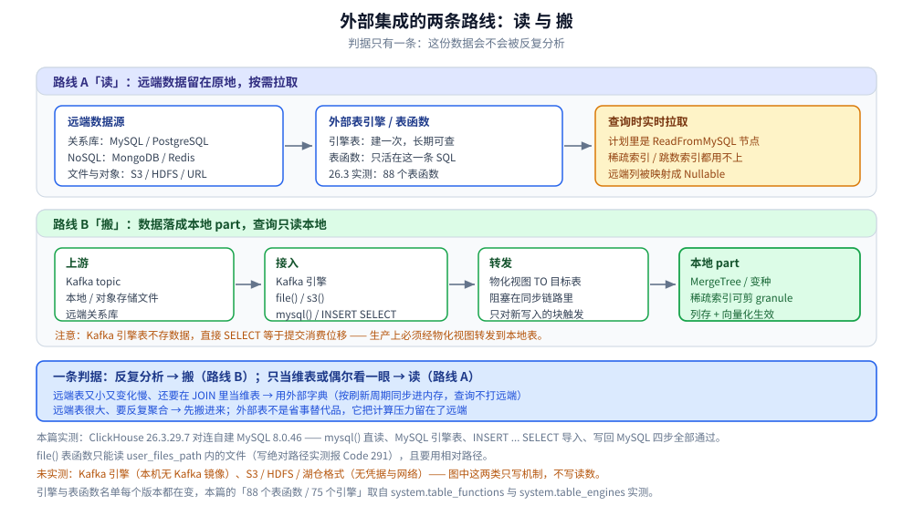
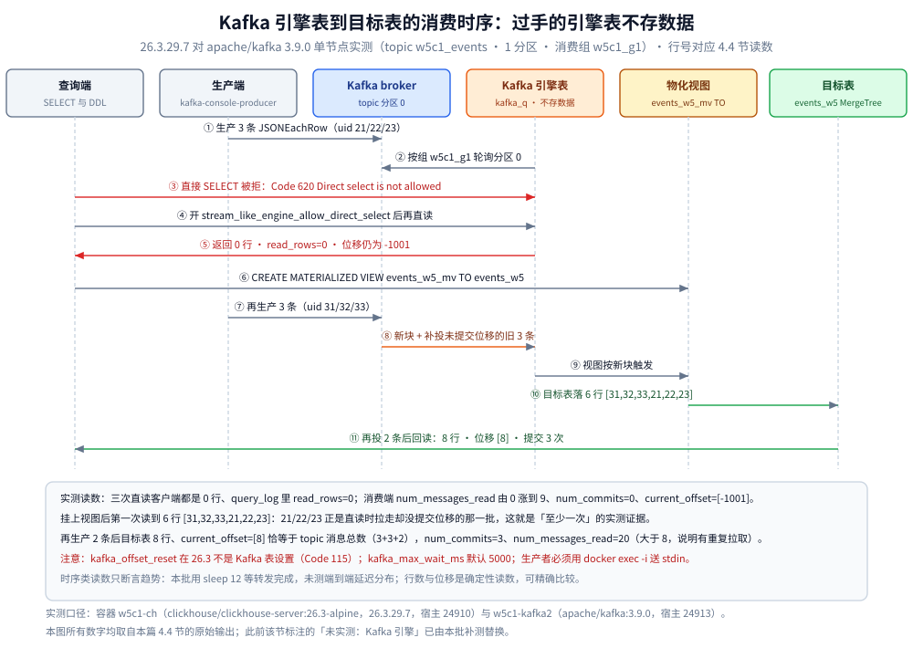

# 外部集成与数据源

> 覆盖：ClickHouse 与外部系统的两类对接 —— **「把远端当表读」**（外部表引擎 / 表函数）与 **「把数据搬进来」**（Kafka 引擎 + 物化视图、`INSERT ... SELECT`、文件与对象存储导入），以及两者的选型判据与实测踩坑。
> 不覆盖：消费端怎么接（HTTP / 原生协议 / Go / Java）见 [选型对比与落地案例.md](选型对比与落地案例.md) 第七节；写入链路的内部机制见 [写入与数据导入.md](写入与数据导入.md)。
>
> 内容整理自个人学习笔记与官方文档；**标 `text` 的块均为本机 Docker 实测**（`clickhouse/clickhouse-server:26.3-alpine` → 26.3.29.7，另起一个 `mysql:8.0`（8.0.46）作为远端数据源），素材见 [素材清单](../../../../素材清单.md)。

---

## 一、对接外部系统有哪两条路？

**本节要点**：一条是**读**（远端数据留在原地，按需拉），一条是**搬**（数据在 ClickHouse 里落成自己的 part）。判据只有一条 —— **这份数据会不会被反复查**。

### 1.1 两条路的形状

```text
路线 A「读」：远端库/文件/对象存储  →  外部表引擎 或 表函数  →  每次查询实时拉取
路线 B「搬」：Kafka / 文件 / 远端库  →  引擎或 INSERT ... SELECT  →  ClickHouse 本地 part  →  查询只读本地
```



图怎么读：上半区是**路线 A（读）** —— 远端数据留在原地，靠外部表引擎或表函数在查询时拉取，落点是执行计划里的 `ReadFromMySQL` 节点，因此用不上列存那套剪枝；下半区是**路线 B（搬）** —— 数据经接入引擎（Kafka 引擎 / `file()` / `mysql()`）与物化视图转发，最终落成本地 `MergeTree` 的 part，之后查询只读本地。底部那条判据是选路的分界线，图中标「未实测」的两类只写机制、不写读数。

### 1.2 什么时候用哪条

| 情形 | 用哪条 | 为什么 |
|---|---|---|
| 只是一次性取一批数、或者要把远端数据**灌进来** | 路线 B（`INSERT ... SELECT`） | 数据进了本地 part，之后查询走列存 + 索引，与远端无关 |
| 远端数据**持续产生**、要近实时可见 | 路线 B（Kafka 引擎 + 物化视图） | 见第四节：直接查 Kafka 引擎表会重复消费 |
| 远端表**很小、变化少、偶尔要关联查** | 路线 A（外部表引擎） | 省一份存储，`JOIN` 时当维表用 |
| 远端表**很大、要反复聚合分析** | 路线 B | 路线 A 每次查询都要把远端数据拉过来，等于让 MySQL 承担分析负载 |
| 只是想**按需看一眼**远端表 | 路线 A（表函数） | 一条 SQL，不建任何对象 |

⭐ 一句话判据：**要被反复分析的数据搬进来（路线 B），只当维表或偶尔看一眼的用外部表（路线 A）**。外部表不是「省事的替代品」，它把计算压力留在了远端。

## 二、26.3 里到底有哪些外部引擎和表函数？

**本节要点**：先把清单实测出来 —— 引擎与表函数的名单**每个版本都在变**，不要按记忆写。

### 2.1 外部类表引擎（实测 `system.table_engines`，共 75 个引擎）

```text
ArrowFlight   AzureBlobStorage   DeltaLake   Dictionary   Executable   File
GenerateRandom  HDFS   Hive   Hudi   Iceberg   IcebergS3   JDBC   Kafka
KeeperMap   MaterializedPostgreSQL   MongoDB   MySQL   NATS   ODBC
PostgreSQL   RabbitMQ   Redis   S3   SQLite   URL   YTsaurus
```

⚠️ 两条与旧口径相悖的实测事实：

- **`MaterializedMySQL` 不在清单里**：实测 `system.table_engines` 中带 `materialized` 的只有 **`MaterializedPostgreSQL`** 与 **`MaterializedView`**。也就是说「用 `MaterializedMySQL` 做 MySQL 实时同步」这条老文档里的路子，在 26.3 已经不存在，MySQL 侧的实时同步要走 **Kafka/Debezium + Kafka 引擎**或 `MaterializedPostgreSQL` 那套思路。
- **`USE_MYSQL` / `USE_HDFS` / `USE_S3` / `USE_RDKAFKA` 这些编译开关都是 1**（`system.build_options`），所以镜像**默认带全了**这些能力 —— 用不了通常是配置或网络问题，不是没编进去。

### 2.2 表函数（实测 `system.table_functions`，共 88 个）

按用途归类（**完整名单里同一个后端往往有多个变体**，如 `icebergS3` / `icebergHDFS` / `icebergAzure` / `icebergLocal` 及各自的 `*Cluster`）：

| 类别 | 表函数 |
|---|---|
| **关系库** | `mysql` `postgresql` `sqlite` `jdbc` `odbc` |
| **NoSQL / KV** | `mongodb` `redis` |
| **对象存储与文件** | `s3` `s3Cluster` `azureBlobStorage` `cosn` `oss` `gcs` `hdfs` `file` `url` `executable` |
| **湖仓格式** | `iceberg*` `deltaLake*` `hudi*` `paimon*`（各自带集群与存储变体） |
| **集群内** | `remote` `remoteSecure` `cluster` `clusterAllReplicas` |
| **本地生成 / 其他** | `numbers` `numbers_mt` `zeros` `primes` `generateRandom` `generateSeries` `values` `format` `input` `view` `viewExplain` `dictionary` `prometheusQuery` `timeSeries*` `mergeTreeIndex` `mergeTreeProjection` |

⭐ 两个特别值得记住的：**`dictionary()`** 能把字典当表查（第六节），**`mergeTreeProjection()`** 能直接读某张表的投影（见 [物化视图与实时聚合.md](物化视图与实时聚合.md) 第十节）。

### 2.3 外部表 vs 表函数

| 维度 | 外部表引擎（`ENGINE = MySQL(...)`） | 表函数（`mysql('host', ...)`） |
|---|---|---|
| 生命周期 | 建一次，长期存在，可被别的查询当普通表用 | 只活在这条 SQL 里 |
| 是否出现在 `system.tables` | 是 | 否 |
| 适合 | 反复查、要参与 `JOIN`、要配权限 | 一次性导入、临时看一眼 |
| 权限 | 跟普通表一样受控 | 每次都要把连接串写在 SQL 里 |

## 三、把外部库当表读：MySQL 端到端实测

**本节要点**：本节所有读数来自一台自建 `mysql:8.0.46` 与 ClickHouse 26.3.29.7 的真实对连，覆盖「读 → 建引擎表 → 灌进来 → 写回去」四步。

### 3.1 表函数：一条 SQL 读远端

远端 MySQL 里有一张 `srcdb.orders`（3 行），ClickHouse 侧不用建任何对象：

```sql
SELECT * FROM mysql('host.docker.internal:13308', 'srcdb', 'orders', 'root', 'chlab') ORDER BY id;
```

```text
1	bj	10.5
2	sh	20
3	gz	7.25
```

### 3.2 引擎表：建一次，之后当普通表查

```sql
CREATE TABLE default.orders_mysql
ENGINE = MySQL('host.docker.internal:13308', 'srcdb', 'orders', 'root', 'chlab');

SELECT count() AS c, sum(amt) AS s FROM default.orders_mysql;
→ 3	37.75
```

### 3.3 实测到的两个细节：类型映射与密码脱敏

```text
SHOW CREATE TABLE default.orders_mysql;

CREATE TABLE default.orders_mysql
(
    `id` Int32,
    `city` Nullable(String),
    `amt` Nullable(Decimal(10, 2))
)
ENGINE = MySQL('host.docker.internal:13308', 'srcdb', 'orders', 'root', '[HIDDEN]')
```

- **所有列都被映射成 `Nullable`**（远端 `id INT PRIMARY KEY` 是 `Int32`，`city VARCHAR` 是 `Nullable(String)`）→ 这不只是显示问题：**`Nullable` 会按 [数据模型与表设计.md](数据模型与表设计.md) 第二节的代价额外占一列标记**，聚合与 `ORDER BY` 都更贵。外部表当维表用时，记得在查询里 `assumeNotNull()` 或先落成本地表再分析。
- **`SHOW CREATE TABLE` 会把密码显示成 `[HIDDEN]`** —— 想核对连接配置不能只看这句，配置真身要去 `system.tables.create_table_query` 之外的地方（如建表时的原始 DDL）找。

### 3.4 把数据搬进来，也能写回去

```sql
-- 搬进来：一次全量导入
CREATE TABLE default.orders_local (id UInt32, city String, amt Decimal(10,2))
ENGINE = MergeTree ORDER BY id;
INSERT INTO default.orders_local
SELECT * FROM mysql('host.docker.internal:13308', 'srcdb', 'orders', 'root', 'chlab');
→ SELECT count(), sum(amt) FROM default.orders_local;   -- 3   37.75

-- 写回去：同一张远端表可以被 INSERT
INSERT INTO TABLE FUNCTION mysql('host.docker.internal:13308', 'srcdb', 'orders', 'root', 'chlab')
VALUES (4, 'sz', 1.50);
```

```text
--- MySQL 侧确认 ---
1	bj	10.50
2	sh	20.00
3	gz	7.25
4	sz	1.50
```

⭐ 写回能力意味着外部表可以当**同步的出口**，但在生产上要慎重：**它是逐行同步写、没有事务、也没有批量语义**，写放大比 `INSERT` 到本地表贵得多。

`EXPLAIN` 里能看到这类读的来源是远端：

```text
Expression ((Project names + Projection))
  Filter ((WHERE + Change column names to column identifiers))
    ReadFromMySQL
```

⭐ `ReadFromMySQL` 是一个**独立的读取节点**（不是 `ReadFromMergeTree`）—— 也就是说，**分区裁剪、跳数索引、稀疏索引这一整套剪枝机制在这个节点上一个都用不上**，过滤条件能否下推到 MySQL 取决于驱动实现，不是列存那套逻辑。

## 四、Kafka 引擎：把消息队列当表读

**本节要点**：Kafka 引擎表的语义是**一次消费**，直接查它（`SELECT`）等于提交消费位移；生产上的正确形状是 **Kafka 引擎表 → 物化视图 → 目标表**。

### 4.1 三个必填参数与消费语义

```sql
CREATE TABLE kafka_queue (
    ts DateTime, uid UInt64, url String
) ENGINE = Kafka
SETTINGS kafka_broker_list = 'kafka:9092',
         kafka_topic_list  = 'events',
         kafka_group_name  = 'ch_events_consumer',
         kafka_format      = 'JSONEachRow';
```

| 参数 | 作用 | 容易踩的地方 |
|---|---|---|
| `kafka_broker_list` | broker 地址 | ClickHouse 与 Kafka 必须网络可达，**同一个 Docker 网络**才用得上服务名 |
| `kafka_topic_list` | 订阅的 topic（可多个） | 多 topic 时列结构必须一致 |
| `kafka_group_name` | **消费组** | 它决定了位移存在哪；**改名字 = 从头再来一遍** |
| `kafka_format` | 消息格式 | 与 `写入与数据导入.md` 的 `FORMAT` 是同一套名字 |

### 4.2 为什么必须「Kafka → 物化视图 → 目标表」

- **Kafka 引擎表本身不存数据**：它是个「读取器」，`SELECT` 一次就把这一批消费掉、位移前进；
- 一旦直接 `SELECT`，**下一批从新位移开始，你刚才读到的数据就再也读不到了**（除非重置消费组）；
- 正确形状是：**引擎表只负责接，物化视图负责把流出去的数据同步写进一张 `MergeTree` 目标表**，查询全部落在目标表上。

```sql
CREATE MATERIALIZED VIEW events_mv TO events_local AS
SELECT * FROM kafka_queue;
```

⭐ 这与 [物化视图与实时聚合.md](物化视图与实时聚合.md) 第二节的「它只对新写入的块触发」是同一条机制 —— 区别在于 Kafka 引擎表的数据是**持续被上游推入**的，所以视图会持续触发。

### 4.3 幂等与重复消费

Kafka 侧的「至少一次」语义会带来重复：同一个 `offset` 在重平衡或异常恢复后可能被再投一次。两条处理路径：

- 目标表用 **`ReplacingMergeTree`**（按主键去重，见 [架构与存储引擎.md](架构与存储引擎.md) 9.2）；
- 或者在视图里就按业务主键 + 时间去重。

⚠️ 期望「Kafka 引擎自动精确一次」是不成立的，**去重要在表引擎或视图里显式做**。

### 4.4 26.3 实测：把整条链路真跑一遍（本批补测）

本批补齐了此前「本机无 Kafka 镜像 → 未实测」的空白。环境：`clickhouse/clickhouse-server:26.3-alpine`（26.3.29.7，容器 `w5c1-ch`，宿主 24910→8123）与 `apache/kafka:3.9.0` 单节点 KRaft（容器 `w5c1-kafka2`，宿主 24913→9094，`KAFKA_ADVERTISED_LISTENERS=PLAINTEXT://host.docker.internal:24913`），topic `w5c1_events` 为 1 分区 1 副本，消费组 `w5c1_g1`。advertised 地址必须是**另一个容器能解析到的地址**，写 `127.0.0.1` 时 ClickHouse 会连到它自己的回环。

```text
$ docker exec w5c1-ch clickhouse-client -q "SELECT uid, url FROM kafka_q FORMAT TSV"
Code: 620. DB::Exception: Direct select is not allowed. To enable use setting
`stream_like_engine_allow_direct_select`, but be aware that usually the read data is
removed from the queue.. (QUERY_NOT_ALLOWED)

$ # 加上该设置后直读（本批连跑 3 次，客户端都返回 0 行）
$ clickhouse-client -q "SELECT uid, url FROM kafka_q SETTINGS
    stream_like_engine_allow_direct_select=1, kafka_max_wait_ms=15000 FORMAT TSV"
（无输出，exit=0）

$ docker exec w5c1-ch clickhouse-client -q "SELECT table, assignments.current_offset,
    num_messages_read, num_commits FROM system.kafka_consumers FORMAT TSVWithNames"
table   assignments.current_offset  num_messages_read   num_commits
kafka_q [-1001]                     9                   0

$ docker exec w5c1-ch clickhouse-client -q "SYSTEM FLUSH LOGS; SELECT left(query,58) AS q,
    read_rows, query_duration_ms FROM system.query_log WHERE query LIKE '%kafka_q%'
    AND type='QueryFinish' ORDER BY event_time DESC LIMIT 3 FORMAT TSVWithNames"
SELECT uid, url FROM kafka_q SETTINGS stream_like_engine_a   0   610

$ docker exec w5c1-ch sh -c 'grep -i kafka /var/log/clickhouse-server/clickhouse-server.log | tail -3'
[...] <Debug> StorageKafka (default.kafka_q): No attached views   （同一行重复出现）
```

五条实测结论：

- **26.3 默认禁止直读流式引擎表**（`Code: 620`）。要显式开 `stream_like_engine_allow_direct_select`，而它的报错原文就把语义说破了 —— “usually the read data is removed from the queue”，与 4.2「查一次就没了」是同一件事；
- **没有 MV 时引擎表只轮询、不落盘**：三次直读客户端都是 0 行、`system.query_log` 里 `read_rows=0`，但 `num_messages_read` 从 0 涨到 9，服务端日志反复打 `No attached views`；
- **位移只在有消费者取走之后才提交**：这一阶段 `num_commits=0`、`current_offset=[-1001]`（未提交过的哨兵值），所以数据「被读走了但没落地」；
- **挂上物化视图后，先前那批被再投一次**：目标表 `events_w5` 第一次查到的 6 行是 `[31,32,33,21,22,23]` —— `21/22/23` 正是直读时拉走却没提交位移的那一批，这是 4.3「至少一次」的直接证据；
- **`kafka_offset_reset` 不是 26.3 的 Kafka 表设置**：建表时带上它会得到 `Code: 115. Unknown setting 'kafka_offset_reset': for storage Kafka`；而 `kafka_num_consumers`、`kafka_skip_broken_messages`、`kafka_thread_per_consumer` 可正常接受。查询侧与 kafka 相关的会话设置实测只有 `kafka_max_wait_ms`（默认值 5000）与 `kafka_disable_num_consumers_limit`。

提交位移之后的读数（生产端再投 2 条，等待约 12 秒后查询；时序类读数只断言趋势，不承诺具体延迟）：

```text
$ clickhouse-client -q "SELECT count() AS c, groupArray(uid) AS uids FROM events_w5 FORMAT TSV"
8   [41,42,31,32,33,21,22,23]
$ clickhouse-client -q "SELECT num_messages_read, num_commits, assignments.current_offset,
    last_commit_time FROM system.kafka_consumers FORMAT TSVWithNames"
num_messages_read   num_commits   assignments.current_offset   last_commit_time
20                  3             [8]                          2026-10-15 17:28:50
```

`current_offset=[8]` 正好等于 topic 里的消息总数（3+3+2），`num_messages_read=20 > 8` 说明中间有过重复拉取 —— 位移语义与「至少一次」都对上了。



图怎么读：六条泳道从左到右是「查询端 / 生产者 / broker / Kafka 引擎表 / 物化视图 / 目标表」；① ~ ⑤ 是**没有物化视图时**的形态——消息被拉走但客户端 0 行、位移停在 -1001；⑥ 挂上视图，⑦ ~ ⑩ 是**有视图之后**——新块与旧的一起被补投、视图按块转发、目标表落 6 行；⑪ 再生产 2 条后位移前进到 [8]。引擎表这一格始终「过手不存」，所以查询全部落在目标表上。

## 五、文件与对象存储怎么接

### 5.1 `file()` 表函数只能读 `user_files` 目录（实测踩坑）

第一次尝试读 `/tmp/wb.csv` 直接失败：

```text
Code: 291. DB::Exception: File `/tmp/wb.csv` is not inside `/var/lib/clickhouse/user_files`.
(DATABASE_ACCESS_DENIED)
```

正确做法是先确认目录，再用**相对路径**：

```sql
SELECT value FROM system.server_settings WHERE name = 'user_files_path';   -- /var/lib/clickhouse/user_files/
```

```text
file('wb.csv', 'CSV', 'id UInt32, name String')  →  1 alice / 2 bob / 3 carol
INSERT INTO default.from_file SELECT * FROM file('wb.csv', 'CSV', 'id UInt32, name String');
→ SELECT count(), sum(id), groupArray(name) FROM default.from_file;   -- 3   6   ['alice','bob','carol']
```

⭐ 这不是权限配置问题，而是**沙箱边界**：`file()` 被限制在 `user_files_path` 之内，路径写绝对路径会被拒。远端读取用 `url()` / `s3()` / `hdfs()`，不要试图用 `file()` 越界。

### 5.2 S3 / HDFS / URL / 湖仓格式

| 表函数 | 读什么 | 典型用法 |
|---|---|---|
| `s3` / `s3Cluster` | S3 兼容对象存储（含 MinIO） | 直接分析落在对象存储上的 Parquet / CSV / ORC |
| `hdfs` / `url` | HDFS、HTTP 可访问的文件 | 一次性导入、跨系统取数 |
| `iceberg*` / `deltaLake*` / `hudi*` / `paimon*` | 湖仓表格式 | **按格式的元数据直接读**，不需要先把文件登记成表 |
| `azureBlobStorage` / `gcs` / `cosn` / `oss` | 各家对象存储 | 存储位置决定用哪个 |

⚠️ 本篇**未实测**对象存储与湖仓格式（本机没有可用的对象存储凭据与网络）—— 上表是官方文档口径，不是本机读数。

## 六、字典：第四种外部源

外部字典（`ENGINE = Dictionary` / `dictionary()` 表函数）把**远端数据预先拉进内存并做索引**，与前面三类区别在于「**读的时候不打远端**」：

| 维度 | 外部表引擎 | 表函数 | 字典 |
|---|---|---|---|
| 数据在哪 | 远端 | 远端 | **本地内存 / 本地文件** |
| 查询时是否访问远端 | 是 | 是 | **否**（按刷新周期同步） |
| 适合 | 反复查的远端表 | 一次性读 | `JOIN` 的替代品（见 [数据模型与表设计.md](数据模型与表设计.md) 第七节） |

⭐ 落地判据：**远端表既小又变化慢、还要在 `JOIN` 里当维表 → 用字典而不是外部表**。字典把「每次查询拉一遍」变成「按刷新周期同步一次」，这也是本目录里最常被推荐的 JOIN 替代路径。

## 七、常见坑清单

| 现象 | 根因 | 处理 |
|---|---|---|
| `Code: 291 ... is not inside /var/lib/clickhouse/user_files` | `file()` 有目录沙箱 | 文件放进 `user_files_path`、用相对路径；远端用 `url` / `s3` |
| `Code: 279 ... ALL_CONNECTION_TRIES_FAILED` | 网络不通或库名/凭据错 | 先确认 ClickHouse 容器能否解析并连上目标（`getent hosts` / 换 `host.docker.internal`） |
| 直接查 Kafka 引擎表，数据「查一次就没了」 | 引擎表不存数据、查询即提交位移 | 用 `物化视图` 转发到 `MergeTree` 目标表（4.2） |
| 外部表当维表后聚合变慢 | 远端列全被映射成 `Nullable`（3.3） | 先落本地表，或在查询里 `assumeNotNull()` |
| `MaterializedMySQL` 建不出来 | 26.3 引擎清单里已无此引擎（2.1） | MySQL 实时同步走 Kafka/Debezium + Kafka 引擎 |
| 远端过滤没生效、查询越来越慢 | `ReadFromMySQL` 节点用不上列存的剪枝（3.4） | 大表分析一律先搬进本地 |

## 八、应用场景

**本节要点**：外部集成在真实系统里主要解决「数据在别处」的四个问题 —— 维表补全、实时接入、归档分析、跨系统取数。

| 场景 | 具体形态 | 用什么 | 说明 |
|---|---|---|---|
| **维表补全 / JOIN 替代** | 用户表、商品表在 MySQL，分析查询要按维度聚合 | 外部字典（首选）或 MySQL 引擎表 | 字典按刷新周期同步进内存，查询不打扰 MySQL |
| **实时接入埋点 / 日志** | 业务写入 Kafka，需要在分钟级内做聚合分析 | Kafka 引擎 + 物化视图 + `MergeTree` 目标表 | 可观测性栈里的日志/链路存储常走这条 |
| **对象存储上的历史数据归档分析** | 数仓把冷数据落成 Parquet / Iceberg | `s3()` / `icebergS3()` 表函数 | 不导入也能查，代价是每次都读远端 |
| **一次性迁移 / 初始化** | 从 MySQL、PostgreSQL 把存量数据搬进来 | `INSERT ... SELECT FROM mysql(...)` | 实测可用（3.4），也是本目录里最稳的路 |
| **本地文件批量导入** | 运维导出 CSV 后手工灌入 | `file()` 表函数 + `INSERT ... SELECT` | 文件必须落在 `user_files_path`（5.1） |
| **对外提供结果** | 分析结果要回写到业务库 | `INSERT INTO TABLE FUNCTION mysql(...)` | 实测可写回，但逐行、无事务，慎用于高频 |

## 九、具体使用

**本节要点**：这一节是可以直接抄走的三组模板 —— **临时读一眼**、**建外部表长期用**、**把数据搬进来**。

### 9.1 临时读一眼（表函数）

```sql
-- 远端关系库
SELECT * FROM mysql('host:3306', 'db', 't', 'user', 'pass') LIMIT 10;
SELECT * FROM postgresql('host:5432', 'db', 't', 'user', 'pass') LIMIT 10;

-- 对象存储上的文件（按格式自带解析）
SELECT * FROM s3('https://bucket.s3.amazonaws.com/data/*.parquet', 'Parquet') LIMIT 10;
SELECT * FROM url('https://example.com/data.csv', 'CSV', 'a UInt32, b String') LIMIT 10;

-- 本地 user_files 下的文件（相对路径！）
SELECT * FROM file('wb.csv', 'CSV', 'id UInt32, name String');

-- 集群内的另一台节点
SELECT * FROM remote('node2:9000', 'default', 'events', 'user', 'pass') LIMIT 10;
```

### 9.2 建外部表长期用（引擎表）

```sql
CREATE TABLE dim_user
ENGINE = MySQL('host:3306', 'db', 'users', 'user', 'pass');

-- 之后它就是一张表：可以 JOIN、可以加 LIMIT，但别拿它做重聚合
SELECT d.city, count() FROM events AS e
LEFT JOIN dim_user AS d ON e.uid = d.id
GROUP BY d.city;
```

### 9.3 把数据搬进来（三种导入路径）

```sql
-- ① 远端库 → 本地表（一次性全量）
INSERT INTO events_local
SELECT * FROM mysql('host:3306', 'db', 'events', 'user', 'pass');

-- ② 本地文件 → 本地表
INSERT INTO events_local
SELECT * FROM file('events.csv', 'CSVWithNames');

-- ③ 流式：Kafka 引擎表 + 物化视图 + 目标表
CREATE TABLE events_local (ts DateTime, uid UInt64, url String)
ENGINE = ReplacingMergeTree ORDER BY (ts, uid);          -- 去重交给表引擎（4.3）

CREATE TABLE kafka_queue (ts DateTime, uid UInt64, url String)
ENGINE = Kafka SETTINGS kafka_broker_list = 'kafka:9092',
                        kafka_topic_list = 'events',
                        kafka_group_name = 'ch_events_consumer',
                        kafka_format = 'JSONEachRow';

CREATE MATERIALIZED VIEW events_mv TO events_local AS SELECT * FROM kafka_queue;
```

## 延伸追问

- **外部表能不能替代「先导入再分析」？** → 不能。`ReadFromMySQL` 用不上列存的剪枝（3.4），且远端列会被映射成 `Nullable`（3.3）；它适合维表与偶发查看，不适合反复聚合。
- **为什么 Kafka 引擎表「查一次数据就没了」？** → 它不存数据，`SELECT` 等于提交消费位移（4.2）；生产上必须用物化视图把流转发到目标表。
- **`MaterializedMySQL` 怎么建不出来？** → 26.3 实测 `system.table_engines` 里只有 `MaterializedPostgreSQL`，**没有 `MaterializedMySQL`**（2.1）。旧的同步方案要换成 Kafka / Debezium 这条路。
- **`file()` 为什么读本机绝对路径会被拒？** → 它被限制在 `user_files_path` 内（5.1，实测报 Code 291），这是沙箱而不是权限配置。
- **能反过来往 MySQL 写吗？** → 能，`INSERT INTO TABLE FUNCTION mysql(...)` 实测成功（3.4）；但它是逐行写、无事务，只适合低频回写。
- **字典和外部表到底怎么选？** → 看「远端数据会不会被反复读」：会被反复读且变化慢 → 字典；只是偶尔看一眼 → 外部表或表函数（第六节）。

## 关联

- [写入与数据导入.md](写入与数据导入.md) — 数据进来之后发生了什么：part、合并与批量要求
- [物化视图与实时聚合.md](物化视图与实时聚合.md) — Kafka 引擎能落地的关键机制：视图的触发时机与历史回填
- [数据模型与表设计.md](数据模型与表设计.md) — 数据字典（第七节）与外部表的分工，以及 `Nullable` 的代价
- [架构与存储引擎.md](架构与存储引擎.md) — 外部表读不到的那套结构：稀疏索引、跳数索引与 part
- [选型对比与落地案例.md](选型对比与落地案例.md) — 客户端接入（HTTP / 原生协议 / Go / Java）与落地检查单
- [集群与高可用.md](集群与高可用.md) — `remote` / `cluster` 表函数背后的分片与副本
- [数据库选型对比.md](../../数据库选型对比.md) — 七类存储在系统中的横向定位
- [素材清单.md](../../../../素材清单.md) — 本篇素材与实测出处登记
