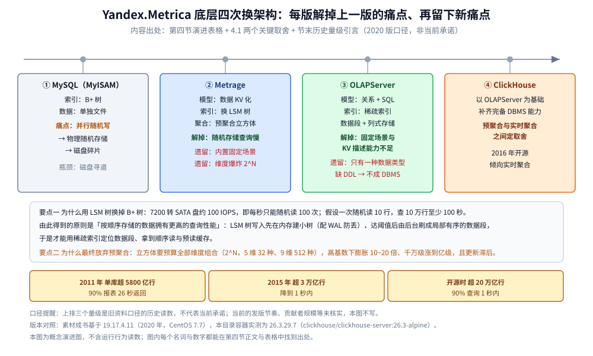
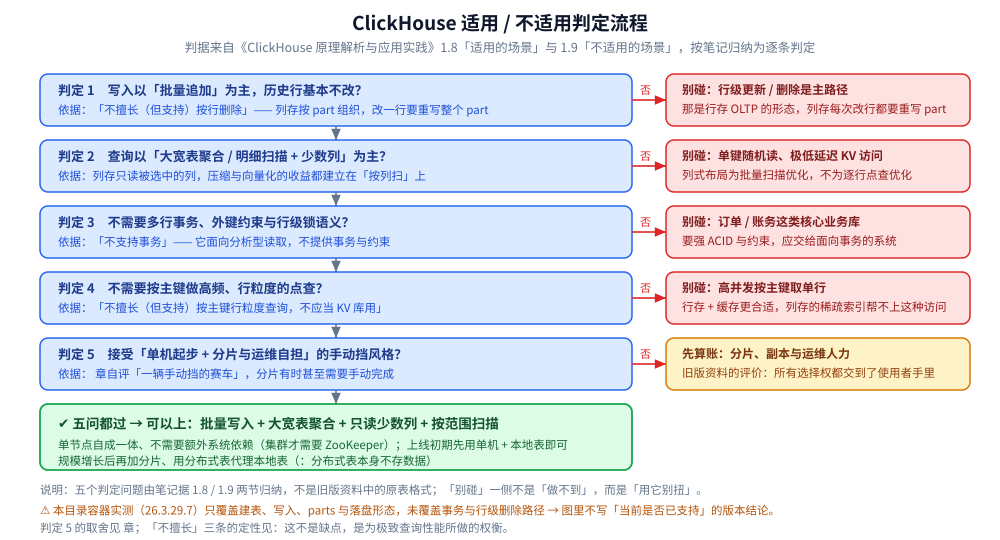

# 定位与适用场景

> 覆盖：ClickHouse 是什么、它填补 OLAP 的哪一个空缺，擅长与不擅长的负载形状，以及它在真实系统里的落点与选型判定清单。
> 不覆盖：MergeTree 落盘形态、索引与数据标记见 [架构与存储引擎.md](架构与存储引擎.md)、[索引原理与查询优化.md](索引原理与查询优化.md)；建表与写入见 [数据模型与表设计.md](数据模型与表设计.md)、[写入与数据导入.md](写入与数据导入.md)；横向选型见 [列式数据库选型对比.md](../列式数据库选型对比.md)。
>
> 素材来源：《ClickHouse 原理解析与应用实践》（朱凯，机械工业出版社 2020 年）第 1 章「ClickHouse 的前世今生」、第 2 章「ClickHouse 架构概述」的读后整理，**按主题归纳而非逐字摘录**；其余整理自个人学习笔记与官方文档，素材见 [素材清单](../../../../素材清单.md)。
>
> ⚠️ 该书成书于 **2020 年**（全书基于 **19.17.4.11**，演示环境 CentOS 7.7），本目录的容器实测为 **26.3.29.7**（`clickhouse/clickhouse-server:26.3-alpine`，容器名 `devnotes-ch`，宿主端口 HTTP 18123 → 8123、native 19000 → 9000，时区 UTC）。凡涉及会随版本变化的默认值、参数名、引擎能力，本批未在 26.3 复核的一律标 **未核实**，不作现状结论。

---

## 一、ClickHouse 是什么？它填补了 OLAP 的哪个空缺？

**本节要点**：一句话钉死——它是**用 SQL 做实时聚合的列式分析库**；选的是「关系模型 + 列式存储 + 实时聚合」这条路，而不是预先建立方体。后面所有「适合 / 不适合」的判断都从这条定位推出来。

### 1.1 经典 OLAP 的两条路，各自堵在哪

传统 OLAP 大致分两条路线，各有绕不开的代价：

| 架构 | 做法 | 代价 |
|---|---|---|
| **ROLAP** | 直接建在关系模型上（常配星型 / 雪花模型），查询时才聚合，**无预处理** | 海量数据下 `GROUP BY` 吃紧：上亿行的表同时跑几十个字段的聚合，很难秒级返回 |
| **MOLAP** | 多维数组存储，**预先聚合、空间换时间**，只留聚合结果 | ① 维度组合爆炸导致数据膨胀；② 预处理带来滞后（新数据不能立即查）；③ **无法下钻明细** |
| **HOLAP** | ROLAP 与 MOLAP 的混合 | 兼具两者复杂度，一般不单独作为选型方向 |

维度组合的代价可以量化：组合数 = **2^N**（N 为维度个数）——5 个维度就是 32 种、9 个维度 512 种；高基数下预聚合后数据量可达 **10~20 倍**膨胀，千万级表能涨到亿级。

⭐ 由此得到 ClickHouse 的位置：它**不预先建立方体**，而是把「关系模型 + 列式存储 + 实时聚合 + 向量化执行」组合起来，在查询时把速度补回来。

### 1.2 名称、定位与架构定性

- 名称是 **Click Stream, Data WareHouse** 的缩写。
- 一句话定位：**在开源的性能与商用的能力之间取平衡**——这是它诞生的出发点。
- 架构上它是一款**多主对等（Multi-Master）**的 MPP 数据库：没有主控节点，不采用 Hadoop 生态常见的 Master-Slave 结构，因此没有单点故障；同时它是基于关系模型的 **ROLAP** 方案。

### 1.3 九项能力，合起来才是它的位置

**本节要点**：任何一项单独看都有别的系统更强——它的价值在这几项**组合**在一起。

| 能力 | 要点 |
|---|---|
| **完备的 DBMS 功能** | 有 DDL / DML / 权限 / 备份恢复 / 分布式管理，所以是 DBMS 而不只是 database |
| **列式存储与压缩** | 列存同时减少扫描范围与传输体量；压缩与列存伴生（同一列取值重复度高、压缩率最高）；落盘时列与列分别存文件（主要指 MergeTree 家族） |
| **向量化执行引擎** | 可理解为「消除程序内循环」的优化，靠 CPU 的 SIMD 指令在寄存器层面并行 |
| **关系模型与 SQL** | 用关系模型 + 完整 SQL，迁移成本低；⚠️ SQL 解析**大小写敏感**（`SELECT a` 与 `SELECT A` 是不同列） |
| **多样化的表引擎** | 家族众多，用「粗粒度按批、普通硬件」与「细粒度、需高性能硬件」两类取舍哲学覆盖不同场景 |
| **多线程与分布式** | SIMD 不适合分支多的场景，用多线程互补；一条设计原则是**「计算移动比数据移动更划算」** |
| **多主架构** | Multi-Master 对等、无主控节点，天然规避单点，适合多数据中心与异地多活 |
| **在线查询** | 面向交互式分析的查询延迟目标 |
| **数据分片与分布式查询** | 本地表（Local Table，持有某一片数据）+ 分布式表（Distributed Table，**本身不存数据**，是本地表的访问代理，作用类似分库中间件） |

### 1.4 版本与口径提醒

上表里**压缩算法默认值、向量化依赖的指令集、表引擎分类数量**这类信息会随版本变化。本批实验只采集了容器环境与落盘形态，**未逐项复核旧资料里的默认值**，因此：具体默认压缩算法、编译期 SIMD 开关名、表引擎清单不作现状断言，需要时查 `system.build_options` / `system.table_engines`；而「1 节点只能 1 分片、分布式表不存数据、1 分片 1 副本至少 2 个节点」这类集群结论见 [架构与存储引擎.md](架构与存储引擎.md) 第一节，本批**未在集群形态下实测**。

## 二、它擅长哪些场景？

**本节要点**：把行业清单抽象一层，共同的技术形状只有一条——**数据量大、以追加写入为主、查询是「带条件的范围扫描 + 聚合」而不是取单行**。

| 行业 | 数据形状 | 契合它的哪个设计 |
|---|---|---|
| 广告 / Web / App 流量分析 | 海量埋点事件持续追加，查询多为按维度聚合 | 列式存储 + 实时聚合（不必预先建好立方体） |
| 电信 / 物联网 | 设备与线路持续上报，按对象 + 时间段查 | 分区 + 稀疏索引按范围剪枝（见 [架构与存储引擎.md](架构与存储引擎.md)） |
| 电商 / 金融 / 游戏 | 宽表明细，要求明细可下钻 | 保留明细（对比 MOLAP 只留聚合结果） |
| 安全（日志与审计） | 只追加、不可变的记录 | 追加写入友好、压缩比高 |
| BI 报表 | 查询是 `GROUP BY` + 过滤 | SQL 与关系模型，迁移成本低 |

⭐ 一条判据：**数据是否「以秒级或更高频率、批量地往历史里追加」，而查询只在需要时扫其中的一部分？** 是 → 它的存储布局在为你优化；不是 → 先看第三节。

> 量级佐证（**旧资料口径，非本机实测、也非容量承诺**）：公开资料里 Yandex.Metrica 的列存总体压缩比可达约 **8:1**（未压缩 17PB → 压缩后 2PB），单集群存储超 **20 万亿行**且 **90% 的自定义查询能在 1 秒内**返回——用来佐证「列存 + 实时聚合」在真实业务量级上站得住。

## 三、哪些场景明确不适用？

**本节要点**：这几条指向同一件事——它**不为「点」操作优化，只为「面」扫描优化**；这不是缺陷，而是为极致查询性能所做的权衡。

| 不适用 | 原因 | 该用什么 |
|---|---|---|
| **需要事务** | 不支持多行 / 多表 ACID、外键约束、行级锁语义 | 面向事务的关系型库 |
| **按主键行粒度的点查** | 稀疏索引只记「一段数据」的位置，命中一行也要读回整个 granule（默认 8192 行粒度），与「按列批量扫描」的布局正好相反 | 行存 + 缓存（KV 类） |
| **频繁按行 UPDATE / DELETE** | 数据以**不可变 part** 为单位落盘，改 / 删一行都要重写 part（见 [架构与存储引擎.md](架构与存储引擎.md)） | 行存 OLTP |
| **为固定报表做预聚合** | 它擅长**实时聚合**；用模拟预聚合去套，等于把最贵的灵活性浪费掉（见第四节） | MOLAP 一类预聚合引擎 |

⚠️ 「不擅长」不等于「做不到」：上表前两条是**支持但代价不划算**。本批实验**未覆盖事务与行级删除路径**，旧资料标记为待核对的方向（试验性事务、lightweight delete）**不作结论**。

## 四、这套设计是怎么演化来的？

**本节要点**：它今天的形态不是一次设计出来的，而是底层数据组织方式被**四次替换**、每次解决上一版遗留痛点的结果——理解这条因果链，后面的取舍才有出处。

```text
Yandex.Metrica 底层四次换架构：

  MySQL(MyISAM)  ──▶  Metrage  ──▶  OLAPServer  ──▶  ClickHouse
       │               │                │                │
   随机写 + 碎片    KV + LSM 树      关系模型 + SQL   补全为完备 DBMS
   磁盘寻道瓶颈    + 预聚合立方体    + 稀疏索引 + 列存   2016 年开源
                   维度爆炸          只有一种数据类型   倾向实时聚合
```

| 阶段 | 数据模型与索引 | 要解决的痛点 | 遗留的问题 |
|---|---|---|---|
| **MySQL（MyISAM）** | B+ 树存索引、数据单独文件 | ——（起点） | 来自分布式系统的并行随机写 → 物理随机存储 + 磁盘碎片 |
| **Metrage** | 数据模型 **KV 化**、索引换 **LSM 树**、改**预聚合** | 随机存储导致的查询慢 | 只提供内置的几十种固定分析场景（自定义分析无解）、维度爆炸 |
| **OLAPServer** | 换回**关系模型 + SQL**；索引只用 LSM 的**稀疏索引**、数据文件沿用**数据段**思想；再引入**列式存储** | Metrage 的固定场景与 KV 描述能力不足 | 只有一种数据类型（固定长度数值型）、缺 DDL 等 DBMS 管理功能 →「只能叫数据库，不能叫 DBMS」 |
| **ClickHouse** | 以 OLAPServer 为基础，目标做成**完备的 DBMS** | 补齐 DBMS 能力，并在预聚合与实时聚合之间定取舍 | ——（2016 年开源） |

### 4.1 两个关键取舍

1. **为什么从 B+ 树换到 LSM 树**：机械硬盘的随机 IOPS 很低——典型 7200 转 SATA 盘约 **100 IOPS**，即每秒只能随机读 100 次；假设一次随机读返回 10 行，查 10 万行至少 **100 秒**。由此得出的原则是**「按顺序存储的数据拥有更高的查询性能」**（少寻道与旋转延迟、可利用 OS 预读）。LSM 树正是为此：写入先在内存建小树（配 WAL 防丢），达阈值后由后台刷成**局部有序**的数据段，于是可用**稀疏索引**定位数据段、拿到顺序读与预读缓存。
2. **为什么最终放弃预聚合**：Metrage 靠立方体预算所有维度组合，换来「固定场景立即返回」，代价是维度爆炸（2^N）与实时更新的滞后。OLAPServer 换回关系模型 + **实时聚合**后发现：**查询性能并不比预聚合差太多，灵活性却更好**——这就是 ClickHouse 继续走这条路的依据。

> 演进过程中的历史量级（**旧资料口径，非当前承诺**）：从 2011 年单库超 5800 亿行、90% 报表 26 秒返回，到 2015 年超 3 万亿行、降到 1 秒内，再到开源时在超 20 万亿行上做到 90% 查询 1 秒内。当前的发版节奏、贡献者规模等**未核实，不写结论**。



图怎么读：横轴是时间方向，四个色块依次是第四节的四个阶段，块内三行是「数据模型与索引」，橙色行是它**要解决的痛点**、红色行是它**遗留的问题**；下方两个面板是 4.1 的两条取舍算术（100 IOPS → 10 万行至少 100 秒；2^N → 5 维 32 种、9 维 512 种、膨胀 10~20 倍），最下排三枚黄签是节末引言里的历史量级。这张图是**概念演进**，不含运行行为读数。

## 五、应用场景

**本节要点**：第二节讲的是「它擅长什么样的负载」（技术形状），这一节补另一半——**这套能力在真实系统里落在哪个位置、存的是哪一类表**。

| 落点类型 | 系统里的位置 | 存的表 | 为什么落在它这里 |
|---|---|---|---|
| **可观测性后端** | 链路追踪 / 日志的存储引擎 | `traces` / `logs` 明细表，按天分区 | 本仓有据：Jaeger v2 的原生存储后端之一就是 ClickHouse（见 [架构与部署.md](../../../中间件/可观测性/Jaeger/架构与部署.md)） |
| **用户行为分析** | 埋点明细仓 | `events` 大宽表（按天分区 + 按用户/时间排序） | 明细只追加、查询是「按维度聚合 + 取少数列」 |
| **实时看板 / 大屏** | BI 与看板的聚合引擎 | 分钟级预聚合表（物化视图产出） | 看板要「秒级返回聚合」，靠预聚合而不是现算 |
| **归因与漏斗** | 曝光 / 点击明细库 | 事实表 + 用户标签表 | 需要按任意维度切分，且要保留明细以便回溯 |
| **风控与审计的事后分析** | 明细留存与离线核查 | 交易 / 操作明细 | ⚠️ 是**事后分析**，不是实时决策链路（后者要极低延迟点查，见第三节） |

⭐ 一条自检：上表每一行都落在「明细只追加 + 查询按维度聚合」这条线上——一旦变成「按主键高频点改」，就该回到第三节重新评估。

> 公开的使用案例（**旧资料口径，未核实现状**）：CERN 用它保存强对撞机试验记录的**数十亿**事件、把查找**从数小时缩短到数秒**；另有 CloudFlare 与国内多家互联网公司的公开案例。本仓库里能直接对照的落点是可观测性——**Jaeger v2 把 ClickHouse 作为官方原生存储**（见 [架构与部署.md](../../../中间件/可观测性/Jaeger/架构与部署.md)），属于「Trace 明细 + 大范围聚合查询」的典型用法。

## 六、具体使用

把需求逐条对照下表。**同一侧「右」出现得多，就说明它不是你该选的第一个系统。**

| 判断问题 | 更该选 ClickHouse | 更该另选系统 |
|---|---|---|
| 写入模式 | 批量追加为主，历史行基本不改 | 频繁行级 UPDATE / DELETE 是主路径 → 行存 OLTP |
| 查询形态 | 大宽表聚合、明细范围扫描、只读少数列 | 单键随机读、极低延迟 KV 访问 → 行存 + 缓存 |
| 数据量 | 单表到亿级且继续增长、成本敏感 | 数据量小、普通关系库足够 |
| 一致性诉求 | 分析型读取即可，不需要多行事务 | 需要多行 ACID 与外键约束 → 关系型 OLTP |
| 延迟目标 | 秒级（公开口径：90% 查询 1 秒内） | 单请求毫秒级 → 换预聚合 / 缓存 / 行存 |
| 建模中心 | 宽表 + 维度聚合 | 实体之间的复杂关系 → 图库或关系型 |
| 明细留存 | 要留明细、随时下钻 | 只要固定报表结果 → 预聚合引擎（MOLAP 一类） |
| 查询语言 | 接受 SQL 生态（迁移成本低） | 要求原系统专有查询语言逐条兼容 |
| 运维投入 | 接受手动分片、自己搭副本与监控 | 要求高度自动化运维 → 托管服务或更自动化的引擎 |



使用建议（下面三步的判定先后顺序不能颠倒，颠倒容易误判）：

1. **先看前三条**（写入模式、查询形态、数据量）——它决定大方向，这三条不对就别往下看；
2. **再看一致性与延迟**——需要事务或毫秒级点查时，列存再快也补不回结构错配；
3. **最后看明细留存这条隐藏项**——只想「把明细算成几张固定报表」，预聚合引擎更省事；用 ClickHouse 去模拟立方体，等于把它最贵的灵活性浪费掉。

⚠️ 上表按「擅长 / 不擅长」两类判据归纳，不是产品原始对比格式；「另选」一侧不代表「做不到」，而是「用它别扭、代价不划算」。

## 延伸追问

- **它和「传统 MPP 数据仓库」到底像在哪、不像在哪？** → 像在关系模型 + SQL + 列式执行；不像在它**没有主控节点**（Multi-Master 对等），且把分片与副本的选择权交给使用者（有一个形象的说法：它更像一辆「手动挡的赛车」）。
- **为什么说它「不需要预聚合」也能快？** → 因为它在**查询时**实时聚合：列存减少要读的字节、向量化减少要执行的循环、稀疏索引与分区减少要扫的范围；性能有保障时，实时聚合的架构更简洁。
- **MOLAP 的立方体膨胀到底多严重？** → 维度组合数是 2^N（5 维 32 种、9 维 512 种），高基数下预聚合后数据量膨胀约 **10~20 倍**，千万级表变亿级。
- **「不擅长按行删除」是不是就是删不了？** → 是「不擅长（但支持）」；根因是数据以不可变 part 落盘，删除要重写 part（见 [架构与存储引擎.md](架构与存储引擎.md) 第四节）。⚠️ 26.3 的删除路径本批未实测。
- **为什么按主键取单行会慢？** → 稀疏索引只为「一段数据」记录区间位置，命中一行也要读回整个 granule（默认 8192 行粒度）；按主键点查属于行存与缓存的强项。
- **它的 SQL 是标准 SQL 吗？** → 是完整 SQL，但不是标准 SQL 的全部，且**解析大小写敏感**；关系模型 + SQL 的价值主要在迁移成本低。
- **物联网 / 车联网这类设备上报适合它吗？** → 适合；判据仍是「追加写 + 按对象和时间段查」。
- **它能不能当主业务库？** → 不支持事务，订单、账务这类库应交给面向事务的系统。
- **它和时序数据库、全文检索是什么关系？** → 横向选型不在本篇展开：时序侧见 [时序数据库选型对比.md](../../时序数据库/时序数据库选型对比.md)，检索与分析两条线见 [搜索与分析选型对比.md](../../搜索与分析/搜索与分析选型对比.md)。
- **只想看「为什么快」的机制，从哪读起？** → 直接进 [架构与存储引擎.md](架构与存储引擎.md)：模块链 → MergeTree 落盘形态 → 索引与数据标记。

## 关联

- [架构与存储引擎.md](架构与存储引擎.md) — 上面每条「为什么」的底层依据：模块链、MergeTree 落盘形态、索引与数据标记、家族引擎
- [数据库选型对比.md](../../数据库选型对比.md) — 七类存储的定位矩阵；第五节是「ClickHouse vs Elasticsearch」的差异表
- [搜索与分析选型对比.md](../../搜索与分析/搜索与分析选型对比.md) — 分析族四路横评（单机列存 / MPP / 实时 OLAP / 湖上分析）与本仓的实测边界
- [时序数据库选型对比.md](../../时序数据库/时序数据库选型对比.md) — 它作为「通用列存自建时序语义」这条路线的代价
- [定位与适用场景.md](../../时序数据库/GreptimeDB/定位与适用场景.md) — 邻居目录里「一库多信号」的另一种定位，便于对照
- [架构与部署.md](../../../中间件/可观测性/Jaeger/架构与部署.md) — 本仓库里 ClickHouse 的真实落点：Jaeger v2 的官方原生存储
- [可观测性选型对比.md](../../../中间件/可观测性/可观测性选型对比.md) — 可观测性栈层面它适合承载哪一类信号
- [素材清单.md](../../../../素材清单.md) — 本篇素材出处登记
> 反向引用（本篇被下列文档引到）：[写入与数据导入.md](写入与数据导入.md)、[性能调优与基准测试.md](性能调优与基准测试.md)、[数据模型与表设计.md](数据模型与表设计.md)、[物化视图与实时聚合.md](物化视图与实时聚合.md)、[索引原理与查询优化.md](索引原理与查询优化.md)、[选型对比与落地案例.md](选型对比与落地案例.md)、[列式数据库选型对比.md](../列式数据库选型对比.md)
