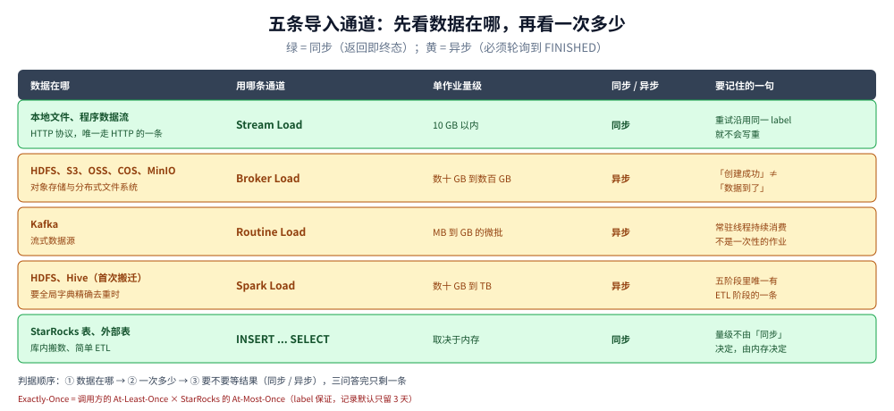

# 导入与更新

> 覆盖：五条导入通道各自的数据源、量级与同步语义、label 为什么能给出 At-Most-Once、
> 导入作业的五阶段状态机、原子性的边界、主键表的更新与删除怎么写、导入侧最容易踩的坑。
>
> ⚠️ 本篇**没有本仓实测读数**，全部为官方文档（`Latest-4.1`）口径。凡是按语义推导的结论标「推演」；
> 文档未明说的写「未确认」。口径边界见 [README.md](README.md) 第四节。

---

## 一、五条通道，各管一段

**本节要点**：选通道先看**数据在哪、一次多少、要不要等结果**这三个问题——它们分别对应数据源、量级、同步/异步，答完就只剩一条。

### 1.1 一张对照表

| 通道 | 数据源 | 单作业量级 | 格式 | 同步 / 异步 | 协议 |
|---|---|---|---|---|---|
| **Stream Load** | 本地文件、程序里的数据流 | **≤ 10 GB** | CSV、JSON | **同步** | **HTTP** |
| **Broker Load** | HDFS、S3、GCS、Azure、OSS、COS、OBS、MinIO 等 | 数十 GB ~ 数百 GB | CSV、Parquet、ORC | 异步 | MySQL |
| **Routine Load** | Kafka | MB ~ GB（微批） | CSV、JSON、Avro（v3.0.1+） | 异步 | MySQL |
| **Spark Load** | HDFS、Hive | 数十 GB ~ TB | CSV、ORC（v2.0+）、Parquet（v2.0+） | 异步 | MySQL |
| **INSERT INTO … SELECT** | StarRocks 表、外部表 | 跟内存相关 | — | 同步 | MySQL |
| **INSERT INTO … VALUES** | 程序、ETL 工具 | 单条 / 小批量 | — | 同步 | MySQL |

⭐ 三个反直觉的点：

1. **只有 Stream Load 走 HTTP**，其余全走 MySQL 协议。所以「用 JDBC 能不能导入」的答案是：
   能，但走的是 `INSERT`，不是 Stream Load。
2. **Spark Load 只在「初次搬迁」和「要全局字典精确去重」时才有意义**。日常增量不该用它——
   它要额外起 Spark 集群，链路最长（五个阶段里唯一有 ETL 阶段的就是它）。
3. **`INSERT INTO ... SELECT` 的量级取决于内存**，不是「同步所以只能小批量」。大表之间搬数据也走它，
   但要控制批次，别把一次 `SELECT` 的全部结果压在 BE 内存里。

### 1.2 按数据源选，比按量级选更省事

文档给的推荐路径基本可以直接照用：

| 数据在哪 | 推荐 | 备注 |
|---|---|---|
| Hive / HDFS | **Broker Load**；表很多时改用 Hive 外表直接查 | 外表省掉搬迁，但查询通常比导入后慢 |
| Kafka | **Routine Load** | 有复杂多表关联与 ETL 时，先用 Flink 处理，再用 Flink Connector 走 Stream Load |
| 本地文本文件 | **Stream Load** | — |
| MySQL | MySQL 外表 + `INSERT INTO new_table SELECT * FROM external_table` | 比按行写快得多 |
| 程序写入 | **Stream Load** | 官方有 Java / Python 示例 |
| StarRocks 内部表之间 | `INSERT INTO ... SELECT` | 配外部调度器可做简单 ETL |
| Oracle / PostgreSQL 等 | DataX（starrockswriter） | — |



绿底三条是同步的（返回即终态），黄底三条是异步的（必须轮询到 `FINISHED`）。最右一列是每条通道最容易误解的那一句，
比如 Spark Load 是唯一带 ETL 阶段的，而 `INSERT ... SELECT` 的量级由内存而不是由「同步」决定。

---

## 二、label：为什么它能给出「不重复写」

**本节要点**：StarRocks 自己不保证 Exactly-Once，它保证的是 **At-Most-Once**；把「至少一次」交给调用方，
两者一乘就是 Exactly-Once。理解了这句话，就理解了为什么重试是安全的。

### 2.1 三条语义

| 语义 | 谁保证 | 含义 |
|---|---|---|
| **原子性** | StarRocks | 同一作业内的**有效数据**要么全生效、要么全不生效 |
| **At-Most-Once** | StarRocks，靠 label | 同一个 label 的数据**最多被导入一次** |
| **At-Least-Once** | **调用方** | 失败就重试，直到拿到成功 |

⭐ 关键推论：**重试用同一个 label，就不会写重**。这就是「网络超时但服务端其实成功了」这种最常见故障的解法——
调用方不知道成没成，用原 label 再发一次：若上次已成功，这次会被告知 label 已存在；若上次没成，这次正常执行。

### 2.2 label 的规则

- 每个导入作业有且只有一个 label，可由用户指定或系统生成；
- **label 在一个数据库内唯一**；
- 作业**成功后 label 不可复用**；⚠️ **作业失败后 label 可以复用**（这点决定了「失败重试」可以直接沿用 label）；
- 已完成的作业记录会保留一段时间（FE 配置 `label_keep_max_second`，默认 **3 天**）——
  超过保留期后再拿同一个 label 提交，就不再被识别为重复了。**所以 label 的生成策略必须自带业务唯一性**
  （例如 `表名_分区_批次号`），不能指望服务端永久去重。

### 2.3 「有效数据」不包括什么

原子性说的是「有效数据全生效或全不生效」，而**因质量问题被过滤掉的行不算有效数据**。
也就是说：一个作业里 1000 行、其中 5 行类型转换失败被过滤，作业仍可能成功，最终只进了 995 行。
「成功」不等于「一行不差」——要判断这个，得看作业返回的过滤行数与错误详情，不能只看状态。

---

## 三、作业状态机：五个阶段，看清「什么时候能查」

**本节要点**：`FINISHED` 才是可查的最终态；`LOADING` 期间数据已经在 BE 上但**还没生效**。异步通道必须轮询到终态。

```
PENDING ──→ ETL ──→ LOADING ──→ FINISHED   ← 可查询
   │         │         │
   │         │         └──→ CANCELLED
   │         └── 仅 Spark Load 有（用外部 Spark 做清洗/分区/排序/聚合）
   └── 仅 Broker Load / Spark Load 有（等 FE 调度）
```

| 阶段 | 含义 | 哪些通道有 |
|---|---|---|
| `PENDING` | 已提交，等 FE 调度 | Broker Load、Spark Load |
| `ETL` | 外部算力做预处理 | **仅 Spark Load** |
| `LOADING` | 数据已发到 BE，**等待生效** | 所有异步通道 |
| `FINISHED` | 全部生效，**可查** | 终态 |
| `CANCELLED` | 失败 / 被取消 | 终态 |

⭐ 两个实操结论：

- **异步通道必须轮询到 `FINISHED` 或 `CANCELLED`**。返回「创建成功」只是建了作业，不代表数据进去了。
- **Stream Load 与 INSERT 是同步的**，HTTP 响应 / SQL 返回时已经是终态——所以它们不需要轮询，
  但也意味着**大作业会把连接占住**（Stream Load 单作业建议 ≤ 10 GB 就是从这来的）。

---

## 四、更新与删除：主键表能做什么

**本节要点**：四种表模型里只有**主键表**支持完整的 `UPDATE` / `DELETE` 语法；更新表只能靠「再导一次同 key 的行」覆盖。

### 4.1 能力边界

| 模型 | 按 key 覆盖 | `UPDATE` 语句 | `DELETE` 语句 | 部分列更新 | 条件更新 |
|---|---|---|---|---|---|
| 明细表 | ❌（追加） | ❌ | 按分区删 / 条件删（有限） | ❌ | ❌ |
| 聚合表 | 聚合合并 | ❌ | 同上 | ❌ | ❌ |
| 更新表 | ✅（读时合并） | 有限 | 有限 | 有限 | ❌ |
| **主键表** | ✅（写时合并） | ✅ | ✅ | ✅（行模式 v2.3+ / 列模式 v3.1+） | ✅（v2.5+） |

⚠️ 「有限」的地方本册不展开——因为**没有实测，说不清边界在哪**。能确认的是：主键表是唯一把更新做成一等公民的模型，
需要频繁改数、按条件改数、只更新几列的场景，应该直接建主键表，而不是在更新表上想办法。

### 4.2 三种「更新」的写法与代价

```sql
-- 1. 整行覆盖：再导入一份同 key 的行（所有模型都适用的思路，语义取决于模型）
--    更新表 / 主键表 → 覆盖；聚合表 → 按聚合函数合并；明细表 → 变成两行

-- 2. UPDATE：改指定列（主键表）
UPDATE orders SET status = 'PAID' WHERE order_id = 1001;

-- 3. 条件更新 / 部分列更新（主键表，需在建表或导入时开启对应属性）
```

⭐ 三种写法的代价排序（**机制层面，无读数**）：

- **整行覆盖**要提供完整一行 → 写放大最大，但语义最清楚；
- **`UPDATE`** 由 FE 转成「读旧值 + 写新值」的作业 → 比整行覆盖省网络，但会在 BE 上产生一次读；
- **部分列更新**只写变更列 → 网络最省，代价是**读路径要拼多版本**，且需要列模式 / 行模式的配置配合。

### 4.3 删除的三种粒度

| 粒度 | 怎么做 | 代价 |
|---|---|---|
| **删分区** | `ALTER TABLE ... DROP PARTITION` | 元数据操作，最快；**不可逆** |
| **条件删除** | `DELETE FROM t WHERE ...`（主键表） | 生成删除谓词，靠后台 compaction 真正回收 |
| **整表清空** | `TRUNCATE TABLE` | 元数据操作，快 |

⭐ 时间序列数据的正确做法是**按分区删**，不是 `DELETE FROM ... WHERE dt < '...'`。
后者在主键表里会生成大量删除标记，要靠 compaction 慢慢消化——这也是「分区粒度别切太碎、但也别不切」的实际理由。

---

## 五、导入侧最容易踩的六个坑

**本节要点**：这六条都是「机制决定的行为」，不是配置没调好。

1. **拿 label 当永久幂等键**。label 记录默认只留 3 天（`label_keep_max_second`），过期后同 label 会被当作新作业。
   → label 要自带业务唯一性，别指望服务端长期去重。

2. **以为「作业成功」等于「数据一行不差」**。质量过滤掉的行不算有效数据，作业仍可 `FINISHED`。
   → 每次导入都要看过滤行数与错误样本，不要只看状态。

3. **把异步通道当同步用**。Broker / Routine / Spark Load 返回的是「作业创建结果」，
   必须轮询到 `FINISHED`。→ 接入层要有状态轮询与超时取消，否则「提交成功」会被误当成「数据到了」。

4. **用更新表装累加值**。覆盖语义会把上一次的值丢掉（见 [架构与表模型.md](架构与表模型.md) 2.2 的推演：`sum` 从 172 变成 137）。
   → 累计类指标用聚合表 + `SUM`。

5. **小批量高频写**。StarRocks 的写入单位是「一次导入产生一批 segment」，写得太碎会产生大量小文件，
   读放大与 compaction 压力都上来。→ 客户端要做**攒批**（这点与 ClickHouse 的「必须批量写」是同一个道理，
   只是 StarRocks 有事务与主键合并兜底，容忍度稍高，但方向一致）。

6. **在明细表上想「改一行」**。明细表是追加语义，同一 key 再导一次就是多一行。
   → 要改数就建主键表或更新表，别在明细表上绕。

---

## 六、这一篇的结论收口

- **五条通道的分界线是数据源**：本地文件 / 程序 → Stream Load（≤10 GB，同步）；HDFS 与对象存储 → Broker Load；
  Kafka → Routine Load；初次大搬迁 → Spark Load；库内搬 → `INSERT ... SELECT`。
- **Exactly-Once = 调用方的 At-Least-Once × StarRocks 的 At-Most-Once（靠 label）**。
  重试沿用同一 label 是安全的，但 label 记录只留 3 天。
- **`FINISHED` 才是可查终态**；`LOADING` 期间数据已在 BE 但未生效。
- **主键表是唯一把更新做成一等公民的模型**：`UPDATE` / `DELETE` / 部分列更新 / 条件更新都在它上面。
- **删时间序列数据按分区删**，不要用条件删除硬删。
- **写入要攒批**——碎写产生的 segment 小文件，读的时候要还。
