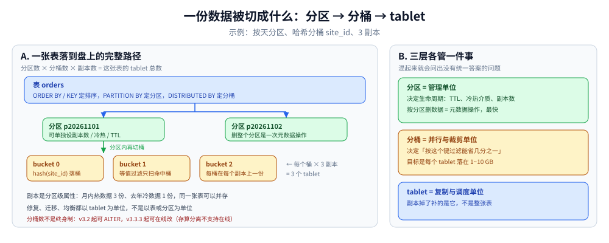

# 架构与表模型

> 覆盖：FE / BE / CN 三类节点各管什么、四种表模型对同一批重复行分别怎么处理、
> 分区与分桶怎么落到 tablet 上、存算一体与存算分离差在哪一环、副本与元数据的一致性边界。
>
> ⚠️ 本篇**没有本仓实测读数**，全部为官方文档（`Latest-4.1`）口径。凡是本册按语义推演出来的结论，
> 都标了「推演」二字；文档未明说的写「未确认」。口径边界见 [README.md](README.md) 第四节。

---

## 一、一条 SQL 从客户端到 tablet，经过哪几个角色？

**本节要点**：StarRocks 只有两类组件（FE、BE/CN），但 FE 内部有三种角色、BE 内部有四层数据单位。先把名字对上，后面每个结论才有落点。

### 1.1 两类组件、三种 FE 角色

| 角色 | 管什么 | 不参与什么 |
|---|---|---|
| **Leader FE** | 读写元数据；生成并下发执行计划；调度导入与查询 | —（本身也是从 Follower 里选出来的） |
| **Follower FE** | 只读元数据；把写请求转给 Leader；**参与选主** | 不写元数据 |
| **Observer FE** | 只读元数据；从 Leader 同步并重放日志；**提高查询并发** | ⭐ **不参与选主** —— 所以加 Observer 不会增加选举压力 |
| **BE** | 存数据（tablet / segment）、执行查询片段的物理算子 | 不持有元数据 |
| **CN**（仅存算分离） | 只做计算与缓存，存储交给对象存储 / HDFS | 不持久化数据 |

三个 FE 角色里最容易被忽略的是 **Observer**：它能扩查询并发，却不影响「过半 Follower 存活才能选主」这条约束。
所以在读多写少的场景里，加 Observer 的性价比高于加 Follower——这是它存在的全部理由。

### 1.2 元数据怎么同步

每个 FE 都用 **BDB JE（Berkeley DB Java Edition）** 在自己的内存里维护一份**完整的元数据副本**。
写路径是单向的：

```
客户端 DDL/DML
   ↓
Leader FE 写元数据
   ↓ Raft 复制
Follower（过半确认才算成功） + Observer（同步重放，不参与确认）
```

⭐ 两个连带结论：

- **写元数据的延迟由「过半 Follower」决定**，不是由 Leader 单机决定。FE 部署跨机房时，
  这条链路的 RTT 会直接变成建表、加分区、改 schema 的延迟。
- **元数据全量在内存里**。表、分区、tablet 的数量直接吃 FE 的堆——这是「分区别切太碎」的另一个理由
  （第一个理由是查询时的元数据开销）。分区数从十万级往上，先去看 FE 的堆与 GC。

### 1.3 查询怎么落到 tablet 上

```
SQL → FE：解析 → 逻辑计划 → CBO 选物理计划 → 按 tablet 切成 Fragment
                                    ↓
                    BE/CN：本地扫描自己那几个 tablet 的 segment
                                    ↓
                          Fragment 之间 shuffle / 汇总
                                    ↓
                              FE 汇总结果返回
```

关键在「按 tablet 切 Fragment」这一步：**分桶的设计直接决定了 Fragment 的粒度和数据本地性**。
分桶键选得好，filter 能砍掉大部分 bucket，剩下的每个 BE 只扫自己那几份；选得差，就是全员全扫再把数据搬到一起。


左边是 FE 的三张面孔：Leader 写、Follower 读并参与选主、Observer 只读且不进选举。
右边是两种部署形态的分界：BE 有本地盘所以延迟低但扩容要搬数据，CN 无状态所以能秒级伸缩但冷读要走远端。

---

## 二、四种表模型，到底差在哪？

**本节要点**：四种模型的差别**不在语法，在「同一批重复行进来时它们各自留下什么」**。这一节用一个 6 行的小样本把这四种结果推演出来。

### 2.1 一张表说清四种模型

建表时必须选一种，而且**建完不能改**（要换只能重建表）。它们的共同前提是：数据按排序键（sort key）有序落盘。

| 模型 | 建表关键字 | 同一 key 出现多次时 | 明细能不能召回 | 典型用途 |
|---|---|---|---|---|
| **明细表** Duplicate Key | `DUPLICATE KEY(...)` | **全部保留**，一行不多一行不少 | ✅ 全部原始行 | 日志、事件流水、审计底表；**拿不准选它** |
| **聚合表** Aggregate Key | `AGGREGATE KEY(...)` | 按指标列的聚合函数（`SUM` / `MAX` / `REPLACE`…）**合并成一行** | ❌ 只剩聚合结果 | 预汇总的指标表、 cube |
| **更新表** Unique Key | `UNIQUE KEY(...)` | **保留最新一批**（等价于指标列全是 `REPLACE`） | ❌ 只剩最新 | 需要按 key 覆盖、但更新不频繁 |
| **主键表** Primary Key | `PRIMARY KEY(...)` | 同更新表：保留最新 | ❌ 只剩最新 | 实时 upsert、频繁按主键改 |

⭐ 一句话判据：**「要不要保留历史明细」定明细 / 其余三种；「更新频率高不高」定主键 / 更新。**

### 2.2 同一批 6 行，四种结果（推演）

设表结构为 `(uid, name, score)`，按 `uid` 分 key，依次导入这 6 行：

```
(1,'a',10) (1,'a',20) (1,'a',30) (2,'b',5) (2,'b',7) (3,'c',100)
```

| 模型 | 落表后 `SELECT *` 的结果 | `count(*)` | `sum(score)` |
|---|---|---|---|
| 明细表 | 6 行原样 | **6** | 172 |
| 聚合表（`score` 用 `SUM`） | `(1,60) (2,12) (3,100)` | **3** | 172 |
| 更新表 | `(1,'a',30) (2,'b',7) (3,'c',100)` | **3** | 137 |
| 主键表 | `(1,'a',30) (2,'b',7) (3,'c',100)` | **3** | 137 |

这张表能读出三件事：

1. **`sum` 不一定对得上**。更新表与主键表只留最后一行，前面被覆盖掉的 20 和 5 就永远拿不回来了（137 而非 172）。
   如果业务要「累计值」，指标列必须用聚合表 + `SUM`，**不能用更新表去装累加值**——这是最常见的建模错。
2. **更新表与主键表的结果一样，但代价不一样**（下一节）。
3. **明细表的 6 行是唯一能回溯的**。选它的代价是存储与查询量，好处是任何事后口径都能重算。

⚠️ 更新表与主键表「保留最新」依赖于**导入顺序**：跨批次按导入时间，同批次内按行在文件里的顺序。
文档只说「最新导入的数据行替换掉其他重复行」，**同批次内多行同 key 谁算最新，本册未确认**（不猜）。

### 2.3 `merge-on-write` 与 `merge-on-read` 的分界

更新表与主键表结果相同，但实现路线相反：

| | 更新表 Unique Key | 主键表 Primary Key |
|---|---|---|
| 合并时机 | **读时合并**（merge-on-read）：写入只追加，查询时才把同 key 的多版本归并 | **写时合并**（merge-on-write）：写入时直接把旧版本标记删除、写新版本 |
| 写放大 | 小（只追加） | 大（要定位并改写旧行） |
| 读放大 | 大（每次查都要归并多版本） | 小（读到的就是唯一版本） |
| 额外成本 | — | **主键索引常驻内存** |
| 适合 | 写多读少、更新稀疏 | 点查多、更新频繁、要求「读到的即刻是最新」 |

⭐ **主键索引是内存买来的**。主键表快在读路径，代价是每个 tablet 的主键索引要在内存里有一份；
主键越长（尤其是长字符串拼出来的复合主键），这份内存越大。官方因此建议主键尽量短、优先用整型代理键。
（v2.3 起支持主键索引持久化，v3.0 起主键可与 `ORDER BY` 列解耦。）

### 2.4 排序键不等于 key 列

这两件事常被混为一谈，实际是两层：

- **key 列**决定「同 key 怎么合并」（去重 / 聚合的语义）；
- **排序键**决定「数据在磁盘上按什么顺序排」（前缀索引建在它上面）。

v3.0 起主键表可以用 `ORDER BY` 单独指定排序键，v3.3 起另外三种表也支持。没指定时，排序键就是 key 列。
这个解耦很实用：key 要用短整型（省主键索引内存），排序键却可能需要「时间 + 城市」这种组合来配合过滤。

⚠️ 两条例外，写的时候容易踩：聚合表与更新表的 `ORDER BY` **必须包含全部 key 列**（顺序可变，集合不能变）；
明细表与主键表的 `ORDER BY` 可以是任意列组合。

---

## 三、分区与分桶：数据怎么落到 tablet 上

**本节要点**：分区是**管理单位**，分桶是**并行与裁剪单位**。两个旋钮常被当成一个，导致「分桶数建完不能改」这类过时结论还在流传。

### 3.1 分区：三种方式，官方只推荐一种

| 方式 | 怎么定 | 适用 | 官方态度 |
|---|---|---|---|
| **表达式分区** | 写分区表达式，导入时**自动建分区** | 连续时间范围、枚举值 | ⭐ **推荐**，v3.4 起统一语法，将逐步取代另两种 |
| **Range 分区** | 手动 / 动态指定每个分区的上下界 | 数据简单有序、按连续范围管理 | 不推荐 |
| **List 分区**（v3.1+） | 显式列出枚举值到分区的映射 | 一个分区要包含多值（如「一个国家多个城市」） | 不推荐 |

表达式分区最大的好处是**不用预先建分区、也不用配动态分区属性**：来什么数据建什么分区。
而动态分区（Range 分区的 TTL 用法）是**提前建**——新数据不属于已建分区时会**报错**，这两者的区别要分清。

```sql
-- 表达式分区：按 7 天切片，导入时自动建
CREATE TABLE site_access (
    event_day DATETIME NOT NULL,
    site_id   INT,
    pv        BIGINT
) DUPLICATE KEY(event_day, site_id)
PARTITION BY time_slice(event_day, INTERVAL 7 day)
DISTRIBUTED BY HASH(site_id);
```

分区粒度的取舍没有通解，文档给的三条判断可以直接用：

- 单分区数据量小 → 粒度可以粗（按月），**减少元数据数量**；
- 查询条件精确到天、单分区量大 → 按天，**换裁剪效果**；
- 有按天过期的需求 → 按天，**换删数据的速度**（删分区是元数据操作，删行是数据操作）。

### 3.2 分桶：三种方式，默认是随机

| 方式 | 建表写法 | 引入 | 说明 |
|---|---|---|---|
| **随机分桶** | 不写 `DISTRIBUTED BY`，或 `DISTRIBUTED BY RANDOM` | v3.1 | **默认**。数据随机摊到各桶，不保证同 key 同行 |
| **哈希分桶** | `DISTRIBUTED BY HASH(col, ...)` | 早期即有 | 同 key 必进同一桶；按分桶键过滤时能裁剪 |
| **范围分桶** | 由 Key / `ORDER BY` 自动推导 | **v4.1**，默认关闭 | 需开 FE 配置 `enable_range_distribution`；tablet 支持自动分裂合并 |

随机分桶的限制要知道：**仅支持明细表**、不支持指定 Colocation Group、不支持 Spark Load。
所以「不写 `DISTRIBUTED BY`」这条捷径只对明细表成立，聚合 / 更新 / 主键表还是要给分桶键。

哈希分桶的价值全在**裁剪**：`WHERE site_id = 54321` 这类查询，只扫命中的那个 bucket。
文档给的例子很直白——每分区 10 个桶，一条等值查询裁掉 9 个，只读 1/10。

而它的风险是**倾斜**：分桶键基数低或分布幂律，某些桶会明显更大。文档的建议是加列打散（如 `site_id, city_code`），
但加列会让「按单列过滤」的裁剪失效——**均匀与裁剪是一对矛盾**，取决于查询是短查询（单机可扫完）还是长查询（要多机并行）。

### 3.3 分桶数：能改，而且默认自动

这是最常被写错的一条：

| 说法 | 实况 |
|---|---|
| ❌「分桶数建表后不能改」 | **v3.2 起可 `ALTER TABLE ... DISTRIBUTED BY ... BUCKETS n`**；v3.3.3 起可在线改（存算分离不支持在线改） |
| ❌「必须手算分桶数」 | **v2.5.7 起默认自动设置**，不写 `BUCKETS` 就由系统按机器资源与数据量定 |
| ❌「一个 tablet 越小越好」 | 目标区间是 **1 GB ~ 10 GB**（3.2 优化数据分布一节的建议） |

手动设分桶数的经验公式，文档给的是**按每 10 GB 原始数据一个 tablet** 反推；
单分区预计超过 **100 GB** 时才建议手动设。v4.1 的存算分离集群支持大容量 tablet，口径改为 **10 GB ~ 50 GB / tablet、单个不超过 100 GB**。

⭐ 一个容易被忽略的开关：**`enable_tablet_internal_parallel`**（v2.4 起）。开了之后，
单个 tablet 也能被多线程分段并行扫——这意味着**分桶数不再是查询并行度的硬上限**，分桶数的压力因此被削弱。
不开这个开关时，一个 tablet 只能被一个线程扫，分桶太少就会限制并行度。

### 3.4 tablet 是复制与调度的最小单位

```
分区 p20261101
 ├─ bucket 0 → tablet(p0-b0-r1) 在 BE1，tablet(p0-b0-r2) 在 BE2
 ├─ bucket 1 → tablet(p0-b1-r1) 在 BE1，tablet(p0-b1-r2) 在 BE3
 └─ ...
```

- **副本数是分区级属性**：可以按月热 3 副本、按年冷 1 副本（单副本表要显式设 `replication_num=1`）；
- **`N` 个桶 × `M` 副本 = 该分区的 tablet 总数**，这个数直接吃 FE 的元数据内存；
- **修复、迁移、均衡都以 tablet 为单位**——BE 掉了，重建的是它上面那批 tablet 的副本，不是整表。



从上往下是一份数据被切的三层：表按分区键切开，每个分区再按分桶键哈希成 N 个桶，每个桶在每个副本上一份 tablet。
右上角的「3 个 tablet」指的就是一个桶的三份副本——副本数、分桶数、分区数三个数相乘，才是这张表的 tablet 总量。

---

## 四、存算一体与存算分离，差在哪一环

**本节要点**：差在**存储归谁**，不在「有没有缓存」。而存储一挪走，一批功能就跟着版本落后甚至缺失——选型时这才是关键。

| | 存算一体（shared-nothing） | 存算分离（shared-data） |
|---|---|---|
| 节点 | FE + **BE** | FE + **CN** |
| 数据在哪 | BE 本地盘 | 对象存储 / HDFS（S3、GCS、Azure、MinIO、OSS、COS、OBS…） |
| 缓存 | 无此概念（数据本来就在本地） | **多层**：内存 → 本地磁盘 → 远端；冷数据先拉进缓存再算 |
| 扩容 | 加 BE，**要搬数据** | 加 CN，**秒级、不搬数据** |
| 存储成本 | 本地盘，按副本数放大 | 对象存储，通常更便宜 |
| 性能 | ⭐ 数据本地，延迟低 | 缓存命中时接近；**未命中要付远端读的代价** |
| 隔离性 | 存算耦合，重查询会挤占同机 I/O | 计算节点可独立伸缩，隔离更好 |

⭐ 这条差异链值得记住：**存储挪到远端 → 计算节点变成无状态 → 才能秒级增删 → 才有弹性**。
但「无状态」的另一面是「每次冷读都要走网络」，所以它把问题从「数据本地性」换成了「缓存命中率」。

### 4.1 功能差异（同一版本、两种形态，不是新旧版本）

官方给了一张按版本列的对照表，这里只挑对选型有影响的几条：

| 功能 | 存算一体 | 存算分离 |
|---|---|---|
| 条件更新 | v2.5+ | v3.1+ |
| 部分更新（行模式） | v2.3+ | v3.1+ |
| 主键索引持久化 | v2.3+ | v3.2+ |
| 主键与 ORDER BY 列解耦 | v3.0+ | v3.1+ |
| Fast Schema Evolution | v3.2+ | v4.0+ |
| File Bundling | 不适用 | v4.0+ |
| **倒排索引** | v3.3+ | **v4.1+** |
| **向量索引** | v3.4+ | **待支持** |
| 随机分桶 | v3.1+ | v3.2+ |
| 在线更改分桶 | v3.3.3+ | **不适用** |
| 查询缓存 | v2.5+ | v3.4+ |
| **备份与恢复** | v1.x+ | **不适用** |
| 跨集群数据迁移工具 | v3.3+ | **不适用** |
| 集群快照 | 不适用 | v3.4.2+ |

⚠️ 三处「不适用」要在选型时正面回答：**存算分离没有 `BACKUP` / `RESTORE`**（靠快照与对象存储自身的版本能力）、
**没有跨集群迁移工具**、**不能在线改分桶**。凡是运维流程里写了「定期备份到另一套集群」的，迁到存算分离都要重写这套流程。

---

## 五、副本与一致性：边界在哪

**本节要点**：StarRocks 的一致性分成两段——**元数据靠 Raft 过半**，**数据靠写入的 quorum 与副本修复**。两段的保证强度不一样。

### 5.1 元数据：过半写成功才算成功

Leader 把元数据变更通过 Raft 同步给 Follower，**超过一半的 Follower 确认后**才认为写成功。
所以：

- 3 个 Follower 的集群能容忍 1 个挂掉（还剩 2 个，过半）；
- 2 个 Follower 的集群**不能**容忍任何 1 个挂掉（剩 1 个不过半，选不出 Leader）；
- Observer 不参与确认，加它不会提高写延迟，也不会拖慢选主。

### 5.2 数据：写 quorum 与副本修复

表的写入成功条件可以按表设置 **`write_quorum`**（建表时指定，或 `ALTER TABLE` 加）。
它决定「几个副本写成功才算这次导入成功」——这是**可用性与一致性的旋钮**，不是性能旋钮。

副本掉了之后，FE 发现 tablet 的副本数低于期望，会触发**副本修复**（从健康副本克隆）。
修复以 tablet 为单位、并发进行；BE 刚重启或长时间离线后，会有一波集中的 tablet 补齐。

⭐ 一段容易误解的边界：**写入的原子性由导入作业保证，不是由副本机制保证**。
同一个导入作业的数据要么全部生效、要么全部不生效（见 [导入与更新.md](导入与更新.md) 第二节），
但这与「副本是否已经全部同步」是两件事——前者是作业级事务语义，后者是副本收敛过程。

---

## 六、这一篇的结论收口

- **三类节点、三种 FE 角色**：能加并发又不加选举压力的是 **Observer**；元数据写延迟由**过半 Follower** 决定。
- **四种表模型**：差别在「同一批重复行留下什么」。要历史明细选明细表；要累计值必须用聚合表 + `SUM`，
  用更新表装累加值一定会丢数。
- **更新表与主键表结果相同、代价相反**：前者读时合并（写便宜），后者写时合并（读便宜但要拿内存换主键索引）。
- **分区管生命周期、分桶管并行与裁剪**；分桶数 **v3.2 起可改**、**v2.5.7 起默认自动**，tablet 目标 **1~10 GB**。
- **存算分离换来了弹性，代价是一批功能的版本落后与三处「不适用」**（备份恢复、跨集群迁移、在线改分桶）。
- **一致性分两段**：元数据 Raft 过半；数据靠 `write_quorum` 与副本修复，两者不强绑定。
