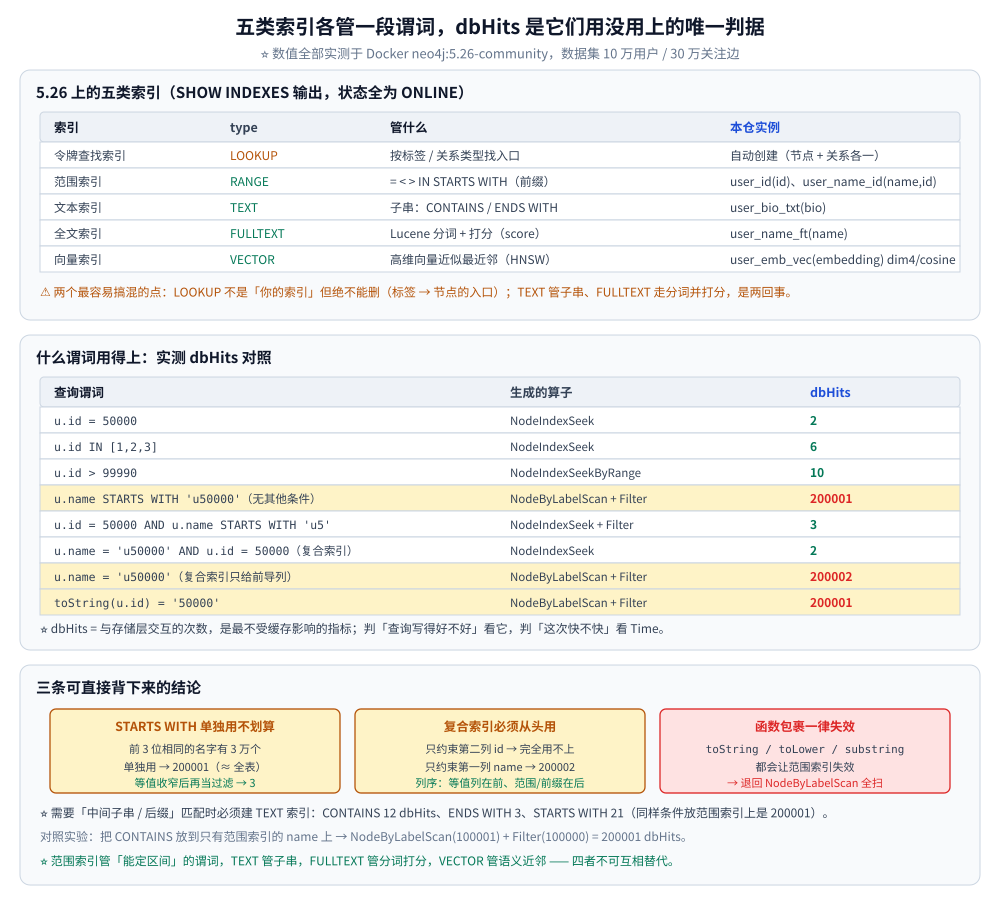
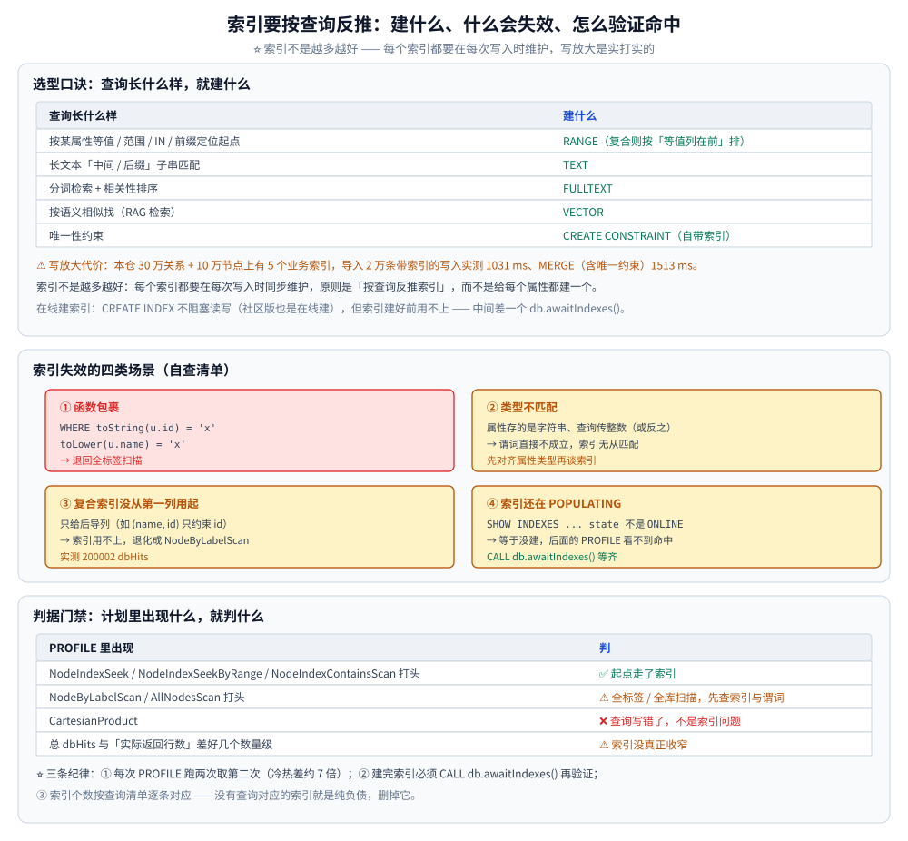
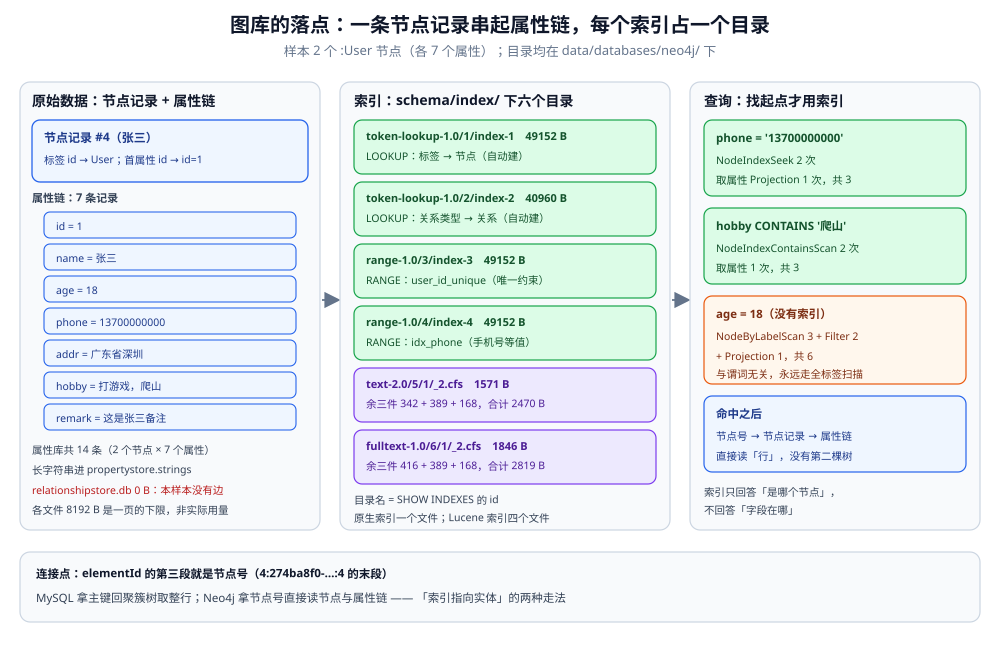

# 索引设计与查询优化

> 令牌索引 / 范围索引 / 文本索引 / 全文索引 / 向量索引五类索引，
> 以及复合索引前缀、失效场景与索引维护。
>
> 内容整理自个人学习笔记。**基础框架**参考《Neo4j 权威指南》与官方 Cypher Manual
> 「Indexes」章节；各索引类型的实测读数与算子名采自 Docker `neo4j:5.26-community`
> （引擎 **5.26.31**），数据集 10 万用户 / 30 万关注边；第六节的 2 条统一样本在另一个
> 同版本实例 `ds-neo4j`（宿主 `127.0.0.1:17474`，空库）上单独复测。

---

## 一、Neo4j 有哪些索引类型？

**本节要点**：5.26 上共有**五类**可用索引，各管一段完全不同的查询形态（实测 `SHOW INDEXES` 输出，状态全为 `ONLINE`）：

| 索引 | `type` | 提供方 | 管什么 | 本仓实例 |
|---|---|---|---|---|
| 令牌查找索引 | `LOOKUP` | `token-lookup-1.0` | 按**标签 / 关系类型**找节点、关系的入口 | `index_343aff4e`（NODE）、`index_f7700477`（RELATIONSHIP），**自动创建** |
| 范围索引 | `RANGE` | `range-1.0` | `=`、`<`、`>`、`IN`、`STARTS WITH`（前缀） | `user_id (id)`、`user_name_id (name, id)` |
| 文本索引 | `TEXT` | `text-2.0` | **子串**语义：`CONTAINS`、`ENDS WITH` | `user_bio_txt (bio)` |
| 全文索引 | `FULLTEXT` | Lucene | 分词 + 打分（`score`），模糊 / 词项匹配 | `user_name_ft (name)` |
| 向量索引 | `VECTOR` | `vector-2.0` | 高维向量的近似最近邻（HNSW） | `user_emb_vec (embedding)`，dim 4 / cosine |

⚠️ 两个最容易被搞混的点：

- **`LOOKUP` 索引不是"你的索引"，但绝不能删** —— 它是"从标签到节点"的入口，
  `MATCH (u:User …)` 这类模式靠它才能落到具体的节点上（见本文第二节的 `NodeByLabelScan`）。
- **`TEXT` 与 `FULLTEXT` 是两回事** —— `TEXT` 是"子串 / 前后缀"语义、不走分词、不打分；
  `FULLTEXT` 走 Lucene 分词并返回 `score`。选错会既慢又不准（见第三节、第四节）。

---



图里把五类索引按「管什么谓词」分成五条通道：`LOOKUP` 负责从标签与关系类型找入口，`RANGE` 接等值 / 范围 / 前缀，`TEXT` 接子串与后缀，`FULLTEXT` 走分词打分，`VECTOR` 走语义近邻；一条谓词走错通道，结果不是变慢就是直接扫全标签。

## 二、范围索引怎么建、又怎么被用上？

**本节要点**：范围索引是**默认选择**，覆盖等值、范围、`IN`、前缀四类谓词。它走 B+ 树，所以只有"能被排序 / 能定区间"的谓词才用得上；被函数包住、或语义无法转成区间（中间子串）的谓词一律用不上。

### 2.1 创建

```cypher
CREATE INDEX user_id IF NOT EXISTS FOR (u:User) ON (u.id);            // 单属性
CREATE INDEX user_name_id IF NOT EXISTS FOR (u:User) ON (u.name, u.id);  // 复合索引
CREATE CONSTRAINT user_id_unique IF NOT EXISTS FOR (u:User) REQUIRE u.id IS UNIQUE;  // 唯一约束（隐含索引）
```

⚠️ 建完**不会立刻可用**：索引先处于 `POPULATING`，要等它 `ONLINE` 才生效。
脚本里用 `CALL db.awaitIndexes()` 等齐；这一步省掉，后面的 `PROFILE` 会看到"索引明明建了却没用上"。

### 2.2 什么谓词用得上（实测 dbHits）

| 查询谓词 | 生成的算子 | dbHits | 评价 |
|---|---|---|---|
| `u.id = 50000` | `NodeIndexSeek` | **2** | ⭐ 最优 |
| `u.id IN [1,2,3]` | `NodeIndexSeek` | **6** | ⭐ 每命中一个点约 2 次 |
| `u.id > 99990` | `NodeIndexSeekByRange` | **10** | ✅ 区间扫 |
| `u.name STARTS WITH 'u50000'`（无其他条件） | `NodeByLabelScan` + `Filter` | **200001** | ❌ 单靠前缀没锚点 → 全扫 |
| `u.id = 50000 AND u.name STARTS WITH 'u5'` | `NodeIndexSeek` + `Filter` | **3** | ⭐ 先用等值锚定，前缀只做过滤 |
| `u.name = 'u50000' AND u.id = 50000`（复合索引） | `NodeIndexSeek` | **2** | ⭐ 两列都约束 |
| `u.name = 'u50000'`（复合索引只给前导列） | `NodeByLabelScan` + `Filter` | **200002** | ❌ 前导单独用不上 |
| `toString(u.id) = '50000'` | `NodeByLabelScan` + `Filter` | **200001** | ❌ 函数包裹 → 索引失效 |
| `toLower(u.name) = 'u0'` | `NodeByLabelScan` + `Filter` | **200001** | ❌ 同上 |

⭐ 三条可直接背下来的结论：

1. **`STARTS WITH` 单独用不划算** —— 前 3 位相同的名字有 3 万个，索引扫出来的区间几乎等于全表；
   它只有在**已被等值条件收窄**后当过滤条件才划算（200001 → 3）。
2. **复合索引必须"从头用"** —— 只约束第二列（`id`）时索引完全用不上；
   只约束第一列（`name`）时，本仓实测也退化成 `NodeByLabelScan`（200002），
   所以**复合索引的列序要按"等值列在前、范围 / 前缀列在后"来排**。
3. **任何函数包裹都会让索引失效** —— 这是范围索引最大的坑（`toString` / `toLower` / `substring` 都算）。

---

## 三、文本索引（TEXT）解决什么？

**本节要点**：`TEXT` 索引是 5.x 新增的，专门补上范围索引做不到的 **`CONTAINS` / `ENDS WITH`** 两种"子串"谓词 —— 它内部用 n-gram 做倒排，所以能把"中间匹配"变成"索引扫"。

```cypher
CREATE TEXT INDEX user_bio_txt IF NOT EXISTS FOR (u:User) ON (u.bio);
CALL db.awaitIndexes();
```

实测三种谓词的效果（`bio` 只加在 200 个用户上）：

| 谓词 | 生成算子 | dbHits |
|---|---|---|
| `u.bio CONTAINS 'number 1'` | `NodeIndexContainsScan`（`TEXT INDEX u:User(bio)`） | **12** |
| `u.bio ENDS WITH '10'` | `NodeIndexEndsWithScan`（`TEXT INDEX u:User(bio)`） | **3** |
| `u.bio STARTS WITH 'graph'` | `NodeIndexSeekByRange`（`TEXT INDEX u:User(bio)`） | **21** |

⭐ 对照实验说明"它到底补了哪块"：把同样的 `CONTAINS` 放到**只有范围索引**的 `name` 上：

```text
NodeByLabelScan(u:User) 100001 + Filter(CONTAINS) 100000 = 200001 dbHits
```

⭐ 结论：**需要"中间子串 / 后缀"匹配时，必须建 `TEXT` 索引**；范围索引在这两种谓词上完全无能为力。

---

## 四、全文索引与向量索引怎么用？

**本节要点**：全文索引走 Lucene 分词并**打分**，适合"长文本模糊检索 + 相关性排序"；向量索引走 **HNSW 近似最近邻**，适合"按语义相似找"。两者都**不走 Cypher 的谓词通道**，要用过程调用（`CALL db.index.fulltext.queryNodes` / `db.index.vector.queryNodes`）。

### 4.1 全文索引

```cypher
CREATE FULLTEXT INDEX user_name_ft IF NOT EXISTS FOR (u:User) ON EACH [u.name];

CALL db.index.fulltext.queryNodes('user_name_ft', 'u99999')
YIELD node, score
RETURN node.id AS id, score LIMIT 5;
```

实测：命中 1 条，`score = 5.0488`，整条查询 **1 dbHit**（`Time 32 µs`）。
⭐ 与范围索引的分工：**要"排序相关性"或"分词模糊"用全文索引；要"精确等值"用范围索引** ——
拿全文索引做等值查询是杀鸡用牛刀，拿范围索引做模糊查询则根本用不上。

### 4.2 向量索引（5.11+）

```cypher
CREATE VECTOR INDEX user_emb_vec IF NOT EXISTS FOR (u:User) ON (u.embedding)
OPTIONS { indexConfig: {
  `vector.dimensions`: 4,
  `vector.similarity_function`: 'cosine'    // 另一种是 'euclidean'
}};
CALL db.awaitIndexes();

CALL db.index.vector.queryNodes('user_emb_vec', 5, [1.0, 1.0, 1.0, 1.0])
YIELD node, score
RETURN node.id AS id, score;
```

实测（4 维、200 个带向量的用户）：返回 5 条，`score` 从 **0.99999** 递减到 **0.9744**，
整条查询 **5 dbHits**（`Time 35 µs`）。

| 参数 | 取值 | 什么时候改 |
|---|---|---|
| `vector.dimensions` | 必须**与实际向量长度严格一致** | 换 embedding 模型时重建索引 |
| `vector.similarity_function` | `cosine` / `euclidean` | 语义相似（文本向量）多用 `cosine`；看重绝对距离用 `euclidean` |

⚠️ 维度定得太高不会"更准"，只会让索引更大、构图更慢；**维度由 embedding 模型决定，不是可以调优的自由参数**。
⚠️ **2026.02 起 GA 的"带过滤向量搜索"（索引内按属性过滤）在本仓 5.26 上不可用，未实测**；
5.26 的做法是"先用向量索引取 Top-K，再在 Cypher 里 `WHERE` 过滤"（K 要放大些，避免过滤后不够数）。

---



图里上半是「查询长什么样 → 建哪种索引」的对照，下半是四类失效场景：函数包裹、类型不匹配、复合索引没用上第一列、索引还在 `POPULATING`；右侧把代价落在具体读数上——30 万关系 + 10 万节点、5 个业务索引下，带索引导入 2 万条 1031 ms，`MERGE` 含唯一约束 1513 ms。

## 五、索引怎么选、怎么维护？

**本节要点**：索引不是越多越好 —— 每个索引都要在**每次写入**时维护，写放大是实打实的。原则是"**按查询反推索引**"，而不是"给每个属性都建一个"。

### 5.1 选型口诀

| 查询长什么样 | 建什么 |
|---|---|
| 按某属性等值 / 范围 / `IN` / 前缀定位起点 | `RANGE`（复合则按"等值列在前"排） |
| 长文本中间 / 后缀子串匹配 | `TEXT` |
| 分词检索 + 相关性排序 | `FULLTEXT` |
| 按语义相似找（RAG 检索） | `VECTOR` |
| 唯一性约束 | `CREATE CONSTRAINT`（自带索引） |

⚠️ **写放大代价**：本仓 30 万关系 + 10 万节点上有 5 个业务索引，
导入 2 万条带索引的写入实测 **1031 ms**、MERGE（含唯一约束）**1513 ms**（见
[数据建模与导入.md](数据建模与导入.md) 第五节）；索引越多，每次写入要更新的结构越多。

### 5.2 维护动作

```cypher
SHOW INDEXES YIELD name, type, entityType, labelsOrTypes, properties, state, populationPercent;
DROP INDEX user_name_id IF EXISTS;          // 删
CREATE INDEX user_id IF NOT EXISTS FOR (u:User) ON (u.id);   // 建
CALL db.awaitIndexes();                     // 等 ONLINE
```

⭐ **在线建索引**：`CREATE INDEX` 不阻塞读写（社区版也是在线建），但索引建好前**用不上**，
所以"建索引"和"跑压测"要串行 —— 中间差一个 `db.awaitIndexes()`。

### 5.3 索引失效的四类场景（自查清单）

1. **函数包裹**：`WHERE toString(u.id) = 'x'`、`toLower(u.name) = 'x'` → 全扫；
2. **类型不匹配**：属性存的是字符串、查询传整数（或反之）→ 谓词直接不成立，索引无从匹配；
3. **复合索引没从第一列用起**：只给后导列 → 索引用不上；
4. **索引还在 `POPULATING`**：`SHOW INDEXES` 里 `state` 不是 `ONLINE` → 等于没建。

---

## 六、两条用户记录落盘后，原始数据和索引各在哪？

前面五节讲的都是「索引怎么建、命中怎么验」。这一节换到磁盘上：**把两条记录写进图库，再去数据目录里把它们找出来**——看清一个图库的「原文」是节点记录加属性链，「索引」是每个索引各占一个目录，而两者之间只靠一个节点号相连。

样本与其他产品篇共用：

```text
id=1  name=张三  age=18  phone=13700000000  addr=广东省深圳  hobby=打游戏，爬山         remark=这是张三备注
id=2  name=李四  age=19  phone=13800000000  addr=广东省深圳  hobby=唱、跳、rap、打蓝球  remark=这是李四备注
```

（容器 `ds-neo4j`，`neo4j:5.26.31`，数据目录 `/var/lib/neo4j/data/databases/neo4j/`。）

### 6.1 建库：先数清有几个索引目录

```cypher
CREATE CONSTRAINT user_id_unique IF NOT EXISTS FOR (u:User) REQUIRE u.id IS UNIQUE;
CREATE INDEX idx_phone IF NOT EXISTS FOR (u:User) ON (u.phone);
CREATE TEXT INDEX idx_hobby_text IF NOT EXISTS FOR (u:User) ON (u.hobby);
CREATE FULLTEXT INDEX idx_remark_ft IF NOT EXISTS FOR (u:User) ON EACH [u.remark];
```

`SHOW INDEXES YIELD name, type, id` 直接给出每个索引的目录编号：

| 索引 | type | provider 目录 | `id` | 磁盘落点 |
|---|---|---|---|---|
| `idx_phone` | RANGE | `range-1.0` | 4 | `schema/index/range-1.0/4/` |
| `user_id_unique` | RANGE | `range-1.0` | 3 | `schema/index/range-1.0/3/` |
| `idx_hobby_text` | TEXT | `text-2.0` | 5 | `schema/index/text-2.0/5/` |
| `idx_remark_ft` | FULLTEXT | `fulltext-1.0` | 6 | `schema/index/fulltext-1.0/6/` |
| `index_343aff4e` | LOOKUP（NODE） | `token-lookup-1.0` | 1 | `schema/index/token-lookup-1.0/1/` |
| `index_f7700477` | LOOKUP（RELATIONSHIP） | `token-lookup-1.0` | 2 | `schema/index/token-lookup-1.0/2/` |

⭐ 两个读数值得记住：

- **每个索引一个目录，目录名就是 `SHOW INDEXES` 的 `id`**——这与 MySQL 把四棵树塞进同一个 `.ibd`、靠根页号区分是完全不同的组织方式；
- 6 个索引里有 **2 个是自动建的 `LOOKUP`**，自己建的只有 4 个——`MATCH (u:User …)` 能落到具体节点上，靠的就是 `token-lookup-1.0/1/`。

### 6.2 原始数据：一条节点记录 + 七条属性记录

图库没有「行」，一条 `:User` 由几类记录拼起来：

| 文件 | 存什么 | 本机读数 |
|---|---|---|
| `neostore.nodestore.db` | 节点记录：标签 id、第一条属性 id、第一条关系 id | 8192 B |
| `neostore.propertystore.db` | 属性记录：属性键 id + 值（或指针），按节点串成链 | 8192 B |
| `neostore.propertystore.db.strings` | 放不进属性记录的长字符串 | 8192 B |
| `neostore.propertystore.db.arrays` | 数组型属性 | 8192 B |
| `neostore.labeltokenstore.db.names` | 标签名 `User` → 标签 id | 8192 B |
| `neostore.relationshipstore.db` | 关系记录 | **0 B**（本样本没有边） |

两条样本各 7 个属性，所以属性库里有 **14 条属性记录**；节点记录本身**一个属性值都不存**，只记「标签 id + 第一条属性 id」，其余靠属性链一步步跳。这也解释了第 6.5 节每个命中查询末尾那 1 次 `Projection` 的 dbHit——那是在读属性，不是索引在查。

⚠️ 上表 8192 B 是**一页的下限而不是实际用量**：Neo4j 按 8192 字节分页，空库也照样是这个数，只能当量级看。`relationshipstore.db` 为 0 B 倒是个硬结论——没写边，这块文件就没被碰过。

### 6.3 索引数据：原生索引是单文件，Lucene 索引是四个文件

| 索引 | 文件 | 体积 |
|---|---|---|
| `idx_phone` | `range-1.0/4/index-4` | 49152 B |
| `user_id_unique` | `range-1.0/3/index-3` | 49152 B |
| `index_343aff4e`（NODE） | `token-lookup-1.0/1/index-1` | 49152 B |
| `index_f7700477`（REL） | `token-lookup-1.0/2/index-2` | 40960 B |
| `idx_hobby_text` | `text-2.0/5/1/_2.cfs` 1571 / `_2.cfe` 342 / `_2.si` 389 / `segments_2` 168 | 合计 2470 B |
| `idx_remark_ft` | `fulltext-1.0/6/1/_2.cfs` 1846 / `_2.cfe` 416 / `_2.si` 389 / `segments_2` 168 | 合计 2819 B |

⚠️ 两种实现的分野直接写在文件上：

- `RANGE` 与 `LOOKUP` 是**原生索引**，一个 `index-<id>` 文件装下整个结构，49152 B = **6 页**；
- `TEXT` 与 `FULLTEXT` 是 **Lucene** 索引：`_2.cfs` 是复合段文件、`_2.cfe` 是段内条目表、`_2.si` 是段元信息、`segments_2` 是提交点，**四个文件才算一个完整索引**，两条记录就已生成一个段；
- 所以「`TEXT` 与 `FULLTEXT` 是两回事」不只体现在谓词上，**在磁盘上也是两套引擎**——`TEXT` 看似「文本」，实际同样走 Lucene，只是不建打分。

### 6.4 两者靠什么连：节点号（`elementId`）

索引里存的不是属性值的地址，而是**节点号**：

```text
elementId(张三) = 4:274ba8f0-e091-422f-ac37-f7b7a95a214a:4
elementId(李四) = 4:274ba8f0-e091-422f-ac37-f7b7a95a214a:3
```

三段依次是**数据库 id、库实例 uuid、节点号**。`idx_phone` 的条目是「手机号 → 4」，`user_id_unique` 的条目是「1 → 4」，两个不同索引指向同一个节点号；拿到节点号之后，再读节点记录、顺属性链取 `name`。

⭐ 这和 MySQL 二级索引叶子存主键是同一个套路：**索引只回答「是哪个实体」，不回答「实体的字段在哪」**。区别在于 MySQL 拿到主键还要再查一次聚簇索引，而 Neo4j 拿到节点号直接读节点记录——节点记录就是「行」，没有第二棵树。



图里左栏是原文：节点记录只记标签与第一条属性，七个属性值沿属性链排开，长字符串另有存放；中栏是 `schema/index/` 下六个目录，绿色两个是原生索引、紫色两个是 Lucene 的四个文件；右栏三条查询分别落到 `NodeIndexSeek`、`NodeIndexContainsScan` 与 `NodeByLabelScan`，箭头最终都收回同一个节点号。

### 6.5 三次查询各走哪条路

> 下表取 `PROFILE` 输出的算子级 `DB Hits` 与底部 `Total database accesses`。⚠️ 走 HTTP `/db/neo4j/query/v2` 时 `profiledQueryPlan.dbHits` 恒为 0，不能拿它当读数。

| 查询 | 打头算子 | 算子 dbHits | 总计 |
|---|---|---|---|
| `{phone:'13700000000'}` | `NodeIndexSeek`（RANGE） | 2 | 3 |
| `{phone:'13900000000'}`（不存在） | `NodeIndexSeek`（RANGE） | 1 | 1 |
| `{id:2}` | `NodeUniqueIndexSeek` | 2 | 3 |
| `hobby = '打游戏，爬山'` | `NodeIndexSeek`（TEXT） | 2 | 3 |
| `hobby STARTS WITH '打'` | `NodeIndexSeekByRange`（TEXT） | 2 | 3 |
| `hobby CONTAINS '爬山'` | `NodeIndexContainsScan`（TEXT） | 2 | 3 |
| `remark` 走全文过程 | `ProcedureCall` | 未计 | `1 + ?` |
| `age = 18`（无索引） | `NodeByLabelScan` | 3 + Filter 2 + Projection 1 | 6 |
| `name = '张三'`（无索引） | `NodeByLabelScan` | 3 + Filter 2 | 5 |
| `remark CONTAINS '张三'`（无 TEXT 索引） | `NodeByLabelScan` | 3 + Filter 2 + Projection 1 | 6 |

⭐ 三条判读：

- 命中的查询总计都是 **3**（索引 2 + 取属性 1），未命中的是 **1**（只碰了索引）——**索引查询本身不读节点**；
- 没有索引的属性，无论 `=` 还是 `CONTAINS`，起点都是 `NodeByLabelScan`，dbHits 恒等于「User 节点数 + 命中数 + 投影」，与谓词无关；
- `TEXT` 索引一个就能覆盖 `=`、`STARTS WITH`、`CONTAINS` 三种谓词，但**三种用到的算子不同**（`Seek` / `SeekByRange` / `ContainsScan`），扫描量也不同：`ContainsScan` 要遍历索引里的所有条目。

### 6.6 写一条新记录：节点、属性、索引各改一次

插入 `id=3` 的「王五」，`elementId` 为 `4:274ba8f0-…:0`，随即就能用新手机号查到——**索引同步维护**，没有 ES / Meilisearch 那种 refresh 或任务窗口。

重复 `id=3` 再插一次，直接抛错：

```text
Neo.ClientError.Schema.ConstraintValidationFailed: Node(0) already exists with label `User` and property `id` = 3
```

改 `id=1` 的手机号（137 → 136）后，旧号查到 **0** 条、新号查到 **1** 条：`idx_phone` 当场换条目，`hobby` / `remark` 两个索引不受影响。

⚠️ 节点号会**回收复用**：删掉节点后腾出的号回到号池，下一次 `CREATE` 可能拿到同一个号（本次插入的「王五」就拿到了 `:0`）。所以 `elementId` 只能当库内引用，不能当业务主键——业务主键必须是自己的 `id` 属性，这也正是唯一约束存在的理由。

### 6.7 本产品做不到什么

- **没有覆盖索引**：索引只返回节点号，取任何属性都要再读一次节点 / 属性记录（第 6.5 节每个命中查询的那 1 次 `Projection` 就是这笔开销）。
- **索引只加速「找起点」**：起点确定后，沿 `-[:FOLLOWS]->` 遍历走的是关系链，与索引无关——这也是图库「顺着关系走」比 JOIN 快的物理原因。
- **`TEXT` 与 `FULLTEXT` 不可互换**：`CONTAINS` 没有 `TEXT` 索引就是全标签扫描；而 `FULLTEXT` 只能通过 `CALL db.index.fulltext.queryNodes()` 调用，不能直接写进 `WHERE`。
- **唯一性只能靠约束**：`IS UNIQUE` 是约束而非索引选项，重复值直接抛错，没有 MySQL 那种「唯一索引 + 忽略重复」的柔性写法。
- **写放大 = 1 + N**：一次写入要维护节点、属性，以及所有被影响到的索引条目；索引越多写得越慢，这一点与关系型完全一致。

---

## 使用：给图库设计一套索引并验证命中

**本节要点**：一条"从查询反推索引 → 建 → 验证命中 → 记基线"的闭环，判据全部落在 `dbHits` 上。

```cypher
// ① 列出现有索引与状态
SHOW INDEXES YIELD name, type, entityType, properties, state
ORDER BY type, name;

// ② 建/补索引（IF NOT EXISTS 保证幂等）
CREATE INDEX user_id IF NOT EXISTS FOR (u:User) ON (u.id);
CREATE TEXT INDEX user_bio_txt IF NOT EXISTS FOR (u:User) ON (u.bio);
CALL db.awaitIndexes();

// ③ 验证命中：起点那一跳必须是 Seek，不是 LabelScan
PROFILE MATCH (u:User {id: 50000})-[:FOLLOWS]->(f) RETURN count(f);
```

```bash
# ④ 用 cypher-shell 的 verbose 输出把算子树抓下来（plain 只给汇总，看不到算子）
docker exec -i neo4j-lab cypher-shell -u neo4j -p neo4jtest123 --format verbose \
  "PROFILE MATCH (u:User {id: 50000})-[:FOLLOWS]->(f) RETURN count(f);" \
  | grep -E "NodeIndex|NodeByLabelScan|AllNodesScan|CartesianProduct|Expand|Total database"
```

⭐ **判据（可当门禁）**：

| 出现 | 判 |
|---|---|
| `NodeIndexSeek` / `NodeIndexSeekByRange` / `NodeIndexContainsScan` 打头 | ✅ 起点走了索引 |
| `NodeByLabelScan` / `AllNodesScan` 打头 | ⚠️ 全标签 / 全库扫描，先查索引与谓词 |
| `CartesianProduct` | ❌ 查询写错了，不是索引问题 |
| 总 dbHits 与"实际返回行数"差好几个数量级 | ⚠️ 索引没真正收窄 |

⚠️ 三条实践纪律：① 每次 `PROFILE` **跑两次**取第二次（第一次含冷页缓存，实测冷热差约 7 倍）；
② 索引建完**必须** `CALL db.awaitIndexes()` 再验证；③ 索引个数按查询清单**逐条对应**，
没有查询对应的索引就是纯负债。

---

## 延伸追问

- **令牌索引（`LOOKUP`）为什么必须保留？**
  → 它是"**从标签 / 关系类型到实体的入口**"：Cypher 里 `MATCH (u:User …)` 要先靠它把
  "User 这个标签对应哪些节点"找出来，再谈别的索引。它是**唯一能按标签定位**的索引，
  删掉之后所有 `NodeByLabelScan` 都无从谈起，查询会直接失败或退化成全库扫描。
- **全文索引和范围索引怎么选？**
  → 看谓词语义：`=` / `<` / `>` / `IN` / `STARTS WITH` → **范围索引**；
  `CONTAINS` / `ENDS WITH` 这类子串 → **文本索引（TEXT）**；
  需要**分词 + 相关性打分 + 模糊** → **全文索引（FULLTEXT）**。
  ⚠️ 三者不可互相替代：拿范围索引做 `CONTAINS` 实测 200001 dbHits（全扫），
  拿全文索引做等值则是性能浪费。
- **向量索引的维度怎么定？**
  → 维度由 **embedding 模型**决定（模型输出几维就几维），不是可调参数；
  调它只会让索引失真（维度与向量长度必须严格一致，否则建索引就失败）。
  真正要调的是 `similarity_function`（语义检索一般 `cosine`）和后续的 Top-K。
- **复合索引的列序怎么排？**
  → **等值列在前、范围 / 前缀列在后**。本仓实测 `(name, id)` 只约束 `name` 时退化成
  `NodeByLabelScan`（200002 dbHits），两列都约束才走 `NodeIndexSeek`（2 dbHits）；
  所以"能一起用的列"才放同一个复合索引，用不上的列放进去只是写负债。
- **索引建得越多，查询越快吗？**
  → 不是。每个索引都要在**每次写入**时同步维护，读的收益和写的代价要对账。
  正确做法是**按查询清单反推索引**，删掉没有查询使用的索引。

---

## 关联

- [Cypher查询与执行计划.md](Cypher查询与执行计划.md) — `PROFILE` 怎么看、算子名各代表什么
- [架构与存储引擎.md](架构与存储引擎.md) — 为什么"顺关系走"不需要索引，而"按属性找起点"必须要
- [数据建模与导入.md](数据建模与导入.md) — 导入前先建索引 / 约束，是导入性能的关键一步
- [向量索引与GraphRAG.md](向量索引与GraphRAG.md) — 向量索引在检索链路里的完整用法
- [事务与并发控制.md](事务与并发控制.md) — 唯一约束靠什么锁保证（MERGE 的并发正确性）
- [README.md](README.md) — 本目录导读：版本坐标与阅读顺序
- [索引设计与EXPLAIN.md](../../关系型/MySQL/索引设计与EXPLAIN.md) — 关系型侧：B+ 树索引与最左前缀
- [索引原理.md](../../NoSQL/MongoDB/索引原理.md) — 文档库侧：复合索引与选择性
- [数据库选型对比.md](../../数据库选型对比.md) — **上游**：第三节「存储格式」把原文、索引与索引数据的落点横向对齐
- [索引原理.md](../../搜索与分析/Elasticsearch/索引原理.md) — **对照**：同是 Lucene 实现，ES 以段为单位，本篇的 TEXT / FULLTEXT 也是四个 Lucene 文件
> 反向引用（本篇被下列文档引到）：[运维与调优.md](运维与调优.md)
