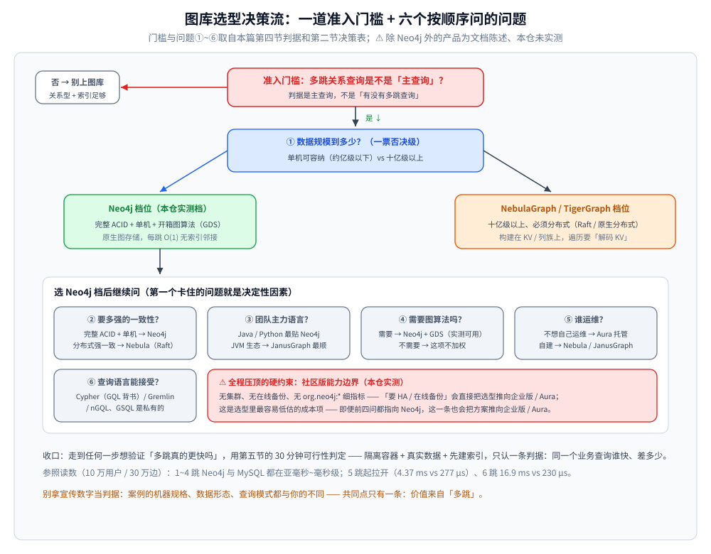
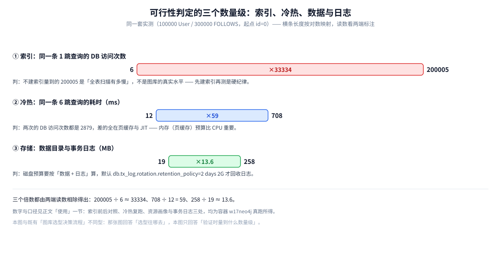

# 选型与落地案例

> Neo4j / NebulaGraph / JanusGraph / TigerGraph 对比、选型决策框架、真实落地案例、
> 不该上图库的场景，以及图库与编程语言生态的契合度。
>
> 内容整理自个人学习笔记。**基础框架**参考《Neo4j 权威指南》与各家官方文档；
> **产品对比与落地案例**为公开资料整理，⚠️ **除 Neo4j 外的产品本仓均未实测**（无对应实例），
> 相关数字与结论请以各家官方文档和自家实测为准。
>
> ⚠️ **实测口径**：**Neo4j 的结论来自本仓实测**（Docker `neo4j:5.26-community` / 内核 5.26.31，
> 10 万用户 / 30 万关注边，对照 Docker `mysql:8.0` 同构图）；**其余三个产品的特性为文档陈述**。
>
> 📎 **2026-10-17 复核口径**：另起隔离容器 `w17neo4j`（4 核 / 5.9 GB 内存，`heap 1G + pagecache 512M`），
> 用 `LOAD CSV … IN TRANSACTIONS OF 20000 ROWS` 导入 **100000 User / 300000 FOLLOWS**（出度恒为 3、种子固定可复现）
> 后重跑一遍可行性判定。该轮实测得到：**存储密度为每节点 15 B、每关系 34 B**；
> **索引前后 200005 → 6 次 DB 访问**；**冷启动 708 ms vs 热态 12 ms**；
> **导入后事务日志 258 MB ≈ 数据目录 19 MB 的 13.6 倍** —— 读数与命令见「使用」一节。
> ⚠️ 该轮用 `cypher-shell` 采集（时间列为整数毫秒），与本篇既有那组
> **Go 驱动直读 `Profile()` 的微秒级读数不是同一套工具**，两套数字不要混用；
> 可跨轮比较的只有**可达节点数**与 **DB 访问次数**这类确定性量。

---

## 一、主流产品怎么对比？

**本节要点**：四家图库的**根本差异在存储** —— **原生图存储**（Neo4j / TigerGraph）
vs **构建在 KV / 列族之上**（NebulaGraph 的 RocksDB、JanusGraph 的 Cassandra / HBase）。
存储选型决定了它们各自擅长的规模与代价。

| 维度 | **Neo4j** | **NebulaGraph** | **JanusGraph** | **TigerGraph** |
|---|---|---|---|---|
| 定位 | 原生图库，**生态最成熟** | 分布式原生图库 | 可插拔后端的图库 | 原生分布式图分析 |
| 许可 | **GPLv3**（社区版）/ 商业许可（企业版、Aura） | **Apache 2.0** | **Apache 2.0** | 商业闭源 |
| 存储 | **原生图存储**（记录 + 指针） | 自研 KVStore（RocksDB） | Cassandra / HBase 之上 | 原生分布式 |
| 查询语言 | **Cypher**（已覆盖 GQL 大部分） | nGQL | Gremlin（TinkerPop） | GSQL |
| 分布式 | 因果集群 / 新架构 | Shared-nothing + Raft | 依赖后端 | 原生分布式 |
| 事务 | 完整 ACID | 强一致（Raft） | 取决于后端 | ACID |
| 图算法 | **GDS**（独立引擎） | 内置部分算法 | 需外挂 | 内置 GSQL 图分析 |
| 适用规模 | **中小规模、单机为主** | 千亿点万亿边 | 大规模 | 大规模 |

⚠️ **三条读表要点**：

1. **"原生图存储"是 Neo4j 的立身之本，也是它的单机天花板** ——
   记录号 × 定长寻址天然是单机模型（见 [架构与存储引擎.md](架构与存储引擎.md) 与
   [因果集群与高可用.md](因果集群与高可用.md)）；要上十亿级就得换架构。
2. **"构建在 KV 上"是分布式图库的通用手法**：把邻接关系编码成 KV 对，直接继承后端存储的
   水平扩展与容错 —— 代价是**遍历要"解码 KV"**，多跳时不如原生指针直接。
   ⚠️ 本仓实测的"每跳 O(1) 无索引邻接"结论**只属于原生图存储**，不能套到 JanusGraph / NebulaGraph 上。
3. **查询语言决定生态与迁移成本**：Cypher 有 GQL 标准背书，Gremlin 是 TinkerPop 通用语言，
   nGQL / GSQL 是各自私有的 —— 换产品往往意味着**重写查询**。
4. **许可不是打分项，而是准入项**：四家里**两家 Apache 2.0、一家 GPLv3、一家闭环商业**。
   Neo4j 社区版的 GPLv3 只在**分发**时才产生传染性 —— 服务端自用、SaaS 内部使用通常不受影响，
   但**把图库嵌进要交付给客户的产品**（私有化交付、随镜像分发的应用）就必须先过法务。
   ⚠️ 许可以各产品当期 `LICENSE` 为准，此处不是法律意见，只作为**选型时要主动确认的一项**。

---

## 二、选型决策该按什么顺序问？

**本节要点**：按**数据规模 → 一致性 → 团队栈 → 运维形态**的顺序问，第一个卡住的点就是决定性因素。
⚠️ 别一上来比性能 —— 规模不够时，性能差异根本不是瓶颈。

| 顺序 | 问题 | 判据与去向 |
|---|---|---|
| ① | **数据规模到多少？** | 单机可容纳（约亿级以下）→ **Neo4j**；十亿级以上 → **NebulaGraph / TigerGraph** |
| ② | **要多强的一致性？** | 完整 ACID + 单机 → Neo4j；分布式强一致 → NebulaGraph（Raft） |
| ③ | **团队主力语言是什么？** | 见第五节「契合语言」—— 驱动成熟度决定上手成本 |
| ④ | **需要图算法吗？** | 需要 → **Neo4j + GDS**（本仓实测可用）；不需要 → 这项不加权 |
| ⑤ | **谁运维？** | 不想自己运维 → **Aura**（托管）；自建 → NebulaGraph / JanusGraph |
| ⑥ | **查询语言能不能接受？** | 认 Cypher → Neo4j；认 Gremlin → JanusGraph；认 nGQL → NebulaGraph |

⭐ **一句话决策树**：

```text
关系网是不是"主查询"？
  ├─ 不是 → 别上图库，用关系型 + 合适的索引
  └─ 是 → 规模多大？
            ├─ 亿级以下、要 ACID、要图算法 → Neo4j（本仓这个档位）
            └─ 十亿级以上、要分布式 → NebulaGraph / TigerGraph
```



决策流程图把上面第二节的六问表展开成带去向的路线：**先问准入门槛**（多跳是不是主查询，一票否决），
**再问规模①**（第一个卡住的点就是决定性因素），**②~⑥ 在 Neo4j 档位内继续收窄或分流到其余三家**。
注意"社区版能力边界"画在图里不是第七问，而是**全程压顶的约束**——要 HA / 在线备份时，
即便前四问都指向 Neo4j 社区版，答案也会被改写成企业版 / Aura。

⚠️ **一个常被忽略的约束：社区版能力边界**。本仓实测 Neo4j 社区版
**无集群、无在线备份、无 `org.neo4j:*` 细指标**（见 [因果集群与高可用.md](因果集群与高可用.md) 与
[运维与调优.md](运维与调优.md)）。所以"要 HA 或在线备份"这件事**会直接把选型推向企业版 / Aura**
—— 这是选型里最容易低估的成本项。

2026-10-17 的复核把这三条落到了**命令级证据**（原文见「使用」一节）：`CREATE DATABASE` 与 `SHOW SERVERS`
都返回 `Unsupported administration command`；`neo4j-admin database --help` 的子命令只有
`check / dump / import / info / load / migrate / upload`，**根本没有 `backup`**，而 `dump` 必须停机
（在线跑报 `The database is in use`）；5.26 发行版里**不存在任何 `metrics` / `prometheus` 设置项**
（写 `server.metrics.enabled` 会被严格校验直接拒启），2004 端口默认存在但 `GET /metrics` 返回空 body。

⭐ **表外还有一个前置约束：许可与合规**。它和"社区版能力边界"一样**不参与打分** ——
技术全对、许可不合适，方案照样推倒重来。所以在走完六问之后、动手做 PoC 之前，先确认三件事：
① 产品是**服务端自用**还是**随产品分发**；② 团队能不能接受 **GPLv3**（Neo4j 社区版）；
③ 项目是否要求**商业 SLA / 官方支持**。任一条答"不能接受"，选型就已经离开第一列
（对应第一节表格的"许可"行）。

---

## 三、哪些真实场景落了地？

**本节要点**：图库的价值集中在**"关系是主查询"**的场景：反欺诈、社交、安全、知识图谱。
⚠️ 以下案例数字来自**公开资料与官方宣传**，**本仓未验证**，仅作方向参考。

| 产品 | 场景 | 公开资料中的说法 |
|---|---|---|
| **Neo4j** | 金融反欺诈 | 关联交易 / 团伙识别，公开案例称显著降低欺诈率 |
| **Neo4j** | 社交网络 | 支撑到**百亿级节点**的公开案例 |
| **Neo4j** | 网络安全 | 攻击路径 / 资产关系分析 |
| **Neo4j** | 医疗知识图谱 | 疾病-症状-药物关系推理 |
| **NebulaGraph** | 携程酒店风控 | 风控关系网，分布式规模 |
| **NebulaGraph** | 美团图平台 | 多业务线共用的图平台 |
| **JanusGraph** | 跨国金融对账 | 公开案例提到十亿级边、日均千万级交易 |

⭐ **从案例里能提炼的共同点**（比具体数字更值得记）：

- **价值都来自"多跳"**：反欺诈是"你和他隔着几层关系"，安全是"从入口到目标的路径"，
  知识图谱是"实体间的推理链" —— 全是**多跳关系查询**，这正是图库的主场；
- **都伴随"关系数据量远超实体量"**：少数实体、海量关系，用关系型要不断 JOIN，用图库是顺遍历；
- **规模差异体现在架构上**：单机案例（Neo4j）与分布式案例（NebulaGraph）的分界，
  基本上就是**数据规模有没有过单机容量**这条线。

⚠️ **别拿宣传数字当自己的判据**：案例的机器规格、数据形态、查询模式都与你的不同。
**正确做法是拿自己的数据做一次可行性验证**（见下方"使用"一节）。

---

## 四、哪些场景不该上图数据库？

**本节要点**：图库**不是万能存储**。凡是"关系不是主查询"的场景，关系型 / 文档 / 列式 / 时序
都比图库合适 —— 上图库只会徒增组件与运维成本。

| 不该用图库的场景 | 为什么 | 该用什么 |
|---|---|---|
| **大量简单 CRUD** | 图库的优势在遍历，不在点查 | 关系型（本仓实测点查走索引 `dbHits=2`，图库并不更快） |
| **全表扫描 / 全库聚合** | 图库不擅长"扫全部再聚合" | 列式（ClickHouse 一类） |
| **BI 宽表、大批量报表** | 这是列存主场 | 列式 / 数据仓库 |
| **日志、时序、海量写入** | 写吞吐与时序聚合是时序库主场 | 时序库（InfluxDB 等） |
| **关系不重要、就是存对象** | 文档模型天然贴合 | 文档型（MongoDB） |
| **几万行的小数据** | 关系型绰绰有余，引入图库是过度设计 | 关系型 |

⚠️ **本仓实测给出的两条"别硬上"的硬证据**：

- **图库的"快"是有条件的**：本仓多跳遍历（6 跳 1086 个可达节点 / 2550 `dbHits`）确实快，
  但对 MySQL 的差距**只在跳数足够多时才拉开**（1~4 跳 MySQL 也是亚毫秒到毫秒级）。
  换句话说：**跳数少、数据小的时候，图库换来的加速不足以抵消新组件的成本**。
- **图算法不是免费的**：本仓 `nodeSimilarity` 在 10 万点上**跑不完**（见
  [GDS图算法实战.md](GDS图算法实战.md)），必须限候选 —— 别把"有算法"当成"算法随便用"。

⭐ **判据总结**：**"多跳关系查询是不是主查询"是唯一的准入门槛**。
是 → 值得评估图库；不是 → 关系型 + 索引（+ 缓存 + 分片）就够了。
决策清单见 [数据库选型对比.md](../../数据库选型对比.md) 第八节。

---

## 五、和编程语言生态怎么契合？

**本节要点**：选型落地时的隐形门槛是**驱动成熟度**。图库的官方驱动质量差异很大，
直接决定"接进去要多久、踩多少坑"。

| 语言 | Neo4j | NebulaGraph | JanusGraph | TigerGraph |
|---|---|---|---|---|
| **Java** | ⭐ 官方驱动成熟（Spring Data Neo4j） | 官方 Java 客户端 | ⭐ **最贴**（TinkerPop 就是 JVM 生态） | 官方 Java 客户端 |
| **Go** | ⭐ 官方驱动（本仓用 `neo4j-go-driver/v5` 实测） | ⭐ 官方 Go 客户端 | 走 Gremlin 协议，较弱 | 官方 Go 客户端 |
| **Python** | ⭐ 官方驱动 + **`neo4j-graphrag-python`** | 官方客户端 | 走 Gremlin，较弱 | 官方客户端 |
| **JavaScript** | ⭐ 官方驱动 | 官方客户端 | 走 Gremlin，较弱 | 官方客户端 |
| **PHP** | 社区驱动（无官方）；也可直接走 Bolt / HTTP | 社区驱动 | 弱 | 弱 |

⭐ **三条结论**：

1. **Java 与 Python 是 Neo4j 最舒服的两条路**：Java 有 Spring Data Neo4j，Python 有官方 GraphRAG 库
   （见 [向量索引与GraphRAG.md](向量索引与GraphRAG.md)）；
2. **Go 这边 Neo4j / NebulaGraph 都有官方驱动，够用**（本仓全程用 Go 驱动实测，
   见 [Cypher查询与执行计划.md](Cypher查询与执行计划.md) 的 `Profile()` 用法）；
3. **JanusGraph 是"Java 优先"**：它的 TinkerPop / Gremlin 生态在 JVM 上最顺，
   非 JVM 语言接入会明显更吃力。

⚠️ **反面教训（本仓实测踩到）**：驱动 API 的**版本差异**本身就会消耗时间 ——
本仓写 Go 驱动示例时，`ProfiledPlan` 的访问器在 v5.28 里是**方法**（要加括号）、
`Plan` 没有 `Root()`、`dbHits` 只在 `Profile()` 结果上而不在 `Plan()` 上（详见
[Cypher查询与执行计划.md](Cypher查询与执行计划.md) 的踩坑表）。
**所以选型时要把"驱动的版本活跃度"算进去**：冷门语言的驱动往往滞后于服务端能力。

---

## 六、除了这四家，还有哪些候选？

**本节要点**：本篇的对比表只覆盖**四家**。如果它们都不合适，还有一批"第四种选择" ——
⚠️ **它们全部不在本仓实测范围内**，下面只给**定位与风险提示**，数字与细节请查各家官方文档。

| 候选 | 定位 | 与四家的差异点 | ⚠️ 风险提示 |
|---|---|---|---|
| **AWS Neptune** | 云托管图库（属性图 + RDF 两套 API） | 不自己运维；OpenCypher / Gremlin / SPARQL 都能用 | 绑定云厂商，迁出成本高 |
| **ArangoDB** | 多模型（文档 + 图 + KV 同一引擎） | 一套引擎同时承担图与文档 | 图侧规模与图算法生态不如专用图库 |
| **Memgraph** | 内存优先、Cypher 兼容 | 兼容 Cypher；自带流式导入（Kafka） | 内存成本高，生态与工具链小 |
| **Kuzu** | 嵌入式图库（跑在进程里） | 类似"图库里的 SQLite"，无独立服务端 | 单机、偏分析场景，不适合当在线主库 |
| **各云厂商图库**（阿里云 GDB 等） | 云托管 | 与云上其他服务打通 | 同样是云绑定；能力随厂商路线演进 |
| **RedisGraph** | ⚠️ **已停止维护** | —— | ⭐ 见下 |

⭐ **从 RedisGraph 停更学到的那一课**：图能力如果只是**宿主产品的一个模块**（Redis 模块、某数据库的插件），
它的存亡就跟着宿主的产品线走 —— 当年"顺手用现成组件、少一个中间件"的选择，最后会变成一次数据迁移。
**判据**：把"这个图库（或模块）**自己的**发布节奏、版本支持周期与迁移工具"当成选型维度，
而不是只问"我的技术栈里是不是已经有它"。

⚠️ 本节内容为公开资料整理，**本仓无对应实例、未做任何验证**；产品能力迭代很快，动手前先看当期官方文档。

---

## 使用：给一个场景做 30 分钟的可行性判定

**本节要点**：选型讨论最怕"纸上谈兵"。用**最小成本**验证"多跳查询是否真的更快"，
判据只有一条 —— **同一个业务查询，图库和现有方案谁快、差多少**。
下面是 2026-10-17 在本机**真跑一遍**的六步流程，每步都写明"该量什么、量到多少算正常"。

**第 1 步 · 起一个隔离容器（就绪约 35 秒）**

```bash
# 本仓口径：不碰任何既有实例；专用前缀 + 收尾只 stop 不 rm
docker run -d --name neo4j-bench -p 7687:7687 -p 7474:7474 \
  -e NEO4J_AUTH=neo4j/test123 -e NEO4J_server_memory_heap_max__size=1G \
  neo4j:5.26-community
```

```text
本仓实测：容器首启 → cypher-shell 能 RETURN 1 = 35.0 秒；停机后重启 → 就绪 = 25.1 秒。
```

**第 2 步 · 把业务样本导进去（顺手记下导入耗时）**

```cypher
// 节点、关系各一份 CSV，放在容器 import/ 目录下；分批提交避免单事务过大
LOAD CSV WITH HEADERS FROM 'file:///users.csv' AS row
CALL { WITH row CREATE (:User {id: toInteger(row.id)}) } IN TRANSACTIONS OF 20000 ROWS;

LOAD CSV WITH HEADERS FROM 'file:///follows.csv' AS row
CALL { WITH row MATCH (a:User {id: toInteger(row.from)}), (b:User {id: toInteger(row.to)})
       CREATE (a)-[:FOLLOWS]->(b) } IN TRANSACTIONS OF 20000 ROWS;
```

```text
本仓实测（100000 User / 300000 FOLLOWS，4 核容器）：
  建节点 11.22 s ｜ 建索引 4.40 s ｜ 建关系 21.32 s（≈ 1.4 万边/秒）
⚠️ 计时含 cypher-shell 连接开销，只作数量级参考；换机器、换数据形态都会变。
⚠️ 建关系前必须先建索引（见第 3 步），否则每行都要全表扫描，300000 行会跑到不可用。
```

**第 3 步 · 先建索引，再跑那条多跳查询**

```cypher
// 关键：先给起点建索引（否则测出来的是全表扫描，不是图库的真实水平）
CREATE INDEX user_id IF NOT EXISTS FOR (u:User) ON (u.id);
CALL db.awaitIndexes(300);   // 索引是后台建的，等它 ONLINE 再测

// 多跳遍历（把跳数当参数，1~4 跳各测一遍）
PROFILE MATCH (u:User {id: 0})-[:FOLLOWS*1..3]->(x)
RETURN count(DISTINCT x);
```

```text
本仓实测参照（10 万用户 / 30 万关注边，起点 id=0）：
  跳数  Neo4j 结果 / dbHits / 耗时         MySQL 递归 CTE
  1     3      / 6      / 221 µs           3     / 0.073 ms
  2     12     / 30     / 253 µs           12    / 0.078 ms
  3     39     / 93     / 265 µs           39    / 0.348 ms
  4     120    / 282    / 348 µs           120   / 0.418 ms
  5     363    / 849    / 277 µs           363   / 4.37 ms
  6     1086   / 2550   / 230 µs           1087  / 16.9 ms
> ⚠️ 时序类读数有波动，只断言趋势；差 1 个节点是两边边数差 2 条所致（非 bug）
```

**第 4 步 · 补一组"索引前 vs 索引后"对照（最容易被跳过的一步）**

```cypher
// 同一容器里把索引删掉再跑一遍同一条查询，看"全表扫描"与"索引 seek"差多少
DROP INDEX user_id IF EXISTS;
CALL db.awaitIndexes(300);
PROFILE MATCH (u:User {id: 0})-[:FOLLOWS*1..1]->(x) RETURN count(DISTINCT x);
```

```text
本仓实测（cypher-shell 口径，同一份数据，只差一个索引）：
  1 跳：有索引   6 次 DB 访问（NodeIndexSeek 2 + VarLengthExpand 4）
        无索引 200005 次（NodeByLabelScan 100001 + Filter 100000 + 展开 4）—— 相差 ≈ 33334 倍
  6 跳：有索引 2879 次 ｜ 无索引 202878 次（可达节点两边都是 1085 个）
⭐ dbHits 的增长跟着**新增可达节点数**走（≈ 每节点 2.65 次访问），与跳数无关；
   "没索引"那组里的 200005 是个常数项 —— 量到它就说明你测的不是图库。
```



图把三组倍数并排放在一起：**索引前后 ≈ 33334 倍**（第 4 步）、**冷热 ≈ 59 倍**与
**数据与日志 ≈ 13.6 倍**（第 5 步），横条按对数映射。

**第 5 步 · 量资源：内存、存储，以及两种"冷"**

```bash
# 稳态内存 / CPU
docker stats --no-stream
# 存储：先确认"数据目录里到底有没有数据"
docker exec neo4j-bench sh -c 'du -sh /data/databases/neo4j /data/transactions/neo4j; \
  ls -l /data/databases/neo4j/neostore.nodestore.db'
```

```text
本仓实测（100000 节点 / 300000 关系 / 1 个范围索引）：
  存储密度  节点 15 B/个（nodestore 1507328 B）、关系 34 B/个（relationshipstore 10240000 B）
            + 每节点 1 个整型属性（propertystore 4120576 B）
  数据目录  19 MB（含索引）；事务日志 258 MB（单文件 268435456 B ≈ 256 MiB），258 ÷ 19 ≈ 13.6
  日志回收  看 db.tx_log.rotation.retention_policy，默认 2 days 2G —— 导入完不会立刻回收
  内存      docker stats 稳态 451.3 MiB（导入期峰值 1.137 GiB）；配置 heap 1G + pagecache 512M
  冷热      同一条 6 跳查询：重启后首跑 708 ms → 第二次 31 ms → 稳态 12 ms（DB 访问恒为 2879）
⚠️ 坑：**不重启就去 du 数据目录，量到的 nodestore 是 0 字节、整个目录只有 2.9 MB** ——
   导入的数据这时还压在事务日志与页缓存里，store 要等 checkpoint（重启容器触发 checkpoint / 启动恢复、日志轮转）才落地。
   停机重启后再量才是上面的 19 MB。**量存储前先重启一次容器**，
   否则会得出"图库几乎不占空间"的错误结论。
```

**第 6 步 · 收尾：停掉隔离实例（只 stop，不 rm）**

```bash
docker stop neo4j-bench   # 只 stop 自己创建的，不 rm，便于复跑
```

⭐ **判据表**：

| 观察 | 判 |
|---|---|
| 1~3 跳两边**差不多快** | 图库优势**还不明显** —— 别急着迁，继续看更深的跳数 |
| 跳数一大，现有方案**明显塌方**（本仓 MySQL 6 跳是 5 跳的 4 倍） | **多跳真的是主查询** → 图库值得投入 |
| 现有方案的查询**本身就是 JOIN 串** | 图库可能天然更贴合（模式匹配 vs 连表） |
| 瓶颈在**写吞吐 / 全库聚合** | 图库解决不了 —— 该换列式 / 时序（第四节） |
| 只有个位数跳、数据也不大 | **别上图库** —— 关系型 + 索引足够（第四节） |
| **无索引那组的 dbHits 是个常数项**（本仓 200005） | 你没在测图库 —— 先建索引、等它 `ONLINE` 再测（第 4 步） |
| **冷启动首跑比稳态慢一个数量级**（本仓 708 ms vs 12 ms） | 别拿首跑数字当容量判据；页缓存没热时，读数代表"最坏情况"（第 5 步） |

⚠️ **验证五条纪律**：

1. **一定用真实数据和真实查询**，不要用"官方基准" —— 图库性能对**数据形态**极其敏感；
2. **先建索引再测，并等索引 `ONLINE`**：没索引测出来的是"全表扫描有多慢"，不是图库的真实水平；
3. **分清两种"冷"**：页缓存冷（重启后首跑）与 JIT 冷都叠在首跑里，报读数必须说明是第几次跑的；
4. **量存储前先重启一次容器**（触发 checkpoint / 启动恢复），否则量到的是 0 字节 store + 几百 MB 事务日志；
5. **验证完记得停掉隔离实例**：`docker stop neo4j-bench`（本仓收尾纪律：只 stop 自己创建的，
   **不 rm**，便于复跑）。

---

## 延伸追问

- **Neo4j 和 NebulaGraph 怎么选？**
  → 核心分界是**规模与一致性模型的组合**：**单机可容纳、要完整 ACID、要开箱的图算法** → Neo4j；
  **十亿级以上、必须分布式、可接受 nGQL** → NebulaGraph。
  更实际的一条判据是**团队现有栈**：已有大量 Cypher / 图算法经验就用 Neo4j，
  已有分布式 KV 运维能力（RocksDB / Raft 那一套）再考虑 NebulaGraph。
  ⚠️ 别忘了**社区版能干什么**：本仓实测 Neo4j 社区版无集群 / 无在线备份 ——
  要 HA 就直接对比**企业版 / Aura** 的成本，而不是拿社区版比。
- **图数据库能替代关系型吗？**
  → **不能，也不该**。关系型的强项是"强事务 + 表结构 + 报表 + 生态与人才"，
  这些图库都不占优；图库只在**多跳关系查询**这一个维度上反超。
  现实中的正确姿势是**并存**：关系型做权威源，图库做关系网的**查询副本 / 分析引擎**
  （和"权威源 + 检索副本"是同一种架构思路，见 [数据库选型对比.md](../../数据库选型对比.md) 第七节）。
- **什么场景图数据库反而不如关系型？**
  → ①**点查/CRUD**（关系型走 B+ 树索引，本仓实测 Neo4j 索引 seek 的 `dbHits=2`，
  图库在这件事上并不更快）；②**全库聚合 / 报表**（列存才是主场）；
  ③**小数据量**（几万行用关系型绰绰有余，引入图库是过度设计）；
  ④**关系不是主查询**（那图库的多跳优势根本用不上）。
  ⭐ 一句话：**图库是"关系网专用武器"，不是通用数据库的替代品。**
- **怎么判断"多跳"是不是我的主查询？**
  → 看**读路径**：如果核心接口需要"沿着关系走 3 跳以上"，或查询本身是"关系链"（三度人脉、
  资金链路、攻击路径、推荐路径），多跳就是主查询；如果核心接口都是"按主键取一条 + 关联两三张表"，
  多跳就不是。⚠️ 判据是**主查询**，不是"有没有多跳查询" —— 一个系统里偶尔有一条多跳查询，
  不足以支撑引入图库。
- **图库的运维成本到底有多高？**
  → 三块：**①组件本身**（单机好办，集群就贵）；**②数据同步**（关系型 → 图库要建管道，
  见 [数据库选型对比.md](../../数据库选型对比.md) 第七节的同步方式）；**③人才**（图建模与 Cypher 要学，
  排查手段与关系型不同 —— 本仓的"小世界 / 规则图 / 页缓存"这些直觉都靠实测建立）。
  ⚠️ 这也是为什么第四节反复强调**"多跳是不是主查询"是唯一准入门槛** ——
  门槛不够高，运维成本就收不回来。
- **GPLv3 会不会成为一票否决？**
  → 只在**分发**时才会。三种情形要分清：① **服务端自用**（含 SaaS 内部使用）通常不触发传染性，
  社区版照用；② **随产品交付给客户**（私有化部署、随镜像分发）就必须先过法务 ——
  解法是三选一：买企业版商业许可 / 换 Apache 2.0 的 NebulaGraph / 把图库留在服务端、不随产品分发；
  ③ 要求**官方 SLA 支持** → 直接进企业版 / Aura 的成本对比。
  ⚠️ 条款以各产品当期 `LICENSE` 为准，此处只提醒"选型时要主动确认"。
- **PoC 的读数怎么外推成容量规划？**
  → 用**与规模无关的那几个密度**去乘。本仓实测的三个密度是：**节点 15 B/个**、
  **关系 34 B/个**、**每节点 1 个整型属性还需 ≈ 41 B**；100000 节点 / 300000 关系对应数据目录 19 MB ——
  按这个密度线性外推，**1 亿节点 + 3 亿关系 ≈ 19 GB**（不含索引与日志）。
  再叠两块：**事务日志**（导入期 258 MB，是数据目录的 13.6 倍，默认 2 days 2G 才回收）与
  **导入速率**（≈ 1.4 万边/秒，300000 边 21.32 s），迁移窗口按这个速率估。
  ⚠️ 外推只保量级；真上生产前，务必用自家数据再测一遍。
- **批量导入后磁盘为什么涨得比数据多？**
  → 因为**数据先落事务日志，store 要等 checkpoint 才落地**。本仓实测：导入了 19 MB 的数据，
  事务日志先涨到 258 MB（单文件 256 MiB），而此刻 `du` 数据目录只有 2.9 MB、nodestore 是 **0 字节**；
  停机并重启（触发 checkpoint / 启动恢复）之后，nodestore / relationshipstore 才变成 1507328 B / 10240000 B。
  两个动作值得写进运维手册：① 量存储前先重启一次；② 导入后确认日志回收策略
  （`db.tx_log.rotation.retention_policy`，默认 `2 days 2G`）。

---

## 关联

- [README.md](README.md) — 本目录导读：版本坐标与阅读顺序
- [架构与存储引擎.md](架构与存储引擎.md) — "原生图存储"为什么决定了 Neo4j 的单机模型与规模上限
- [因果集群与高可用.md](因果集群与高可用.md) — 要 HA 就得看企业版 / Aura，社区版无集群
- [GDS图算法实战.md](GDS图算法实战.md) — 图算法能力是选型时 Neo4j 的优势（也是成本项）
- [向量索引与GraphRAG.md](向量索引与GraphRAG.md) — 向量 + GraphRAG 能力如何进入选型考量
- [运维与调优.md](运维与调优.md) — 社区版 / 企业版的能力差异与运维成本
- [数据建模与导入.md](数据建模与导入.md) — 选型落地后的建模与数据迁移
- [数据库选型对比.md](../../数据库选型对比.md) — 全仓存储选型总表与"一套系统各存各的"组合范式
- [关系数据存储.md](../../存储架构与场景/形态篇/关系数据存储.md) — 对照面：关系型在点查 / 事务 / 报表维度上的强项
- [关注粉丝设计.md](../../../../04-架构与系统/系统设计/社交互动系统/关注粉丝设计.md) — 关系链在关系型 / Redis / 图库之间的真实取舍
> 反向引用（本篇被下列文档引到）：[图数据库选型对比.md](../图数据库选型对比.md)
