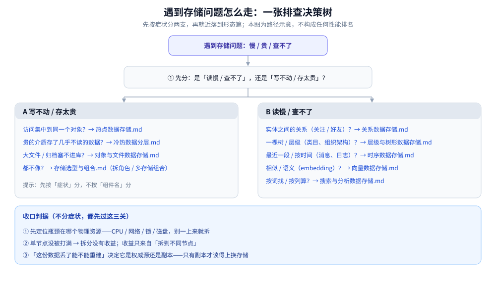

# 存储架构与场景

> 本目录收「**跨场景的存储形态**」：不写单个组件的参数，也不写某一道场景题的推导，
> 只回答**这一类数据、这一类问题通用怎么存**——判据是什么、代价落在哪。
>
> 内容整理自个人学习笔记，素材见 [素材清单](../../../素材清单.md)。

---

## 一、本目录的结构

```text
存储选型与组合.md    ⭐ 总纲：五种数据角色 + 为什么一个系统不可能只用一种存储 + 分工 + 冷热 + 同步

形态篇/（一类数据怎么存）
关系数据存储.md        有向 / 无向边、双索引、分片键、推拉与大号、多跳门槛
层级与树形数据存储.md  邻接表 / 路径枚举 / 嵌套集 / 闭包表、深递归与环、何时其实是图
时序数据存储.md        只追加、三种载体、有界 N、游标分页、多路归并、乱序与水位线
向量数据存储.md        高维无全序、四种 ANN 结构、向量 + 标量过滤、量化与内存换算
对象与文件数据存储.md  大 / 不可变 / 整存整取、对象存储 vs 文件系统、生命周期、直传
搜索与分析数据存储.md  倒排与列式两种物理组织、派生副本的延迟、聚合三种口径

横切篇/（一类问题怎么解）
热点数据存储.md        访问集中：三种成因、拆 key 的收益边界、热点行、探测与合并写
冷热数据分层.md        边界按访问分布定、三种下沉策略、统一查询层与限频回填、合规删除
```

## 二、按需求进

| 你要解决的问题 | 从哪读 |
|---|---|
| 「一个系统里数据该分几种角色、要不要拆多种存储」 | [存储选型与组合.md](存储选型与组合.md)（一篇读完） |
| 「关注 / 好友这类关系怎么存、要不要上图库」 | [关系数据存储.md](形态篇/关系数据存储.md) |
| 「组织架构 / 商品类目 / 评论楼中楼这类层级怎么存」 | [层级与树形数据存储.md](形态篇/层级与树形数据存储.md) |
| 「消息历史 / 时间线 / 日志这类只追加的数据怎么存」 | [时序数据存储.md](形态篇/时序数据存储.md) |
| 「向量 / embedding 这类数据怎么存、怎么按相似度找」 | [向量数据存储.md](形态篇/向量数据存储.md) |
| 「图片 / 视频 / 附件 / 归档这些大文件怎么存」 | [对象与文件数据存储.md](形态篇/对象与文件数据存储.md) |
| 「按词检索、按列做分析的数据怎么存」 | [搜索与分析数据存储.md](形态篇/搜索与分析数据存储.md) |
| 「某个对象 / 某个 key 太热了怎么办」 | [热点数据存储.md](横切篇/热点数据存储.md) |
| 「哪些数据该进内存、哪些该下沉」 | [冷热数据分层.md](横切篇/冷热数据分层.md) |
| 「某个具体组件该选谁」（B+Tree / LSM / 跳表…） | 族目录：[关系型/](../关系型/关系型选型对比.md)、[NoSQL/](../NoSQL/NoSQL选型对比.md)、[缓存/](../缓存/缓存选型对比.md)…… |
| 「这道具体场景题的数据怎么放」 | [系统设计](../../../04-架构与系统/系统设计/README.md) 下各专题的 `存储全景.md` |

## 三、遇到问题先走这张排查树

上面的表是**静态索引**（知道自己要找什么，直接查表）；如果只是「哪里不对、但不知道从哪下手」，就先走这张**动态排查树**——先分症状，再定位瓶颈，最后落到对应的形态篇。



图怎么读：入口是「慢 / 贵 / 查不了」，第一刀按**症状**分成左右两支——左支是**写不动 / 存太贵**（访问集中 → 热点篇；贵的介质存了几乎不读的数据 → 冷热篇；大文件 / 归档塞不进库 → 对象与文件篇；都不像 → 组合总纲），右支是**读慢 / 查不了**（关系 → 关系篇；层级 → 层级与树形篇；最近一段 / 按时间 → 时序篇；相似 / 语义 → 向量篇；按词找 / 按列算 → 搜索与分析篇）。底部三关不分症状都要过：**先定位物理瓶颈、再看单点是否被打满、最后用「丢了能不能重建」判它是权威源还是副本**。图里的判据抄自各形态篇正文，不给阈值数字。

## 四、与相邻目录的分工

| 目录 | 关系 |
|---|---|
| [数据存储/](../) 下的**族目录**（关系型 / NoSQL / 缓存 / 对象存储…） | 那边讲**某个组件**的原理、参数与族内选型；本目录讲**跨组件**的形态与组合 |
| [数据库选型对比.md](../数据库选型对比.md) | **跨族横评**：七类存储选哪一类；本目录接着回答「选完怎么组合」 |
| [系统设计/](../../../04-架构与系统/系统设计/README.md) | 那边是**一道场景题的推导**（各专题的 `存储全景.md`）；本目录是这些题里**反复出现的那一层**——通用版在这里，实例在那边 |

⭐ 一句话分清：**组件怎么配**看族目录，**这类数据怎么存**看本目录，**这道题怎么设计**看系统设计。

## 延伸追问

- **本目录和族目录会不会重复？** → 不会。族目录回答「用哪个产品、它内部怎么工作」，本目录回答「这类数据该怎么组织、放哪、要不要拆」；同一话题两边各取一层，互引不重复。
- **为什么总纲放在这里，而不是留在系统设计？** → 总纲讲的是**跨场景**的判据，不是某一道题的推导；按分层它属于「存储」，场景题只是消费它。
- **这些形态篇要不要配实测？** → 形态与判据不依赖读数。篇内引用的读数都来自具体场景篇的本机实测，并已标明出处。
- **排查树和「按需求进」表该用哪个？** → 知道要找什么就查表（静态索引），只知道「哪里不对」就走树（动态路径）；两者入口不同、终点相同，最后都落到某一篇。

## 关联

- [存储选型与组合.md](存储选型与组合.md) — 本目录总纲：数据角色、多存储组合、冷热与同步
- [关系数据存储.md](形态篇/关系数据存储.md) — 关系这类数据的通用存储形态
- [层级与树形数据存储.md](形态篇/层级与树形数据存储.md) — 父子层级这类数据的四种模型与读写取舍
- [时序数据存储.md](形态篇/时序数据存储.md) — 只追加这类数据的通用存储形态
- [向量数据存储.md](形态篇/向量数据存储.md) — 向量这类数据的近似索引与检索路径
- [对象与文件数据存储.md](形态篇/对象与文件数据存储.md) — 大文件 / 不可变这类数据的存储形态
- [搜索与分析数据存储.md](形态篇/搜索与分析数据存储.md) — 检索副本与分析副本的物理组织
- [热点数据存储.md](横切篇/热点数据存储.md) — 访问集中时的通用处理
- [冷热数据分层.md](横切篇/冷热数据分层.md) — 按访问频率分层的通用形态
- [数据库选型对比.md](../数据库选型对比.md) — 上一层的跨族横评：先选族，再谈组合
- [系统设计/README.md](../../../04-架构与系统/系统设计/README.md) — 这些形态在具体场景题里的实例
- [素材清单.md](../../../素材清单.md) — 素材来源登记
