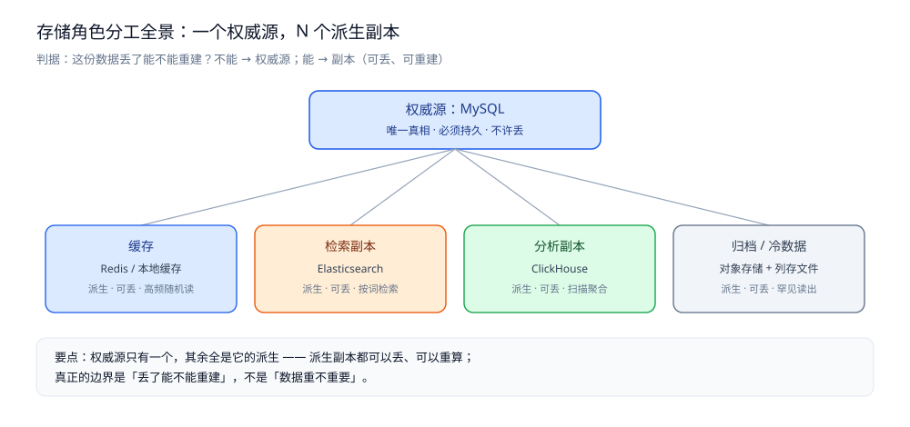
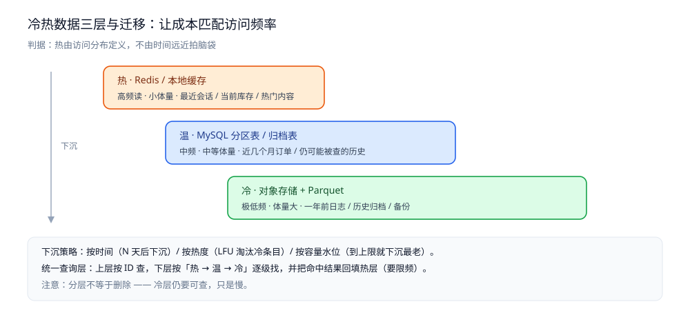
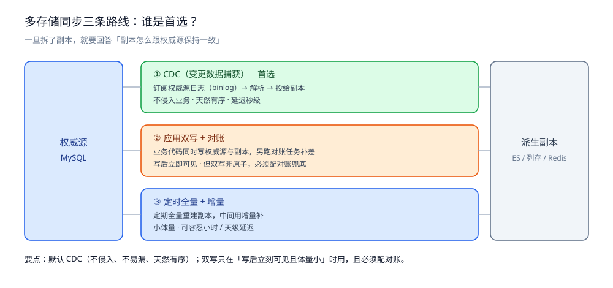
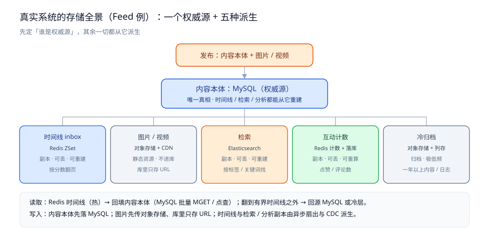

# 存储选型与组合

> 一个系统里的数据不会只有一种角色——它可能有权威源、缓存、检索副本、分析副本、冷归档，
> 每种角色适合的存储不同。本篇先分清角色，再讲为什么一种存储不够、[MySQL](../关系型/MySQL/README.md) 与 [Redis](../NoSQL/Redis/README.md) 怎么分工、
> 什么时候引入第三种、冷热怎么分、多存储之间怎么同步，最后串成一个真实系统的存储全景。
>
> 内容整理自个人学习笔记，素材见 [素材清单](../../../素材清单.md)。

---

## 一、一个系统里数据扮演哪几种角色？

**本节要点**：先别问「用 [MySQL](../关系型/MySQL/README.md) 还是 [Redis](../NoSQL/Redis/README.md)」，先问「这份数据在这个系统里是**什么角色**」。角色决定了它要什么存储性质：是不是唯一真相、能不能丢、按什么方式被读。

### 1.1 五种角色

| 角色 | 它是什么 | 能丢吗 | 主要怎么被访问 | 典型载体                                                                |
|---|---|---|---|---------------------------------------------------------------------|
| **权威源** | 业务数据的**唯一真相**，所有副本都由它派生 | ❌ 不能 | 事务写入、按主键点查 | [MySQL](../关系型/MySQL/README.md)                   |
| **缓存** | 为读加速而存在的**派生副本** | ✅ 能（可重建） | 高频随机读 | [Redis](../NoSQL/Redis/README.md) / 本地缓存          |
| **检索副本** | 为「按词、按属性找」而重建的**倒排副本** | ✅ 能 | 全文 / 条件检索 | [Elasticsearch](../搜索与分析/Elasticsearch/README.md) |
| **分析副本** | 为「大范围聚合」而重建的**[列式](../列式数据库/列式数据库选型对比.md)副本** | ✅ 能 | 扫描 + 聚合、离线 | [ClickHouse](../列式数据库/ClickHouse/README.md)       |
| **归档 / 冷数据** | 低频但仍需留存的历史 | ✅ 能（可再生成） | 罕见读出 | 对象存储 + [列存](../列式数据库/列式数据库选型对比.md) 文件             |

### 1.2 五种角色之间的关系

一句话概括：**权威源只有一个，其余全是它的派生**。

```text
        写（事务）
          │
          ▼
      [ 权威源 MySQL ]  ← 唯一真相
          │
   ┌──────┼───────────────┬────────────────┐
   ▼      ▼               ▼                ▼
[缓存]  [检索副本]     [分析副本]      [归档/冷数据]
 Redis     ES           ClickHouse      对象存储+Parquet
 派生、可丢  派生、可丢      派生、可丢        派生、可丢
```

⭐ **判据**：「这份数据我丢了能不能重建？」

- **不能重建** → 它是**权威源**，必须持久、必须有事务或至少有一致性保障。
- **能重建**（从权威源或其变更日志重算） → 它是**副本**，可以丢、可以按需重建，选型自由度大得多。

> 这条判据能挡掉一大类错误设计：把缓存当唯一数据源、把检索副本当业务真相。



图怎么读：上方居中是唯一的权威源 MySQL（唯一真相 · 必须持久 · 不许丢），下面一排四个盒子——缓存（Redis / 本地缓存）、检索副本（Elasticsearch）、分析副本（ClickHouse）、归档 / 冷数据（对象存储 + 列存文件）——都标着「派生 · 可丢」。看图要抓住底部那句：**真正的边界是「丢了能不能重建」，不是「数据重不重要」**；同一角色还可以分层（本地缓存与 Redis 都属于「缓存」）。

### 1.3 判据小结

| 问题 | 判据 |
|---|---|
| 这份数据是不是权威源？ | 问「丢了能不能从别处重建」→ 不能，就是权威源，必须持久 |
| 副本可以丢吗？ | 可以，但必须有**重建路径**；没有重建路径的副本等于第二个权威源，必然不一致 |
| 一个角色一定要一种存储吗？ | 不一定。同一角色可分层（本地缓存 + [Redis](../NoSQL/Redis/README.md) 都属于「缓存」） |

---

## 二、为什么一个系统不可能只用一种存储？

**本节要点**：不是「想不想用多种」，而是**四个维度天然分裂**——任何单一存储只能在其中几个维度上最优。当相反的要求落到同一个存储上打架时，拆分就是必然。

### 2.1 四个维度的差异

| 维度 | 一端 | 另一端 | 谁擅长哪端                                                                                                                                                                                                |
|---|---|---|------------------------------------------------------------------------------------------------------------------------------------------------------------------------------------------------------|
| **读写模式** | 点查（按主键取一行） | 聚合 / 全文 / 多跳 | [行存](../关系型/关系型选型对比.md) 擅长点查；[列存](../列式数据库/列式数据库选型对比.md) 擅长聚合；[倒排](../搜索与分析/搜索与分析选型对比.md) 擅长全文；[图](../图数据库/图数据库选型对比.md) 擅长多跳 |
| **数据量级** | 热数据（小、常访问） | 冷数据（大、少访问） | [内存](../NoSQL/Redis/README.md) 擅长热；[磁盘 / 对象存储](../NoSQL/MongoDB/README.md) 擅长冷                                                                                   |
| **访问频率** | 高频读 | 低频归档 | [内存](../NoSQL/Redis/README.md) / SSD 擅长高频；[对象存储](../NoSQL/MongoDB/README.md) 擅长低频                                                                                |
| **一致性要求** | 强一致（事务） | 最终一致（副本） | [关系库](../关系型/关系型选型对比.md) 擅长强一致；派生副本通常只要最终一致                                                                                                                                        |

### 2.2 一个存储扛不下时的四种表现

| 表现 | 症状 | 说明 |
|---|---|---|
| **写不动** | 写入成为瓶颈 | 单点写吞吐有限，写放大让它更快到顶 |
| **读太慢** | 复杂查询拖垮在线库 | 分析型扫描与在线点查抢同一份资源 |
| **查不了** | 不支持某类查询 | 关系库做全文检索、多跳遍历都很勉强 |
| **存太贵** | 冷数据占了最贵的内存 | 用内存存几乎不读的历史，成本失控 |

⭐ 关键：**这四种表现没有一种是「换台更强的机器」能根治的** —— 它们来自「一份存储同时服务两种相反的需求」。真正的办法是**按需求把数据拆成不同角色，各放各的存储**。

### 2.3 判据小结

| 问题 | 判据 |
|---|---|
| 要不要拆多种存储？ | 问「同一份数据有没有两种相反的需求」→ 有（点查 vs 聚合、热 vs 冷），就拆 |
| 拆的代价是什么？ | 多一份**一致性负担**：副本要同步、要能重建、要能对账 |
| 什么时候不该拆？ | 量级小、需求单一就别拆。拆存储的第一原则是**需求驱动，不是架构好看** |

---

## 三、MySQL 和 Redis 分别负责什么？

**本节要点**：这是最常见的两件套，但边界经常被弄反——把 [Redis](../NoSQL/Redis/README.md) 当权威源、把 [MySQL](../关系型/MySQL/README.md) 当缓存。一句话记住：**MySQL 存「真相」，Redis 存「真相的衍生品和临时状态」**。

### 3.1 分工对照

| 职责 | [MySQL](../关系型/MySQL/README.md) | [Redis](../NoSQL/Redis/README.md) |
|---|---|---|
| 权威源（唯一真相） | ✅ | ❌ |
| 事务 / 回滚 | ✅ | 有限（Lua 原子，但无回滚） |
| 关系查询 / JOIN | ✅ | ❌ |
| 缓存读加速 | 不做（它就是被缓存的一方） | ✅ |
| 计数器（点赞 / 库存 / 未读） | 勉强（行锁竞争） | ✅ |
| 有序集合（榜单 / 时间线 / 延迟队列） | 勉强 | ✅ |
| 分布式锁 | ❌ | ✅ |
| 在线状态 / 会话 | ❌ | ✅（带 TTL） |

### 3.2 ⚠️ Redis 不能当唯一数据源

三件事决定了它不能：

1. **它可能丢**：即使开了持久化，RDB 是周期性快照、AOF 也可能只落盘到最后一次 fsync；主从切换还可能丢掉尚未同步的最后一段写。**「可能丢」与「原始数据」是互斥的**。
2. **它贵**：所有数据常驻内存，单位容量成本远高于磁盘。用内存存全量业务数据，成本不可接受。
3. **它没有真正的事务与关系约束**：唯一索引、外键、多行原子提交这些「保真相不失真」的手段，它都没有。

所以正确的姿势是：**[Redis](../NoSQL/Redis/README.md) 里的东西，原则上都能从 [MySQL](../关系型/MySQL/README.md) 重建**。Redis 是加速器与状态机，不是账本。

### 3.3 边界怎么划

| 场景 | 放哪 | 为什么 |
|---|---|---|
| 用户注册信息 | [MySQL](../关系型/MySQL/README.md) | 权威源，丢了不可重建 |
| 用户信息的读缓存 | [Redis](../NoSQL/Redis/README.md) | 派生，可从 [MySQL](../关系型/MySQL/README.md) 重建 |
| 秒杀库存的预扣 | [Redis](../NoSQL/Redis/README.md)（+ [MySQL](../关系型/MySQL/README.md) 兜底持久化） | 高频原子扣减放内存；最终以 MySQL 为准 |
| 实时点赞计数 | [Redis](../NoSQL/Redis/README.md) | 高频自增；定期落库或按需重算 |
| 分布式锁 | [Redis](../NoSQL/Redis/README.md) | 临时状态，本来就是短生命周期的 |

⭐ 一句话：**能重建的放 [Redis](../NoSQL/Redis/README.md)，不能重建的放 [MySQL](../关系型/MySQL/README.md)；Redis 里的每条数据都要能回答「它从哪来、怎么重建」。**

### 3.4 判据小结

| 问题 | 判据 |
|---|---|
| 这份数据能不能只放 [Redis](../NoSQL/Redis/README.md)？ | 问「Redis 丢了之后，我从哪把它变回来」→ 答不上来，就不能只放 Redis |
| 缓存和权威源怎么保持一致？ | 优先「先写权威源，再让缓存失效 / 更新」，接受**最终一致**；强一致场景宁可不加缓存 |
| 计数类数据放哪？ | 放 [Redis](../NoSQL/Redis/README.md) 原子自增，定期 / 异步落库；不要用 `COUNT(*)` 现算 |

---

## 四、什么时候该引入第三种存储？

**本节要点**：第三种存储不是「多一个组件更高级」，而是**前两种真的解决不了某类需求**时才引入。每引入一种，就多一条同步链路和一份一致性负担。

### 4.1 「需求 → 第三种存储」对照

| 需求 | 引入                                                                                                            | 前两种为什么不行 |
|---|---------------------------------------------------------------------------------------------------------------|---|
| **全文检索 / 复杂条件筛选** | [Elasticsearch](../搜索与分析/Elasticsearch/README.md)                                           | [MySQL](../关系型/MySQL/README.md) 的 `LIKE %x%` 用不上索引；分词、相关度排序、近似匹配都不是关系库的活 |
| **大宽表聚合 / 明细分析** | [ClickHouse](../列式数据库/ClickHouse/README.md) 等 [列存](../列式数据库/列式数据库选型对比.md) | 关系库做全表聚合会拖垮在线事务；列存按列扫描快一个量级 |
| **多跳关系（三跳以上）** | [图数据库](../图数据库/图数据库选型对比.md)                                                                 | 多跳在关系库里是多次 JOIN，跳数一多就迅速变慢 |
| **海量 KV（TB 级、超高写吞吐）** | [HBase](../NoSQL/NoSQL选型对比.md) / [ScyllaDB](../NoSQL/NoSQL选型对比.md)        | 单库容量与写吞吐有上限；这类场景要的是能水平扩展的分布式 KV |
| **时序数据（写多读少、按时间聚合）** | [时序库](../时序数据库/GreptimeDB/README.md)                                                        | 关系库存时序写入放大、按时间窗口聚合慢；时序库按时间分区并压缩存储 |

### 4.2 ⭐ 判据：现在这两种真的解决不了？

引入第三种之前，先连问三个问题：

1. **是「不能」还是「不够快」？** —— 如果能用现存储 + 索引 + 缓存解决，只是慢一点，那不该加组件，该优化查询。
2. **加了之后谁来保证一致？** —— 新存储是权威源还是副本？副本从哪同步、多久延迟、怎么对账？答不上来就先别加。
3. **运维成本值不值？** —— 每多一个组件，就多一份部署、监控、备份、故障演练的成本。

只有当「确实做不到」且「一致性路径想清楚了」时，才引入第三种存储。

### 4.3 判据小结

| 问题                                                             | 判据 |
|----------------------------------------------------------------|---|
| 该不该加 [ES](../搜索与分析/Elasticsearch/README.md)？ | 问「要不要按词 / 相关度搜索」→ 要才加；只是想加个条件筛选，先看看索引 |
| 该不该加 [列存](../列式数据库/列式数据库选型对比.md)？            | 问「有没有大规模聚合 / 分析需求，且不能拖垮在线库」→ 有才加 |
| 该不该加 [图库](../图数据库/图数据库选型对比.md)？              | 问「三跳以上的遍历是不是主查询」→ 是才加；单跳、两跳邻接表足够 |
| 新存储是权威源还是副本？                                                   | **默认副本**。除非它是某类数据唯一的家，否则一律从权威源派生 |

---

## 五、冷热数据怎么分？

**本节要点**：不是所有数据都值得住最贵的内存。按**访问分布**把数据分三层——热的常驻内存、温的放磁盘、冷的进对象存储；分层的目的是**让每一层的成本与它的访问频率匹配**。

### 5.1 三层

| 层 | 载体 | 特征 | 典型内容 |
|---|---|---|---|
| **热** | [Redis](../NoSQL/Redis/README.md) / 本地缓存 | 高频读、数据量小 | 最近会话、当前库存、热门内容 |
| **温** | [MySQL](../关系型/MySQL/README.md) 分区表 / 归档表 | 中频、中等体量 | 近几个月订单、仍可能被查的历史 |
| **冷** | 对象存储 + Parquet 等[列式](../列式数据库/列式数据库选型对比.md)文件 | 极低频、体量巨大 | 一年前的日志、历史归档、备份 |



⭐ 判据：**「热」由访问分布定义，不由时间远近拍脑袋**。哪一段数据承接了绝大多数请求，哪一段就是热层。

⭐ 三种下沉策略（按时间 / 按热度 / 按容量水位）、统一查询层与限频回填的完整口径见 [冷热数据分层.md](横切篇/冷热数据分层.md)——那是这条判据的展开篇，本节只留上面这三层与下面的判据。

### 5.2 判据小结

| 问题 | 判据 |
|---|---|
| 冷热边界怎么定？ | 按**访问分布**定：看请求落在哪一段，不按「几天以前」拍 |
| 冷数据要不要能查？ | 要。分层不等于删除；冷层仍要可查，只是慢，需要统一查询层兜住 |
| 下沉后热层还回填吗？ | 看访问模式：偶尔被读到的冷数据可以回填，但要限频，防止污染热层 |

---

## 六、多存储之间怎么同步？

**本节要点**：一旦拆了副本，就必须回答「副本怎么跟权威源保持一致」。三条主流路线各自适合不同体量，**绝大多数系统的首选是 CDC（订阅权威源的变更日志）**，因为它是唯一「权威源不动、副本被动跟随」的方案。

### 6.1 三条路线

| 路线                                                | 机制 | 适合 | 代价 |
|---------------------------------------------------|---|---|---|
| **[CDC](../数据同步/CDC/)（变更数据捕获）** | 订阅权威源的日志（如 [MySQL](../关系型/MySQL/README.md) binlog），解析后投给副本 | 大多数派生副本同步 | 要维护一条日志管道；有延迟；解析要处理 schema 变更 |
| **应用双写 + 对账**                                     | 业务代码同时写权威源与副本，另跑对账任务补差 | 副本少、要求写后立即可见 | 双写非原子，可能一边成功一边失败；必须配对账兜底 |
| **[定时全量](../数据同步/定时同步/) + 增量**  | 定期全量重建副本，中间用增量补 | 小体量、可容忍较长延迟 | 全量期间资源开销大；延迟以小时 / 天计 |



图怎么读：左端是权威源 MySQL，右端是派生副本（ES / 列存 / Redis），中间三条路线自上而下是 **① CDC**（订阅 binlog → 解析 → 投给副本；不侵入业务、天然有序、延迟秒级）、**② 应用双写 + 对账**（写后立即可见，但双写非原子，必须配对账兜底）、**③ 定时全量 + 增量**（小体量、可容忍小时 / 天级延迟）。默认答案是顶部那条：**CDC**；双写只在「写后立刻可见且体量小」时用。位点、全量与增量怎么衔接，属于同步机制本身的内容，见本篇关联节的 [数据同步方式选型对比.md](../数据同步/数据同步方式选型对比.md)，本篇只讲它在存储组合里的位置。

### 6.2 为什么首选 CDC

| 对比项 | CDC | 应用双写 |
|---|---|---|
| 是否侵入业务代码 | ❌ 不侵入 | ✅ 侵入，每处写都要记得写副本 |
| 是否会漏 | 日志是权威源的既有产物，不易漏 | 容易漏（某人忘了写，或某一步失败） |
| 一致性 | 以权威源日志为准，天然有序 | 两条写路径可能乱序 |
| 延迟 | 秒级（取决于管道） | 近实时 |

⭐ 一句话：**CDC 把「同步」这件事从业务代码里彻底剥离出来** —— 这也是它成为主流的原因。双写只在「需要写后立刻可见、且体量很小」时才用，且**必须配对账**。

> 组合范式参考：[数据导入导出设计.md](../../../04-架构与系统/系统设计/数据导入导出设计.md)（批量数据进出系统时怎么保一致性）、[数据库选型对比.md](../数据库选型对比.md)（各类存储的定位与同步能力）。

### 6.3 判据小结

| 问题 | 判据 |
|---|---|
| 用 CDC 还是双写？ | 默认 CDC；只有当副本要求「写后立即可见」且体量小，才考虑双写，并配对账 |
| 副本延迟能接受多少？ | 按业务定：Feed 的时间线副本可容忍秒级，账务类要求更强，可能得走同步 |
| 怎么保证不漏？ | 副本要能**全量重建**（从权威源重算一遍）；有重算路径，就不怕增量漏 |

---

## 七、一个真实系统的存储全景

**本节要点**：把前面几节串起来 —— 以 Feed 系统为例，看同一个业务里数据的五种角色如何各就各位。

### 7.1 Feed 系统的存储全景

| 数据 | 角色 | 存储                                                          | 理由 |
|---|---|-------------------------------------------------------------|---|
| 内容本体（正文、作者、标签） | 权威源 | [MySQL/](../关系型/MySQL/)                   | 唯一真相，按 ID 点查，要持久 |
| 时间线（inbox：内容 ID + 排序键） | 副本 | [Redis/](../NoSQL/Redis/) ZSet            | 高频读、按分数翻页；可从内容库按关注关系重建 |
| 图片 / 视频 | 归档 / 静态资源 | 对象存储 + CDN                                                  | 体积大、走 CDN 分发，不进业务库 |
| 检索（按标签 / 关键词找内容） | 检索副本 | [Elasticsearch/](../搜索与分析/Elasticsearch/) | 从内容本体同步，供搜索用 |
| 互动计数（点赞 / 评论数） | 副本 | [Redis/](../NoSQL/Redis/) 计数 + 定期落库       | 高频自增；可从互动明细重算 |
| 冷归档（一年以上的内容与日志） | 归档 | 对象存储 + [列存](../列式数据库/列式数据库选型对比.md) 文件     | 极低频，用最便宜的介质 |

```text
发布：内容本体 → MySQL（权威源）
         │
         ├─ 异步：写作者 outbox / 扇出到粉丝 inbox（Redis ZSet）
         ├─ CDC：同步到 ES（检索）/ 列存（分析）
         └─ 图片先传对象存储，库里只存 URL

读取：Redis 时间线（热）→ 回填内容本体（MySQL 批量 MGET / 点查）
         └ 翻到有界时间线之外 → 回源 MySQL 或冷层
```



图怎么读：中间是权威源「内容本体：MySQL」，四周挂五个派生物——时间线 inbox（Redis ZSet，按分数翻页）、图片 / 视频（对象存储 + CDN，库里只存 URL）、检索（Elasticsearch，按标签 / 关键词找）、互动计数（Redis 计数 + 落库，可重算）、冷归档（对象存储 + 列存，一年以上内容 / 日志）。读路径写在底部：**先读 Redis 时间线（热），再按内容 ID 回填 MySQL；翻到有界时间线之外才回源 MySQL 或冷层**；写路径是内容本体先落 MySQL、图片先传对象存储，时间线与检索 / 分析副本由异步扇出和 CDC 派生。

### 7.2 为什么每个角色是它

- **内容本体必须在 [MySQL](../关系型/MySQL/README.md)**：它是唯一真相，时间线、检索、分析三份副本都能从它重建。
- **时间线只能是副本**：它巨大（每条内容 × 每个粉丝一份），但完全可由「内容 + 关注关系」重算，所以放内存、可丢。
- **图片不进库**：对象存储 + CDN 才是大文件的正确归宿，库里只存指针。
- **检索必须独立**：全文检索不是关系库能干的活，且它是从权威源派生的副本，丢了能重建。

⭐ 贯穿全篇的一句话：**先定「谁是权威源」，其余一切都从它派生** —— 谁派生谁、怎么同步、能不能丢，全都由这句推出。

---

## 八、常见反模式：这几种组合用了会出事

**本节要点**：前面几节讲「该怎么组合」，这一节讲**最常被走错的四条**——它们的根子是同一个：**把某个角色的存储，当成了另一个角色用**。

| 反模式 | 错在哪 | 后果 | 正确姿势 |
|---|---|---|---|
| **① 把 [Redis](../NoSQL/Redis/README.md) 当唯一数据源**（甚至关掉持久化） | Redis 是**派生副本 + 短暂状态**（第三节），不是账本：它可能丢（RDB 周期快照、AOF 至多 fsync 到上一次、主从切换丢未同步的写）、又贵、还没有真正的事务与关系约束 | 进程重启或主从切换就**丢掉「唯一真相」**，且没有重建路径——因为你自己把它当成了源头 | 每条数据都要能回答「它从哪来、怎么重建」；不能重建的落到 [MySQL](../关系型/MySQL/README.md) 这类权威源 |
| **② 用 `SELECT ... FOR UPDATE` 包大事务** | 把「加锁 → 调 RPC / 发 MQ / 等第三方 → 再提交」写进同一个事务，**持锁时间被外部调用拉长** | 连接池被长事务占满、后续请求排队超时；行锁等待级联，最坏把并发压成串行（机制见 [热点数据存储.md](横切篇/热点数据存储.md)） | 事务里**只做数据库写**，外部调用抖出去；按行加锁不按表；长耗时动作移出事务 |
| **③ 盲目引入 [ES](../搜索与分析/Elasticsearch/README.md) / [ClickHouse](../列式数据库/ClickHouse/README.md)，CDC 链路天天挂** | 引入第三种存储前没算清「谁来保证一致、延迟多少、怎么对账」（第四节），只看到「别人都在用」 | 副本长期滞后或直接不一致，业务读到脏副本；出问题还要回头修数据 | 先问「是**不能**还是**不够快**」；副本**必须能全量重建**并定期演练（第六节）；不一致时**永远信权威源** |
| **④ 双写不一致**（先写 DB 再写缓存，或反过来） | 双写**非原子**——两步之间失败或并发乱序，就出现「库里有、缓存是旧值」或「缓存新、库里旧」 | 用户看到**数据回退**（写完读到的还是旧值），且极难复现 | 默认走 **CDC**（第六节）；必须双写就「**先写权威源、再删缓存**（是删不是改）」，并配**对账**兜底（见 [缓存一致性.md](../缓存/缓存一致性.md)） |

⭐ 四条反模式的同一个根：**没有先问「这份数据是什么角色」**。角色一旦定错，后面每一步都在给这个错误打补丁。

---

## 九、架构演进路线：什么时候该走下一步？

**本节要点**：存储的每一步拆分都由**一个具体症状**触发，不是按「数据到多少万就升级」拍脑袋。下表按常见顺序列出路径，每步标注**触发症状**与**这一步换来什么 / 代价**。

| 阶段 | 触发症状（为什么要走这一步） | 这一步做什么 | 换来 / 代价 |
|---|---|---|---|
| **① 单体 MySQL** | 起点——读写都在同一个库 | — | 换来：简单、事务天然一体；代价：读与写抢同一份资源 |
| **② MySQL + Redis** | **点查成为热路径**，库上的高频读开始拖慢写 | 加缓存层（Cache-Aside） | 换来：读加速、写压力下降；代价：多一份**缓存一致性**负担与缓存治理 |
| **③ 读写分离** | 加了缓存后，**仍有大量绕不过缓存的读**（范围查询、报表、全表扫描）压在主库 | 一主多从，读走从库 | 换来：读吞吐随从库数扩展；代价：**复制延迟**带来读写不一致窗口（写后立刻读可能读不到） |
| **④ 分库分表** | **写不动**（单库写 QPS 到顶）或**存不下**（单库容量到顶） | 按分片键水平拆分 + 路由层 | 换来：写吞吐与容量随分片数扩展；代价：跨片查询 / 聚合、分布式事务、路由复杂度（分片键怎么选见 [关系数据存储.md](形态篇/关系数据存储.md) 第三节） |
| **⑤ 引入 ES / ClickHouse** | 出现**「查不了」**（要按词 / 相关度检索）或**「读太慢」**（大范围聚合、明细分析拖垮在线库） | 加**检索副本 / 分析副本**，用 CDC 从权威源派生（第六节） | 换来：检索与分析的专用能力；代价：**又一条同步链路 + 一份一致性负担** |

⭐ 三条判据：

- **每一步的触发信号都是「症状」，不是「数字」**——写不动 / 读太慢 / 查不了 / 存太贵（第二节那四种表现），才是真正该走下一步的时刻；
- **顺序可以跳，但角色不能糊**：有的系统跳过读写分离直接分库分表，有的有分析需求却没有分片需求。顺序按症状取用，但**每加一个组件都要回答「它算什么角色、从哪重建、怎么对账」**（第一、六节）；
- ⚠️ **反向也成立**：**没有对应症状就别升级**。加组件只换来一致性负担与运维成本，并不会自动变快。

> 量级只能当**粗略的经验信号**（例如「单表到千万～亿级」「写 QPS 顶到单库上限」），不必套用别处的数字；真正触发下一步的是**症状**，不是量级。

---

## 使用：按系统类型查存储组合

**本节要点**：下面这张表把常见系统类型的「权威源 + 缓存 + 特化存储」列出来，供快速对照；具体到项目仍要按真实量级与需求裁剪。

| 系统类型 | 权威源 | 缓存 | 特化存储 | 备注 |
|---|---|---|---|---|
| **电商** | [MySQL](../关系型/MySQL/README.md)（订单 / 库存 / 商品） | [Redis](../NoSQL/Redis/README.md)（库存预扣、详情页缓存、会话） | [ES](../搜索与分析/Elasticsearch/README.md)（商品搜索）、[列存](../列式数据库/列式数据库选型对比.md)（交易分析）、对象存储（图片 / 视频） | 库存与订单要强一致，缓存只做加速 |
| **社交** | [MySQL](../关系型/MySQL/README.md)（用户 / 内容 / 关系） | [Redis](../NoSQL/Redis/README.md)（时间线、计数、在线状态） | [图库](../图数据库/图数据库选型对比.md)（三跳以上关系）、对象存储（媒体） | 时间线与计数都是可重建副本 |
| **内容 / 资讯** | [MySQL](../关系型/MySQL/README.md)（文章 / 作者） | [Redis](../NoSQL/Redis/README.md)（热文、榜单） | [ES](../搜索与分析/Elasticsearch/README.md)（全文检索）、[列存](../列式数据库/列式数据库选型对比.md)（阅读分析）、对象存储 + CDN | 检索与推荐是两条独立派生链 |
| **工具 / SaaS** | [MySQL](../关系型/MySQL/README.md)（业务实体） | [Redis](../NoSQL/Redis/README.md)（会话、限流、锁） | 视功能而定（如报表走[列存](../列式数据库/列式数据库选型对比.md)） | 体量小就别拆，两件套足够 |

⭐ 判据：**这张表只是起点**。真正决定组合的是「数据角色 × 量级 × 一致性要求」三件事，不是系统类型的名字。

---

## 延伸追问

- **只用 [MySQL](../关系型/MySQL/README.md) + [Redis](../NoSQL/Redis/README.md) 能撑到多大？** → 没有固定阈值。当出现「点查与聚合抢资源」「热数据放不下」「要按词搜索」这三类症状之一时，就是该拆的信号；量级小、需求单一时，两件套反而最省。
- **同样是副本，为什么 [ES](../搜索与分析/Elasticsearch/README.md) 和 [ClickHouse](../列式数据库/ClickHouse/README.md) 不能合成一个？** → 两者的索引结构相反：ES 是倒排索引，擅长「按词找文档」；[列存](../列式数据库/列式数据库选型对比.md)是[列式](../列式数据库/列式数据库选型对比.md)存储，擅长「按列扫全量做聚合」。一个为「找」优化，一个为「算」优化，合成一个两头不讨好。
- **CDC 管道自己挂了怎么办？** → 副本要**可全量重建**。只要有「从权威源重算」的路径，增量管道短暂中断就不致命；关键是重算脚本要能跑通，并定期演练。
- **[Redis](../NoSQL/Redis/README.md) 和 [MySQL](../关系型/MySQL/README.md) 的数据对不上，先信谁？** → 永远信**权威源**。缓存与 MySQL 不一致时，标准动作是「以 MySQL 为准，刷新 / 删除缓存」，而不是反过来去修 MySQL。
- **冷数据下沉后，业务还要按老 ID 查旧数据怎么办？** → 靠**统一查询层**：上层照常按 ID 查，下层按「热 → 温 → 冷」逐级找。代价是冷查询慢，且要防止回填污染热层。
- **多副本之间要不要保证顺序？** → 同一份数据的所有变更要按权威源的顺序应用，否则副本会算出错误状态；CDC 天然带顺序，双写则要额外处理（这是双写更容易出错的又一个原因）。
- **反模式和「不拆」是不是矛盾？** → 不矛盾。反模式判的是「**放错位置**」（该当副本的当了权威源），「不拆」判的是「**要不要加组件**」（需求不足就别加）；一个说位置、一个说数量，各管一头。
- **演进能不能跳步？** → 能。上面的顺序只是常见先后，不是必经流程；判据是「当前症状是什么」，按症状取用对应手段——有分析需求就直接加分析副本，不必先把前几步走一遍。

## 关联

- [海量数据存储设计.md](../../../04-架构与系统/系统设计/海量数据存储设计.md) — 开放题视角：按数据类型选存储 + 分布式分层的两条突破路线。
- [数据导入导出设计.md](../../../04-架构与系统/系统设计/数据导入导出设计.md) — 批量数据进出系统时的任务化与一致性，与本篇的同步路线互补。
- [文件存储与上传架构.md](../../../04-架构与系统/系统设计/文件存储与上传架构.md) — 「归档 / 静态资源」这一类角色的落地（对象存储 / Ceph / 直传）。
- [数据库选型对比.md](../数据库选型对比.md) — 各类数据库的定位与适用场景，本篇的「选哪种」在那里展开。
- [关系型选型对比.md](../关系型/关系型选型对比.md) — 关系型数据库内部怎么选；本篇「权威源」的代表就在这一档。
- [列式数据库选型对比.md](../列式数据库/列式数据库选型对比.md) — 「分析副本」该用哪类列式引擎。
- [搜索与分析选型对比.md](../搜索与分析/搜索与分析选型对比.md) — 「检索副本」该怎么选。
- [图数据库选型对比.md](../图数据库/图数据库选型对比.md) — 多跳关系到什么程度才值得上专用图存储。
- [NoSQL选型对比.md](../NoSQL/NoSQL选型对比.md) — KV / 文档 / 列 / 图四类 NoSQL 的取舍。
- [缓存选型对比.md](../缓存/缓存选型对比.md) — 「缓存」这一角色的具体载体怎么选。
- [缓存一致性.md](../缓存/缓存一致性.md) — 缓存与权威源之间的一致性机制。
- [数据同步方式选型对比.md](../数据同步/数据同步方式选型对比.md) — 多存储同步（CDC / 双写 / 定时同步）三条路线的族级横评与组合范式。
- [系统设计方法论.md](../../../04-架构与系统/系统设计/系统设计方法论.md) — 先问边界、再估量级、后定存储的方法论总纲。
- [关系数据存储.md](形态篇/关系数据存储.md) — 第九节第 4 步「分片键怎么选」的展开
- [热点数据存储.md](横切篇/热点数据存储.md) — 第八节反模式②「长事务 + 热点行」的机制底座
- [冷热数据分层.md](横切篇/冷热数据分层.md) — 第五节「冷热怎么分」的展开篇
> 反向引用（本篇被下列文档引到）：[向量数据存储.md](形态篇/向量数据存储.md)、[对象与文件数据存储.md](形态篇/对象与文件数据存储.md)、[层级与树形数据存储.md](形态篇/层级与树形数据存储.md)、[搜索与分析数据存储.md](形态篇/搜索与分析数据存储.md)、[时序数据存储.md](形态篇/时序数据存储.md)、[对象存储选型对比.md](../对象存储/对象存储选型对比.md)、[FlinkCDC.md](../数据同步/CDC/FlinkCDC.md)、[存储全景.md](../../../04-架构与系统/系统设计/Feed流系统/存储全景.md)、[总体设计.md](../../../04-架构与系统/系统设计/Feed流系统/总体设计.md)、[时间线存储与分页.md](../../../04-架构与系统/系统设计/Feed流系统/时间线存储与分页.md)、[存储全景.md](../../../04-架构与系统/系统设计/IM系统/存储全景.md)、[总体设计.md](../../../04-架构与系统/系统设计/IM系统/总体设计.md)、[消息可靠投递.md](../../../04-架构与系统/系统设计/IM系统/消息可靠投递.md)、[存储全景.md](../../../04-架构与系统/系统设计/弹幕系统/存储全景.md)、[总体设计.md](../../../04-架构与系统/系统设计/弹幕系统/总体设计.md)、[存储全景.md](../../../04-架构与系统/系统设计/推荐系统/存储全景.md)、[总体设计.md](../../../04-架构与系统/系统设计/推荐系统/总体设计.md)、[存储全景.md](../../../04-架构与系统/系统设计/社交互动系统/存储全景.md)、[总体设计.md](../../../04-架构与系统/系统设计/社交互动系统/总体设计.md)、[存储全景.md](../../../04-架构与系统/系统设计/秒杀系统/存储全景.md)、[总体设计.md](../../../04-架构与系统/系统设计/秒杀系统/总体设计.md)、[统计页提速.md](../../../04-架构与系统/系统设计/统计页提速.md)、[通知系统设计.md](../../../04-架构与系统/系统设计/通知系统设计.md)
