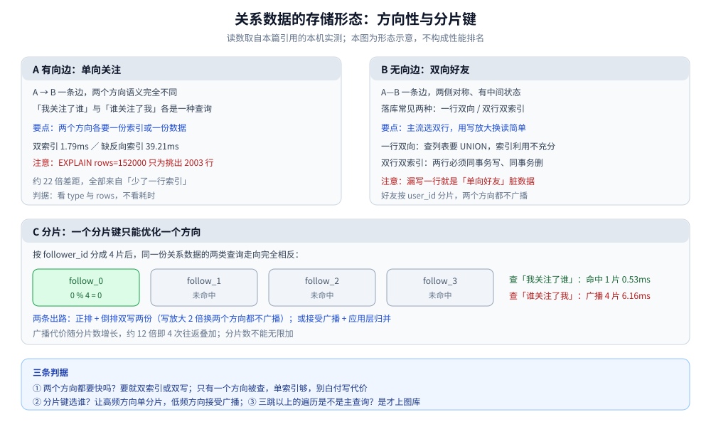

# 关系数据存储

> 关系（关注 / 好友 / 拉黑）这类「实体之间的边」怎么存：方向性决定索引、分片键决定广播、
> 推拉决定成本放在哪、缓存决定一次变更要失效几份、多跳决定要不要上图库。
>
> 本篇是**跨场景的归纳篇**：不引入新的实测读数，所引读数均来自关联篇目的本机实测；
> 场景侧的完整推导（朋友圈、Feed、大 V）留在 [系统设计](../../../../04-架构与系统/系统设计/README.md) 那几条线。
>
> 内容整理自个人学习笔记，素材见 [素材清单](../../../../素材清单.md)。

---

## 一、一条边是「有向」还是「无向」，先决定了什么？

**本节要点**：关系存储的第一性问题不是「用什么存储」，而是**这条边有没有方向**。方向决定索引、决定表结构、决定要不要中间状态——三件事全部由它推出。

### 1.1 两种边

| | 有向边 | 无向边 |
|---|---|---|
| 语义 | A 关注 B，B 可以没关注 A | A 与 B 互为好友，对称 |
| 反向是什么 | 「谁关注了我」（粉丝），**另一种查询** | 同一个好友列表，**同一种查询** |
| 中间状态 | 无，只有「有 / 无」 | 有：申请中、已同意、已拉黑 |
| 典型上限 | 关注可上万 | 好友通常几千 |

一句话：**关注是「一个人对另一个人」的声明，好友是「两个人之间的关系」**。前者可以单方面成立，后者必须双方点头。

### 1.2 有向边：两个方向是两种查询

「我关注了谁」和「谁关注了我」语义完全不同，也走不同的索引。所以第一判据是：

⭐ **这两个方向都要快吗？** 都要，就为两个方向各准备一份索引（或一份数据）；只有一个方向被查，就单索引，别白加写代价。

### 1.3 无向边：对称，但有生命周期

双向好友**不能**用「一行加一个互为好友标志位」表达，原因有两个：

1. **查询要拆条件**：查「A 的好友」得写两个方向的 `OR`，索引利用不充分；
2. **中间状态表达不了**：申请中是**单向**的（A → B），已同意是**双向**的——一行加标志位装不下「方向不对称的中间态」。

所以「待验证」这类单向状态**单独一张申请表**，别混进好友表。

### 1.4 落库的两种形态

| 形态 | 写 | 查 | 适合 |
|---|---|---|---|
| **一行双向**（归一化成 a < b 一行） | 一条关系一行，删也一行 | 要 `UNION` 两个方向 | 写多读少，或两个方向查询量都小 |
| **双行双索引**（一条边落两行） | 一次变更写 / 删**两行，且必须同事务** | 两个方向各走主键前缀，单分片点查 | 读多（列表页每次进 App 都要拉） |

⭐ 主流选**双行双索引**：用写放大 2 倍换读简单。附带好处是「只属于一侧的属性」（备注、分组）天然有地方放——A 给 B 的备注只写在 `(A, B)` 那一行。

⚠️ 漏写一行、或删除时只删一行，就是「单向好友」脏数据：A 的好友里有 B，B 的好友里没有 A。

---

## 二、为什么「两个方向都要快」是第一判据？

**本节要点**：少一个方向的索引，代价不是「慢一点」，而是**退化成整索引扫描**。这条判据可以直接用执行计划验证。

### 2.1 一行索引之差

同一份关系数据、同一个查询，加与不加反向索引的结果：

```text
有 idx_followee ：type=ref   key=idx_followee rows=2003   1.79ms（2003 行）
缺反向索引      ：type=index key=PRIMARY      rows=152000 39.21ms（2003 行）
```

### 2.2 读法

- `rows=2003` 是**估算行数等于结果行数**——直接命中；
- `rows=152000` 意味着**沿主键索引整条扫过去，只为挑出 2003 行**；
- 约 **22 倍**的差距，全部来自「少了一行索引」。

⭐ 判据：**看 `EXPLAIN` 的 `type` 与 `rows`，不要只看耗时**。`ref` + `rows≈结果行数` 才对；`index` / `ALL` 且 `rows` 远大于结果行数，就是漏索引。

---

## 三、分片键为什么只优化一个方向？

**本节要点**：关系数据一大就要分片，而**一个分片键只能优化一个方向**。分片键选错，另一个方向的查询就得打穿所有分片。

### 3.1 同一个键，两类查询走向相反

按 `follower_id` 分成 4 片后：

| 查询 | 命中 | 代价 |
|---|---|---|
| 「我关注了谁」 | 1 片（该用户的关注边全在同一片） | 0.53ms |
| 「谁关注了我」 | **必须广播全部 4 片**再合并 | 6.16ms，约单片的 12 倍 |

12 倍 = 4 次查询 / 网络往返叠加 4 次索引扫描。**分片数越多，广播越贵**。

### 3.2 两条出路

| 出路 | 做法 | 代价 |
|---|---|---|
| **双写两份**（正排 + 倒排） | 一份按 `follower_id` 分片服务关注列表，一份按 `followee_id` 分片服务粉丝列表 | 写放大 2 倍；两份要保证一致 |
| **接受广播 + 合并** | 并发打所有分片，应用层归并 | 分片数受限；尾延迟由最慢分片决定 |

⭐ 大型社交系统几乎都走第一条——**存两份、按两个维度各分一次片**，用写放大换两个方向都不广播。这也解释了「为什么关注 / 取关是重操作」。

### 3.3 扩容时怎么再平衡

分片数一变，`id % N` 的映射会全变，所有关系边都要重分布。缓解办法：**一致性哈希**（扩容只搬一部分）或**预分片**（先分足够多片，扩容时搬整片而不是重算取模）。按同一个维度存的两行会**一起搬**，不会出现「A 的关系一半在旧片、一半在新片」的中间态。



图怎么读：A 面板是有向边（单向关注）——两个方向语义不同，各要一份索引，双索引 1.79ms 对缺反向索引 39.21ms，后者 `rows=152000` 只为挑出 2003 行，约 22 倍差距全来自「少了一行索引」。B 面板是无向边（双向好友）——一条边落成两行、必须同事务写删，漏一行就是「单向好友」；主流选双行双索引，用写放大换读简单。C 面板是按 `follower_id` 分 4 片：「我关注了谁」命中 1 片 0.53ms，而「谁关注了我」必须广播全部 4 片 6.16ms、约单片的 12 倍，出路是正排 + 倒排双写两份，或接受广播后在应用层归并。

---

## 四、这条边的成本放在哪：推还是拉？

**本节要点**：推（写扩散）与拉（读扩散）的**代价结构正好相反**，选哪个取决于四个量里哪个更大。这不是存储问题，而是「把成本放在哪」的问题。

### 4.1 代价结构

| 模式 | 写入成本 | 读取成本 |
|---|---|---|
| **推**（写扩散） | ∝ 作者的**粉丝数**（一次发帖写 m 个收件箱） | O(1)，直接读自己的收件箱 |
| **拉**（读扩散） | O(1)，只写自己一份 | ∝ 读者的**关注数**（读时聚合多路） |

⚠️ 这笔账分属**两个角色**：推的成本按**作者的粉丝数**算，拉的成本按**读者的关注数**算。**粉丝多只说明一件事——推这个作者很贵**，别拿「同一个人粉丝多还是关注多」直接下结论。

| 现象 | 更适合 | 理由 |
|---|---|---|
| 读远多于写 | 偏推 | 成本摊在少数几次写上 |
| 写远多于读 | 偏拉 | 成本摊在读侧 |
| 粉丝数远大于关注数（大号） | 拉（不能纯推） | 扇出 ∝ 粉丝数，写侧先爆 |
| 僵尸粉多、活跃粉丝少 | 推拉结合 | 只推给在线 / 活跃粉丝，其余拉 |

### 4.2 大号为什么必须单独走一条路

纯推的写放大 = 粉丝数。粉丝到百万级时，一次发布就是百万次写——**这不是「慢一点」，而是不可行**。所以超过阈值的大号改为**不推**：只写自己一份，粉丝读时现场拉。

- **阈值要靠数据定**：按「粉丝数 × 发帖频次」估算写放大，超出可接受的写 QPS 就转拉；
- **大号名单离线算**：粉丝数会涨落，实时判定会让发帖路径依赖一个易变的量；
- **读路径要合并两份**：推来的 + 现场拉的，要归并排序、去重、分页。

### 4.3 收件箱必须设上限

写扩散会不断追加，不设限就无限膨胀。做法是**每次写入后按排名截断，只保留最近 N 条**；翻出 N 条之外只能**回源**或明确「到底了」。⚠️ **有界是写扩散的前提假设，不是优化项**。

---

## 五、缓存：为什么一次关系变更要失效两份？

**本节要点**：列表类数据必须缓存，而**对称关系的一次变更会影响两个人**——这是它和单向关系在缓存上最大的不同。

| 操作 | 要失效的缓存 |
|---|---|
| 加好友 / 删好友 | 删 `friends:A` 与 `friends:B` **两份** |
| 改备注（单侧属性） | 只删受影响那一侧 |
| 拉黑 | 删两份，并清申请列表 |

⚠️ 最常见的事故是**只失效了一侧**：A 立刻看到 B，B 那边缓存里还没有 A——用户视角就是「单向好友」。

一致性策略用**先更新 DB、再删缓存**（Cache-Aside + 删除）：

```text
1. 事务里写 DB（两行边 + 更新申请状态）
2. 事务提交后，再删两个人的列表缓存
3. 读时未命中 → 从 DB 重建
```

- **删而不是改**：改缓存要算新值，删缓存让下次读重建，更简单也更稳；
- **删失败要兜底**：设 TTL，或订阅变更日志异步清理——**TTL 是最后一道保险**；
- **缓存必须可重建**：列表是派生数据，丢了能从关系表重算，所以不必当唯一数据源。

---

## 六、什么时候该升级到图数据库？

**本节要点**：多跳遍历是图库唯一不可替代的能力，但**门槛比直觉高**——一两跳并不比关系库快。

- **准入判据只有一条**：**三跳以上的遍历是不是主查询**（三度人脉、资金链路、攻击路径）；
- 本仓实测（10 万点 / 30 万边）：**1~3 跳两者都在亚毫秒**，图库并无优势，**6 跳才拉开量级**；
- 所以「偶尔有一条多跳查询」不足以支撑引入图库；关系只是属性时，**邻接表 + 索引（+ 缓存 + 分片）就够**。

⭐ 另一类收益在**集合运算**：共同关注、二度人脉用内存集合的 `SINTER` 比 JOIN 省事——这才是内存集合真正划算的地方，单跳查询用不上它。

---

## 七、不上图库：用内存集合做多跳与交集

**本节要点**：多跳的准入判据是「三跳以上是不是主查询」（第六节）；**够不上图库时，一跳 / 两跳的「交集、并集」类查询用内存集合（Set）就能做**，而且比 SQL 的 `JOIN` 更直接。这一节给命令逻辑与复杂度。

### 7.1 为什么集合运算划算

关注列表本身就是「一组人」——一个集合。求「共同关注」就是求**交集**，求「我关注的人关注的人」就是求**并集**；用 SQL 要先 `JOIN` 再 `GROUP BY`，用集合是**一条命令**。

| 查询 | 集合运算 | 命令逻辑 | 复杂度（理论量级） |
|---|---|---|---|
| **共同关注**（我 ∩ 他） | 交集 | `SINTER 我:followee 他:followee` | ⚠️ `O(N×M)`：N = **最小集合**基数，M = 参与集合数——**先拿最小的集合当起点最省** |
| **二度人脉**（我关注的人关注的人） | 并集 | 对每个关注对象取 `SMEMBERS`，`SUNION` 合并，再减去我直接关注的与自己 | `SUNION` 为 `O(N)`，N = 所有集合元素总数 |
| **共同关注数**（只要数不要名单） | 交集计数 | `SINTERCARD 2 我:followee 他:followee LIMIT k`（Redis 7.0+） | 带 `LIMIT` 可提前停；**只要判断「有没有 / 有多少」时比 `SINTER` 省** |

### 7.2 复杂度怎么读

（以下复杂度为命令文档给出的量级，**非本篇实测**——本篇是归纳篇，不做性能实测。）

- `SINTER` 的代价随**最小集合**增长，不随结果集增长——所以「共同关注」在「小号 ∩ 小号」上很便宜，在「小号 ∩ 大号」上受**小号**约束；
- `SUNION` 要把所有集合的元素并起来，代价随**总元素数**增长——二度人脉的膨胀点在「**关注数 × 平均关注数**」，**必须有界**（只取排序靠前的若干关注对象）；
- ⚠️ **交集 / 并集都要把集合搬进内存算**：大集合（百万级）做 `SINTER` 会占可观的内存与 CPU——这正是「单跳用不上集合运算、它真正划算的地方是**小集合之间、且高频读**」的原因（第六节那句判据）。

### 7.3 三个必须知道的边界

1. ⚠️ **跨分片不可用**：Redis Cluster 要求一条命令的所有 key 落在**同一个 slot**。`SINTER 我:followee 他:followee` 里两个 key 前缀不同 → 大概率不同 slot → 命令直接报错。要么用 **hash tag** 把同一主体的 key 绑到同槽（`{u:123}:followee`），要么在应用层 `SMEMBERS` 后自己求交（放弃服务端运算）；
2. ⚠️ **内存成本是硬约束**：每个用户的关注 / 粉丝集合都常驻内存，关系一多，内存就是瓶颈——所以集合运算适合**关系规模可控**的场景；规模一大，回到「正排 + 倒排 + 分片」（第三节）；
3. ⚠️ **二度人脉会爆**：`关注数 × 平均关注数` 可能是百万级，`SUNION` 前**必须裁剪**，否则一次查询就是一次全量并集。

⭐ 判据小结：**「交集 / 并集」适合一跳、两跳且集合不大；三跳以上是主查询，才回到图库（第六节）。** 集合运算省的是「不用 `JOIN`」，不是「不用考虑规模」。

```text
共同关注：SINTER    我:followee  他:followee
二度人脉：SUNION    对每个我关注的人取 followee，再减去我直接关注的与自己
只要计数：SINTERCARD 2 我:followee 他:followee LIMIT k     ← Redis 7.0+
同槽约束：{u:1001}:followee / {u:1001}:fans              ← hash tag 绑同槽
```

---

## 使用：按关系类型查存储方案

**本节要点**：下面按关系类型列出结构、分片、缓存与第一判据，供快速对照；具体到项目仍要按查询分布裁剪。

| 关系类型 | 结构 | 分片键 | 缓存 | 第一判据 |
|---|---|---|---|---|
| **单向关注** | 有向边，双索引（正排 + 倒排） | 按关注方分片；查粉丝广播或双写 | 双方各自的关注 / 粉丝集合 | 两个方向都要快吗 |
| **双向好友** | 一条无向边落成**两行**，同事务写删 | 按 `user_id` 分片，两个方向都不广播 | 两份列表一起失效 | 列表读是否远多于写 |
| **待验证申请** | 单独一张申请表（单向） | 按接收方建索引 | 待处理列表 | 单向状态是否混进了好友表 |
| **拉黑** | 单独一张表（动作单向、效果双向） | 需要反向索引（查「谁拉黑了我」） | 两份 + 清申请 | 被拉黑方能否感知 |
| **多跳关系** | 邻接表（+ 内存集合做集合运算） | 同上 | 同上 | 三跳以上的遍历是不是主查询 |

⭐ 两条横向判据：**① 有向关系的两个方向都要防「只优化了一个」**；**② 无向关系的两行要防「只写 / 只删了一行」**。

## 延伸追问

- **为什么不把好友直接塞进关注表？** → 关注是有向边、无中间状态；好友是无向边、有申请到拉黑的生命周期。硬塞进一张表，要么加一堆字段把索引搞复杂，要么让两个方向的语义互相污染。
- **「共同关注」怎么算？** → 关系存关系库时用两表 `JOIN`；存内存集合时直接 `SINTER`。这正是内存集合真正划算的地方。
- **关系上要不要设上限？** → 要。上限让「列表的读聚合」有界——缓存大小、全量拉取、遍历成本的最坏情况都变确定。这也是很多产品给关注数 / 好友数设上限的原因之一。
- **取关之后，对方收件箱里的旧内容怎么办？** → 推模式按「发帖那一刻的关系」写，取关者收件箱里会有残留。要么读时按当前关系过滤，要么接受残留（成本更低）。
- **关系的「计数」（粉丝数 / 好友数）怎么维护？** → 用计数器而不是 `COUNT(*)` 现算，且计数与判重要一起原子更新。
- **`SINTER` 和 SQL 的 `JOIN` 该选谁？** → 集合小、要频繁求交集 / 并集 → 内存集合（一条命令、代价看最小集合）；集合大、要带条件过滤 / 排序 / 分页 → 关系库 `JOIN` 更合适。两者不是替代关系，是不同规模下的选择。
- **hash tag 会不会造成数据倾斜？** → 会。hash tag 把同一主体的 key 强制同槽，热点主体的槽会变热——它在解决「跨槽不可用」的同时，把问题换成了「单槽变热」（见 [热点数据存储.md](../横切篇/热点数据存储.md)）。

## 关联

- [关注粉丝设计.md](../../../../04-架构与系统/系统设计/社交互动系统/关注粉丝设计.md) — 单向关注：双索引 / 分片广播 / 推拉与大号，本篇第一、三、四节的实测读数出自此
- [好友关系设计.md](../../../../04-架构与系统/系统设计/社交互动系统/好友关系设计.md) — 双向好友：状态机、双行同事务、双边缓存失效，本篇第一、五节的场景版
- [评论点赞设计.md](../../../../04-架构与系统/系统设计/社交互动系统/评论点赞设计.md) — 同一类「计数 + 判重 + 异步写」的手法，用在粉丝数与点赞上
- [时序数据存储.md](时序数据存储.md) — 同为形态篇：有界列表、游标分页与指针 / 本体分离
- [热点数据存储.md](../横切篇/热点数据存储.md) — 大号扇出之外的另一类热点：热点行与热点键
- [数据类型.md](../../NoSQL/Redis/数据类型.md) — 内存集合与有序集合的成员操作，集合运算的载体
- [选型与落地案例.md](../../图数据库/Neo4j/选型与落地案例.md) — 「多跳是不是主查询」的准入判据与六跳实测
- [图数据库选型对比.md](../../图数据库/图数据库选型对比.md) — 图存储这一族的横向选型
- [一致性哈希.md](../../../../04-架构与系统/分布式/服务治理/一致性哈希.md) — 分片扩容时最小搬移的基础
- [分表与路由.md](../../关系型/MySQL/分表与路由.md) — 分片键与路由的通用手法
- [索引原理.md](../../NoSQL/MongoDB/索引原理.md) — 若把关系存成文档（一个人一份、列表内嵌），多键索引的代价
- [缓存容量与治理.md](../../缓存/缓存容量与治理.md) — 集合常驻内存时的容量治理，第七节「内存成本是硬约束」的上游
> 反向引用（本篇被下列文档引到）：[冷热数据分层.md](../横切篇/冷热数据分层.md)
