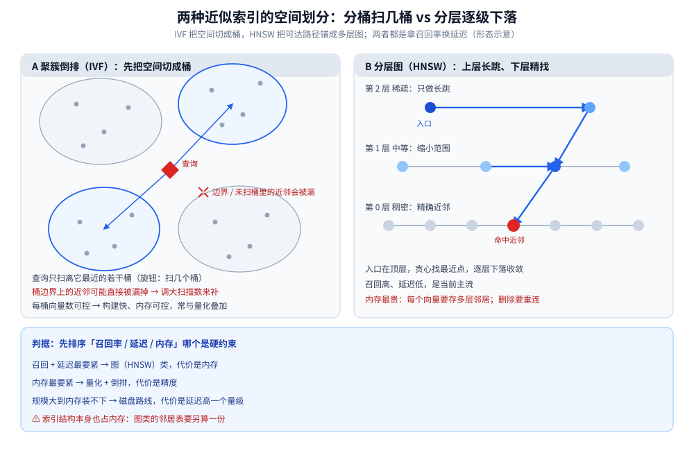
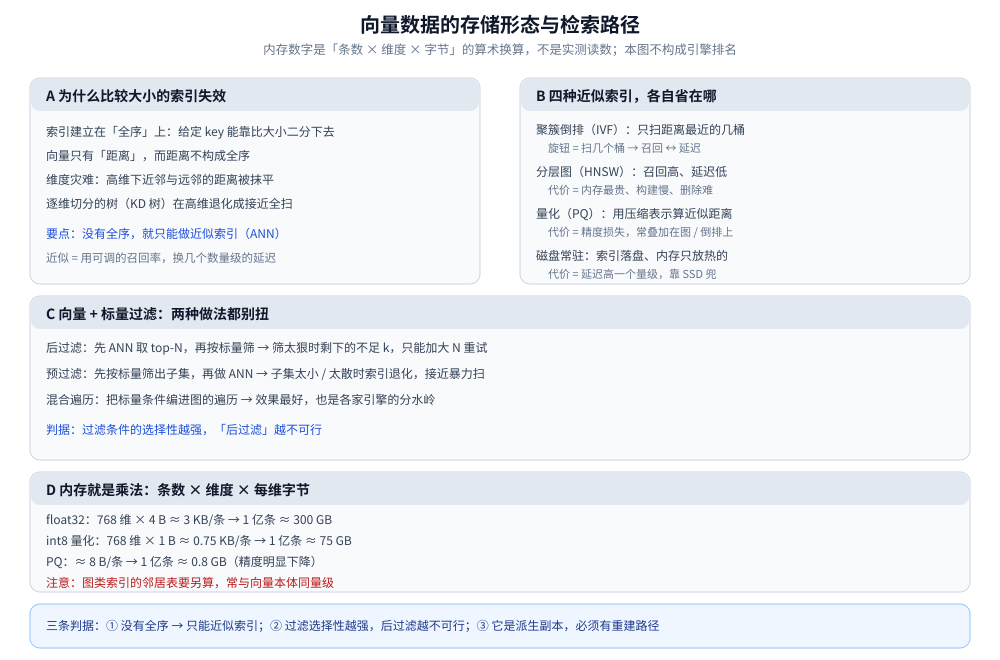

# 向量数据存储

> 覆盖：向量（embedding）这类数据怎么存——**为什么「比大小」的索引在它身上失效**、四种近似索引各自省在哪、
> 「向量 + 标量过滤」为什么难、量化怎么把内存换算下来，以及它为什么天生是一份「派生副本」。
>
> 不覆盖：本篇讲这类数据的**存储形态与检索路径**（不碰具体产品引擎与参数）；产品选型属族目录
> `数据存储/向量数据库/`（尚未成篇），跨族横评见 [数据库选型对比.md](../../数据库选型对比.md)。
>
> 内容整理自个人学习笔记，素材见 [素材清单](../../../../素材清单.md)。
>
> 📎 本篇是**跨场景的归纳篇**：不引入新的实测读数，所引读数来自关联篇目的本机实测；文中的内存数字是**算术换算**（条数 × 维度 × 字节），不是性能实测。

---

## 一、向量这东西「不像数据」，像坐标

**本节要点**：向量的语义是**距离**，不是相等。这一条决定了它不能沿用「比较大小」的那套索引——后面每一节都是它的推论。

### 1.1 三个特征

| 特征 | 含义 | 直接推论 |
|---|---|---|
| **高维** | 维度常在几百～几千 | 一维**全序**没了：「谁和谁近」不再能用「谁比谁小」表达 |
| **相似 ≠ 相等** | 查询是「找最接近的 k 条」 | 这是 **top-k 近似**问题，不是等值 / 范围查询 |
| **靠距离度量** | 余弦 / 内积 / 欧氏距离 | 向量**归一化后**余弦与内积等价——存之前归一化，能省掉每次查询的模长计算 |

### 1.2 为什么 B+ 树、哈希这类索引失效

关系库的索引建立在**全序**上：给定一个 key，能靠「比大小」一路二分下去。向量没有这个性质——它只有「距离」，而距离**不构成全序**（A 近 B、B 近 C，并不代表 A 近 C）。

再叠上**维度灾难**：维度一高，任意两点之间的距离都挤在一个很窄的区间里，**近邻与远邻的差别被抹平**；逐维切分的树（如 [KD树与高维索引.md](../../../../02-计算机基础/数据结构/树/空间与字符串树/KD树与高维索引.md)）在高维上会退化成接近全扫。

⭐ 判据：**「能不能用树 / 哈希索引」取决于有没有全序**。向量没有全序、只有相似度 → 只能退而求其次，做**近似**索引（ANN，Approximate Nearest Neighbor）。

---

## 二、四种近似索引怎么选？

**本节要点**：ANN 的共性是**用一个可调的召回率，换几个数量级的延迟**。四种结构代表四种「省在哪」。

| 结构 | 思路 | 优点 | 代价 / 调什么 |
|---|---|---|---|
| **聚簇倒排（IVF 类）** | 先聚类分桶，查询只扫距离最近的若干桶 | 构建快、内存可控、容易与量化叠加 | 落在桶边界上的近邻会被漏；**扫几个桶**就是召回 / 延迟的旋钮 |
| **分层可导航小世界图（HNSW）** | 多层图：上层稀疏做长跳、下层稠密做精找 | 召回高、延迟低，是当前主流 | **内存最贵**（每个向量要存多层邻居）；构建慢；**删除难**（图要重连） |
| **量化 / 乘积量化（PQ）** | 把向量切段、每段用码本编码，用压缩表示算近似距离 | 内存可降一个量级 | 有精度损失；通常**叠加**在 IVF / HNSW 上（索引 + 压缩） |
| **磁盘常驻 / 内存 + 磁盘** | 索引落盘，内存只放热的部分 | 装得下更大规模 | 延迟高一个量级，全靠 SSD 兜 |

⭐ 判据：**先排序「召回率、延迟、内存」哪个是硬约束**——

- 召回和延迟最要紧 → 走图（HNSW）类，代价是内存；
- 内存最要紧 → 走量化 + 倒排，代价是精度；
- 规模大到内存装不下 → 走磁盘路线，代价是延迟。

⚠️ 还有一个常被忽略的点：**索引结构本身也占内存**。图类索引的邻居表可能比原始向量还大——算内存预算要**两头都算**。

### 2.1 两种划分方式：先把空间切块，还是先建多层图

IVF 与 HNSW 的差别，可以还原成「往哪个方向做近似」：

- **IVF 切的是空间**：先聚类出若干桶，查询只扫离查询最近的几个桶——**扫几个桶**就是召回与延迟的旋钮，代价是落在桶边界上的近邻会被漏掉；
- **HNSW 切的是可达路径**：上层稀疏做长跳、下层稠密做精找，查询从入口逐层下落——召回高、延迟低，代价是**每个向量都要存多层邻居**，内存最贵；
- 两者都能叠加量化（IVF + PQ 最常见）：量化砍的是「每条向量占多少字节」，**不改变**上层是桶还是图。

⭐ 判据：**要低延迟高召回 → 往图层走，用内存换；内存吃紧 → 往桶 + 量化走，用精度换**；两条路都绕不开「索引结构本身也占内存」这笔账。



图怎么读：左图是 IVF——椭圆是一个聚类桶，查询（红色菱形）只扫离它最近的几个桶，落在两个桶交界的近邻可能直接被漏掉；右图是 HNSW——第 2 层稀疏只做长跳，逐层下落到第 0 层做精找，蓝色路径就是一次查询的下落轨迹。两图对照着看：**IVF 把「可能在哪」压成一小组桶，HNSW 把「怎么走过去」压成一小段路径**，省的都是「不必扫全库」这件事。

---

## 三、为什么「向量 + 标量过滤」这么难？

**本节要点**：真实查询几乎不是「全库找最像的 k 条」，而是「**在满足条件的子集里**找最像的 k 条」（我可见的、未过期的、属于某租户的……）。而 ANN 索引是为「全量 top-k」设计的，两者叠起来会互相拆台。

| 做法 | 怎么做 | 问题 |
|---|---|---|
| **后过滤** | 先 ANN 取 top-N，再按标量条件筛 | 筛得太狠时剩下的不足 k → 只能**加大 N 重试**，延迟不可控 |
| **预过滤** | 先按标量筛出子集，再在子集里做 ANN | 子集太小 / 太散时，索引结构对不上子集，退化成暴力扫 |
| **混合遍历** | 把标量条件编进图的遍历（只在命中节点上扩展） | 效果最好，但实现复杂，是各家引擎的分水岭 |

⭐ 判据：**过滤条件的选择性越强，「后过滤」越不可行**——高选择性要走预过滤或混合遍历；只有「筛掉很少」时后过滤才划算。

---

## 四、内存怎么换算、量化省在哪

**本节要点**：向量占的内存就是个乘法——**条数 × 维度 × 每维字节**。量化做的事，就是砍最后一项。

算术估算（不是实测）：

| 方案 | 每条 | 1 亿条的向量本体 |
|---|---|---|
| float32（原始） | 768 维 × 4 B ≈ 3 KB | ≈ 300 GB |
| int8 量化 | 768 维 × 1 B ≈ 0.75 KB | ≈ 75 GB |
| PQ（≈ 8 B / 条，极压缩） | 8 B | ≈ 0.8 GB（精度明显下降） |

⚠️ 别忘了图类索引的**邻居表**要另算（常与向量本体同量级甚至更大）。

⭐ 判据：**先算「条数 × 维度 × 字节」，装得下就别量化**——量化是「装不下」时的补救，不是默认选项。

---

## 五、它天生是一份「派生副本」

**本节要点**：向量由**原文 + 模型**生成，所以它**不是唯一真相**——按 [存储选型与组合.md](../存储选型与组合.md) 的角色划分，它是**检索副本**。这一点决定了它的读写路径和一致性口径。

- **写入是异步派生**：原文先落权威源 → 由异步任务（outbox / CDC）生成向量 → 写入向量库。这条链路见 [数据同步方式选型对比.md](../../数据同步/数据同步方式选型对比.md)；
- **删除要跟着走**：原文删了、向量还在 → 检索会**召回已删内容**。所以删除必须同步到向量副本，或在读侧按权威源过滤；
- ⚠️ **换模型 = 全量重建**：模型版本一变，所有向量的语义空间就变了，**新旧向量不可混算**。所以原文与**模型版本**必须留档，重建路径必须能跑通；
- ⭐ 判据：**「这份数据丢了能不能重算」**——向量能（只要有原文和模型），所以它可以丢、可以重建；但**不能把它当唯一数据源**。



图怎么读：A 面板是第一节那条根因——向量没有全序、只有距离，再叠上维度灾难，B+ 树与哈希全部失效，只剩近似索引；B 面板摊开第二节的四种 ANN 结构，每种标注「省在哪、代价是什么」；C 面板是第三节「向量 + 标量过滤」的三种做法，后过滤与预过滤各有各的别扭，混合遍历才是分水岭；D 面板纯粹是第四节的算术换算（768 维 float32、一亿条 ≈ 300 GB），红字提醒图类索引的邻居表要另算。底部三条判据即上文，其中第③条对应第五节「派生副本」的结论；图内数字全部取自正文，未引入新读数。

---

## 六、应用场景

**本节要点**：这种「只有距离、没有全序」的数据在真实系统里落在哪儿——按**谁在消费它**分几层看：推荐链路拿它做召回、语义检索拿它做第一跳、离线任务拿它算相似度，判据都是第一节那三个特征（高维、相似 ≠ 相等、靠距离度量）。

| 场景 | 向量的角色 | 用谁 |
|---|---|---|
| **推荐召回** | 召回的一路：拿用户 / 物品向量找近邻，只求「不漏」，不求排准 | 低延迟高召回走图（HNSW）类；多路去重与融合见 [召回与排序.md](../../../../04-架构与系统/系统设计/推荐系统/召回与排序.md)、[特征与冷启动.md](../../../../04-架构与系统/系统设计/推荐系统/特征与冷启动.md) |
| **语义检索 / RAG** | 「关键词 + 向量」双路里的语义一路 | 与倒排合流见 [Elasticsearch/向量与AI搜索.md](../../搜索与分析/Elasticsearch/向量与AI搜索.md)；图谱侧见 [Neo4j/向量索引与GraphRAG.md](../../图数据库/Neo4j/向量索引与GraphRAG.md) |
| **以图搜图 / 多模态** | 把图、音、文编码进同一空间，按距离找相似 | 同一套 ANN 结构，差别只在编码器；跨模态检索的形态与文本向量一致 |
| **离线去重 / 聚类 / 反查** | 批量算相似度，没有在线延迟约束 | 第四节的「暴力 / 分片并行」；这时不必付 ANN 的构建与内存代价 |
| **多租户 / 带可见性过滤** | 只在「我能看的那部分」里找最像的 k 条 | 过滤选择性高时走预过滤或混合遍历（第三节） |

⭐ **三条把上表读薄的工程判据**：

1. **它几乎总是副本，不是权威源**：向量的真相在「原文 + 模型」这一对上，所以先把**重建路径**定下来，再谈索引与量化——否则一次换模型就等于数据报废（第五节）。
2. **召回与排序分工不同**：向量检索只负责把候选捞回来（不漏），排准交给后面的重排；直接拿 ANN 结果当最终排序，就会撞上第三节「过滤 + top-k」的两难。
3. **先在纸上算内存预算**：正文里的一亿条 float32 ≈ 300 GB 已经不小，图类索引的邻居表还要另算一份——装不下就早早上量化或磁盘路线，别等线上 OOM 再改。

## 七、具体使用

**本节要点**：先看查询长什么样，再选索引与量化；这张表是起点，具体按规模与精度要求裁剪。下面按「先选结构（7.1）→ 再落命令与算式（7.2~7.4）」组织。

### 7.1 按查询形态选结构

| 查询形态 | 索引 | 第一判据 |
|---|---|---|
| 内存够、要低延迟高召回 | 图（HNSW）类 | 内存装得下「向量 + 邻居表」吗 |
| 内存紧、规模大 | 倒排 + 量化 | 能容忍多少精度损失 |
| 带强选择性过滤 | 混合遍历或预过滤 | 过滤后的子集还够大吗 |
| 规模超出内存 | 磁盘常驻路线 | 能接受延迟上升一个量级吗 |
| 只做离线批量相似度 | 暴力 / 分片并行 | 有没有在线延迟要求 |

⭐ 三条横向判据：**① 没有全序 → 只能近似索引**；**② 过滤选择性越强，后过滤越不可行**；**③ 它是派生副本，必须有重建路径**。

### 7.2 建索引与查 top-k：两个常见载体的命令骨架

> ⚠️ 落地写法骨架，未单独编译、未执行；参数含义取自各载体公开文档，本篇不做实测。

```sql
-- pgvector：先在向量列上建 HNSW 索引，再用距离运算符查 top-k
CREATE INDEX idx_item_emb ON item USING hnsw (embedding vector_cosine_ops)
  WITH (m = 16, ef_construction = 64);   -- m / ef_construction 越大，召回越高、内存与构建越贵

-- <=> 是余弦距离（1 - 余弦相似度）；归一化之后也能改用 <#>（负内积）
SELECT id FROM item ORDER BY embedding <=> :query_emb LIMIT 10;
```

```text
# Redis Search：建向量索引 + KNN 查询（语义骨架）
FT.CREATE idx ON HASH PREFIX 1 item: SCHEMA emb VECTOR HNSW 6 TYPE FLOAT32 DIM 768 DISTANCE_METRIC COSINE
FT.SEARCH idx *=>[KNN 10 @emb $q AS score] PARAMS 2 q <blob> SORTBY score DIALECT 2
```

### 7.3 归一化：让余弦与内积等价

> ⚠️ 落地写法骨架，未单独编译；口径来自本篇第一节「归一化后余弦与内积等价」。

```text
写入前把每条向量除以自身的 L2 模长（‖v‖₂），存进去的就是单位向量；
此后 cos(u, v) 与 u·v 只差一个常数，查询侧省掉一次模长计算。

代价：丢掉「向量长度」这一维信息——长度本身有业务含义时（如用模长表示置信度）别归一化。
```

### 7.4 内存估算：先算「条数 × 维度 × 字节」

> ⚠️ 这是算术换算，不是实测；算式与数字口径来自本篇第四节。

```text
向量本体：条数 × 维度 × 每维字节
  一亿条 × 768 维 × 4 B (float32) ≈ 300 GB
  一亿条 × 768 维 × 1 B (int8)    ≈  75 GB
  一亿条 × ≈ 8 B (PQ，极压缩)      ≈ 0.8 GB（精度明显下降）

再叠加：图类索引的邻居表要另算一份（常与向量本体同量级甚至更大）；
        装得下就先别量化——量化是「装不下」时的补救。
```

## 延伸追问

- **为什么不直接全量算距离？** → 小规模可以（暴力就是精确解）；规模一上来，计算量是「查询数 × 库大小」，只能靠 ANN 把「扫全库」压成「扫一小部分」。
- **HNSW 为什么删除难？** → 向量被删后，图里指向它的边断了，近邻结构出现「断路」；要么重连、要么留墓碑让读侧过滤——这也是很多引擎选「软删 + 重建」的原因。
- **召回率怎么量？** → 拿一批查询做暴力算出的「真答案」当基准，看 ANN 命中了多少；调参（扫几个桶 / 搜索宽度）就是在召回与延迟之间移动。
- **归一化到底解决什么？** → 让「余弦相似度」与「内积」等价，省掉每次查询的模长计算；代价是丢掉「向量长度」这一维信息，看业务是否需要。
- **向量库能不能完全替代关键词检索？** → 不能。向量擅长「语义相近」，对**精确词、编号、短查询**反而弱，所以生产上常见「关键词 + 向量」双路合并（见 [Elasticsearch/向量与AI搜索.md](../../搜索与分析/Elasticsearch/向量与AI搜索.md)）。
- **它和图数据库什么关系？** → 图层面上的「属性 + 向量」混合检索见 [Neo4j/向量索引与GraphRAG.md](../../图数据库/Neo4j/向量索引与GraphRAG.md)；本篇只讲「向量这一类数据」的通用形态。

## 关联

- **上游/总纲**：[README.md](../README.md) — 本目录总纲：五种数据形态的分工与「先判形态、再选产品」的路线
- **上游/总纲**：[存储选型与组合.md](../存储选型与组合.md) — 本篇第五节「检索副本」这个角色的出处
- **上游/总纲**：[数据库选型对比.md](../../数据库选型对比.md) — 先选族的跨族横评；向量这一族的具体产品在其中
- **上游/总纲**：[数据同步方式选型对比.md](../../数据同步/数据同步方式选型对比.md) — 向量副本从权威源派生的同步路线
- **对照/互补**：[搜索与分析数据存储.md](搜索与分析数据存储.md) — 同为形态篇：关键词检索与向量检索的合流
- **对照/互补**：[时序数据存储.md](时序数据存储.md) — 同为形态篇：多路归并去重是「混合检索」同一类手法
- **对照/互补**：[KD树与高维索引.md](../../../../02-计算机基础/数据结构/树/空间与字符串树/KD树与高维索引.md) — 逐维切分的高维索引为什么退化
- **下游机制**：[Elasticsearch/向量与AI搜索.md](../../搜索与分析/Elasticsearch/向量与AI搜索.md) — 向量检索在检索副本上的落地（dense 向量、量化、混合检索）
- **下游机制**：[Neo4j/向量索引与GraphRAG.md](../../图数据库/Neo4j/向量索引与GraphRAG.md) — 向量与图结合的检索路径
- **下游机制**：[召回与排序.md](../../../../04-架构与系统/系统设计/推荐系统/召回与排序.md) — 向量召回在推荐链路里的位置（场景侧）

- [素材清单.md](../../../../素材清单.md) — 素材来源登记
> 反向引用（本篇被下列文档引到）：[层级与树形数据存储.md](层级与树形数据存储.md)
