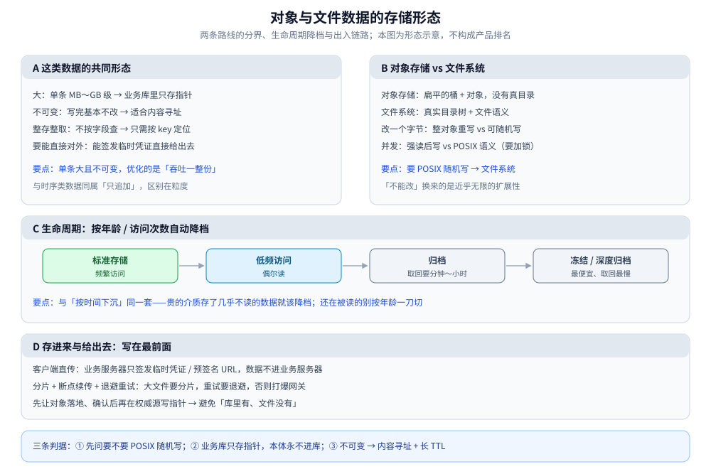

# 对象与文件数据存储

> 图片、视频、备份、日志归档——这类「**大、不可变、整存整取**」的数据怎么存：
> 对象存储与文件系统两条路线的分界、为什么「不支持改」反而是它的优势、
> 生命周期怎么自动降档、以及「存进来」和「给出去」这条链路的关键约束。
>
> ⭐ **边界**：本篇讲这类数据的**存储形态与读写路径**（不碰具体对象存储产品的 API 与参数）；
> 产品选型在 [对象存储选型对比.md](../../对象存储/对象存储选型对比.md) 与 [对象存储/README.md](../../对象存储/README.md)。
>
> 本篇是**跨场景的归纳篇**：不引入新的实测读数；分层口径来自 [冷热数据分层.md](../横切篇/冷热数据分层.md)。
>
> 内容整理自个人学习笔记，素材见 [素材清单](../../../../素材清单.md)。

---

## 一、这类数据的共同形态

**本节要点**：判断该不该用对象存储，先看数据是不是**大、不可变、整存整取**——三条都中，它就是对象存储的主场。

| 特征 | 含义 | 直接推论 |
|---|---|---|
| **大** | 单条 MB～GB 级 | 塞不进行存的行里 → 业务库只存**指针** |
| **不可变** | 写完基本不改（改元数据即可） | 适合**内容寻址 / 追加式**存储；「改」= 新写一份 |
| **整存整取** | 一次读一整份，不做「按字段查」 | 不需要索引，只需要**按 key 定位** |
| **要能直接对外** | 常要经 CDN 或直传给客户端 | 存储层要能签发**临时凭证**，不必过业务服务器 |

⭐ 与 [时序数据存储.md](时序数据存储.md) 的相似与不同：都「只追加」；区别是这里**单条很大且不可变**，所以优化的不是「按时间读一页」，而是「**一次吞吐一整份**」。

---

## 二、对象存储 vs 文件系统：两条路线

**本节要点**：「对象存储」不是「云端硬盘」，它和分布式文件系统解决的是不同的问题。分界线是**要不要 POSIX 语义**。

| 维度 | 对象存储 | 分布式文件系统 |
|---|---|---|
| 数据模型 | 扁平的「桶 + 对象」，**没有真目录** | 真实的目录树与文件语义 |
| 改一个字节 | **整对象重写** | 可随机写（要锁 / 一致性协议） |
| 并发语义 | 强一致读后写 + 最终一致的列举 | POSIX 语义，多客户端并发写要加锁 |
| 访问方式 | HTTP（GET / PUT），CDN 友好 | 挂载成本地文件系统，程序照常读写 |
| 适合 | 大文件、只追加、直接对外 | 需要随机读写、要当普通文件用 |

⭐ 判据：**要 POSIX 随机写 → 文件系统；只整存整取 + HTTP 直出 → 对象存储**。

⚠️ 「对象存储不能改」不是缺陷——它换来了**近乎无限的扩展性**（没有目录元数据、没有跨节点锁）。两条路线的完整对照见 [对象存储/README.md](../../对象存储/README.md)。

---

## 三、为什么「不可变」是好事

**本节要点**：不可变不是妥协，而是三个好处的来源。

- **内容寻址**：用内容的哈希当 key → 天然去重（同样内容只存一份）、天然可校验（下载后校验哈希）；
- **缓存友好**：不可变对象可以设**超长 TTL**，因为它永不变 → CDN 命中率高、回源少；
- **并发简单**：没有「边写边读」的中间态，不需要锁，读永远读到完整的旧版或新版。

⚠️ 代价：**覆盖更新会留下旧版本**（要靠版本控制或生命周期规则清理）；且改元数据在某些实现下也可能触发重写。

---

## 四、生命周期与冷热

**本节要点**：对象存储是 [冷热数据分层.md](../横切篇/冷热数据分层.md) 里**冷层**的默认载体，它的生命周期规则就是「按时间下沉」在存储产品里的固化物。

- **按年龄 / 访问次数自动降档**：标准 → 低频 → 归档 → 冻结，越往后越便宜、取回越慢；
- ⚠️ **归档层的取回要时间**（分钟～小时级），不是「点一下就回来」——产品交互要能容忍这个延迟；
- ⭐ 判据与分层篇一致：**「贵的介质存了几乎不读的数据」就该降档**；反过来，「还在被读的数据」别按年龄一刀切下去。

---

## 五、存进来与给出去：写在最前面

**本节要点**：文件类业务最大的性能问题往往不在存储，而在**数据流过业务服务器**。所以这条链路要最先设计。

- **客户端直传**：业务服务器只签发**临时凭证 / 预签名 URL**，数据根本不进业务服务器（省带宽、省内存、不被大文件拖住）；
- **分片 + 断点续传 + 退避重试**：大文件必须分片；失败要能续传；重试必须**退避**，否则打爆网关；
- **先落地、后入账**：先让对象落地，回调 / 轮询确认后**才在权威源写指针**，避免「库里有、文件没有」；
- 完整链路见 [文件存储与上传架构.md](../../../../04-架构与系统/系统设计/文件存储与上传架构.md)。

---

## 六、指针与本体分离，删除要小心

**本节要点**：业务库里只存**对象 key + 元数据**，本体在对象存储——这条分离带来一个必须想清楚的顺序问题。

- **删**：先让对象**不可达**（删指针或标记删除），再异步清对象；反过来（先删对象）会留下**指向空文件的指针**；
- **改**：内容变了就写**新对象 + 换指针**（不可变的好处），而不是原地改；
- **对账**：定期比对「库里的指针」与「桶里的对象」，找出孤儿对象（有对象无指针）与悬空指针（有指针无对象）。

---

## 使用：按访问形态选载体

**本节要点**：先看数据的访问形态，再选载体；这张表是起点，具体按成本与合规要求裁剪。

| 你的数据 | 载体 | 第一判据 |
|---|---|---|
| 图片 / 视频 / 附件，只整存整取 | 对象存储 + CDN | 需不需要随机写 |
| 要挂载给程序当普通文件读写 | 分布式文件系统 | 有没有 POSIX 要求 |
| 一年前的日志 / 备份 / 归档 | 对象存储归档层 | 取回延迟能容忍多少 |
| 同一内容会重复出现 | 对象存储 + 内容寻址 / 版本控制 | 值不值得做去重 |
| 热数据（频繁读的小文件） | 前面加缓存 / CDN | 读频率够不够高 |

⭐ 三条横向判据：**① 先问「要不要 POSIX 随机写」**；**② 业务库只存指针，本体永不进库**；**③ 不可变 → 用内容寻址 + 长 TTL，而不是想办法去「改」**。

图怎么读：A 面板是第一节的四条特征判据（大 / 不可变 / 整存整取 / 要能直接对外），三条都中就属对象存储主场；B 面板把第二节的两种载体摆成左右对照，分界线只有一条——要不要 POSIX 随机写，「不能改」换来的是近乎无限的扩展性；C 面板把第四节「标准 → 低频 → 归档 → 冻结」画成单向降档链路，越往右越便宜、取回越慢（归档层按分钟～小时计）；D 面板是第五节的出入链路：直传只签凭证、分片加退避重试、先落地后入账。底部三条判据即上文，无新读数。

## 延伸追问

- **对象存储能不能当数据库用？** → 不能做在线事务，但很适合做「数据湖」的底座：列式文件放对象存储、元数据单独管，扫描型分析在它上面跑。
- **为什么大文件一定要分片上传？** → 一次传完失败就要重头再来；分片后失败只重传一片，还能并发上传提高吞吐。
- **CDN 和对象存储什么关系？** → 对象存储是「源站」，CDN 是它前面的缓存层；因为对象不可变，CDN 可以用长 TTL，命中率天然高。
- **内容寻址会不会有安全问题？** → 用哈希当 key 时，别人猜到哈希就可能拿到内容，所以访问控制要放在**签名 URL / 权限层**，不能只靠「key 不可猜」。
- **冷归档的数据怎么保证还能查？** → 靠**元数据索引**：对象本体在归档层，但「哪个 key 属于谁、什么时候」的元数据留在可查的地方。

## 关联

- [对象存储选型对比.md](../../对象存储/对象存储选型对比.md) — 本篇的产品侧：对象存储这一族怎么选
- [对象存储/README.md](../../对象存储/README.md) — 对象存储与文件系统两条路线的目录导读
- [文件存储与上传架构.md](../../../../04-架构与系统/系统设计/文件存储与上传架构.md) — 上传链路的完整推导（直传 / 分片 / 凭证 / 退避）
- [冷热数据分层.md](../横切篇/冷热数据分层.md) — 对象存储是冷层的默认载体；生命周期与「按时间下沉」同源
- [时序数据存储.md](时序数据存储.md) — 同为形态篇：都「只追加」，区别在单条大小与访问粒度
- [层级与树形数据存储.md](层级与树形数据存储.md) — 同为形态篇：目录树是层级模型的一个场景
- [海量数据存储设计.md](../../../../04-架构与系统/系统设计/海量数据存储设计.md) — 海量数据的分片 + 分层两条突破路线
- [存储选型与组合.md](../存储选型与组合.md) — 「归档 / 冷数据」这个角色在存储组合里的位置
- [数据导入导出设计.md](../../../../04-架构与系统/系统设计/数据导入导出设计.md) — 批量数据进出与「先落地后入账」的同类手法
- [素材清单.md](../../../../素材清单.md) — 素材来源登记
