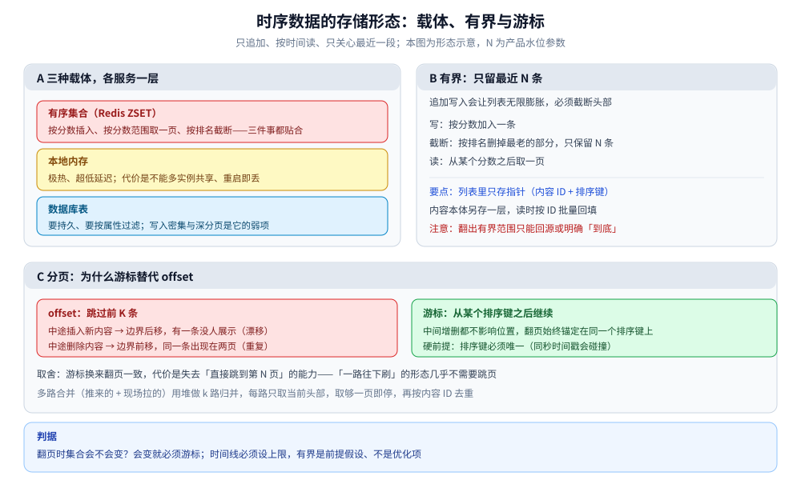

# 时序数据存储

> 消息历史、Feed 时间线、日志、指标——这类「**只追加、按时间读、只关心最近一段**」的数据怎么存：
> 载体怎么分工、为什么要设上限、为什么必须游标分页、多路来源怎么合并。
>
> ⭐ **边界**：本篇讲这类数据的**存储形态与读写路径**（不碰具体产品）；**产品选型与参数**
> （VictoriaMetrics / GreptimeDB / ClickHouse 等怎么选）在 [时序数据库](../../时序数据库/时序数据库选型对比.md)。
>
> 本篇是**跨场景的归纳篇**：不引入新的实测读数，结构口径来自关联篇目的推导。
>
> 内容整理自个人学习笔记，素材见 [素材清单](../../../../素材清单.md)。

---

## 一、这类数据的共同形态是什么？

**本节要点**：把「消息 / 时间线 / 日志 / 指标」放在一起看，它们的**读写形状**是一样的——这也正是它们能用同一套存储手法的原因。

### 1.1 三个共同点

| 特征 | 含义 | 直接推论 |
|---|---|---|
| **只追加** | 极少按主键改历史，基本只有新增 | 写入不必维护复杂索引；分区 / 分片按时间做 |
| **按时间读** | 访问总是「最近一段」或「某个时间窗口」 | 排序键就是时间；范围读是主查询 |
| **热点集中** | 绝大多数读落在最近一小段 | 天然适合冷热分层，且检索键要能定位到「最近」 |

### 1.2 与「关系型数据」的分界

同样是「存下来」，时序类数据的**第一性问题不是「怎么保证唯一」，而是「怎么在写得多、读得偏的情况下维持范围读的代价」**。所以：

- 关系型强调**约束与事务**（唯一、外键、多行原子）；
- 时序类强调**追加吞吐 + 范围读 + 有界**。

⚠️ 这不是「数据库类型之争」，而是**访问形状之争**：同一份数据在两种形状下，选型会完全不同。

---

## 二、存在哪：三种载体怎么分工？

**本节要点**：这类数据要支持三个动作——**按排序键插入一条**、**从某个位置往回取一页**、**只保留最近 N 条**。哪个载体把这三件事都做便宜，就是默认选择。

### 2.1 三种载体

| 载体 | 结构 | 适合 | 不适合 |
|---|---|---|---|
| **有序集合**（内存） | 哈希表 + 跳表 | 按分数范围读、按分数插入、按排名截断 | 内存成本；要自己管一致性 |
| **本地内存** | 进程内有序容器 | 极热的个人列表、超低延迟、可容忍重启丢失 | 多实例共享、持久化、容量受限 |
| **数据库表** | 关系表 + 索引 | 需要持久、要按属性过滤、要事务 | 写入密集；深分页代价高 |

⭐ 为什么有序集合是默认：插入、范围取页、按排名截断都是对数复杂度（跳表定位 + 范围扫描），**正好贴合这三个动作**。

### 2.2 指针 / 本体分离

⭐ 判据：**列表里只存「指针」（内容 ID + 排序键），内容本体另存一层**。

- **省空间**：列表条目数远多于内容数（每条还要在多个列表里各出现一次）；
- **好更新**：内容编辑 / 删除只改本体，不用回头改所有列表；
- **能批量回填**：一页 N 条按 ID 批量取（`MGET` / 批量点查），减少往返。

一句话：**列表是「索引」，本体是「真相」**——前者丢了能重建，后者不能；两者不该放同一种存储，也不该有同一个生命周期。

### 2.3 三种载体常是分层共存

热层用内存有序集合、温层用数据库表、冷层用对象存储 + 列式文件。选型不是「三选一」，而是**同一份数据在三层各选一个**。分层的边界与回填见 [冷热数据分层.md](../横切篇/冷热数据分层.md)。

---

## 三、为什么要「有界」？

**本节要点**：只追加的列表会**无限膨胀**，所以「只保留最近 N 条」是这类数据的前提假设，不是可选优化。

### 3.1 做法

```text
写入：ZADD list score member
截断：ZREMRANGEBYRANK list 0 -N-1     ← 按排名删掉最老的部分，只保留最近 N 条
读取：ZREVRANGEBYSCORE list (cursor -inf LIMIT 0 pageSize
```

### 3.2 代价与选择

- **代价**：翻到 N 条之外时，「列表里没有了」——只能**回源**（按主体 + 时间重查）或明确告诉用户「到底了」；
- **N 怎么定**：由产品「最多翻多少页」与内存预算共同决定，**不套用别处的数字**；
- ⚠️ **有界 + 回源是一对**：只做有界不给回源路径，等于给用户设了一个没有说明的边界。

### 3.3 上限还有第二个作用

给列表设上限（条数或主体数），等于给下游留出**确定的最坏情况**：缓存大小、全量拉取、遍历成本全都变可控。这也是很多产品给「关注数 / 好友数」设上限的原因。

---

## 四、分页：为什么游标替代 offset？

**本节要点**：时序列表是**边翻边变**的，而 `offset` 假设「集合是静止的」。只要读取过程中集合在变，「跳过 K 条」就没有稳定含义。

### 4.1 offset 的两个毛病

| 毛病 | 现象 | 原因 |
|---|---|---|
| **漂移（漏条）** | 同一条没人展示 | 翻页前顶部插入新内容，原来的第 K 条被挤到 K+1 位，下一页从新的 K+1 开始 |
| **重复** | 同一条出现在两页 | 翻页前有内容被删除，后面整体前移，原本第 K+1 条变成第 K 条 |

### 4.2 游标怎么做

不用「跳过多少条」，改用「**从哪个位置之后继续**」：用上一页**最后一个条目的排序键**当游标，取「分数小于它」的左开区间。中间插入 / 删除都不影响锚点位置。

### 4.3 硬前提：排序键必须唯一

| 排序键 | 碰撞来源 | 解法 |
|---|---|---|
| 纯时间戳 | **同一秒**内多条并列 | 用有序发号器（如雪花 ID），天然唯一且单调 |
| 综合分（浮点） | 浮点碰撞更常见 | 用「(综合分, 内容 ID)」复合键，同分用 ID 破平 |

⭐ 一句话：**游标分页与唯一排序键是一对**。想用游标，就必须先保证排序键唯一。

### 4.4 取舍

**游标换来翻页一致性，代价是失去「直接跳到第 N 页」的能力**。这类列表的形态是「一路往下刷」，几乎不需要跳页，所以这笔交易非常划算；产品若真要跳页，得另想办法（如快照），别硬套游标。



图怎么读：A 面板是三种载体的分工——有序集合（按分数插入 / 范围取页 / 按排名截断都贴合）、本地内存（极热但不可多实例共享）、数据库表（持久与属性过滤，写入密集与深分页是弱项）。B 面板是「有界」：写一条、按排名截断只留最近 N 条、从某个分数之后取一页，且列表里只存指针、内容本体另存一层，翻出有界范围只能回源或明确「到底」。C 面板是游标与 offset 的对照：offset 在中途增删时会漏条或重复，游标锚定排序键位置不受影响，但硬前提是排序键唯一。图里的 N 是产品水位参数，不给具体数值。

---

## 五、多路来源怎么合并去重？

**本节要点**：一旦数据来自多路（推来的 + 现场拉的、主列表 + 插入流、本地旧页 + 服务端新页），读取时就必须**归并 + 去重**，且**归并要一次到位**。

### 5.1 归并：每路只取一点

- **错误做法**：每路都取满一页再拼起来排序取前 N——若第 1 路就贡献满页，其余路取的全被丢弃，白白多读；
- **正确做法**：每路当作有序游标流，用**堆做 k 路归并**，每次只从堆顶取一条，取够 N 条就停；
- **复杂度**：取一页 = `O(pageSize × log k)`，k 是路数；**k 要设上限**，否则首屏延迟随路数增长。

### 5.2 去重：按内容 ID

- **为什么会重复**：同一内容可能既被推过又被现场拉过；插入流也可能命中主列表已有的内容；
- **去重键**：**内容 ID**（全局唯一），**不是排序键**——排序键会因不同信号而变，拿它去重会漏；
- **判重位置**：**在合并这一步**。写入时判重只能防「同一路内重复」，防不了「多路之间重复」。

---

## 六、乱序数据怎么处理？

**本节要点**：这类数据号称「只追加、按时间排」，但**真实世界的写入常带乱序**（网络延迟、时钟不准、批量补传）。乱序会直接破坏第四节那套「按时间游标分页」的连续性。

### 6.1 为什么会乱序

| 成因 | 表现 |
|---|---|
| **网络 / 采集延迟** | 先发生的事件后到（日志、埋点、监控上报） |
| **客户端时钟不准** | 不同机器的时间戳本就不可比，快慢不一 |
| **批量补传 / 重放** | 设备离线后一次性补传历史，时间戳全落在过去 |

### 6.2 乱序会破坏什么

- **游标分页**：游标锚定「上一页最后一个排序键」，而乱序到达的数据会**插进已经翻过的区间**——下一页看不到它（漏条）；
- **有界截断**：`按排名截断` 隐含假设「新的在末尾」，乱序写入会打乱「谁才是最近 N 条」；
- **分区 / 冷热下沉**：按时间分区时，迟到的数据会落进**已经下沉 / 已经封存**的旧分区，甚至写到已关闭的分区。

### 6.3 三种应对

| 手段 | 怎么做 | 解决什么 / 不解决什么 |
|---|---|---|
| **水位线（Watermark）+ 允许延迟窗口** | 维护一个「事件时间水位」，只处理「时间戳 ≤ 水位」的数据；水位 = 当前最大事件时间 − 允许延迟。窗口内迟到照常并入，超出窗口的走**迟到侧**单独处理 | 解决「迟到多久还算数」；⭐ 窗口 = 你能容忍的迟到时长，**窗口越长结果越准但延迟越大** |
| **复合排序键（时间戳, 唯一 ID）** | 排序键从「时间戳」升级为「(时间戳, 单调发号器 / 唯一 ID)」 | 解决**同键碰撞**（第四节那条硬前提）；⚠️ **不解决迟到**——迟到的数据排序键更小，仍会插到前面 |
| **分区按「到达时间」而非「事件时间」** | 写入按**服务器接收时间**分分区，保证「新到达的一定写进当前分区」；再在**读侧**按事件时间重排 / 去重 | 解决「写回已关闭分区 / 被拒写」；代价是牺牲「分区即有序」 |

### 6.4 一条硬约束

⚠️ **「按事件时间严格有序」与「写入不被阻塞」不可兼得**：要严格有序，就得缓冲等待（用延迟换准确）；要低延迟，就得接受乱序，在读侧用**归并 + 水位线**兜住。

⭐ 与第四节的呼应：游标分页要求「排序键唯一」，乱序额外要求「排序键还能对齐读序」——所以日志 / 监控这类**到达顺序不可控**的数据，常见组合是「**复合键 + 读侧归并 + 水位线**」，而不是硬保证写入有序。

---

## 使用：按时序数据的读模式选结构

**本节要点**：先看读的模式，再选载体与分页方式；这张表是起点，具体仍按真实水位裁剪。

| 读的模式 | 载体 | 分页 | 第一判据 |
|---|---|---|---|
| 只从头顺序消费 | 列表（队列） | 偏移即可 | 要不要从中间位置开始取 |
| 要按分数 / 时间**翻页** | **有序集合** | **游标** | 翻页时集合会不会变 |
| 要持久 + 按属性过滤 | 数据库表（分区） | 游标 + 索引 | 是否需要事务与属性过滤 |
| 极热、可容忍重启丢 | 本地内存 | 游标 | 能否容忍多实例不一致 |
| 翻出有界范围之后 | 回源数据库 / 冷层 | 同上 | 回源还是「到底」，产品要选一个 |

⭐ 三条横向判据：**① 有界是前提，不是优化**；**② 游标的前提是排序键唯一**；**③ 多路来源必须在读取时再去一次重**。

## 延伸追问

- **为什么列表只存指针、不存正文？** → 一是省空间（条目数远多于内容数，且每条要在多个列表里出现）；二是内容更新 / 删除时不用动所有列表；回填时按 ID 批量取即可。
- **游标能不能直接用时间戳？** → 行，但要解决同秒碰撞。用发号器，或「(时间戳, 内容 ID)」复合键，才能唯一定位。
- **有界列表被截断后，用户想一直往下翻怎么办？** → 要么回源数据库重查（慢但完整），要么明确「到底了」（快但翻不深）；产品必须选一个。
- **多路合并时路数太多怎么办？** → 给 k 设上限，只合并排序靠前的若干活跃来源；翻得更深时再补拉。
- **内存里的列表挂了怎么办？** → 列表是可重建的派生数据（从本体按关系重算），所以可以**不持久**；关键是把「重建」路径准备好，别把它当唯一数据源。
- **它和时序数据库是一回事吗？** → 不是。本篇讲的是**这类数据的存储形态与读写路径**；产品的引擎、压缩、查询语言与运维在 [时序数据库](../../时序数据库/时序数据库选型对比.md)。
- **水位线要定多长？** → 由业务能容忍的延迟定：监控可以短窗口（秒级），离线分析可以长窗口（小时级）；窗口越长越准，但结果产出越晚。
- **迟到超过窗口的数据怎么办？** → 走「迟到侧」单独处理，或直接丢弃并计数（按业务定）；关键是**别让它悄悄消失**——要么并入，要么明确告知。

## 关联

- [时序数据库选型对比.md](../../时序数据库/时序数据库选型对比.md) — 本篇的**产品侧**：时序引擎这一族怎么选（边界见本篇引语）
- [时间线存储与分页.md](../../../../04-架构与系统/系统设计/Feed流系统/时间线存储与分页.md) — 载体选择、有界、游标分页与冷热分层的场景版
- [排序与去重.md](../../../../04-架构与系统/系统设计/Feed流系统/排序与去重.md) — 稳定排序键怎么来、多路去重的完整口径
- [搜索与历史.md](../../../../04-架构与系统/系统设计/IM系统/搜索与历史.md) — 消息历史按冷热分层存放、按需逐层取
- [存储选型与组合.md](../存储选型与组合.md) — 多存储组合的总纲：时间线在这里是「派生副本」的典型
- [海量数据存储设计.md](../../../../04-架构与系统/系统设计/海量数据存储设计.md) — 「按数据类型选存储」里时序那一支的开放题视角
- [冷热数据分层.md](../横切篇/冷热数据分层.md) — 分层的通用形态：这类型数据的冷热边界怎么定、怎么下沉
- [关系数据存储.md](关系数据存储.md) — 有界列表、指针 / 本体分离这两条手法的另一处应用
- [热点数据存储.md](../横切篇/热点数据存储.md) — 追加流里的热点（单个大号、单个房间）怎么处理
- [数据类型.md](../../NoSQL/Redis/数据类型.md) — 有序集合的范围读取与按排名删除
- [底层结构.md](../../NoSQL/Redis/底层结构.md) — 跳表为什么让插入与范围读同为对数复杂度
- [列式数据库选型对比.md](../../列式数据库/列式数据库选型对比.md) — 冷层常用的列式存储
- [深分页与索引变更.md](../../关系型/MySQL/深分页与索引变更.md) — 回源到关系库时，深分页与索引变更的代价
- [消息可靠投递.md](../../../../04-架构与系统/系统设计/IM系统/消息可靠投递.md) — 到达顺序不可控时，消息侧的乱序与重投对齐，第六节「按到达时间分区」的场景呼应
