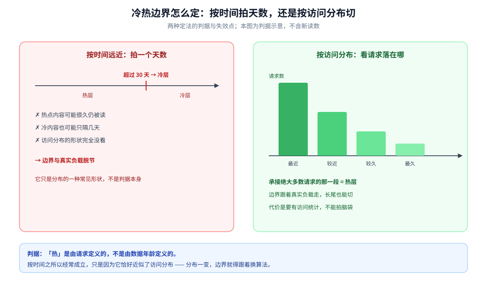
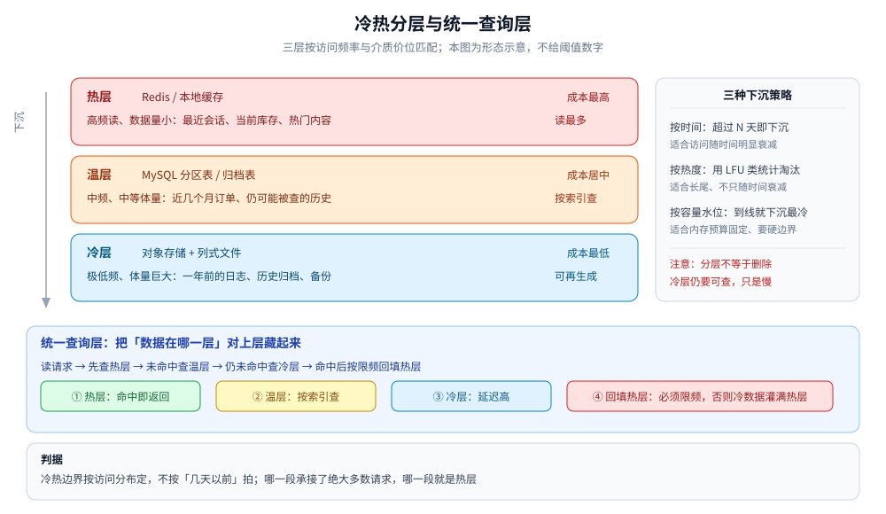

# 冷热数据分层

> 数据不会都值得住最贵的内存。本篇讲「**按访问频率分层**」这条通用形态：边界怎么定、
> 数据沉到哪一层、下沉之后读路径怎么补。
>
> 本篇是**跨场景的归纳篇**：不引入新的实测读数；分层阈值的具体取值取决于产品策略与存储成本，
> 一律由业务定，本篇只给形态与判据。
>
> 内容整理自个人学习笔记，素材见 [素材清单](../../../../素材清单.md)。

---

## 一、冷热边界凭什么定？

**本节要点**：边界只能按**访问分布**定，不能按「几天以前」拍脑袋。这是本节唯一要记住的判据，其余都是它的推论。

### 1.1 两种定法

| 定法 | 做法 | 问题 |
|---|---|---|
| **按时间远近** | 「超过 30 天算冷」 | 拍出来的数字。热点内容可能很久仍被读，冷内容也可能只隔几天 |
| **按访问分布** | 看请求实际落在哪一段 | 需要访问统计，但边界与真实负载对齐 |

⭐ 判据：**哪一段数据承接了绝大多数请求，哪一段就是热层**。「热」是由请求定义的，不是由数据年龄定义的。

### 1.2 为什么现实中常常「看起来像按时间」

多数业务的访问分布确实**随时间衰减**（订单、日志、消息历史都是「最近的天天看，久远的几乎不看」），
于是「按时间」看起来能近似成立。但它只是分布的一种常见形状，**不是判据本身**：

- 访问分布**不只随时间衰减**时（部分内容数据呈长尾），按时间切会把仍在被读的数据提前赶下去；
- 遇到这种分布，改用**按热度**（访问统计）或**按容量水位**。

### 1.3 两种定法放在一起：谁跟着负载走

按时间与按访问分布的差别不在「用不用天数」，而在**边界是否跟着负载走**：按时间只固定了一刀，访问分布一变（热点内容变老、长尾变长）边界就错；按访问分布直接取「承接绝大多数请求的那一段」，分布怎么变边界就怎么变。代价是要有访问统计，不能拍脑袋。

⚠️ 这也是 1.2 那句话的另一面：**「看起来像按时间」只是分布的一种常见形状**，不是判据本身。

图怎么读：左栏红底是「按时间拍天数」，时间轴上切一刀，下方三条是它的失效点；右栏绿底是「按访问分布」，柱形表示请求落在不同数据段，最高的一段就是热层；底部一行把两种定法的判据压成一句。

---

## 二、三层各放什么？

**本节要点**：分层的目的只有一个——**让每一层的成本与它的访问频率匹配**。快而贵的介质只服务少数请求，大而便宜的介质兜住绝大多数数据。

### 2.1 三层

| 层 | 载体 | 特征 | 典型内容 |
|---|---|---|---|
| **热** | 内存缓存 / 本地缓存 | 高频读、数据量小 | 最近会话、当前库存、热门内容 |
| **温** | 关系库分区表 / 归档表 | 中频、中等体量 | 近几个月订单、仍可能被查的历史 |
| **冷** | 对象存储 + 列式文件 | 极低频、体量巨大 | 一年前的日志、历史归档、备份 |

### 2.2 ⚠️ 两个常见误解

1. **分层不等于删除**。冷层仍然**可查**，只是慢；真正决定「能看多久」的是产品策略，成本只决定这份数据存在**哪种介质**上——两者次序不能颠倒。
2. **同一层可以不止一种介质**。热层常见「本地缓存 + 分布式缓存」两级，冷的只服务少数请求，本地那一级挡在最前面。

⭐ 关键：**先定「保留多久」（产品策略），再由它倒推分层**（成本），不要反过来用成本倒推产品承诺。

---

## 三、怎么把数据沉下去？

**本节要点**：下沉策略按**数据为什么变冷**来选——是随时间衰减、还是长尾分布、还是内存预算硬约束。

| 策略 | 做法 | 适合 |
|---|---|---|
| **按时间** | 超过 N 天的数据从热层下沉 | 访问随时间明显衰减（订单、日志） |
| **按热度** | 用访问统计（如 LFU 类计数）淘汰冷的条目 | 访问呈长尾、不只随时间衰减（部分内容数据） |
| **按容量水位** | 热层到容量上限就下沉最老 / 最冷 | 内存预算固定、需要硬边界 |

### 3.1 下沉要顺带解决的两件事

- **搬迁的原子性**：数据「既在下沉的路上、又被读到」时必须能读到，做法通常是**先写新层、再切读路径、最后清旧层**；
- **计数的连续性**：按热度下沉依赖访问统计，统计本身要能跨层累积，否则刚下沉的条目会「从零开始重新变热」。

---

## 四、分层之后读路径怎么补？

**本节要点**：分层的代价全部落在**读路径**上——一个查询可能要跨三层。补法是加一个**统一查询层**，把「数据在哪一层」对上层藏起来。

### 4.1 统一查询层

- **做法**：对上层只暴露「按 ID / 按条件查」，内部按 **热 → 温 → 冷** 顺序查找，命中哪层就回哪层；
- **收益**：业务代码不用知道数据在哪层，分层对它是透明的；
- **代价**：冷层查询延迟高，且越靠后越慢。

### 4.2 回填必须限频

命中冷层后把结果**回填热层**，下次就快了。但：

⚠️ **回填必须限频**。否则一次全量扫描式访问会把冷数据整批灌进热层，把最贵的介质用来存最冷的数据——**分层当场失效**。

### 4.3 异步回捞与预热

- **异步回捞**：冷查询先返回占位，同时起一个异步任务把手柄捞回并预热热层；
- **可预判的场景提前加载**：如「跳转到历史某一段」，可以在跳转前就预取；
- **预热只热已知会热的**：启动或缓存重建时，只预加载最近一段，不要把整条线全拉进内存。

图怎么读：左栏是三层阶梯——热（内存缓存：最近会话、当前库存、热门内容）、温（关系库分区表 / 归档表：近几个月订单）、冷（对象存储 + 列式文件：一年前的日志与归档），左侧「下沉」箭头贯穿；右栏是三种下沉策略（按时间 / 按热度 / 按容量水位）与两条注意（分层不等于删除、冷层仍要可查）。底部是统一查询层：读请求按 ① 热层命中即返回 → ② 温层按索引查 → ③ 冷层延迟高 → ④ 回填热层（必须限频）的顺序走。图里不给任何阈值数字，冷热分界的取值由业务定。

---

## 五、下沉之后，原来的查询怎么办？

**本节要点**：分层会改变**查询代价的形状**，不会改变「查询还要能跑」这个要求。两处最容易出问题。

### 5.1 按老 ID 查旧数据

用户翻开很久以前的记录、按老 ID 点查，是最常见的「冷查询」。它必须能跑通，靠的就是统一查询层：上层照常按 ID 查，下层逐级找。**代价是这次请求慢**，可以用异步回捞把它从关键路径上摘出去。

### 5.2 深分页

温层用关系库承接时，**深分页（大 `OFFSET`）本来就慢**——它要跳过前面所有行。分层不会让它变快，只会把「慢」从热层挪到温层。

- 优先用**游标分页**（锚定排序键）替代大偏移；
- 归档表按**查询维度**建索引，别只按主键；
- ⚠️ 冷层不要做深分页，只做「按 ID 点查」或「按分区扫描」。

### 5.3 冷热交界处的两个坑

| 坑 | 现象 | 应对 |
|---|---|---|
| **回填污染** | 冷数据被灌进热层，热层水位失控 | 回填限频 + 设置回填的容量上限 |
| **边界抖动** | 数据在层间来回搬 | 下沉 / 回填各设一个阈值，两者留出迟滞区间 |

---

## 六、冷数据不只是「怎么存」，还有「怎么合规地删」

**本节要点**：分层解决的是「怎么存、存在哪」，但**「被遗忘权」这类合规删除会在冷层上直接撞墙**——冷层为「顺序扫、批量算」而优化，恰恰最不擅长「按某一个人精准删一行」。

### 6.1 为什么冷层删不动

| 层的形态 | 「删一个人」的代价 |
|---|---|
| 热 / 温层按主体可定位 | 按主键 / 索引找到那几行，删除即可 |
| **冷层是列式文件（Parquet 等）+ 对象存储** | 文件**不可变**——改一行 = 读整个文件、过滤、写回一个新文件 |

三个叠加的难点：

1. **文件级不可变**：列式文件为压缩与顺序扫优化，**不支持就地删除**，最小的删除单位是「一个文件」；
2. **一个人散在多个文件 / 多个分区**：他的数据按时间散落在多年归档里，删他要找到并重写**所有**含他的文件；
3. **分区若只按时间切**：冷层按时间分区时，找「这个人的数据在哪几个文件」没有索引，只能**全量扫**——代价随归档规模爆炸。

### 6.2 四种做法（按合规口径选）

| 做法 | 怎么做 | 适合 | 代价 |
|---|---|---|---|
| **主键定位 + 重写** | 靠一个「主体 → 文件 / 分区」的索引（或反向索引）找到所有含该主体的文件，逐个读-过滤-重写 | **要求物理删除**、主体删除量不大 | 该分区全量重写（写放大）；宜**攒批**后一起重写 |
| **墓碑 + 读时过滤** | 在线只记「该主体已删」，冷层读路径把命中墓碑的行过滤掉，物理删除攒批延后 | 合规口径是「**不可再被检索 / 使用**」 | 冷层数据**实际还在**，不满足「字节彻底消失」的强口径 |
| **布隆过滤器 / 索引加速判断** | 按主体建布隆过滤器（或分桶索引），先判「这批文件里**一定没有**他」，快速跳过 | 加速上面两种做法 | ⚠️ 只有「**一定没有 / 可能有**」，**不能用来证明存在**——只能做跳过，不能做删除依据 |
| **加密抹除（crypto-shredding）** | 按主体加密（每个主体一把密钥），删数据 = **删密钥**，密文随即成为垃圾 | 主体粒度清晰、密钥管理能力足够 | 密钥管理复杂；读时要解多把钥；密钥本身也要安全保管 |

### 6.3 判据

- **先定合规口径**：「删除」是「**不可再被检索 / 使用**」还是「**物理字节彻底消失**」？前者可用墓碑 + 过滤，后者必须重写；
- **冷层要按「删除的维度」可定位**：常见删除维度是**主体（人）**，那冷层就得有按主体定位分区的索引——**如果冷层只按时间分区，删一个人就要扫所有时间分区**；
- **在线只记意图、离线做删除**：删除请求落在热层（记墓碑），物理删除走**离线批处理**（和「下沉」复用同一套批处理链路），⚠️ 别在在线请求里触发重写冷文件；
- ⭐ **分区维度的取舍**：按时间分区利于「读最近」，按主体分区利于「删某人」；多数系统**主分区按时间、副索引按主体**，删除时用副索引反查文件。

---

## 使用：按访问分布定层

**本节要点**：下面是一张定层自查表，从上到下走一遍，冷热边界与下沉策略就定了。

| 问题 | 怎么答 |
|---|---|
| **保留多久**由谁定？ | 产品策略先定，再由它倒推分层；不要用成本倒推产品承诺 |
| 数据为什么变冷？ | 随时间衰减 → 按时间；长尾 → 按热度；内存硬约束 → 按容量水位 |
| 冷层要不要能查？ | 要。分层不等于删除，冷层慢但必须可查 |
| 谁来屏蔽「数据在哪层」？ | 统一查询层，对上层按 ID 查，内部逐级找 |
| 命中冷层后回填吗？ | 回填，但**必须限频**，并给它容量上限 |
| 深分页怎么办？ | 温层用游标分页替大偏移；冷层不做深分页 |

## 延伸追问

- **分层会不会让用户「丢历史」？** → 不会。分层只是**换介质**，不是删除；决定「能看到多久」的是产品策略，成本只决定存在哪种介质上。
- **为什么不能直接用「超过 N 天」当下沉规则？** → 因为它是拍的，不是判据。访问分布一旦不只随时间衰减，「按时间」就会把还在被读的数据提前赶下去。
- **回填为什么一定要限频？** → 不限频时，一次冷扫描会把冷数据整批搬进热层，最贵的介质去存最冷的数据，分层就白做了。
- **冷层查询太慢怎么办？** → 用异步回捞把它从关键路径摘出去；可预判的场景就提前预热。
- **分层和副本是不是一回事？** → 不是。分层是**同一份数据在不同生命周期的位置**，副本是**同一份数据在同一时刻的多份**；两者可以叠加，但判据不同。
- **分层边界该按「条数」还是「时间」表达？** → 实现上通常是时间或水位，但**判据永远来自访问分布**——先看分布，再选一个能近似它的实现口径。
- **墓碑和真删除怎么选？** → 先看合规口径。要求「不可再被使用」→ 墓碑 + 读时过滤；要求「字节消失」→ 主键定位 + 重写，且冷层要按**删除维度**建索引。
- **加密抹除是不是万能？** → 不是。它把「删数据」换成「删密钥」，代价是密钥管理复杂、读时要解多把钥、密钥本身也要严格保管——只适合主体粒度清晰的场景。

## 关联

- [存储选型与组合.md](../存储选型与组合.md) — 多存储组合的总纲，冷热分层是其中一节；本篇把这一节展开成通用形态
- [海量数据存储设计.md](../../../../04-架构与系统/系统设计/海量数据存储设计.md) — 「海量」的两条突破路线之一就是分层，开放题视角
- [时间线存储与分页.md](../../../../04-架构与系统/系统设计/Feed流系统/时间线存储与分页.md) — 时间线的热温冷三层与「回源还是到底」的取舍
- [搜索与历史.md](../../../../04-架构与系统/系统设计/IM系统/搜索与历史.md) — 历史消息按冷热分层存放、按需逐层取
- [时序数据存储.md](../形态篇/时序数据存储.md) — 时序类数据的分层最典型：最近一段常驻、久远下沉
- [关系数据存储.md](../形态篇/关系数据存储.md) — 列表类数据的有界与回源，与分层是同一组取舍
- [缓存淘汰算法.md](../../缓存/缓存淘汰算法.md) — 热层内部怎么淘汰，与「按热度下沉」共用访问统计
- [缓存容量与治理.md](../../缓存/缓存容量与治理.md) — 热层水位与容量治理，回填限频的上游约束
- [列式数据库选型对比.md](../../列式数据库/列式数据库选型对比.md) — 冷层常用的列式文件与列式引擎
- [数据同步方式选型对比.md](../../数据同步/数据同步方式选型对比.md) — 数据在层间搬迁时的一致性路线
- [深分页与索引变更.md](../../关系型/MySQL/深分页与索引变更.md) — 温层深分页的代价与索引变更风险
- [数据导入导出设计.md](../../../../04-架构与系统/系统设计/数据导入导出设计.md) — 批量数据进出的任务化与一致性，与「攒批删除 / 重写」是同一类批处理形态，第六节的做法可复用它
> 反向引用（本篇被下列文档引到）：[热点数据存储.md](热点数据存储.md)
