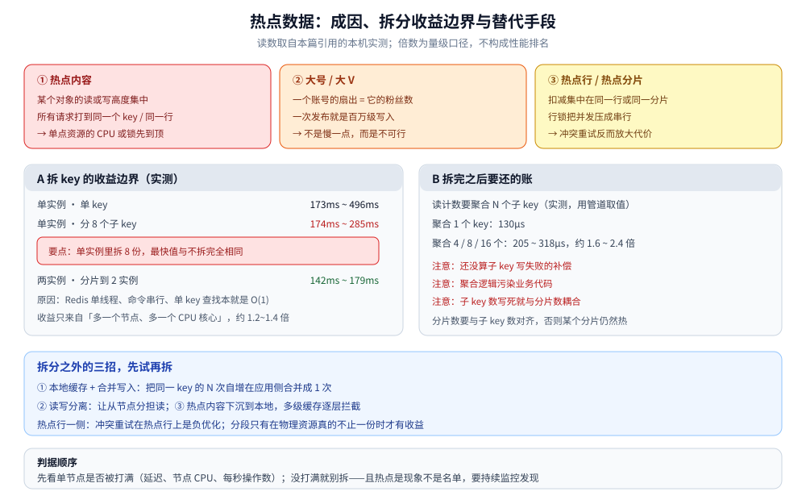

# 热点数据存储

> 访问集中到同一个对象（key / 行 / 分片）时怎么存：热点怎么会形成、「拆 key」为什么在单实例上
> 一点用都没有、拆完要还哪些账、以及拆分之外先该试的三招。
>
> 本篇是**跨场景的归纳篇**：不引入新的实测读数，所引读数均来自关联篇目的本机实测。
>
> 内容整理自个人学习笔记，素材见 [素材清单](../../../素材清单.md)。

---

## 一、热点是怎么产生的？

**本节要点**：热点不是「某个 key 特别大」，而是**访问集中**——同一时刻，绝大多数请求落到同一个对象上。成因有三类，处理手法不同。

| 成因 | 机制 | 压力的落点 |
|---|---|---|
| **① 热点内容** | 某个对象的读或写高度集中（热门内容、热点房间） | 承载它的那一个 key / 那一个节点 |
| **② 大号 / 大 V** | 一个主体的**扇出 = 它的粉丝数**，一次发布就是百万级写入 | 写入侧（一次操作放大成 m 次写） |
| **③ 热点行 / 热点分片** | 扣减集中在同一行或同一分片 | 行锁把并发压成串行 |

⭐ 三类热点的**第一性问题不同**：① 是「单点资源被打满」，② 是「一次操作被放大」，③ 是「并发被串行化」。所以下面的手法也分三类，别混用。

---

## 二、为什么「拆 key」在单实例上一点用都没有？

**本节要点**：直觉答案是「把 key 拆成 N 份」，但**拆 key 本身不产生任何收益**。原因是内存存储的执行模型——**单线程、命令串行、单 key 查找本就是 O(1)**。收益只来自「拆到不同节点」。

### 2.1 实测：同一个计数，三种分法

```text
单实例 · 单 key          : 173ms ~ 496ms
单实例 · 分 8 个子 key    : 174ms ~ 285ms      ← 最快值与不拆完全相同
两实例 · 分片到 2 实例    : 142ms ~ 179ms      ← 收益出现在这里
```

（10 万次自增、管道批量、预热后连跑 5 次取区间；交叉核对用的镜像自带压测工具也在同一量级。）

### 2.2 三条结论

1. ⭐⭐ **单实例内拆 key 几乎没有收益**：`173ms` 对 `174ms`，**最快值完全一样**。Redis 单线程，所有命令串行过一遍；单 key 查找是 O(1)，key 数量不改变单实例的 CPU 上限。
2. ⭐ **收益只在跨实例 / 跨分片时出现**：`142ms` 对 `173ms`，约 1.2 倍（压测工具侧约 1.4 倍）。因为那才是**两个 CPU 核心 / 两个节点**。
3. ⚠️ **拆分收益有上限**：本机远达不到「2 倍」，因为瓶颈先落在容器网络与客户端上，而不是存储的 CPU。这恰恰是判据所在——**先看单节点是否先被打满**。

### 2.3 判据

| 问题 | 判据 |
|---|---|
| 要不要拆热 key？ | **先看单节点是否被打满**（延迟、节点 CPU、每秒操作数）。没打满，拆了也没收益 |
| 怎么拆才有收益？ | 拆到**不同实例 / 分片**上；且分片数要与子 key 数对齐，否则某个分片仍然热 |
| ⚠️ 拆完就没事了？ | 不是。**热点是现象，不是一个固定名单**——要持续监控发现新的热点 |

---

## 三、拆完之后要还哪些账？

**本节要点**：拆 key 把「单点压力」换成了「聚合成本 + 一致成本 + 耦合成本」，这三笔账通常被忽略。

| 账 | 具体是什么 |
|---|---|
| **聚合读的代价** | 读一次计数要聚合 N 个子 key：实测聚合 4 / 8 / 16 个落在 **205 ~ 318µs**，而单个 key 只要 **130µs**，约 1.6 ~ 2.4 倍（用管道取值，所以不是线性叠加） |
| **写失败的补偿** | 某个子 key 写失败 → 计数少算 → 需要补偿逻辑 |
| **业务代码被污染** | 聚合逻辑散进业务，读一处计数变成读 N 处 |
| **与分片数耦合** | 子 key 数一旦写死，就和分片数绑在一起，改分片要改代码 |

⚠️ 这四笔账里，**「聚合读」只是明面上的那一笔**；后两笔才是长期维护成本。

---

## 四、拆分之外，先试哪三招？

**本节要点**：在动手拆之前，有三条更省事的路，代价明显更小。

1. **本地缓存 + 合并写入**：把同一个 key 的 N 次自增在**应用侧合并成 1 次**，再写存储——直接减少请求数，而不是分散请求；
2. **读写分离**：让从节点分担读；计数这种「读多写也多」的场景，读会先被分担掉；
3. **热点内容下沉到本地**：常被读的热点对象放本地缓存，多级缓存逐层拦截，让热点在到达存储前就被挡住。

⭐ 这三招的顺序是**「先减少请求、再分散请求」**：减少请求不引入新的成本和耦合，分散请求会把第三节那四笔账全带上。



图怎么读：顶部是三种成因——热点内容（读或写高度集中，单点资源先到顶）、大号 / 大 V（扇出 = 粉丝数，一次发布百万级写）、热点行 / 热点分片（行锁把并发压成串行）。A 面板是收益边界：单实例单 key 173ms ~ 496ms、分 8 个子 key 174ms ~ 285ms，**最快值完全相同**；只有分到两实例才出现 142ms ~ 179ms、约 1.2~1.4 倍，收益来自「多一个节点、多一个 CPU 核心」。B 面板是拆完之后要还的账：聚合 4 / 8 / 16 个子 key 要 205 ~ 318µs（单 key 130µs），还没算子 key 写失败补偿、聚合逻辑污染业务、子 key 数与分片数耦合。底部是替代三招与判据顺序——先看单节点是否被打满，没打满就别拆。

---

## 五、热点行和热点键有什么不同？

**本节要点**：热点键（第三节那类）是**读 / 写请求集中在同一个 key**；热点行是**并发更新集中在同一行数据**。两者的手法不能互换。

| | 热点键 | 热点行 |
|---|---|---|
| 症状 | 单个节点 CPU / 网络先到顶 | 行锁把并发**压成串行** |
| 典型场景 | 计数、热门读 | 库存扣减、余额扣减 |
| 常用手法 | 拆到不同实例、本地缓存合并写 | 把扣减搬到内存原子操作、再异步落库 |
| ⚠️ 反例 | 单实例拆 key 无收益 | **在热点行上用「比较并交换 + 失败重试」是负优化**——本仓实测在热点行上重试量级到 9.2 万次且出现漏卖 |

### 5.1 为什么 CAS 在热点行上是负优化

冲突少时，「比较并交换 + 失败重试」很划算；但**热点行上冲突几乎必然发生**，于是重试次数爆炸，还把「本来该失败」的请求变成了「重试后成功」——**既放大了资源消耗，又破坏了语义**（本仓实测出现漏卖）。

### 5.2 「分段」能不能解决热点行

要看**底下的物理资源**：如果扣减最终仍落在同一个单点上，分段只是把请求绕一圈再回来，**没有收益**（甚至因轮询兜底而变慢）；只有物理资源真的不止一份时，分段才有意义。

⭐ 一句话：**先问「瓶颈在哪个物理资源上」，再决定要不要分。** 分的是物理资源，不是逻辑名字。

---

## 六、热点是现象，不是名单

**本节要点**：热点会转移——今天的热点内容明天就冷了，大号名单每天在变。所以热点处理是**持续过程**，不是一次性改造。

- **要监控**：节点 CPU、每秒操作数、延迟分位、热点 key 采样——**先看得见，才谈得上处理**；
- **要能发现新的热点**：用采样或热点统计工具持续发现，而不是靠一份人工维护的清单；
- **大号名单离线算**：粉丝数涨落频繁，用离线任务定期刷新，在线按名单走——实时判定会让关键路径依赖一个易变的量。

---

## 使用：热点自查顺序

**本节要点**：发现「某个对象很慢」时，按这个顺序往下走，别一上来就拆。

| 步 | 做什么 | 判据 |
|---|---|---|
| ① | **确认瓶颈在哪个物理资源** | CPU / 网络 / 锁 / 磁盘，先定位，别猜 |
| ② | **看单节点是否被打满** | 没打满 → 拆分没有收益，回头查别的原因 |
| ③ | **先减少请求** | 本地缓存、合并写入、多级缓存逐层拦截 |
| ④ | **再分散请求** | 拆到不同实例 / 分片，且分片数与子 key 数对齐 |
| ⑤ | **检查是不是热点行** | 是 → 别用重试型 CAS；把扣减收敛到一个原子点 |
| ⑥ | **建立持续监控** | 热点是现象不是名单，要能发现新的 |

## 延伸追问

- **拆了 key 为什么没变快？** → 因为瓶颈不在「key 的个数」，而在承载它的那一个节点的 CPU / 网络。单线程串行执行时，key 数量不改变单实例上限。
- **拆到多少个分片才够？** → 分到「每个分片都不再是先到顶的那个」为止；拆过头只会把第三节那四笔账放大，收益不变。
- **热点行能不能直接换成分段？** → 先看物理资源。物理上仍是同一个单点时分段无收益，还会引入轮询兜底的开销。
- **大号名单要不要实时算？** → 不要。粉丝数变化频繁，实时判定会让发布路径依赖一个易变的量；离线定期刷、在线按名单走。
- **热点和冷热分层是同一个问题吗？** → 不是。分层解决「**数据放哪一层**」，热点解决「**同一时刻请求集中到同一个对象**」；两者常同时出现，但判据不同。
- **限流能不能治热点？** → 只能缓解入口压力，治不了「同一个对象」这件事——被限掉的请求要么排队要么失败，热点本身还在。

## 关联

- [评论点赞设计.md](../../../04-架构与系统/系统设计/社交互动系统/评论点赞设计.md) — 热点键的完整推导与实测读数（本篇第二、三节的数据出自此）
- [库存系统设计.md](../../../04-架构与系统/系统设计/秒杀系统/库存系统设计.md) — 热点行的扣减闭环：原子预扣、锁内重判与分段判据
- [总体设计.md](../../../04-架构与系统/系统设计/秒杀系统/总体设计.md) — 「真正的瓶颈是同一行」这条判据的出处与分段实测
- [商品详情页设计.md](../../../04-架构与系统/系统设计/秒杀系统/商品详情页设计.md) — 热点内容下沉到本地的多级缓存做法
- [关注粉丝设计.md](../../../04-架构与系统/系统设计/社交互动系统/关注粉丝设计.md) — 热点成因之二（大号扇出）与推拉分流阈值
- [限流与防刷.md](../../../04-架构与系统/系统设计/IM系统/限流与防刷.md) — 按主体做哈希分片，避免单个大号的键打爆一个分片
- [存储全景.md](../../../04-架构与系统/系统设计/弹幕系统/存储全景.md) — 热点房间缓存：读高度集中时在库前挡一层
- [存储选型与组合.md](存储选型与组合.md) — 多存储组合的总纲：热点内容与冷热分层在这里是两种不同的角色问题
- [冷热数据分层.md](冷热数据分层.md) — 另一类「放哪一层」的问题，与热点正交
- [关系数据存储.md](关系数据存储.md) — 大号扇出的写入放大与推拉分流
- [时序数据存储.md](时序数据存储.md) — 追加流里的热点：单房间、单主体的写入集中
- [缓存问题与方案.md](../缓存/缓存问题与方案.md) — 穿透 / 击穿的发生条件与热点读的关系
- [分布式锁.md](../NoSQL/Redis/分布式锁.md) — 把「同一行」的并发收敛到一个原子点
- [MVCC与锁.md](../关系型/MySQL/MVCC与锁.md) — 行锁与当前读的机制底座：为什么热点行会把并发压成串行
