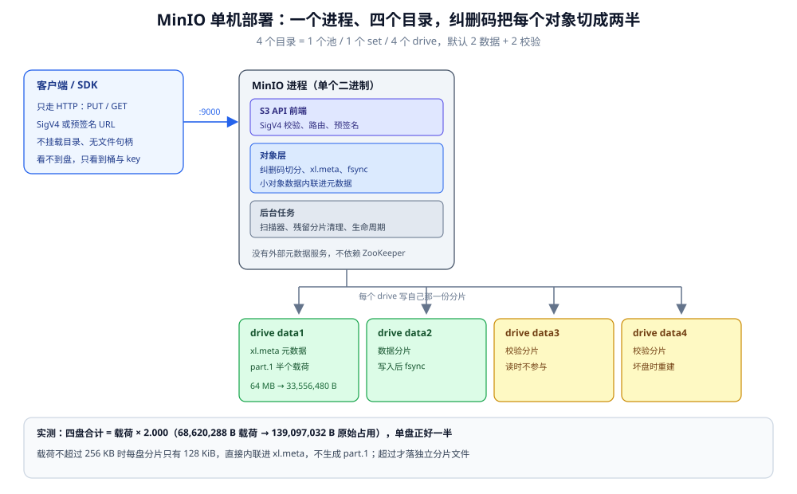
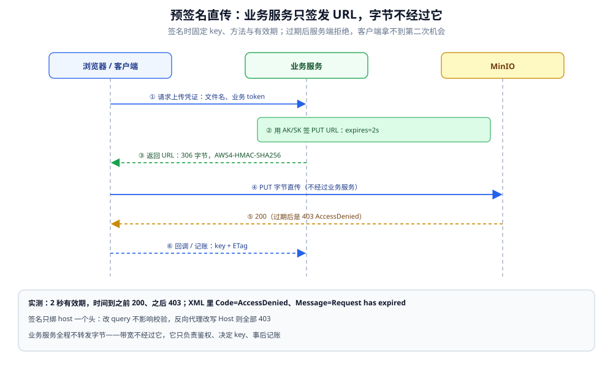
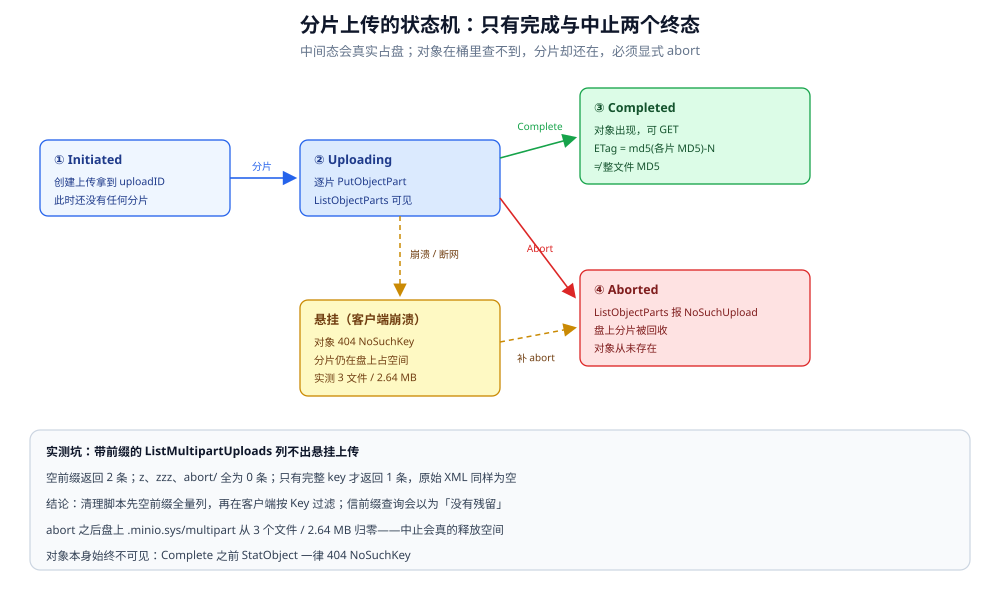

# MinIO

> 覆盖：MinIO 是什么、和 Ceph 与云对象存储的分水岭；单机 4 盘怎么起一套能跑的 S3 服务；
> Bucket / Prefix / 纠删码 / 版本 / 对象锁五组语义；预签名直传、1000 条分页、分片上传与残留分片、
> 以及本机实测的吞吐、延迟、磁盘放大与五个坑。
>
> 不覆盖：Ceph 与对象存储的路线选型见 [对象存储选型对比.md](对象存储选型对比.md)；
> 上传链路的架构（直传 vs 中转、凭证签发）见 [文件存储与上传架构.md](../../../04-架构与系统/系统设计/文件存储与上传架构.md)；
> 对象的不变性与生命周期见 [对象与文件数据存储.md](../存储架构与场景/形态篇/对象与文件数据存储.md)；
> S3 报文结构、签名算法与断点续传的协议细节留待同目录的《S3 兼容协议与分片上传》（尚未成篇）。
>
> 内容整理自个人学习笔记。实测环境：`ghcr.io/coollabsio/minio:latest`（镜像内 `minio --version` =
> RELEASE.2025-10-15T17-29-55Z / go1.24.9）+ `minio-go v7.4.1`，单机 4 盘（EC 2+2），
> 两套后端对比（Windows 绑定挂载 / Docker 命名卷）。读数见第三、五、六、七节与「校验口径」。

---

## 一、一句话定位：它和 Ceph、云对象存储的分水岭在哪

**本节要点**：MinIO 是「**一个进程 + 一组本地目录 = 一套 S3 兼容服务**」；不挂载、不共享、没有独立的元数据服务。所以它和 Ceph 的分水岭是「**要不要跨节点共享目录**」，和云对象存储的分水岭是「**持久性由谁保证**」。

对象存储这个词容易和「共享盘」混淆。MinIO 对外只有一个 HTTP 端点，对象按 key 整块存取：没有随机写、没有 `rename`、没有文件锁。这既是它的限制，也是它简单的来源——不需要元数据集群，不需要给客户端装文件系统驱动。

### 1.1 三条分界线

| 对比对象 | MinIO 是什么 | 另一方是什么 | 判据 |
|---|---|---|---|
| Ceph / 分布式文件系统 | HTTP API，不挂载 | 挂载到 OS 目录，跨节点共享 | 要不要多节点共享同一份目录 |
| 云对象存储（COS / OSS） | 自建几块盘保证持久性 | 云的多可用区保证持久性 | 故障域与运维由谁承担 |
| HDFS | 只能整对象覆盖写 | 支持追加写与多副本管道 | 要不要追加写 |

前两条就是 [对象存储选型对比.md](对象存储选型对比.md) 的结论落到具体产品上；第三条的分水岭在 [HDFS.md](../../大数据组件/文件系统/HDFS.md) 里有完整对照。

### 1.2 什么时候不该选它

- 需要 **POSIX 语义**（随机写、`rename`、目录遍历、文件锁）→ 用 Ceph 一类的分布式文件系统，MinIO 给不了。
- 需要**追加写日志**（HDFS 那种一次写多次追加）→ MinIO 的对象是不可变整块覆盖，追加要先读出来再整块写回。
- 需要**把远端目录挂到本地**用 → 那是文件系统的事；对象存储只能经 SDK 或 HTTP 访问。

### 1.3 本机可用的镜像与版本

⚠️ 社区发行渠道在 2025 年之后收窄，本机 2026-11-01 逐个试过的结果是：`registry-1.docker.io` 直连超时；多个镜像站对 `minio/minio`、`minio/mc` 报 tag 不存在或 403；`dl.min.io` 的二进制下载链接返回 410。最终用的是一个第三方重打包镜像，跑起来的是真 MinIO：

| 项 | 值 |
|---|---|
| 镜像 | `ghcr.io/coollabsio/minio:latest` |
| digest | `sha256:69b55a1c1c5dc285ce04db96689f5b2102317fc77a50680a1874ca6efd1c87f9` |
| 服务端版本 | `RELEASE.2025-10-15T17-29-55Z (go1.24.9 linux/amd64)` |
| commit-id | `DEVELOPMENT.GOGET`（发布者从源码 tag 自行构建，非官方发布二进制） |
| 许可 | GNU AGPLv3 |
| 控制台 | 仍随服务启动，打印随机端口（实测 37057 / 39917 / 40937） |

⭐ 版本口径要写清：`commit-id=DEVELOPMENT.GOGET` 说明这不是官方签名构建，行为可能与官方同版本二进制有细微差异；下文的**机制**结论（纠删码、版本、对象锁）与它无关，但**性能读数**只代表这台机器、这个构建。

---

## 二、核心概念：五个必须先建起来的对象

**本节要点**：Bucket 是命名空间、Prefix 只是 key 的字符串前缀；数据落盘的单位是 drive，冗余手段是纠删码；版本化之后「删除」变成「写标记」，对象锁则在版本之上再加一层时间限制。

### 2.1 Bucket 与 Prefix

Bucket 是全局唯一的命名空间，创建后名字基本不能改。Prefix 不是目录，只是 key 的字符串前缀——控制台里看到的「文件夹」是把同前缀的 key 折叠显示。

实测三个前缀命中数，验证它确实是**字符串匹配**而不是目录遍历：

| Prefix | 命中对象数 | 说明 |
|---|---|---|
| `page/1` | 1000 | 匹配 `page/1000`~`page/1999` |
| `page/12` | 100 | 匹配 `page/1200`~`page/1299` |
| `page/123` | 10 | 匹配 `page/1230`~`page/1239` |

所以「目录」只是给人看的；给对象「分目录」的唯一手段是设计 key 的前缀，而列表操作的成本与命中数量成正比。

### 2.2 key 与「伪目录」

对象由 `bucket + key` 唯一确定，key 里可以带 `/`，但服务端不维护目录实体：写 `a/b/c.txt` 不会自动创建 `a/` 与 `a/b/`，删掉最后一个对象后前缀也会自然消失。这决定了两个常见误判：

- 「目录」不能单独删除，也不能单独授权（权限只能按前缀配策略）。
- 空目录不存在，所以「建目录占位」在对象存储里是无效动作。

### 2.3 Drive、Set 与纠删码

MinIO 把每个数据目录叫一个 drive。多个 drive 组成一个 erasure set，按 set 做纠删码。启动日志会直接把拓扑打出来：

```text
INFO: Formatting 1st pool, 1 set(s), 4 drives per set.
INFO: WARNING: Host local has more than 2 drives of set. A host failure will result in data becoming unavailable.
```

第一行说明 **4 个目录 = 1 个池、1 个 set、每个 set 4 个 drive**；第二行是必须读懂的警告：4 块盘都在**同一台机器**上，机器一挂 4 块一起挂，纠删码挡不住这种故障。纠删码只防单盘损坏，不防整机宕机。

本机 4 盘跑的是 **2 数据 + 2 校验（EC:2）**，实测放大比正好 `2.000`（见 8.1）。单盘模式在这个版本仍能启动，日志变成 `1 set(s), 1 drives per set`，但同时会警告默认凭据、且没有任何冗余：

```text
INFO: Formatting 1st pool, 1 set(s), 1 drives per set.
WARN: Detected default credentials 'minioadmin:minioadmin', we recommend that you change these values with 'MINIO_ROOT_USER' and 'MINIO_ROOT_PASSWORD' environment variables
```

### 2.4 版本、删除标记与对象锁

三者是叠在一起的三层，顺序不能反：

| 层 | 开启方式 | 打开后「删除」变成什么 | 空间何时释放 |
|---|---|---|---|
| 版本化 | `EnableVersioning` | 写一个**删除标记**（delete marker） | 删除具体 VersionID |
| 对象锁 | 建桶时 `ObjectLocking=true`（版本化自动开启） | 保留期内拒绝删除指定版本 | 保留期到期后 |
| 法定保留 | 同上，附 `LegalHold` | 一直拒绝，与时间无关 | 手动解除 |

实测版本化删除的完整轨迹（同一个 key 写两次再删一次）：

```text
put v1 id=5b90282b-d72.. etag=f8a249fa9677f0b514efa13ee7b226f7
put v2 id=009b0010-b9f.. etag=3a5b86318f047be95ab533551944382d
get latest="version-2-payload-longer"
get versionId=v1 "version-1-payload"
version-count=2
delete-without-version elapsed=82.044ms
stat-after-delete err=http=404 code=NoSuchKey msg="The specified key does not exist."
post-delete-version-count=3
after-remove-marker get="version-2-payload-longer"
```

注意三件事：不带版本号的 DELETE **不报错也不真删**，只是把最新版换成删除标记（版本数从 2 变 3）；普通 GET 立刻 404；把那个标记版本删掉，对象就「复活」成 v2。**「删了但盘没少」在版本化桶里是正常现象**，不是泄漏。

---

## 三、整体架构：一个进程、四块盘、两条路径

**本节要点**：MinIO 的复杂度几乎全在「写」这条路径上——分片、算校验、写 4 块盘、`fsync`；读只走两条数据分片，所以同一套配置读写吞吐能差 5 倍。**对象存储的性能不是产品参数，是盘与 `fsync` 的参数**。

### 3.1 进程里的三块

```text
S3 API 前端  ──  SigV4 校验、路由、限流、预签名校验
对象层        ──  纠删码切分、xl.meta 元数据、part 文件、fsync
后台任务      ──  扫描器、残留分片清理、生命周期、复制
```

三块都在同一个二进制里，没有外部依赖（不要 ZooKeeper、不要元数据库）。这也是它能「一个容器 + 几个目录」跑起来的原因。



图怎么读：左边客户端只看到一个 HTTP 端点，不挂载任何目录；中间是一个 MinIO 进程，内部三层都在这一个二进制里；右边 4 个目录是 4 个 drive，同一个对象在每个 drive 上只有**一半**的数据（2 数据分片 + 2 校验分片，实测放大比 2.000）。底部那行是内联阈值：载荷不超过 256 KB 时，数据分片只有 128 KiB，会直接内联进 `xl.meta`，不再生成 `part.1`。

### 3.2 一次 PUT 怎么落盘

1. 前端校验签名与桶策略；
2. 对象层把载荷切成 2 个数据分片，算出 2 个校验分片；
3. 每个 drive 写入自己的分片：大对象落成 `part.1`，小对象**内联**进 `xl.meta`；
4. 元数据与数据都 `fsync` 之后才返回 200。

第 4 步是理解后面所有性能读数的钥匙：**一次 PUT 的耗时下限是「最慢那块盘的 fsync」**，不是网络、不是 CPU。小对象尤其明显，因为载荷只有几 KB，时间基本全花在等盘。

实测内联阈值（同一对象在 data1 上的落盘形态）：

| 载荷 | data1 上的文件 | 字节数 |
|---|---|---|
| 4 KB | `xl.meta` | 2483 |
| 64 KB | `xl.meta` | 33209 |
| 128 KB | `xl.meta` | 65979 |
| 256 KB | `xl.meta` | 131515 |
| 384 KB | `part.1` + `xl.meta` | 196640 + 364 |
| 1 MB | `part.1` + `xl.meta` | 524320 + 364 |
| 64 MB | `part.1` + `xl.meta` | 33556480 + 364 |

规律很清楚：**每盘分片 ≤128 KiB 就内联进 `xl.meta`**。4 盘 EC:2 下每盘分片是载荷的一半，所以「载荷 ≤256 KB 不产生 `part.1`」。这条边界决定了小文件场景的目录开销——每个对象每块盘至少一个 `xl.meta` 文件。

### 3.3 一次 GET 怎么读

GET 只需要读 2 个数据分片：优先从本地或负载最低的 drive 读，校验分片只在数据分片缺失时参与重建。所以同一个 64 MB 对象，写要落 4 块盘、读只取 2 块，**读写不对称是机制决定的**，不是配置问题。

### 3.4 代价：同一份代码，只换了盘

两套后端跑同一份探针，只有数据目录不同：一套是 Windows 的 `D:` 盘绑定挂载（DrvFs），一套是 Docker 命名卷（VM 内 ext4）。读数的差别是数量级的：

| 指标 | 绑定挂载（DrvFs） | 命名卷（ext4） |
|---|---|---|
| 1 KB 串行 PUT | 9.5 个/秒，p50 **96.954 ms** | **94.0 ~ 100.4** 个/秒，p50 **8.373 ~ 9.122 ms** |
| 1 KB 并发 PUT（8 / 32 线程） | 14.0 / 14.2 个/秒 | 163.0 ~ 233.9 / 127.8 ~ 169.8 个/秒 |
| 1 KB 并发 GET（8 / 32 线程） | 135.3 / 182.5 个/秒 | 714.4 ~ 2624.3 / 873.8 ~ 1019.5 个/秒 |
| 64 MB 单 PUT | 28.0 ~ 35.6 MB/s | **77.8 ~ 110.7** MB/s |
| 64 MB GET | 102.7 ~ 112.7 MB/s | **369.7 ~ 625.1** MB/s |
| 128 MB 分片 PUT（1 / 4 / 16 线程） | 15.5 / 30.5 / 34.9 MB/s | 79.8 / 117.7 / 126.8 MB/s |
| 删除一个版本 | 82.044 ms | 未单测 |

三条结论：

- **同一份代码，PUT 差 10 倍**（9.5 → 100 个/秒）。差别不在 MinIO，在 DrvFs 的 `fsync` 每次都要穿透到 Windows。容器部署时把数据目录放在绑定挂载、overlay 或网络盘上，就会得到左列这种读数。
- **串行 1 KB PUT 到 100 个/秒就封顶**，加并发只抬到约 2 倍再回落（163 → 128）。等的是同一批盘的 `fsync`，加线程只会在队列里排队。
- **读写不对称约 1:5**（64 MB：写 78~111 MB/s，读 370~625 MB/s）。写要 4 盘落+校验，读只取 2 片——同一台机器上没有「同时很快」这回事，容量规划要按写侧算。

---

## 四、部署：4 个目录 + 一个容器

**本节要点**：最小可用部署就是「4 个独立目录 + 4 个环境变量 + 1 个端口」；启动日志三行必须看懂（拓扑、故障域警告、默认凭据警告）。控制台端口每次启动都变，要固定得显式指定。

### 4.1 最小可运行

```bash
MSYS_NO_PATHCONV=1 docker volume create minio-d1
MSYS_NO_PATHCONV=1 docker volume create minio-d2
MSYS_NO_PATHCONV=1 docker volume create minio-d3
MSYS_NO_PATHCONV=1 docker volume create minio-d4
MSYS_NO_PATHCONV=1 docker run -d --name minio \
  -p 39000:9000 \
  -e MINIO_ROOT_USER=minioadmin \
  -e MINIO_ROOT_PASSWORD=minioadmin123 \
  -v minio-d1:/data1 -v minio-d2:/data2 \
  -v minio-d3:/data3 -v minio-d4:/data4 \
  ghcr.io/coollabsio/minio:latest \
  server /data1 /data2 /data3 /data4 --address :9000
```

四个目录必须在**不同的盘或不同的卷**上才有意义；都放在同一个卷的子目录里，单盘故障还是会一起挂。`MINIO_ROOT_USER` / `MINIO_ROOT_PASSWORD` 是根账号，生产上必须换掉并且走密钥管理，不要写在 compose 明文里。

### 4.2 启动日志三行

```text
INFO: Formatting 1st pool, 1 set(s), 4 drives per set.
INFO: WARNING: Host local has more than 2 drives of set. A host failure will result in data becoming unavailable.
WebUI: http://172.17.0.3:37057 http://127.0.0.1:37057
```

- 第 1 行：拓扑。`4 drives per set` 是纠删码的最小完整单位，不是「4 个副本」。
- 第 2 行：**故障域警告**。它说的是「这 4 块盘在同一台机器上」，机器挂 = 4 块一起挂。
- 第 3 行：控制台的随机端口。本机三次启动分别是 37057 / 39917 / 40937，**没有固定值**；要稳定访问就加 `--console-address :9001` 并映射该端口。

### 4.3 健康检查与端口

```bash
curl -s -o /dev/null -w '%{http_code}\n' http://127.0.0.1:39000/minio/health/live
```

实测返回 `200`。这个探针只证明进程还活着，不证明 4 块盘都可用——盘坏一块它照样 200，要用更严格的 `/minio/health/cluster` 或管理接口（本机未实测）。

### 4.4 数据目录长什么样

```text
/data1/<bucket>/<object-key>/xl.meta          元数据；小对象的数据也内联在这里
/data1/<bucket>/<object-key>/<uuid>/part.1    大对象的数据分片（约载荷的一半）
/data1/.minio.sys/multipart/...               未完成的分片上传
```

每个对象在每块盘上都有自己的一份：4 盘 EC:2 下总占用 = 载荷 × 2，单盘占用 = 载荷 ÷ 2。这个比例是后面「容量怎么算」和「盘上到底占了多少」的基准。

### 4.5 四条部署约束

- **数据目录不要用绑定挂载 / overlay / 网络盘**。3.4 的表已经量过了：同一份代码换后端差 10 倍。
- **纠删码的「盘」要真是独立故障域**。同一台机器的 4 个目录只防坏盘，不防宕机。
- **反向代理必须传对 Host**。预签名 URL 的签名绑定了 host（协议 + 域名 + 端口），代理改了 Host 就会 `SignatureDoesNotMatch`；要么透传 Host，要么给 MinIO 配 `MINIO_SERVER_URL`。
- **TLS 放前置代理终止**。MinIO 自己也能上 TLS，但证书轮换、SNI 这些事交给 Nginx / Envoy 更省心。

---

## 五、使用一：预签名直传

**本节要点**：业务服务只签发 URL、不转发字节；URL 的有效期与权限在签名时固定，过期后服务端回 `403 AccessDenied / Request has expired`。这条链路把「带宽」从业务服务挪走，代价是把「有效期」变成必须设计的参数。

### 5.1 谁签、谁传

浏览器拿到 URL 之后直接 PUT 到 MinIO，字节不经过业务服务。业务服务只负责三件事：鉴权、决定 key、记账。整条链路里 MinIO 不认识用户，只认签名。



图怎么读：三条竖线分别是浏览器、业务服务、MinIO。关键在第 4 步——字节从浏览器直接进 MinIO，**业务服务那一栏没有任何数据流**，这是直传和中转的根本差别。底部标了实测结果：URL 306 字节、签名算法 `AWS4-HMAC-SHA256`、2 秒有效期，超时后返回 403 与 `Request has expired`。

### 5.2 签发的最小代码

```go
package main

import (
	"context"
	"fmt"
	"time"

	"github.com/minio/minio-go/v7"
	"github.com/minio/minio-go/v7/pkg/credentials"
)

func presignPut() (string, error) {
	cli, err := minio.New("127.0.0.1:9000", &minio.Options{
		Creds:  credentials.NewStaticV4("minioadmin", "minioadmin123", ""),
		Secure: false,
	})
	if err != nil {
		return "", err
	}
	u, err := cli.PresignedPutObject(context.Background(),
		"probe-presign", "presign/put.txt", 2*time.Second)
	if err != nil {
		return "", err
	}
	fmt.Printf("expires=%s algo=%s\n", u.Query().Get("X-Amz-Expires"), u.Query().Get("X-Amz-Algorithm"))
	return u.String(), nil
}
```

示例里的桶名与密钥只是本机实验值。生产上 `Secure: true`、密钥从配置中心或环境变量取，并且**只签单个 key**——不要签桶级的通配权限。

### 5.3 实测：有效期与过期原文

```text
presign-get url_len=306 expires=2 sig_algo=AWS4-HMAC-SHA256 signed_headers=host
presign-get before_expiry status=200 bytes=15
presign-get after_expiry status=403 xml=AccessDenied / Request has expired
presign-put before_expiry status=200
presign-put after_expiry status=403
presign-list status=200 keycount=2 truncated=false
```

四个可直接复用的判据：

- URL 只有 **306 字节**，可以直接放进 JSON 响应或跳转链接。
- 签名只绑了 `host` 一个头，所以改路径参数、改 query 里非签名参数都不会破坏签名；改 Host 会。
- 过期返回的是 **403 + XML**，不是 401，且 `Code=AccessDenied`、`Message="Request has expired"`——前端提示语应该按这个 `Message` 区分「过期」和「无权限」。
- **桶也可以预签名列举**（最后一行），这意味着「给前端一个临时目录浏览能力」只需要签一个 list URL，不用暴露密钥。

### 5.4 四个坑

- **有效期上限**：minio-go 的 `Presigned*` 文档口径是最长 7 天、最短 1 秒；超过上限会直接报错，不是静默截断。
- **签名绑 Host**：负载均衡器如果不透传 Host，所有预签名 URL 全部 403。这是生产上最常见的「本地好用、上线就坏」。
- **URL 里带 AK**：`X-Amz-Credential` 前几位就是 access key（实测输出 `minioa...uest`）。URL 泄露等于「该对象在有效期内被任意读写」，所以有效期要短、权限要窄。
- **改 key 要重签**：预签名不能复用，key、方法、有效期任一变化都要重新签发；客户端续传要重新取 URL。

---

## 六、使用二：列举与分页

**本节要点**：单次列举**最多 1000 条**，超过就靠 continuation token 翻页；这不是客户端限制，是服务端硬边界（请求 5000 条也只回 1000 条）。前缀过滤是字符串匹配，分页期间有新写入时结果可能漏或重。

### 6.1 1000 条的硬边界

往同一个前缀下放 2500 个对象，然后分别请求不同的 `max-keys`：

```text
m5b max_keys=100 returned=100 truncated=true maxkeys_field=100
m5b max_keys=1000 returned=1000 truncated=true maxkeys_field=1000
m5b max_keys=5000 returned=1000 truncated=true maxkeys_field=5000
```

第三行是关键：**服务端把 `MaxKeys` 原样回显成 5000，却只给了 1000 条**，并置 `truncated=true`。所以任何「一次列全」的代码在对象数超过 1000 时都会静默漏数据。

按 1000 条一页翻完 2500 个对象，页大小正好是 1000 / 1000 / 500：

```text
listv2 page=1 keys=1000 truncated=true next_token=true
listv2 page=2 keys=1000 truncated=true next_token=true
listv2 page=3 keys=500 truncated=false next_token=false
```

客户端把三页拼起来共 2500 条，耗时 0.524 秒。

### 6.2 前缀是字符串，分页是游标

前缀的语义在第 2.1 节已经量过：`page/1` 命中 1000 条而不是 1 个「目录」。分页靠的是上一页返回的 `NextContinuationToken`，**不要自己按 key 猜下一页起点**——token 里带服务端的内部排序信息，猜出来的起点会漏。

### 6.3 分页期间有新写入会怎样

列举是「按 key 字典序取一段」，不是快照。翻页过程中如果有新 key 插入到尚未读到的区间，它会出现在后面的页里；如果有 key 被删除，也可能出现同一条被数两次。要精确对账就不能依赖一次遍历，得按版本号或修改时间做二次校准（机制如此，本机未构造并发场景实测）。

### 6.4 翻页的最小代码

```go
func listAll(cli *minio.Client, bucket, prefix string) (int, error) {
	core := minio.Core{Client: cli}
	total := 0
	token := ""
	for {
		res, err := core.ListObjectsV2(bucket, prefix, "", token, "", 1000)
		if err != nil {
			return total, err
		}
		total += len(res.Contents)
		if !res.IsTruncated {
			return total, nil
		}
		token = res.NextContinuationToken
	}
}
```

`Core.ListObjectsV2` 比 `ListObjects` 的 channel 形态更直接：能拿到 `IsTruncated` 与 token，方便打日志和限速。用 channel 形态时（`cli.ListObjects`）也要注意它内部同样是 1000 条一页，只是把翻页藏起来了。

---

## 七、使用三：大对象、分片与残留

**本节要点**：大对象走分片上传时，**分片大小比并发线程数更值钱**（实测把 8 MB 换到 64 MB 提速 67%~71%，线程 4→16 只再快 8%~14%）；分片对象的 ETag 不是内容 MD5；中断的上传会在盘上留分片，而 `ListMultipartUploads` 的带前缀查询在本机这个构建上列不出来。

### 7.1 什么时候必须分片

- 单个对象超过单次 PUT 上限（S3 规范是 5 GiB，本机未实测该上限）；
- 需要**断点续传**：客户端崩了不用从头传；
- 单条链路上传大文件抖动大，要靠多分片并发拉满带宽。

普通的小对象走一次 PUT 就行，分片在这种情况下只增加元数据与请求数。

### 7.2 分片大小 vs 线程数

同一个 128 MB 对象，只改分片大小与并发线程：

| 分片大小 | 线程 | 绑定挂载 | 命名卷 |
|---|---|---|---|
| 8 MB × 16 | 1 | 15.5 MB/s | 79.8 MB/s |
| 8 MB × 16 | 4 | 30.5 MB/s | 117.7 MB/s |
| 8 MB × 16 | 16 | 34.9 MB/s | 126.8 MB/s |
| 64 MB × 2 | 4 | 50.9 MB/s | 136.2 MB/s |

两套后端上的相对关系一致：**把分片从 8 MB 加到 64 MB，比把线程从 4 加到 16 更划算**（命名卷 +70.7% vs +7.7%；绑定挂载 +66.9% vs +14.4%）。原因是每个分片都要走一次「写入 + fsync + 元数据」，分片越碎，等待次数越多；线程只能重叠一部分等待，而分片变大直接减少等待次数。

分片也不是越大越好：分片越大，断点续传一次要重传的代价越大，且单分片的发送时间拉长。按本机读数，**16~64 MB 是合理区间**；再往上收益已经很小。

### 7.3 ETag 不是内容校验和

实测两组 ETag：

```text
single etag=38ce7d52651ebe529bd3a912a4992f1e md5=38ce7d52651ebe529bd3a912a4992f1e equal=true
multipart etag=c63f1f885570832d1b0169c5db24a8d1-4 computed=c63f1f885570832d1b0169c5db24a8d1-4 equal=true parts=4
multipart whole_md5=84656c297339f80a89f24c3a057d5159 etag_is_whole_md5=false
```

规则可以复算：单次 PUT 的 ETag 就是内容 MD5；分片上传的 ETag 是「**各分片 MD5 的二进制串再取 MD5**」，后缀 `-N` 是分片数。它**不等于整个文件的 MD5**。所以拿 ETag 做秒传 / 去重时，必须保证分片大小一致，否则同一个文件会算出两个 ETag。

### 7.4 abort 与残留分片

分片上传不是原子的，中间状态会真实占用磁盘：



图怎么读：只有 `Completed` 与 `Aborted` 两个终态。中间态（客户端崩溃、网络断）会停在「已上传若干分片」的位置：对象在桶里**查不到**（`NoSuchKey`），但分片在盘上真实存在。实测一个传了 1 个 5 MB 分片的上传，`ListObjectParts` 能列出 1 个分片，`StatObject` 报 404；abort 之后 `ListObjectParts` 变成 `NoSuchUpload`，盘上 `.minio.sys/multipart` 从 3 个文件 / 2.64 MB 变成 0 个文件。

⚠️ 这里有一个必须知道的异常：**带前缀的 `ListMultipartUploads` 在本机这个构建上列不出上传**。同一个悬挂上传，空前缀能列出 2 条，任何非空前缀都是 0 条（包括完整 key）：

```text
m8f prefix=""               uploads=2
m8f prefix="z"              uploads=0
m8f prefix="zzz"            uploads=0
m8f prefix="zzz-matrix.bin" uploads=1
m8f prefix="zzz-matrix"     uploads=0
m8f prefix="abort/"         uploads=0
m8f after-abort total_uploads=0
```

预签名的**原始 XML** 也验证了不是客户端的问题：`<ListMultipartUploadsResult>` 里一个 `<Upload>` 都没有。所以清理脚本要用**空前缀全量列**，再在客户端按 Key 过滤；用前缀直接查会以为「没有残留」。

### 7.5 生产上的清理

三个手段，按可靠性排序：

- **生命周期规则**：桶上配 `AbortIncompleteMultipartUpload`，超过 N 天的未完成上传自动回收（本机未实测配置与生效时间）。
- **定时任务扫**：用空前缀 `ListMultipartUploads` 全量拉，按 `Initiated` 时间清理；注意上面的前缀异常。
- **客户端超时兜底**：上传方自己记录 uploadID，失败时主动 `AbortMultipartUpload`，不要指望服务端「自己会好」。

---

## 八、验证与排查

**本节要点**：先确认「真的按纠删码在跑」（启动日志 + 盘上放大比 + 每盘半个分片）；再用错误码速查定位。对象存储的绝大多数「诡异」都能落到三类：签名、版本、保留期。

### 8.1 先确认真的按纠删码在跑

三步互相印证，缺一步都可能看错：

1. **启动日志**：`4 drives per set` 说明一个纠删码组有 4 块盘。
2. **盘上放大比**：往一个空桶写一批对象（4 KB + 64 KB + 128 KB + 256 KB + 1 MB + 64 MB = 68,620,288 B），再逐盘统计：

```text
drive=/d1 total=34774258B files=12
drive=/d2 total=34774258B files=12
drive=/d3 total=34774258B files=12
drive=/d4 total=34774258B files=12
ec-total raw=139097032B payload=69537792B ratio=2.000
```

四盘合计是载荷的 **2.000 倍**，每盘正好一半。这说明是 **2 数据 + 2 校验**，不是 4 副本（那会是 4.000），也不是无冗余（1.000）。

3. **单盘分片大小**：64 MB 对象的 `part.1` 在一个盘上是 **33,556,480 B**，正好 32 MiB，也就是载荷的一半。

容量规划就按「可用容量 = 裸容量 ÷ 2」算，再乘以安全水位。

### 8.2 故障速查

| 症状 | 先查什么 |
|---|---|
| `403 AccessDenied / Request has expired` | 预签名是否过期；对比 URL 里的 `X-Amz-Date` 与 `X-Amz-Expires` |
| `403 SignatureDoesNotMatch` | 签名绑定的 host 是否被代理改写；是否透传 Host 或配了 `MINIO_SERVER_URL` |
| `404 NoSuchKey` 但「刚删过」 | 版本化桶里删除只是写标记；按 VersionID 取旧版或删标记 |
| `404 NoSuchVersion` | VersionID 写错或该版本已被删；先带版本列表查全量 |
| `400 InvalidRequest / Object is WORM protected` | 对象锁保留期未到；GOVERNANCE 可 `GovernanceBypass`，COMPLIANCE 不行 |
| `404 NoSuchUpload` | 分片上传已被 abort 或已完成；续传前先 `ListObjectParts` |
| 带前缀列分片上传返回 0 | 改用空前缀全量列再过滤（见 7.4） |
| 盘容量涨了但对象数没涨 | 版本、删除标记、未完成分片三者之一；分别查版本列表与 `.minio.sys/multipart` |

| 排查项 | 命令 / 接口 |
|---|---|
| 进程活着吗 | `curl -s -o /dev/null -w '%{http_code}' http://127.0.0.1:9000/minio/health/live` → `200` |
| 服务端版本与构建 | `docker exec <容器> minio --version` |
| 纠删码拓扑 | `docker logs <容器> \| head -5`，看 `drives per set` |
| 盘上实际占用 | `du -sb <dataN>/<bucket>`，与载荷比应约等于 2.000 |
| 残留分片占多少 | `du -sb <dataN>/.minio.sys/multipart` |
| 桶是否版本化 | `GetBucketVersioning` / 控制台桶设置 |
| 对象锁保留期 | `GetObjectRetention(bucket, key, versionID)` |
| 对象总数 | 按 6.4 的代码翻页计数，别信单次返回的条数 |

### 8.3 三个容易读错的量

- **「1 KB PUT 100 个/秒」不是 MinIO 的上限**，是这 4 块盘 `fsync` 的上限。换 NVMe、换掉绑定挂载，数字会变；反过来，把它当产品参数做容量规划就会错。
- **ETag ≠ 内容校验和**。单段上传时等于 MD5 纯属巧合，多段上传时是「分片 MD5 的 MD5」，与整文件 MD5 无关（7.3 有复算）。
- **「删除成功」不等于「空间释放」**。版本化桶里第一次 DELETE 只写标记，实测版本数从 2 涨到 3；要释放得删具体版本或配过期规则。

---

## 九、校验口径

⚠️ 逐块标注真实性与覆盖范围。所有读数来自本机容器，版本与镜像见 1.3。

| 结论 | 口径 | 读数 / 依据 |
| --- | --- | --- |
| 4 盘跑 EC:2，放大比 2.000 | ✅ 真跑 | 六种载荷合计 68,620,288 B，四盘 139,097,032 B；每盘 34,774,258 B；64 MB 对象单盘 `part.1`=33,556,480 B |
| 每盘分片 ≤128 KiB 内联进 `xl.meta` | ✅ 真跑 | 256 KB 载荷 → 单盘 `xl.meta`=131515 B、无 `part.1`；384 KB → `part.1`=196640 B + `xl.meta`=364 B |
| 单次列举最多 1000 条 | ✅ 真跑 | 请求 `max_keys=5000` 实回 1000 条且 `truncated=true`；2500 个对象分 1000/1000/500 三页 |
| 前缀是字符串匹配 | ✅ 真跑 | `page/1`→1000、`page/12`→100、`page/123`→10 |
| 预签名过期返回 403 + `Request has expired` | ✅ 真跑 | 2 秒有效期：200 → 403 `AccessDenied`；URL 306 字节、`AWS4-HMAC-SHA256`、`signed_headers=host` |
| 预签名可匿名列桶 | ✅ 真跑 | 预签名 GET 桶 → 200，`keycount=2` |
| 版本化删除只写标记 | ✅ 真跑 | 版本数 2 → 3，普通 GET 404 `NoSuchKey`，删标记后 GET 回到 v2 |
| GOVERNANCE 可被 bypass 删除 | ✅ 真跑 | 无 bypass → 400 `InvalidRequest`；`GovernanceBypass: true` → 成功 |
| COMPLIANCE 连 bypass 也拒绝 | ✅ 真跑 | `GovernanceBypass: true` 仍 400 `InvalidRequest`；到期后删除成功 |
| 分片 ETag 可复算 | ✅ 真跑 | 32 MB / 8 MB 分 4 段，ETag=`md5(各段MD5)-4`，与整文件 MD5 不等 |
| abort 回收盘上分片 | ✅ 真跑 | `.minio.sys/multipart` 3 文件 / 2.64 MB → 0 文件；`ListObjectParts` → `NoSuchUpload` |
| 绑定挂载 vs 命名卷差 10 倍 | ✅ 真跑 | 1 KB 串行 PUT 9.5 vs 94.0~100.4 个/秒；各档见 3.4 |
| 分片大小比线程数更值钱 | ✅ 真跑 | 命名卷 79.8→136.2 MB/s（+70.7%）vs 117.7→126.8（+7.7%）；绑定挂载同向 |
| 单盘模式仍可启动、无冗余 | ✅ 真跑 | 日志 `1 set(s), 1 drives per set` + 默认凭据警告 |
| 健康探针返回 200 | ✅ 真跑 | `/minio/health/live` |
| 带前缀 `ListMultipartUploads` 返回 0 | ✅ 真跑（单构建） | 空前缀 2 条，`z` / `zzz` / `zzz-matrix` / `abort/` 全 0，完整 key 1 条；原始 XML 同样为空 |
| 单次 PUT 上限 5 GiB | ⚠️ 未实测 | S3 规范口径，本机没传 5 GiB 对象验证 |
| 预签名最长 7 天 | ⚠️ 未实测 | 客户端库文档口径，只验证了 2 秒这一档 |
| 生命周期规则清理残留分片 | ⚠️ 未实测 | 未配置规则、未等待生效 |
| `mc admin info` 等管理命令 | ⚠️ 未实测 | 拉不到 `minio/mc` 镜像，管理侧全部用 S3 API 验证 |
| 拔盘/坏盘后的重建 | ⚠️ 未实测 | 未做故障注入，只从放大比与分片布局推断机制 |
| 多节点纠删码集群 | ⚠️ 未实测 | 本机为单节点 4 目录 |
| 分页期间并发写入的漏/重 | ⚠️ 未实测 | 6.3 按机制陈述，未构造并发场景 |

**实测环境**：宿主 Windows 11（WSL2），Docker 引擎 29.7.2；服务端 `ghcr.io/coollabsio/minio@sha256:69b55a…`（RELEASE.2025-10-15T17-29-55Z，go1.24.9），4 目录 / 1 set / EC:2；客户端 `minio-go v7.4.1`（`golang:1.26-bookworm`）；两套数据后端：`D:/…/data1..4` 绑定挂载与命名卷 `minio-lab-v1..v4`。实验探针依次跑 m0~m10 共 15 组，每组读数在正文对应小节。

⚠️ **未覆盖**：TLS / mTLS、IAM 策略与桶策略、跨节点复制、KMS 加密、`mc` 管理工具、坏盘重建、5 GiB 以上对象。

---

## 延伸追问

- **为什么单盘也能启动？** → 这个版本允许 `1 drives per set`（实测日志），但没有冗余，等价于普通目录存文件。要有冗余至少 4 块盘，且要真的在不同故障域上。
- **4 块盘坏一块还能读吗？** → 机制上能：EC:2 里 2 个数据分片坏 1 个，可以用 2 个校验分片重建；本机没做拔盘测试，这条是按编码方式推的，不作实测口径。
- **版本化删除了为什么不释放空间？** → 第一次 DELETE 写的是删除标记，旧版本仍占盘（实测版本数 2→3）。要释放得删具体 VersionID，或配生命周期过期规则。
- **GOVERNANCE 和 COMPLIANCE 到底差在哪？** → 差在「有没有后门」：GOVERNANCE 带 `GovernanceBypass` 能删（实测成功），COMPLIANCE 带 bypass 也拒绝（实测 400）。真要防内部误删用 COMPLIANCE，要留运维余地用 GOVERNANCE。
- **分片大小怎么定？** → 本机读数下 16~64 MB 是甜点：8 MB→64 MB 提速 67%~71%，线程 4→16 只再快 8%~14%。再大就开始牺牲断点续传的重传代价。
- **小对象多怎么办？** → 别硬堆并发（163→128 个/秒，越并发越慢）。要么换本地 NVMe 降低 `fsync`，要么把元数据放关系库、对象合并成大文件再存。
- **为什么不直接用云对象存储？** → 回到 [对象存储选型对比.md](对象存储选型对比.md) 的判据：不需要自建就别自建。MinIO 值得上的场景是「数据不能出内网」或「要有 S3 API 但不上云」。
- **`ListMultipartUploads` 那个前缀异常是 bug 吗？** → 本机只能确认行为（空前缀能列、非空前缀不列），无法确认是不是这个第三方构建引入的。做法上按「不可信」处理：清理脚本一律全量列再过滤。

## 关联

- **上游/总纲**：[对象存储选型对比.md](对象存储选型对比.md) — 先答「自建还是上云」「文件系统还是对象存储」，本篇是选定之后的落地
- **上游/总纲**：[README.md](README.md) — 对象存储目录导读与阅读顺序
- **对照/互补**：[文件存储与上传架构.md](../../../04-架构与系统/系统设计/文件存储与上传架构.md) — 本篇第五节的直传是那套架构里的一个实现选项
- **对照/互补**：[对象与文件数据存储.md](../存储架构与场景/形态篇/对象与文件数据存储.md) — 对象为什么不可变、生命周期怎么逐级降档
- **对照/互补**：[HDFS.md](../../大数据组件/文件系统/HDFS.md) — 「能不能追加写」的分水岭；HDFS 的链式复制与 MinIO 的纠删码是两种冗余思路
- **下游机制**：[存储选型与组合.md](../存储架构与场景/存储选型与组合.md) — 对象存储在「归档 / 静态资源」角色里怎么与其他存储组合
- **下游机制**：[S3-兼容协议与分片上传.md](S3-兼容协议与分片上传.md) — 本篇第七节的分片行为，在报文层对应的签名、XML 与错误码
- **运维/配置**：[文件存储与上传架构.md](../../../04-架构与系统/系统设计/文件存储与上传架构.md#使用直传凭证的-go-骨架) — 预签名凭证的业务侧骨架
