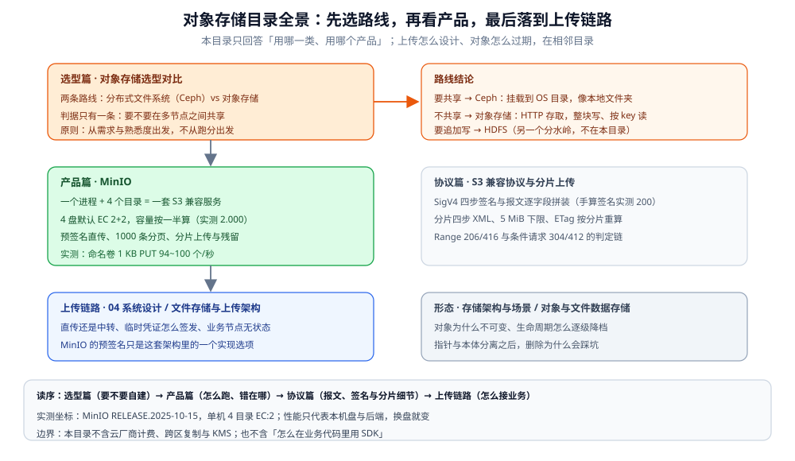

# 对象存储

> 覆盖：文件存储两条路线的选型判据（Ceph vs 对象存储）、自建 S3 兼容服务 MinIO 的语义与实测（Bucket / Prefix / 纠删码 / 版本 / 对象锁 / 预签名 / 分页 / 分片上传）、S3 协议报文层（SigV4 签名、Range 与条件请求、分片四步 API 与错误 XML）——共 **3 篇成篇**。
>
> 不覆盖：选定存储之后的**上传链路架构**（直传 vs 中转、有状态 / 无状态、业务节点为什么不能中转字节）见 [文件存储与上传架构.md](../../../04-架构与系统/系统设计/文件存储与上传架构.md)；对象「为什么不可变、生命周期怎么降档」的形态归纳见 [对象与文件数据存储.md](../存储架构与场景/形态篇/对象与文件数据存储.md)；结构化数据该用哪类库见 [数据库选型对比.md](../数据库选型对比.md)。
>
> 内容整理自个人学习笔记。本目录带两组本机容器实测：`ghcr.io/coollabsio/minio:latest`（镜像内 `minio --version` = **RELEASE.2025-10-15T17-29-55Z** / go1.24.9），单机 **4 盘（EC 2+2）**，另起一套**同镜像单盘**实例做对照；协议篇另用**手写的 Go 原始 HTTP 客户端**（不引 SDK，签名与 XML 全部自己拼）。每处读数在篇内逐条标注出处。

---

## 一、一句话定位：本目录回答什么

| 层级 | 问题 | 谁回答 |
| --- | --- | --- |
| 选路线 | 文件存储要**自建分布式文件系统**，还是用**对象存储**？ | [对象存储选型对比.md](对象存储选型对比.md) |
| 选产品 | 要自建 S3 兼容服务时，用什么、怎么跑、错在哪？ | [MinIO.md](MinIO.md) |
| 协议细节 | SigV4 怎么签、分片上传的报文与断点续传怎么定？ | [S3-兼容协议与分片上传.md](S3-兼容协议与分片上传.md) |
| 接业务 | 直传还是中转、临时凭证怎么签发？ | 04 系统设计的 [文件存储与上传架构.md](../../../04-架构与系统/系统设计/文件存储与上传架构.md) |

> ⭐ 一句话记忆：**本目录只管「用哪一类、用哪个产品、这个产品的坑在哪」**。上传链路怎么摆、对象过期怎么配、云厂商怎么计费，都在相邻目录，本篇不重复。

## 二、本目录的分工

| 篇 | 视角 | 回答什么 | 状态 |
| --- | --- | --- | --- |
| [对象存储选型对比.md](对象存储选型对比.md) | ⭐ **总纲 / 选型** | 两条路线的分水岭是「要不要跨节点共享」；选型第一原则是「从需求与熟悉度出发、不从性能出发」；对象存储与数据库的分工（指针 vs 本体） | 已成篇（⚠️ 未做本机实测） |
| [MinIO.md](MinIO.md) | **产品手册** | 单技术手册：一句话定位、核心概念（Bucket / Prefix / 纠删码 / 版本 / 对象锁）、整体架构、部署、预签名直传、列举与分页、分片上传、验证与排查 | 已成篇（✅ 容器实测） |
| [S3-兼容协议与分片上传.md](S3-兼容协议与分片上传.md) | **协议层** | 子资源与请求形态、SigV4 四步签名、payload 三种校验模式、Range 与条件请求、分片四步 API 与断点续传判定、错误 XML 与可重试性 | 已成篇（✅ 手写 HTTP 实测） |

## 三、全景与读序

这张图说明本目录的位置：先看**选型篇**定「要不要自建」（判据只有「要不要在多节点之间共享」），再看**产品篇 MinIO** 弄清「一个进程 + 几个目录怎么变成一套 S3 服务、容量为什么按一半算」，之后才是**协议篇**（报文、签名与分片细节）与相邻的**上传链路 / 形态篇**。底部一行是读序与实测坐标——MinIO 的数字只代表本机这 4 块盘与两种后端，换盘就变，不能当产品参数。

首次进入按这个顺序读（每篇的具体知识点见 [目录.md](../../../目录.md)，此处不重复）：

| 顺序 | 篇 | 什么时候读 |
| --- | --- | --- |
| ① | [对象存储选型对比.md](对象存储选型对比.md) | 还没决定「是否要引一套文件存储」时——先定路线，别先比参数 |
| ② | [MinIO.md](MinIO.md) | 已确定走对象存储、要自建或自测时——语义、部署、实测与五个坑 |
| ③ | [文件存储与上传架构.md](../../../04-架构与系统/系统设计/文件存储与上传架构.md) | 要接进业务时——直传 vs 中转、凭证签发、业务节点无状态 |
| ④ | [S3-兼容协议与分片上传.md](S3-兼容协议与分片上传.md) | 要自己实现客户端或排查签名失败时 |

### 依赖关系

| 本篇 | 建议先读 | 为什么 |
| --- | --- | --- |
| [MinIO.md](MinIO.md) | [对象存储选型对比.md](对象存储选型对比.md) | 先接受「不共享才用对象存储」这个前提，再看产品形态才不会被「为什么不能当网盘挂载」绊住 |
| [文件存储与上传架构.md](../../../04-架构与系统/系统设计/文件存储与上传架构.md) | [MinIO.md](MinIO.md) 第五节 | 预签名直传是架构里的一个实现选项，先看懂 URL 怎么签、什么时候过期 |
| [S3-兼容协议与分片上传.md](S3-兼容协议与分片上传.md) | [MinIO.md](MinIO.md) 第六、七节 | 分页与分片的产品行为先看过，再回头读报文与签名 |

## 四、本轮实测坐标

| 项 | 值 |
| --- | --- |
| 镜像 | `ghcr.io/coollabsio/minio@sha256:69b55a1c1c5dc285ce04db96689f5b2102317fc77a50680a1874ca6efd1c87f9` |
| 服务端版本 | `RELEASE.2025-10-15T17-29-55Z`（go1.24.9 linux/amd64，AGPLv3，`commit-id=DEVELOPMENT.GOGET`，属第三方重新打包） |
| 拓扑 | 单机 4 目录跑 **EC 2+2**（`minio-lab`，宿主 39000）；同名镜像**单盘**对照（`minio-lab-vol`，宿主 39001） |
| 后端 | ① Windows 绑定挂载（DrvFs）；② Docker 命名卷（ext4）——同一份代码两套读数 |
| 客户端 | Go `github.com/minio/minio-go/v7 v7.4.1`（真跑） |
| 协议侧客户端 | 手写 Go 原始 HTTP（`net/http` + `crypto/hmac` + `crypto/sha256`），不引 SDK |

本目录最值得记住的读数：

| 读数 | 值 | 出处 |
| --- | --- | --- |
| 后端比产品更决定吞吐 | 1 KB 串行 PUT：绑定挂载 **9.5 个/秒** vs 命名卷 **94.0 ~ 100.4 个/秒**（约 10 倍） | [MinIO.md](MinIO.md) 第 3.4 节 |
| 读写不对称约 1:5 | 64 MB：写 **77.8 ~ 110.7 MB/s**，读 **369.7 ~ 625.1 MB/s** | [MinIO.md](MinIO.md) 第 3.4 节 |
| 4 盘 EC:2 的放大比正好 2.000 | 载荷合计 68,620,288 B，四盘 139,097,032 B | [MinIO.md](MinIO.md) 第 8.1 节 |
| 列举是 1000 条硬边界 | 请求 `max_keys=5000`，实回 1000 条且 `truncated=true` | [MinIO.md](MinIO.md) 第 6.1 节 |
| 前缀是字符串匹配不是目录 | `page/1` 命中 **1000** 条、`page/12` 命中 **100** 条 | [MinIO.md](MinIO.md) 第 2.1 节 |
| 分片大小比线程数更值钱 | 8 MB → 64 MB 提速 **+70.7%**；线程 4 → 16 只再快 **+7.7%** | [MinIO.md](MinIO.md) 第七节 |
| 时间窗实测 10 过 16 拒 | 签名时间偏 **±10 分钟回 200**；偏 **±16 分钟回 403 `RequestTimeTooSkewed`** | [S3-兼容协议与分片上传.md](S3-兼容协议与分片上传.md) 第 4.5 节 |
| 非末片小于 5 MiB 合并不了 | 2 片各 1 MiB 合并 → **400 `EntityTooSmall`**，对象不生成 | [S3-兼容协议与分片上传.md](S3-兼容协议与分片上传.md) 第 5.4 节 |
| 合并不幂等 | 同一 `uploadId` 二次合并 → **404 `NoSuchUpload`**；对已完成上传 abort 回 **204** | [S3-兼容协议与分片上传.md](S3-兼容协议与分片上传.md) 第 5.6 节 |

> ⚠️ **未实测项**：`mc` 管理命令（拉不到镜像）、5 GiB 单次 PUT 上限、预签名 7 天上限、生命周期规则回收残留分片、拔盘重建，均按文档口径陈述，篇内已逐条标注。

## 五、本目录的边界

| 本目录收 | 不收（在哪） |
| --- | --- |
| Ceph（分布式文件系统）vs 对象存储的**路线判据** | **上传链路怎么摆** → [文件存储与上传架构.md](../../../04-架构与系统/系统设计/文件存储与上传架构.md) |
| MinIO 这个产品**自身**的语义、部署、配置与排障 | **各语言 SDK 的接入写法** → 语言目录下的组件接入篇 |
| 预签名、分页、分片这些**产品行为** | **SigV4 报文、Range、分片 XML 与错误码** → [S3-兼容协议与分片上传.md](S3-兼容协议与分片上传.md) |
| 对象存储在本系统里的**角色落点** | **多存储组合与选型判据** → [存储选型与组合.md](../存储架构与场景/存储选型与组合.md) |
| 对象不可变与生命周期降档的**形态归纳** | [对象与文件数据存储.md](../存储架构与场景/形态篇/对象与文件数据存储.md) |
| — | **「能不能追加写」的分水岭** → [HDFS.md](../../大数据组件/文件系统/HDFS.md) |

## 延伸追问

- **只想补一块，最短路径是什么？** → 判断该不该自建读 [对象存储选型对比.md](对象存储选型对比.md) 第二节；要把 MinIO 跑起来读 [MinIO.md](MinIO.md) 第四节；线上分页漏数据读第六节，分片残留读第七节。
- **为什么本目录的选型篇不做实测，产品篇却全是读数？** → 选型比较的是「机制与契合度」，换台机器结论不变；产品读数强依赖磁盘与后端（同一份代码能差 10 倍），只能在自己的环境里量。
- **MinIO 能替代数据库吗？** → 不能。它按 key 存取大对象，没有事务与复杂查询；正确分工是**库里存元数据指针、对象存储存本体**（见选型篇第三节）。

## 关联

- [对象存储选型对比.md](对象存储选型对比.md) — 本目录总纲：Ceph vs 对象存储的路线判据
- [MinIO.md](MinIO.md) — 产品篇：自建 S3 兼容服务的语义、部署与实测
- [S3-兼容协议与分片上传.md](S3-兼容协议与分片上传.md) — 协议篇：SigV4 签名的逐步计算、分片上传四步 XML、Range 与条件请求的返回码
- [文件存储与上传架构.md](../../../04-架构与系统/系统设计/文件存储与上传架构.md) — 选定之后的上传链路架构（直传 vs 中转、业务节点无状态）
- [存储选型与组合.md](../存储架构与场景/存储选型与组合.md) — 对象存储在「归档 / 静态资源」角色里的落点与多存储组合
- [对象与文件数据存储.md](../存储架构与场景/形态篇/对象与文件数据存储.md) — 对象不可变、生命周期降档、指针与本体分离
- [数据库选型对比.md](../数据库选型对比.md) — 结构化数据选哪类库，与「文件 / 对象放哪」正交
- [素材清单.md](../../../素材清单.md) — 素材来源登记
