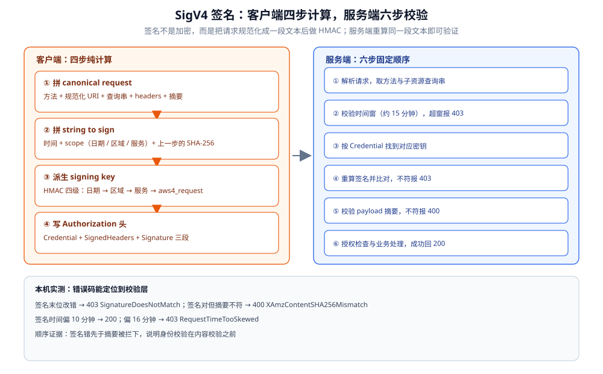
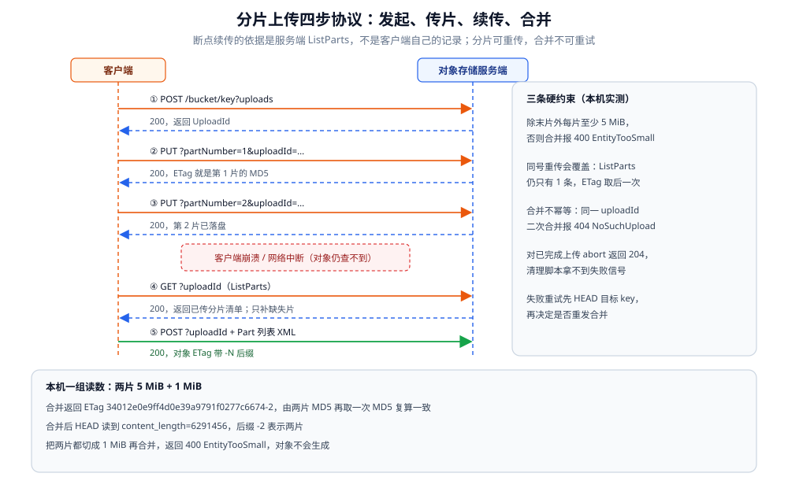
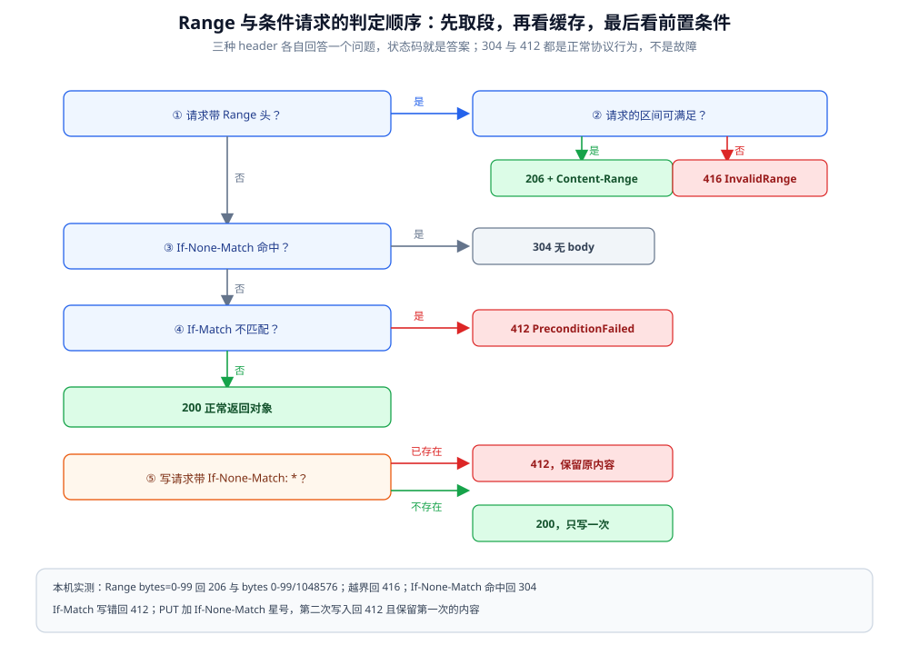

# S3 兼容协议与分片上传

> 覆盖：S3 兼容协议的**报文层**——资源与子资源形态、SigV4 的逐步计算、payload 的三种校验模式、Range 与条件请求、分片上传四步 API 与断点续传判定、错误 XML 与可重试性。
>
> 不覆盖：MinIO 这个**产品**的部署、纠删码、1000 条分页、版本与对象锁见 [MinIO.md](MinIO.md)；业务侧的直传架构与凭证签发见 [文件存储与上传架构.md](../../../04-架构与系统/系统设计/文件存储与上传架构.md)；对象不可变与生命周期见 [对象与文件数据存储.md](../存储架构与场景/形态篇/对象与文件数据存储.md)。
>
> 内容整理自个人学习笔记。实测环境：`ghcr.io/coollabsio/minio:latest`（RELEASE.2025-10-15T17-29-55Z / go1.24.9）+ **手写的 Go 原始 HTTP 客户端**（不引 SDK：签名自己算、XML 自己拼），单机 4 盘 EC 2+2，path-style 端点 `127.0.0.1:39000`。读数见第三、四、五、六、七节。

---

## 一、一句话定位：一组「动词 + 子资源 + 自证签名」，没有会话

**本节要点**：S3 兼容协议不是「RPC 接口」，而是**把身份、时间、内容摘要全部压进每个请求**的无会话协议；理解它的关键是三条分界线，而不是背 API 清单。

| 维度 | 普通 REST API | S3 兼容协议 |
|---|---|---|
| 身份 | 登录态 / Cookie / Bearer token，服务端存会话 | 每个请求自带签名，服务端不存会话 |
| 时间 | 一般不管 | **参与签名**，偏差过大直接拒（实测窗口落在 10~16 分钟之间） |
| 幂等 | 由业务定义 | PUT 同一 key 即覆盖；**分片合并却不是幂等的**（第五节） |
| 成功响应 | 通常回 JSON | 可能回空体或 XML；DELETE 成功回 `204` |
| 资源 | URL 路径 + 方法 | URL 路径 + **子资源 query**（`?uploads`、`?partNumber=`） |

三条分界线：

- **协议 vs 选型**：用不用对象存储、Ceph 还是对象存储，见 [对象存储选型对比.md](对象存储选型对比.md)；
- **协议 vs 产品**：本文只讲「按规范该怎么发请求」，MinIO 怎么跑、盘上怎么摆见 [MinIO.md](MinIO.md)；
- **协议 vs 架构**：浏览器直传、临时凭证、业务节点无状态，见 [文件存储与上传架构.md](../../../04-架构与系统/系统设计/文件存储与上传架构.md)。

⚠️ 本机服务端是 MinIO，它实现的是 S3 的一个子集；AWS 独有或较新的能力（SigV4a、trailer 校验和、虚拟主机风格端点）本文不展开，涉及处标注为未实测。

## 二、核心概念：四组必须先建起来的对象

**本节要点**：先把「资源怎么表达」「请求拿什么自证」「payload 怎么校验」「成功与失败长什么样」四组概念建起来，后面的签名与分片才有落点。

### 2.1 资源与子资源

对象由 `bucket` + `key` 寻址，**方法 + 子资源 query** 决定操作。同一个路径上挂不同的 query，语义完全不同：

| 请求 | 语义 | 是否参与签名 |
|---|---|---|
| `PUT /bucket/key` | 写对象 | 是（路径 + 查询串都在 canonical request 里） |
| `POST /bucket/key?uploads` | 发起分片上传 | 是 |
| `PUT /bucket/key?partNumber=1&uploadId=…` | 上传第 1 片 | 是（query 要**按键名排序**） |
| `GET /bucket/key?uploadId=…` | 列出已上传分片 | 是 |
| `POST /bucket/key?uploadId=…` | 合并分片 | 是 |
| `DELETE /bucket/key?uploadId=…` | 放弃分片上传 | 是 |
| `GET /bucket/key?versionId=…` | 读指定版本 | 是（版本语义见 [MinIO.md](MinIO.md) 第 2.4 节） |

⭐ 关键点：**子资源是签名输入的一部分**。少写一个 `&uploadId=`，不是「参数丢了」，而是签名对不上。

### 2.2 一条请求的认证要素

| 要素 | 形态 | 作用 |
|---|---|---|
| Credential | `AK/20261101/us-east-1/s3/aws4_request` | 指明用哪个 key、哪一天、哪个区域、哪个服务 |
| SignedHeaders | `content-type;host;x-amz-content-sha256;x-amz-date` | 声明哪些 header 被纳入签名 |
| Signature | 64 位十六进制 | 对 canonical request 的 HMAC 结果 |
| 时间 | `x-amz-date: 20261101T150913Z` | 防止重放，参与签名 |

⚠️ `region` 不是装饰：它进 scope，也进签名链。本机 MinIO 用默认 `us-east-1`，换区域必须同步改。

### 2.3 payload 的三种校验模式

| 模式 | `x-amz-content-sha256` 的值 | 适用 | 本机实测 |
|---|---|---|---|
| 完整摘要 | 整个 body 的 SHA-256 | 小对象、可一次读入内存 | ✅ 200 |
| 不校验 | `UNSIGNED-PAYLOAD` | HTTPS 下大流量，省一次哈希 | ✅ 200，ETag 与完整摘要模式一致 |
| 流式分块 | `STREAMING-AWS4-HMAC-SHA256-PAYLOAD` | 边读边发，每块单独签名 | ✅ 4 块，32768 B 原文发出 33210 B |

流式模式的代价是**每块都带一个签名头**：实测 32 KB 分 4 块，线上字节比原文多 442 B（每块 `长度;chunk-signature=…\r\n` 与结尾一个空块的签名）。多出来的这 442 B 不是协议缺陷，而是「不预读完整内容也能证明身份」的代价。

### 2.4 响应与错误

- 成功：可能是空体（`PUT` / `DELETE` 回 `204`），也可能是 XML（分片相关操作都回 XML）；
- 失败：**一律 XML**，字段固定为 `Code` / `Message` / `Key` / `BucketName` / `Resource` / `RequestId` / `HostId`；
- `RequestId` 是排查锚点：同一个值会同时出现在响应体和响应头 `x-amz-request-id` 里。

## 三、整体架构：一条请求从字节到 200

**本节要点**：服务端按固定顺序校验——**时间窗 → 密钥 → 签名 → payload 摘要 → 权限 → 业务**；顺序决定了同一个错误可能有不同报错码，排查时要按这个顺序倒推。

### 3.1 客户端计算与服务端校验



这张图把「谁算什么」分开画：左边是客户端要完成的**四步纯计算**（拼 canonical request → 拼 string to sign → HMAC 链派生 signing key → 写 Authorization），右边是服务端拿到请求后**按固定顺序**做的六步校验。顺序很关键——本机实测中，签名错先报 `403 SignatureDoesNotMatch`，只有签名通过后 body 摘要不符才报 `400 XAmzContentSHA256Mismatch`；时间偏差则更早被拦下，报 `403 RequestTimeTooSkewed`。

### 3.2 两个端点风格

| 风格 | 形态 | 本机 |
|---|---|---|
| path-style | `http://host:port/bucket/key` | ✅ 实测（本文全部读数基于它） |
| virtual-host | `http://bucket.host/key` | ⚠️ 未实测（需要 DNS 或泛解析） |

区域、端点、bucket 名三者共同决定 canonical request 里的 `host`。**签名时写 `host:127.0.0.1:39000`，发请求时就不能换成 `localhost:39000`**——端口和主机名都进了签名。

### 3.3 请求的字节构成

一次 `PUT` 在线上就是：请求行（方法 + 路径 + 查询串）、headers（含签名与时间）、body（原始字节）；响应是状态行 + headers + 可选的 XML。协议本身**没有帧、没有会话、没有心跳**——这也是它能被任何 HTTP 基础设施承载的原因（HTTP 层语义见 [HTTP与gRPC.md](../../../02-计算机基础/网络/应用层/HTTP与gRPC.md)）。

## 四、使用一：签名（SigV4 的四个计算步骤）

**本节要点**：签名不是「把密钥拼上去算个 HMAC」，而是**先把请求规范化成一段确定的文本**，再对文本做四步运算；90% 的签名失败都出在第一步的规范化上。

### 4.1 第一步：拼 canonical request

实测发出的 `PUT /proto-bucket/sigv4/hello.txt`，它的 canonical request 原文如下（空行也是内容的一部分）：

```text
PUT
/proto-bucket/sigv4/hello.txt

content-type:text/plain
host:127.0.0.1:39000
x-amz-content-sha256:68174946db4a3e1d8f2b6b39f27423efc5223935c9a67a09c9f081e3c5bc86fa
x-amz-date:20261101T150913Z

content-type;host;x-amz-content-sha256;x-amz-date
68174946db4a3e1d8f2b6b39f27423efc5223935c9a67a09c9f081e3c5bc86fa
```

五段依次是：方法、规范化 URI、规范化查询串、规范化 headers、签名 header 列表，最后是 payload 摘要。三个最容易错的地方：

| 易错点 | 正确做法 | 错了的表现 |
|---|---|---|
| 查询串 | 按键名排序、键值都做 URI 编码，空值写成 `uploads=` | 分片请求 `403`，单对象请求正常 |
| header 值 | 去首尾空白、多个空格压成一个、键转小写 | 带 `Content-Type: text/plain` 的请求失败 |
| URI 编码 | 每段单独编码，`/` 不编码 | key 里有中文或空格时签名对不上 |

### 4.2 第二步：拼 string to sign

```text
AWS4-HMAC-SHA256
20261101T150913Z
20261101/us-east-1/s3/aws4_request
eeed98defc1459951f1ab525f0632e06e75ebd939e93b5370524eebf11163ff1
```

第四行是上一步整段文本的 SHA-256。注意第二行的时间与 scope 里的日期分别取 `20060102T150405Z` 与 `20060102` 两种格式，**两者必须来自同一个时刻**。

### 4.3 第三步：派生 signing key

```go
kDate    := hmacSHA256([]byte("AWS4"+secretKey), "20261101")
kRegion  := hmacSHA256(kDate, "us-east-1")
kService := hmacSHA256(kRegion, "s3")
kSigning := hmacSHA256(kService, "aws4_request")
```

四级 HMAC 是逐层收窄：日期 → 区域 → 服务 → 终态。它的意义是**同一个 secret 在不同日期、不同区域会派生出不同密钥**，泄露一次签名不会直接暴露 secret。

### 4.4 第四步：写 Authorization

```text
Authorization: AWS4-HMAC-SHA256 Credential=minioadmin/20261101/us-east-1/s3/aws4_request,
  SignedHeaders=content-type;host;x-amz-content-sha256;x-amz-date, Signature=38858aa4…
```

`SignedHeaders` 必须与 canonical request 里那段**逐字一致**；只改签名不改列表，同样会失败。

### 4.5 实测：能过与不能过的分界

| 请求 | 结果 | 说明 |
|---|---|---|
| 手算签名 + 完整摘要 | `200` | ETag `5c776a9485e495b1c9609e714dca2dca` |
| 同一请求改 `UNSIGNED-PAYLOAD` | `200` | ETag 完全相同，说明摘要模式不影响落盘结果 |
| 签名末位改成另一个十六进制字符 | `403 SignatureDoesNotMatch` | 服务端重算后不匹配 |
| 不带 `Authorization` | `403 AccessDenied` | 连签名都没进入校验 |
| 签名正确但声明的摘要与 body 不符 | `400 XAmzContentSHA256Mismatch` | 说明签名先于摘要校验 |
| 签名时间偏 10 分钟 | `200` | 窗口内 |
| 签名时间偏 16 分钟 | `403 RequestTimeTooSkewed` | 窗口外 |

那条 `XAmzContentSHA256Mismatch` 的原文是：

```text
code=XAmzContentSHA256Mismatch status=400
msg="The provided 'x-amz-content-sha256' header does not match what was computed."
```

⭐ 它和 `SignatureDoesNotMatch` 的区别很重要：**前者说明身份没问题、内容被动过；后者说明连密钥或规范化都没对上**。排查方向完全不同。

### 4.6 预签名 URL 与 header 认证的差别

预签名把同一套计算搬到 query 里：`X-Amz-Algorithm`、`X-Amz-Credential`、`X-Amz-Date`、`X-Amz-Expires`、`X-Amz-SignedHeaders`、`X-Amz-Signature`。计算 canonical request 时**先不带 `X-Amz-Signature`**，算完之后再追加到查询串末尾。它的签发与过期行为（306 B 的 URL、2 秒有效期、过期后 `403 Request has expired`）见 [MinIO.md](MinIO.md) 第五节，此处不重复。

## 五、使用二：上传（单次 PUT 与分片四步）

**本节要点**：小对象一次 `PUT` 就够；大对象必须走**发起 → 传片 → 合并**三步，而「断点续传」的全部依据是服务端的 `ListParts`，不是客户端自己的记录。

### 5.1 单次 PUT 与内容校验

单次 `PUT` 的 body 就是对象本体。可选加 `Content-MD5`，服务端收到后先算一遍再比对：

```text
bad_content_md5 status=400 code=BadDigest
msg="The Content-Md5 you specified did not match what we received."
good_content_md5 status=200
```

⚠️ `Content-MD5` 是**整段 body 的 MD5**，与分片对象的 ETag 不是一回事（见 5.5）。单次 PUT 的规范上限是 5 GiB，本机未传这么大的对象验证。

### 5.2 分片四步与状态



图里两条生命线之间的五类请求就是分片上传的全部协议面：`POST ?uploads` 发起、`PUT ?partNumber` 传片（可并发、可重传）、`GET ?uploadId` 列已传分片、`POST ?uploadId` 合并、`DELETE ?uploadId` 放弃。右侧三个旁注是本机实测到的硬约束：非末片不得小于 5 MiB、同号重传会覆盖、合并**不幂等**。

### 5.3 四个关键报文

发起分片返回 UploadId，后续所有请求都靠它：

```text
<InitiateMultipartUploadResult xmlns="http://s3.amazonaws.com/doc/2006-03-01/">
  <Bucket>proto-bucket</Bucket><Key>mp/big.bin</Key>
  <UploadId>NDQ2ZjU5YmMtZWY4OC00ZmJlLWFhNmItOTU0N2ViYWI2NWVk…</UploadId>
</InitiateMultipartUploadResult>
```

传片只回一个 ETag 头，**它就是这一片的 MD5**：

```text
part1 status=200 size=5242880 etag=b64b3adffdbc075acedb0b9d286fa24a md5=b64b3adffdbc075acedb0b9d286fa24a
part2 status=200 size=1048576 etag=e373a6b09e4e6be90477befebeaec06f md5=e373a6b09e4e6be90477befebeaec06f
```

`ListParts` 是续传的唯一可信状态，返回每片的编号、大小与 ETag：

```text
list_parts_item part=1 size=5242880 etag=b64b3adffdbc075acedb0b9d286fa24a
list_parts_item part=2 size=1048576 etag=e373a6b09e4e6be90477befebeaec06f
```

合并请求要把**按编号升序的 Part 列表**放进 XML，ETag 要带引号；成功后返回对象 ETag 与 Location：

```text
<CompleteMultipartUploadResult xmlns="http://s3.amazonaws.com/doc/2006-03-01/">
  <Location>http://127.0.0.1:39000/proto-bucket/mp/big.bin</Location>
  <Bucket>proto-bucket</Bucket><Key>mp/big.bin</Key>
  <ETag>&#34;34012e0e9ff4d0e39a9791f0277c6674-2&#34;</ETag>
</CompleteMultipartUploadResult>
```

合并后 `HEAD` 读到 `content_length=6291456`（5 MiB + 1 MiB），ETag 后缀 `-2` 表示两片。

### 5.4 分片大小有硬下限

除最后一片外，每片不得小于 **5 MiB**。本机把两片都传成 1 MiB 再合并，得到：

```text
complete_1MiB_parts status=400 code=EntityTooSmall
msg="Your proposed upload is smaller than the minimum allowed object size."
```

这条约束解释了为什么「小文件分片」只会增加请求数：分片再小也要凑够 5 MiB，否则合并不了。分片大小对吞吐的影响（8 MB 换到 64 MB 提速 67%~71%）见 [MinIO.md](MinIO.md) 第七节。

### 5.5 ETag 规则与复算

- 单次 PUT：ETag = 整段 body 的 MD5；
- 分片上传：ETag = **各片 MD5 的二进制串再取一次 MD5**，后缀 `-N` 是分片数。

实测两片 `b64b3adf…` 与 `e373a6b0…`，按规则复算得到 `34012e0e9ff4d0e39a9791f0277c6674-2`，与服务端返回的 ETag 完全一致。⚠️ 它**不等于整个文件的 MD5**，拿 ETag 做秒传 / 去重时必须固定分片大小，否则同一个文件会算出两个 ETag。

### 5.6 断点续传的完整判定

客户端崩溃后恢复上传，顺序是：

1. 读出本地记录的 `uploadId` 与文件指纹（不要重新发起，否则旧分片永远悬挂）；
2. `GET ?uploadId=` 调 `ListParts`，**以服务端返回的分片为准**；
3. 只补缺失的片；同号重传会覆盖——实测同一 `partNumber` 传两次，`ListParts` 仍然只有 1 条记录，ETag 变成后一次的值；
4. 全部到齐后用这批判 ETag 合并；
5. 合并超时或网络中断时，**先 `HEAD` 目标 key 判断是否其实已经成功**，因为合并不幂等：同一个 `uploadId` 二次合并返回 `404 NoSuchUpload`；
6. 确认失败才 `DELETE ?uploadId=` 回收，且不要指望它报错——对一个已完成的上传执行 abort，本机返回 `204` 而不是错误。

⭐ 归纳成一句：**分片重传是幂等的（同号覆盖），整体合并不是（二次 404）**。客户端重试策略必须按这个差异写。

### 5.7 服务端拷贝：不经过客户端的复制

两种形态，数据都不经过客户端：

| 形态 | 请求 | 返回 |
|---|---|---|
| 整对象拷贝 | `PUT /bucket/dst` + `x-amz-copy-source: /bucket/src` | `<CopyObjectResult>` 带 ETag |
| 分片拷贝 | `PUT ?partNumber=1&uploadId=…` + `x-amz-copy-source` + `x-amz-copy-source-range: bytes=0-1023` | `<CopyPartResult>` 带 ETag |

实测整对象拷贝后读回 4096 B 内容一致、ETag 与源对象相同；分片拷贝 `bytes=0-1023` 后合并，读回 1024 B 且内容一致。这正是「秒传」在协议层的形态：内容已经在服务端，就只需要拷贝，不需要重传。

## 六、使用三：读取（Range、条件请求与条件写）

**本节要点**：读请求靠 header 表达三件事——**要哪一段、缓存是否过期、前置条件是否满足**；三者都靠状态码回答，body 可能为空。

### 6.1 Range：三种形态与 416

对一个 1 MiB 对象实测：

| 请求 header | 状态码 | 返回 | `Content-Range` |
|---|---|---|---|
| 无 | `200` | 1048576 B | — |
| `Range: bytes=0-99` | `206` | 100 B | `bytes 0-99/1048576` |
| `Range: bytes=-100` | `206` | 100 B | `bytes 1048476-1048575/1048576` |
| `Range: bytes=1048576-1048675` | `416 InvalidRange` | XML 错误 | — |

`Range` 是**闭区间**，`-100` 表示「最后 100 字节」。越界不是返回空，而是 `416`，并附带：

```text
msg="The requested range 'bytes=1048576-1048675' is not satisfiable"
```

### 6.2 条件请求与条件写



判定顺序是固定的：**先看 Range（读部分），再看缓存条件（If-None-Match），最后看前置条件（If-Match）**。实测四条：

```text
if_none_match status=304 len=0
if_match_wrong status=412 code=PreconditionFailed
if_match_ok status=200 len=1048576
cond_put_first status=200 / cond_put_second status=412
```

`If-None-Match` 命中回 `304`，body 为空——这不是错误，是「你手上的副本还有效」。`If-Match` 不匹配回 `412`，用于「只在对象没被别人改过时才覆盖」。

写请求也可以带条件：`PUT` + `If-None-Match: *` 表示「只有 key 不存在才写入」。实测第一次 `200`，第二次 `412`，且原有内容仍是第一次写入的 `first`——这就是「不可变对象 / 只写一次」在协议层的实现，不需要业务侧加锁。

### 6.3 HEAD 与 GET

`HEAD` 与 `GET` 的签名输入相同（方法名不同），返回同样的 headers 但没有 body：实测 `content_length=1048576`、`etag` 正常、`body_len=0`。它的典型用途是「合并之后确认对象是否已存在」——比 `GET` 省掉整个 body 的传输。

## 七、使用四：错误、状态码与可重试性

**本节要点**：错误体是固定 XML，真正要记的是**哪些错误重试有用**：4xx 里除了限流都与重试无关，5xx 与网络错误才值得退避重试。

### 7.1 错误体的固定字段

```text
<?xml version="1.0" encoding="UTF-8"?>
<Error>
  <Code>SignatureDoesNotMatch</Code>
  <Message>The request signature we calculated does not match the signature you provided…</Message>
  <Key>sigv4/bad.txt</Key>
  <BucketName>proto-bucket</BucketName>
  <Resource>/proto-bucket/sigv4/bad.txt</Resource>
  <RequestId>18E3F462939CC656</RequestId>
  <HostId>dd9025bab4ad464b049177c95eb6ebf374d3b3fd1af9251148b658df7ac2e3e8</HostId>
</Error>
```

`Code` 是判断依据，`Message` 是给人看的，`RequestId` 用来把客户端日志与服务端日志对上。**不要用 `Message` 做程序判断**——它可能随版本变化，也可能包含 HTML 转义（实测里的 `&#39;` 就是单引号）。

### 7.2 实测错误矩阵

| 场景 | 状态码 | Code | 是否值得重试 |
|---|---|---|---|
| 签名不匹配 | `403` | `SignatureDoesNotMatch` | 否（先修签名） |
| 未携带认证 | `403` | `AccessDenied` | 否 |
| 时间偏差 16 分钟 | `403` | `RequestTimeTooSkewed` | 否（先校时） |
| body 与声明的摘要不符 | `400` | `XAmzContentSHA256Mismatch` | 否 |
| `Content-MD5` 与 body 不符 | `400` | `BadDigest` | 否（重算重发） |
| key 不存在 | `404` | `NoSuchKey` | 否（除非是最终一致性场景，S3 兼容实现多为强一致） |
| bucket 不存在 | `404` | `NoSuchBucket` | 否 |
| Range 越界 | `416` | `InvalidRange` | 否 |
| `If-None-Match` 命中 | `304` | —（无 body） | 否（用本地缓存） |
| `If-Match` 不匹配 / 条件写冲突 | `412` | `PreconditionFailed` | 否（重新读后决策） |
| 非末片小于 5 MiB | `400` | `EntityTooSmall` | 否（改分片策略） |
| uploadId 不存在或已完成 | `404` | `NoSuchUpload` | 否（重新发起或先 HEAD 确认） |
| 合并 XML 缺 Part | `400` | `InvalidRequest` | 否（修 XML） |

### 7.3 重试分级的判断

| 响应 | 处理 |
|---|---|
| `5xx`、连接重置、超时 | 可重试，指数退避 + 抖动 |
| `429` / `SlowDown`（兼容实现可能有） | 可重试，但必须退避 |
| `4xx`（除限流） | 不重试，重试只会放大问题 |
| `200` 但内容不符 | 用 ETag / MD5 校验发现，按数据损坏处理 |

### 7.4 客户端重试约定

- **PUT 同一 key 可重试**：覆盖语义，重试不会产生副本；
- **PUT 同一分片编号可重试**：实测同号覆盖，`ListParts` 只留一条；
- **合并请求不可盲目重试**：二次合并回 `404 NoSuchUpload`，必须先 `HEAD` 目标 key 判断前一次是否已成功；
- **abort 不提供状态信号**：对已完成的上传执行 abort 返回 `204`，清理脚本不能依赖它报错。

## 八、验证与排查

**本节要点**：先用「两种错误码」区分签名问题与内容问题，再按校验顺序倒推；排障的主要抓手是 canonical request 自算、错误码、`RequestId`。

### 8.1 三步确认签名链路

1. **自算 canonical request**：把五段原文打印出来，与人眼能核对的内容（Host 是否带端口、query 是否排序、header 是否小写去空白）逐项比对；
2. **看错误码定位层**：`SignatureDoesNotMatch` 在签名层，`XAmzContentSHA256Mismatch` 在摘要层，`RequestTimeTooSkewed` 在时间层；
3. **确认服务端时间**：容器与宿主机时钟是否一致；签名日期与 scope 日期是否来自同一时刻。

### 8.2 故障速查双表

| 症状 | 先查什么 |
|---|---|
| 403 签名错，但 SDK 能通 | 自己拼的 Host、查询串排序、路径编码、header 大小写 |
| 403 时间偏斜 | 客户端时钟、容器时区、签名到发送之间的延迟 |
| 400 摘要不符 | 是否改了 body 没重签、是否开了压缩导致 body 变化 |
| 分片合并 404 | `uploadId` 是否已完成/被 abort；先 HEAD 目标 key |
| 合并 400 EntityTooSmall | 是否把非末片切到了 5 MiB 以下 |
| 续传后对象大小不对 | 是否漏传某片、是否用了旧的 ETag 列表 |
| 206 但内容错位 | Range 是闭区间；对象是否已被覆盖 |

| 排查项 | 命令 / 方法 |
|---|---|
| 服务端时间 | `docker exec minio-lab date -u` |
| 对象头 | `HEAD` 或 SDK 的 `StatObject` |
| 已传分片 | `GET ?uploadId=`（`ListParts`） |
| 错误定位 | 用响应里的 `RequestId` 搜服务端日志 |
| 签名复现 | 打印 canonical request 与 string to sign，逐段比对 |

### 8.3 三个容易读错的量

- **分片 ETag ≠ 整体 MD5**：它是「各片 MD5 再 MD5」，后缀是分片数；
- **时间窗不是「发出去就算」**：实测 10 分钟可过、16 分钟被拒，约定值是 15 分钟；
- **合并不幂等、abort 不报错**：二次合并 `404`，对已完成上传 abort 返回 `204`——两者都不能当作「上一次失败」的依据。

## 九、校验口径

> ✅ 本篇读数的校验方式与范围（RELEASE.2025-10-15T17-29-55Z，单机 4 盘 EC 2+2，path-style）：

| 结论 | 状态 | 读数 / 说明 |
|---|---|---|
| 手算 SigV4 可被服务端接受 | ✅ 真跑 | canonical request + string to sign + signature 全打印；`200`，ETag `5c776a94…` |
| `UNSIGNED-PAYLOAD` 可用 | ✅ 真跑 | `200`，ETag 与完整摘要模式一致 |
| 流式签名（aws-chunked）可用 | ✅ 真跑 | 4 块；32768 B 原文 → 33210 B 线上字节；读回内容一致 |
| 篡改签名 → 403 | ✅ 真跑 | `SignatureDoesNotMatch`，错误体全文 |
| 摘要与 body 不符 → 400 | ✅ 真跑 | `XAmzContentSHA256Mismatch` |
| 时间窗约 15 分钟 | ✅ 真跑 | ±10 分钟 `200`；±16、±20 分钟 `403 RequestTimeTooSkewed` |
| Range 三种形态与 416 | ✅ 真跑 | `206` + `bytes 0-99/1048576`；后缀 `bytes 1048476-1048575/1048576`；越界 `416` |
| 条件请求 304 / 412 | ✅ 真跑 | `If-None-Match` → `304`；`If-Match` 不匹配 → `412` |
| 条件写 `If-None-Match: *` | ✅ 真跑 | 首次 `200`，二次 `412`，内容保持首次写入 |
| 分片四步 XML | ✅ 真跑 | Initiate / UploadPart / ListParts / Complete 原文均留存 |
| 分片 ETag 可复算 | ✅ 真跑 | 两片 MD5 复算 = `34012e0e9ff4d0e39a9791f0277c6674-2` |
| 非末片最小 5 MiB | ✅ 真跑 | 2×1 MiB 合并 → `400 EntityTooSmall` |
| 同号分片重传覆盖 | ✅ 真跑 | 二次上传后 `ListParts` 仍 1 条，ETag 变为新值 |
| 合并不幂等 | ✅ 真跑 | 二次合并 → `404 NoSuchUpload` |
| 对已完成上传 abort | ✅ 真跑 | 返回 `204` |
| 服务端拷贝（整对象 / 分片） | ✅ 真跑 | 整对象 4096 B 一致；分片 range 1024 B 一致 |
| 单次 PUT 5 GiB 上限 | ⚠️ 未实测 | 规范口径，未传大对象 |
| 预签名 7 天上限 | ⚠️ 未实测 | 属 MinIO 产品侧，见 [MinIO.md](MinIO.md) |
| virtual-host 风格端点 | ⚠️ 未实测 | 本机无 DNS，全部读数基于 path-style |
| SigV4a、trailer 校验和 | ⚠️ 未实测 | 本机 MinIO 未覆盖 |
| SSE-KMS 下的分片 ETag | ⚠️ 未实测 | 加密对象 ETag 规则不同，属文档口径 |
| 并发合并竞争 | ⚠️ 未实测 | 未构造两个 Complete 同时到达的场景 |

| 依赖 | 实际版本 |
|---|---|
| 服务端镜像 | `ghcr.io/coollabsio/minio@sha256:69b55a1c1c5dc285ce04db96689f5b2102317fc77a50680a1874ca6efd1c87f9` |
| 服务端版本 | `RELEASE.2025-10-15T17-29-55Z`（go1.24.9） |
| 客户端 | 手写 Go 原始 HTTP（`net/http` + `crypto/hmac` + `crypto/sha256`），无 SDK |

## 延伸追问

- **为什么签名要先拼成一段文本再算？** → 让「同一语义的请求」无论 header 顺序、是否有多余空白，都得到同一段文本，服务端才能重算出同一个签名；规范化就是去歧义。
- **`UNSIGNED-PAYLOAD` 是不是不安全？** → 它只省掉 body 摘要，身份与时间仍然签了；在 HTTPS 下 body 本身有传输完整性保护，所以常用；没有 TLS 时等于放弃了内容校验。
- **分片传一半崩了，服务端知不知道？** → 知道。分片是真实落盘的中间状态，`ListParts` 能列出来；对象在合并前查不到（`NoSuchKey`），但分片占着空间。
- **为什么合并失败不能直接重试？** → 合并不幂等：第一次可能已经成功但响应丢了，第二次会报 `404 NoSuchUpload`；正确做法是先 `HEAD` 确认对象，再决定是否重发。
- **ETag 能当文件指纹做秒传吗？** → 单次 PUT 可以，分片对象必须固定分片大小；加密或带额外校验和的对象 ETag 规则还会变，跨客户端不一定可比。
- **业务代码里要自己拼签名吗？** → 一般不用，SDK 已封装；但排查 403 时必须能读懂 canonical request，否则只能盲试。

## 关联

- **上游/总纲**：[README.md](README.md) — 对象存储目录导读：选型 → 产品 → 协议 → 上传链路的读序
- **上游/产品**：[MinIO.md](MinIO.md) — 同一套协议在 MinIO 上的部署、纠删码、分页与实测吞吐
- **对照/互补**：[对象存储选型对比.md](对象存储选型对比.md) — 先决定要不要引对象存储，再看协议细节
- **下游架构**：[文件存储与上传架构.md](../../../04-架构与系统/系统设计/文件存储与上传架构.md) — 直传 vs 中转、临时凭证怎么签发
- **下游业务**：[富媒体消息.md](../../../04-架构与系统/系统设计/IM系统/富媒体消息.md) — 分片、断点续传与秒传在业务侧的编排
- **底层协议**：[HTTP与gRPC.md](../../../02-计算机基础/网络/应用层/HTTP与gRPC.md) — S3 所依赖的 HTTP 语义与方法约定
