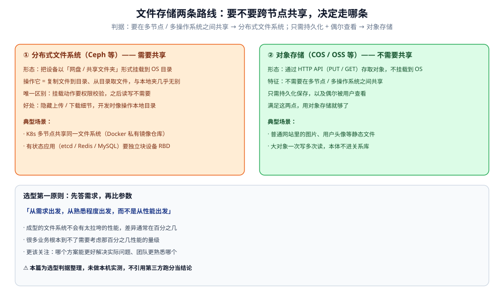

# 对象存储选型对比

> 文件存储的两条路线怎么选：**自建分布式文件系统（Ceph 等）** 还是 **云对象存储（COS / OSS 等）**——
> 判据只有一句「**要不要跨节点共享**」，外加一条选型第一原则「**从需求与熟悉度出发，不从性能出发**」。
> 本篇只回答「该用哪一类文件存储」；选定之后「上传走直传还是中转、凭证怎么签发、文件为什么不能放业务服务器」
> 属于上传链路架构，见 [文件存储与上传架构.md](../../../04-架构与系统/系统设计/文件存储与上传架构.md)。
>
> 内容整理自个人学习笔记，素材见 [素材清单](../../../素材清单.md)。
> ⚠️ 本篇为选型判据整理，**未做本机实测**，不引用任何第三方性能跑分当结论。

---

## 一、选型第一原则：先答需求，再比参数？

**本节要点**：**核心是「选型方法」而不是「性能对比」**——先问需求与团队熟悉度，而不是先比参数。

> **从需求出发，从熟悉程度出发，而不是从性能出发。**

原因：

- **成型的文件系统不会有太拉垮的性能**，性能差异通常在百分之几；
- 很多业务**根本到不了需要考虑那百分之几性能的量级**；
- 所以更该关注的是：**哪个方案能更好解决实际问题、团队更熟悉哪个**。

⭐ 这条原则把「选型」从「比跑分」拉回「比契合度」——下面的两条路线之分，也不是性能之分，而是**共享需求**之分。

---

## 二、两条路线分别适合什么场景？

**本节要点**：分水岭是「**要不要在多个节点 / 操作系统之间共享**」——要共享走分布式文件系统，不要共享走对象存储。

### 2.1 分布式文件系统（Ceph 等）—— 需要共享

**场景**：K8s 环境。所有容器 / Pod **部署在多台机器上**，机器之间需要**共享文件或磁盘**。

具体例子：

- 在 K8s 里搭建 **Docker 私有镜像仓库**，把镜像都存在一个位置，**所有集群节点共享同一个文件系统**（镜像存在这里）；
- **有状态应用**（etcd、Redis、MySQL）：每个 Pod 需要一块**独立的存储块设备**（RBD），这类也用 Ceph 提供。

**原理**：把设备以**类似网盘 / 共享文件夹**的形式**挂载到操作系统**的某个目录上。对使用者来说，**操作它就是复制文件到目录、从目录取文件**，与本地文件夹**几乎没有区别**。

**唯一区别**：**挂载动作需要权限校验**，之后的读写就不需要了。好处是**隐藏了文件上传 / 下载的细节**——开发时就像操作本地目录。

### 2.2 对象存储（COS / OSS 等）—— 不需要共享

**场景**：普通网站里的**图片、用户头像**等静态文件。

特征：

- **不需要在多个操作系统 / 节点之间共享**；
- 只需要**持久化保存**，以及**偶尔被用户查看**。

满足这两点，用对象存储就够了。它通过 **HTTP API（PUT / GET）** 存取对象，不挂载到操作系统，大对象一次写多次读，本体不进关系库。

### 2.3 一张图看清两条路线的边界

图怎么读：左右两栏是两条路线的**形态差异**——左栏（分布式文件系统 Ceph）把设备**挂载到 OS 目录**，操作它就像操作本地文件夹，因此能被多节点共享，适合 K8s 镜像仓库与有状态应用的块设备（RBD）；右栏（对象存储 COS / OSS）经 **HTTP API 存取**、不挂载、不共享，适合图片头像这类「持久化 + 偶尔查看」的静态文件。底部是贯穿两者的**选型第一原则**：从需求与熟悉度出发，而不是从性能出发。⚠️ 图为判据示意，不含任何性能读数。

---

## 三、它和「数据库选型」是什么关系？

**本节要点**：本篇解决「**文件 / 大对象放哪**」，[数据库选型对比.md](../数据库选型对比.md) 解决「**结构化数据用哪类库**」；两者正交，一个系统通常都要，且分工固定——**库里只存指针（元数据），本体交给对象存储**。

| 数据 | 归谁 | 理由 |
|---|---|---|
| 文件元数据（key、归属、大小、类型） | 关系库（权威源） | 唯一真相，要按业务条件查询与鉴权 |
| 文件本体 | 对象存储 / 分布式文件系统 | 大对象一次写多次读，绝不进关系库 |
| 热点文件 | CDN 边缘节点（缓存） | 高频被访问，可从对象存储回源重建 |

⭐ 对象存储**不是数据库**：它按 key 存取大对象，不提供事务与复杂查询。所以「选了对象存储」不等于「不用数据库」，而是把**本体**与**元数据**分开存。这一角色分工的通用判据见 [存储选型与组合.md](../存储架构与场景/存储选型与组合.md)。

---

## 延伸追问

- **成型文件系统的性能差异到底要不要紧？** → 通常只在百分之几，且很多业务根本到不了需要计较那百分之几的量级；所以选型从**需求与团队熟悉度**出发，而不是从跑分出发（见第一节）。
- **什么时候必须用 Ceph 这类分布式文件系统？** → 当需要**跨节点共享同一文件系统**时——K8s 多节点共享镜像仓库、有状态应用要独立块设备（RBD）；不需要共享就别引它，对象存储更省事（见 2.1）。
- **对象存储能替代数据库吗？** → 不能。它按 key 存取大对象、不给事务与复杂查询；正确分工是**库里存元数据指针、对象存储存本体**（见第三节）。
- **选定存储之后，上传链路还要设计什么？** → 直传还是中转、临时凭证怎么签发、文件为什么不能放业务服务器——这些是架构问题，见 [文件存储与上传架构.md](../../../04-架构与系统/系统设计/文件存储与上传架构.md)。

## 关联

- [文件存储与上传架构.md](../../../04-架构与系统/系统设计/文件存储与上传架构.md) — 选定之后的上传链路：直传 vs 中转、有状态 / 无状态、预签名凭证（架构视角）；本篇的「上传」部分在那里。
- [数据库选型对比.md](../数据库选型对比.md) — 结构化数据选哪类库；与本篇「文件 / 对象放哪」正交。
- [存储选型与组合.md](../存储架构与场景/存储选型与组合.md) — 对象存储在「归档 / 静态资源」角色里的落点与多存储组合判据。
- [README.md](README.md) — 对象存储目录导读。
- [素材清单.md](../../../素材清单.md) — 素材来源登记。
> 反向引用（本篇被下列文档引到）：[对象与文件数据存储.md](../存储架构与场景/形态篇/对象与文件数据存储.md)
