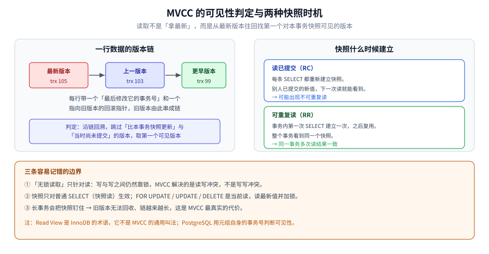

# MVCC 多版本并发控制

> MVCC（Multi-Version Concurrency Control）的**通用原理**：为什么「多版本」能让读写互不阻塞、它靠什么实现、有哪些代价；以及 InnoDB 与 PostgreSQL 两条不同的实现路线。
> InnoDB 的具体落地（隐藏列 / undo 版本链 / Read View 细节）与它的锁体系见 [InnoDB的并发控制实现.md](../关系型/MySQL/InnoDB的并发控制实现.md)。
>
> 内容整理自个人学习笔记。素材见 [素材清单.md](../../../素材清单.md)。

---

## 一、它解决什么问题

**本节要点**：MVCC 用「保留旧版本」换掉「读要等写、写要等读」，把读写的互斥降到最低。

MVCC（Multi-Version Concurrency Control，多版本并发控制）是一种用于数据库系统中处理并发数据访问的技术：**它允许在不锁定资源的情况下执行读取和写入操作**，从而提高数据库的并发性能。

它要解决的对立是：**如果只有锁，读和写就必然互相等待**。加锁方案里，读者要防止写者改掉自己正在读的数据，写者要防止读者看到中间态，于是双方互斥；而 MVCC 换了个思路 —— **写不覆盖旧值，而是留下一个新版本**，读者去读「属于自己那一刻」的那个版本，两边自然不必排队。

代价是：更新不再原地覆盖，**旧版本要留、要清理**，并且「某个版本对我可见吗」需要一套判定规则。

## 二、五个特点

**本节要点**：这五条是 MVCC 的「能力清单」，也是判断一个系统是否真的用了 MVCC 的抓手。

| 特点 | 说明 |
|---|---|
| **无锁读取** | 读取操作不需要获取任何锁，因为每个事务看到的是一致性视图（Consistent View），即在某个时间点数据库的状态 |
| **快照读取** | 事务在开始时会创建一个快照，包含事务开始时数据库的状态，事务基于该快照读取一致性数据 |
| **版本控制** | 每个数据项可能存在多个版本，每个版本有一个时间戳表示其创建时间 |
| **写入时冲突检测** | 当事务试图修改数据时，系统检查是否有其他事务已读取该数据的旧版本；有冲突则处理（回滚或等待） |
| **支持多隔离级别** | 在不同隔离级别下工作，从而在一致性和并发性之间权衡 |

> ⚠️ 「无锁读取」是**读**这一侧的性质：写与写之间**仍然要靠锁**。MVCC 解决的是读写冲突，不是写写冲突 —— 后者依然取决于行锁、唯一索引与隔离级别。

## 三、通用实现方式

**本节要点**：任何 MVCC 实现都要回答两个问题 —— **旧版本存在哪**、**怎么决定版本可见性**。

MVCC 通常通过以下方式实现：

- **版本向量**：记录每个事务看到的每个数据项的版本号
- **时间戳**：每个事务都有一个时间戳，用于确定事务的先后顺序
- **Undo 日志**：用于回滚操作、以及**构造历史版本**以解决写入冲突

落到具体产品上，无非是「版本存在行内还是行外」与「可见性用区间还是用集合判定」的组合，下面两条路线就是这两种组合的代表。

## 四、两条实现路线：InnoDB 与 PostgreSQL

**本节要点**：同样是 MVCC，两条路线的差别在**旧版本放哪**，以及**可见性怎么判**；理解这一点，就不会把某一家的名词当成通用概念。

| | InnoDB（MySQL） | PostgreSQL |
|---|---|---|
| **旧版本存放** | **行外**：当前行留在页里（含 `DB_TRX_ID` / `DB_ROLL_PTR`），旧版本在 **undo log** 里串成版本链 | **行内**：每个元组自带 `xmin` / `xmax` 事务号，旧元组留在原处由 `VACUUM` 清理 |
| **可见性判定** | 由 **Read View**（活跃事务 ID 集合）沿版本链回溯判定 | 由元组自己的 `xmin` / `xmax` 与当前快照区间直接比对 |
| **旧版本清理** | purge 线程按最老的活跃 Read View 推进 | `VACUUM` / autovacuum |
| **读到的位置** | 可能需要在 undo 链上回溯 → 链越长读越慢 | 直接跳过多余元组，但表会「膨胀」需要回收 |

两条路线的**共同点**才是 MVCC 的通用部分：都为每个数据保留多个版本、都由「事务可见性规则」决定读到哪个版本、都需要后台回收旧版本。

> ⭐ 所以「Read View」是 **InnoDB 的名词**，不是 MVCC 的通用术语；对应到 PostgreSQL 就是「快照 + `xmin`/`xmax` 判定」。把这两套词混着用，最容易在讨论时露怯。
>
> 💡 理论落地：InnoDB 用隐藏列、undo 版本链与 Read View 实现这套机制，隐藏列取值、RC/RR 的 Read View 生成时机、以及加锁规则的实测见 [InnoDB的并发控制实现.md](../关系型/MySQL/InnoDB的并发控制实现.md)。

上图是两条路线的共同骨架：同一行有多个版本，读取时不是「读最新」，而是**从最新往回找第一个对本事务快照可见的版本**；而快照建立的时机（每条语句一份 / 每个事务一份）直接决定了这个事务能不能看见别人刚提交的改动。

## 五、应用与优劣

**本节要点**：收益是读写不互斥、死锁减少；代价是**存储与回收**，而最大的风险来自长事务把回收水位钉住。

**应用**：PostgreSQL、Oracle、MySQL（InnoDB 存储引擎）、MongoDB（WiredTiger 引擎）等现代数据库广泛采用。

| 方面 | 内容 |
|---|---|
| **优势** | ① 提高并发性：允许多个事务同时读取数据而不必等待；② 减少死锁：读操作不需要加锁，减少死锁可能 |
| **挑战** | ① **存储开销**：每个数据项可能存多个版本，增加存储需求；② **垃圾回收**：需要定期清理不再使用的旧版本以释放空间 |

> ⚠️ 两个挑战在工程上是同一件事的两面：**只要有一个长事务/长快照不结束，回收就无法推进** ——
> undo（或旧元组）会持续膨胀，读要走的链越来越长。这就是「长事务」在 MVCC 体系里最真实的代价，
> 监控口径见 [锁等待与死锁排查.md](../关系型/MySQL/锁等待与死锁排查.md) 第三节。

## 六、读语义：它能规避什么、不能规避什么

**本节要点**：MVCC 只对**快照读**负责；锁定读/写操作走的是「当前读」，仍然要靠锁。

- **快照读**（普通 `SELECT`）：走 MVCC，读到的是本事务快照对应的版本 —— RR 下同一事务多次读结果一致，因此**不可重复读被规避**。
- **当前读**（`SELECT ... FOR UPDATE`、`UPDATE`、`DELETE`）：读最新版本并加锁，**不受隔离级别影响**；要防幻读就得靠间隙锁（Next-Key Lock）。

完整对照与可复现实验见 [快照读与当前读.md](快照读与当前读.md)。

## 延伸追问

- **MVCC 能解决幻读吗？** → 快照读能（RR 下同一事务读到同一版本），但当前读（`FOR UPDATE`）仍依赖**间隙锁**。「RR 靠 MVCC 就万事大吉」是错的。
- **为什么 RC 下每条语句读到的版本可能不同？** → RC 每条语句生成新快照，RR 只在事务内第一条语句生成、之后复用。
- **版本链会不会无限长？** → 会被后台按「最老的活跃快照」清理；**长事务会把水位钉住** → undo 暴涨，这是长事务最真实的代价。
- **MVCC 让写操作也不加锁了吗？** → 没有。写写冲突仍靠锁与唯一索引解决，MVCC 只让「读」不阻塞。
- **乐观锁和 MVCC 是一回事吗？** → 不是。乐观锁是应用层的冲突检测策略（版本号/条件更新），MVCC 是数据库内部的版本管理机制；两者常被混为一谈，区别见 [乐观锁与悲观锁.md](乐观锁与悲观锁.md)。

## 关联

- [README.md](README.md) — 本目录总纲
- [InnoDB的并发控制实现.md](../关系型/MySQL/InnoDB的并发控制实现.md) — InnoDB 路线的实现细节与锁体系
- [快照读与当前读.md](快照读与当前读.md) — 快照读/当前读的语义与对照实验
- [标准隔离级别与产品实现差异.md](标准隔离级别与产品实现差异.md) — 隔离级别标准与各产品的实现差异
- [乐观锁与悲观锁.md](乐观锁与悲观锁.md) — 应用层的并发控制思想
- [关系型选型对比.md](../关系型/关系型选型对比.md) — 跨产品的隔离语义与锁行为差异
- [素材清单.md](../../../素材清单.md) — 素材来源登记
> 反向引用（本篇被下列文档引到）：[事务与并发控制.md](../图数据库/Neo4j/事务与并发控制.md)、[锁的粒度与模式.md](锁的粒度与模式.md)、[一致性模型.md](../../../04-架构与系统/分布式/理论基础/一致性模型.md)、[时钟与顺序.md](../../../04-架构与系统/分布式/理论基础/时钟与顺序.md)
