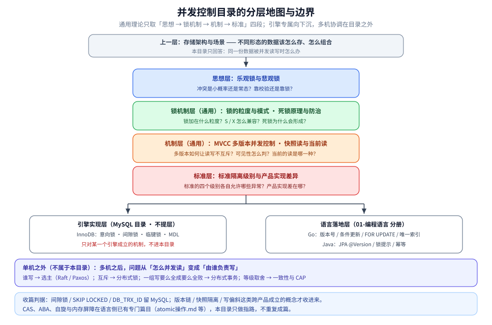

# 并发控制

> 本目录是「**单个数据库/存储内部如何并发读写**」的通用理论层：并发控制思想（乐观 / 悲观）、锁的粒度与模式、多版本并发控制（MVCC）、读语义（快照读 / 当前读）、隔离级别标准、死锁原理与防治，以及这些理论在 Go / Java 里的落地分册。
> **它不写任何一个引擎的参数与专有机制** —— InnoDB 的意向锁 / 间隙锁 / 临键锁 / MDL 属于存储引擎，留在 [InnoDB的并发控制实现.md](../关系型/MySQL/InnoDB的并发控制实现.md)。
>
> ⭐ **上一层**：「不同形态的数据该怎么存、怎么组合」见 [存储架构与场景](../存储架构与场景/README.md) 与 [存储选型与组合.md](../存储架构与场景/存储选型与组合.md)；本目录只回答「同一份数据被并发读写时怎么办」。
> **单机之外**的多机协调（选主、分布式锁、跨库一致性）不属于本目录，见文末「边界」。
>
> 内容整理自个人学习笔记。素材见 [素材清单.md](../../../素材清单.md)。

---

## 一、本目录管什么

**本节要点**：一条从「思想」到「引擎实现」再到「代码落地」的线，本目录只拿中间那段通用的。

| 层 | 回答什么 | 在哪 |
|---|---|---|
| **思想层** | 冲突是小概率还是常态？靠校验还是靠锁？ | 本目录（[乐观锁与悲观锁.md](乐观锁与悲观锁.md)） |
| **锁机制层（通用）** | 锁加在什么粒度上？S / X 怎么兼容？死锁为什么会形成？ | 本目录（[锁的粒度与模式.md](锁的粒度与模式.md)、[死锁原理与防治.md](死锁原理与防治.md)） |
| **机制层（通用）** | 多版本如何让读写不互斥？可见性怎么判？当前的读是哪一种？ | 本目录（[MVCC多版本并发控制.md](MVCC多版本并发控制.md)、[快照读与当前读.md](快照读与当前读.md)） |
| **标准层** | 标准的四个隔离级别各自允许哪些异常？产品实现差在哪？ | 本目录（[标准隔离级别与产品实现差异.md](标准隔离级别与产品实现差异.md)） |
| **引擎实现层** | InnoDB 具体加哪些锁、Read View 何时生成、MDL 怎么坑 DDL | [MySQL 目录](../关系型/MySQL/README.md)（引擎专属，**不**提层） |
| **语言落地层** | Go / Java 里版本号、条件更新、`@Version` 怎么写 | `01-编程语言/` 分册 |

⚠️ 判据很简单：**只对某一个引擎成立的机制，不进本目录**。所以「间隙锁」「`SKIP LOCKED`」「`DB_TRX_ID`」留 MySQL；而「版本链」「快照隔离」「写偏斜」这类跨产品成立的概念才收进来。



图怎么读：中间竖排四层是本目录的主线——思想层（乐观 / 悲观）→ 锁机制层（粒度与模式、死锁）→ 机制层（MVCC、快照读与当前读）→ 标准层（隔离级别），每层框里标了对应的零件篇和它回答的问题；顶部灰框是上一层「数据形态该存成什么样」，下方两个白框是细节的去处——引擎专属内容进 MySQL 目录且**不提层**，代码写法进 `01-编程语言/` 分册；靛蓝横条是分界线以外：多机之后换成选主、分布式锁与分布式事务那一套。底部两行判据照抄上方正文，指路 CAS / ABA 的既有篇目。

## 二、本目录的结构

```text
乐观锁与悲观锁.md              两种并发控制思想：原理、实现、代价、选型
锁的粒度与模式.md              锁加在什么上（表/页/行）、S 与 X 两种模式、兼容性矩阵、意向锁
MVCC多版本并发控制.md          多版本为什么能读写不互斥；InnoDB 与 PostgreSQL 两条路线
快照读与当前读.md              同一事务里两种读法看到什么；幻读为什么只被快照读规避
标准隔离级别与产品实现差异.md   ANSI/ISO 标准的四级别 × 三类现象；默认级别与实现路线；写偏斜与 SSI
死锁原理与防治.md              死锁的四个必要条件、等待图、超时/主动牺牲、防治手段
```

语言落地分册（不放在本目录）：

```text
01-编程语言/go/工程实践/写冲突控制的Go落地.md     版本号 / 条件更新 / FOR UPDATE / 唯一索引
01-编程语言/java/写冲突控制的Java落地.md          JPA @Version / 锁提示 / 幂等
```

## 三、按需求进

| 你要解决的问题 | 从哪读 |
|---|---|
| 「乐观锁和悲观锁到底怎么选」 | [乐观锁与悲观锁.md](乐观锁与悲观锁.md) 第三节 |
| 「表锁 / 页锁 / 行锁怎么选，S 锁 X 锁是什么」 | [锁的粒度与模式.md](锁的粒度与模式.md) 第一、二节 |
| 「为什么加了行锁还要意向锁」 | [锁的粒度与模式.md](锁的粒度与模式.md) 第四节 |
| 「死锁是怎么形成的、怎么防」 | [死锁原理与防治.md](死锁原理与防治.md) 第二、五节 |
| 「死锁报错了，该由谁重试」 | [死锁原理与防治.md](死锁原理与防治.md) 第四节 |
| 「为什么读了不加锁、写也不会把读堵死」 | [MVCC多版本并发控制.md](MVCC多版本并发控制.md) 第一、二节 |
| 「Read View 是通用概念吗」 | [MVCC多版本并发控制.md](MVCC多版本并发控制.md) 第四节（它是 InnoDB 的名词） |
| 「同一个事务里两条查询结果不一样」 | [快照读与当前读.md](快照读与当前读.md) 第二节 |
| 「RR 到底有没有幻读」 | [快照读与当前读.md](快照读与当前读.md) 第三节 + [标准隔离级别与产品实现差异.md](标准隔离级别与产品实现差异.md) 第二节 |
| 「标准 RR 和 MySQL 的 RR 差在哪」 | [标准隔离级别与产品实现差异.md](标准隔离级别与产品实现差异.md) 第二节 |
| 「为什么很多业务用 RC」 | [标准隔离级别与产品实现差异.md](标准隔离级别与产品实现差异.md) 第三节 |
| 「`SERIALIZABLE` 为什么有的库不慢」 | [标准隔离级别与产品实现差异.md](标准隔离级别与产品实现差异.md) 第三、四节（SSI） |
| 「InnoDB 具体加了哪几把锁」 | [InnoDB的并发控制实现.md](../关系型/MySQL/InnoDB的并发控制实现.md)（引擎层，不在本目录） |
| 「Go / Java 里怎么写」 | [写冲突控制的Go落地.md](../../../01-编程语言/go/工程实践/写冲突控制的Go落地.md)、[写冲突控制的Java落地.md](../../../01-编程语言/java/写冲突控制的Java落地.md) |

## 四、语言无关层：CAS、自旋与内存屏障在哪 ⭐

**本节要点**：乐观思想往下一层就是 CPU 的原子指令；这部分**已经有专门的篇目**，本目录只做指路，不重复写。

| 概念 | 为什么和本目录有关 | 去哪读 |
|---|---|---|
| **CAS（Compare-And-Swap）** | 乐观锁在 CPU 指令层的形态：值等于预期才换新值，否则失败重试 | [atomic操作.md](../../../01-编程语言/go/并发编程/atomic操作.md) 第四节（含 CAS 循环与竞争时序） |
| **ABA 问题** | 与「用 `updated_at` 当版本号会误判」是同一类缺陷 | [atomic操作.md](../../../01-编程语言/go/并发编程/atomic操作.md) 4.2；Java 侧见 [锁与AQS.md](../../../01-编程语言/java/并发编程/锁与AQS.md) 4.2 |
| **自旋与无锁结构** | 「不阻塞、原地重试」的代价（空转烧 CPU） | [atomic操作.md](../../../01-编程语言/go/并发编程/atomic操作.md) 1.2 |
| **内存屏障 / 内存序** | 无锁方案绕不开的可见性与重排问题 | [JMM与内存屏障.md](../../../01-编程语言/java/并发编程/JMM与内存屏障.md)、[Go内存模型.md](../../../01-编程语言/go/并发编程/Go内存模型.md) |

> ⚠️ 之所以不在这里再写一篇「无锁编程与 CAS」：`atomic操作.md`、`锁与AQS.md`、`JMM与内存屏障.md` 已经覆盖了指令、ABA、内存序与实测，重复成篇只会让两处口径漂移。

## 五、边界：单机之外

**本节要点**：一旦把视角抬到多机，问题就从「怎么并发读」变成「由谁负责写」，机制整体换一套。

前四篇讲的都是**单机内**的读写并发。多机之后：

- **谁来写**：主节点选举（Leader Election），常见实现是 Raft、Paxos/Multi-Paxos，以及基于它们的 ZooKeeper / etcd —— 见 [Raft协议.md](../../../04-架构与系统/分布式/共识协议/Raft协议.md)、[Paxos协议.md](../../../04-架构与系统/分布式/共识协议/Paxos协议.md)。
- **互斥怎么做**：跨进程 / 跨机器的锁 —— 见 [分布式锁.md](../NoSQL/Redis/分布式锁.md)、[分布式协调选型对比.md](../../中间件/分布式协调/分布式协调选型对比.md)。
- **一组写操作怎么要么全成要么全败**：跨库一致性 —— 见 [README.md](../../../04-架构与系统/分布式/分布式事务/README.md)、[分布式事务选型对比.md](../../中间件/分布式事务/分布式事务选型对比.md)。
- **一致性等级怎么取舍**：见 [CAP与PACELC.md](../../../04-架构与系统/分布式/理论基础/CAP与PACELC.md)。

> 一句话分界：**本目录管「一份数据被并发读写」，分布式目录管「多份数据由谁说了算」。**

⭐ **为什么本目录在 03 而不在 04**：它是 03 内**刻意的「无产品通用层」**——不绑任何引擎（InnoDB 的间隙锁之类在 [MySQL/](../关系型/MySQL/README.md)），但也不归 [分布式/](../../../04-架构与系统/分布式/README.md)，因为 04 只管「多机之后多出什么问题」。判据一句话：**把机器数从 1 加到 3，本目录的结论一条都没变** → 它讲的是单机语义，留在 03。新增相邻篇时按这条切：变的是「谁说了算」→ 04；变的只是「用哪个产品的哪个参数」→ 族目录。

## 关联

- [乐观锁与悲观锁.md](乐观锁与悲观锁.md) — 并发控制思想与选型
- [锁的粒度与模式.md](锁的粒度与模式.md) — 锁的粒度、S/X 模式与意向锁
- [死锁原理与防治.md](死锁原理与防治.md) — 死锁的条件、等待图与防治
- [MVCC多版本并发控制.md](MVCC多版本并发控制.md) — 多版本并发的通用原理
- [快照读与当前读.md](快照读与当前读.md) — 读语义与幻读
- [标准隔离级别与产品实现差异.md](标准隔离级别与产品实现差异.md) — 隔离级别标准与产品差异
- [存储架构与场景](../存储架构与场景/README.md) — 上一层：数据形态与多存储组合（讲「存什么」）
- [存储选型与组合.md](../存储架构与场景/存储选型与组合.md) — 数据角色与多存储分工
- [MySQL/README.md](../关系型/MySQL/README.md) — 引擎实现层：InnoDB 的并发控制实现
- [事务与隔离级别.md](../关系型/MySQL/事务与隔离级别.md) — MySQL 侧的隔离级别、事务代价与代码落地
- [写冲突控制的Go落地.md](../../../01-编程语言/go/工程实践/写冲突控制的Go落地.md) — Go 落地分册
- [写冲突控制的Java落地.md](../../../01-编程语言/java/写冲突控制的Java落地.md) — Java 落地分册
- [素材清单.md](../../../素材清单.md) — 素材来源登记
