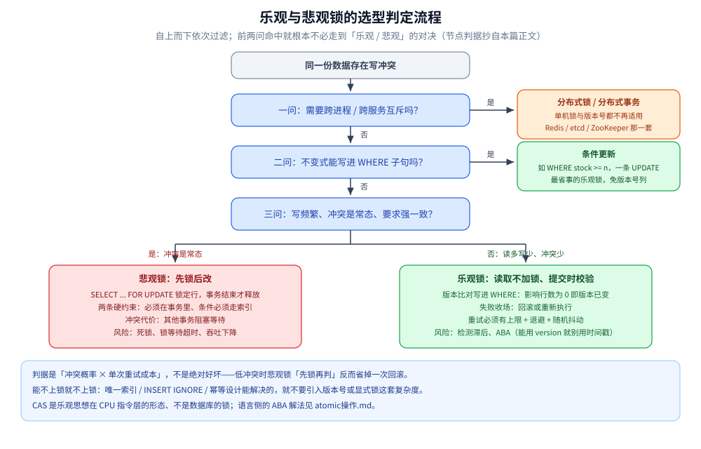

# 乐观锁与悲观锁

> 两种**并发控制思想**：乐观锁「读取不加锁、提交时才校验」，悲观锁「操作前先加锁」；本篇讲它们的原理、实现方式、代价与选型判据。
> 数据库引擎真正提供的锁（InnoDB 的意向锁 / 间隙锁 / 临键锁 / MDL）见 [InnoDB的并发控制实现.md](../关系型/MySQL/InnoDB的并发控制实现.md) —— 那是**实现**，不是思想。
>
> 内容整理自个人学习笔记。素材见 [素材清单.md](../../../素材清单.md)。

---

## 一、乐观锁

**本节要点**：先假设冲突是小概率事件，因此读取时不加锁、只在提交时校验；代价是冲突时「事后发现」，必须靠重试或报错收场。

乐观锁是一种并发控制机制，用于处理多用户同时操作同一数据时可能出现的冲突。它基于一种假设：**在大多数情况下，多个事务可以同时进行而不会相互干扰**——冲突是小概率事件。

因此它允许事务在**不加锁**的情况下进行，**只在提交时才检查是否发生了冲突**。

**实现方式**：通常依赖记录的**版本号**或**时间戳**。

1. 读取数据时，同时获取当前的版本号（或时间戳）
2. 事务完成、准备提交更新时，检查自读取以来数据的版本号是否发生变化
3. **没有变化** → 说明期间无其他事务修改过该数据，安全提交
4. **发生变化** → 说明已有其他事务修改，当前事务需要**回滚或重新执行**

```sql
-- 版本号机制的典型写法：把「比对版本」和「更新」放在一条 SQL 里，由数据库保证原子性
UPDATE item
SET stock = stock - 1, version = version + 1
WHERE id = #{id} AND version = #{oldVersion};
-- 影响行数为 0 → 说明版本已变，业务层重试或报错
```

**优点**：

1. **性能**：不需要加锁，减少了锁争用，提高了系统的并发性能
2. **简单性**：实现相对简单，特别是在**读多写少**的场景下

**缺点**：

1. **冲突检测滞后**：在提交时才检测冲突，如果冲突频繁，可能导致大量事务需要回滚或重试
2. **ABA 问题**：一个事务读取数据后，另一个事务把数据**改掉又改回原值**（或版本号回到原状），此时校验可以通过，但数据实际已被中间修改过、可能产生误判

> 💡 **常见误写**：有人把 `SELECT ... FOR UPDATE` 归为乐观锁的实现——**它恰恰是悲观锁**，
> 因为它一开始就锁住了行。乐观锁的特征是「读取时不加锁，写入时校验」。
> 另一个常见混用：**CAS（Compare-And-Swap）是乐观思想在 CPU 指令层的形态**，不是数据库的锁；语言侧的原理与 ABA 解法见 [atomic操作.md](../../../01-编程语言/go/并发编程/atomic操作.md)。

## 二、悲观锁

**本节要点**：假设冲突是常态，所以先锁后改；换来确定性的同时，把复杂度转移成了「死锁与锁等待」。

悲观锁与乐观锁相对，基于一种较为保守的假设：**多个事务并发执行时冲突是常见的**，因此需要通过锁定机制来避免冲突。

核心思想是：在事务进行数据操作时**先对数据加锁**，确保在事务执行期间其他事务不能修改这些数据。

**关键特点**：

1. **锁定数据**：事务开始时通过数据库的锁机制锁定需要操作的数据，防止其他事务同时修改
2. **数据一致性**：只有持有锁的事务才能修改数据，因此能确保一致性
3. **死锁风险**：多个事务相互等待对方释放锁时可能导致死锁
4. **性能影响**：高并发系统中可能因频繁的锁争用而影响性能
5. **适用场景**：适用于**写操作频繁**的场景，锁定可减少冲突和数据不一致的风险
6. **事务隔离级别**：悲观锁的行为与事务隔离级别相关，不同级别对锁的持有与释放时机不同
7. **实现方式**：通过 SQL 实现，如 `SELECT ... FOR UPDATE` 锁定行，或使用数据库特定的锁机制
8. **回滚机制**：事务无法提交时，数据库系统负责释放锁并回滚事务，保证数据一致性

```sql
-- 悲观锁：一开始就锁住这行，直到事务结束（COMMIT/ROLLBACK）才释放
BEGIN;
SELECT stock FROM item WHERE id = 1 FOR UPDATE;   -- 排他锁
UPDATE item SET stock = stock - 1 WHERE id = 1;
COMMIT;
```

> ⚠️ 悲观锁的两条硬约束：**必须在事务里**（自动提交下锁在语句结束就释放，等于白锁），**条件必须走索引**（否则 InnoDB 会把它扫过的行全锁上）。这两条与引擎的加锁规则直接相关，见 [InnoDB的并发控制实现.md](../关系型/MySQL/InnoDB的并发控制实现.md)。

## 三、两者对比与选型

**本节要点**：没有绝对优劣，判据是「冲突概率 × 单次重试成本」，而不是「谁更新谁更高级」。

| 维度 | 乐观锁 | 悲观锁 |
|---|---|---|
| **核心假设** | 冲突是小概率事件 | 冲突是常态 |
| **加锁时机** | 不加锁，提交时校验 | 操作前先加锁 |
| **实现位置** | 应用层（版本号/CAS/时间戳） | 数据库锁（`FOR UPDATE`、行锁、表锁） |
| **冲突代价** | 提交时才发现，需回滚重试 | 其他事务**阻塞等待** |
| **适合场景** | **读多写少**、冲突少 | **写多**、冲突多、要求强一致 |
| **主要风险** | 大量重试、ABA | **死锁**、锁等待超时、吞吐下降 |
| **典型应用** | 商品详情、库存扣减（带重试） | 银行转账、账户扣款、秒杀预扣 |

**选择结论**：读操作远多于写操作的场景中乐观锁更合适（减少锁争用、提高并发）；
写操作频繁且对一致性要求极高的场景中悲观锁更好（用锁换取确定性）。

**实践提醒**：两者的重试/等待都必须**有界**——乐观锁要设重试上限 + 退避（退避还要加随机抖动，否则同一批冲突者会再次同时到达），悲观锁要给锁等待设预算而不是吃默认超时。



图怎么读：入口是「同一份数据存在写冲突」，自上而下问三问——第一问命中就直接离开单机锁的世界（跨进程换分布式锁，一组写操作全成全败是分布式事务）；第二问命中就用条件更新，一条 `UPDATE` 是最省事的乐观锁、不必加版本号列；只有第三问也落空（读多写少、冲突少），才轮到乐观 / 悲观对决。下方两个分支各带自己那侧的硬约束与风险，底部横条是判据和「能不上锁就不上锁」的提醒。

把分流顺序整理成判定表（按问的顺序，命中即停）：

| 判定问题 | 答「是」的落点 | 答「否」的去向 |
|---|---|---|
| 需要跨进程 / 跨服务互斥吗？ | Redis / etcd / ZooKeeper 分布式锁；一组写操作要全成全败则换分布式事务 | 进第二问 |
| 不变式能写进 `WHERE` 吗（如 `stock >= n`）？ | 条件更新：一条 `UPDATE` 搞定，免版本号列 | 进第三问 |
| 写频繁、冲突是常态、要求强一致？ | 悲观锁 `FOR UPDATE`：必须在事务里 + 条件走索引，锁等待设预算 | 乐观锁：版本比对写进 `WHERE`，影响行数为 0 即冲突 → 有上限的重试 + 退避 + 抖动 |

## 四、补充：不止乐观与悲观两种 ⭐

**本节要点**：很多场景根本不需要引入版本号或显式锁 —— 能用唯一索引、条件更新或幂等设计解决的，就不要上「锁」这套复杂度。

- **唯一索引 / `INSERT IGNORE` / `ON DUPLICATE KEY UPDATE`**：把「判重」交给存储引擎的行锁与索引结构，一次往返搞定，是幂等写的最常用手段（写法见 [写冲突控制的Go落地.md](../../../01-编程语言/go/工程实践/写冲突控制的Go落地.md)）。
- **条件更新**：不变式能写进 `WHERE` 时（如 `WHERE stock >= n`），一条 `UPDATE` 就是最省事的乐观锁，不必加版本号列。
- **跨进程、跨服务**：单机锁与版本号都不再适用，要换成 Redis / etcd / ZooKeeper 那一套分布式锁，见 [分布式锁.md](../NoSQL/Redis/分布式锁.md)；选主与更弱的协调需求见 [分布式协调选型对比.md](../../中间件/分布式协调/分布式协调选型对比.md)。
- **跨服务的一组写操作**：那不是「锁」的问题，而是分布式事务，见 [分布式事务选型对比.md](../../中间件/分布式事务/分布式事务选型对比.md)。

## 延伸追问

- **乐观锁失败要重试几次？** → 必须有上限 + 退避，并且只对「冲突属于预期」的操作重试（如扣库存）；在事务里无限重试会把连接池拖死。
- **悲观锁一定比乐观锁慢吗？** → 不一定。低冲突时悲观锁「先锁再判」反而省掉一次回滚；判断依据是**冲突概率 × 重试成本**，不是绝对好坏。
- **`version` 和 `updated_at` 做版本号有什么差别？** → 用单调递增的 `version` 不会 ABA；用时间戳（同一毫秒内改回原值）会被误判成「没变」。能用 `version` 就别用时间戳。
- **乐观锁的「校验」一定要读回旧值再比吗？** → 不必，且**不该**：把比对写进 `WHERE`、用影响行数判定，才是原子的；先 `SELECT` 比较再无条件 `UPDATE` 等于把竞态窗口重新打开。
- **分布式锁能替代数据库悲观锁吗？** → 能替代一部分（跨进程互斥），但它更贵、更依赖外部组件；单库单表内的互斥优先用数据库自己的锁或条件更新。

## 关联

- [README.md](README.md) — 本目录总纲：并发控制的知识地图与阅读顺序
- [MVCC多版本并发控制.md](MVCC多版本并发控制.md) — MVCC 如何用「多版本」替掉一部分锁
- [快照读与当前读.md](快照读与当前读.md) — 同一事务里两种读法看到什么
- [InnoDB的并发控制实现.md](../关系型/MySQL/InnoDB的并发控制实现.md) — 引擎真正提供的锁与加锁范围
- [写冲突控制的Go落地.md](../../../01-编程语言/go/工程实践/写冲突控制的Go落地.md) — 版本号 / 条件更新 / 唯一索引的 Go 写法
- [写冲突控制的Java落地.md](../../../01-编程语言/java/写冲突控制的Java落地.md) — JPA `@Version` 与幂等
- [分布式锁.md](../NoSQL/Redis/分布式锁.md) — 跨进程时这套思想的演化
- [atomic操作.md](../../../01-编程语言/go/并发编程/atomic操作.md) — 乐观思想在 CPU 指令层（CAS / ABA）
- [素材清单.md](../../../素材清单.md) — 素材来源登记
