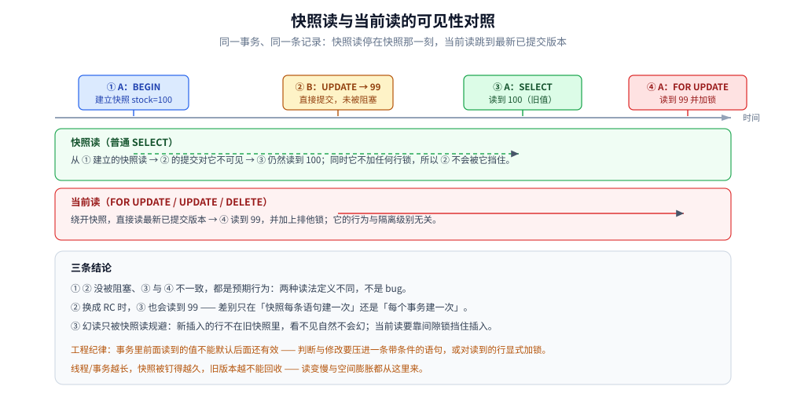

# 快照读与当前读

> 同一事务里，**普通 `SELECT`** 与 **`SELECT ... FOR UPDATE`** 可能读到**两个不同的值** —— 这是「我查到的和更新到的不一样」的根因。本篇讲清两种读法的分工、可复现的对照实验，以及「快照读靠 MVCC 规避幻读、当前读必须靠间隙锁」的道理。
> MVCC 的通用原理见 [MVCC多版本并发控制.md](MVCC多版本并发控制.md)；InnoDB 的加锁范围见 [InnoDB的并发控制实现.md](../关系型/MySQL/InnoDB的并发控制实现.md)。
>
> 内容整理自个人学习笔记。素材见 [素材清单.md](../../../素材清单.md)。
>
> ✅ **实测口径**：本篇的对照实验在 `mysql:8.0` 容器（`mysql-arch-lab`，**8.0.46**）上手工复现，表为 `item(id BIGINT PRIMARY KEY, stock BIGINT, version BIGINT)`、`id = 1` 的 `stock = 100`。

---

## 一、两种读法的定义与分工

**本节要点**：区分它们的唯一判据是「要不要读最新版本、要不要加锁」，而不是写法长短。

| | 快照读（Snapshot Read） | 当前读（Current Read） |
|---|---|---|
| **典型写法** | 普通 `SELECT` | `SELECT ... FOR UPDATE` / `FOR SHARE`、`UPDATE`、`DELETE` |
| **读哪个版本** | 本事务快照对应的版本（可能是旧值） | **最新已提交版本** |
| **是否加锁** | 不加锁 | 加锁（排他 / 共享） |
| **受隔离级别影响** | 是（RC 每条语句建快照、RR 每事务建一份） | **否**，行为与隔离级别无关 |
| **靠什么防幻读** | 靠 MVCC 的快照一致性 | 靠**间隙锁 / 临键锁** |

一句话记法：**快照读「回到过去」，当前读「面对现在」** —— 后者的语义决定了它必须拿到最新值并锁住它，否则「读出来判断再改」就是非原子的。

## 二、对照实验：RR 与 RC 的差别

**本节要点**：RR 下「快照读稳定、当前读跳到最新」是能手工复现的，跑一遍比看十遍有用。

开两个终端（`mysql -h... --comments`）：

```sql
-- 终端 A（事务，RR）
SET SESSION TRANSACTION ISOLATION LEVEL REPEATABLE READ;
BEGIN;
SELECT stock FROM item WHERE id = 1;        -- ① 看到 100，此刻生成快照

-- 终端 B（另一个连接）
UPDATE item SET stock = 99 WHERE id = 1;    -- ② 直接提交，没被阻塞（A 只是快照读，不加行锁）

-- 回到终端 A
SELECT stock FROM item WHERE id = 1;             -- ③ 仍是 100 ← RR 复用同一个快照
SELECT stock FROM item WHERE id = 1 FOR UPDATE;  -- ④ 变成 99！当前读绕开 MVCC 读最新版
COMMIT;
```

| 步骤 | RR 结果 | 换成 RC 的结果 | 说明 |
|---|---|---|---|
| ③ 快照读 | 100 | **99** | RC 每次读都重建快照，所以「读到了别人已提交的新值」 |
| ④ 当前读 | 99 | 99 | `FOR UPDATE` / `UPDATE` / `DELETE` 都读最新版本，**不受隔离级别影响** |

两个可复现的观察：

- **② 没被阻塞**：说明 `SELECT`（快照读）确实不加行锁 —— 这正是「读写不互斥」的直接证据。
- **③ 与 ④ 不一致**：同一个事务、同一条记录，两种读法给出两个值。这不是 bug，而是两种读法的定义不同。



上图把 ①②③④ 四步放在同一条时间轴上：终端 B 的提交发生在快照建立之后，所以快照读（③）仍看旧值，而当前读（④）必须看新值并加锁。

## 三、为什么幻读只被快照读规避

**本节要点**：幻读是「结果集多出/少了行」，防它需要锁住**不存在的行之间的间隙** —— 那是锁的活，不是版本的活。

- **快照读**：读的是快照，别的事务新插入的行本来就不在该快照里，所以**看不见 = 不会幻读**。这是 MySQL RR 下「基本没有幻读」的来源。
- **当前读**：必须读最新数据，新插入的行会落进结果集 —— 于是只能靠 **间隙锁 / 临键锁**把「还没被插入的空隙」也锁住，让别的事务插不进来。

所以「RR 下幻读被解决了吗」的准确回答是：**快照读被 MVCC 规避，当前读要靠间隙锁**。两侧都不能单独成立：
少了 MVCC，普通查询会被间隙锁拖垮并发；少了间隙锁，锁定读就会幻读。

> ⚠️ 由此还推出一条纪律：**事务里前面读到的值，不能默认它到后面还有效** —— 一旦中途夹了当前读，视图就切到最新了；写「读出来判断再改」的逻辑必须整体放进一条带条件的 `UPDATE`（或对读到的行显式加锁）。

## 四、工程后果

**本节要点**：两种读法混用带来的两个真实问题 —— 判断失效与快照过长。

1. **判断失效（最常踩）**：`SELECT` 得到 100 → 业务判断「够扣」 → 中途别的语句触发了当前读或别的事务已提交 → `UPDATE` 实际作用在新值上。修法是**把判断压进 `WHERE`**（`WHERE stock >= n`），让「判断 + 修改」在一条语句的行锁内完成。
2. **快照过长（最贵）**：RR 事务一开始就固定了快照，事务越久，快照对应的旧版本越不能被回收，undo 链越长、读越慢 —— 这是长事务在 MVCC 体系里最直接的代价，监控口径见 [锁等待与死锁排查.md](../关系型/MySQL/锁等待与死锁排查.md) 第三节。
3. **隔离级别选择的连带影响**：把线上降到 RC，快照读会「每条语句都看最新」，一致性判断要更依赖当前读与条件更新；换来的是**少两把锁**（间隙锁），并发与死锁表现都更好 —— 锁数量的实测对照见 [InnoDB的并发控制实现.md](../关系型/MySQL/InnoDB的并发控制实现.md) 的 RC/RR 对比。

## 延伸追问

- **为什么 `UPDATE` 也会「读」？** → 它属于当前读：必须先定位到最新版本的行才能改，定位过程本身就是加锁读。
- **`FOR UPDATE` 和 `FOR SHARE` 差别在哪？** → 都是当前读，区别是加排他锁还是共享锁；后者允许其他事务也加共享锁，但都阻塞排他锁。
- **RR 下 `SELECT` 之后 `UPDATE`，会不会改到旧版本？** → 不会。`UPDATE` 是当前读，改的是最新已提交版本（InnoDB 会在此基础上按需回滚到可见版本再改），所以「读到 100 却改了 99」是预期行为。
- **RC 下还要不要担心幻读？** → 要。RC 基本不加间隙锁，幻读是允许的；需要幻读安全时用 RR 的当前读，或改用 `SERIALIZABLE`（见 [标准隔离级别与产品实现差异.md](标准隔离级别与产品实现差异.md)）。
- **怎么判断一条语句是快照读还是当前读？** → 看它是否需要「基于最新值做判断/修改」：`SELECT` 不带 `FOR` 后缀是快照读，带 `FOR UPDATE` / `FOR SHARE` 或本身是 `UPDATE` / `DELETE` 都是当前读。

## 关联

- [MVCC多版本并发控制.md](MVCC多版本并发控制.md) — 快照从哪来、可见性怎么判
- [InnoDB的并发控制实现.md](../关系型/MySQL/InnoDB的并发控制实现.md) — 当前读加的是哪些锁、RC/RR 锁数量对照
- [标准隔离级别与产品实现差异.md](标准隔离级别与产品实现差异.md) — 幻读在标准与产品中的定义差异
- [乐观锁与悲观锁.md](乐观锁与悲观锁.md) — 把「读出来判断再改」换成原子语句的思路
- [事务与隔离级别.md](../关系型/MySQL/事务与隔离级别.md) — 隔离级别的实现侧与事务代价
- [素材清单.md](../../../素材清单.md) — 素材来源登记
