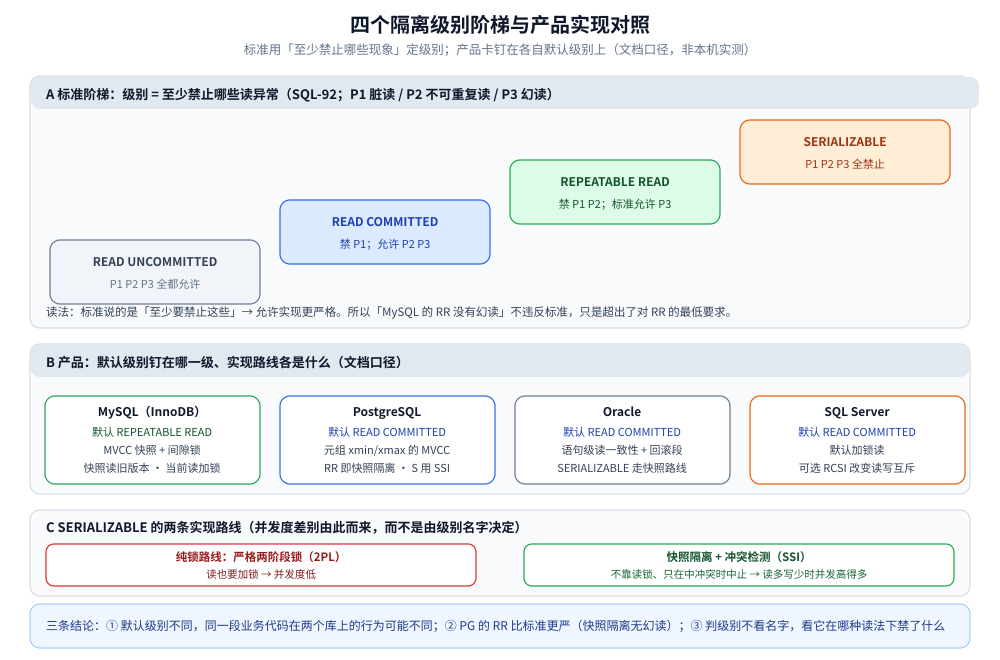
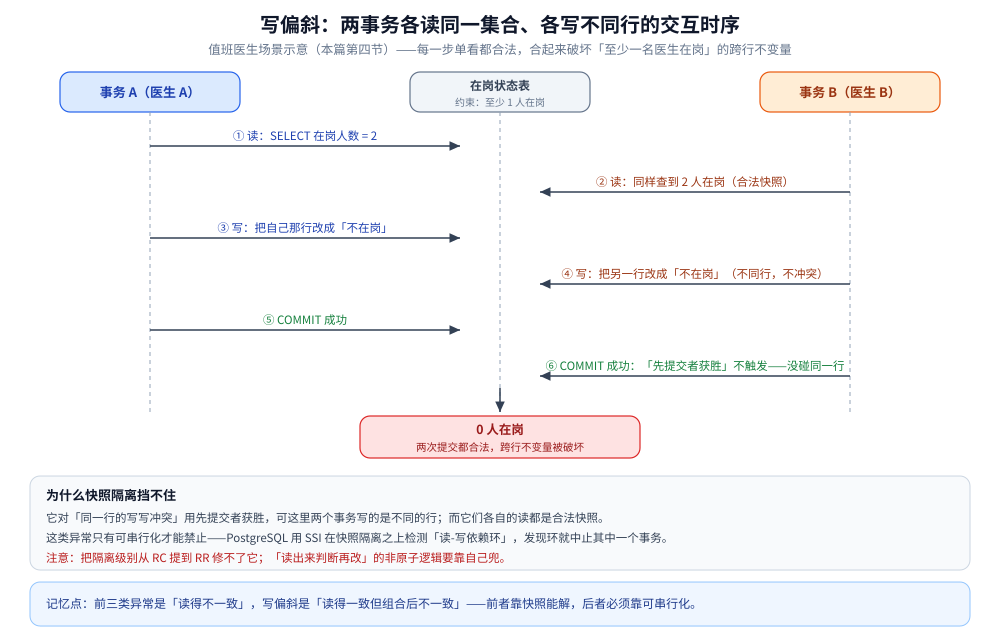

# 标准隔离级别与产品实现差异

> **标准只规定「禁止哪些现象」，不规定「加什么锁」** —— 所以同一个隔离级别在不同产品上的行为可以差很远。本篇给出 ANSI/ISO SQL 的四级别 × 三类现象矩阵、产品默认级别与实现路线的差异，以及标准没定义到的第四类异常。
> MySQL 的实现细节（RC/RR 的 Read View、间隙锁、`FOR UPDATE`）见 [事务与隔离级别.md](../关系型/MySQL/事务与隔离级别.md) 与 [InnoDB的并发控制实现.md](../关系型/MySQL/InnoDB的并发控制实现.md)。
>
> 内容整理自个人学习笔记。素材见 [素材清单.md](../../../素材清单.md)。
>
> ⚠️ **未做本机跨产品实测**：本篇是标准与各产品文档口径的整理，不含本仓的容器实测读数；产品行为以各自版本文档为准。

---

## 一、标准：四个级别 × 三类现象

**本节要点**：SQL 标准的隔离级别是**用「允许出现哪些异常」定义的**，这决定了它天生就有解释空间。

SQL-92 定义了四个隔离级别，并用三类「读异常」来刻画它们的强度（记号沿用论文惯例）：

| 隔离级别 | 脏读 P1 | 不可重复读 P2 | 幻读 P3 |
|---|---|---|---|
| **READ UNCOMMITTED** | 允许 | 允许 | 允许 |
| **READ COMMITTED** | 禁止 | 允许 | 允许 |
| **REPEATABLE READ** | 禁止 | 禁止 | **允许** |
| **SERIALIZABLE** | 禁止 | 禁止 | 禁止 |

三类现象在本仓的口径：

| 现象 | 一句话 | 例子 |
|---|---|---|
| **脏读** | 读到别人**未提交**的数据 | A 读到 B 已改未提交的余额；B 一回滚，A 就基于一个不存在的事实做了决策 |
| **不可重复读** | 同一事务两次读**同一行**，结果不同 | 库存第一次读到 100、第二次读到 50；按 100 下单的逻辑直接崩掉 |
| **幻读** | 同一事务两次按条件查，**结果集**多了/少了行 | 事务里两次 `COUNT(*)` 数量变了，破坏「按集合判断」的不变量 |

> ⭐ 关键读法：标准说的是「**至少**要禁止这些现象」，**允许实现更严格**。所以「MySQL 的 RR 没有幻读」并不违反标准 —— 它只是超出了标准对 RR 的最低要求。反过来，标准也没有禁止实现引入**额外**的现象（见第四节）。

## 二、实现可以更严：MySQL 的 RR 就是例子

**本节要点**：判级别不能只看名字 —— 要看它在**哪种读法**下禁了什么。

标准里的 REPEATABLE READ **允许幻读**；而 MySQL InnoDB 的 RR 实际表现是：

| 读法 | 幻读 | 靠什么 |
|---|---|---|
| **快照读**（普通 `SELECT`） | **不会** | MVCC 快照 —— 别的事务新插入的行不在我的快照里，看不见自然不幻 |
| **当前读**（`FOR UPDATE` / `UPDATE` / `DELETE`） | 会（靠锁兜住） | **间隙锁 / 临键锁**把「还不存在的空隙」也锁住 |

于是同一句「RR 有没有幻读」，答案取决于问的是哪种读法 —— 这正是「标准 RR」与「MySQL RR」被反复混淆的地方。两种读法的分工与对照实验见 [快照读与当前读.md](快照读与当前读.md)。

> ⚠️ 反向的坑同样存在：**降到 RC 时，MySQL 基本不加间隙锁**（除少数场景），幻读就变成「允许」的 —— 这是很多互联网业务选 RC 时接受的代价，不是疏忽。

## 三、产品默认级别与实现路线差异

**本节要点**：先看默认级别，再看实现路线（快照隔离 / 锁 / SSI），最后才谈性能。

| 产品 | 默认隔离级别 | 实现路线（要点） |
|---|---|---|
| **MySQL（InnoDB）** | **REPEATABLE READ** | MVCC 快照 + 间隙锁；快照读读旧版本，当前读加锁读最新 |
| **PostgreSQL** | **READ COMMITTED** | MVCC（元组 `xmin`/`xmax`）；其 REPEATABLE READ 即**快照隔离**，`SERIALIZABLE` 用 **SSI** |
| **Oracle** | **READ COMMITTED** | 语句级读一致性 + 回滚段；`SERIALIZABLE` 走快照路线 |
| **SQL Server** | **READ COMMITTED** | 默认加锁读；可选 RCSI（读已提交快照）改变读写互斥 |

图怎么读：A 面板是标准阶梯——台阶越高禁止的现象越多，RR 那一格特意标着「标准允许 P3」，好和下方 MySQL 的实际表现对上；B 面板把四款产品钉在默认级别上，描边颜色对应它停的那一级——只有 MySQL 停在 RR 台阶上，其余三家默认 RC，而 MySQL「快照读无幻读」比标准对 RR 的最低要求**更严**；C 面板对照 `SERIALIZABLE` 的两条路线：纯锁路线连读都要加锁，SSI 路线不靠读锁、只在中冲突时中止，这正是「`SERIALIZABLE` 为什么有的库不慢」的结构性原因。整张图是文档口径示意，不含本机实测。

三条可直接用的结论：

1. **默认级别不同，同一段业务代码在两个库上的行为可能不同** —— 尤其「同一事务里多次读是否稳定」。
2. **PostgreSQL 的 RR 比标准更严**：标准 RR 允许幻读，PG 的 RR（快照隔离）不允许幻读。
3. **`SERIALIZABLE` 在实现上分两条路线**：一条是纯锁（两阶段锁 / 严格 2PL），另一条是**快照隔离 + 冲突检测（SSI）** —— 后者不靠读锁、只在可能产生不一致时中止事务，所以在读多写少时比锁路线并发度高得多。

> ⚠️ 上表是**文档口径**，不是本机实测；具体到某个版本，以该产品当前版本文档为准。

## 四、标准漏掉的第四类异常：写偏斜

**本节要点**：快照隔离（以及不少产品名义上的 `SERIALIZABLE`）能挡住前三类异常，却挡不住「两个事务各改各的行、各读集合做判断」导致的写偏斜。

**写偏斜（Write Skew）**：两个事务都读同一个**集合**、据此决定各自修改**不同的行**，各自看都没问题，合起来却破坏了跨行不变量。

典型场景（值班医生）：约束是「至少一名医生在岗」。
- 事务 A：查到有 2 人在岗 → 把自己那条改成「不在岗」
- 事务 B：同样查到有 2 人在岗 → 把**另一条**改成「不在岗」
- 两个事务改的是**不同的行**，所以谁都不冲突；但提交后 0 人在岗，不变量被破坏。

图怎么读：①② 两步是两个事务各读同一个集合——都查到 2 人在岗、都是合法快照；③④ 各写**不同的行**，所以「先提交者获胜」这类同行写写冲突检测根本触发不了；⑤⑥ 两次提交都成功，结果框就是终态「0 人在岗」。每一步单看都合法、合起来破坏约束，这就是写偏斜的定义。

为什么快照隔离挡不住：它对「同一行的写写冲突」用**先提交者获胜**，可这里两个事务写的是不同的行；而它们各自的读都是合法快照。这类异常**只有可串行化**才能禁止 —— 这正是 PostgreSQL 用 SSI 补齐的地方：它在快照隔离之上检测「读-写依赖环」，发现环就中止其中一个事务。

> ⭐ 记忆点：**前三类异常是「读得不一致」，写偏斜是「读得一致但组合后不一致」** —— 前者靠快照能解，后者必须靠可串行化。

把写偏斜和最容易混淆的丢失更新摆成一张对照表（判据取自本节与延伸追问）：

| 对照维度 | 丢失更新 | 写偏斜 |
|---|---|---|
| 两个事务写的是 | **同一行** | **不同的行** |
| 各自的判断依据 | 被改的那一行的值 | 同一个集合（如「在岗人数」） |
| 快照隔离能不能挡 | 能（同一行写写冲突用先提交者获胜） | 不能——各自读合法、写不冲突 |
| 兜住它需要什么 | 快照隔离即可 | 可串行化（锁路线或 SSI 检测读-写依赖环） |

## 五、本篇与 MySQL 篇的分工

**本节要点**：标准层面看本篇，实现与代码落地看 MySQL 篇，两者不重复。

| 问题 | 看哪篇 |
|---|---|
| 标准怎么定义四级别、允许哪些现象 | **本篇**第一、二节 |
| 各产品默认级别与实现路线 | **本篇**第三节 |
| 标准之外的写偏斜与 SSI | **本篇**第四节 |
| MySQL 的 RC/RR 到底加什么锁、Read View 何时生成 | [事务与隔离级别.md](../关系型/MySQL/事务与隔离级别.md)、[InnoDB的并发控制实现.md](../关系型/MySQL/InnoDB的并发控制实现.md) |
| 代码里怎么设隔离级别、怎么重试死锁 | [事务与隔离级别.md](../关系型/MySQL/事务与隔离级别.md) 的使用段 |

## 延伸追问

- **标准里 RR 允许幻读，为什么 MySQL 的 RR 没有幻读？** → 标准只规定「最少禁止哪些现象」，实现可以更严；MySQL 用 MVCC 快照解决快照读的幻读、用间隙锁解决当前读的幻读。
- **`SERIALIZABLE` 一定比 RR 慢很多吗？** → 不一定。走 SSI 的实现（如 PostgreSQL）不靠读锁，读多写少时开销远小于两阶段锁路线；真正的代价是中冲突时事务会被中止并要求重试。
- **写偏斜和丢失更新的区别？** → 丢失更新是两个事务改**同一行**（快照隔离能挡住）；写偏斜是各改**不同的行**、但都基于同一个集合判断（快照隔离挡不住）。
- **把隔离级别从 RC 提到 RR 能修所有一致性问题吗？** → 不能。RR/快照隔离挡不住写偏斜，也挡不住「读出来判断再改」的非原子逻辑 —— 后者要靠条件更新或显式加锁。
- **为什么很多互联网业务反而用 RC？** → 除了减少间隙锁带来的并发收益，也因为 RC 下「读到最新已提交」更符合多数人直觉；代价是幻读与不可重复读要自己兜。

## 关联

- [README.md](README.md) — 本目录总纲
- [事务与隔离级别.md](../关系型/MySQL/事务与隔离级别.md) — MySQL 侧的隔离级别实现、代价与代码落地
- [InnoDB的并发控制实现.md](../关系型/MySQL/InnoDB的并发控制实现.md) — RC/RR 的锁数量实测对照
- [快照读与当前读.md](快照读与当前读.md) — 幻读与两种读法的关系
- [MVCC多版本并发控制.md](MVCC多版本并发控制.md) — 快照隔离的底层机制
- [关系型选型对比.md](../关系型/关系型选型对比.md) — 跨产品的隔离语义对照
- [README.md](../../../04-架构与系统/分布式/分布式事务/README.md) — 跨库之后，「隔离」换成了另一套语言
- [素材清单.md](../../../素材清单.md) — 素材来源登记
