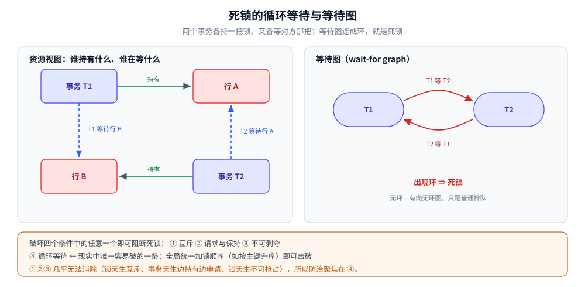

# 死锁原理与防治

> 跨数据库、跨系统的**死锁通用理论**：死锁成立的四个必要条件（Coffman 条件）、
> 用等待图（wait-for graph）描述与检测环路、检测之后的两种处置（超时回滚 / 主动牺牲），
> 以及应用侧能落地的防治手段。
> ⭐ MySQL 的具体参数与排查命令见 [锁等待与死锁排查.md](../关系型/MySQL/锁等待与死锁排查.md) 与 [事务与隔离级别.md](../关系型/MySQL/事务与隔离级别.md) 第四节；
> 跨进程 / 跨机器的互斥与死锁见 [分布式锁.md](../NoSQL/Redis/分布式锁.md)。
>
> 内容整理自个人学习笔记。素材见 [素材清单.md](../../../素材清单.md)。

---

## 一、死锁是什么？和「锁等待」差在哪？

**本节要点**：锁等待是一个事务在等别人放锁，等得到；死锁是一组事务互相等，永远等不到——差别就在有没有「环」。

| | 锁等待（等待 / 饥饿） | 死锁 |
|---|---|---|
| 形态 | 单方向等待：A 等 B | 环形等待：A 等 B、B 等 A（可以更长） |
| 会不会自己解开 | 会（B 提交 / 回滚后 A 继续） | **不会**，没人先松手就永久互相卡住 |
| 引擎怎么办 | 等，直到超时 | 必须**主动干预**：超时或检测后回滚一方 |
| 典型错误号（MySQL） | 1205 `Lock wait timeout exceeded` | 1213 `Deadlock found` |

一句话：**锁等待是「排队」，死锁是「环」**。防治死锁的本质，就是**别让等待关系结成一个环**。

## 二、死锁成立的四个必要条件是什么？（Coffman 条件）

**本节要点**：Coffman 在 1971 年给出的四条。四条**同时**成立才可能死锁；破坏任意一条，死锁就不成立——这是所有「防治」手段的理论来源。

| 条件 | 含义 | 在数据库里的样子 |
|---|---|---|
| **① 互斥（Mutual Exclusion）** | 资源一次只能被一个进程占用 | 行锁 / 表锁本身就是互斥的 |
| **② 请求与保持（Hold and Wait）** | 已持有资源，同时又在申请新资源 | 事务持着行 1 的锁，再去申请行 2 的锁 |
| **③ 不可剥夺（No Preemption）** | 资源不能被强行夺走，只能自己释放 | 锁只在事务结束（提交 / 回滚）时释放 |
| **④ 循环等待（Circular Wait）** | 存在一个进程环，每个都在等下一个持有的资源 | A 等 B 的行、B 等 A 的行 |

> ⭐ 关键理解：**条件 ①②③ 几乎无法消除**——锁天生互斥、事务天生「边持有边申请」、锁天生不可抢占。所以工程上唯一现实可破的是 **④ 循环等待**，这也解释了为什么「统一加锁顺序」是死锁防治的第一手段（第五节）。

## 三、怎么发现死锁？—— 等待图（Wait-for Graph）

**本节要点**：把「谁在等谁」画成一张有向图，**图里出现环 = 存在死锁**。检测问题就此变成「在图上找环」。

- **节点** = 事务（或进程 / 线程）；
- **有向边 T1 → T2** = T1 正在等待 T2 持有的资源。

```text
T1 持有 行A，等待 行B
T2 持有 行B，等待 行A
⇒ 等待图：T1 → T2 → T1   出现环 ⇒ 死锁
```



上图就是最典型的两事务死锁：两人各拿一把、各等另一把；等待图一旦连成环，谁都不会先松手，只能由外部打断。

**检测时机**（各引擎做法不同，思路一致）：

- **每次「申请锁受阻」时增量检查**：只判断这次新加的边是否成环（现实引擎的主流做法，避免全图扫描）；
- **周期性全图找环**：开销大，一般不用。

> 图的规模 ≈ 活跃事务数 × 等待关系数。热点行场景下这张图更新极频繁，这也是「死锁检测本身有 CPU 开销」的原因——关掉检测（如 MySQL 的 `innodb_deadlock_detect=OFF`）能省 CPU，但会把死锁退化成「等到超时才失败」，通常是赔本买卖。

## 四、发现了之后怎么办？—— 超时回滚 vs 主动牺牲

**本节要点**：无论哪种处置，数据库都没有「让双方都不损失」的办法，只能挑一个受害事务回滚，把环打断。应用必须能接住这次回滚并重试。

| 处置方式 | 怎么工作 | 优点 | 代价 |
|---|---|---|---|
| **超时回滚** | 等锁超过阈值（如 `innodb_lock_wait_timeout`，默认 50s）就报错回滚 | 实现简单、无检测开销 | 把死锁**拖成慢失败**：用户白等几十秒 |
| **检测 + 主动牺牲** | 等待图发现环，立即回滚其中一个事务 | 快速打断环、不做无谓等待 | 需要维护等待图（有 CPU 开销） |

**该回滚谁？** 各引擎的口径都是「**回滚代价最小的一方**」——通常是持有 / 修改行数少、undo 少的事务。所以**死锁报错由谁承担是不可预测的**，应用不能假设「我总是赢」，必须**把死锁当可重试错误处理**：

- 捕获死锁 / 锁超时错误（MySQL 1213 / 1205，SQL Server 1205，PostgreSQL `deadlock detected`）；
- 在**事务外层**重试（**不能**在原地重试——原事务已回滚，必须重新开启一个）；
- 重试必须有**上限 + 退避 + 抖动**：死锁意味着热点，多个实例「立刻同频重试」会再撞一次。

## 五、怎么防治死锁？（重点）

**本节要点**：既然只能减少、不能消除，防治手段按「破坏哪个必要条件」来记，比死记几条招式更牢。

| 手段 | 破坏的条件 | 怎么做 |
|---|---|---|
| **统一加锁顺序** ⭐ | ④ 循环等待 | 涉及多个资源的操作，全局约定一个顺序（如按主键 id 升序加锁），环就建不起来 |
| **缩短持锁时间** | ② 请求与保持 | 拆大事务；事务内不做慢操作（RPC、大批量计算）——持锁越短，撞上的窗口越小 |
| **把锁降级为条件更新 / 乐观锁** | ① 互斥 | 能用一条 `UPDATE ... WHERE 条件` 解决的，就别先 `SELECT` 再 `UPDATE`；见 [乐观锁与悲观锁.md](乐观锁与悲观锁.md) |
| **让锁命中索引** | 缩小加锁范围 | 没有索引的 `WHERE` 会锁上整表 / 整段（见 [InnoDB的并发控制实现.md](../关系型/MySQL/InnoDB的并发控制实现.md)），锁范围越大越容易互撞 |
| **选择合适的隔离级别 / 加锁策略** | 缩小加锁范围 | 范围锁（间隙锁）是额外的死锁来源；能接受宽松语义时降级可显著减少（MySQL 语境详见 [事务与隔离级别.md](../关系型/MySQL/事务与隔离级别.md)） |
| **给锁等待设预算** | —— | 调小锁等待超时，让请求快速失败而不是占死连接，再配合重试 |

> ⭐ 最有效、也最常被忽略的一条是**统一加锁顺序**：它直接消灭「循环等待」，而循环等待恰恰是四个条件里唯一现实中可破的一个。
> 代码级写法（Go 的 `Transfer` 按 id 排序、Spring 事务里的死锁重试）见 [写冲突控制的Go落地.md](../../../01-编程语言/go/工程实践/写冲突控制的Go落地.md) 与 [事务与隔离级别.md](../关系型/MySQL/事务与隔离级别.md)。

## 六、边界：跨机器的死锁为什么要自己扛？

**本节要点**：同一台机器内，数据库 / OS 会替你检测并回滚；一旦跨进程、跨机器，没有全局的「等待图」，处置责任就回到应用自己身上。

- **跨进程 / 跨机器**：互斥靠分布式锁（Redis / etcd / ZooKeeper），死锁表现为**大家都拿不到锁**；由于没有上帝视角，只能靠**锁租约 + 超时**兜底（持有者崩溃后锁自动过期）。见 [分布式锁.md](../NoSQL/Redis/分布式锁.md)、[分布式协调选型对比.md](../../中间件/分布式协调/分布式协调选型对比.md)。
- **操作系统 / 语言运行时**：互斥量、通道、goroutine 之间同样会死锁（如两个 goroutine 各等对方的 channel）。原理完全一致，只是排查手段不同——见 [协程泄漏与死锁.md](../../../01-编程语言/go/并发编程/协程泄漏与死锁.md)。
- **跨服务的一组写操作**：那不是「锁死锁」，而是分布式事务的一致性问题——见 [分布式事务选型对比.md](../../中间件/分布式事务/分布式事务选型对比.md)。

> 一句话分界：**本机内的死锁，引擎 / OS 会检测并替你回滚；跨机器的死锁，没有全局视角，只能靠超时与幂等重试自己扛。**

## 延伸追问

- **死锁能不能彻底消除？** → 不能。破坏 ①②③ 的任意一条都会严重损伤并发（比如「一次性申请所有锁」破坏请求与保持，但并发度会大幅下降），工程上只破 ④，把概率压到可接受。
- **为什么死锁报错不能原地重试？** → 被回滚的是**整笔事务**，原地重试等于在一个已失效的事务里继续——必须回到事务外层重新 `BEGIN`。
- **两个只读事务会不会死锁？** → 普通只读（快照读）不加锁，不会；但若都加 S 锁、再都想升级成 X 锁，就会形成「锁升级死锁」，见 [锁的粒度与模式.md](锁的粒度与模式.md)。
- **关掉死锁检测会更快吗？** → 省下检测的 CPU，但死锁只能等超时，热点行场景等待时间显著变长，通常更糟。只有在确认无死锁、且检测开销成为瓶颈时才考虑。
- **分布式锁也会死锁吗？** → 会，而且更难查：没有全局等待图。主要靠给锁设**租约 / 过期时间**，让持有者崩溃后锁能自动释放。

## 关联

- [README.md](README.md) — 本目录总纲：并发控制的知识地图
- [锁的粒度与模式.md](锁的粒度与模式.md) — 锁的粒度、模式与兼容性（死锁的「材料」）
- [乐观锁与悲观锁.md](乐观锁与悲观锁.md) — 把互斥换成校验，从源头减少死锁
- [锁等待与死锁排查.md](../关系型/MySQL/锁等待与死锁排查.md) — MySQL 线上的死锁与锁等待排查命令
- [事务与隔离级别.md](../关系型/MySQL/事务与隔离级别.md) — InnoDB 语境下的死锁处理与减少手段
- [InnoDB的并发控制实现.md](../关系型/MySQL/InnoDB的并发控制实现.md) — 间隙锁等额外死锁来源
- [协程泄漏与死锁.md](../../../01-编程语言/go/并发编程/协程泄漏与死锁.md) — OS / goroutine 层的同一套原理
- [分布式锁.md](../NoSQL/Redis/分布式锁.md) — 跨进程、跨机器时的互斥与死锁
- [素材清单.md](../../../素材清单.md) — 素材来源登记
