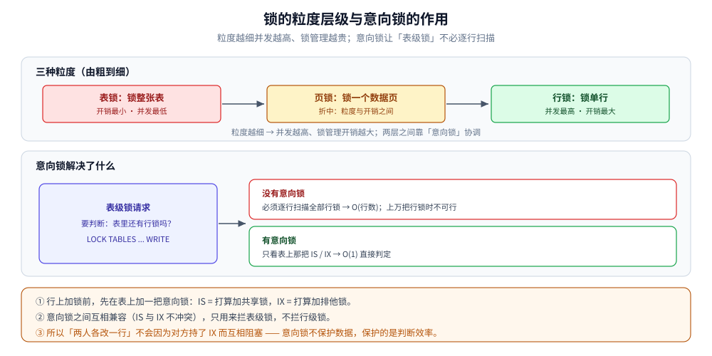

# 锁的粒度与模式

> 跨数据库通用的**锁机制基础**：锁加在什么粒度上（表 / 页 / 行）、有哪几种模式（共享 S / 排他 X）、
> 它们如何组合成一张兼容性矩阵，以及意向锁为什么能让「表级锁」不必逐行扫描。
> ⭐ 具体引擎的锁（InnoDB 的记录锁 / 间隙锁 / 临键锁 / MDL）是这套理论的特例，见 [InnoDB的并发控制实现.md](../关系型/MySQL/InnoDB的并发控制实现.md)。
>
> 内容整理自个人学习笔记。素材见 [素材清单.md](../../../素材清单.md)。

---

## 一、锁到底加在什么上？—— 三种粒度

**本节要点**：粒度越粗越省管理开销、并发越低；粒度越细并发越高、锁管理越贵。粒度层级是这套权衡的第一层。

| 粒度 | 典型对象 | 优点 | 代价 | 谁常用 |
|---|---|---|---|---|
| **表锁** | 整张表 | 开销小、加/释放快、不易死锁 | 并发低：一个写就锁住全表 | MyISAM、显式 `LOCK TABLES`、DDL |
| **页锁** | 一个数据页（常见 8 KB / 16 KB） | 折中：粒度与开销的中间点 | 同一页里的无关行也被牵连 | SQL Server 常见 |
| **行锁** | 单行 | 并发最高：不同行互不阻塞 | 开销大：每行都要维护锁结构 | InnoDB（默认） |

三种粒度不是「三选一」，而是**按层级同时存在**：一个引擎可以既提供表锁又提供行锁，由执行器按访问范围自动选。表锁在**上**、行锁在**下**，两层之间靠「意向锁」协调（第四节）。

### 1.1 为什么粒度是一个「权衡」而不是「越细越好」

锁对象本身要占内存、要维护、要在事务结束时逐一释放——**加一把锁是有成本的**。如果给每一次读写都加行锁，锁管理的开销可能超过它换来的并发收益。

所以引擎的普遍做法是：**能锁一行就不锁一表，但一旦要动的行太多，就退到更高粒度**。退的方式有两种：

- **主动退**：语句本身就是全表操作（DDL、全表更新），直接取表锁；
- **被动退**：锁数量太大 → 升级为表锁，这就是第五节讲的「锁升级」。

## 二、一把锁有哪几种模式？—— S 与 X

**本节要点**：共享锁（S）只允许别人也读，排他锁（X）谁都别碰。S / X 是所有数据库锁模型的最小公因子。

| 模式 | 别名 | 允许别人做什么 | 典型触发 |
|---|---|---|---|
| **S 锁（共享锁 / Shared）** | 读锁 | 其他事务也能读（加 S），但不能写（不能加 X） | `SELECT ... LOCK IN SHARE MODE` |
| **X 锁（排他锁 / Exclusive）** | 写锁 | 其他事务既不能读、也不能写 | `UPDATE` / `DELETE` / `SELECT ... FOR UPDATE` |

- **S 与 S 兼容**：多个事务同时读同一行互不阻塞。
- **S 与 X 互斥、X 与 X 互斥**：只要有人要写，读和写都得等。
- 一句话记法：**X 对一切说不，S 只对 X 说不**。

### 2.1 为什么基础模式只有两种

锁模式的定义其实只有一句话——**「是允许多人一起持有，还是只允许一个人持有」**：

- 允许多人 → S；只允许一个人 → X。

其它叫法（读锁 / 写锁、共享 / 排他）都是这两种的别名。多版本并发（MVCC）之所以能进一步绕开读锁，是因为它把「读」变成一种**不需要加 S 锁**的操作——见 [MVCC多版本并发控制.md](MVCC多版本并发控制.md)。

## 三、S / X / IS / IX 怎么兼容？—— 兼容性矩阵

**本节要点**：这张矩阵决定「两个事务的锁请求能不能同时被满足」。表头里多出来的 IS / IX 是「意向锁」，下一节解释它为什么必须存在。

读法：**行是已持有的锁，列是新请求的锁**；`✓` 兼容（可同时持有），`✗` 冲突（后来者要等）。

| 已持有＼新请求 | S | X | IS | IX |
|---|---|---|---|---|
| **S** | ✓ | ✗ | ✓ | ✗ |
| **X** | ✗ | ✗ | ✗ | ✗ |
| **IS** | ✓ | ✗ | ✓ | ✓ |
| **IX** | ✗ | ✗ | ✓ | ✓ |

三条记法：

1. **X 那一行、那一列全是 `✗`**：排他锁与任何锁都不兼容。
2. **IS / IX 之间全是 `✓`**：意向锁只表达「我打算在下面加锁」，彼此不冲突。
3. **S 与 IX 冲突、IS 与 X 冲突**：这正是「有人要读整表」与「有人要写某些行」之间的冲突，也是意向锁真正起作用的地方。

## 四、有了行锁，为什么还要意向锁？

**本节要点**：意向锁不保护数据，它保护的是「判断表里有没有行锁」这件事的**效率**——把 O(行数) 的检查降成 O(1)。

设想没有意向锁：事务 A 要加一把**表级 X 锁**（比如 `LOCK TABLES ... WRITE`）。它必须先确认表内没有任何行被锁住，否则就可能与正在写某行的事务 B 撞上。但行锁可能有成百上千把，**逐行检查是不现实的**。

意向锁（Intention Lock）解决的正是这一步：

- 事务在**行上加锁之前**，先在**表上加一把意向锁**——`IS`（打算加共享锁）或 `IX`（打算加排他锁）；
- 于是表级锁请求只需检查**表上唯一那一把意向锁**：看到 `IX`，就知道「表里已有行要被改」，直接判冲突，**不必扫描所有行锁**。

| 意向锁 | 含义 | 何时加 |
|---|---|---|
| **IS（意向共享锁）** | 我打算在下面某些行上加 S 锁 | 加行 S 锁前，先在表上加 IS |
| **IX（意向排他锁）** | 我打算在下面某些行上加 X 锁 | 加行 X 锁前，先在表上加 IX |

⭐ 关键性质：**意向锁之间互相兼容（IS 与 IX 不冲突）**。所以「两个人各改一行」不会因为对方持了 IX 而互相阻塞——意向锁**只**拦表级锁，不拦行级锁。

> ⚠️ 两个高频误判，方向恰好相反：
> **「我明明只锁了一行，怎么整个表的操作被卡住」** —— 卡住它的是表级锁与意向锁的冲突，不是行锁本身；
> **「我加了行锁，怎么还被别人的请求插队」** —— 那多半是元数据锁（MDL），见 [InnoDB的并发控制实现.md](../关系型/MySQL/InnoDB的并发控制实现.md) 2.6。

## 五、锁升级：行锁什么时候会变成表锁？

**本节要点**：锁升级是「用并发换管理开销」的兜底机制——当一把锁要管太多行时，某些引擎干脆把它换成一把表锁。

**触发条件**（以支持锁升级的引擎为例，如 SQL Server）：

1. **单条语句 / 事务持有的锁数超过阈值**（SQL Server 约 5000 把）→ 升级为表锁；
2. **锁内存紧张**：锁结构占用超过服务器内存的一部分 → 提前升级，腾锁内存；
3. 部分语句（全表扫描 + 大批量更新）天然倾向于直接取表锁。

**代价**：一旦升级成表锁，**并发度骤降**——所有无关的行访问都被挡在外面，而且升级是引擎**自动**做的，应用往往措手不及。所以支持升级的引擎都会给 DBA 留 `ALTER TABLE ... SET (LOCK_ESCALATION = ...)` 之类的开关。

> ⭐ **InnoDB 明确不做锁升级**：它的行锁永远不会升级成表锁。代价是**锁内存随并发线性增长**（行锁也要占内存），好处是并发不会被突然降级。这也是「InnoDB 行级并发、MyISAM 一写锁全表」这条常见结论的机制来源。InnoDB 的锁类型与内存结构见 [InnoDB的并发控制实现.md](../关系型/MySQL/InnoDB的并发控制实现.md)。

上图把三层粒度与意向锁串起来：粒度越细并发越高、锁管理越贵；而意向锁的存在，让「表里还有没有行锁」这个判断从逐行扫描变成只看表上那一把标记。

## 延伸追问

- **表锁一定比行锁差吗？** → 不一定。全表更新或冲突极少的场景，表锁省掉大量锁管理开销反而更快；行锁的价值在高并发、且冲突集中在少数行时。
- **意向锁会导致死锁吗？** → 意向锁本身不会（IS / IX 互相兼容）。死锁都发生在数据锁（行锁 / 表锁）之间，见 [死锁原理与防治.md](死锁原理与防治.md)。
- **页锁为什么现在少见？** → 它是磁盘页单位的产物；行级存储引擎普遍把「页」当成内部组织方式（如 InnoDB 的页是 B+ 树节点），而不把它暴露成对外加锁粒度。
- **`LOCK IN SHARE MODE` 和 MVCC 快照读有什么区别？** → 前者是**当前读 + S 锁**，会阻塞写；后者不加锁、读旧版本，见 [快照读与当前读.md](快照读与当前读.md)。
- **两个只读事务会不会死锁？** → 会。若两者都先拿 S 锁、再都想升级为 X 锁，就会互相等对方释放 S，形成「锁升级死锁」；防治办法是统一升级顺序，或一开始就直接取 X 锁。

## 关联

- [README.md](README.md) — 本目录总纲：并发控制的知识地图
- [InnoDB的并发控制实现.md](../关系型/MySQL/InnoDB的并发控制实现.md) — 这套理论在 InnoDB 上的特例（记录锁 / 间隙锁 / 临键锁 / MDL）
- [死锁原理与防治.md](死锁原理与防治.md) — 多把锁之间的循环等待怎么产生与防治
- [乐观锁与悲观锁.md](乐观锁与悲观锁.md) — 不加锁的那条路线（把互斥交给校验）
- [MVCC多版本并发控制.md](MVCC多版本并发控制.md) — 让读不再需要 S 锁的机制
- [快照读与当前读.md](快照读与当前读.md) — 哪些读会加锁、哪些不会
- [事务与隔离级别.md](../关系型/MySQL/事务与隔离级别.md) — 隔离级别决定「实际加了什么锁」
- [素材清单.md](../../../素材清单.md) — 素材来源登记
