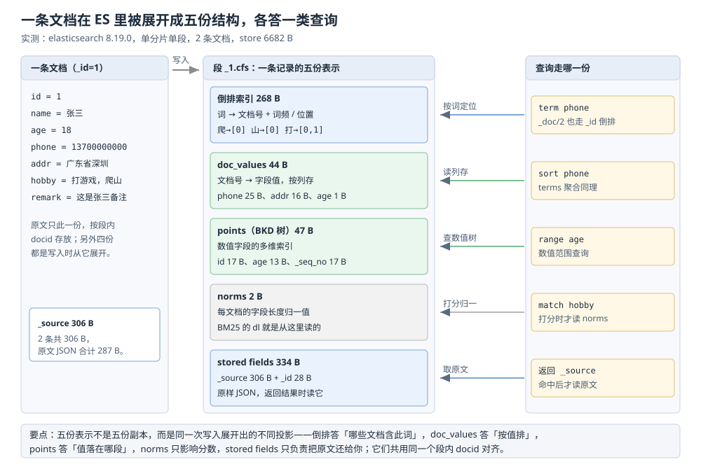

# 索引原理

> Elasticsearch 的索引结构：倒排索引由什么组成、分析器往里放了什么、字段类型与 doc_values 如何决定
> 索引体积，以及这些结构在本机实例上的实测读数。
>
> 素材来源：《Elasticsearch 数据搜索与分析实战》（王深湛）「索引与映射」相关章节的读后整理，**按主题归纳而非逐字摘录**；
> FST 词典与倒排表压缩两节按 Lucene 实现补全并指向本仓数据结构篇；全部读数取自本机 Docker 实例
> （`elasticsearch:8.19.0`，单节点、堆 512m、端口 19200）的真实运行结果。

---

## 一、倒排索引凭什么比扫全表快？

**本节要点**：正排与倒排的方向差异，以及倒排索引「词典 + 倒排表」两部分各自扛什么。

### 1.1 方向反了，代价就反了

+ **正排索引**（forward index）以「文档 → 内容」组织数据。要判断「某个词出现在哪些文档里」，只能逐篇扫描全文，代价随文档总量**线性增长**。
+ **倒排索引**（inverted index）把方向反过来，以「词 → 文档列表」组织数据。查询时先在词典里定位词项，再直接取出对应的文档 ID 列表求交并，从而避免全表扫描。

### 1.2 词典 + 倒排表

| 组成 | 说明 |
| --- | --- |
| 词典（term dictionary） | 保存索引中出现过的所有词项（term），通常**有序**，可用二分查找或 FST 结构快速定位 |
| 倒排表（posting list） | 每个词项对应一个有序文档 ID 列表，列表项通常还记录词频（freq）、位置（position）、字符偏移 |

查询 `term = "elasticsearch"` 时，先在词典中定位词项，再取出倒排表得到命中文档集合；多条件查询就是对多个倒排表做**求交 / 求并**。

⭐ **倒排表项里到底存了什么**——用 `_termvectors` 直接看一条文档（字段设了 `term_vector: with_positions_offsets`）：

```text
# 文档内容：inverted index inverted index 倒排索引
# GET /lab_tv/_termvectors/1?fields=msg&positions=true&offsets=true
term           tf   positions
index          2    [{'position': 1, 'start_offset': 9,  'end_offset': 14},
                     {'position': 3, 'start_offset': 24, 'end_offset': 29}]
inverted       2    [{'position': 0, 'start_offset': 0,  'end_offset': 8},
                     {'position': 2, 'start_offset': 15, 'end_offset': 23}]
倒              1    [{'position': 4, 'start_offset': 30, 'end_offset': 31}]
排              1    [{'position': 5, 'start_offset': 31, 'end_offset': 32}]
索              1    [{'position': 6, 'start_offset': 32, 'end_offset': 33}]
引              1    [{'position': 7, 'start_offset': 33, 'end_offset': 34}]
# field_statistics: doc_count=1, sum_ttf=8
```

这一张表就把三件事同时说明了：① 索引里存的是**词项**不是原文（`index`、`inverted` 已小写化）；
② 同一词项在同一文档里出现两次要记 `tf=2` 与两个位置（短语查询 `match_phrase` 靠位置判断先后）；
③ 中文被切成了**单字**（见第二节）。

### 1.3 词典：FST

词典要在「海量 term 里快速定位」和「内存占用」之间平衡，Lucene 用的是 **FST**（Finite State Transducer，有限状态转换器）——把有序词表压成一张**最小无环有限状态机**，公共前后缀只存一份，还能直接跑前缀查询。

⚠️ FST 的形态与压缩原理（Trie / Radix Tree / DAWG 这条线）不在这里重讲，见
[Trie.md](../../../../02-计算机基础/数据结构/树/空间与字符串树/Trie.md)；
「有序 + 前缀」的另一条路线（跳表）见 [平衡树.md](../../../../02-计算机基础/数据结构/树/内存平衡树/平衡树.md)。

### 1.4 倒排表：差分编码 + 分块压缩

倒排表是**递增的文档 ID 序列**，直接存 4 字节整数很浪费，Lucene 的做法是：

+ **差分**（delta）：只存相邻 ID 的差值，差值远小于原值；
+ **分块位压缩**（Frame of Reference）：一整块按该块最大值所需的最小位宽统一编码；
+ 稀疏、跨度大的场景（过滤型字段）改用 **Roaring bitmap** 这类分块位图。

⚠️ 位图的实现细节见 [位图与布隆过滤器.md](../../../../02-计算机基础/数据结构/概率与统计/位图与布隆过滤器.md)——同一套压缩思路在这里的落点是「倒排表」。

### 1.5 长倒排表：跳表式跳转

对一个出现几百万次的 term，倒排表会很长。求交时若逐个比对文档 ID 代价过高，因此按固定块长（Lucene 的 postings 实现以 **128 个文档为一块**）保存**跳转信息**，让求交可以整块跳过。这就是本项目里「跳表式跳转」的含义：结构不是跳表，但跳转思想同源。

### 1.6 与 B+ 树的对比

| 对比项 | 倒排索引 | B+ 树 |
| --- | --- | --- |
| 适用场景 | 全文检索、多值匹配 | 精确等值 / 范围查询 |
| 查询方式 | 词典定位 + 倒排表求交并 | 从根到叶逐层查找 |
| 分词 / 模糊匹配 | 天然支持（按分词匹配） | 不支持，只能前缀 like |
| 结果相关性 | 可结合 TF-IDF / BM25 计算得分 | 不返回相关性得分 |
| 典型系统 | Elasticsearch / Lucene | MySQL InnoDB 等关系型数据库 |

---


图把倒排索引拆成词典与倒排表两段：查一个 `term` 先在词典里定位，再读出该 term 的文档号序列；序列靠差分编码加按块位宽压缩，长表再叠一层跳转，共同决定一次查询要读多少字节。

## 二、分析器往倒排表里放了什么？

**本节要点**：倒排表里的 term 不是原文，是分析链的产物——这一步决定了「能搜到什么」。

分析链是 `char filter → tokenizer → token filter` 三段，写入时和查询时**各跑一遍同一个分析器**（这就是「查询串必须和写入串用同一套分析」的原因）。

⭐ **标准分词器对中文是逐字切**（本机实测，`_analyze`）：

```text
# 输入：Elasticsearch 倒排索引原理 Inverted Index
elasticsearch       ← 英文按词切并小写化
倒 排 索 引 原 理     ← 中文逐字切，切出来的是 6 个单字 term
inverted
index
```

⚠️ 直接后果：中文用默认分析器时，搜「倒排」会被拆成「倒」+「排」两个词的组合匹配，**召回和精度都不可控**——中文场景必须换 IK 之类的分词器，或者把字段设成 `keyword` 走精确匹配。

---

## 三、字段类型怎么决定索引结构？

**本节要点**：映射（mapping）的核心是给每个字段指定类型，类型决定了**是否分词**、**能做什么查询**、**能否排序和聚合**。

| 类型 | 用途 | 是否分词 | 典型查询方式 |
| --- | --- | --- | --- |
| `text` | 全文检索字段（正文、标题） | ✅ 会分词 | `match`、`match_phrase`、`multi_match` |
| `keyword` | 精确值（标签、枚举、ID、状态） | ❌ 整值建索引 | `term`、`terms`、排序、`aggs` |
| `long` / `integer` / `short` / `byte` | 整数 | ❌ | `term`、`range` |
| `float` / `double` / `half_float` | 浮点数 | ❌ | `range` |
| `scaled_float` | 需精度的浮点，按 `scaling_factor` 存成整数（如价格存「分」） | ❌ | `range` |
| `date` | 日期时间，底层存为 long 时间戳 | ❌ | `range`、`term`、按日期聚合 |
| `boolean` | 真假值 | ❌ | `term` |
| `geo_point` | 经纬度点（lat/lon） | ❌ | `geo_distance`、`geo_bounding_box` |
| `object` | JSON 对象，默认被**扁平化**为 `a.b` 点号字段 | 子字段各自决定 | 按子字段查询 |
| `nested` | 对象数组需保留**元素间关联**时使用 | ❌ | 专用 `nested` query |
| `array` | 数组（ES 无独立数组类型），任意字段写多值即成数组 | 依元素类型 | 同其元素类型 |
| `binary` | Base64 编码的二进制 | ❌ | ⚠️ 不可搜索，仅存储 |

**文本类型（text）**：默认会被分词，不指定时用标准分词器切分，切分结果存进倒排表。搜索时只有搜索文本与索引中的文本相匹配的文档才会命中。

```json
PUT mysougoulog
{ "settings": { "number_of_shards": "5", "number_of_replicas": "1" },
  "mappings": { "properties": { "userid": { "type": "text" } } } }
```

**日期（date）**：默认是 UTC，比北京时间晚 8h，每次查询都要换算。实际项目里用 `format` 自定义：

```json
PUT sougoulog-date
{ "mappings": { "properties": { "visittime": {
    "type": "date", "format": "yyyy-MM-dd HH:mm:ss ||epoch_millis" } } } }
```

这里允许两种格式，`epoch_millis` 代表毫秒时间戳。⭐ 用时间戳可以绕开时区问题：`yyyy-MM-dd HH:mm:ss` 不带时区信息，写入时默认按 UTC 解释，最终仍以**长整型时间戳**保存，查询与聚合用的就是这个时间戳。

**关键字（keyword）**：与 `text` 相对，不做分词，把整个字段值当作一个词项建索引，适合精确匹配、排序与聚合。

**布尔、经纬度、对象、数组、二进制**：用途与注意事项见上表；其中 `object` 与 `nested` 的差异是常见易混点——对象数组若需维持元素间关联，必须用 `nested`。

---

## 四、为什么排序和聚合只认 keyword？

**本节要点**：这不是一条「约定」，而是索引方向决定的硬限制。

⭐ 根本原因：倒排索引的方向（词 → 文档）和聚合需要的方向（文档 → 值）是**反的**。

| 维度 | `text` | `keyword` |
| --- | --- | --- |
| 索引内容 | 分词后的每个 term → 文档列表 | 整个字段值当作一个 term → 文档列表 |
| 能做什么 | `match` / 打分 / 高亮 / 短语查询 | `term` 精确匹配、排序、聚合、`wildcard` |
| `doc_values`（正排列式） | ❌ 默认关闭且**无法开启** | ✅ 默认开启 |
| `norms`（长度归一因子） | ✅ 默认开启，打分要用 | 不打分可关 |
| 典型坑 | 排序报 `Fielddata is disabled`；`term` 查整句查不到 | 搜「华为手机」漏掉分词命中的文档 |

**为什么 ES 拒绝为 text 开 doc_values**：要做聚合就必须有「文档 → 值」的正排结构，否则只能把整份倒排现场反转（即 fielddata，见第五节）。而 text 字段反转出来的不是「这个字段的值」，是「这个文档里出现过的一堆无序 term」（同一文档的分词还被去重合并进倒排），语义上没法分组或排序——所以 ES 直接在 mapping 层禁掉，而不是等到运行时慢。

**标准解法是子字段（多字段），不是二选一**：

```json
{ "mappings": { "properties": { "title": {
    "type": "text",
    "fields": { "kw": { "type": "keyword", "ignore_above": 256 } } } } } }
```

查询/高亮用 `title`，排序/聚合用 `title.kw`。⚠️ 代价：这份字段的索引体积变大（两套结构），子字段默认还要各自算 norms。

---

## 五、正排结构 doc_values 与 fielddata 是什么关系？

**本节要点**：两者都是为了拿到「文档 → 值」，区别在**存不存**。

### 5.1 doc_values 是建索引时写好的正排

`doc_values` 是列式的正排结构，**写索引时**随倒排一起落盘，因此排序/聚合是「读现成的」。除 `text` 外的字段默认开启。

### 5.2 fielddata 是把倒排现场反转——事故根源

给 `text` 字段做聚合时的报错原文（本机实测）：

```text
Fielddata is disabled on [msg] in [lab_text]. Text fields are not optimised for operations
that require per-document field data like aggregations and sorting, so these operations are
disabled by default. Please use a keyword field instead. Alternatively, set fielddata=true
on [msg] in order to load field data by uninverting the inverted index. Note that this can
use significant memory.
```

⭐ 关键在最后一句：**`fielddata=true` 的做法是 "uninverting the inverted index"**——把倒排现场反转成正排，**全量加载进堆内存**、且不落盘。字段基数一高就会把堆撑爆（老版本 ES 的经典事故「JVM 内存溢出」多半出在这里）。所以正确做法是**加 keyword 子字段**，而不是开 fielddata。

### 5.3 字段级开关

| 参数 | 控制什么 | 关掉的收益 | 关掉的代价 |
| --- | --- | --- | --- |
| `doc_values` | 排序/聚合/脚本用的正排列式结构 | 省磁盘与段内存 | 该字段不能再排序/聚合（`_source` 仍在） |
| `norms` | 每文档的字段长度归一信息（BM25 用） | 省内存；日志、纯 filter 字段基本无意义 | 该字段的打分失去长度归一 |
| `index` | 是否建倒排 | 只展示不检索的字段省掉词典与倒排 | 该字段完全不可查 |
| `ignore_above` | keyword 值超过该长度就**不索引**（`_source`/doc_values 仍保留） | 防长 URL / base64 撑爆词典 | ⚠️ 超长值 `term`、`wildcard` 静默查不到 |
| `eager_global_ordinals` | 段刷新时就构建 global ordinals | 换掉聚合首查的延迟 | 写入/刷新侧变慢，占用内存 |

⭐ **global ordinals 是 keyword 聚合的隐藏成本**：`terms` 聚合要把每个段内部的局部 ordinal 映射成跨段的全局 ordinal（一张字典树/数值数组），段发生 refresh 或 merge 之后需要重建。表现就是「聚合首次查询很慢、后面变快」，以及段很多的小索引聚合反而更贵。

---


图把同一份字段值在两种方向上的落盘摆在一起：倒排回答「哪些文档含这个词」，doc_values 回答「这个文档的该字段值是多少」。两者在磁盘上是两份独立的大小，可以分别关掉，关掉的差值就是各自的开销。

## 六、索引在磁盘上占多少、由什么构成？

**本节要点**：把「倒排 + 正排」从总开销里拆出来——用体积的**加性**验证两套结构确实同时存在。

### 6.1 体积加性验证

四份**完全相同**的数据（3000 条），只改索引开关，各自 `_forcemerge?max_num_segments=1` 消除段数差异后比总占用：

| 索引 | 配置 | `store.size_in_bytes` |
| --- | --- | --- |
| `lab_base` | keyword：倒排 + `doc_values` 都开 | **132827** |
| `lab_nodv` | keyword + `doc_values: false` → 只剩倒排 | 120683 |
| `lab_noindex` | keyword + `index: false` → 只剩正排 | 109318 |
| `lab_text` | text：分词后建倒排 + norms（无 doc_values） | 126072 |

两个差值直接给出两套结构的体量：

```text
正排（doc_values）= 132827 − 120683 = 12144 B   （约占 9.1%）
倒排（词典+倒排表）= 132827 − 109318 = 23509 B   （约占 17.7%）
固定开销（_source、元数据等）= 132827 − 12144 − 23509 = 97174 B
```

⭐ **交叉验算**（这才是它可信的原因）：两份「缺一块」的索引加起来，减掉一次固定开销，应当回到全量：

```text
120683（缺正排）+ 109318（缺倒排）− 97174（固定开销）= 132827 ✅ 与全量完全相等
```

⚠️ 读数的边界：这是**小文档、单分片、已合并到一段**下的比例，`_source` 等固定开销占比被放得很大；真实业务里文档更大、字段更多，倒排与正排的占比会显著不同。**要记住的不是这几个具体数字，而是「倒排与正排是两份独立开销、都能被单独关掉」**。

### 6.2 段与 CFS

索引由若干**段**（segment）组成，段一旦写成**不可修改**，删除与更新都是「标记删除 + 追加新段」。

```text
# GET /lab_base/_segments
{"_0": {"num_docs": 3000, "size_in_bytes": 132448, "compound": true}}
```

`compound: true` 表示 Lucene 把该段的多个文件（词典、倒排表、正排、原始文档、norms 等）**打包进一个 `.cfs` 复合文件**（配套 `.cfe` 条目索引、`.si` 段信息）。本机实测 `_forcemerge` 后段目录只有 `.cfs/.cfe/.si` 三种后缀——⚠️ 因此**在文件级看不到独立的 `.tim`/`.doc`/`.dvd`**；本文档对「词典 / 倒排表 / 正排是三套结构」的验证走的是 6.1 的**体积加性**与 1.2 的**倒排项内容**，不是文件后缀。


图按字符过滤、分词、分词过滤三段展开分析链，并标出写入侧与查询侧各跑一遍同一套的对称关系：中文在 `standard` 下被切成单字，term 的粒度在第一步就已经定死。

## 七、分析器拆开看：字符过滤器 → 分词器 → 分词过滤器

Elasticsearch 在两种情况下会用到文本分析，

+ 一、原始数据写入索引时，如果索引的某个字段类型是 text，则会将分析之后的内容写入索引；
+ 二、对 text 类型字段的索引数据做全文检索时，搜索内容也会经过文本分析。

文本分析的顺序是先进行字符过滤器的处理，然后是分词器的处理，最后是分词过滤器的处理。

在 Elasticsearch 中，触发文本分析的时机有两个。

● 索引时：当索引映射中存在 text 字段时，默认会使用标准分析器进行文本分析，如果不喜欢默认的分析器，也可以在映射中指定某个 text 类型字段使用其他分析器。

● 全文检索时：当你对一个索引的 text 类型字段做全文检索时也会触发文本分析，这时文本分析的对象是搜索的内容。默认的分析器也是标准分析器，如果需要改变分析器，可以通过搜索参数 `analyzer` 进行设置。为了保持搜索效果的一致性，索引时的分析器和全文检索时的分析器一般会设置成相同的。

### 7.1 字符过滤器

字符过滤器(character filter)是文本分析的第一道工序，作用在**原始字符流**上，用于在分词前做简单的字符过滤和转换。

+ 输入输出都是字符串，可以替换、删除或保留某些字符；
+ 一个分析器可配置 0 个或多个字符过滤器，按顺序链式执行；
+ ⚠️ 字符过滤器不能改变分词边界（那是分词器的职责），只能改变字符本身。

| 名称 | 作用 |
| --- | --- |
| `html_strip` | 剔除文本中的 HTML 标签，如 `<b>abc</b>` → `abc` |
| `mapping` | 按配置替换字符，如把 `:)` 统一替换为 `happy` |
| `pattern_replace` | 用正则替换匹配到的内容 |

### 7.2 分词器

分词器的功能就是把原始的文本按照一定的规则切分成一个个单词，对于中文文本而言分词的效果和中文分词器的类型有关。分词器还会保留每个关键词在原始文本中出现的位置数据。Elasticsearch 内置的分词器有几十种，通常针对不同语言的文本需要使用不同的分词器，你也可以安装一些第三方的分词器来扩展分词的功能。

分词器会把原始文本切分为一个个分词(token)，通常分词器会保存每个分词的以下 3 种信息。

● 文本分析后每个分词的相对顺序，主要用于短语搜索和单词邻近搜索。

● 字符偏移量，记录分词在原始文本中出现的位置。

● 分词类型，记录分词的种类，例如单词、数字等。

| 分词器 | 说明 |
| --- | --- |
| `standard` | 默认分词器，按 Unicode 文本分段算法切分；英文按词，中文按**单字** |
| `simple` | 按非字母字符切分并转小写 |
| `whitespace` | 仅按空格切分 |
| `keyword` | 不切分，整段文本作为一个分词 |

**中文分词 ik**：ES 自带分词器对中文支持很差（`standard` 会把中文切成一个个单字），中文场景一般安装 IK 分词器(`analysis-ik`)，它提供两种模式：

| 模式 | 切分粒度 | 特点 | 选用场景 |
| --- | --- | --- | --- |
| `ik_max_word` | 最细粒度，穷尽所有可能的词 | 分词多，召回率高，索引体积大 | ⭐ **索引时(index)使用** |
| `ik_smart` | 粗粒度，做最少切分 | 分词少更准，召回率略低 | ⭐ **全文检索时(search)使用** |

⭐ 索引时的文本分析使用 `ik_max_word` 更加合适，而全文检索时的文本分析使用 `ik_smart` 较为多见：索引时尽量多切词以提高召回，查询时切得粗一些以免把用户意图切碎。

### 7.3 分词过滤器

分词过滤器(token filter)作用在分词器切出的 token 流上，用于对单词做进一步过滤和转换，例如，停用词分词过滤器(stop token filter)可以把分词器切分出来的冠词 a、介词 of 等无实际意义的单词直接丢弃，避免它们影响搜索结果。

| 名称 | 作用 |
| --- | --- |
| `lowercase` | 统一转小写，保证大小写不敏感 |
| `stop` | 丢弃停用词（a、of、the 等） |
| `stemmer` | 词干提取，如 running → run |
| `synonym` | 同义词替换，如「手机」→「移动电话」 |
| `asciifolding` | 去掉重音符号，如 café → cafe |


## 八、mapping 怎么写：容错、复制与动态映射的边界

### 8.1 忽略不合法数据：`ignore_malformed`

默认情况下，若写入的数据与映射定义的类型不兼容（例如向 `date` 字段写入无法解析的字符串），Elasticsearch 会直接抛错并**拒绝整条文档**，批量写入时尤为麻烦。可以在字段级别设置 `ignore_malformed: true`，让 ES 忽略这条不合法的数据（该字段不被索引，但整条文档仍可写入）：

```json
PUT my_index
{ "mappings": { "properties": { "age": { "type": "integer", "ignore_malformed": true } } } }
```


### 8.2 字段复制与字段存储：`copy_to` 与 `store`

Elasticsearch 允许在映射中为某个字段定义 `copy_to` 参数，以实现复制多个其他字段的内容，这样在搜索一个字段时能够达到同时搜索多个字段的效果，使用字段复制比使用多字段匹配 `multi_match` 性能更好。

```json
PUT my_index
{ "mappings": { "properties": {
    "first_name": { "type": "text", "copy_to": "full_name" },
    "last_name":  { "type": "text", "copy_to": "full_name" },
    "full_name":  { "type": "text" } } } }
```
字段存储(`store`)指字段是否**独立**保存原始值。默认 `_source` 已保存完整原始文档，一般无需 `store`；只有在关闭 `_source`、或确实需要在结果中单独取出某字段时才设置为 `true`。

### 8.3 动态映射与它的两个坑

若向 Elasticsearch 的索引中添加数据的字段是原先未定义的，数据也依然可以被成功添加。Elasticsearch 拥有动态映射机制，会根据添加的数据内容自动识别对应的字段类型，这也正是索引的映射可以根据写入的数据自动“扩张”的原因。

#### 动态映射的坑：字段数爆炸与类型猜错

+ **字段数爆炸（field limit）**：每个新出现的 JSON 键都会生成一条 mapping。把动态 key 当字段名（`user_defined.123`、metric 名做字段）、深层 `object` 被扁平化成 `a.b.c`，都能让字段数失控。ES 用 `index.mapping.total_fields.limit`（默认 1000）兜底，超了之后该索引**整体拒写**，报 `too_many_fields`。正解：动态键改写成 `[{name, value}]` 的 nested 结构、用 `dynamic_templates` 统一映射成 keyword，或整个字段 `"enabled": false`（只存 `_source`，不可查）。
+ **猜错类型只能重建**：第一个值是整数就定成 `long`，后续来浮点直接写失败；字符串看着像日期就定成 `date`，格式一变即报错；`"00123"` 被猜成数值丢了前导零。**已有字段的类型不能原地修改**（`PUT _mapping` 只能新增字段），唯一路径是 reindex。
+ ⚠️ 同一字段被不同服务写入不同类型时，往往只有部分文档/部分分片失败，测试环境难复现——上线前用 `_mapping` 固化，别指望动态映射。

生产建议：**收紧动态映射**。业务索引用 `"dynamic": "strict"`（未知字段报错）；日志索引用 `"dynamic": false`（未知字段只进 `_source`）；再配 `dynamic_templates` 声明 `*_id → keyword`、`@timestamp → date` 这类规则。

### 8.4 字段设计建议

通常写入 Elasticsearch 的字段需要符合以下几种情况。

(1) 该字段被用作检索条件。(2) 该字段用于统计分析。(3) 该字段经常用于前端展示。(4) 该字段是文档主键。

---

## 九、两条用户记录落盘后，原始数据和索引各在哪？

**本节要点**：ES 既没有「表」也没有「行」——一条记录在段里被展开成**五份表示**（原文、倒排、doc_values、points、norms），它们靠同一个**段内 docid** 对齐；查询按类型各取一份，不存在「先查索引再回表」这一个固定动作。

本节沿用统一的 2 条样本（主键 `id`，索引字段 `phone`、`hobby`、`remark`），为贴合 ES 的语义把 `hobby` 写成单值字符串：

```json
{ "id": 1, "name": "张三", "age": 18, "phone": "13700000000",
  "addr": "广东省深圳", "hobby": "打游戏，爬山", "remark": "这是张三备注" }
{ "id": 2, "name": "李四", "age": 19, "phone": "13800000000",
  "addr": "广东省深圳", "hobby": "唱、跳、rap、打蓝球", "remark": "这是李四备注" }
```

映射如下（`id` 让动态映射猜成 `long`）：

```json
PUT /user_demo
{ "settings": { "number_of_shards": 1, "number_of_replicas": 0 },
  "mappings": { "properties": {
    "name":   { "type": "text" },
    "age":    { "type": "integer" },
    "phone":  { "type": "keyword" },
    "addr":   { "type": "keyword" },
    "hobby":  { "type": "text" },
    "remark": { "type": "text" } } } }
```

### 9.1 建索引：一个分片一个目录，一个段一组文件

```text
GET /_cat/shards/user_demo?v&h=index,shard,prirep,state,docs,store
index     shard prirep state   docs store
user_demo 0     p      STARTED    2 6.5kb

GET /user_demo/_stats?filter_path=_all.primaries.docs,_all.primaries.store
docs.count=2  docs.total_size_in_bytes=6349  store.size_in_bytes=6682
segments.count=1
```

`store` 是**整个分片目录**的字节数，`docs.total_size_in_bytes` 只算 Lucene 段文件——两者差 333 B，正是 `segments_N` 这层元数据。

容器里对应的真实文件（路径中间的 UUID 是分片目录名）：

```text
/usr/share/elasticsearch/data/indices/40JlrT5dQYya8mXUljj1Iw/0/
├── index/    _1.cfs 5303  _1.cfe 697  _1.si 349  segments_4 333  write.lock 0
├── translog/ translog-4.tlog 55  translog.ckp 88
└── _state/   state-2.st 708  retention-leases-2.st 180  state-0.st 125
```

| 目录 | 放什么 | 本机读数 |
| --- | --- | --- |
| `index/` | 不可变的段文件；`compound: true` 时所有结构打包进 `.cfs` | `_1.cfs` 5303 B = 2 条文档的全部五份结构 |
| `translog/` | 写操作日志，refresh 之后、flush 之前仍在 | `translog-4.tlog` 仅 55 B（写完已 refresh，只剩文件头） |
| `_state/` | 集群级索引状态（不是数据） | `state-2.st` 708 B |

⚠️ 因为默认开复合文件，**文件级看不到独立的 `.tim`/`.doc`/`.dvd`**；要确认「五份结构各自多大」只能用 `_disk_usage`。

### 9.2 原始数据：`_source` 只存一份

`_disk_usage` 只接受 **POST**（用 GET 返回 `405`），且必须带 `run_expensive_tasks=true`：

```text
POST /user_demo/_disk_usage?run_expensive_tasks=true
_source: total 306 B = stored_fields 306 B（inverted 0、doc_values 0）
```

⭐ 两条样本的原文 JSON 用 UTF-8 计只有 **139 B + 148 B = 287 B**；落到 306 B 是因为 Lucene 的 stored fields 每条还要带长度头等框架字节——**这个体量下压缩省不下任何东西**。

`_source` 是一整条 JSON，不是一类字段一块：改 `remark` 一个字符，整条 `_source` 也要重写一遍（见 9.6）。它的唯一用途是**返回结果与高亮**，不参与任何检索。

### 9.3 索引数据：一个字段最多展开成四套结构

`_disk_usage` 的字段级读数（单位 B，2 条文档合计 695 B）：

| 字段 | 类型 | 倒排 | doc_values | points | norms | 合计 |
| --- | --- | --- | --- | --- | --- | --- |
| `name` | text | 33 | 0 | 0 | 0 | 33 |
| `age` | integer | 0 | 1 | 13 | 0 | 14 |
| `phone` | keyword | 34 | 25 | 0 | 0 | 59 |
| `addr` | keyword | 25 | 16 | 0 | 0 | 41 |
| `hobby` | text | 77 | 0 | 0 | 2 | 79 |
| `remark` | text | 82 | 0 | 0 | 0 | 82 |
| `id` | long | 0 | 1 | 17 | 0 | 18 |
| `_id` | 内部字段 | 17 | 0 | 0 | 0 | 45（另含 stored 28） |
| `_source` | 原文 | 0 | 0 | 0 | 0 | 306 |
| `_seq_no` | 内部字段 | 0 | 1 | 17 | 0 | 18 |

⭐ 四条可直接读出的规律：

1. **`text` 没有 doc_values、`keyword` 有** —— 表里 `name`/`hobby`/`remark` 的 doc_values 全是 0，`phone`/`addr` 才有。这就是第四节「排序和聚合只认 keyword」的体积证据。
2. **数值字段落在 points 而不是倒排** —— `age` 的 13 B、`id` 的 17 B 全在 `points`（BKD 树），倒排是 0。数值的等值与范围都走这棵树。
3. **`_id` 自己也是一条倒排项** —— 17 B 倒排 + 28 B 存原文，所以 `GET _doc/2` 和 `ids` 查询才那么快。
4. **`norms` 只对 text 字段有值** —— `hobby` 2 B 正好是「2 条文档各 1 字节」；`remark` 同为 text 却显示 0 B，是这个体量下按文件块抹零的统计口径，**不要据此推断它不打分**（要判「是否参与打分」看 mapping 的 `norms` 开关，不看这列体积）。

字段合计 695 B，而 `store.size_in_bytes` 是 6682 B：**差额约 6 KB 全是段级固定开销**（FST 词典、段元数据、文件头、块对齐）。这正是第六节 6.1 里「3000 条文档下固定开销仍占 73%」的同一现象，只是 2 条文档时更极端。

倒排里到底装了什么，用分析器直接看（`hobby` 的值）：

```text
POST /user_demo/_analyze   {"analyzer":"standard","text":"打游戏，爬山"}
token   position  start  end  type
打      0         0      1    <IDEOGRAPHIC>
游      1         1      2    <IDEOGRAPHIC>
戏      2         2      3    <IDEOGRAPHIC>
爬      3         4      5    <IDEOGRAPHIC>
山      4         5      6    <IDEOGRAPHIC>
```

标点「，」被丢弃，五个字变成五个**独立 term**，各自带位置。倒排索引里因此有 `游→[0]`、`戏→[0]`，而 `打` 同时出现在两条文档里 → `打→[0,1]`。

### 9.4 两者靠什么连：段内 docid + 一份 `_id` 倒排

⚠️ ES **没有** MySQL 那种「二级索引叶子存主键值」的结构，也没有 SQLite 的 rowid 列。它对齐五份结构靠的是 **Lucene 段内 docid**（从 0 开始的整数，段内唯一）：

```text
段 _0：doc 0 → 张三，doc 1 → 李四
段 _1：doc 0 → 王五            ← 另起一段，docid 又从 0 开始
```

| 位置 | 存什么 | 谁用它 |
| --- | --- | --- |
| `_id` 倒排 | `"1"` → 段 `_0` 的 doc 0 | `GET _doc/1`、`ids` 查询、更新/删除定位 |
| `_source`（stored fields） | 整条原文，按 docid 顺序排 | 返回结果、reindex、高亮 |
| 倒排 | term → docid 列表（+ 词频 + 位置） | `term`、`match`、`match_phrase` |
| doc_values | docid → 字段值，按列 | `sort`、`aggs`、`script` |
| points | docid → 数值，BKD 树 | 数值 `range` |

⭐ 关键结论：**`_id` 只是「一条普通的有索引字段」**，真正的主键是「段 + docid」这个物理位置。所以段合并（merge）重排 docid 是安全的——`_id` 倒排会跟着重写；但如果业务把 docid 存到了外部系统，merge 之后就对不上了。

还有一个实时性差异：`GET _doc/2` 走的是 **translog + version map**，刚写入、还没 refresh 的文档也能读到（返回 `_version=1 _seq_no=1 _primary_term=1`）；而 `_search` 只能看到已 refresh 的段。**同一份数据，两条入口看的是不同的东西。**



这张图把「一条记录的五份表示」与「哪类查询读哪份」并排摆在一起：原文 `_source` 只负责把结果还给你，四套索引结构各答一类问题，五者共用同一个段内 docid，缺了任何一份都会让对应那类查询失效或退化。

### 9.5 三次查询各走哪条路

| 查询 | 走哪份结构 | 本机读数 |
| --- | --- | --- |
| `GET /user_demo_wr/_doc/2` | translog / version map → stored fields | `_version=1 _seq_no=1 _primary_term=1` |
| `term phone = 13700000000` | 倒排表 | 1 条，`max_score=0.6931471` |
| `match hobby = 爬山` | 分析成「爬」「山」两个 term，两路倒排求并 + BM25 | 1 条，`1.4398422 = 0.7199211 × 2` |
| `sort phone asc` | doc_values（`profile` 里只剩 `ConstantScoreQuery(*:*)`，没有任何 term 查找） | 2 条，`sort` 值就是手机号 |
| `match hobby = 打游戏` | 逐字切成 3 个单字 term 的 OR | ⚠️ 2 条，doc2 只命中「打」 |
| `match_phrase hobby = 打游戏` | 同样两个 term，再加位置相邻校验 | 1 条 |

`profile` 给出的执行树，直接坐实前三行：

```text
match hobby:爬山
BooleanQuery hobby:爬 hobby:山
  TermQuery hobby:爬
  TermQuery hobby:山

term phone:13700000000
TermQuery phone:13700000000

sort phone
ConstantScoreQuery ConstantScore(*:*)
  MatchAllDocsQuery *:*
```

⭐ 最后两行是本节最该记住的：**排序根本没有「查」这个动作**——它把全部文档都当命中，再按 doc_values 里的列值排。所以「带过滤条件的深排序」的代价主要不在过滤，而在被排序的文档数。

⚠️ 中文逐字切的后果在表里也有了：搜「打游戏」召回 2 条，doc2 的 `hobby` 是「唱、跳、rap、打蓝球」，只因为共用一个「打」字。要压掉这类假阳性，要么装 IK 分词器，要么用 `match_phrase` 做位置校验（但 phrase 仍只是「单字相邻」，对同义改写无能为力）。

**倒排与 doc_values 可以互相顶班**（本节额外做的一次对照）。把 `phone` 改成 `"index": false` 重建同名索引并写入同样的两条：

```text
term phone 仍然命中 1 条，但 profile 里的查询类型变了：
SortedSetDocValuesRangeQuery phone:[[31 33 37 30 30 ...] TO [31 33 37 30 30 ...]]
_disk_usage：phone 倒排 0 B，doc_values 仍是 25 B
```

⭐ 字节 `31 33 37 …` 就是 `"13700000000"` 的 ASCII。这说明：**关掉倒排不等于关掉查询**，ES 会自动改成按文档读 doc_values 里的有序值集合来比对——语义不变，代价从「按词定位」变成「逐文档判断」。

### 9.6 写一条新记录，五份结构各改什么

在 `user_demo_wr` 上先写两条，再写第三条（`id=3`，`refresh=true`）：

```text
写入前：_0  num_docs=2  size=6349
写入后：_0  num_docs=2  size=6349   ← 一个字节都没动
        _1  num_docs=1  size=6029   ← 新段
文件：_1.cfs 4983  _1.cfe 697  _1.si 349  segments_2 227  translog-2.tlog 613
```

| 结构 | 一次写入要做什么 |
| --- | --- |
| `translog` | ⭐ 先追加操作并 fsync（本例 613 B）；refresh 之前只有它能保证这条记录可被 `GET _doc` 读到 |
| stored fields / `_source` | 整条 JSON 写进**新段**，哪怕只改一个字段也是整条重写 |
| 倒排 | 该文档的每个 term 追加一条 posting（docid + 词频 + 位置） |
| doc_values | 该文档的列值追加进新段的列存 |
| points | 数值写进新段的 BKD 树 |
| norms | 按新字段长度算一个归一值 |

⭐ 两张表的对照说明了一切：**旧段 `_0` 的 `num_docs` 与 `size` 分毫未变**，更新与删除都是「标记 + 追加新段」，空间要等 merge 才真正释放。这也是「删了不还空间」在 ES 侧的根因（对照 [运维与监控.md](../../NoSQL/MongoDB/运维与监控.md) 里 MongoDB 的同名现象）。

### 9.7 本产品做不到什么

- **`text` 不能排序/聚合，且不允许开 doc_values**——要排序必须加 `keyword` 子字段，代价是同一份值存两套结构（第四节已量化）。
- **中文默认逐字切**——`match 打游戏` 实测召回 2 条，其中一条只含「打」。这不是 bug，是 `standard` 分析器的定义；中文生产必须换 IK，且索引侧与查询侧要用同一套。
- **更新不是原地改**——改一个字段 = 旧 doc 标记删除 + 整条重新写入新段；`_source` 永远整条重写。
- **docid 只在段内唯一**——段合并会重排，不能当业务 ID 存到外部系统；对外只能用 `_id`。
- **五份结构不能互相替代**——关 `doc_values` 就不能排序，关 `index` 虽仍能查但退化成扫 doc_values（9.5 实测），把 `_source` 关掉就再也拿不到原文（除非逐字段 `store`，那是把同一份数据换个地方存）。
- **小数据下固定开销压倒一切**——2 条文档时字段合计只 695 B，整片目录却是 6682 B；拿小数据估容量会严重高估「数据本身的占比」。

---

## 使用：把索引结构量出来

```bash
# 前置：docker run -d --name es-idx-lab -p 19200:9200 \
#   -e discovery.type=single-node -e xpack.security.enabled=false \
#   -e ES_JAVA_OPTS="-Xms512m -Xmx512m" elasticsearch:8.19.0
ES=http://127.0.0.1:19200

# ① 看分析器把原文切成了什么 term（中文逐字切）
curl -s --noproxy '*' -H 'Content-Type: application/json' -XPOST "$ES/_analyze" \
  -d '{"analyzer":"standard","text":"Elasticsearch 倒排索引原理"}'

# ② 看倒排表项：term → tf + positions（需 mapping 里设 term_vector）
curl -s --noproxy '*' "$ES/lab_tv/_termvectors/1?fields=msg&positions=true&offsets=true"

# ③ 拆分倒排与正排的体积：同一份数据建三个索引，只改开关
#    base(全) / doc_values:false(只剩倒排) / index:false(只剩正排)
curl -s --noproxy '*' "$ES/lab_noindex/_stats?filter_path=indices.*.total.store.size_in_bytes"

# ④ 看段结构与 CFS 状态
curl -s --noproxy '*' "$ES/lab_base/_segments"
```

---

## 延伸追问

- **为什么倒排索引能加速「多条件查询」，而 B+ 树不能？**
  → 多条件落在倒排索引上是多个**有序文档 ID 列表求交**，可以整块跳过；B+ 树一个索引只服务一种字段顺序，多条件要么走一个索引再回表过滤，要么建联合索引。
- **词典有序，那 `prefix` / `wildcard` 查询为什么还是慢？**
  → 词典定位很快（FST 支持前缀走），真正贵的是**展开出的 term 数**：`a*` 可能命中几十万个 term，每个都要取一次倒排表。所以前缀查询的代价在 term 数量，不在词典结构。
- **`_source` 和 `doc_values` 都在存字段值，不是重复吗？**
  → 不是。`_source` 是原始 JSON（用于返回和高亮），`doc_values` 是**列式 + 有序**（用于排序聚合），两者数据形态与用途都不同，`doc_values: false` 关掉不影响 `_source` 返回。
- **为什么 `text` 字段不能开 `doc_values`，却允许开 `fielddata`？**
  → `doc_values` 要求写入时就按「文档 → 值」落盘，而 `text` 分词后一个文档对应一堆无序 term，落不成稳定的列；`fielddata` 是运行时从倒排反转，代价是堆内存，所以 ES 的默认态度是「禁用 + 报错提示改用 keyword 子字段」。
- **段合并（merge）对索引意味着什么？**
  → 段不可变 → 更新与删除只能追加与标记 → 段越积越多会影响查询与聚合（global ordinals 要重建）。merge 把多个段合成一个、物理抹掉标记删除的文档，是**用 IO 换查询效率**的过程。

## 关联

- [README.md](README.md) — 本目录导读：定位、版本坐标与阅读顺序
- [写入流程.md](写入流程.md) — 结构建好之后，文档怎么写进去、什么时候能被搜到
- [搜索流程与DSL.md](搜索流程与DSL.md) — 这些结构怎么支撑查询与打分
- [分页与聚合.md](分页与聚合.md) — 为什么排序 / 聚合只认 keyword（doc_values 的方向）
- [向量与AI搜索.md](向量与AI搜索.md) — 另一类索引结构：向量索引与量化
- [Trie.md](../../../../02-计算机基础/数据结构/树/空间与字符串树/Trie.md) — Trie / Radix Tree / DAWG / FST 的形态与压缩原理
- [位图与布隆过滤器.md](../../../../02-计算机基础/数据结构/概率与统计/位图与布隆过滤器.md) — RoaringBitmap 分块位图，倒排表压缩的同源思路
- [平衡树.md](../../../../02-计算机基础/数据结构/树/内存平衡树/平衡树.md) — 跳表式跳转与「有序 + 前缀」的另一条路线
- [B树与B+树.md](../../../../02-计算机基础/数据结构/树/磁盘存储树/B树与B+树.md) — 另一种索引主线：有序树与磁盘页
- [索引设计与EXPLAIN.md](../../关系型/MySQL/索引设计与EXPLAIN.md) — MySQL 侧索引设计（B+ 树主线）的完整口径
- [索引原理.md](../../NoSQL/MongoDB/索引原理.md) — 同批整理的另一种索引主线
- [数据库选型对比.md](../../数据库选型对比.md) — **上游**：第三节「存储格式」的十产品落点对照表，本篇第九节是其中 Elasticsearch 一列的完整读数

> 反向引用（本篇被下列文档引到）：[LSM树.md](../../../../02-计算机基础/数据结构/树/磁盘存储树/LSM树.md)、[空间索引与R树.md](../../../../02-计算机基础/数据结构/树/空间与字符串树/空间索引与R树.md)、[倒排索引.md](../../../../02-计算机基础/数据结构/高级数据结构/倒排索引.md)、[AC自动机.md](../../../../02-计算机基础/算法/字符串匹配/AC自动机.md)、[BM.md](../../../../02-计算机基础/算法/字符串匹配/BM.md)、[KMP.md](../../../../02-计算机基础/算法/字符串匹配/KMP.md)、[搜索与分析数据存储.md](../../存储架构与场景/形态篇/搜索与分析数据存储.md)、[客户端.md](客户端.md)、[常见事故.md](常见事故.md)、[搜索与分析选型对比.md](../搜索与分析选型对比.md)、[数据库选型对比.md](../../数据库选型对比.md)、[搜索与历史.md](../../../../04-架构与系统/系统设计/IM系统/搜索与历史.md)
