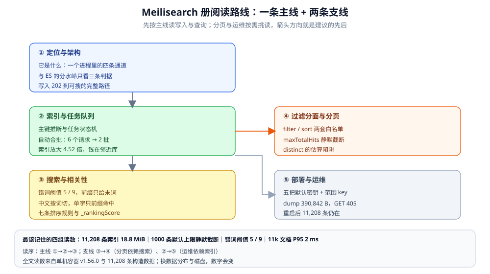

# Meilisearch 目录导读

> 本册把 Meilisearch 拆成 **5 篇零件 + 1 篇导读**：定位与架构（它是什么、一个进程里跑着哪几条通道）→ 索引与任务队列（写入为什么先返回一张任务单）→ 搜索与相关性（错词、前缀、中文分词与排序规则）→ 过滤分面与分页（白名单、分面与 1000 条的静默上限）→ 部署与运维（密钥、持久化、备份与排障）。
>
> 不覆盖：跨产品选型与「轻量检索这一族什么时候够用」见 [搜索与分析选型对比.md](../搜索与分析选型对比.md)；与 Elasticsearch 的逐项机制对照见 [Elasticsearch 册](../Elasticsearch/README.md)；对象在业务系统里的上传链路与本册无关。按仓库约定，Go / Java 接入代码放在语言目录，本册只讲服务端机制与接口语义。
>
> 内容整理自个人学习笔记。实测环境：`dockerproxy.net/getmeili/meilisearch:latest` → **v1.56.0**（commit `47567abc…`，镜像自报 `commitDate: unknown`），容器 `meili-lab`（宿主 `37700` → 容器 `7700`，命名卷 `meili-lab-data`），另起只开 metrics 的 `meili-lab-metrics`（`37701`）。数据集为本仓构造的 11,208 条中文笔记文档，平均 380 B。所有读数来自单机容器，换机器、换数据分布都会变。

---

## 一、一句话定位与它凭什么

**本节要点**：Meilisearch 不是「功能少一点的 Elasticsearch」，而是**把应用内搜索压缩成一个进程**——单二进制 + LMDB + 异步任务队列 + 内置分词与错词容忍。抽掉任何一块，它的取舍都会变。

| 组成 | 它换来的能力 | 抽掉这一块会怎样 |
|---|---|---|
| **单进程** | 一个容器起服务，无外部依赖，镜像 482 MB、空载 RSS **13.21 MiB** | 想要分片与副本就得自己加一层——它本身不提供 |
| **LMDB 存储** | 读写路径短、崩溃恢复简单、数据目录即全部状态 | 写入串行化：高并发写只能排队，没有多分片分摊 |
| **异步任务队列** | 每个写操作先返回 `taskUid`，可轮询、可观测、可自动合批 | 客户端不能「发完就当成功」，必须等到任务 `succeeded` |
| **charabia 分词** | 中文、日文、泰文等开箱可搜，不需要装分词插件 | 没有 ES 那种可自由编排的 analyzer 链，细粒度调分词要改配置甚至改代码 |
| **默认排序与错词** | 开箱相关性够用，拼错一两个字母仍能命中 | 可调空间小：排序规则能改顺序，但没有脚本打分与复杂函数评分 |

⭐ 一句话记：**它卖的是「站内搜索的默认体验」，不是「通用检索的能力上限」**。日志后端、复杂聚合、跨机房高可用、深翻页导出，都不在它的设计目标里。

---

## 二、核心概念速览

**本节要点**：先记住「一次写入 = 一张任务单，一次查询 = 一条 HTTP 请求」，剩下的名词都是这两句话的展开。

| 概念 | 一句话 | 详见 |
|---|---|---|
| **index** | 一个可搜索的文档集合，相当于 ES 的索引；建索引本身也是异步任务 | [索引与任务队列.md](索引与任务队列.md) |
| **document** | 一条 JSON，必须有主键；主键可以显式指定，也可从字段名推断 | 同上 |
| **primary key** | 文档唯一标识；未指定时找「以 `id` 结尾」的字段，找不到则任务失败 | 同上 |
| **task** | 所有写操作的执行单：`enqueued` → `processing` → `succeeded` / `failed` | 同上 |
| **batch** | 队列把同类型任务自动合成一批执行，`batchUid` 可回查 | 同上 |
| **settings** | 索引级配置：可搜字段、可过滤字段、可排序字段、排序规则、错词阈值、分页上限 | [搜索与相关性.md](搜索与相关性.md) / [过滤分面与分页.md](过滤分面与分页.md) |
| **rankingRules** | 默认七条：`words` / `typo` / `proximity` / `attributeRank` / `sort` / `wordPosition` / `exactness` | [搜索与相关性.md](搜索与相关性.md) |
| **filterable / sortable** | 过滤与排序各有一份白名单，没进白名单的字段直接用会 400 | [过滤分面与分页.md](过滤分面与分页.md) |
| **maxTotalHits** | 默认 **1000**：只能翻到前 1000 条，越界**不报错、返回空** | 同上 |
| **API key** | 主密钥、默认搜索密钥、自定义密钥三档；`actions` 与 `indexes` 决定权限 | [部署与运维.md](部署与运维.md) |
| **dump / snapshot** | 逻辑备份与物理快照；dump 可跨版本导入 | 同上 |

⚠️ 两组最容易混的概念：**`filter` 与 `sort` 是两套白名单**，一个字段能排序不代表能过滤；**「任务成功」才是「文档可搜」的时点**，HTTP 202 只代表入队。

---

## 三、阅读路线

**本节要点**：五篇是「一条主线 + 两条支线」：主线是写入与查询两条路径，支线分别通往分页边界与运维面。

图里左侧是主线三篇（定位 → 索引 → 搜索），右侧两篇是支线（分页依赖搜索，运维依赖索引）；箭头方向就是「谁必须在前」。底部面板抄的是本册最该记住的四组读数：11,208 条索引 18.8 MiB、分页 1000 条静默截断、错词阈值 5/9、单机搜索 P95 2ms——⚠️ 这些只代表本机这套数据，不是产品参数。

| 顺序 | 篇 | 视角 | 什么时候读 |
|---|---|---|---|
| ① | [定位与架构.md](定位与架构.md) | ⭐ **主线起点** | 想知道它和 ES 的分水岭、一个进程里跑着哪几条通道、写入到可搜的完整路径 |
| ② | [索引与任务队列.md](索引与任务队列.md) | 写入层 | 文档怎么进、主键怎么推断、任务为什么合批、写入后多久能搜到 |
| ③ | [搜索与相关性.md](搜索与相关性.md) | 查询层 | 错词、前缀、中文分词、排序规则与打分怎么工作 |
| ④ | [过滤分面与分页.md](过滤分面与分页.md) | 查询边界 | 过滤/排序白名单、分面、distinct，以及 1000 条之后为什么翻不到 |
| ⑤ | [部署与运维.md](部署与运维.md) | 操作层 | 要部署、要发密钥、要备份、要接监控、要排查 401/403 与失败任务 |

### 3.1 三条阅读路线

| 目的 | 按这个顺序读 |
|---|---|
| **从零跑起来并灌一批数据** | 本页一、二节 → [部署与运维.md](部署与运维.md) 第二节 → [索引与任务队列.md](索引与任务队列.md) 第三、四节 |
| **搜索结果不对 / 拼错搜不到** | [搜索与相关性.md](搜索与相关性.md) 第二、三、四节 → [过滤分面与分页.md](过滤分面与分页.md) 第一、二节 |
| **要上生产，评估边界** | [定位与架构.md](定位与架构.md) 第五、六节 → [过滤分面与分页.md](过滤分面与分页.md) 第六节（1000 条上限）→ [部署与运维.md](部署与运维.md) 第三、五、六节 |

### 3.2 依赖关系

| 本篇 | 建议先读 | 为什么 |
|---|---|---|
| 索引与任务队列.md | 定位与架构.md 第三节 | 不先知道「写入走任务队列、查询走直连」，任务状态机就没有落点 |
| 搜索与相关性.md | 索引与任务队列.md 第二、四节 | 分词与「何时可搜」都在写入侧决定，查询侧只是消费结果 |
| 过滤分面与分页.md | 搜索与相关性.md 第一、二节 | 分面是过滤结果的计数，分页是排序结果的切片 |
| 部署与运维.md | 索引与任务队列.md 第三节 | 任务队列既是写入通道也是运维观测面（`/tasks`） |

---

## 四、实测坐标

**本节要点**：本册所有数字来自同一台机器、同一个容器、同一批构造数据；换数据分布与磁盘，读数会变。

| 项 | 值 |
|---|---|
| 镜像 / 版本 | `dockerproxy.net/getmeili/meilisearch:latest` → **v1.56.0**（commit `47567abc0e7e86b9f561ef2dbe9fd9764c6955d8`，`commitDate: unknown`），镜像 482 MB |
| 容器 | `meili-lab`：宿主 `37700` → `7700`，命名卷 `meili-lab-data`；`meili-lab-metrics`：`37701`，仅用于验证 `/metrics` |
| 数据集 | 11,208 条中文笔记文档，`avgDocumentSize` **380 B**；1208 条阶段平均 **331 B** |
| 索引体积 | 11,208 条：`indexSize` **19,689,472 B**（约 18.8 MiB）、`rawDocumentDbSize` 4,358,144 B、比值 **4.52**；1208 条阶段比值 **6.16**（小数据被 LMDB 页开销放大） |
| 批量写入 | 10 × 1000 条，墙钟 **2.61 s**；自动合批的一批 9000 条耗时 **1.88 s**；1200 条一批耗时 **174 ms** |
| 写入可见性 | 单条写入任务 **17.9 ms**；任务完成前第 5.6 / 12.6 ms 查询均 0 命中，18.9 ms 查询命中 |
| 搜索延迟 | 11,208 条、`q=搜索`：服务端平均 **1.07 ms**、P95 **2 ms**；客户端墙钟平均 **5.74 ms** |
| 错词阈值 | 默认 `oneTypo=5`、`twoTypos=9`：4 字符 `Rdie` / `Javo` 0 命中；5 字符 `Kafak` / `Javva` 命中；7 字符 2 错 `Kafkkka` 0；13 字符 2 错 `Meiliseeearch` 命中；3 错 0 |
| 中文分词 | `搜` → 2 条（搜索 ×2）；`索` → 1 条（索引）；`对象存` → 1 条（对象存储，前缀命中） |
| 分页上限 | 默认 `maxTotalHits=1000`：`limit=1001` 实回 **1000**；`offset=1000` 回 **200 + 0 条**；`estimatedTotalHits` 仍报 **1208**；调到 2000 后 `offset=1000` 回 20 条 |
| 密钥 | 搜索密钥可查询；写文档、列密钥均 **403 `invalid_api_key`**（与「密钥不存在」同一个错误码） |
| 备份 | `POST /dumps` 生成 **25,000 B** dump（1208 条阶段）；`GET /dumps` 在 v1.56.0 回 **405** |
| 持久化 | 重启容器后 1208 条文档与设置全部还在，搜索正常 |

> ⚠️ **未实测项**：dump 导入恢复、snapshot、多节点/高可用、向量检索（`numberOfEmbeddings=0`）、facet search、`MEILI_ENV=production` 差异、跨版本升级路径。篇内按文档口径陈述，并逐条标注。

---

## 五、本册的边界

| 本册收 | 不收（在哪） |
|---|---|
| Meilisearch 单机的定位、写入、查询、分页与运维机制 | **跨产品选型** → [搜索与分析选型对比.md](../搜索与分析选型对比.md) |
| 实测读数与版本差异 | **Elasticsearch 的机制对照** → [Elasticsearch 册](../Elasticsearch/README.md) |
| 服务端 API 语义与错误码 | **Go / Java 接入代码** → 按仓库约定放对应语言目录 |
| 单机部署、密钥、备份、监控 | **上传链路与对象存储** → [对象存储选型对比.md](../../对象存储/对象存储选型对比.md) |
| 应用内搜索的边界 | **日志检索与可观测性整栈** → [可观测性选型对比.md](../../../中间件/可观测性/可观测性选型对比.md) |

---

## 延伸追问

- **Meilisearch 能不能当 ES 用？** → 不能。它没有分片与副本、没有聚合框架、没有可编排的 analyzer 链；换来的是单进程、开箱中文与错词、毫秒级查询。判据是主查询是不是「应用内搜索」（见 [定位与架构.md](定位与架构.md) 第五、六节）。
- **为什么写入接口返回 202，而文档当时还搜不到？** → 写操作先入任务队列，索引完成才可见；HTTP 202 只代表入队。要么等 `taskUid` 变 `succeeded`，要么按业务接受短暂不可见（见 [索引与任务队列.md](索引与任务队列.md) 第四节）。
- **翻页翻到第 1000 条之后为什么是空的？** → 默认 `maxTotalHits=1000`，越界不报错、直接返回空数组，`estimatedTotalHits` 仍会报真实总数；这是本册最容易误判为「数据丢了」的一处（见 [过滤分面与分页.md](过滤分面与分页.md) 第六节）。
- **中文为什么不用装分词插件？** → 内置 charabia 会按词切分；代价是单字查询只命中「以该字开头的词」，不是逐字匹配（本册实测 `搜` 与 `索` 的差异，见 [搜索与相关性.md](搜索与相关性.md) 第四节）。

---

## 关联

- [搜索与分析选型对比.md](../搜索与分析选型对比.md) — **上游/总纲**：轻量检索这一族什么时候够用、与 ES / Solr / 数据库全文的边界
- [Elasticsearch 册](../Elasticsearch/README.md) — **对照/互补**：同样做应用搜索，但以分片、副本、analyzer 链与聚合能力换复杂度
- [索引与任务队列.md](索引与任务队列.md) — 本册写入主线
- [搜索与相关性.md](搜索与相关性.md) — 本册查询主线
- [过滤分面与分页.md](过滤分面与分页.md) — 本册查询边界
- [部署与运维.md](部署与运维.md) — 本册操作面
- [搜索与分析数据存储.md](../../存储架构与场景/形态篇/搜索与分析数据存储.md) — **上游原理**：倒排为什么为「找」付写代价
- [数据库选型对比.md](../../数据库选型对比.md) — **上游/总纲**：检索副本为什么不能当唯一数据源
