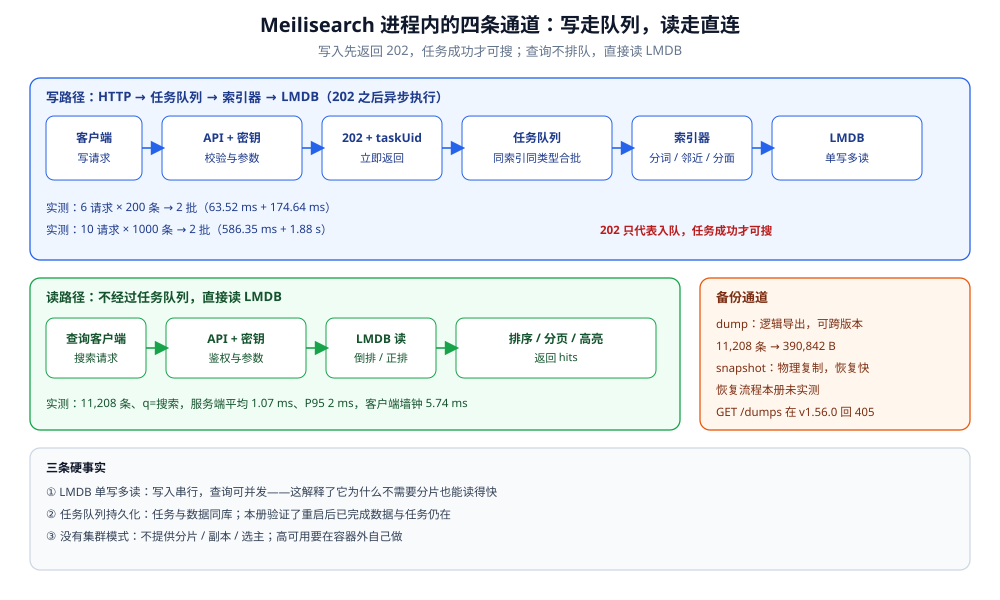

# 定位与架构

> 覆盖：Meilisearch 到底是什么、它和 Elasticsearch 的分水岭在哪、一个进程里跑着哪几条通道、一次写入从 HTTP 202 到「能搜到」要经过什么。
>
> 不覆盖：部署参数与密钥见 [部署与运维.md](部署与运维.md)；任务状态机与索引体积见 [索引与任务队列.md](索引与任务队列.md)；查询、错词与中文分词见 [搜索与相关性.md](搜索与相关性.md)。
>
> 内容整理自个人学习笔记。实测环境：`dockerproxy.net/getmeili/meilisearch:latest` → **v1.56.0**，容器 `meili-lab`（宿主 `37700`），数据集 11,208 条中文笔记文档、平均 380 B。本篇读数见第三、四节。

---

## 一、一句话定位：它和 ES 的分水岭在哪

**本节要点**：Meilisearch 是**面向应用内搜索的单进程检索引擎**，不是「缩小版 Elasticsearch」。它把部署、分词、错词、默认排序都做成开箱即用，代价是放弃分片、副本、聚合框架与深翻页。

| 维度 | Meilisearch | Elasticsearch |
|---|---|---|
| **部署形态** | 单二进制 / 单容器，无外部依赖；镜像 482 MB，空载 RSS **13.21 MiB** | JVM + 集群，节点、分片、副本、堆都要规划 |
| **Schema** | 弱 schema：字段直接进文档，可搜/可过滤/可排序按需开白名单 | mapping 显式，字段类型与 analyzer 先定义 |
| **分词** | 内置 charabia，中文/日文等开箱可搜 | 需要选分词器、装插件、配 analyzer 链 |
| **相关性** | 七条排序规则 + 默认错词容忍，开箱即用 | BM25 + function score / script score，可调空间大 |
| **聚合** | 只有分面计数（facet distribution） | 完整聚合框架（terms / date_histogram / nested…） |
| **分页** | 默认只能翻到前 **1000** 条，越界静默返回空 | `from + size` 默认上限 10000，越界报错 |
| **高可用** | 单进程，无分片与副本；靠外部多实例或备份 | 原生分片 + 副本 + 故障转移 |
| **运维面** | 一个容器、一个卷、一个主密钥 | 集群、分片分配、ILM、快照仓库、安全配置 |

⭐ 判据一句话：**主查询是「用户输入几个词，要一条像样的结果列表」→ 它够用且更省心；主查询是「任意维度聚合 + 深翻页导出 + 多租户隔离」→ 它是错的工具**。

⚠️ 一个常见误解：**「轻量」不等于「只能做玩具」**。本机 11,208 条文档上，服务端搜索平均 **1.07 ms**、P95 **2 ms**；真正限制它的是**单机与查询表达力**，不是小数据量下的速度。

---

## 二、核心概念：必须先建起来的四个对象

**本节要点**：索引装文档，文档靠主键区分，写操作变成任务，行为靠设置调。四句话撑起整个使用面。

| 对象 | 一句话 | 关键点 |
|---|---|---|
| **index** | 一个可搜索的文档集合 | 建索引本身也是异步任务；索引名即 URL 里的 `indexUid` |
| **document** | 一条 JSON 文档 | 必须有主键；字段不需要预先声明类型 |
| **primary key** | 文档唯一标识 | 未显式指定时，找「以 `id` 结尾」的字段；找不到则该写入任务失败 |
| **task** | 所有写操作的执行单 | `POST` 返回 `202 + taskUid`；状态 `enqueued` → `processing` → `succeeded` / `failed` |
| **settings** | 索引级行为配置 | `searchableAttributes` / `filterableAttributes` / `sortableAttributes` / `rankingRules` / `typoTolerance` / `pagination.maxTotalHits` |

主键推断的实测：在未指定 `primaryKey` 的索引里写入 `{"id": 1, "x": "alpha"}`，任务成功后索引的 `primaryKey` 自动变成 `id`；写入一条没有 `id` 类字段的文档，任务失败并返回：

```json
{
  "code": "index_primary_key_no_candidate_found",
  "message": "The primary key inference failed as the engine did not find any field ending with `id` in its name. Please specify the primary key manually using the `primaryKey` query parameter."
}
```

⚠️ 注意措辞是「**以 `id` 结尾**」，不是「必须叫 `id`」：`userId`、`order_id` 这类字段也会被当成候选。生产上建议**显式指定主键**，别把建索引的成败交给字段命名。

---

## 三、整体架构：一个进程里的四条通道

**本节要点**：写入走「API → 任务队列 → 索引器 → LMDB」，查询走「API → LMDB 读」；两条路径在存储层汇合，但**不共享同一条串行队列**。



图里上半部分是写路径：HTTP 请求先被 API 层校验密钥与参数，然后**立刻返回 202**，真正的索引在后台任务队列里执行；队列会把同类型任务自动合成一批，交给索引器做分词、前缀、邻近与分面提取，最后写进 LMDB。下半部分是读路径：搜索请求不经过任务队列，直接读 LMDB 里的倒排、前缀、分面与文档库。右侧是备份通道：dump 导出逻辑数据，snapshot 复制物理状态——⚠️ snapshot 与恢复本册未实测，只按文档口径陈述。

| 通道 | 走什么 | 实测 / 文档口径 |
|---|---|---|
| **HTTP + API key** | 鉴权、参数校验、限流（无内置限流，靠外部） | `/health` 免鉴权 200；`/version` 无密钥 401（实测） |
| **任务队列** | 所有写操作：建索引、写文档、改设置、建 dump | 6 个写请求被合成 2 批（实测，见 [索引与任务队列.md](索引与任务队列.md) 第三节） |
| **索引器** | charabia 分词、前缀库、邻近库、分面库、文档库 | 1000 条一批的索引阶段耗时可从任务 `progressTrace` 读出（实测） |
| **搜索读路径** | 查询解析、倒排求交、排序、分页、高亮 | 不排队；与写入的隔离靠 LMDB 的读写并发 |
| **备份通道** | dump（逻辑）、snapshot（物理） | dump 文件 25,000 B（1208 条阶段，实测）；恢复未实测 |

⭐ 架构上的三个硬事实：

1. **LMDB 是单写多读**：写入串行化，查询可以并发。这解释了为什么它不需要「分片」也能读得快，也解释了为什么高并发写会排队。
2. **任务队列是持久化的**：任务与数据都在同一个 LMDB 环境里，重启后未完成任务会继续处理（本册只验证了「重启后已完成的数据还在」，未验证「未完成任务续跑」）。
3. **没有集群模式**：它不提供分片、副本、选主。要高可用只能在外面做多实例 + 只读副本 + 定期 dump，或者接受单点。

---

## 四、一次写入到可检索的完整路径

**本节要点**：HTTP 202 不是「写成功」，任务 `succeeded` 才是「可搜」。中间隔着一个可能被合批、可能失败的索引过程。

实测时间线（单机、命名卷）：

| 动作 | 结果 |
|---|---|
| 建索引 `notes` | 任务 `succeeded`，耗时 **20.8 ms** |
| 写入 8 条文档 | 任务 `succeeded`，耗时 **459 ms**（首次建索引结构，明显偏慢） |
| 更新设置（可搜 / 可过滤 / 可排序） | 任务 `succeeded`，耗时 **23.9 ms** |
| 写入 1 条文档 | 任务 `succeeded`，耗时 **17.9 ms** |
| 6 × 200 条并发入队 | 合成 2 批，1200 条墙钟 **0.23 s**；合批那批 1000 条耗时 **174 ms** |
| 10 × 1000 条入队 | 合成 2 批，10,000 条墙钟 **2.61 s**；9000 条那批耗时 **1.88 s** |

一批 1000 条文档的 `progressTrace` 里，索引器的主要阶段（实测，取自 5 × 200 条合批）：

| 阶段 | 耗时 |
|---|---|
| `extracting words`（分词与词项提取） | 37.81 ms |
| `extracting word proximity`（词邻近关系） | 60.17 ms |
| `extracting facets`（分面提取） | 6.03 ms |
| `post processing words`（前缀与词库后处理） | 8.13 ms |
| `finalizing > committing`（提交到 LMDB） | 17.42 ms |
| **整个 `indexing` 阶段** | **170.20 ms** |

⚠️ 读法：**分词与邻近关系占了大头**，分面只占 6 ms。这意味着「字段很多、文本很长」比「分面维度很多」更容易拖慢首次索引；而设置变更会触发重建，代价同样落在这些阶段上。

写入可见性的实测（单条文档）：

```text
POST /indexes/infer/documents  → 202, taskUid=…
+5.6 ms   搜索该文档唯一词 → 0 命中
+12.6 ms  搜索该文档唯一词 → 0 命中
+18.9 ms  搜索该文档唯一词 → 1 命中
任务状态：succeeded，duration=17.9 ms
```

⚠️ 结论：**「写完立刻搜」在它这里同样是竞态**，只是窗口从 ES 的约 1 秒缩短到**任务耗时**（本例 17.9 ms）。客户端要么等任务成功再返回，要么接受短暂不可见。

---

## 五、它擅长什么、不擅长什么

**本节要点**：把「应用内搜索」四件事做顺，是它的全部设计目标；超出这四件事，每加一项都要付架构代价。

| 场景 | 适不适合 | 原因 |
|---|---|---|
| 站内搜索（文章、商品、文档） | ✅ 主场景 | 开箱分词、错词、排序、分面，单机就够 |
| 中文 / 日文搜索 | ✅ 开箱可用 | 内置 charabia，不需要装插件（实测 `对象存储`、`搜索引擎` 直接命中） |
| 搜索框的即时联想 | ✅ 适合 | 前缀搜索是默认行为，11k 文档 P95 **2 ms** |
| 多维筛选 + 分面计数 | ✅ 够用 | `filterableAttributes` + `facets`；但没有聚合框架 |
| 日志检索后端 | ❌ 不该用 | 没有副本与分片，数据量一上来单机先撞墙；全文索引成本也不适合日志 |
| 复杂聚合报表 | ❌ 不该用 | 只有分面计数，没有 `GROUP BY`、时间直方图、嵌套聚合 |
| 深翻页 / 全量导出 | ⚠️ 受限 | 默认只能翻到前 **1000** 条，越界静默空（见 [过滤分面与分页.md](过滤分面与分页.md) 第六节） |
| 多租户强隔离 | ⚠️ 要设计 | 索引级隔离 + API key 的 `indexes` 范围；没有 ES 的租户级路由 |
| 向量 / 混合检索 | ⚠️ 有功能但本册未实测 | 本机 `numberOfEmbeddings=0`；能力边界请核官方，不要引用本册 |

---

## 六、与 ES 的分水岭：选型时只看三条

**本节要点**：功能表可以列几十行，真正决定选谁的只有三条：规模与高可用、查询表达力、运维人力。

| 判据 | 选 Meilisearch | 选 Elasticsearch |
|---|---|---|
| **规模与高可用** | 单机可承载、能接受单点或外部多实例 | 要分片水平扩展、要副本自动故障转移 |
| **查询表达力** | 关键词 + 过滤 + 排序 + 分面就够 | 要聚合分析、脚本打分、复杂布尔与嵌套查询 |
| **运维人力** | 没人专职运维检索集群 | 有平台/搜索团队，或愿意用托管服务 |

⭐ 三条里只要有一条落在右边，就别用「先上轻量、以后再说」来赌——**检索副本可以重建，但迁移查询语义与分页行为不是免费的**。反过来，三条都在左边时，上 ES 得到的能力大部分用不到，付的是集群与调优成本。

> 与选型总纲的关系：本册只回答「选了 Meilisearch 之后它怎么工作」；「轻量检索这一族什么时候够用、与数据库全文检索怎么比」在 [搜索与分析选型对比.md](../搜索与分析选型对比.md) 第 3.2、7.1 节。

---

## 七、校验口径

| 内容 | 状态 | 依据 |
|---|---|---|
| 版本 `1.56.0`、commit `47567abc…`、镜像 482 MB | ✅ 实测 | `/version`、`docker images` |
| 空载 RSS 13.21 MiB | ✅ 实测 | `docker stats --no-stream` |
| 索引 / 文档 / 主键 / 任务 / 设置五类对象 | ✅ 实测 | 建索引、写文档、改设置、查任务 |
| 主键推断「以 `id` 结尾」与失败错误码 | ✅ 实测 | 无主键索引写入无 `id` 字段的文档 |
| 写入 202 → 任务成功 → 可搜的时间线 | ✅ 实测 | 单条写入 + 三次即时查询 |
| 合批与索引阶段耗时 | ✅ 实测 | 6 × 200 条、10 × 1000 条任务 `progressTrace` |
| 11,208 条搜索 P95 2 ms | ✅ 实测 | 100 次 `q=搜索` 循环 |
| LMDB 单写多读、任务持久化、无集群模式 | ⚠️ 文档口径 | 官方架构文档；本册只验证了重启后已完成数据仍在 |
| dump / snapshot 的恢复流程 | ⚠️ 未实测 | 只验证了 `POST /dumps` 生成文件 |
| 向量检索能力 | ⚠️ 未实测 | 本机未开启，`numberOfEmbeddings=0` |

---

## 延伸追问

- **为什么它敢用单进程？** → 因为目标场景是「应用内搜索」：数据量在单机内存/磁盘舒适区，查询是只读为主，写入可以排队。真要横向扩展，它把这件事留给外部（多实例 + 路由），而不是在进程内做分片。
- **LMDB 单写多读会不会成为瓶颈？** → 读路径不受影响；写路径会排队，但任务队列会把同类型写自动合批，把「很多小写」变成「少数大批」。批量导入时这个特性是优势；高频单条更新时仍要评估。
- **任务队列和数据在同一个 LMDB 里，会不会互相拖慢？** → 本册没有做隔离实验，不能下结论；能确认的是任务本身也持久化，重启后已完成任务与数据都还在。
- **它能不能做高可用？** → 服务本身不提供副本与选主。常见做法是外面挂多实例、读请求轮询、写只打主实例，并用 dump 做冷备；⚠️ 这套组合本册未实测。
- **「任务成功」之后一定搜得到吗？** → 本册实测的语义是任务成功即可搜（18.9 ms 后命中），没有额外 refresh 等待；但客户端仍应以任务状态为准，而不是以 HTTP 202 为准。

---

## 关联

- [README.md](README.md) — **上游/总纲**：本册五篇的分工与读序
- [索引与任务队列.md](索引与任务队列.md) — **下游**：任务状态机、自动合批与索引体积的展开
- [搜索与相关性.md](搜索与相关性.md) — **下游**：查询侧的分词、错词与排序规则
- [过滤分面与分页.md](过滤分面与分页.md) — **下游**：1000 条分页上限与过滤白名单
- [部署与运维.md](部署与运维.md) — **下游**：单容器部署、密钥、备份与监控
- [搜索与分析选型对比.md](../搜索与分析选型对比.md) — **上游/总纲**：轻量检索族的适用边界
- [Elasticsearch 册](../Elasticsearch/README.md) — **对照/互补**：分片、副本与聚合框架换来的能力
- [搜索与分析数据存储.md](../../存储架构与场景/形态篇/搜索与分析数据存储.md) — **上游原理**：倒排索引为什么为「找」付写代价
