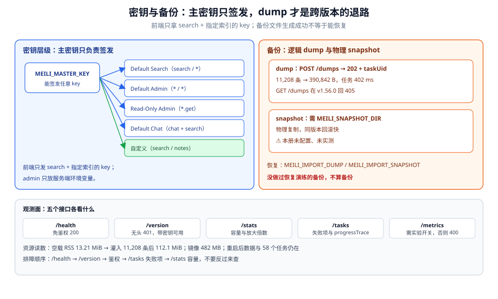

# 部署与运维

> 覆盖：单容器怎么起、环境变量怎么配、五把默认密钥与自定义范围密钥怎么用、`/health` `/version` `/stats` `/tasks` `/metrics` 各能看什么、数据怎么持久化、dump 与 snapshot 怎么选、升级与容量、常见错误怎么查。
>
> 不覆盖：写入任务与索引体积见 [索引与任务队列.md](索引与任务队列.md)；查询参数与相关性见 [搜索与相关性.md](搜索与相关性.md)；过滤与分页上限见 [过滤分面与分页.md](过滤分面与分页.md)。
>
> 内容整理自个人学习笔记。实测环境：`dockerproxy.net/getmeili/meilisearch:latest` → **v1.56.0**（commit `47567abc…`），容器 `meili-lab`（宿主 `37700`，命名卷 `meili-lab-data`）与 `meili-lab-metrics`（`37701`，只开 metrics）。本篇读数见第二至第七节。

---

## 一、一句话定位：一个容器、一个卷、三个观测接口

**本节要点**：它没有集群、没有外部依赖；**运维面小到只剩「容器 + 数据卷 + 密钥」**。代价是所有高可用与容量问题都要在容器外自己解决。

| 运维对象 | 它是什么 | 出问题先看 |
|---|---|---|
| **容器** | 单进程，`7700` 端口，镜像 482 MB | `docker logs`、`/health` |
| **数据卷** | 一个目录 `/meili_data`（内含 `data.ms` 与 `dumps`） | 磁盘占用、权限、备份 |
| **主密钥** | `MEILI_MASTER_KEY`，签发所有 API key | 401 / 403 |
| **任务日志** | `/tasks`，与数据同库 | 失败任务、积压 |
| **备份** | dump（逻辑）/ snapshot（物理） | 恢复演练 |

⭐ 它没有「集群状态页」——**`/stats` 与 `/tasks` 就是它的运维面板**，没有分片分配、没有副本同步、没有选主。

---

## 二、部署：最小可运行配置

**本节要点**：起一个命名卷 + 主密钥 + 端口映射就够；`MEILI_ENV=production` 会强制要求主密钥，公网部署必须开。

```bash
# 起容器（本仓实测形态；命名卷，不挂宿主机目录）
MSYS_NO_PATHCONV=1 docker run -d --name meili-lab \
  -p 37700:7700 \
  -e MEILI_MASTER_KEY='devnotes_master_key_123' \
  -e MEILI_ENV=development \
  -e MEILI_NO_ANALYTICS=true \
  -v meili-lab-data:/meili_data \
  dockerproxy.net/getmeili/meilisearch:latest

# 就绪检查：/health 是唯一免鉴权接口，200 即进程可用
curl --noproxy '*' -s -i http://127.0.0.1:37700/health | head -3
```

| 环境变量 | 作用 | 注意 |
|---|---|---|
| `MEILI_MASTER_KEY` | 主密钥，至少 16 字节 | ⭐ 公网必须设；不设则无鉴权 |
| `MEILI_ENV` | `development` / `production` | `production` 强制主密钥，且默认只监听本机之外的行为不同（按文档） |
| `MEILI_HTTP_ADDR` | 监听地址，容器内默认 `0.0.0.0:7700` | 映射到宿主端口即可 |
| `MEILI_DB_PATH` | 数据目录，默认 `/meili_data/data.ms` | 与卷路径保持一致 |
| `MEILI_DUMP_DIR` | dump 输出目录，默认 `/meili_data/dumps` | 备份要能取到 |
| `MEILI_SNAPSHOT_DIR` | snapshot 输出目录 | 未配置则 snapshot 不可用 |
| `MEILI_NO_ANALYTICS` | 关闭匿名统计 | 内网部署建议开 |
| `MEILI_EXPERIMENTAL_ENABLE_METRICS` | 开启 `/metrics` | 默认关闭，见第四节 |

⚠️ 三个部署坑：

1. **Git Bash 挂宿主机目录必须加 `MSYS_NO_PATHCONV=1`**，否则 `-v D:/...` 会被改写成 `/d/...`，挂载点为空。用命名卷可以完全绕开这类问题。
2. **宿主端口会冲突**：`7700` 常被别的实例占用，起之前先 `docker ps` 看一遍。
3. **数据卷权限**：容器内以非 root 运行（官方镜像），挂宿主机目录时目录属主不对会报写入失败；命名卷没有这个问题。

---

## 三、密钥：五把默认密钥与自定义范围

**本节要点**：主密钥只用来**签发**密钥，日常请求应该用范围受限的 key；搜索前端只拿 `search` 权限的 key，写操作拿 admin key。

设置主密钥后，实例自动生成五把默认 key（实测 `GET /keys`）：

| 名称 | `actions` | `indexes` | 用途 |
|---|---|---|---|
| **Default Search API Key** | `search` | `*` | 前端搜索 |
| **Default Admin API Key** | `*` | `*` | 服务端写与运维 |
| **Default Read-Only Admin API Key** | `*.get`、`keys.get` | `*` | 只读运维 |
| **Default Chat API Key** | `chatCompletions`、`search` | `*` | 对话式检索（本册未用） |
| 自定义（实测建了一把） | `search` | `notes` | 只搜指定索引 |

### 3.1 范围校验的实测

用自定义 search key（仅 `notes` + `search`）：

| 请求 | 结果 |
|---|---|
| 搜索 `notes` | **200** |
| 写 `notes` 文档 | **403** `invalid_api_key` |
| 列 `/keys` | **403** `invalid_api_key` |

⚠️ 注意：**「权限不足」与「密钥不存在」返回同一个 `invalid_api_key`**，不要靠错误码区分；要确认是哪一把 key，去 `GET /keys` 对 `uid`。

无 `Authorization` 头时是另一层错误：

```json
{
  "message": "The Authorization header is missing. It must use the bearer authorization method.",
  "code": "missing_authorization_header",
  "type": "auth"
}
```

### 3.2 建一把最小权限 key

```bash
curl --noproxy '*' -s -X POST "http://127.0.0.1:37700/keys" \
  -H "Authorization: Bearer $MEILI_MASTER_KEY" \
  -H 'Content-Type: application/json' \
  -d '{"description":"frontend search","actions":["search"],"indexes":["notes"],"expiresAt":null}'
```

⭐ 生产建议：**前端只发 `search` + 指定索引的 key**；admin key 只放服务端环境变量；密钥轮换用「新建 → 切换 → 删旧」，删除接口是 `DELETE /keys/{uid}`（本册未实测过期与删除后的拒绝行为）。

---

## 四、观测面：五个接口各看什么

**本节要点**：`/health` 免鉴权、`/version` 要鉴权、`/stats` 看容量、`/tasks` 看写入、`/metrics` 要实验开关。五个接口的分工不要混。

| 接口 | 鉴权 | 返回 | 什么时候用 |
|---|---|---|---|
| `GET /health` | **免鉴权** | `{"status":"available"}` | 容器就绪 / 负载均衡探活 |
| `GET /version` | 需要 | `pkgVersion`、`commitSha`、`commitDate` | 确认版本与升级结果 |
| `GET /stats` | 需要 | 每索引文档数、`indexSize`、`rawDocumentDbSize`、`isIndexing` | 容量与索引膨胀 |
| `GET /tasks` / `GET /batches` | 需要 | 任务状态、耗时、`progressTrace`、失败原因 | 写入排障 |
| `GET /metrics` | 需要 + 实验开关 | Prometheus 文本格式 | 接监控 |

实测细节：

```text
GET /health   无头        → 200（唯一免鉴权接口）
GET /version  无头        → 401 missing_authorization_header
GET /version  带主密钥    → {"commitSha":"47567abc…","commitDate":"unknown","pkgVersion":"1.56.0"}
GET /metrics  无头        → 401（先鉴权）
GET /metrics  带主密钥    → 400 feature_not_enabled（默认未开）
```

开启 metrics 需要 `MEILI_EXPERIMENTAL_ENABLE_METRICS=true`；本册另起 `meili-lab-metrics` 验证，返回的是标准 Prometheus 文本：

```text
# HELP meilisearch_db_size_bytes Meilisearch DB Size In Bytes
# TYPE meilisearch_db_size_bytes gauge
meilisearch_db_size_bytes 73728
# HELP meilisearch_http_requests_total Meilisearch HTTP requests total
# TYPE meilisearch_http_requests_total counter
meilisearch_http_requests_total{method="GET",path="/health",status="200"} 1
```

⚠️ 该接口也是**实验特性**：参数名、指标名与稳定性都可能在版本间变化，接监控前先在目标版本上抓一次。

### 4.1 资源占用

| 时点 | 读数 |
|---|---|
| 空载 RSS | **13.21 MiB** |
| 灌入 11,208 条后 RSS | **112.1 MiB** |
| 镜像大小 | **482 MB**（`docker images` 口径） |
| 数据库文件 | 49,496,064 B（含 9 个索引；`notes` 索引 19,689,472 B） |

⭐ 它的内存模型是「按索引结构增长」，不是 JVM 那种固定堆；11k 文档 112 MiB 只能说明这个量级，**不能外推**到百万级。

---

## 五、持久化与备份

**本节要点**：数据全在 `/meili_data` 一个卷里；dump 是逻辑备份、可跨版本，snapshot 是物理快照、恢复快但绑定版本。⭐ **备份的价值只在恢复演练过之后才成立**。

### 5.1 持久化：重启不丢

```bash
# 本册实测：11,208 条文档 + 58 个任务，重启后全部还在
docker restart meili-lab
curl --noproxy '*' -s http://127.0.0.1:37700/health
curl --noproxy '*' -s -H "Authorization: Bearer $MEILI_MASTER_KEY" \
  http://127.0.0.1:37700/stats
```

重启后 `notes.numberOfDocuments=11208`、`indexSize=19689472`、任务总数 58，搜索正常。⚠️ 这验证的是「已完成的数据与任务在」，**未验证「处理中的任务在重启后续跑」**。

### 5.2 dump：逻辑备份

```bash
# 创建 dump：异步任务
curl --noproxy '*' -s -X POST http://127.0.0.1:37700/dumps \
  -H "Authorization: Bearer $MEILI_MASTER_KEY"
# → {"taskUid":58,"type":"dumpCreation","status":"enqueued"}

# 等任务成功后，文件在容器内的 /meili_data/dumps
docker exec meili-lab ls -l /meili_data/dumps
```

| 数据集 | dump 大小 | 任务耗时 |
|---|---|---|
| 1,208 条阶段 | **25,000 B** | — |
| 11,208 条阶段 | **390,842 B** | **402 ms** |

⚠️ `GET /dumps` 在 v1.56.0 返回 **405 Method Not Allowed**——没有「列出 dump」的接口，只能到数据目录里看文件。

恢复用启动参数 `MEILI_IMPORT_DUMP=/meili_data/dumps/xxx.dump`（或 `--import-dump`），导入完成后服务才可写；⚠️ **本册未实测恢复流程**，只验证了 dump 文件生成。

### 5.3 snapshot：物理快照

需要先设 `MEILI_SNAPSHOT_DIR`，再 `POST /snapshots`。它复制整个 LMDB 状态，恢复快，但**与版本绑定更紧**，跨大版本升级优先用 dump。⚠️ 本册未配置、未实测。

| | dump | snapshot |
|---|---|---|
| 内容 | 逻辑数据（文档 + 设置 + 任务等） | 物理数据库文件 |
| 跨版本 | ✅ 设计上可导入新版本 | ⚠️ 受版本约束 |
| 大小 | 390,842 B（11,208 条） | 未测 |
| 恢复 | `MEILI_IMPORT_DUMP` | `MEILI_IMPORT_SNAPSHOT` |
| 适用 | 升级、迁移、长期备份 | 同版本快速回滚 |



图里左panel是密钥层级：主密钥只负责签发，Default Search 只给 `search` 权限、Default Admin 有全部权限、自定义密钥可限定到 `notes` 索引；中间是备份取舍，dump 生成 390,842 B 且 `GET /dumps` 回 405，snapshot 需配 `MEILI_SNAPSHOT_DIR` 且本册未实测；右侧五个观测接口各有侧重。底部一行给出的排障顺序（`/health` → `/version` → 鉴权 → `/tasks` 失败项 → `/stats` 容量）对应本篇第三节到第七节。

### 5.4 导出全量文档

备份之外，业务上要「导出全部数据」时不要翻搜索页（受 `maxTotalHits` 限制，见 [过滤分面与分页.md](过滤分面与分页.md) 第七节），用文档接口分批取：

```bash
# 分批导出：limit 是单批条数，offset 是偏移；不受 maxTotalHits 约束
curl --noproxy '*' -s -X POST "http://127.0.0.1:37700/indexes/notes/documents/fetch" \
  -H "Authorization: Bearer $MEILI_MASTER_KEY" \
  -H 'Content-Type: application/json' \
  -d '{"limit":1000,"offset":0}'
```

---

## 六、升级与容量

**本节要点**：升级前先 dump；容量按「文档原始大小 × 放大倍数 + 任务/索引开销」估，⭐ 单写者意味着写入吞吐不能靠加机器解决。

### 6.1 升级路径

| 步骤 | 动作 | 判据 |
|---|---|---|
| ① 记录版本 | `GET /version` 存下 `pkgVersion` 与 `commitSha` | 回滚要有坐标 |
| ② 备份 | `POST /dumps`，把文件取出容器 | ⭐ 没有 dump 不升级 |
| ③ 读 Release Notes | 看 breaking changes、设置项改名、任务格式变化 | 排序规则名、实验特性最容易变 |
| ④ 新容器导入 | 起新版本容器 + `MEILI_IMPORT_DUMP`，验证文档数与查询 | 不要在原卷上直接覆盖 |
| ⑤ 切流量 | 验证通过后再切；旧容器保留一段时间 | 可回滚 |

⚠️ **本册未实测跨版本升级**；「同卷直接换镜像」是否安全取决于版本跨度，官方口径是优先 dump 导入，不要拿生产卷试。

### 6.2 容量估算

| 输入 | 怎么量 | 本册读数 |
|---|---|---|
| 原始文档总量 | 条数 × 平均大小 | 11,208 × 380 B ≈ 4.2 MiB |
| 索引放大 | `indexSize / rawDocumentDbSize` | **4.52**（短文档可到 6.43） |
| 磁盘需求 | 原始 × 放大 + dump 副本 + 余量 | 本册索引 18.8 MiB、库文件 47.2 MiB |
| 内存 | 按索引结构增长，非固定堆 | 空载 13.21 MiB → 11k 文档 112.1 MiB |

⚠️ 磁盘要同时留出：索引体积、dump 临时文件、以及 LMDB 的写放大余量。**单写者**还意味着写入吞吐上限由单进程决定，加只读副本只能分担查询，不能分担写。

---

## 七、故障速查

**本节要点**：先按状态码分层——401 是没带/带错密钥，403 是权限不够或密钥不存在，400 是请求本身不合法，405 是方法用错，任务失败要去 `/tasks` 看。

| 症状 | 先查什么 | 依据 |
|---|---|---|
| `401 missing_authorization_header` | 请求有没有带 `Authorization: Bearer …` | `/health` 之外都要带 |
| `403 invalid_api_key` | key 是否过期 / `actions` 是否覆盖 / `indexes` 是否包含目标索引 | 权限不足与密钥不存在同码 |
| `400 feature_not_enabled` | 是否开了 `MEILI_EXPERIMENTAL_ENABLE_METRICS` | `/metrics` 默认关闭 |
| `405` 访问 `/dumps` | 用了 `GET`；列出 dump 没有接口 | v1.56.0 实测 |
| `404 index_not_found` | 索引名拼写、是否已建 | 建索引也是异步任务 |
| `400 invalid_search_filter` | 字段是否进 `filterableAttributes`；`EXISTS` 是否写成后缀 | 见 [过滤分面与分页.md](过滤分面与分页.md) |
| `400 invalid_search_sort` | 字段是否进 `sortableAttributes` | 同上 |
| 写入返回 202 但搜不到 | 任务是否 `succeeded`；批是否还在排队 | 见 [索引与任务队列.md](索引与任务队列.md) 第四节 |
| 翻页到某页后全空 | `offset` 是否 ≥ `maxTotalHits` | 越界返回 200 + 空 |
| 容器起不来 / 端口占用 | `docker ps -a`、宿主端口 | 换端口或停旧实例 |
| 数据目录写入失败 | 卷权限、属主 | 优先用命名卷 |
| 磁盘涨得快 | `/stats` 的 `indexSize` 与 `rawDocumentDbSize` 比值；dump 残留 | 短文档放大更明显 |

常用命令：

```bash
docker logs --tail 100 meili-lab
docker stats --no-stream meili-lab
curl --noproxy '*' -s -H "Authorization: Bearer $MEILI_MASTER_KEY" \
  "http://127.0.0.1:37700/tasks?statuses=failed&limit=20"
curl --noproxy '*' -s -H "Authorization: Bearer $MEILI_MASTER_KEY" \
  "http://127.0.0.1:37700/stats"
```

⭐ 排障顺序固定为：**`/health` → `/version` → 鉴权 → `/tasks` 失败项 → `/stats` 容量**。先确认「进程活着、版本对、密钥对」，再谈数据问题；反过来查会绕远路。

---

## 八、校验口径

| 内容 | 状态 | 依据 |
|---|---|---|
| 单容器 + 命名卷部署、`/health` 免鉴权 | ✅ 实测 | `meili-lab` 容器 |
| 五把默认密钥与自定义范围 key | ✅ 实测 | `GET /keys`；search 200 / 写 403 / 列 keys 403 |
| 401 `missing_authorization_header` 与 403 `invalid_api_key` | ✅ 实测 | 无头请求、错误 key |
| `/version` 需鉴权、版本与 commit | ✅ 实测 | 无头 401、带头返回 1.56.0 |
| `/metrics` 的 401 / 400 与开启后的 Prometheus 输出 | ✅ 实测 | `meili-lab-metrics` 容器 |
| 空载与 11k 文档的 RSS、镜像大小 | ✅ 实测 | `docker stats`、`docker images` |
| 重启后数据与任务仍在 | ✅ 实测 | 11,208 条、58 个任务 |
| dump 生成、大小、`GET /dumps` 405 | ✅ 实测 | 25,000 B / 390,842 B |
| dump 导入恢复 | ⚠️ 未实测 | 只验证文件生成 |
| snapshot 生成与恢复 | ⚠️ 未实测 | 未配置 `MEILI_SNAPSHOT_DIR` |
| `MEILI_ENV=production` 的差异 | ⚠️ 未实测 | 本册用 `development` |
| 跨版本升级路径 | ⚠️ 未实测 | 只按官方口径给步骤 |
| 任务保留与 `DELETE /tasks` | ⚠️ 未实测 | 未改保留参数 |

---

## 延伸追问

- **主密钥能不能直接给前端？** → 不能。主密钥能签发任意 key，等于全部权限；前端只发 `search` + 指定索引的 key。⚠️ 默认 Search Key 的 `indexes` 是 `*`，多租户场景要自建按索引收窄的 key。
- **为什么权限不足和密钥不存在返回同一个错误？** → 避免泄露「哪把 key 存在」，属于安全上的刻意模糊。排障时用 `GET /keys` 对 `uid`，而不是猜错误码。
- **dump 和 snapshot 到底选哪个？** → 跨版本、迁移、长期备份用 dump；同版本快速回滚用 snapshot。⭐ 两者都要做恢复演练，文件生成成功不等于能恢复。
- **单机怎么扛高可用？** → 服务本身不提供副本与选主；常见做法是「主实例写 + 多个只读实例 + 前面放路由」，再用 dump 做冷备。⚠️ 这套组合本册未实测，且要自己解决「只读实例的数据滞后 window」。
- **磁盘为什么比原始数据大好几倍？** → 倒排、前缀、邻近与分面都是独立结构，本册放大 4.52 倍；短文档更高（6.43）。要压体积，先看 `/stats` 的比值，再决定是缩可搜字段还是换更大盘。
- **升级能不能直接换镜像？** → 不建议拿生产卷直接试。正确姿势是 dump → 新容器导入 → 验证 → 切流量；旧容器保留到确认无误，这是唯一可回滚的路径。

---

## 关联

- [README.md](README.md) — **上游/总纲**：本册五篇的分工、读序与实测坐标
- [索引与任务队列.md](索引与任务队列.md) — **上游**：`/tasks` 与 `/batches` 的字段、任务失败与重建
- [搜索与相关性.md](搜索与相关性.md) — **上游**：查询参数与设置项
- [过滤分面与分页.md](过滤分面与分页.md) — **上游**：分页上限与导出边界
- [定位与架构.md](定位与架构.md) — **上游**：单进程、LMDB 与「没有集群模式」
- [搜索与分析选型对比.md](../搜索与分析选型对比.md) — **上游/总纲**：轻量检索族的适用边界与运维成本
- [可观测性选型对比.md](../../../中间件/可观测性/可观测性选型对比.md) — **对照/互补**：metrics 之后接什么
