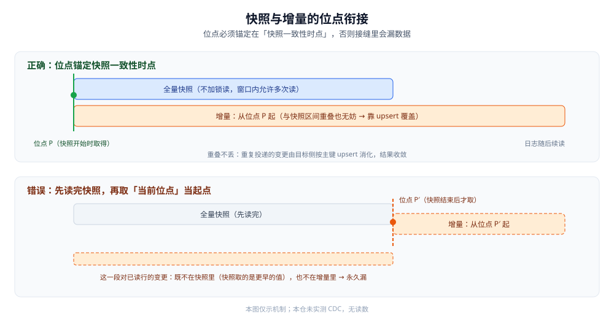

# CDC 原理

> CDC（Change Data Capture，变更数据捕获）之所以能做到**不侵入业务代码**又**近实时**，是因为它借用了数据库本来就要写的那份东西 —— **变更日志**。本篇讲三件事：日志为什么能当原料、**位点**为什么是一切的前提、以及为什么 CDC 也做不到「恰好一次」。
>
> 三条同步路线的横评在 [数据同步方式选型对比.md](../数据同步方式选型对比.md)；本目录的阅读顺序见 [README.md](README.md)；工具怎么挑见 [CDC工具选型.md](CDC工具选型.md)；全量快照与增量日志的衔接见 [全量与增量一体化.md](全量与增量一体化.md)。
>
> 内容整理自个人学习笔记，并参考 MySQL / PostgreSQL / MongoDB / Debezium 官方文档；素材见 [素材清单.md](../../../../素材清单.md)。
>
> ⚠️ 实测口径：**本篇未做容器实测**。原因：需要真实源库开启并保留日志、以复制身份创建消费连接、再制造增删改并观察事件流，属于多进程对接才有意义的实验。文中代码为**可编译骨架**（用成熟库、省略部分错误处理），**未在本仓运行**；不引用任何第三方吞吐或延迟数字。

---

## 一、变更日志为什么能当同步的原料？

**本节要点**：数据库为「崩溃恢复」和「主从复制」本就会把每次变更追加进日志。CDC 只是**多挂一个消费者**去读这份日志，因此对业务代码零侵入，且天然包含 `delete`（这点轮询做不到）。

### 1.1 三种常见数据库的日志

| 数据库 | 日志 | CDC 读它需要什么 | 位点用什么表示 |
|---|---|---|---|
| **MySQL** | `binlog` | 开启 `log_bin`、格式设为 `ROW`、`binlog_row_image=FULL`；消费方需要 `REPLICATION SLAVE` / `REPLICATION CLIENT` 权限 | 文件名 + 偏移（`mysql-bin.000123:4567`）或 GTID |
| **PostgreSQL** | `WAL` | 把 `wal_level` 调到 `logical`，创建**逻辑复制槽**并选一个输出插件（如 `pgoutput`） | LSN（日志序列号） |
| **MongoDB** | `oplog` | 必须是**副本集**（单节点没有 oplog），或直接用 **change streams** | oplog 时间戳 / change stream 的 resume token |
| Oracle | `redo` + LogMiner / XStream | 归档日志 + LogMiner / XStream | SCN（系统变更号） |

⭐ 一句话：**没有一个数据库「为 CDC 专门准备」日志** —— 这份日志先服务于崩溃恢复和主从复制，CDC 是搭便车。这解释了两件事：为什么 CDC 延迟能低（日志本来就是顺序追加的实时流），也为什么 CDC 受日志保留期约束（日志会被回收，落后太久就跟丢了）。

### 1.2 为什么读日志优于轮询

一个直觉方案是「定时 `SELECT ... WHERE updated_at > 上次`」。它的问题在日志里全都自然解决：

| 维度 | 轮询（按时间戳） | 读日志 |
|---|---|---|
| **删除** | ❌ 行没了就查不到，**删除事件捕获不到** | ✅ 日志里有 `DELETE` |
| **中间态** | ❌ 两次轮询之间的多次更新被压成最后一次 | ✅ 每一次变更都是一条事件 |
| **源库压力** | ❌ 每次都要扫表 / 走索引查询 | ✅ 只是顺序读日志 |
| **时效** | ❌ 受轮询周期限制 | ✅ 近实时 |
| **侵入** | 中（要保证 `updated_at` 被正确维护） | 低（不动业务代码） |

> ⚠️ 轮询并非一无是处 —— 当源库**不允许开日志**（云托管、DBA 不放权）时，它往往是唯一可行的路线，见 [定时同步/README.md](../定时同步/README.md)。

### 1.3 binlog 的三种格式，为什么必须用 ROW

MySQL 的 `binlog_format` 有三档，只有 `ROW` 适合 CDC：

| 格式 | 日志里记什么 | 能不能做 CDC |
|---|---|---|
| `STATEMENT` | 原始 SQL 语句 | ❌ 拿不到「哪一行变了」，函数/触发器还会导致主从不一致 |
| `MIXED` | 视语句而定，自动切换 | ⚠️ 不保证所有变更都有行数据 |
| `ROW` | **每一行的前后镜像** | ✅ 变更行、变更前后值都在，`delete` 也在 |

配套还有一个 `binlog_row_image`：`FULL` 记整行、`MINIMAL` 只记主键和被改列。CDC 要重建「更新后完整的一行」，通常需要 `FULL`。**这两项一定要在动工前确认**，否则 CDC 拿到的是一份「残缺的日志」。

---

## 二、位点是什么，为什么它是一切的前提？

**本节要点**：位点 = 「我已经处理到日志的哪个位置」。它是 CDC 的**断点续传坐标**：有了它，消费进程重启后能接着上次继续；丢了它，就只能回退重放。位点与初始快照必须**取自同一时点**，否则快照和增量之间会有一道缝。

### 2.1 位点的形态

| 数据库 | 位点表示 | 说明 |
|---|---|---|
| MySQL | `binlog file + position` | 精确但「主库切换 / 日志轮转」后含义会变，跨实例迁徙困难 |
| MySQL | **GTID** | 全局事务 ID，跨主从切换仍可比较，是更稳的位点（需开启 GTID） |
| PostgreSQL | **LSN**（日志序列号） | 复制槽会**记住**消费者确认过的 LSN，服务端帮你保留日志 |
| MongoDB | oplog 时间戳 / resume token | 凭证在客户端，服务端 op log 是固定大小的环形集合 |

⭐ 判据：**优先选「全局可比较」的位点（GTID / LSN / token），而不是「本地物理偏移」** —— 物理偏移只在同一个实例的同一条日志链上有意义。

### 2.2 位点存到哪

位点必须有**持久化的落脚点**，且要与「下游写入」在同一个事务边界里更新，否则会出现「改了下游但没记位点」或「记了位点但下游没写」：

| 存法 | 说明 | 一致性 |
|---|---|---|
| 位点 + 下游数据**同库同事务** | 一致性最强，前提是下游支持事务 | ✅ 推荐 |
| 交给**中间层**管（Kafka offset / Flink checkpoint） | 位点随消费位点提交，重放语义由中间层保证 | ✅ 常见 |
| 单独存位点表、两阶段提交 | 要自己保证两件事都成功 | ⚠️ 复杂易错 |
| 不存只靠内存 | 重启即从头重放 | ❌ 不可用于生产 |

### 2.3 一致性快照：快照与位点必须同一时点

冷启动时，CDC 要先**全量拉一遍存量数据**做基线，再**从某个位点开始跟增量**。这两步的接缝是 CDC 最容易出错的地方：

- 快照**必须对应一个确定的日志位点**（快照建立的那一刻，日志读到哪了）。
- 实现上通常借助「短暂加只读锁拿到位点 → 记下位点 → 不加锁读快照」，或直接用 GTID 相关联。
- ⚠️ 如果先读快照、再随便取一个「当前位点」，那么**快照读完之后、取位点之前**的变更会被漏掉。



完整的衔接流程、无锁快照与断点续传见 [全量与增量一体化.md](全量与增量一体化.md)。

---

## 三、一条变更事件长什么样？

**本节要点**：一条 CDC 事件要能回答「**哪张表的哪一行、做了什么操作、改前改后各是什么**」。其中 UPDATE 的前后镜像（before / after）决定了目标侧能不能做精确的部分更新。

### 3.1 事件的基本信息

| 字段 | 含义 | 用途 |
|---|---|---|
| 库 / 表 | 变更发生在哪 | 路由到下游哪个目标表 |
| 操作类型 | `INSERT` / `UPDATE` / `DELETE` | 决定下游做 upsert 还是 delete |
| **前镜像（before）** | 变更前的行（UPDATE / DELETE 才有） | 定位旧行、比较字段 |
| **后镜像（after）** | 变更后的行（INSERT / UPDATE 才有） | 写入下游的新值 |
| 位点 / 时间戳 | 这条事件在日志中的位置与发生时间 | 续传与乱序判断 |

### 3.2 before / after 镜像的价值与坑

- **只做 upsert 时**，其实只需要 **after**（含主键），按主键覆盖即可 —— 这也是大多数「同步副本」场景的做法。
- **`DELETE` 只有 before**，下游必须能从 before 里取到主键才能删。
- ⚠️ **`binlog_row_image=MINIMAL` 时，before/after 可能都不完整**（只含主键和改动列）：此时「按 after 整行覆盖」会**把未改动列写成空**。这是 CDC 目标侧数据「莫名被清空」的经典原因之一。
- **需要区分「真删」与「软删」**：若业务是软删（`is_deleted=1`），log 里是 `UPDATE`，下游得自己把软删翻译成删除。

---

## 四、为什么 CDC 也做不到「恰好一次」？

**本节要点**：跨系统的投递无法既保证「不丢」又保证「不重」 —— 这是分布式系统的基本事实。工程上的答案是：**接受「至少一次」，把去重交给目标侧的幂等写入**。

### 4.1 三种投递语义

| 语义 | 含义 | 代价 |
|---|---|---|
| 至多一次（at-most-once） | 先记位点再处理 | 崩溃会**丢事件** |
| 至少一次（at-least-once） | 先处理再记位点 | 崩溃会**重复事件** |
| 恰好一次（exactly-once） | 不丢不重 | 需要「位点与下游写入同事务」，跨异构系统通常做不到 |

### 4.2 幂等写入是最终答案

既然「至少一次」是现实，**目标侧必须幂等**：

- **按主键 `upsert`**：`INSERT ... ON DUPLICATE KEY UPDATE` / ES 的 `_id` 覆盖 / KV 的 `SET`。重复投递同一条变更，结果不变。
- **`delete` 天生幂等**：删一条不存在的行是空操作。
- ⚠️ **慎用「自增 / 累加」类目标操作**：`counter = counter + 1` 在重复投递下会**多加**。计数类应改为「按主键全量覆盖计数值」，而不是增量累加。

---

## 使用：用 Go 读一次 MySQL binlog

下面是一个**可编译骨架**：以「从库」的身份连上 MySQL，指定起始位点，注册行事件回调。用成熟库 `github.com/go-mysql-org/go-mysql`，不自己解析 binlog 二进制格式。

```go
package main

import (
	"context"
	"fmt"
	"time"

	"github.com/go-mysql-org/go-mysql/mysql"
	"github.com/go-mysql-org/go-mysql/replication"
)

// handleRows 把 binlog 事件还原成「哪张表 / 什么操作 / 主键」。
// 真实实现里这里应把变更投递给下游（并且幂等），本骨架只打印。
func handleRows(e *replication.RowsEvent) {
	schema, table := string(e.Table.Schema), string(e.Table.Table)
	for _, row := range e.Rows {
		// row 的形状随事件类型变化：INSERT/UPDATE 是 after（UPDATE 还会有 before），DELETE 是 before。
		fmt.Printf("变更 schema=%s table=%s row=%v\n", schema, table, row)
	}
}

func main() {
	cfg := replication.BinlogSyncerConfig{
		ServerID: 100, // 伪造一个唯一的从库 ID，避免和真实从库冲突
		Flavor:   "mysql",
		Host:     "127.0.0.1",
		Port:     3306,
		User:     "cdc",
		Password: "cdc",
	}
	syncer := replication.NewBinlogSyncer(cfg)
	defer syncer.Close()

	// 位点：生产上应从上一次处理成功的位置续读，而不是固定值。
	pos := mysql.Position{Name: "mysql-bin.000001", Pos: 4}
	streamer, err := syncer.StartSync(pos)
	if err != nil {
		panic(err)
	}

	ctx := context.Background()
	for {
		ev, err := streamer.GetEvent(ctx)
		if err != nil {
			// 这里应做重连 + 从上次成功位点续读，骨架从简。
			panic(err)
		}
		switch e := ev.Event.(type) {
		case *replication.RowsEvent:
			handleRows(e)
		case *replication.QueryEvent:
			fmt.Printf("query: %s\n", e.Query)
		}
		// 每处理成功一条，就把「已到位点」持久化一次（与下游写入同事务最佳）。
		_ = time.Now()
	}
}
```

⚠️ **未实测**：上述代码未在本仓运行。要真跑需要：一个开启 `ROW` 格式 binlog 的 MySQL、一个具备复制权限的账号、再用 `INSERT/UPDATE/DELETE` 制造变更观察输出。生产化还差：**位点持久化、下游幂等写入、schema 变更处理、重连与退避** —— 这四件才是 CDC 的真正工程量。

---

## 延伸追问

- **CDC 和数据库自带主从复制都在读 binlog，本质区别是什么？** → 自带复制把日志重放到**同构从库**；CDC 把日志**解析成事件**给任意下游（异构库 / 检索 / 分析 / MQ），下游与源库引擎无关。
- **为什么 MySQL 一定要 `ROW` 格式？** → 只有 ROW 记了「哪一行的前后值」，`STATEMENT` 只有 SQL 语句、`MIXED` 不保证行数据；没有行数据就无法还原变更。
- **位点丢了会怎样？** → 只能回退到上一次持久化的位点重放，重复部分靠下游幂等消化；如果日志已被回收、位点已过期（超出保留期），就只能**重新做全量快照**。
- **PostgreSQL 的复制槽有什么特别？** → 复制槽会**阻止服务端回收**该消费者还没确认的 WAL，故「消费者长期不消费」会撑大 WAL 占用 —— 这是一把双刃剑。
- **CDC 对源库负担大吗？** → 读日志本身是顺序读、负担小；真正的压力在**上游事务提交时写日志**（这本就发生）和下游消费。想进一步隔离，可以在**只读从库**上跑 CDC，见 [数据同步方式选型对比.md](../数据同步方式选型对比.md) 的「原生复制 + CDC」组合。

## 关联

- [数据同步方式选型对比.md](../数据同步方式选型对比.md) — 上位：三条同步路线的族级横评与组合范式
- [README.md](README.md) — 本目录导读：CDC 四篇的阅读顺序与依赖
- [CDC工具选型.md](CDC工具选型.md) — 把上面这些原理落到具体工具（Debezium / Canal / Flink CDC …）
- [全量与增量一体化.md](全量与增量一体化.md) — 快照与增量的位点衔接、断点续传与幂等
- [FlinkCDC.md](FlinkCDC.md) — 用 Flink 把全量 + 增量压进一个作业的形态
- [日志与持久化.md](../../关系型/MySQL/日志与持久化.md) — binlog 本身怎么记、怎么刷盘、怎么恢复
- [复制与高可用.md](../../关系型/MySQL/复制与高可用.md) — 同构主从复制：与 CDC 同源（都读 binlog）但用途不同
- [缓存一致性.md](../../缓存/缓存一致性.md) — 「订阅 binlog 异步失效」是 CDC 思路在缓存场景的应用
