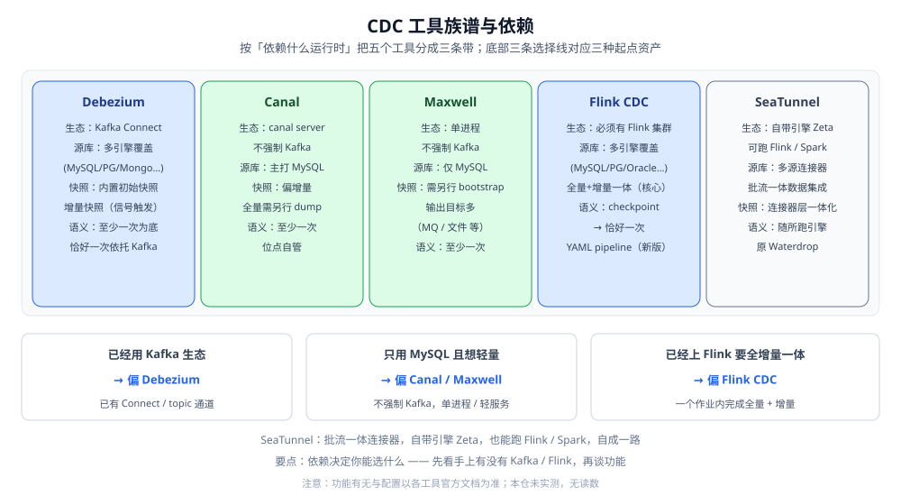

# CDC工具选型

> 把 CDC 原理落到具体工具：Debezium、Canal、Maxwell、Flink CDC、SeaTunnel 各自站在哪个生态、要什么依赖、投递语义靠什么实现、快照与 schema 演进能力如何。给三条按「起点资产」走的选择线和一张按需求查工具的对照表。
>
> 内容整理自个人学习笔记，并参考各家官方文档；素材见 [素材清单](../../../../素材清单.md)。
>
> ⚠️ 实测口径：**本篇未做容器实测**。原因：要真实源库开启并保留日志、拉起 Kafka Connect / Flink / SeaTunnel 等运行时、再制造增删改观察事件流，属于多进程对接才有意义的实验。因此本篇 **不引用任何吞吐 / 延迟 / 版本号 / 准确率数字**；功能有无与配置项一律 **以各工具官方文档为准**。

---

## 一、CDC 工具到底在选什么？

**本节要点**：五个工具比的不是「谁快谁慢」，而是五种**部署形态与依赖把**。依赖是硬约束——你手上已经有什么基础设施，几乎决定了你只能选哪一类，功能对照表是第二步。

### 1.1 选型先问的三个约束

先回答三个问题，功能清单还没轮到上场：

| 约束 | 问法 | 决定了什么 |
|---|---|---|
| **已有什么基础设施** | 团队是否已有 Kafka / Kafka Connect？是否已有 Flink 集群？ | 有 Kafka → Debezium 顺理成章；有 Flink → Flink CDC 顺理成章；都没有 → 轻量客户端（Canal / Maxwell） |
| **源库是什么** | 只有 MySQL，还是要覆盖 PG / Mongo / Oracle / SQL Server？ | 只覆盖单源 → Canal / Maxwell 够用；要多源统一 → Debezium / Flink CDC / SeaTunnel |
| **下游是什么** | 目标是消息队列、另一个库、检索/分析副本，还是要入湖？ | 目标决定投递通道与幂等写法，也决定工具的输出连接器是否够用 |

⭐ 判据：**先按「依赖」砍，再按「功能」挑**。一个能覆盖五种源库、但要求你先建一整套 Kafka 生态的工具，在你没有 Kafka 时就是不可选项。

### 1.2 五个工具一句话定位

| 工具 | 一句话 | 生态位置 |
|---|---|---|
| **Debezium** | 基于 Kafka Connect 的 CDC 平台，把变更事件写进 Kafka topic | Kafka 生态的「标准件」 |
| **Canal** | 阿里开源，伪装成 MySQL 从库读 binlog 的服务端 | MySQL 侧的独立服务 |
| **Maxwell** | 单个 Java 进程读 MySQL binlog 并输出 JSON | 极轻量的 MySQL 客户端 |
| **Flink CDC** | Flink 的 CDC 源连接器，全量+增量在一个作业内完成 | Flink 生态的一部分 |
| **SeaTunnel** | 原 Waterdrop，批流一体的数据集成平台，连接器丰富 | 独立的集成平台 |

图注：五个工具按「**依赖什么运行时**」排开——Debezium 与 Flink CDC 依赖重（Kafka Connect / Flink），Canal 与 Maxwell 轻（独立进程 / 单进程），SeaTunnel 自带引擎、相对灵活。底部三条选择线就是把「起点资产」映射到工具。

### 1.3 为什么没有「万能工具」

看到五个工具的对照表，很容易产生一个念头：「有没有一个既覆盖所有源库、又不依赖任何集群、还自带全量和增量一体的？」——**没有**。原因是这些能力互相牵制：

- **想覆盖多源 → 就得有一套统一的运行时**：要对接不同数据库的日志格式，工具需要一个能做连接管理、状态管理、投递管理的框架（Kafka Connect 或 Flink 就是这样的框架）。多源能力是用**依赖**换来的。
- **想轻量 → 就得放弃通用性**：单进程客户端之所以简单，是因为它只对着**一种**源库、**一种**日志格式做优化。
- **想全量一体 → 就要有地方存「状态」**：快照期间记录的变更、位点、分片进度都要有落脚点，这本身就是一套**有状态运行时**的活。

于是选型更像「**三选二**」：多源 / 轻量 / 一体化，通常只能同时占两个。先想清楚哪个对你最不重要，取舍就清楚了。

---

## 二、五个工具分别是什么形态？

**本节要点**：把这五个都读成「**一个进程 + 一种依赖 + 一批连接器**」，就看清了差别：Debezium 是 Kafka Connect 上的连接器集合，Canal / Maxwell 是独立读 binlog 的进程，Flink CDC 是 Flink 的 Source，SeaTunnel 是自带引擎的集成平台。

### 2.1 Debezium：Kafka Connect 生态的 CDC 平台

- **形态**：一组 **Kafka Connect 连接器**。源连接器读数据库日志，把变更事件作为记录写入 Kafka topic；下游从 topic 消费。
- **依赖**：需要一个 Kafka Connect 集群（有独立与分布式两种运行方式），通常还会配 Schema Registry 来管理事件 schema。**Kafka 是它的主场**。
- **源库覆盖**：偏广，覆盖多种关系库与文档库（MySQL / PostgreSQL / MongoDB / Oracle / SQL Server 等，具体清单以官方文档为准）。
- **快照能力**：内置**初始快照**；并支持在运行中触发的**增量快照**（通过信号机制补数，无需停机重来）。
- **投递语义**：建立在 Kafka 与 Kafka Connect 的投递之上，通常以**至少一次**为底；要更强语义需要依托 Kafka 侧的事务能力，**以官方文档为准**。
- **schema 演进**：变更事件自带 schema，历史记录放在内部 topic，可对接 Schema Registry 做版本管理。
- **运维成本**：偏高——Kafka + Connect + （可能还有）Registry，是一整套要维护的东西。
- **语言栈**：Java。
- **典型场景**：已有 Kafka，源库不止一种，希望事件统一进 topic 再分流给多个下游。
- **不适用**：团队没有 Kafka、只想把一张 MySQL 表同步出去——为它引入整套 Kafka 生态偏重。

### 2.2 Canal：读 MySQL binlog 的独立服务端

- **形态**：一个独立进程（canal server），**伪装成 MySQL 的从库**发 dump 请求读 binlog，解析后交给下游。
- **依赖**：**不强制 Kafka**——下游可以走 TCP 直连，也可以把变更投到 Kafka / RocketMQ 等。
- **源库覆盖**：**主打 MySQL**（含云上 RDS 一类的 MySQL 兼容实例）。
- **快照能力**：定位偏**增量**；冷启动的全量基线通常**另行做一次 dump**，再让 Canal 从对应位点起跟增量。
- **投递语义**：**至少一次**；位点由 Canal 侧自行记录管理。
- **schema 演进**：需要下游配合处理，工具侧提供相关机制，**以官方文档为准**。
- **运维成本**：中等——服务端要部署，下游连接方式灵活。
- **语言栈**：Java。
- **典型场景**：只有 MySQL，要独立服务端、要投多个下游、要自己掌控位点。
- **不适用**：源库不止 MySQL，或希望工具自带全量快照一体化。

### 2.3 Maxwell：极轻量的 MySQL 单进程

- **形态**：单个 Java 进程守护，**直读 MySQL binlog**，输出 JSON 变更记录。
- **依赖**：**不强制 Kafka**——可输出到 Kafka、RabbitMQ、Redis、文件、标准输出等多种目标。
- **源库覆盖**：**仅 MySQL**。
- **快照能力**：提供从现有数据初始化的 bootstrap 能力，全量基线要**单独触发**。
- **投递语义**：**至少一次**。
- **schema 演进**：输出带 schema 信息的 JSON，下游自行消化。
- **运维成本**：低——一个进程、一个配置文件，几乎没有额外基础设施。
- **语言栈**：Java。
- **典型场景**：只有 MySQL，追求「最小可运行」——一个进程把变更丢进 MQ 或文件。
- **不适用**：需要覆盖多源、或需要在同一进程内做复杂转换与聚合。

### 2.4 Flink CDC：Flink 的 CDC 源连接器

- **形态**：Flink 的 **Source 连接器**，让 Flink 作业**直接读数据库日志**，不必再经中间消息队列。
- **依赖**：**必须有 Flink 集群**（或至少一个 Flink 运行环境）。
- **源库覆盖**：较广，覆盖多种关系库与文档库（MySQL / PostgreSQL / Oracle / MongoDB / SQL Server 等，**以官方文档为准**）。
- **快照能力**：**内置全量 + 增量一体化**是它的核心卖点——一个作业里先做快照再切增量，无需自己拼接位点（算法见 [FlinkCDC.md](FlinkCDC.md)）。
- **投递语义**：**靠 Flink checkpoint 做恰好一次**；端到端是否真恰好一次还取决于 sink 是否支持事务或幂等。
- **schema 演进**：随版本演进，能力与配置**以官方文档为准**。
- **运维成本**：偏高——要维护 Flink 集群，还要理解 checkpoint 与状态。
- **语言栈**：Java（Flink 生态），新版提供 YAML pipeline 这种声明式写法。
- **典型场景**：已经在用 Flink，需要「全量 + 增量一个作业」，且希望位点由 checkpoint 统一管理。
- **不适用**：没有 Flink 集群、也不打算维护；或只需要把一张 MySQL 表轻量同步出去。

### 2.5 SeaTunnel：批流一体的数据集成平台

- **形态**：一个**连接器驱动的集成平台**，一份配置描述「source → transform → sink」，**批与流用同一套模型**。
- **依赖**：**自带引擎 Zeta**，也可以跑在 Flink 或 Spark 之上——依赖灵活，**不强制 Flink**。
- **源库覆盖**：连接器数量多，源与目标都覆盖较广，其中含 CDC 连接器。
- **快照能力**：在**连接器层面**提供全量与增量的一体化能力（具体连接器能力**以官方文档为准**）。
- **投递语义**：随所选运行引擎而变——跑在 Flink 上时语义依托 Flink，跑自带引擎时依托其自身机制。
- **schema 演进**：由连接器与目标端配合处理。
- **运维成本**：中等——平台本身要部署，但「多源多目标」能省掉拼装多个工具的成本。
- **语言栈**：Java 为主，配置驱动。
- **典型场景**：多源多目标、要统一编排与一份配置描述整条链路、批流用同一套模型。
- **不适用**：只要单源到单目标、且已有更贴近的专用工具可用。

### 2.6 五种形态的对照小结

把上面的描述压成「进程模型 / 依赖 / 输出 / 状态存放」四栏：

| 工具 | 进程模型 | 硬依赖 | 输出去向 | 状态（位点）存放 |
|---|---|---|---|---|
| **Debezium** | Kafka Connect 连接器 | Kafka（Connect） | Kafka topic | Connect / Kafka 内部 |
| **Canal** | 独立服务端 | 无（可选 MQ） | TCP 直连或 MQ | Canal 侧自管 |
| **Maxwell** | 单进程 | 无（可选 MQ） | MQ / 文件 / stdout | 本地或配置的存储 |
| **Flink CDC** | Flink 作业里的 Source | Flink 集群 | Flink sink | Flink checkpoint |
| **SeaTunnel** | 平台作业 | 无（自带引擎） | 各类 sink 连接器 | 运行引擎的机制 |

⭐ 判据：**状态存放在哪，决定了「重启后从哪续」**——把这一栏记牢，运维时的行为就都能解释。

---

## 三、对照维度怎么比？

**本节要点**：用**七个维度**把五个工具拉到同一张表上。其中「源库覆盖」「部署形态」「投递语义」「快照能力」是四个硬维度，先看它们再看其余。

### 3.1 七个对照维度

| # | 维度 | 为什么关键 |
|---|---|---|
| ① | **源库覆盖** | 决定「一个工具能不能管全部源」，还是每种源各配一个工具 |
| ② | **部署形态** | 是否必须依赖 Kafka / 是否必须依赖 Flink 集群——直接决定可行性 |
| ③ | **投递语义** | 至少一次还是恰好一次、恰好一次靠什么实现（Kafka 事务 / Flink checkpoint / sink 事务） |
| ④ | **快照能力** | 是否内置「全量 + 增量一体化」，没有就得自己做快照与位点衔接 |
| ⑤ | **schema 演进处理** | 源表加列 / 改类型时，事件形状与下游能否跟上 |
| ⑥ | **运维成本** | 要维护几套组件、要不要专门的人 |
| ⑦ | **语言栈** | 二次开发、定制转换、排障时要读哪种代码 |

### 3.2 五个工具 × 七维对照表

| 维度 | Debezium | Canal | Maxwell | Flink CDC | SeaTunnel |
|---|---|---|---|---|---|
| **① 源库覆盖** | 广（多关系库 + 文档库） | 主打 MySQL | 仅 MySQL | 较广（多关系库 + 文档库） | 广（连接器多） |
| **② 部署形态** | 需 Kafka Connect（Kafka 生态） | 独立服务端，不强制 Kafka | 单进程，不强制 Kafka | 需 Flink 集群 | 自带引擎，也可跑 Flink / Spark |
| **③ 投递语义** | 至少一次为底，恰好一次依托 Kafka | 至少一次，位点自管 | 至少一次 | checkpoint → 恰好一次 | 随所跑引擎 |
| **④ 快照能力** | 内置初始快照 + 增量快照 | 偏增量，全量另行 dump | 需单独 bootstrap | 内置全量+增量一体 | 连接器层一体化 |
| **⑤ schema 演进** | 事件带 schema + 历史 topic / Registry | 下游配合处理 | 输出带 schema 的 JSON | 以官方文档为准 | 连接器与目标端配合 |
| **⑥ 运维成本** | 高 | 中 | 低 | 高 | 中 |
| **⑦ 语言栈** | Java | Java | Java | Java（+ YAML） | Java（配置驱动） |

> ⚠️ 表内为**定性**判断，功能有无与细分能力**以各工具官方文档为准**；本仓未做实测，故不给任何性能数字。

### 3.3 维度之间怎么取舍

七个维度不会同时最优，要按场景排序：

| 你最在意 | 优先维度 | 可以妥协的 |
|---|---|---|
| 快速上线、少运维 | 部署形态 + 运维成本 | 源库覆盖（先单源） |
| 一次覆盖多种源库 | 源库覆盖 + schema 演进 | 运维成本（接受重依赖） |
| 数据不丢不重 | 投递语义 + 快照能力 | 运维成本（接受集群） |
| 团队只会一种技术栈 | 语言栈 + 部署形态 | 源库覆盖 |

⭐ 判据：**先给七个维度排序，再看哪个工具在你的前两位上不丢分**——而不是逐项比「谁的格子多」。

---

## 四、三条选择线怎么走？

**本节要点**：从「起点资产」出发有三条清晰的选择线——已有 Kafka 偏 Debezium、只用 MySQL 想轻量偏 Canal / Maxwell、已上 Flink 要全增量一体偏 Flink CDC；SeaTunnel 则适合「多源多目标、要统一配置」的一层。

### 4.1 已经用 Kafka 生态 → 偏 Debezium

你已经有了 Kafka（很可能还有 Kafka Connect），那么 Debezium 几乎不需要新增基础设施：把它作为连接器部署进去，变更事件天然落成 topic，下游继续按 Kafka 消费者的方式接。

- **顺的地方**：复用既有投递通道与运维；源库覆盖广；schema 可交给 Registry 管。
- **要留意**：你要接受「事件先落 Kafka」这一跳；以及 Kafka 侧的保留、分区、消费组都要一起管。
- 若你的目标只是「MySQL → 某处」，为它引入整套 Kafka 生态就显得重了。

### 4.2 只用 MySQL 且想轻量 → 偏 Canal / Maxwell

源库只有 MySQL、又不想为了同步引入 Kafka / Flink 这类重组件时，两个独立客户端是最省事的选择。

- **Canal**：适合需要**服务端形态**、位点自管、可能投多个下游（TCP 直连或投 MQ）的场景。
- **Maxwell**：适合追求**极简**——一个进程、一个配置、输出到 MQ 或文件即可。
- **共同代价**：源库覆盖基本锁死在 MySQL；全量基线通常要**自己另做一次**，再接到增量位点上（衔接见 [全量与增量一体化.md](全量与增量一体化.md)）。

### 4.3 已经上 Flink 且要全增量一体 → 偏 Flink CDC

已经维护着 Flink 集群、且希望「全量快照 + 增量」在一个作业里搞定，就选 Flink CDC。

- **顺的地方**：省掉「Canal → MQ → Flink」的中间跳板，少两段运维；位点交给 checkpoint，语义更强。
- **要留意**：它把你对 CDC 的依赖，换成了对 Flink 集群与 checkpoint 的依赖——**集群本身要会运维**。
- 展开见 [FlinkCDC.md](FlinkCDC.md)。

### 4.4 SeaTunnel 站在哪

SeaTunnel 既不是「某生态的附属」，也不是「单一源的客户端」，而是**一层集成平台**：

- 当需求是「**多源、多目标、统一配置、批流一套模型**」时，它比「每对源和目标准备一个工具」更省事。
- 它**自带引擎**，不必先有 Flink；也可以跑在 Flink / Spark 上复用既有集群。
- 代价是多了一层平台要理解与运维，且具体连接器能力**以官方文档为准**。

---

## 五、落地前要确认什么？（PoC 清单）

**本节要点**：选定工具只是开始，真正决定成败的是**源库侧、工具侧、目标侧**三处的准备。下面是一份「动工前必须逐条确认」的清单，避免装到一半才发现原料不对。

### 5.1 源库侧（没有原料，一切免谈）

| 确认项 | 为什么 |
|---|---|
| 日志已开启且格式正确 | MySQL 需 `ROW`、PostgreSQL 需 logical、MongoDB 需副本集——详见 [CDC原理.md](CDC原理.md) 1.1 |
| 行镜像完整 | MySQL 的 `binlog_row_image` 影响 before / after 是否完整 |
| 有专用复制账号与权限 | 不能拿业务账号跑 CDC |
| 日志保留期够长 | 保留期决定「你最多能落后多久还能续上」 |
| 允许从库 / 只读实例消费 | 主库压力敏感的，是否要在只读库上跑 |

### 5.2 工具侧（选型后要验的能力）

| 确认项 | 为什么 |
|---|---|
| 目标源库在该工具的支持清单里 | 「官方支持」与「社区连接器」是两种可靠性 |
| 快照是内置还是需自己做 | 决定要不要额外写快照衔接（见 [全量与增量一体化.md](全量与增量一体化.md)） |
| 位点存到哪里、怎么续传 | 判断重启后的行为是否可控 |
| schema 变更时的行为 | 加列 / 改类型会不会让链路中断 |
| 监控与告警怎么接 | 落后多少、有没有报错，要能看到 |

### 5.3 目标侧（收敛的最后一环）

| 确认项 | 为什么 |
|---|---|
| 写入能否幂等 | 至少一次语义下，去重全靠目标侧 |
| 目标表结构能否容纳源表变更 | 否则一次 DDL 就能把链路打断 |
| 删除事件怎么落 | 检索副本必须处理 delete，否则留孤儿文档 |

> ⚠️ 本清单不给「跑通要多久 / 支持多少 QPS」这类数字——**本仓未实测**，请以各工具官方文档与自家 PoC 为准。

---

## 使用：按需求查工具

先按「你手上有什么 / 你要什么」定位到一到两个候选，再回上面的对照表看细节。

| 你的需求 | 优先看 | 关键判据 |
|---|---|---|
| 已有 Kafka，要接多种源库 | **Debezium** | 直接复用 Kafka Connect 通道；schema 放进 Registry |
| 只有 MySQL，要极简上线 | **Maxwell** | 单进程、可输出 MQ 或文件，几乎零基础设施 |
| 只有 MySQL，要服务端形态 / 投多下游 | **Canal** | 伪装从库、位点自管，可选投 Kafka / RocketMQ |
| 要覆盖 Oracle / SQL Server 等 | **Debezium / Flink CDC** | 单源客户端覆盖不了，需走多源框架 |
| 要入湖 / 多目标分发、要统一编排 | **SeaTunnel** | 连接器丰富，一份配置描述整条链路 |
| 已上 Flink，要全量+增量一个作业 | **Flink CDC** | 增量快照算法 + checkpoint 语义 |
| 多源多目标、要统一配置、批流一套 | **SeaTunnel** | 连接器丰富，自带引擎或跑 Flink / Spark |
| 源库是云托管、不给日志 | **以上都不行** | 拿不到日志就没有 CDC 原料，回到 [数据同步方式选型对比.md](../数据同步方式选型对比.md) 的定时同步 / 双写 |

用法提示：先用这张表把候选**收敛到一两个**，再回到第三节的对照表逐维核对，最后用第五节 PoC 清单确认可行性。**不要拿功能最多的工具去解决最小的需求。**

⭐ 一句话收口：**依赖优先于功能**——先看手上有没有 Kafka / Flink，再谈源库覆盖与语义。

---

## 延伸追问

- **Debezium 和 Canal 都在读 binlog，选哪个？** → 看部署形态：Debezium 走 Kafka Connect、事件落 Kafka topic；Canal 是独立服务端、可以不经过 Kafka 直连下游。有 Kafka 生态偏前者，只做 MySQL 又想轻偏后者。
- **Canal 和 Maxwell 怎么二选一？** → 两者都只覆盖 MySQL。要服务端形态、要投多下游、要更细的位点控制，偏 Canal；只求一个进程跑起来、输出到 MQ 或文件，偏 Maxwell。
- **「全量 + 增量一体」是不是决定性能力？** → 是**落地便利性**的分水岭。没有一体化，全量快照与增量的位点衔接要自己做，接缝处最容易漏数据——这正是 [全量与增量一体化.md](全量与增量一体化.md) 展开的问题。
- **Flink CDC 的恰好一次从哪来？** → 来自 Flink 的 **checkpoint**：位点随 checkpoint 提交，作业从最近一次成功 checkpoint 恢复。但端到端恰好一次还要求 sink 支持事务或幂等，见 [FlinkCDC.md](FlinkCDC.md)。
- **SeaTunnel 和 Flink CDC 重叠吗？** → 都能做 CDC 入库入湖，但定位不同：SeaTunnel 是「集成平台 + 多连接器」，Flink CDC 是「Flink 生态里的 CDC 源」。前者重「统一编排多源多目标」，后者重「把全量增量压进一个 Flink 作业」。
- **选型要不要看社区活跃度？** → 要看，但本篇**不给版本号与发布日期**（未实测），请以各项目的官方仓库与文档为准。
- **为什么不直接比「支持多少表 / 多少 QPS」？** → 这类数字强依赖硬件、源库配置与数据形状，脱离现场没有可比性；**本仓未实测**，所以只给定性维度。
- **同一个项目里能用多个 CDC 工具吗？** → 可以，但每多一个工具就多一套位点管理与运维面；能收敛到同一个框架时，优先收敛。
- **迟迟定不下来怎么办？** → 用最小 PoC：挑一张**有代表性**的表，跑通「初始快照 + 增量 + 一条 delete + 重启续读」，能跑通再谈推广。
- **已经选了工具，还要不要保留定时全量兜底？** → 通常要。CDC 保增量、定时全量做基线修复，是常见组合，见 [数据同步方式选型对比.md](../数据同步方式选型对比.md) 4.1。

## 关联

- [CDC原理.md](CDC原理.md) — 上位：变更日志、位点、投递语义的原理层
- [全量与增量一体化.md](全量与增量一体化.md) — 工具选定后，全量快照与增量日志怎么无缝接上
- [FlinkCDC.md](FlinkCDC.md) — Flink CDC 这种「一段化」形态的展开
- [CanalCDC.md](CanalCDC.md) — Canal 这条路线的展开：伪装从库、两套位点、两条链路与三段式
- [README.md](README.md) — 本目录导读：CDC 五篇的阅读顺序
- [数据同步方式选型对比.md](../数据同步方式选型对比.md) — 更高一层：CDC / 双写 / 定时三条路线怎么比、怎么组合
- [README.md](../定时同步/README.md) — 另一条同步路线：源库不给日志时改走定时批量
- [README.md](../../../中间件/消息队列/Kafka/README.md) — Debezium 的落点，也是「事件先落 MQ」这一跳的载体
- [数据库选型对比.md](../../数据库选型对比.md) — 选存储时顺带评估「该源库有没有成熟的 CDC 工具」
- [NoSQL选型对比.md](../../NoSQL/NoSQL选型对比.md) — 异构目标侧（KV / 文档库）怎么选
