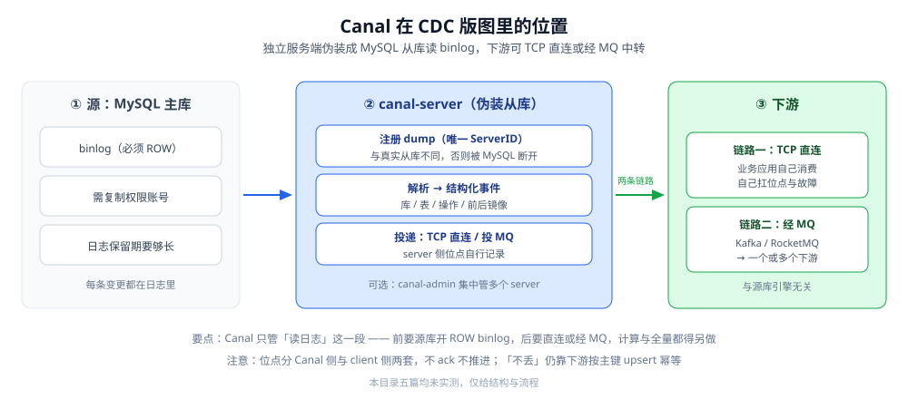
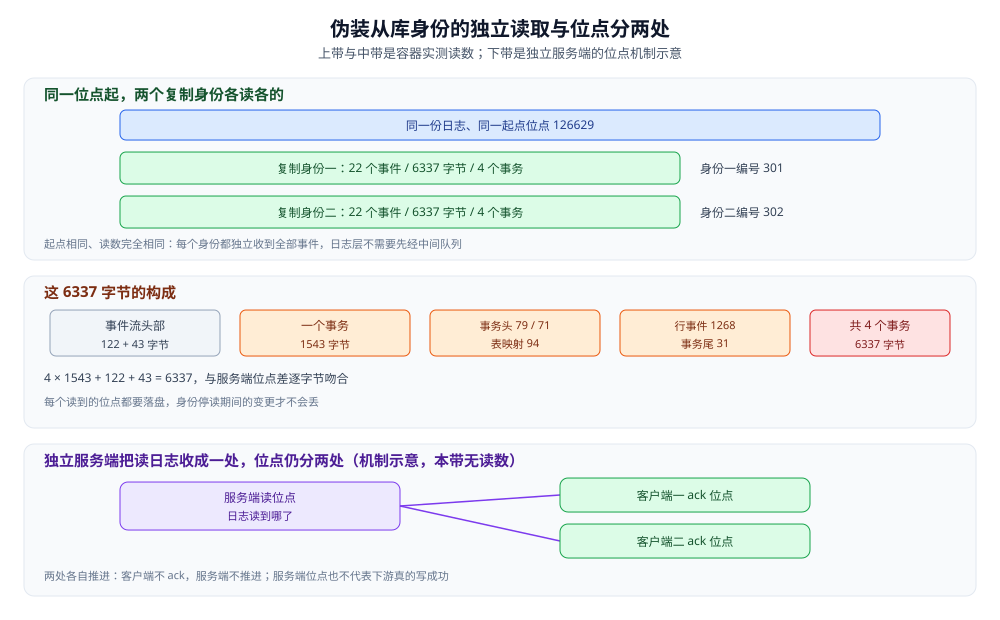

# CanalCDC

> Canal 这条具体形态：伪装成 MySQL 从库读 binlog 的独立服务端、位点在服务端与客户端之间怎么走、两条典型链路（TCP 直连 / 投 MQ）、与 Flink 组合成的「三段式」，以及它的代价与边界。
> 本篇**不覆盖** CDC 的通用原理（变更日志、位点、投递语义）与五条工具路线的横评 —— 那些在 [CDC原理.md](CDC原理.md) 与 [CDC工具选型.md](CDC工具选型.md)。
>
> 内容整理自个人学习笔记，并参考 Canal 官方文档；素材见 [素材清单](../../../../素材清单.md)。
>
> ⚠️ 实测口径：**本篇未做容器实测**。要真跑需要：一个开启 `ROW` 格式 binlog 的 MySQL、一个具备复制权限的账号、一套 canal-server + 下游消费端，再制造增删改并观察事件流 —— 属于多进程对接才有意义的实验。文中配置为**概念骨架**，具体字段名 **以官方文档为准**。
>
> ✅ 口径更新（2026-10-16）：本句现在只约束 **canal-server 与下游消费端**。2.4 节补做了**上游日志侧**的容器实测：自建单实例（`ROW` 日志 + GTID）与一个以复制身份连接的 Go 客户端，验证「伪装从库读日志」这一层的协议行为与事件体积；服务端自身的形态、两套位点与 HA **仍未实测**（本机无对应镜像，按纪律只拉取一次、180 秒超时即放弃）。

---

## 一、Canal 站在 CDC 版图的哪一格？

**本节要点**：Canal 是「读日志」这一段的具体实现，**形态是独立服务端，不附带计算引擎**。它把自己伪装成 MySQL 的一个从库，向主库发 dump 请求拿 binlog —— 与真实从库走同一套协议。

| 维度 | Canal |
|---|---|
| 定位 | MySQL 侧的独立 CDC 服务端 |
| 形态 | 一个进程（canal-server），伪装从库 |
| 源库覆盖 | 主打 MySQL（含云上 MySQL 兼容实例） |
| 输出方式 | TCP 直连下游 / 投 Kafka / RocketMQ |
| 是否自带计算 | ❌ 只做「读日志 + 解析 + 投递」，不含转换与聚合 |
| 是否自带全量 | ❌ 偏增量；全量要另做一次 dump，再接到位点 |



⭐ 一句话：**Canal 只管「读日志」这一段**，前后都要你补：前面是源库的日志配置，后面是「直连下游」或「经 MQ 中转」；要换算力或做全量，都得另想办法。

---

## 二、它怎么把自己伪装成一个从库？

**本节要点**：Canal 与真实从库的差别只在「拿到 binlog 之后做什么」——从库把事件回放成本地数据，Canal 把事件解析成结构化事件投给下游。读日志这一段，两者用的是同一套复制协议。

### 2.1 伪装从库的四步

```text
① Canal 向 MySQL 发起 dump 请求
      （与从库一致：注册一个 ServerID、说明从哪个位点开始、要哪些库表）
   ▼
② MySQL 校验权限，通过后开始推送 binlog 事件流
      （需要 REPLICATION SLAVE / REPLICATION CLIENT 权限）
   ▼
③ Canal 解析事件流
      （把 binlog 二进制还原成「库 / 表 / 操作 / 前后镜像」）
   ▼
④ Canal 把事件交给下游
      （TCP 直连客户端 / 投 Kafka / RocketMQ）
```

对照真实从库，四步里有两步一致、两步分叉：

| 步骤 | 与从库的异同 |
|---|---|
| ① 注册 dump | **完全一致**：ServerID 必须唯一，否则会与真实从库冲突 |
| ② 接收事件流 | **完全一致**：binlog 流本身格式一样 |
| ③ 解析事件 | **不同**：从库把事件回放成数据，Canal 把事件解析成结构化事件 |
| ④ 交给下游 | **不同**：从库写入自己的表，Canal 投给下游 |

⚠️ 由此产生两条硬约束：

- **ServerID 必须与真实从库不同**，否则 MySQL 会认为有重复从库、断开其中一个；
- **`binlog_format` 必须是 `ROW`**（原理见 [CDC原理.md](CDC原理.md) 的 1.3 节）—— `STATEMENT` 与 `MIXED` 都拿不到行级变更。

### 2.2 位点：Canal 侧与客户端侧各管一段

Canal 的位点管理分两层，这一点与「位点随 checkpoint 一起提交」的 Flink CDC 很不一样：

| 层 | 管什么 | 存在哪 |
|---|---|---|
| **Canal Server 侧** | 「我已经把 binlog 读到哪了」 | 默认落 ZooKeeper / 本地文件 / 配置的 meta 表（以部署配置为准） |
| **Canal Client 侧** | 「我已经把事件消费到哪了」 | 由客户端维护（或在 MQ 模式下交给消费组位点） |

⭐ 判据：Canal 的位点不是「一处」，而是「两处」—— server 侧读位点 + client 侧 ack 位点。客户端不 ack，server 不会推进；但 server 侧位点与「下游是否真的写成功」是两回事，所以「不丢」仍要靠下游幂等兜底。

> ⚠️ 这一点与 Flink CDC 对比最鲜明：Flink CDC 的位点收进 **checkpoint** 一处管理；Canal 需要维护两套位点，任一侧出问题都可能导致重复或卡住。

### 2.3 与 Flink CDC 的机制对照

| 维度 | Canal | Flink CDC |
|---|---|---|
| 读日志的方式 | 伪装从库发 dump（与从库同协议） | 伪装从库发 dump（与从库同协议） |
| 拿到 binlog 后 | 解析成事件投下游 | 直接进入 Flink 作业的 Source |
| 是否含计算 | ❌ | ✅（Flink transform + sink） |
| 位点存哪 | Canal 侧 + client 侧两套 | checkpoint 一处 |
| 全量快照 | 需另做 | 内置一体化 |

⭐ 判据：**两者「读日志」的能力同源，分歧全在「读完交给谁」**——Canal 交出去，Flink CDC 自己接住。展开见 [FlinkCDC.md](FlinkCDC.md)。

### 2.4 上游那一段能被单独验证吗？（复制身份实测）

**本节要点**：2.1 的 ①②③ 三步都发生在「日志层」，可以脱离任何 CDC 服务端单独验证。本机用一个复制身份客户端（Go 的 `go-mysql` v1.16.0，连自建单实例 MySQL 8.0.46，`ROW` 日志 + GTID）按这四步跑了一遍：注册 → 收流 → 解析 → 计数，读数与源库侧 `SHOW BINLOG EVENTS` 的相邻位点差逐字节吻合。

| 观测项 | 读数 | 说明 |
|---|---|---|
| 起始位点 | 126629 | 两个身份都从这一点起发 dump 请求 |
| 各读到 22 个事件 | 6337 字节，位点推到 132801 | 身份编号 301 与 302 的读数完全相同 |
| 6337 字节的构成 | 122 + 43 + 4 × 1543 | 122 字节的格式说明事件 + 43 字节的轮转事件 + 4 个事务 |
| 一个事务的构成 | 79 + 71 + 94 + 1268 + 31 = 1543 | 事务号 / 事务开始 / 表映射 / 单行整镜像 / 提交标记 |

- ⭐ **「一份日志、多个消费者各读各的」在日志层本来就成立**：两个身份各自独立收到全部 22 个事件、各自把位点推进到 132801，互不干扰。Canal 把这一层收成「服务端只 dump 一次」，于是下游的「各读各的」被上移到客户端 ack 位点或消息队列的消费组 —— 3.1 里那条「没有一份数据多下游各读各的」不是日志做不到，而是服务端只保留了**一个**读日志的身份。
- **编号必须互不相同**：上表两个身份用的是 301 与 302。本轮另用同一编号 200 试跑过两个身份，双方各自都读到了 5 个事件、没有观测到断开，但客户端库会自动重连，因此**不能**据此判断撞号在协议层的行为 —— 上文 2.1 那条硬约束仍以官方文档为准，未实测。
- 第 ③ 步解析出来能拿到的，就是 [CDC原理.md](CDC原理.md) 3.2 说的 before / after 镜像：`ROW` + 整镜像下单行 1268 字节，`FULL` / `MINIMAL` / `STATEMENT` 三档体积的实测差异见该篇 3.3。



图注：上带与中带的位点、事件数与字节数为容器实测 —— 自建单实例 MySQL 8.0.46（`ROW` 日志、GTID 开启），Go 复制客户端 `go-mysql` v1.16.0，两个身份编号 301 / 302 并发各读一轮，读数一致；下带是独立服务端形态的位点机制示意，无读数。

> ⚠️ **仍未实测**：服务端自身的配置装载、instance 与下游目的地、客户端 ack 与两套位点的落盘格式、HA 切换。本机没有对应镜像，按纪律只尝试拉取一次并在 180 秒超时后放弃。上表只验证了「Canal 依赖的那一层日志」，不能替代对 Canal 本身的验证。

---

## 三、两条典型链路

**本节要点**：Canal 的下游有两条路——**直连**（少一跳，但下游要自己扛位点与故障）或**投 MQ**（多一跳，但拿到解耦与缓冲）。选哪条只看一件事：下游稳不稳、要不要重放。

### 3.1 链路一：Canal → TCP 直连下游

```text
MySQL ──binlog──▶ canal-server ──TCP──▶ 业务应用（消费 + 写目标）
```

- **优点**：组件少，一跳到底；延迟最低。
- **代价**：下游进程与 canal-server 强耦合——下游重启期间，事件要么积在 server 缓冲、要么按 client 位点重放；下游多一个消费者要写就要多一份 client，没有「一份数据多下游各读各的」。
- **适合**：下游只有一个、能容忍耦合、追求最少组件。

### 3.2 链路二：Canal → MQ → 下游

```text
MySQL ──binlog──▶ canal-server ──▶ Kafka / RocketMQ ──▶ 一个或多个下游
```

- **优点**：拿到 MQ 的三件套——解耦、缓冲（下游故障后重放）、多下游分发。
- **代价**：多一个 MQ 要运维；位点从「Canal 侧 + client 侧」变成「Canal 侧 + 消费组侧」。
- **适合**：多个下游消费同一份变更、或下游可能长时间故障需要缓冲。

这条链路已经接近「Canal + Kafka」的组合，与 Flink CDC「一体化」的对照见第四节。

### 3.3 两条链路的选择判据

| 判据 | 直连 | 投 MQ |
|---|---|---|
| 下游数量 | 一个 | 多个（各读各的） |
| 下游故障容忍 | 低（要快速恢复） | 高（MQ 缓冲） |
| 需要重放 | 偶尔 | 经常 |
| 组件数 | 少 | 多一个 MQ |
| 位点管理 | 两套（Canal + client） | 两套（Canal + 消费组） |

⭐ 一句话：**直连图省事，投 MQ 图解耦与缓冲**。需求里只要出现「多个下游」或「下游可能长时间停」，就投 MQ；两条都行时，选你团队更熟的那条。

---

## 四、与 Flink 组合：「三段式」是 Canal 最经典的用法

**本节要点**：Canal + MQ + Flink 就是 [FlinkCDC.md](FlinkCDC.md) 里说的「传统三段式」—— 组件多、位点两套，但解耦与缓冲能力最强；对照「一体化」的取舍见该篇第一节。

### 4.1 三段式长什么样

```text
① 读日志            ② 缓冲                       ③ 计算
Canal ──binlog──▶ Kafka ──topic──▶ Flink 作业 ──▶ 目标
（伪装从库）        （解耦 + 缓冲）     （消费 + 转换 + 写出）
```

| 段 | 角色 | 为什么存在 |
|---|---|---|
| **① Canal** | 读 binlog、解析成事件 | 需要一个「以复制身份」连接源库的组件 |
| **② Kafka** | 缓冲、解耦、多下游 | 允许下游故障后重放；让源与下游各自升级互不影响 |
| **③ Flink** | 消费、转换、写出 | 计算引擎需要稳定的输入流 |

### 4.2 三段式 vs Flink CDC 一体化

| 对照项 | 三段式（Canal + Kafka + Flink） | Flink CDC 一体化 |
|---|---|---|
| **组件数** | 3 套（Canal + Kafka + Flink） | 1 套（Flink） |
| **传输跳数** | 源 → Canal → Kafka → Flink → 目标 | 源 → Flink → 目标 |
| **位点管理** | 2 套（Canal 侧 + Kafka 消费组侧） | 1 套（checkpoint） |
| **缓冲能力** | 强（Kafka 可存 7 天、可多下游） | 弱（靠 Flink 状态 + 反压） |
| **下游故障容忍** | 高（Kafka 存着） | 低（作业停太久位点会失效） |
| **全量一体化** | 需自己做（Canal 偏增量） | 内置 |
| **运维面** | 三套组件 | 一套集群 + 源库 |

⭐ 判据：三段式换来的解耦与缓冲是实打实的——下游经常长时间故障、或一份变更要被多个系统各读各的，就该留 Kafka；只做「源 → 目标」实时搬运、下游稳定的，Flink CDC 一体化更省事。

### 4.3 什么时候三段式反而更对

不是「Flink CDC 是更新的一体化、就必然优先」——下面这些场景里，三段式反而更合适：

| 场景 | 为什么三段式更对 |
|---|---|
| 一份变更要多个下游各读各的 | Kafka 天然一份数据多消费组；Flink CDC 要另接 MQ 才能做到 |
| 下游可能停几小时到几天 | Kafka 缓冲兜住；Flink CDC 停久了位点会失效 |
| 下游与 CDC 由不同团队维护 | Kafka topic 是清晰边界，两边互不感知对方实现 |
| 已有 Kafka 生态、也有 Flink | 只差一个 Canal，三段式顺手拼出 |
| 源库只允许 Canal 接入（安全策略） | 团队规定只能上 Canal 时，三段式就是唯一路径 |

> ⚠️ 反过来，若「已经上 Flink、下游稳定、只要源到目标」——多维护一套 Kafka 与 Canal 就是纯负担，一体化更合适。选型最终看**依赖与缓冲需求**，不是看新旧。

---

## 五、代价是什么？

**本节要点**：Canal 的代价集中在**两套位点、独立服务端运维、全量要另做**三处，与 Flink CDC 的「集群 + 学习曲线」形成两种不同重量的依赖。

| 代价 | 说明 |
|---|---|
| **两套位点** | Canal 侧 + client 侧各一套，需要理解二者关系才能排障 |
| **独立服务端运维** | canal-server 要部署、监控、故障恢复；HA 需要额外配置 |
| **全量要另做** | 冷启动的全量基线要自己另 dump 再接到位点（衔接见 [全量与增量一体化.md](全量与增量一体化.md)） |
| **源库要求不变** | 必须 `ROW` 格式、必须有复制权限、必须管住日志保留期——换工具省不掉 |
| **只能 MySQL** | 想覆盖 PG / Mongo / Oracle 要另起工具或换 Debezium |

> ⚠️ 相对而言，Canal 的运维面比 Flink CDC **轻**（不需要 Flink 集群，不涉及 checkpoint 状态），但比 Maxwell **重**（Maxwell 就一个进程，Canal 是一套服务端 + 可能的 HA）。

---

## 六、什么时候别用 Canal？

**本节要点**：Canal 不是默认答案——源库不止 MySQL、要一体化全量、或要覆盖多源时，它不是最优解。

| 场景 | 更合适的选择 |
|---|---|
| 源库不止 MySQL（要 PG / Mongo / Oracle） | Debezium 或 Flink CDC |
| 要「全量 + 增量」一个作业搞定 | Flink CDC |
| 只要一个进程、极简部署 | Maxwell |
| 已有 Kafka 生态、要统一事件总线 | Debezium |
| 要多源多目标、统一编排 | SeaTunnel |

⭐ 判据：**「源库是不是只有 MySQL」「全量是不是要自己做」**——两条都答「是」，Canal 就是候选；有一条答「否」，先看看别的工具。完整对照见 [CDC工具选型.md](CDC工具选型.md) 第三节。

---

## 使用：一份 canal-server 的概念骨架

下面给出一份**概念骨架**——只写「有哪些块、块里大概有什么」，**不杜撰具体字段名**，键名与取值一律 **以官方文档为准**。⚠️ **未实测**：未在本仓运行。

```properties
# canal-server 侧（概念结构，非真实字段名）
canal.instance.master.address = <MySQL 地址>
canal.instance.dbUsername     = <复制账号>
canal.instance.dbPassword     = <密码>
canal.instance.filter.regex   = <要同步的库.表，支持通配>
canal.instance.gtidon         = <是否用 GTID 定位>

# 下游目的地二选一
canal.serverMode              = <TCP 直连 / kafka / rocketmq>
```

```text
部署形态（概念）：
  canal-server  ──读 binlog──▶ 直接投下游（TCP 或 MQ）
       │
       └─ canal-admin（可选）：集中管理多个 canal-server 的配置与位点

两个位点：
  server 侧：读到哪了（zk / 本地文件 / meta 表）
  client 侧：消费到哪了（客户端 ack / MQ 消费组位点）
```

⚠️ **未实测**：以上配置未在本仓运行，也**刻意不写具体键名**（避免版本差异误导）。要真跑需要：开启 `ROW` binlog 的 MySQL、复制权限账号、canal-server 实例、一个下游消费端。生产化还差：**HA 部署、位点持久化可靠性、全量快照衔接、监控与告警** —— 这几件才是 Canal 落地的真正工程量。

---

## 延伸追问

- **Canal 和 Debezium 都在读 binlog，怎么选？** → 看部署形态：Debezium 走 Kafka Connect、事件落 Kafka topic；Canal 是独立服务端，可以不经过 Kafka 直连下游。有 Kafka 生态偏前者，只做 MySQL 又想轻、要服务端形态偏后者。
- **Canal 为什么必须管住 ServerID？** → 它冒充的是一个从库，ServerID 与真实从库撞了，MySQL 会当成重复从库断开其中一个——表现为「同步莫名中断」或「真实从库掉线」。
- **Canal 的位点为什么要两套？** → server 侧记「binlog 读到哪」，client 侧记「事件消费到哪」；不 ack 就不推进，但 server 侧位点不代表下游写成功，所以「不丢」仍要下游幂等兜底。
- **Canal 能保证不丢不重吗？** → 投递语义是**至少一次**（原理见 [CDC原理.md](CDC原理.md) 第四节）；去重靠目标侧按主键 upsert，与所有 CDC 一样。
- **Canal 自带全量吗？** → 不。它偏增量，冷启动的全量基线要自己另 dump 再接到位点，接缝问题见 [全量与增量一体化.md](全量与增量一体化.md)。
- **直连和投 MQ 怎么选？** → 下游只有一个、能容忍耦合，直连最省；下游多个、或可能长时间停，投 MQ 换缓冲与解耦（判据见 3.3）。
- **既然有 Flink CDC，三段式是不是过时了？** → 不是。要缓冲、要一份数据多下游、要团队间有清晰边界时，三段式仍更对；反之才是一体化更省。
- **Canal 能覆盖 PostgreSQL / MongoDB 吗？** → 不能，它主打 MySQL。多源要换 Debezium / Flink CDC / SeaTunnel，见 [CDC工具选型.md](CDC工具选型.md)。
- **Canal 的运维面比 Flink CDC 轻吗？** → 单看组件是轻的（不用 Flink 集群）；但两套位点 + HA 配置 + 全量另做，加起来也是一份不小的工作量。

## 关联

- **上游/总纲**：[CDC原理.md](CDC原理.md) — 地基：变更日志、位点、投递语义的通用原理
- **上游/总纲**：[CDC工具选型.md](CDC工具选型.md) — 五条工具路线的横评，Canal 在其中占「独立服务端」一格
- **对照/互补**：[FlinkCDC.md](FlinkCDC.md) — 同为「读日志」，但把全量 + 增量压进一个 Flink 作业、位点收进 checkpoint
- **对照/互补**：[全量与增量一体化.md](全量与增量一体化.md) — Canal 偏增量，全量基线与位点衔接要自己做，做法见该篇
- **对照/互补**：[数据同步方式选型对比.md](../数据同步方式选型对比.md) — 上位：CDC 与双写、定时同步三条路线怎么比、怎么组合
- **对照/互补**：[README.md](../../../中间件/消息队列/Kafka/README.md) — 链路二的「中间跳板」，也是三段式里的缓冲层
- **对照/互补**：[README.md](README.md) — 本目录导读：CDC 五篇的阅读顺序与依赖
