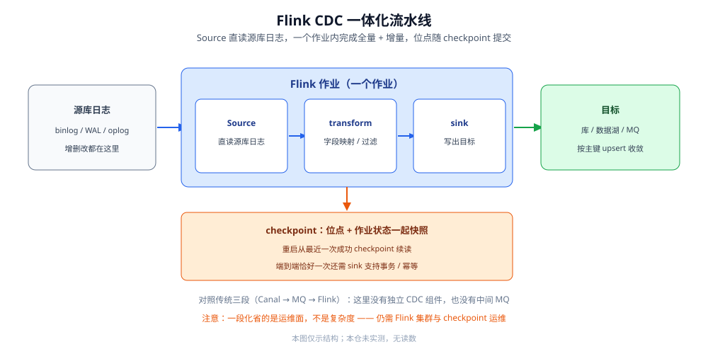

# FlinkCDC

> 把「全量 + 增量」压进**一个作业**的一种具体形态：Source 直读数据库日志，增量快照算法在一个 Flink 作业里完成快照与增量切换，位点随 checkpoint 提交换来 exactly-once。本篇讲清它为什么能省掉中间跳板、算法与语义怎么配合、YAML pipeline 的概念结构，以及它的代价。
>
> 内容整理自个人学习笔记，并参考各家官方文档；素材见 [素材清单](../../../../素材清单.md)。
>
> ⚠️ 实测口径：**本篇未做容器实测**。原因：要拉起 Flink 集群、配好源库日志、跑一个完整作业并验证 checkpoint 恢复，属于多进程对接才有意义的实验。YAML 与代码**只到概念结构**，具体字段名 **以官方文档为准**；不引用任何吞吐 / 延迟 / 版本号数字。

---

## 一、为什么传统方案要「三段」，Flink CDC 只要一段？

**本节要点**：传统链路是「Canal 读日志 → MQ 缓冲 → Flink 消费」，中间跳板是为了**解耦与缓冲**，但也带来两套运维与两跳延迟；Flink CDC 让 Flink 的 Source **直接读数据库日志**，把三段压成一个作业。

### 1.1 传统三段链路的每一段在干什么

| 段 | 角色 | 为什么存在 |
|---|---|---|
| **① 读日志** | Canal / Debezium 之类的 CDC 组件读 binlog，解析成事件 | 需要一个「以复制身份连接源库」的组件 |
| **② 消息队列** | 事件先写进 Kafka 之类的 MQ | **解耦**生产者与消费者，**缓冲**峰值，允许下游故障后重放 |
| **③ 计算** | Flink 作业从 MQ 消费，做转换后写目标 | 计算侧需要稳定的输入流 |

三段拼起来能跑，但代价是：**两跳传输**（源 → MQ → Flink）、**两套组件要运维**（CDC 组件 + MQ）、**位点两处管**（CDC 侧与消费组侧各有一套）。

### 1.2 一段化省掉了什么

Flink CDC 的思路是：既然 Flink 本身就是计算引擎，**为什么不让它直接读日志**？于是把「读日志」做成 Flink 的一个 **Source 连接器**：

- **省掉 MQ**：Source 直读源库日志，事件直接进 Flink 作业，少一跳传输。
- **省掉一套运维**：不再额外维护 CDC 组件与 MQ，依赖收敛成「源库 + Flink 集群」。
- **位点归一**：位点随 Flink 的 **checkpoint** 统一管理，不再有「CDC 位点」与「消费组位点」两套要协调的东西。
- **全量与增量同作业**：冷启动的初始快照也在同一个作业里完成，不用你手工把「快照」和「增量起点」拼接起来（衔接问题见 [全量与增量一体化.md](全量与增量一体化.md)）。



图注：左边是源库的日志，中间是**一个 Flink 作业**（Source 读日志 → transform 转换 → sink 写出），下方是 checkpoint 把「位点 + 作业状态」一起快照下来。对照传统三段，这里没有独立的 CDC 组件、也没有中间的 MQ。

### 1.3 三段 vs 一段，逐项对照

| 对照项 | 传统三段（Canal → MQ → Flink） | Flink CDC 一段 |
|---|---|---|
| **组件数** | CDC 组件 + MQ + 计算引擎 | 计算引擎（含 Source） |
| **传输跳数** | 源 → CDC → MQ → 计算 → 目标 | 源 → 计算 → 目标 |
| **位点管理** | CDC 侧一套 + 消费组一套 | checkpoint 统一一套 |
| **缓冲能力** | 靠 MQ 削峰、允许下游故障后重放 | 靠 Flink 自身的状态与反压 |
| **全量一体化** | 需自己拼接快照与增量起点 | 作业内完成 |
| **运维面** | 三套组件 | 一套集群 + 源库 |
| **依赖代价** | 需要 MQ 与 CDC 组件 | 需要一个 Flink 集群 |

⭐ 判据：**「省掉 MQ」省的是运维面与一跳传输，代价是把依赖转移到 Flink 集群上**——不是「零代价」。

---

## 二、增量快照算法是什么？

**本节要点**：算法核心是「**从一个位点开始读快照，同时记录该位点起的变更；快照读完后把记录的变更合并进来，再切换到纯增量**」——用「先记增量、后合并」避免锁库，也避免漏数。

### 2.1 算法的四步

| 步骤 | 做什么 |
|---|---|
| **① 定位点** | 在开始读快照前先记录一个日志位点 P（这一步与 [全量与增量一体化.md](全量与增量一体化.md) 的一致性位点同源） |
| **② 读快照** | 分片并发读存量数据；**同时**，从这个位点 P 起的**变更被持续记录**下来 |
| **③ 合并** | 快照读完后，把「快照期间记录的变更」应用到快照结果上，得到一致基线 |
| **④ 切增量** | 合并完成即切换为**纯增量**消费，此后只处理新变更 |

⭐ 关键在「**同时**」二字：读快照与记录变更**并行**，所以不需要给源库长时间加锁，也不会漏掉快照期间发生的变更。

### 2.2 为什么不会漏、为什么可能重

- **不会漏**：因为在位点 P 之后的所有变更都被**记录**下来了，快照读到的是旧值，记录里的新值会补上。
- **可能重**：快照读到的行，与「快照期间记录的同一行的变更」会**重叠**——同一行可能先被快照写入、再被增量写入。
- 重叠不可怕，**只要按主键收敛**就行：后写的值覆盖先写的值。

### 2.3 upsert 收敛

合并与切增量之后，同一行可能被写多次，收敛手段与 [全量与增量一体化.md](全量与增量一体化.md) 第五节一致：

| 操作 | 收敛写法 |
|---|---|
| `INSERT` / `UPDATE` | 按主键 **upsert**，同一条变更重复应用结果不变 |
| `DELETE` | 按主键 delete，删不存在的行是空操作 |

⭐ 一句话：**增量快照算法用「重叠」换「不加锁」，用「幂等 upsert」把重叠消化掉。**

### 2.4 一次走查：三行数据的先后

用一个最小场景把四步串起来看（以某一行 R 为例）：

| 时刻 | 发生的事 | 算法在做什么 |
|---|---|---|
| T0 | 记录位点 P | 定位点 |
| T1 | 开始读快照，读到 R 的**旧值** | 读快照 + 并行记录变更 |
| T2 | 源库把 R 改成**新值** | 这条变更被**记录**下来（还没应用） |
| T3 | 快照读完，R 仍是旧值 | 读快照结束 |
| T4 | 把 T1~T3 记录的变更**应用**到快照结果 | 合并 → R 变成新值 |
| T5 | 切换为纯增量 | 之后再来的变更直接应用 |

可以看到：R 在快照里被写成旧值、又在合并时被写成新值——**被写了两次**。但只要合并与增量都走**按主键 upsert**，最终值就是源库的新值，重复无害。

> ⚠️ 若 R 在 T2 之后又被改一次，会在 T4 合并时应用最新那条，或在切增量后应用，**结果一致**（因为都是后镜像覆盖）。这正是「重叠换不丢」的直观体现。

---

## 三、checkpoint 与 exactly-once 怎么配合？

**本节要点**：位点**随 checkpoint 一起提交**，作业从最近一次成功的 checkpoint 恢复；这要求源与 sink 都参与 checkpoint，而端到端是否真「恰好一次」还取决于 sink 是否支持事务或幂等。

### 3.1 checkpoint 里存了什么

Flink 的 checkpoint 会把**作业状态**做一次一致性快照。对 CDC 作业来说，其中最关键的一份状态就是**位点**：

- 作业运行时，源连接器持续把「已读到的日志位置」维护为状态。
- 触发 checkpoint 时，**位点与其它算子状态一起**被快照到持久化存储。
- 作业失败重启时，从最近一次成功 checkpoint **恢复状态**，源连接器便从该位点继续读日志。

于是「位点管理」这件事被**统一收进 checkpoint**，不再需要你单独维护一张位点表。

### 3.2 恰好一次的三个前提

「恰好一次」不是免费的，端到端成立需要三个前提：

| 前提 | 说明 |
|---|---|
| **① 源参与 checkpoint** | 源连接器把位点纳入状态，checkpoint 时位点被一起快照 |
| **② 作业状态可恢复** | 状态后端能持久化并在重启后恢复（否则位点丢了要回退重放） |
| **③ sink 支持事务或幂等** | 只有在写入端能**两阶段提交**或**幂等覆盖**时，端到端才不丢不重 |

> ⚠️ 前两条由 Flink 保证，第三条取决于**目标端**。如果 sink 只能普通插入、既不幂等也不参与事务，那么端到端通常仍是**至少一次**——重复由目标侧消化。写法和判据见 [全量与增量一体化.md](全量与增量一体化.md) 第五节。

### 3.3 checkpoint 与 savepoint 的定位差别

两个都会「保存状态」，但用途不同：

| | checkpoint | savepoint |
|---|---|---|
| **触发** | 周期自动 | 手动触发 |
| **主要用途** | 故障恢复（自动回滚到最近一次成功点） | 主动运维（升级、迁移、调整并发） |
| **生命周期** | 通常用完即弃 | 由人管理，可长期保留 |
| **与 CDC 的关系** | 位点主要靠它落盘 | 升级 / 换版本时用来保住位点与状态 |

⭐ 判据：**checkpoint 管「自动恢复」，savepoint 管「人为变更」**——要升级作业或调整拓扑时，先打一个 savepoint，别指望 checkpoint 兜住。

---

## 四、YAML pipeline 的概念结构长什么样？

**本节要点**：一份 pipeline 在概念上由 **source / sink / transform** 三类块组成，描述「从哪读 → 怎么转 → 写到哪」；这是**声明式**的上层封装，具体字段名 **以官方文档为准**。

### 4.1 三类块

| 块 | 作用 | 概念内容 |
|---|---|---|
| **source** | 定义从哪里读数据 | 源类型（如某数据库）、连接信息、要同步的表、快照 / 增量策略 |
| **sink** | 定义写到哪里 | 目标类型（如另一个库 / 数据湖 / MQ）、连接信息、写入模式 |
| **transform** | 定义数据怎么转换 | 字段映射、过滤、派生列等规则（可选） |

### 4.2 概念结构

概念上三块串成一条「**源 →（转换）→ 目标**」的线：source 产生变更流，transform 逐条（或按窗口）加工，sink 落库。

- 作业层面还会有些**全局概念**，比如作业名、并发度、checkpoint 间隔等。
- 一份配置可以描述**多张表 / 多条同步**，由运行时展开成对应的作业拓扑。

> ⚠️ 具体的**键名、层级、可选值**在各版本间可能不同，本篇**不编造字段名**，一律 **以官方文档为准**。可对照的字段级骨架见下面「使用」一节，那里同样只写概念、不杜撰键名。

### 4.3 pipeline 适合表达什么、不适合表达什么

| 适合表达 | 不适合表达 |
|---|---|
| 整库 / 多表同步 | 自定义算子、复杂状态逻辑 |
| 字段映射、过滤等常规转换 | 需要自定义窗口 / 多流连接 |
| 一份配置描述多条同步 | 需要精细控制拓扑与并行度 |

⭐ 判据：**声明式表达不了的，就落到 DataStream API**（见第六节），两者不冲突。

---

## 五、schema 演进怎么处理？

**本节要点**：源表**加列、改类型、改名**都会改变事件的形状；处理方式依赖版本与 sink 能力，**以官方文档为准**；工程上要预留「**源先改、下游随后跟上**」的窗口。

### 5.1 三类变更的分别处理

| 变更 | 事件怎么变 | 下游要做什么 |
|---|---|---|
| **加列** | 事件里多出一个字段 | 保证下游能容纳新列，或让工具**忽略未知列** |
| **改类型 / 缩窄** | 值的解释变了 | 确认下游类型能接住，必要时做转换 |
| **改名** | 字段名变了 | 下游要么跟随改，要么做**字段映射** |

> ⚠️ 工具能否**捕获 DDL 并传播**到下游，能力与开关**以官方文档为准**。

### 5.2 兜底策略

- 把 schema 变更当成一次「**有风险的发布**」：先在源库变更，确认工具与下游都能跟上，再放量。
- 对**无法保证跟着改**的下游，用**兼容写入**兜住：宽表预留列、忽略未知键、按已知字段映射。
- 变更期间**旧形状的事件仍需能被处理**——不能一改就让整条链路崩掉。

---

## 六、与 DataStream API 是什么关系？

**本节要点**：YAML pipeline 是**上层声明式封装**，DataStream API 是**底层编程接口**——前者面向「整库 / 整表同步」这类常见形态，后者面向「要写自定义逻辑」的场景，两者产出的是同一类 Flink 作业。

| 维度 | YAML pipeline | DataStream API |
|---|---|---|
| 抽象层次 | 声明式，声明「要什么」 | 命令式，编写「怎么做」 |
| 适用 | 整库 / 多表同步等**常见形态** | 需要**自定义算子、复杂转换、精细控制** |
| 依赖 | 依赖运行时支持 pipeline 写法 | 直接写 Java / Scala 代码 |
| 关系 | 概念上是**上层**，可理解为「用配置生成作业拓扑」 | 概念上是**底层**，pipeline 的语义最终也落到算子上 |

⭐ 判据：**能用 pipeline 表达清楚的，就别写代码；需要精细算子逻辑的，回到 DataStream API。**

---

## 七、代价是什么？

**本节要点**：一段化不是免费的——要一个 **Flink 集群**、要懂 **checkpoint 与状态**、资源占用随作业规模上升；「省掉 MQ」省的是运维面，不是复杂度本身。

| 代价 | 说明 |
|---|---|
| **必须有 Flink 集群** | 没有集群就先建集群；集群的高可用、资源调度都要会运维 |
| **学习曲线** | checkpoint、状态后端、并行度、savepoint 这些概念必须理解，否则恢复行为不受控 |
| **资源占用** | 快照阶段与增量阶段都吃资源；作业规模越大，状态与内存占用越明显 |
| **对源库的要求不变** | 仍要开日志、配权限、管保留期——这些是 CDC 的固有成本，换工具省不掉 |
| **生态绑定** | 用了它，你就把 CDC 的依赖押在了 Flink 生态上 |

> ⚠️ 反过来，如果你的组织**已经在用 Flink**、且需要「全量 + 增量一个作业」，那么上面这些代价大多**已经付出**，Flink CDC 就是顺水推舟。选型对照见 [CDC工具选型.md](CDC工具选型.md) 4.3。

---

## 八、什么时候别用 Flink CDC？

**本节要点**：Flink CDC 不是默认答案——没有 Flink 集群、需求极简、或只要单源轻量同步时，它反而是**过度工程**。

| 场景 | 更合适的选择 |
|---|---|
| 没有 Flink 集群，也不打算维护 | Canal / Maxwell（单源轻量）或 Debezium（已有 Kafka 时） |
| 只有 MySQL、只做一张表 | Maxwell 之类的单进程客户端 |
| 只要「源 → 目标」的搬运，不要复杂转换 | 更贴近的专用同步工具或平台 |
| 已有 Kafka 生态、不需要作业内计算 | Debezium |
| 团队不熟悉 checkpoint / 状态 / 并行度 | 先在简单形态上跑通，再考虑引入 Flink |

⭐ 判据：**「你已经为 Flink 付过费了吗？」**——已经用 Flink 的组织，它近乎白得；没用过的组织，先算清集群与学习成本。完整对照见 [CDC工具选型.md](CDC工具选型.md)。

---

## 使用：一份 pipeline 的概念骨架

下面给出一份**概念骨架**——只写「有哪些块、块里大概有什么」，**不杜撰具体字段名**，键名与取值一律 **以官方文档为准**。⚠️ **未实测**：未在本仓运行。

```yaml
pipeline:
  name: <作业名，任意>
  # checkpoint 间隔、并发度等全局概念

source:
  type: <源类型，例如某个关系库>
  # 连接信息：地址 / 库 / 账号
  # 要同步的表清单（可含通配）
  # 快照策略 / 增量起点策略

transform:            # 可选
  - <字段映射、过滤、派生列等规则>

sink:
  type: <目标类型，例如某个库 / 数据湖 / MQ>
  # 连接信息
  # 写入模式（插入 / upsert 等），须与目标端幂等能力匹配
```

- **source 里通常要给出**：连接信息、要同步的表清单、快照与增量的起点策略。
- **sink 里要确认**：写入模式能否幂等——它决定端到端语义是恰好一次还是至少一次。

⚠️ **未实测**：以上 YAML 未在本仓运行，也**刻意不写具体键名**（避免不同版本字段差异造成误导）。要真跑需要：一个开启日志的源库、一个 Flink 环境、一个可写目标。生产化还差：**快照分片调优、sink 端事务 / 幂等配置、schema 变更预案、checkpoint 恢复演练**。

---

## 延伸追问

- **Flink CDC 会不会漏掉「快照期间的变更」？** → 不会。它在读快照的**同时**记录位点 P 起的变更，快照读完后合并，所以快照期间的变更被补上。
- **那会不会重复？** → 会重叠：同一行可能被快照写入一次、再被增量写入一次。重复由**按主键 upsert** 消化，最终收敛。
- **既然会重复，为什么还说「恰好一次」？** → 「恰好一次」说的是**端到端效果**（结合 sink 事务 / 幂等后不丢不重），不是「事件绝不重复投递」。前提见第三节。
- **位点到底存在哪？** → 存在 Flink 的 **checkpoint**（作业状态）里，而不是你自己维护的位点表；这也是它比「Canal + MQ」少一套位点管理的原因。
- **没有 Flink 集群能用它吗？** → 不能，Flink 集群是它的硬前提。若没有集群又只做 MySQL，考虑 Canal / Maxwell（见 [CDC工具选型.md](CDC工具选型.md)）。
- **pipeline 和写 DataStream 代码冲突吗？** → 不冲突，pipeline 是声明式上层，表达不了复杂逻辑时落到 DataStream API，二者产出同类作业。
- **增量快照会不会把源库读崩？** → 关键在**并发度与分片大小**：片越小、并发越高，源库压力越大。要按实际调，**本仓未实测**，具体参数以官方文档与自家压测为准。
- **checkpoint 太频繁或太稀疏有什么影响？** → 频繁更安全但开销更大；稀疏则恢复时要回退得更多。这本身是个**权衡参数**，取决于你能接受多大的回退与重复。
- **YAML 里能写多复杂的转换？** → 常规字段映射与过滤可以；一旦需要自定义算子或复杂状态逻辑，就回到 DataStream API。
- **一段化之后，源库日志保留期还重要吗？** → 重要。作业长时间停下、checkpoint 又落后于日志保留期时，位点会失效，只能**重做快照**——这是所有 CDC 的共性约束，换工具省不掉。

## 关联

- [CDC原理.md](CDC原理.md) — 地基：日志、位点、投递语义的通用原理
- [CDC工具选型.md](CDC工具选型.md) — 工具横评：Flink CDC 在五条路线里的位置与选择线
- [全量与增量一体化.md](全量与增量一体化.md) — 快照与增量的接缝、断点续传与幂等，是增量快照算法的通用版
- [README.md](README.md) — 本目录导读：CDC 四篇的阅读顺序
- [数据同步方式选型对比.md](../数据同步方式选型对比.md) — 上位：CDC 与双写、定时同步怎么比、怎么组合
- [README.md](../../../中间件/消息队列/Kafka/README.md) — 传统三段链路里的「中间跳板」，Flink CDC 正是把它省掉
- [存储选型与组合.md](../../存储架构与场景/存储选型与组合.md) — 上位视角：把 CDC 放进「多存储 + 数据角色」的整体里看
- [数据湖/README.md](../../数据湖/README.md) — 常见的一体化落点之一：CDC 直接入湖
